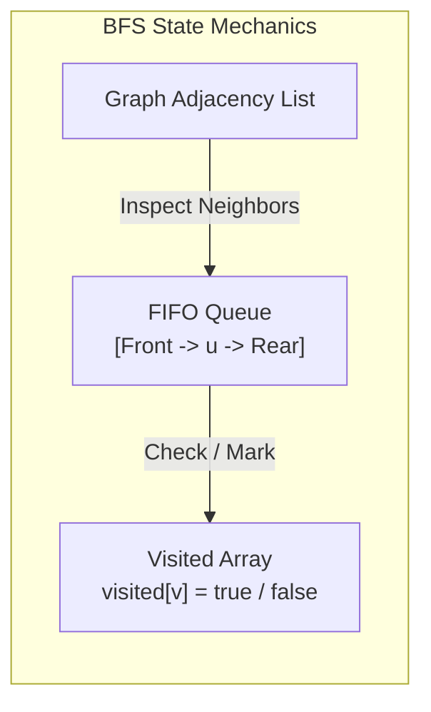
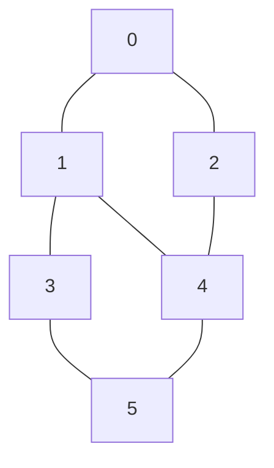
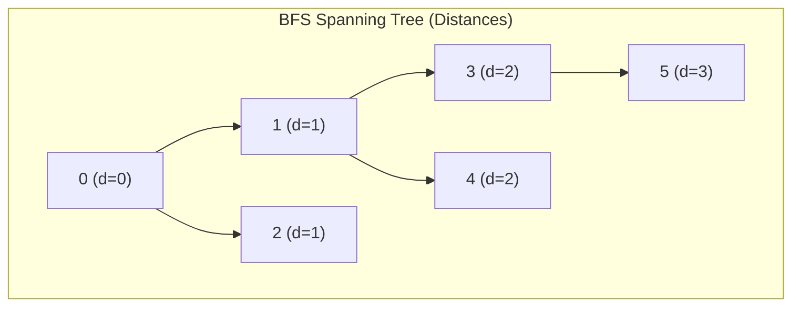
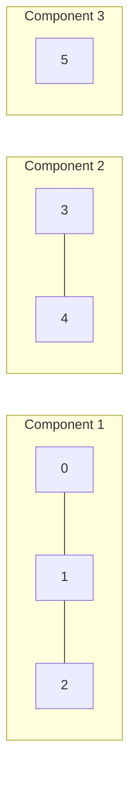

[DSA Index](../README.md) / [Unit 4: Graphs and Hashing](Introduction.md)

# L02: Breadth-First Search

Imagine dropping a stone into a still pond. A ripple forms at the point of impact and expands outward in concentric circles. First, it touches the water 1 meter away, then 2 meters away, then 3 meters away. Every point at distance $d$ is reached before any point at distance $d + 1$.

This is the exact intuition behind **Breadth-First Search (BFS)**. Given a starting vertex $s$, BFS explores the graph in wavefronts of increasing distance:
1. It starts at the source vertex $s$ at distance 0.
2. It visits all immediate neighbors of $s$ (distance 1).
3. It visits all neighbors of those neighbors (distance 2), and so on.

Because it systematically exhausts all vertices at distance $k$ before looking at any vertex at distance $k + 1$, BFS has a powerful property: in an unweighted graph, the path it finds from the source to any reachable vertex is guaranteed to be the shortest path in terms of edge count.

---

## The Traversal Dilemma: Trees vs. Graphs

In Unit 3, when we performed level-order traversal on a binary tree, we simply pushed child pointers into a FIFO (First-In, First-Out) queue. That worked because trees are directed acyclic structures where every node has exactly one parent. You can never circle back to a previously visited node.

The moment we transition to graphs, this guarantee breaks down completely:
1. **Cycles**: A graph may contain cycles ($A \to B \to C \to A$). Without tracking where we have been, a traversal algorithm will circulate indefinitely, pushing already-visited vertices into the queue and exhausting system memory.
2. **Multiple Paths**: Vertex $D$ might be reachable from both $B$ and $C$. If both $B$ and $C$ enqueue $D$, we duplicate work.

So BFS requires two cooperating data structures:
- A **Queue** (FIFO order) to ensure vertices are processed in order of their discovery distance.
- A **Visited Tracking Array** (or bitset) to ensure no vertex is ever enqueued or processed more than once.



---

## Step-by-Step Mechanistic Trace

Let's trace BFS step-by-step on a concrete undirected graph with 6 vertices: $\{0, 1, 2, 3, 4, 5\}$.



Let our starting source vertex be $s = 0$.

We maintain three arrays of size $|V|$:
- `visited[v]`: boolean flag indicating whether vertex $v$ has been enqueued.
- `dist[v]`: integer distance (number of edges) from source $s$ to vertex $v$, initialized to $-1$ ($\infty$).
- `parent[v]`: predecessor vertex on the shortest path from $s$, initialized to $-1$.

### Detailed Execution Steps

1. **Initialization**:
   - `visited = [F, F, F, F, F, F]`, `dist = [-1, -1, -1, -1, -1, -1]`, `parent = [-1, -1, -1, -1, -1, -1]`.
   - Enqueue source vertex `0`. Set `visited[0] = T`, `dist[0] = 0`, `parent[0] = -1`.
   - Queue: `[0]`

2. **Dequeue 0** (current distance = 0):
   - Inspect neighbors of 0: vertices `1` and `2`.
   - Neighbor `1`: unvisited. Set `visited[1] = T`, `dist[1] = 1`, `parent[1] = 0`. Enqueue `1`.
   - Neighbor `2`: unvisited. Set `visited[2] = T`, `dist[2] = 1`, `parent[2] = 0`. Enqueue `2`.
   - Queue: `[1, 2]`

3. **Dequeue 1** (current distance = 1):
   - Inspect neighbors of 1: vertices `0`, `3`, `4`.
   - Neighbor `0`: already visited (`visited[0] == T`). Skip.
   - Neighbor `3`: unvisited. Set `visited[3] = T`, `dist[3] = 2`, `parent[3] = 1`. Enqueue `3`.
   - Neighbor `4`: unvisited. Set `visited[4] = T`, `dist[4] = 2`, `parent[4] = 1`. Enqueue `4`.
   - Queue: `[2, 3, 4]`

4. **Dequeue 2** (current distance = 1):
   - Inspect neighbors of 2: vertices `0`, `4`.
   - Neighbor `0`: visited. Skip.
   - Neighbor `4`: already visited (`visited[4] == T`, enqueued by 1). Skip! Notice that 4 is already reached via distance 2.
   - Queue: `[3, 4]`

5. **Dequeue 3** (current distance = 2):
   - Inspect neighbors of 3: vertices `1`, `5`.
   - Neighbor `1`: visited. Skip.
   - Neighbor `5`: unvisited. Set `visited[5] = T`, `dist[5] = 3`, `parent[5] = 3`. Enqueue `5`.
   - Queue: `[4, 5]`

6. **Dequeue 4** (current distance = 2):
   - Inspect neighbors of 4: vertices `1`, `2`, `5`.
   - Neighbors `1`, `2`, `5` are all already visited. No new vertices enqueued.
   - Queue: `[5]`

7. **Dequeue 5** (current distance = 3):
   - Inspect neighbors of 5: vertices `3`, `4`.
   - Both are visited.
   - Queue: `[]` (Empty. Traversal complete).

### BFS Discovery Tree

The edges $(u, v)$ where vertex $v$ was discovered for the first time form a directed spanning tree called the **BFS Tree**:



Any edge in the original graph that is not part of this tree is called a **cross edge** (e.g., $(2, 4)$ and $(4, 5)$). In an undirected graph, cross edges can only connect vertices in the same BFS level or in adjacent levels differing by at most 1.

---

## Shortest Path Reconstruction

Because `parent[v]` records the exact predecessor that discovered $v$, reconstructing the shortest path from source $s$ to any destination $t$ is simple: backtrack from $t$ to $s$ using `parent[]` pointers, then reverse the sequence.

For example, to find the shortest path from `0` to `5`:
- `parent[5]` is `3`
- `parent[3]` is `1`
- `parent[1]` is `0`
- `parent[0]` is `-1` (Source reached)

Reversing the chain gives: `0 -> 1 -> 3 -> 5` (length: 3 edges).

---

## Handling Disconnected Graphs

What happens if the graph consists of multiple disconnected islands?



If we call BFS starting at `0`, it will traverse vertices `0, 1, 2` and terminate. Vertices `3, 4, 5` will remain completely untouched.

To guarantee that every vertex in an arbitrary graph is discovered, we wrap the BFS traversal inside an outer loop over all vertices:

```c
for (int v = 0; v < num_vertices; v++) {
    if (!visited[v]) {
        bfs(graph, v, visited, dist, parent);
    }
}
```

Each iteration of the outer loop that triggers a new `bfs()` call discovers an entire distinct connected component.

---

## Complete C Implementation: BFS Traversal

Here is a complete, self-contained C implementation using an adjacency list, a dynamically allocated queue, and path reconstruction.

```c
#include <stdio.h>
#include <stdlib.h>
#include <stdbool.h>

// Adjacency List Node
typedef struct AdjListNode {
    int dest;
    struct AdjListNode *next;
} AdjListNode;

// Graph Structure
typedef struct {
    int num_vertices;
    bool is_directed;
    AdjListNode **head;
} Graph;

// Queue Data Structure for BFS
typedef struct {
    int *data;
    int front;
    int rear;
    int capacity;
    int size;
} Queue;

Queue *queue_create(int capacity) {
    Queue *q = (Queue *)malloc(sizeof(Queue));
    q->capacity = capacity;
    q->front = 0;
    q->rear = -1;
    q->size = 0;
    q->data = (int *)malloc(capacity * sizeof(int));
    return q;
}

bool queue_is_empty(Queue *q) {
    return q->size == 0;
}

void queue_enqueue(Queue *q, int value) {
    if (q->size == q->capacity) return;
    q->rear = (q->rear + 1) % q->capacity;
    q->data[q->rear] = value;
    q->size++;
}

int queue_dequeue(Queue *q) {
    if (queue_is_empty(q)) return -1;
    int val = q->data[q->front];
    q->front = (q->front + 1) % q->capacity;
    q->size--;
    return val;
}

void queue_destroy(Queue *q) {
    free(q->data);
    free(q);
}

// Graph creation and edge insertion
Graph *graph_create(int vertices, bool directed) {
    Graph *g = (Graph *)malloc(sizeof(Graph));
    g->num_vertices = vertices;
    g->is_directed = directed;
    g->head = (AdjListNode **)calloc(vertices, sizeof(AdjListNode *));
    return g;
}

void graph_add_edge(Graph *g, int u, int v) {
    AdjListNode *node = (AdjListNode *)malloc(sizeof(AdjListNode));
    node->dest = v;
    node->next = g->head[u];
    g->head[u] = node;

    if (!g->is_directed) {
        AdjListNode *rev = (AdjListNode *)malloc(sizeof(AdjListNode));
        rev->dest = u;
        rev->next = g->head[v];
        g->head[v] = rev;
    }
}

// BFS traversal from a given source vertex
void bfs_traverse(Graph *g, int source, bool visited[], int dist[], int parent[]) {
    Queue *q = queue_create(g->num_vertices);

    visited[source] = true;
    dist[source] = 0;
    parent[source] = -1;
    queue_enqueue(q, source);

    while (!queue_is_empty(q)) {
        int u = queue_dequeue(q);
        printf("Visited vertex: %d (distance: %d)\n", u, dist[u]);

        // Iterate through all neighbors of u
        AdjListNode *curr = g->head[u];
        while (curr != NULL) {
            int v = curr->dest;
            if (!visited[v]) {
                visited[v] = true;
                dist[v] = dist[u] + 1;
                parent[v] = u;
                queue_enqueue(q, v);
            }
            curr = curr->next;
        }
    }

    queue_destroy(q);
}

// Full BFS covering disconnected components
void bfs_full(Graph *g) {
    bool *visited = (bool *)calloc(g->num_vertices, sizeof(bool));
    int *dist = (int *)malloc(g->num_vertices * sizeof(int));
    int *parent = (int *)malloc(g->num_vertices * sizeof(int));

    for (int i = 0; i < g->num_vertices; i++) {
        dist[i] = -1;
        parent[i] = -1;
    }

    int component_count = 0;
    for (int v = 0; v < g->num_vertices; v++) {
        if (!visited[v]) {
            printf("\n--- Starting Component %d from Vertex %d ---\n", ++component_count, v);
            bfs_traverse(g, v, visited, dist, parent);
        }
    }

    free(visited);
    free(dist);
    free(parent);
}

// Print shortest path from source to target
void print_shortest_path(int target, int parent[]) {
    if (target == -1) return;
    print_shortest_path(parent[target], parent);
    printf("%d ", target);
}

void graph_destroy(Graph *g) {
    for (int i = 0; i < g->num_vertices; i++) {
        AdjListNode *curr = g->head[i];
        while (curr) {
            AdjListNode *tmp = curr;
            curr = curr->next;
            free(tmp);
        }
    }
    free(g->head);
    free(g);
}
```

---

## Complexity Analysis

Let's dissect the time and space complexity with mathematical precision.

### Time Complexity

Assume the graph is represented using an **Adjacency List**:
1. **Vertex Enqueue/Dequeue**: Every reachable vertex is enqueued at most once and dequeued at most once. Enqueue and dequeue operations run in $O(1)$ time. For all vertices, this contributes $O(|V|)$ total time.
2. **Neighbor Scanning**: When a vertex $u$ is dequeued, we scan its entire adjacency list of length $\deg(u)$. Summing over all vertices:

$$\sum_{u \in V} \deg(u) = 2|E| \text{ (undirected)} \quad \text{or} \quad |E| \text{ (directed)}$$

Each edge is examined at most twice (once from each end in an undirected graph). Thus, total edge inspection takes $O(|E|)$ time.

Combining both components, the total time complexity is:

$$T(V, E) = O(|V| + |E|)$$

Now, what if the graph is represented using an **Adjacency Matrix**?
When vertex $u$ is dequeued, we must inspect all $|V|$ cells in row $u$ of the matrix to identify its neighbors, regardless of how few neighbors it has. Doing this for all $|V|$ vertices requires:

$$T(V, E) = O(|V| \times |V|) = O(|V|^2)$$

This is why the choice of data structure in L01 directly dictates the performance of BFS. For sparse graphs where $|E| \ll |V|^2$, the adjacency list delivers substantial speedups.

### Auxiliary Space Complexity

- **Queue**: In the worst case (e.g., a star graph where vertex 0 is connected to all other $|V|-1$ vertices), the queue holds $O(|V|)$ elements simultaneously.
- **Tracking Arrays**: The `visited[]`, `dist[]`, and `parent[]` arrays each require $|V|$ elements.
- Therefore, total auxiliary space is:

$$S(V) = O(|V|)$$

---

## Key Takeaways

- BFS explores graphs level-by-level in expanding concentric wavefronts using a FIFO queue.
- To prevent infinite loops caused by cycles and to prevent redundant work, a `visited[]` array is mandatory.
- In unweighted graphs, BFS is guaranteed to discover the shortest path (minimum edge count) between the source and every reachable vertex.
- Shortest paths can be reconstructed in reverse order by tracking `parent[]` pointers during neighbor discovery.
- With an Adjacency List, BFS runs in optimal $O(|V| + |E|)$ time. With an Adjacency Matrix, it runs in $O(|V|^2)$ time. Auxiliary memory overhead is $O(|V|)$.

While BFS expands uniformly outward like ripples in a pond, many problems require us to dive deep into a path until we hit a dead end, backtrack, and explore alternatives. To understand that depth-first mindset and the recursion mechanics behind it, let's proceed to [L03 - Depth-First Search](L03%20-%20Depth-First%20Search.md).
