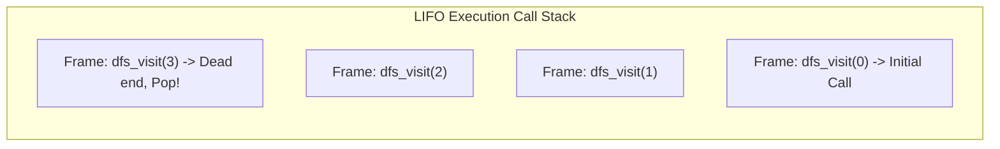
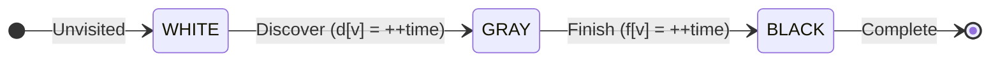
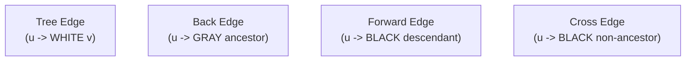
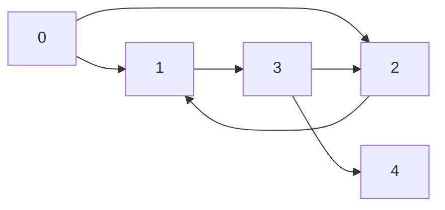

[DSA Index](../README.md) / [Unit 4: Graphs and Hashing](Introduction.md)

# L03: Depth-First Search

If Breadth-First Search is like ripples expanding uniformly across a pond, **Depth-First Search (DFS)** is like a solitary explorer walking through an ancient maze.

The explorer picks a corridor and runs down it as fast and as far as possible. When they reach an intersection, they pick the first branch and continue plunging forward. They only stop when they hit a dead end or arrive at a chamber they have already explored.

At that point, what do they do? They **backtrack**. They step back to the previous junction, check whether any unexplored corridors branch off from that point, and plunge deep down the next one.

This depth-first philosophy—dive as deep as possible before backtracking—makes DFS the algorithmic backbone for topological sorting, cycle detection, biconnectivity, and strongly connected components.

---

## Recursion and the Call Stack

While BFS relies on a FIFO queue to enforce level-order expansion, DFS relies on a **LIFO (Last-In, First-Out) Stack**.

Most implementations express DFS recursively because the programming language runtime provides a call stack for free. Every recursive call pushes an activation record (stack frame) containing local variables and the current vertex identifier onto the execution stack. When a dead end is reached, the function simply returns, automatically popping the frame and unwinding execution back to the previous vertex.



The moment a vertex finishes examining all its outgoing edges, its recursion frame pops off the stack. This distinction between the moment a vertex is **first discovered** and the moment its exploration **finishes** is the core mechanism that makes DFS so versatile.

---

## Three-Color Vertex State and Timestamps

To analyze the structure of a graph using DFS, Cormen, Leiserson, Rivest, and Stein (CLRS) introduced an elegant three-color state model:

1. **WHITE**: The vertex has not yet been discovered (`visited == 0`).
2. **GRAY**: The vertex has been discovered, but we are still exploring its descendants. It currently sits on the active recursion stack (`in_progress`).
3. **BLACK**: The vertex and all its descendants have been completely explored. Its recursion frame has popped off the call stack (`finished`).

Alongside colors, we maintain two integer timestamps for every vertex $v$:
- **Discovery Time ($d[v]$)**: The global clock tick when vertex $v$ turns from WHITE to GRAY.
- **Finish Time ($f[v]$)**: The global clock tick when vertex $v$ turns from GRAY to BLACK after all adjacent edges are exhausted.

Because time ticks forward at each discovery and finish event, for any vertex $v$:

$$1 \le d[v] < f[v] \le 2|V|$$



### The Parenthesis Structure Theorem

These intervals $[d[v], f[v]]$ obey a strict nesting relationship known as the **Parenthesis Theorem**:
For any two vertices $u$ and $v$, exactly one of three conditions holds:
1. The intervals $[d[u], f[u]]$ and $[d[v], f[v]]$ are completely disjoint: neither vertex is a descendant of the other in the DFS tree.
2. The interval $[d[u], f[u]]$ is entirely contained within $[d[v], f[v]]$: $u$ is a proper descendant of $v$ in the DFS tree.
3. The interval $[d[v], f[v]]$ is entirely contained within $[d[u], f[u]]$: $v$ is a proper descendant of $u$ in the DFS tree.

Intervals can never partially overlap. They either nest completely or stay entirely separate.

---

## Edge Classification in DFS

When DFS traverses an edge $(u, v)$, the color of the target vertex $v$ at the exact moment of inspection tells us what kind of edge it is:



Let's dissect each edge type:

1. **Tree Edge**: Vertex $v$ is encountered for the first time (it is **WHITE**). The edge $(u, v)$ is part of the DFS spanning forest.
2. **Back Edge**: Edge $(u, v)$ connects vertex $u$ to an ancestor $v$ that is currently active on the recursion stack (it is **GRAY**). In any graph, a back edge immediately proves the existence of a cycle!
3. **Forward Edge** (Directed graphs only): Edge $(u, v)$ connects vertex $u$ to a descendant $v$ that has already been completely finished (it is **BLACK**), and $d[u] < d[v]$.
4. **Cross Edge** (Directed graphs only): Edge $(u, v)$ connects vertex $u$ to a vertex $v$ that is completely finished (**BLACK**), but $v$ is neither an ancestor nor a descendant ($d[u] > d[v]$). It crosses between different subtrees in the DFS forest.

In an **undirected graph**, every edge is either a **Tree Edge** or a **Back Edge**. Forward edges and cross edges cannot exist because an undirected edge $(u, v)$ would simply be explored from the earlier-visited endpoint first.

---

## Mechanistic Step-by-Step Trace

Let's trace DFS on the following directed graph with 5 vertices:



Let's initialize:
- Global `time = 0`
- Colors: all vertices WHITE.
- Discovery: `d = [0, 0, 0, 0, 0]`, Finish: `f = [0, 0, 0, 0, 0]`.

### Execution Trace

1. Start at vertex `0`:
   - Turn `0` GRAY. `time = 1`, `d[0] = 1`.
   - Stack: `[0]`
   - Inspect edge `0 -> 1`. Vertex `1` is WHITE $\implies$ **Tree Edge**.

2. Call DFS on vertex `1`:
   - Turn `1` GRAY. `time = 2`, `d[1] = 2`.
   - Stack: `[0, 1]`
   - Inspect edge `1 -> 3`. Vertex `3` is WHITE $\implies$ **Tree Edge**.

3. Call DFS on vertex `3`:
   - Turn `3` GRAY. `time = 3`, `d[3] = 3`.
   - Stack: `[0, 1, 3]`
   - Inspect edge `3 -> 2`. Vertex `2` is WHITE $\implies$ **Tree Edge**.

4. Call DFS on vertex `2`:
   - Turn `2` GRAY. `time = 4`, `d[2] = 4`.
   - Stack: `[0, 1, 3, 2]`
   - Inspect edge `2 -> 1`. Vertex `1` is currently GRAY!
   - Because `1` is on the active recursion stack, edge `2 -> 1` is a **Back Edge**! This indicates a cycle: `1 -> 3 -> 2 -> 1`.
   - Vertex `2` has no more outgoing edges.
   - Turn `2` BLACK. `time = 5`, `f[2] = 5`.
   - Backtrack to `3`. Stack: `[0, 1, 3]`.

5. Resume vertex `3`:
   - Next outgoing edge is `3 -> 4`. Vertex `4` is WHITE $\implies$ **Tree Edge**.

6. Call DFS on vertex `4`:
   - Turn `4` GRAY. `time = 6`, `d[4] = 6`.
   - Stack: `[0, 1, 3, 4]`
   - `4` has no outgoing edges.
   - Turn `4` BLACK. `time = 7`, `f[4] = 7`.
   - Backtrack to `3`. Stack: `[0, 1, 3]`.

7. Resume vertex `3`:
   - All outgoing edges of `3` are exhausted.
   - Turn `3` BLACK. `time = 8`, `f[3] = 8`.
   - Backtrack to `1`. Stack: `[0, 1]`.

8. Resume vertex `1`:
   - All outgoing edges of `1` are exhausted.
   - Turn `1` BLACK. `time = 9`, `f[1] = 9`.
   - Backtrack to `0`. Stack: `[0]`.

9. Resume vertex `0`:
   - Inspect edge `0 -> 2`. Vertex `2` is BLACK, and $d[0] < d[2]$ ($1 < 4$) $\implies$ **Forward Edge**.
   - All edges of `0` are exhausted.
   - Turn `0` BLACK. `time = 10`, `f[0] = 10`.
   - Stack: `[]` (Empty. Completed).

### Final Timestamps and Interval Representation

| Vertex | Discovery ($d[v]$) | Finish ($f[v]$) | Interval $[d[v], f[v]]$ |
| :---: | :---: | :---: | :---: |
| **0** | 1 | 10 | `[1, 10]` |
| **1** | 2 | 9 | `[2, 9]` |
| **2** | 4 | 5 | `[4, 5]` |
| **3** | 3 | 8 | `[3, 8]` |
| **4** | 6 | 7 | `[6, 7]` |

Notice how the intervals nest: `[4, 5]` and `[6, 7]` are nested inside `[3, 8]`, which is nested inside `[2, 9]`, which is nested inside `[1, 10]`.

---

## Complete C Implementation: Recursive DFS

Here is a full C program with color tracking, timestamps, edge classification, and component loops.

```c
#include <stdio.h>
#include <stdlib.h>
#include <stdbool.h>

typedef enum {
    WHITE, // Unvisited
    GRAY,  // Active on recursion stack
    BLACK  // Fully processed
} VertexColor;

typedef struct AdjListNode {
    int dest;
    struct AdjListNode *next;
} AdjListNode;

typedef struct {
    int num_vertices;
    bool is_directed;
    AdjListNode **head;
} Graph;

Graph *graph_create(int vertices, bool directed) {
    Graph *g = (Graph *)malloc(sizeof(Graph));
    g->num_vertices = vertices;
    g->is_directed = directed;
    g->head = (AdjListNode **)calloc(vertices, sizeof(AdjListNode *));
    return g;
}

void graph_add_edge(Graph *g, int u, int v) {
    AdjListNode *node = (AdjListNode *)malloc(sizeof(AdjListNode));
    node->dest = v;
    node->next = g->head[u];
    g->head[u] = node;

    if (!g->is_directed) {
        AdjListNode *rev = (AdjListNode *)malloc(sizeof(AdjListNode));
        rev->dest = u;
        rev->next = g->head[v];
        g->head[v] = rev;
    }
}

// Recursive DFS visit
void dfs_visit(Graph *g, int u, VertexColor color[], int d[], int f[], int parent[], int *time) {
    (*time)++;
    d[u] = *time;
    color[u] = GRAY;
    printf("Discovered vertex %d at time %d\n", u, d[u]);

    AdjListNode *curr = g->head[u];
    while (curr != NULL) {
        int v = curr->dest;

        if (color[v] == WHITE) {
            printf("  Edge (%d -> %d): Tree Edge\n", u, v);
            parent[v] = u;
            dfs_visit(g, v, color, d, f, parent, time);
        } else if (color[v] == GRAY) {
            // In undirected graphs, ignore the edge directly back to the immediate parent
            if (g->is_directed || parent[u] != v) {
                printf("  Edge (%d -> %d): Back Edge (Cycle Detected!)\n", u, v);
            }
        } else if (color[v] == BLACK) {
            if (g->is_directed) {
                if (d[u] < d[v]) {
                    printf("  Edge (%d -> %d): Forward Edge\n", u, v);
                } else {
                    printf("  Edge (%d -> %d): Cross Edge\n", u, v);
                }
            }
        }
        curr = curr->next;
    }

    color[u] = BLACK;
    (*time)++;
    f[u] = *time;
    printf("Finished vertex %d at time %d\n", u, f[u]);
}

// Full DFS encompassing all disconnected components
void dfs_full(Graph *g) {
    VertexColor *color = (VertexColor *)malloc(g->num_vertices * sizeof(VertexColor));
    int *d = (int *)malloc(g->num_vertices * sizeof(int));
    int *f = (int *)malloc(g->num_vertices * sizeof(int));
    int *parent = (int *)malloc(g->num_vertices * sizeof(int));

    for (int i = 0; i < g->num_vertices; i++) {
        color[i] = WHITE;
        d[i] = 0;
        f[i] = 0;
        parent[i] = -1;
    }

    int time = 0;
    int forest_count = 0;

    for (int v = 0; v < g->num_vertices; v++) {
        if (color[v] == WHITE) {
            printf("\n--- DFS Root Tree %d starting at vertex %d ---\n", ++forest_count, v);
            dfs_visit(g, v, color, d, f, parent, &time);
        }
    }

    printf("\nVertex Timestamp Summary:\n");
    for (int i = 0; i < g->num_vertices; i++) {
        printf("Vertex %d: d = %2d, f = %2d\n", i, d[i], f[i]);
    }

    free(color);
    free(d);
    free(f);
    free(parent);
}

void graph_destroy(Graph *g) {
    for (int i = 0; i < g->num_vertices; i++) {
        AdjListNode *curr = g->head[i];
        while (curr) {
            AdjListNode *tmp = curr;
            curr = curr->next;
            free(tmp);
        }
    }
    free(g->head);
    free(g);
}
```

---

## Iterative DFS Using an Explicit Stack

In production environments with deeply nested graphs (e.g., millions of vertices in a line graph), deep recursion can blow past the operating system's default thread stack limit (typically 8 MB on Linux), causing a segmentation fault (stack overflow).

To avoid this, we can implement DFS iteratively using an explicit heap-allocated stack.

```c
void dfs_iterative(Graph *g, int start) {
    bool *visited = (bool *)calloc(g->num_vertices, sizeof(bool));
    int *stack = (int *)malloc(g->num_vertices * sizeof(int));
    int top = -1;

    // Push start vertex
    stack[++top] = start;

    while (top >= 0) {
        int u = stack[top--]; // Pop

        if (!visited[u]) {
            visited[u] = true;
            printf("Visited: %d\n", u);

            // Push unvisited neighbors onto the stack
            AdjListNode *curr = g->head[u];
            while (curr != NULL) {
                if (!visited[curr->dest]) {
                    stack[++top] = curr->dest;
                }
                curr = curr->next;
            }
        }
    }

    free(visited);
    free(stack);
}
```

Notice a subtle difference: the order in which neighbors are pushed affects the order they are popped. Pushing neighbors from head to tail reverses the order compared to standard recursive DFS unless neighbors are pushed in reverse.

---

## Complexity Analysis

### Time Complexity
- **Vertex Processing**: Every vertex changes from WHITE to GRAY to BLACK exactly once. The outer loop checks all $|V|$ vertices. Thus, vertex state management takes $\Theta(|V|)$ time.
- **Edge Scanning**: In `dfs_visit`, the adjacency list of vertex $u$ is traversed once during the lifetime of the algorithm. Over all vertices, every edge is examined at most twice (in undirected graphs) or once (in directed graphs):

$$\sum_{u \in V} \deg(u) = \Theta(|E|)$$

Total Time Complexity with an Adjacency List is:

$$T(V, E) = \Theta(|V| + |E|)$$

If implemented using an Adjacency Matrix, finding neighbors for each vertex takes $\Theta(|V|)$ operations, giving $\Theta(|V|^2)$ total time.

### Space Complexity
- **Stack Space**: In the worst-case scenario (a long chain graph: $0 \to 1 \to 2 \to \dots \to |V|-1$), the call stack (or explicit stack) grows to depth $|V|$.
- **Tracking Arrays**: The `color[]`, `d[]`, `f[]`, and `parent[]` arrays each require $|V|$ elements.
- Auxiliary Space Complexity is:

$$S(V) = O(|V|)$$

---

## Key Takeaways

- DFS dives deep along a branch until reaching a dead end or visited node, then backtracks using a LIFO stack.
- The 3-color model (WHITE, GRAY, BLACK) tracks discovery, active recursive descent, and final completion.
- Discovery ($d[v]$) and Finish ($f[v]$) timestamps obey the Parenthesis Theorem: intervals either nest completely or are disjoint.
- Edges are classified into Tree, Back, Forward, and Cross edges based on the color and timestamps of the destination vertex.
- Back edges (pointing to an active GRAY vertex on the recursion stack) indicate cycles.
- DFS with an Adjacency List runs in optimal $\Theta(|V| + |E|)$ time and $O(|V|)$ auxiliary stack space.

Now that we possess both BFS and DFS traversal engines, we can apply them to solve critical graph topology problems: identifying isolated islands of connectivity, testing whether a graph is 2-colorable (bipartite), and detecting structural cycles. Let's explore these in [L04 - Graph Connectivity and Cycle Detection](L04%20-%20Graph%20Connectivity%20and%20Cycle%20Detection.md).
