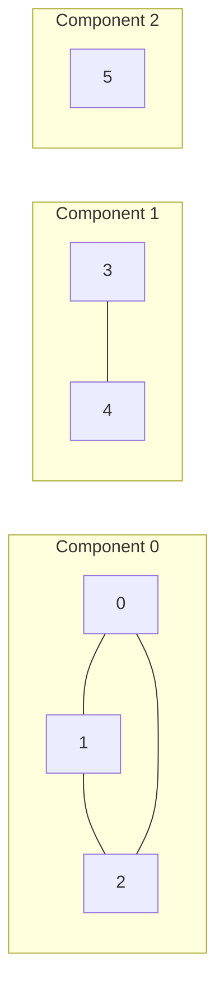
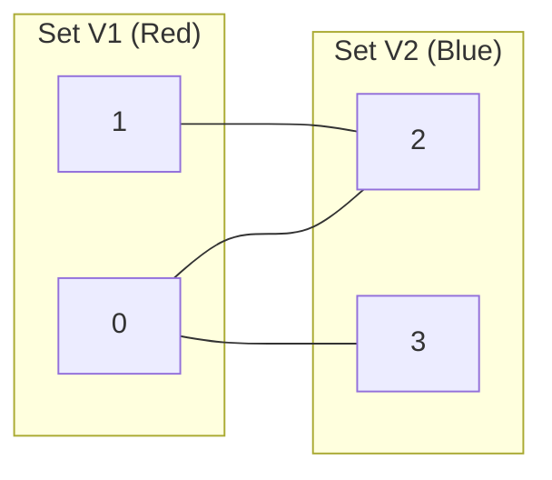
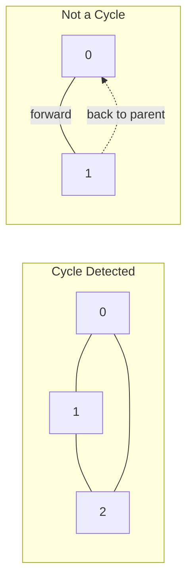
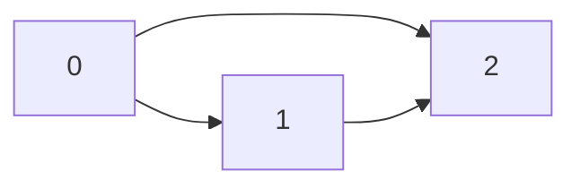
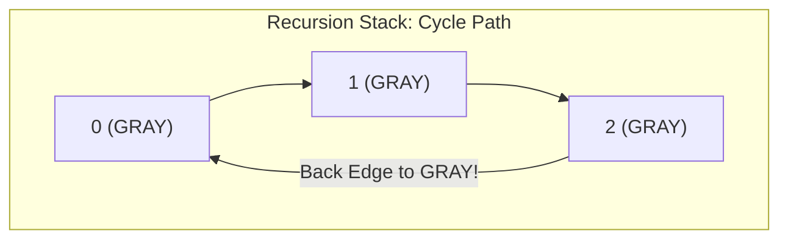
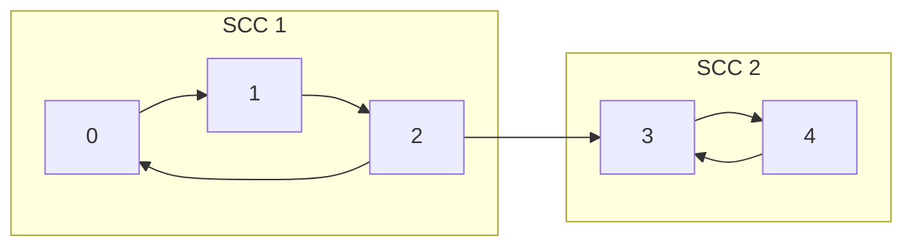
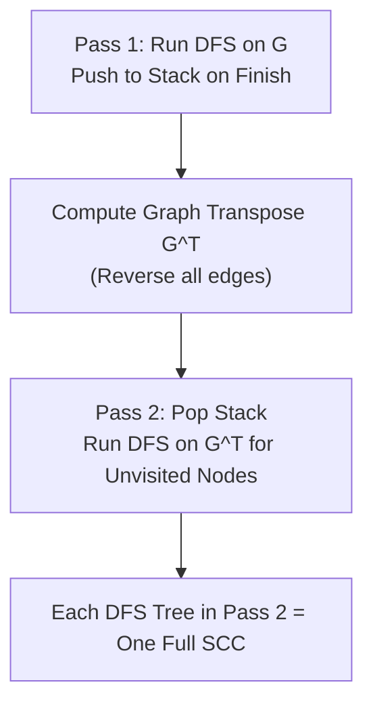

[DSA Index](../README.md) / [Unit 4: Graphs and Hashing](Introduction.md)

# L04: Graph Connectivity and Cycle Detection

Having mastered Breadth-First Search and Depth-First Search, we are ready to tackle foundational questions about graph topology:
- Can we travel between every pair of vertices, or is the network fragmented into isolated islands?
- Can the graph be partitioned into two independent sets with no internal conflicts (bipartite graphs)?
- Does the graph contain circular dependency loops (cycles)?
- In directed networks, which clusters of nodes can mutually reach each other (strongly connected components)?

These questions are not theoretical curiosities. A cycle in an operating system wait-for graph means a permanent deadlock. A cycle in a build tool (like Make or Webpack) means an infinite compilation loop. Detecting cycles and characterizing connectivity are fundamental graph primitives.

---

## Connected Components in Undirected Graphs

In an undirected graph, two vertices $u$ and $v$ are **connected** if there exists a path between them.

Connectivity is an equivalence relation:
- **Reflexive**: Every vertex is connected to itself by a path of length 0.
- **Symmetric**: If $u$ is connected to $v$, then $v$ is connected to $u$.
- **Transitive**: If $u$ is connected to $v$, and $v$ is connected to $w$, then $u$ is connected to $w$.

Because connectivity is an equivalence relation, it partitions the vertex set $V$ into disjoint subsets called **Connected Components**. A connected component is a maximal connected subgraph: every vertex in the subset can reach every other vertex in that subset, and no vertex outside the subset is reachable.



### Component Labeling Algorithm

To label every vertex with its component ID:
1. Maintain an array `component[v]` initialized to $-1$.
2. Initialize `component_id = 0`.
3. Loop through all vertices from $0$ to $|V|-1$.
4. Whenever an unvisited vertex $i$ is encountered (`component[i] == -1`), launch a BFS or DFS from $i$.
5. During the traversal, assign `component[v] = component_id` to every discovered vertex.
6. When the traversal terminates, increment `component_id` and resume the outer loop.

By the time the outer loop finishes, every vertex is stamped with an integer identifier. Two vertices belong to the same component if and only if `component[u] == component[v]`.

Total runtime is $\Theta(|V| + |E|)$ because each vertex and edge is processed exactly once.

---

## Bipartite Graphs and 2-Coloring

A graph $G = (V, E)$ is **bipartite** if its vertex set $V$ can be partitioned into two disjoint sets $V_1$ and $V_2$ ($V = V_1 \cup V_2, V_1 \cap V_2 = \emptyset$) such that every edge connects a vertex in $V_1$ to a vertex in $V_2$. No edge connects two vertices within the same set.



### The Odd-Cycle Theorem

A graph is bipartite if and only if it contains **no odd-length cycles**.

If a graph contains a triangle ($0 \to 1 \to 2 \to 0$, length 3), try coloring it with 2 colors (Red and Blue):
- Color 0 Red.
- Its neighbor 1 must be Blue.
- Its neighbor 2 must be Red (to differ from 1).
- But edge $(2, 0)$ connects two Red vertices! The 2-coloring fails.

### Bipartite Verification via BFS

We can verify bipartiteness using BFS 2-coloring:
1. Initialize a `color[]` array to $-1$ (uncolored).
2. For every uncolored vertex $s$, color it $0$ (Red) and enqueue it.
3. While dequeuing a vertex $u$ with color $c$:
   - For each neighbor $v$ of $u$:
     - If $v$ is uncolored, assign $v$ color $1 - c$ (alternate color) and enqueue $v$.
     - If $v$ is already colored and `color[v] == color[u]`, an edge connects two identically colored vertices. The graph has an odd cycle and is **not bipartite**.
4. If BFS completes without conflict, the graph is bipartite.

Runtime is $O(|V| + |E|)$.

---

## Cycle Detection in Undirected Graphs

Now let's examine cycle detection.

An undirected graph has a cycle if and only if during a traversal we encounter an edge pointing to an already-visited vertex that is **not the immediate parent** of the current vertex.

Notice why the parent condition is critical. In an undirected graph, every edge $(u, v)$ is bidirectional: $u$ is adjacent to $v$, and $v$ is adjacent to $u$. When we move from $u$ to $v$, $v$ will immediately see $u$ in its neighbor list. Without checking `v != parent[u]`, the algorithm would mistake the edge we just crossed for a cycle!



### Undirected Cycle Detection via DFS

```c
#include <stdio.h>
#include <stdlib.h>
#include <stdbool.h>

typedef struct AdjListNode {
    int dest;
    struct AdjListNode *next;
} AdjListNode;

typedef struct {
    int num_vertices;
    AdjListNode **head;
} UndirectedGraph;

bool dfs_cycle_undirected(UndirectedGraph *g, int u, int parent, bool visited[]) {
    visited[u] = true;

    AdjListNode *curr = g->head[u];
    while (curr != NULL) {
        int v = curr->dest;

        if (!visited[v]) {
            if (dfs_cycle_undirected(g, v, u, visited)) {
                return true;
            }
        } else if (v != parent) {
            // Found a visited neighbor that is NOT the immediate parent -> Cycle!
            return true;
        }
        curr = curr->next;
    }
    return false;
}

bool has_cycle_undirected(UndirectedGraph *g) {
    bool *visited = (bool *)calloc(g->num_vertices, sizeof(bool));

    for (int v = 0; v < g->num_vertices; v++) {
        if (!visited[v]) {
            if (dfs_cycle_undirected(g, v, -1, visited)) {
                free(visited);
                return true;
            }
        }
    }

    free(visited);
    return false;
}
```

---

## Cycle Detection in Directed Graphs

Now, what happens if we apply this exact same logic to a directed graph?

It fails immediately.

Consider three vertices: $0 \to 1$, $0 \to 2$, and $1 \to 2$.



Does this graph have a cycle? No. All edges flow forward. There is no way to return to an earlier vertex.

However, if we run DFS starting at `0`:
1. Discover `0`.
2. Discover `1`.
3. Discover `2`. Finish `2`. Finish `1`.
4. Backtrack to `0`. Next edge is $0 \to 2$.
5. Vertex `2` is already visited!
6. If we only checked `visited[2] == true`, we would falsely report a cycle!

Here is why: in a directed graph, encountering an already-visited vertex does **not** imply a cycle unless that vertex is an **ancestor currently active on the recursion stack**.

### The 3-Color / Recursion Stack Method

To detect cycles in a directed graph correctly, we use the three-color model:
- **WHITE (0)**: Unvisited.
- **GRAY (1)**: Currently active on the recursion stack (an ancestor).
- **BLACK (2)**: Completely finished and popped from the recursion stack.

A directed graph contains a cycle if and only if DFS encounters an edge $(u, v)$ where the destination vertex $v$ is **GRAY**.



### Complete C Implementation: Directed Cycle Detection

```c
#include <stdio.h>
#include <stdlib.h>
#include <stdbool.h>

#define WHITE 0
#define GRAY  1
#define BLACK 2

typedef struct AdjListNode {
    int dest;
    struct AdjListNode *next;
} AdjListNode;

typedef struct {
    int num_vertices;
    AdjListNode **head;
} DirectedGraph;

bool dfs_cycle_directed(DirectedGraph *g, int u, int color[]) {
    color[u] = GRAY; // Push onto recursion stack

    AdjListNode *curr = g->head[u];
    while (curr != NULL) {
        int v = curr->dest;

        if (color[v] == GRAY) {
            // Target is currently active on recursion stack -> Back Edge -> Cycle!
            return true;
        }

        if (color[v] == WHITE) {
            if (dfs_cycle_directed(g, v, color)) {
                return true;
            }
        }
        curr = curr->next;
    }

    color[u] = BLACK; // Pop from recursion stack
    return false;
}

bool has_cycle_directed(DirectedGraph *g) {
    int *color = (int *)calloc(g->num_vertices, sizeof(int)); // All WHITE

    for (int v = 0; v < g->num_vertices; v++) {
        if (color[v] == WHITE) {
            if (dfs_cycle_directed(g, v, color)) {
                free(color);
                return true;
            }
        }
    }

    free(color);
    return false;
}
```

---

## Directed Connectivity: Strongly Connected Components (SCC)

In directed graphs, connectivity is fundamentally asymmetric. Vertex $u$ might reach $v$, but $v$ might have no path back to $u$.

This brings us to two distinct definitions of connectivity in directed graphs:
- **Weakly Connected**: If we replace all directed edges with undirected edges, the resulting graph is connected.
- **Strongly Connected**: For every pair of vertices $u, v$, there exists a directed path from $u$ to $v$ **and** a directed path from $v$ to $u$.

A **Strongly Connected Component (SCC)** is a maximal strongly connected subgraph. Every vertex inside an SCC can reach every other vertex inside that same SCC.



Notice the bridge edge $2 \to 3$. You can travel from SCC 1 to SCC 2, but you can never return from SCC 2 to SCC 1. If we collapse each SCC into a single super-vertex, the resulting component graph is **guaranteed to be a Directed Acyclic Graph (DAG)**!

---

## Kosaraju's Algorithm for Strongly Connected Components

How do we find all SCCs in linear time? **Kosaraju-Sharir's Algorithm** solves this using two passes of DFS and the graph transpose.

### The Mathematical Insight: Graph Transpose

Given a directed graph $G = (V, E)$, its **transpose** $G^T = (V, E^T)$ is the graph obtained by reversing the direction of every single edge:

$$\langle u, v \rangle \in E \iff \langle v, u \rangle \in E^T$$

Notice this property: reversing all edges preserves every SCC. If $u$ and $v$ can mutually reach each other in $G$, they can still mutually reach each other in $G^T$!

However, the edges *between* different SCCs are reversed. In our diagram above, the edge $2 \to 3$ becomes $3 \to 2$ in $G^T$.

If we order our search such that we process vertices from the "sink" SCCs of the original graph, then in $G^T$ those sinks become "sources". When we run DFS in $G^T$ from those vertices, the search is trapped inside each SCC and cannot bleed into other components!

### The Two Passes of Kosaraju's Algorithm

1. **Pass 1 (Order by Finish Time)**:
   - Run DFS on the original graph $G$.
   - As each vertex finishes (all its outgoing edges are explored), push it onto a stack.
   - The top of the stack will hold the vertex with the highest finish time (a source in the component DAG).

2. **Compute Transpose $G^T$**:
   - Reverse every directed edge in $G$.

3. **Pass 2 (Extract Components)**:
   - Initialize a `visited[]` array to false.
   - While the stack is not empty:
     - Pop vertex $u$.
     - If $u$ is unvisited in $G^T$, launch a DFS starting from $u$ in $G^T$.
     - Every vertex reached in this DFS traversal belongs to the same Strongly Connected Component!



### Complete C Implementation: Kosaraju's Algorithm

```c
#include <stdio.h>
#include <stdlib.h>
#include <stdbool.h>

typedef struct AdjListNode {
    int dest;
    struct AdjListNode *next;
} AdjListNode;

typedef struct {
    int num_vertices;
    AdjListNode **head;
} Graph;

Graph *graph_create(int vertices) {
    Graph *g = (Graph *)malloc(sizeof(Graph));
    g->num_vertices = vertices;
    g->head = (AdjListNode **)calloc(vertices, sizeof(AdjListNode *));
    return g;
}

void graph_add_directed_edge(Graph *g, int u, int v) {
    AdjListNode *node = (AdjListNode *)malloc(sizeof(AdjListNode));
    node->dest = v;
    node->next = g->head[u];
    g->head[u] = node;
}

// Pass 1: Fill stack with vertices in order of increasing finish time
void dfs_pass1(Graph *g, int u, bool visited[], int stack[], int *top) {
    visited[u] = true;

    AdjListNode *curr = g->head[u];
    while (curr) {
        if (!visited[curr->dest]) {
            dfs_pass1(g, curr->dest, visited, stack, top);
        }
        curr = curr->next;
    }
    // Push onto stack when completely finished
    stack[++(*top)] = u;
}

// Compute transpose graph G^T
Graph *graph_transpose(Graph *g) {
    Graph *gt = graph_create(g->num_vertices);
    for (int u = 0; u < g->num_vertices; u++) {
        AdjListNode *curr = g->head[u];
        while (curr) {
            graph_add_directed_edge(gt, curr->dest, u); // Reverse edge
            curr = curr->next;
        }
    }
    return gt;
}

// Pass 2: DFS on transpose graph collecting SCC members
void dfs_pass2(Graph *gt, int u, bool visited[]) {
    visited[u] = true;
    printf("%d ", u);

    AdjListNode *curr = gt->head[u];
    while (curr) {
        if (!visited[curr->dest]) {
            dfs_pass2(gt, curr->dest, visited);
        }
        curr = curr->next;
    }
}

void find_sccs_kosaraju(Graph *g) {
    int *stack = (int *)malloc(g->num_vertices * sizeof(int));
    int top = -1;
    bool *visited = (bool *)calloc(g->num_vertices, sizeof(bool));

    // Step 1: Fill stack according to finish times
    for (int i = 0; i < g->num_vertices; i++) {
        if (!visited[i]) {
            dfs_pass1(g, i, visited, stack, &top);
        }
    }

    // Step 2: Compute Transpose
    Graph *gt = graph_transpose(g);

    // Step 3: DFS on Transpose in stack order
    for (int i = 0; i < g->num_vertices; i++) {
        visited[i] = false;
    }

    printf("Strongly Connected Components (Kosaraju):\n");
    int scc_count = 0;
    while (top >= 0) {
        int u = stack[top--];
        if (!visited[u]) {
            printf("SCC %d: { ", ++scc_count);
            dfs_pass2(gt, u, visited);
            printf("}\n");
        }
    }

    free(stack);
    free(visited);
    // Cleanup gt...
}
```

---

## Complexity Summary of Connectivity Algorithms

| Algorithm | Graph Type | Time Complexity | Auxiliary Space | Key Mechanics |
| :--- | :--- | :--- | :--- | :--- |
| **Connected Components** | Undirected | $\Theta(V + E)$ | $O(V)$ | BFS/DFS traversal stamping component IDs |
| **Bipartite Verification** | Undirected/Directed | $\Theta(V + E)$ | $O(V)$ | BFS/DFS 2-coloring, checks for odd cycles |
| **Cycle Detection** | Undirected | $O(V + E)$ | $O(V)$ | DFS back-edge check avoiding parent edge |
| **Cycle Detection** | Directed | $O(V + E)$ | $O(V)$ | 3-color model detecting edges to GRAY nodes |
| **Kosaraju SCC** | Directed | $\Theta(V + E)$ | $\Theta(V + E)$ | 2-pass DFS with finish-time stack and transpose $G^T$ |
| **Tarjan SCC** | Directed | $\Theta(V + E)$ | $O(V)$ | 1-pass DFS tracking discovery and low-link values |

---

## Key Takeaways

- In undirected graphs, connected components represent maximal connected subgraphs and are found via DFS/BFS in $\Theta(V + E)$.
- A graph is bipartite if and only if it contains no odd-length cycles; it can be tested via 2-coloring in $O(V + E)$.
- Undirected cycle detection checks for already-visited neighbors that are not the immediate parent.
- Directed cycle detection requires tracking the active recursion stack using three colors; an edge pointing to an active GRAY ancestor indicates a cycle.
- Strongly Connected Components (SCCs) in directed graphs can be discovered in linear time $\Theta(V + E)$ using Kosaraju's two-pass algorithm on $G$ and $G^T$.

So far, every traversal we have performed treated every edge as having equal weight. But in real-world networks—roadways, fiber-optic conduits, and airline routes—edges have distinct physical costs and travel times. When edge weights enter the picture, BFS no longer finds the shortest path. To navigate weighted topologies, let's turn to [L05 - Shortest Path Algorithms - Dijkstra](L05%20-%20Shortest%20Path%20Algorithms%20-%20Dijkstra.md).
