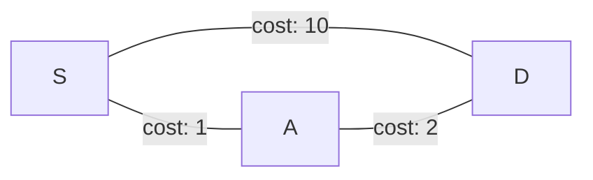
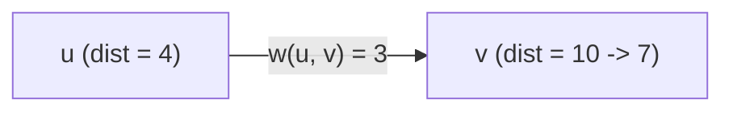
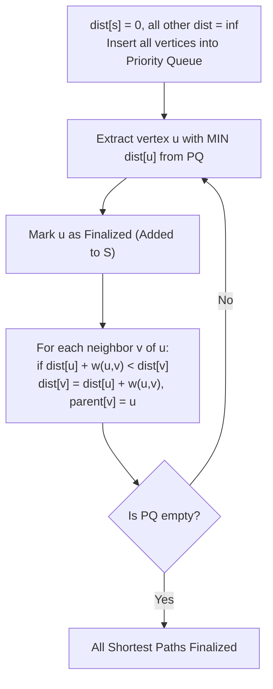
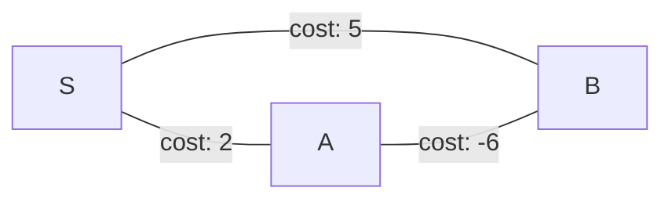
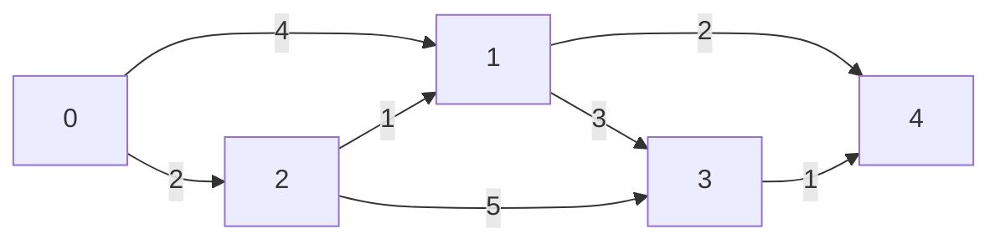

[DSA Index](../README.md) / [Unit 4: Graphs and Hashing](Introduction.md)

# L05: Shortest Path Algorithms - Dijkstra

In L02, we established that Breadth-First Search finds the shortest path between a source vertex and all other vertices. But notice the unspoken assumption baked into BFS: every edge represents exactly one unit of cost.

The moment edges have non-uniform weights—representing physical kilometers of road, milliseconds of fiber-optic latency, or monetary tolls—BFS fails completely.

Consider this minimal counterexample:


If we run BFS starting from $S$:
1. BFS inspects all immediate neighbors: $A$ (1 hop) and $D$ (1 hop).
2. It discovers destination $D$ in a single edge hop and declares the path $S \to D$ (cost 10) to be the shortest path!
3. But the alternate path $S \to A \to D$ requires 2 hops and has a total cost of $1 + 2 = 3$.

BFS is blind to edge weights because its FIFO queue measures distance solely by **hop count**.

To solve the Single-Source Shortest Path (SSSP) problem on weighted graphs, we need an algorithm that explores vertices in order of **cumulative path weight**, not hop count. This is the foundation of **Dijkstra's Algorithm**.

---

## Edge Relaxation and the Triangle Inequality

At the heart of all shortest-path algorithms lies a single fundamental primitive: **Relaxation**.

Let:
- $\text{dist}[u]$ be the shortest known distance from the source $s$ to vertex $u$.
- $\text{dist}[v]$ be the shortest known distance from the source $s$ to vertex $v$.
- $w(u, v)$ be the weight of the directed edge from $u$ to $v$.

Suppose we find that traveling to $u$ and then taking the edge $(u, v)$ yields a shorter total distance than our current best known path to $v$:

$$\text{dist}[u] + w(u, v) < \text{dist}[v]$$

Then we can **relax** the edge $(u, v)$ by updating our estimate for $v$:

$$\text{dist}[v] = \text{dist}[u] + w(u, v)$$

$$\text{parent}[v] = u$$



Before relaxation, $\text{dist}[v] = 10$. After inspecting edge $(u, v)$, we see $4 + 3 = 7 < 10$. We update $\text{dist}[v]$ to $7$ and record $u$ as the predecessor.

When an algorithm finishes, all edges satisfy the **Triangle Inequality**:

$$\text{dist}[v] \le \text{dist}[u] + w(u, v) \quad \forall (u, v) \in E$$

---

## The Greedy Principle of Dijkstra's Algorithm

Edsger Dijkstra introduced an elegant greedy strategy:

1. Maintain two sets of vertices:
   - $S$: Vertices whose absolute shortest distance from the source has been finalized.
   - $V \setminus S$: Vertices whose tentative shortest distances are still being refined.
2. At every iteration, pick the vertex $u \in V \setminus S$ that currently has the **minimum** $\text{dist}[u]$.
3. Add $u$ to $S$ (its distance is now finalized and will never change).
4. Relax all outgoing edges leaving $u$: for each neighbor $v$, if $\text{dist}[u] + w(u, v) < \text{dist}[v]$, update $\text{dist}[v]$.
5. Repeat until all vertices have been added to $S$ (or the priority queue is empty).



### Why Dijkstra Strictly Requires Non-Negative Weights

Dijkstra's greedy choice relies on an inviolable mathematical invariant:

> Once a vertex $u$ is selected with the minimum tentative distance among all unvisited vertices, its distance $\text{dist}[u]$ is permanent and optimal.

Why? If all edge weights $w(e) \ge 0$, any other alternate path from source $s$ to $u$ must pass through some other unvisited vertex $x$. But because $u$ was chosen with the minimum distance, $\text{dist}[x] \ge \text{dist}[u]$. Since all edge weights are non-negative, extending any path through $x$ can only add non-negative cost:

$$\text{path through } x \ge \text{dist}[x] \ge \text{dist}[u]$$

Therefore, no future exploration can ever find a shorter path to $u$.

**The moment negative weights exist, this entire logic collapses.**



If we run Dijkstra on this graph:
1. $S$ extracts $A$ first because $\text{dist}[A] = 2 < \text{dist}[B] = 5$.
2. $B$ is then finalized with $\text{dist}[B] = 5$.
3. Dijkstra permanently locks $B$'s distance at $5$.
4. But the path $S \to A \to B$ has cost $2 + (-6) = -4$!

Because Dijkstra finalized $B$ greedily, it will never re-examine $B$. It produces an incorrect answer. Graphs with negative edge weights require algorithms designed for them, such as the **Bellman-Ford Algorithm** ($O(V \cdot E)$).

---

## Mechanistic Step-by-Step Trace

Let's trace Dijkstra's algorithm on the following weighted directed graph:



Source vertex: $s = 0$.

### Initial State:
- `dist = [0, inf, inf, inf, inf]`
- `parent = [-1, -1, -1, -1, -1]`
- `visited = [F, F, F, F, F]`

### Iteration 1:
- Minimum unvisited vertex is `0` with $\text{dist}[0] = 0$.
- Mark `visited[0] = T`.
- Relax neighbors of `0`:
  - Neighbor `1`: $\text{dist}[0] + 4 = 4 < \infty \implies \text{dist}[1] = 4, \text{parent}[1] = 0$.
  - Neighbor `2`: $\text{dist}[0] + 2 = 2 < \infty \implies \text{dist}[2] = 2, \text{parent}[2] = 0$.
- Current `dist = [0, 4, 2, inf, inf]`.

### Iteration 2:
- Minimum unvisited vertex is `2` with $\text{dist}[2] = 2$.
- Mark `visited[2] = T`.
- Relax neighbors of `2`:
  - Neighbor `1`: $\text{dist}[2] + 1 = 2 + 1 = 3 < \text{dist}[1] (4) \implies \text{dist}[1] = 3, \text{parent}[1] = 2$.
  - Neighbor `3`: $\text{dist}[2] + 5 = 2 + 5 = 7 < \infty \implies \text{dist}[3] = 7, \text{parent}[3] = 2$.
- Current `dist = [0, 3, 2, 7, inf]`.

### Iteration 3:
- Minimum unvisited vertex is `1` with $\text{dist}[1] = 3$.
- Mark `visited[1] = T`.
- Relax neighbors of `1`:
  - Neighbor `3`: $\text{dist}[1] + 3 = 3 + 3 = 6 < \text{dist}[3] (7) \implies \text{dist}[3] = 6, \text{parent}[3] = 1$.
  - Neighbor `4`: $\text{dist}[1] + 2 = 3 + 2 = 5 < \infty \implies \text{dist}[4] = 5, \text{parent}[4] = 1$.
- Current `dist = [0, 3, 2, 6, 5]`.

### Iteration 4:
- Minimum unvisited vertex is `4` with $\text{dist}[4] = 5$.
- Mark `visited[4] = T`.
- Vertex `4` has no outgoing edges.
- Current `dist = [0, 3, 2, 6, 5]`.

### Iteration 5:
- Minimum unvisited vertex is `3` with $\text{dist}[3] = 6$.
- Mark `visited[3] = T`.
- Relax neighbors of `3`:
  - Neighbor `4`: $\text{dist}[3] + 1 = 6 + 1 = 7 \not< \text{dist}[4] (5)$. No change.
- Current `dist = [0, 3, 2, 6, 5]`.

All vertices are visited.

### Final Shortest Paths from Source 0:
- Vertex 0: Distance = 0, Path: `0`
- Vertex 1: Distance = 3, Path: `0 -> 2 -> 1`
- Vertex 2: Distance = 2, Path: `0 -> 2`
- Vertex 3: Distance = 6, Path: `0 -> 2 -> 1 -> 3`
- Vertex 4: Distance = 5, Path: `0 -> 2 -> 1 -> 4`

---

## Two Implementations: Dense vs. Sparse Graphs

How we implement the "find minimum distance vertex" step determines the computational complexity of Dijkstra's algorithm.

### Naive Array Scan: $O(V^2)$
In an array implementation, we simply iterate through the entire `dist[]` array of size $|V|$ to find the minimum unvisited vertex.
- Finding minimum takes $O(V)$. Doing this $|V|$ times takes $O(V^2)$.
- Relaxing edges across all vertices takes $O(E)$.
- Total time: $O(V^2 + E) = O(V^2)$.

For a **dense graph** where $|E| \approx |V|^2$, $O(V^2)$ is optimal because any algorithm must inspect all $|E|$ edges anyway.

### Min-Heap Priority Queue: $O((V + E) \log V)$
For a **sparse graph** where $|E| \ll |V|^2$, scanning the whole array is wasteful. Instead, we store tentative distances in a Binary Min-Heap:
- Extracting the minimum takes $O(\log V)$. Doing this $|V|$ times takes $O(V \log V)$.
- Each edge relaxation decreases a key in the heap, taking $O(\log V)$. Across all $|E|$ edges, this takes $O(E \log V)$.
- Total time: $O((V + E) \log V)$.

---

## Complete C Implementation: Priority Queue Dijkstra

Here is a complete C implementation using an adjacency list and a Binary Min-Heap priority queue.

```c
#include <stdio.h>
#include <stdlib.h>
#include <stdbool.h>
#include <limits.h>

#define INF INT_MAX

// Adjacency List Node
typedef struct AdjListNode {
    int dest;
    int weight;
    struct AdjListNode *next;
} AdjListNode;

typedef struct {
    int num_vertices;
    AdjListNode **head;
} Graph;

Graph *graph_create(int vertices) {
    Graph *g = (Graph *)malloc(sizeof(Graph));
    g->num_vertices = vertices;
    g->head = (AdjListNode **)calloc(vertices, sizeof(AdjListNode *));
    return g;
}

void graph_add_edge(Graph *g, int u, int v, int weight) {
    AdjListNode *node = (AdjListNode *)malloc(sizeof(AdjListNode));
    node->dest = v;
    node->weight = weight;
    node->next = g->head[u];
    g->head[u] = node;
}

// Min-Heap Node
typedef struct {
    int v;
    int dist;
} MinHeapNode;

// Min-Heap with reverse index lookup for O(log V) decrease_key
typedef struct {
    int size;
    int capacity;
    int *pos;             // pos[v] stores current index of vertex v in heap array
    MinHeapNode **array;
} MinHeap;

MinHeapNode *min_heap_node_create(int v, int dist) {
    MinHeapNode *node = (MinHeapNode *)malloc(sizeof(MinHeapNode));
    node->v = v;
    node->dist = dist;
    return node;
}

MinHeap *min_heap_create(int capacity) {
    MinHeap *h = (MinHeap *)malloc(sizeof(MinHeap));
    h->capacity = capacity;
    h->size = 0;
    h->pos = (int *)malloc(capacity * sizeof(int));
    h->array = (MinHeapNode **)malloc(capacity * sizeof(MinHeapNode *));
    return h;
}

void swap_heap_nodes(MinHeap *h, int i, int j) {
    MinHeapNode *tmp = h->array[i];
    h->array[i] = h->array[j];
    h->array[j] = tmp;

    h->pos[h->array[i]->v] = i;
    h->pos[h->array[j]->v] = j;
}

void min_heapify(MinHeap *h, int idx) {
    int smallest = idx;
    int left = 2 * idx + 1;
    int right = 2 * idx + 2;

    if (left < h->size && h->array[left]->dist < h->array[smallest]->dist)
        smallest = left;
    if (right < h->size && h->array[right]->dist < h->array[smallest]->dist)
        smallest = right;

    if (smallest != idx) {
        swap_heap_nodes(h, idx, smallest);
        min_heapify(h, smallest);
    }
}

bool min_heap_is_empty(MinHeap *h) {
    return h->size == 0;
}

MinHeapNode *min_heap_extract_min(MinHeap *h) {
    if (min_heap_is_empty(h)) return NULL;

    MinHeapNode *root = h->array[0];
    MinHeapNode *last_node = h->array[h->size - 1];
    h->array[0] = last_node;

    h->pos[root->v] = h->size - 1;
    h->pos[last_node->v] = 0;

    h->size--;
    min_heapify(h, 0);

    return root;
}

void min_heap_decrease_key(MinHeap *h, int v, int dist) {
    int i = h->pos[v];
    h->array[i]->dist = dist;

    // Percolate up
    while (i > 0 && h->array[i]->dist < h->array[(i - 1) / 2]->dist) {
        swap_heap_nodes(h, i, (i - 1) / 2);
        i = (i - 1) / 2;
    }
}

bool min_heap_contains(MinHeap *h, int v) {
    return h->pos[v] < h->size;
}

// Dijkstra Algorithm
void dijkstra(Graph *g, int src) {
    int V = g->num_vertices;
    int *dist = (int *)malloc(V * sizeof(int));
    int *parent = (int *)malloc(V * sizeof(int));

    MinHeap *h = min_heap_create(V);

    for (int v = 0; v < V; v++) {
        dist[v] = INF;
        parent[v] = -1;
        h->array[v] = min_heap_node_create(v, dist[v]);
        h->pos[v] = v;
    }

    // Source vertex has distance 0
    dist[src] = 0;
    min_heap_decrease_key(h, src, 0);
    h->size = V;

    while (!min_heap_is_empty(h)) {
        MinHeapNode *min_node = min_heap_extract_min(h);
        int u = min_node->v;
        int d_u = min_node->dist;
        free(min_node);

        if (d_u == INF) break; // Remaining vertices are unreachable

        AdjListNode *curr = g->head[u];
        while (curr != NULL) {
            int v = curr->dest;
            int weight = curr->weight;

            // Relaxation step
            if (min_heap_contains(h, v) && dist[u] != INF && dist[u] + weight < dist[v]) {
                dist[v] = dist[u] + weight;
                parent[v] = u;
                min_heap_decrease_key(h, v, dist[v]);
            }
            curr = curr->next;
        }
    }

    printf("Dijkstra Shortest Paths from Source %d:\n", src);
    for (int i = 0; i < V; i++) {
        if (dist[i] == INF) {
            printf("Vertex %d: Distance = INF (Unreachable)\n", i);
        } else {
            printf("Vertex %d: Distance = %2d, Predecessor = %2d\n", i, dist[i], parent[i]);
        }
    }

    free(dist);
    free(parent);
    free(h->pos);
    free(h->array);
    free(h);
}
```

---

## Rigorous Complexity Comparison

The table below contrasts Dijkstra implementations across different underlying priority queue data structures:

| Priority Queue Structure | Find-Min Time | Decrease-Key Time | Total Time Complexity | Best Suited Graph Topology |
| :--- | :--- | :--- | :--- | :--- |
| **Unsorted Array** | $O(V)$ | $O(1)$ | $O(V^2 + E) = O(V^2)$ | **Dense Graphs** ($E \approx V^2$) |
| **Binary Heap** | $O(\log V)$ | $O(\log V)$ | $O((V + E) \log V)$ | **Sparse Graphs** ($E \ll V^2$) |
| **$d$-ary Heap** ($d = E/V$) | $O(d \log_d V)$ | $O(\log_d V)$ | $O(E \log_{E/V} V)$ | Moderately dense graphs |
| **Fibonacci Heap** | $O(\log V)$ amortized | $O(1)$ amortized | $O(E + V \log V)$ | Theoretical optimum |

For dense graphs where $E \approx V^2$, the naive array implementation ($O(V^2)$) actually beats the binary heap ($O(V^2 \log V)$) because it avoids heap manipulation overhead and exhibits superior CPU cache locality.

---

## Key Takeaways

- BFS measures path length solely by hop count; Dijkstra's algorithm accounts for arbitrary non-negative edge weights.
- The fundamental operation is relaxation: if $\text{dist}[u] + w(u, v) < \text{dist}[v]$, update $\text{dist}[v]$ and record $u$ as predecessor.
- Non-negative edge weights are mandatory: negative weights violate the greedy invariant and can lead to incorrect shortest distances.
- Binary Min-Heaps reduce the runtime to $O((V + E) \log V)$ on sparse graphs by optimizing minimum-element extraction.
- For dense graphs where $E = \Theta(V^2)$, a simple array-based implementation is both simpler and asymptotically faster ($O(V^2)$).

With Dijkstra's algorithm, we have mastered traversing complex relational topologies. Now we turn our attention to an entirely different computational challenge: constant-time data retrieval. How do we design a data structure that retrieves a record among billions in $O(1)$ time without searching through an array or traversing tree branches? To answer this, let's explore [L06 - Hashing - Fundamentals and Hash Functions](L06%20-%20Hashing%20-%20Fundamentals%20and%20Hash%20Functions.md).
