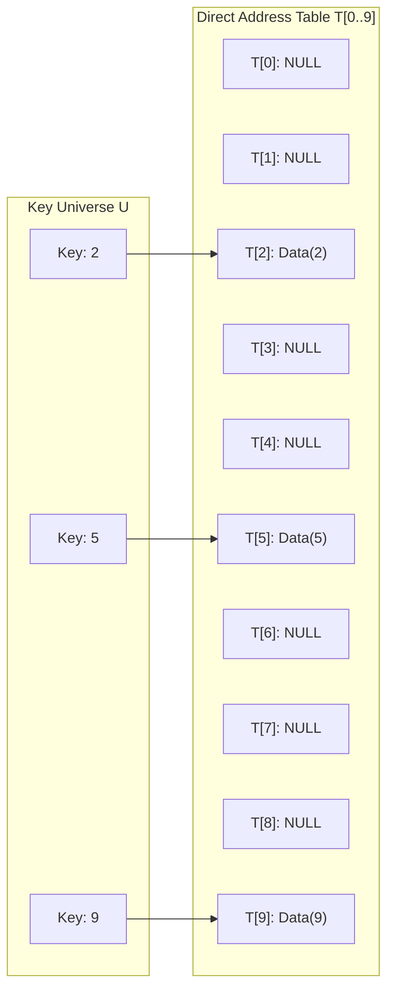
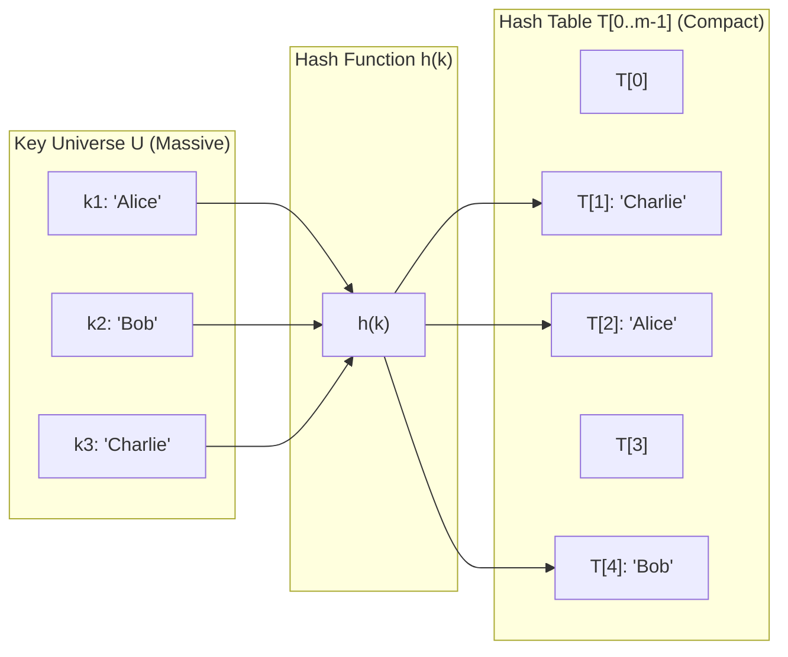
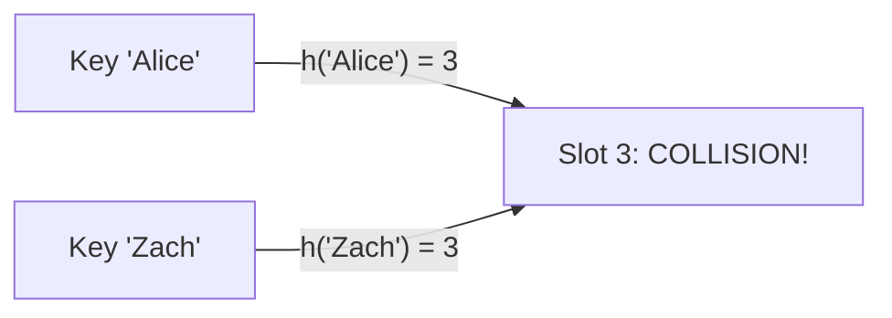

[DSA Index](../README.md) / [Unit 4: Graphs and Hashing](Introduction.md)

# L06: Hashing - Fundamentals and Hash Functions

Consider the fundamental search problem: given a collection of $n$ records, locate the record matching a specific key $k$.

Let's review our progress across previous units:
- In an unsorted array or linked list, searching requires scanning every element: $O(n)$ time.
- In a sorted array, binary search cuts the search space in half at each step: $O(\log n)$ time.
- In a balanced binary search tree (like an AVL tree or Red-Black tree), search takes $O(\log n)$ time.

Can we do better than $O(\log n)$? Can we design a dictionary data structure that achieves **$O(1)$ constant time** for search, insertion, and deletion, independent of the number of records stored?

To achieve $O(1)$ access, we must eliminate comparisons entirely.

---

## Direct Addressing and Its Fatal Limitation

The fastest data structure in computing is the array. If you know the index $i$, the CPU calculates the physical memory address in a single arithmetic instruction and loads the data in $O(1)$ time:

$$\text{Address} = \text{Base} + i \times \text{sizeof}(\text{element})$$

This observation suggests an obvious strategy: **Direct Address Tables (DAT)**.

Suppose every key $k$ is drawn from a universe of possible keys $U = \{0, 1, \dots, |U|-1\}$. We allocate an array $T$ of size $|U|$, where each position $T[k]$ holds a pointer to the record with key $k$.



Direct addressing gives instantaneous $O(1)$ search, insert, and delete. But consider what happens in practice:

1. **Memory Explosion**: Suppose our keys are 9-digit Social Security Numbers ($000{,}000{,}000$ to $999{,}999{,}999$). The universe size $|U|$ is $10^9$. If each entry is an 8-byte pointer, the table requires $8 \text{ GB}$ of RAM. What if the keys are 64-bit integers ($2^{64} \approx 1.84 \times 10^{19}$)? The table would require over 147 exabytes of memory—more storage than exists on earth.
2. **Sparse Utilization**: Even if we could allocate 8 GB for a 9-digit SSN table, suppose our company only employs $10{,}000$ people. Out of 1 billion slots, $999{,}990{,}000$ slots are empty `NULL` pointers. Over $99.999\%$ of the memory is wasted.
3. **Non-Integer Keys**: What if the keys are strings, like customer names, emails, or URLs? Strings cannot be used directly as array indices.

Direct addressing fails whenever the universe of keys $U$ is significantly larger than the number of actual keys $n$ we need to store.

---

## The Hashing Abstraction

This brings us to **Hashing**.

Instead of allocating a table sized to the vast universe of keys $|U|$, we allocate a compact table $T$ of size $m$, where $m$ is proportional to the number of records we actually expect to store ($m \approx \Theta(n)$).

To map an arbitrary key $k \in U$ down to a valid array slot index $\{0, 1, \dots, m-1\}$, we run the key through a mathematical function called a **Hash Function**:

$$h: U \to \{0, 1, 2, \dots, m - 1\}$$



Now, instead of searching the entire table, when someone asks for key $k$, we compute $i = h(k)$ in $O(1)$ time and look up $T[i]$.

---

## The Pigeonhole Principle and Collisions

Notice an inescapable mathematical consequence of this mapping.

If the universe of keys $|U|$ is larger than the number of table slots $m$ ($|U| > m$), the **Pigeonhole Principle** guarantees that there must exist at least two distinct keys $k_1 \neq k_2$ that map to the exact same table slot:

$$h(k_1) = h(k_2)$$

When two distinct keys produce the same hash index, we have a **Collision**.



No matter how clever, complex, or elegant your hash function is, collisions cannot be mathematically avoided if $|U| > m$.

Therefore, any complete hashing system consists of two distinct components:
1. A **Hash Function** that minimizes collisions by distributing keys uniformly across all $m$ slots.
2. A **Collision Resolution Policy** that handles collisions gracefully when they inevitably occur.

---

## Properties of an Ideal Hash Function

What makes a hash function "good"? A well-engineered hash function must satisfy four core criteria:

1. **Determinism**: Given the identical key $k$, $h(k)$ must return the exact same integer every time. It cannot rely on random numbers or external state.
2. **Uniform Distribution (SUHA)**: Under the **Simple Uniform Hashing Assumption (SUHA)**, any given key is equally likely to hash into any of the $m$ slots, independently of where other keys hash:

$$P(h(k) = i) = \frac{1}{m} \quad \forall i \in \{0, 1, \dots, m - 1\}$$

3. **Bit Diffusion (Avalanche Effect)**: Changing a single bit or character in the input key should produce a radically different hash index, thoroughly scattering keys that share common prefixes or suffixes.
4. **Computational Efficiency**: Computing $h(k)$ must be fast—ideally requiring only a handful of machine operations (shifts, additions, multiplications)—so that it does not become a bottleneck.

---

## Hash Functions for Integer Keys

Let's examine the three classical methods for hashing integer keys.

### The Division Method

The simplest and most widely used hash function is the **Division Method**:

$$h(k) = k \bmod m$$

We simply take the remainder of $k$ divided by table size $m$.

#### Choosing Table Size $m$

The choice of $m$ is critical:
- **Never choose $m$ as a power of 2 ($m = 2^p$)**: If $m = 2^p$, then $k \bmod 2^p$ simply extracts the lowest $p$ bits of binary key $k$. All higher bits are ignored. If keys have patterns in their upper bits (like memory addresses aligned to word boundaries), massive clustering occurs.
- **Never choose $m$ as a power of 10 ($m = 10^p$)**: This extracts only the last $p$ decimal digits.
- **Rule of Thumb**: Always choose $m$ to be a **prime number** that is not close to a power of 2 or power of 10. A prime divisor helps break down arithmetic progressions in key distributions.

### The Multiplication Method

Donald Knuth popularized the **Multiplication Method**, which works in two steps:
1. Multiply the key $k$ by a constant fractional number $A$ where $0 < A < 1$, and extract the fractional part of $k A$:

$$\{k A\} = k A - \lfloor k A \rfloor$$

2. Multiply this fractional part by $m$, and take the floor:

$$h(k) = \lfloor m (k A \bmod 1) \rfloor$$

An advantage of the multiplication method is that the choice of $m$ is not critical; it works well even when $m$ is chosen as a power of 2 ($m = 2^p$), which allows fast bitwise operations on binary hardware.

Knuth suggested that the optimal value for $A$ is related to the Golden Ratio:

$$A \approx \frac{\sqrt{5} - 1}{2} \approx 0.6180339887\dots$$

### The Mid-Square Method

In the **Mid-Square Method**:
1. Square the integer key: $k^2$.
2. Extract the middle $r$ digits (or bits) of the result.
3. The table size is chosen as $m = 2^r$ (or $10^r$), so the extracted middle value falls directly into the range $[0, m-1]$.

Why does this work? Squaring the key causes all digits of $k$ to participate in generating the middle digits of $k^2$. The middle digits are thoroughly scrambled, providing good distribution even when keys have patterns in their highest or lowest digits.

---

## Hashing Strings: From Characters to Numbers

In software applications, keys are frequently strings: usernames, words, URLs, or file paths. How do we hash a sequence of characters $S = s_0 s_1 s_2 \dots s_{L-1}$?

### The Naive Sum Approach (And Why It Fails)

A novice might write:

$$h(S) = \left( \sum_{i=0}^{L-1} s[i] \right) \bmod m$$

This is a terrible hash function.
1. **Anagrams collide**: `"stop"`, `"pots"`, `"tops"`, and `"spot"` all have identical sums ($'s' + 't' + 'o' + 'p'$). They all collide on the exact same bucket!
2. **Narrow range**: For strings up to 8 characters with ASCII values up to 127, the sum cannot exceed $8 \times 127 = 1016$. In a table with $10{,}000$ slots, nine-tenths of the table will never receive a single key.

### Polynomial Rolling Hash

To make character position matter, we treat the string as a polynomial whose coefficients are character ASCII values, evaluated at a base prime $p$:

$$h(S) = \left( \sum_{i=0}^{L-1} s[i] \cdot p^i \right) \bmod m$$

Evaluating this directly with large powers $p^i$ would cause integer overflow. Instead, we apply **Horner's Rule**, accumulating the hash iteratively with modulo operations:

$$h = (\dots((s_0 \cdot p + s_1) \cdot p + s_2) \dots ) \bmod m$$

Typically, $p$ is chosen as a small prime (such as 31 or 53 for alphabetic strings).

### The djb2 Hash Algorithm

One of the most famous, effective, and battle-tested string hash functions in computer science is **djb2**, created by Dan Bernstein:

```c
unsigned long hash_djb2(const unsigned char *str) {
    unsigned long hash = 5381;
    int c;

    while ((c = *str++)) {
        // hash * 33 + c
        hash = ((hash << 5) + hash) + c;
    }
    return hash;
}
```

Notice the engineering inside djb2:
- Magic constant `5381`: an odd prime that provides good initial bit diffusion.
- Multiplier `33`: written as `(hash << 5) + hash`. Shifting left by 5 bits and adding `hash` is significantly faster than a hardware integer multiplication instruction on older architectures, while providing excellent bit dispersion.

---

## Complete C Implementation: Hash Function Suite

```c
#include <stdio.h>
#include <stdlib.h>
#include <stdint.h>
#include <string.h>
#include <math.h>

// 1. Division Method for Integers
uint32_t hash_division(uint32_t key, uint32_t table_size) {
    return key % table_size;
}

// 2. Multiplication Method for Integers (Knuth's Golden Ratio)
uint32_t hash_multiplication(uint32_t key, uint32_t table_size) {
    const double A = 0.6180339887; // (sqrt(5) - 1) / 2
    double val = key * A;
    double fractional_part = val - floor(val);
    return (uint32_t)(table_size * fractional_part);
}

// 3. Mid-Square Method for Integers
uint32_t hash_mid_square(uint32_t key, uint32_t r_bits) {
    uint64_t squared = (uint64_t)key * key;
    // Extract r_bits from the middle of the 64-bit result
    // Assuming a 32-bit key, squared is up to 64 bits. Shift right by (32 - r/2)
    uint32_t shift = 16 - (r_bits / 2);
    uint32_t mask = (1U << r_bits) - 1;
    return (uint32_t)((squared >> shift) & mask);
}

// 4. Polynomial Rolling Hash for Strings (Horner's Rule)
uint32_t hash_polynomial(const char *str, uint32_t table_size) {
    const uint32_t p = 31;
    uint64_t hash_val = 0;
    while (*str) {
        hash_val = (hash_val * p + (unsigned char)(*str)) % table_size;
        str++;
    }
    return (uint32_t)hash_val;
}

// 5. Dan Bernstein's djb2 String Hash
uint32_t hash_djb2(const char *str, uint32_t table_size) {
    uint64_t hash = 5381;
    int c;
    while ((c = (unsigned char)*str++)) {
        hash = ((hash << 5) + hash) + c; // hash * 33 + c
    }
    return (uint32_t)(hash % table_size);
}

int main(void) {
    uint32_t table_size = 1009; // A prime table size

    printf("--- Integer Hash Demonstrations (Table Size: %u) ---\n", table_size);
    uint32_t sample_keys[] = {12345, 67890, 54321, 99999, 1009};
    for (int i = 0; i < 5; i++) {
        uint32_t k = sample_keys[i];
        printf("Key %5u -> Div: %4u | Mult: %4u | MidSq(8-bit): %3u\n",
               k,
               hash_division(k, table_size),
               hash_multiplication(k, table_size),
               hash_mid_square(k, 8));
    }

    printf("\n--- String Hash Demonstrations (Table Size: %u) ---\n", table_size);
    const char *words[] = {"algorithm", "logarithm", "datastructure", "graph", "hash"};
    for (int i = 0; i < 5; i++) {
        printf("String '%-13s' -> Poly: %4u | djb2: %4u\n",
               words[i],
               hash_polynomial(words[i], table_size),
               hash_djb2(words[i], table_size));
    }

    return 0;
}
```

---

## Complexity Summary of Hash Functions

| Hash Method | Key Type | Computation Time | Space Overhead | Primary Vulnerability / Consideration |
| :--- | :--- | :--- | :--- | :--- |
| **Division Method** | Integer | $O(1)$ | $O(1)$ | Poor distribution if table size $m$ shares factors with keys; requires prime $m$. |
| **Multiplication Method** | Integer | $O(1)$ | $O(1)$ | Floating point or bit-shift arithmetic overhead; handles power-of-two table sizes well. |
| **Mid-Square Method** | Integer | $O(1)$ | $O(1)$ | Risk of 64-bit integer overflow during squaring step. |
| **Polynomial Rolling Hash** | String | $O(L)$ ($L = \text{length}$) | $O(1)$ | Vulnerable to hash collision attacks if base $p$ is known and predictable. |
| **djb2 Hash** | String | $O(L)$ ($L = \text{length}$) | $O(1)$ | Fast bitwise implementation; widely used general-purpose string hash. |

---

## Key Takeaways

- Direct Address Tables provide $O(1)$ lookup but fail due to memory explosion when the key universe $|U| \gg n$ and lack of support for non-integer keys.
- Hashing compresses an arbitrary universe of keys down to a compact table of size $m \ll |U|$ via a hash function $h(k)$.
- Because $|U| > m$, the Pigeonhole Principle guarantees that collisions ($h(k_1) = h(k_2)$) are mathematically inevitable.
- A good hash function must be deterministic, computationally fast, achieve uniform distribution (SUHA), and exhibit high bit diffusion.
- For integer keys, use the division method with a prime $m$ or Knuth's multiplication method with the golden ratio.
- For strings, polynomial rolling hashes with Horner's rule or bitwise algorithms like `djb2` incorporate character order, eliminating anagram collisions.

Now that we have established how to construct hash functions that distribute keys across a compact array, we must confront the central challenge of hashing: when two keys inevitably hash to the exact same slot, how do we store both without losing either? To explore our first major collision resolution strategy, let's proceed to [L07 - Collision Resolution - Open Hashing](L07%20-%20Collision%20Resolution%20-%20Open%20Hashing.md).
