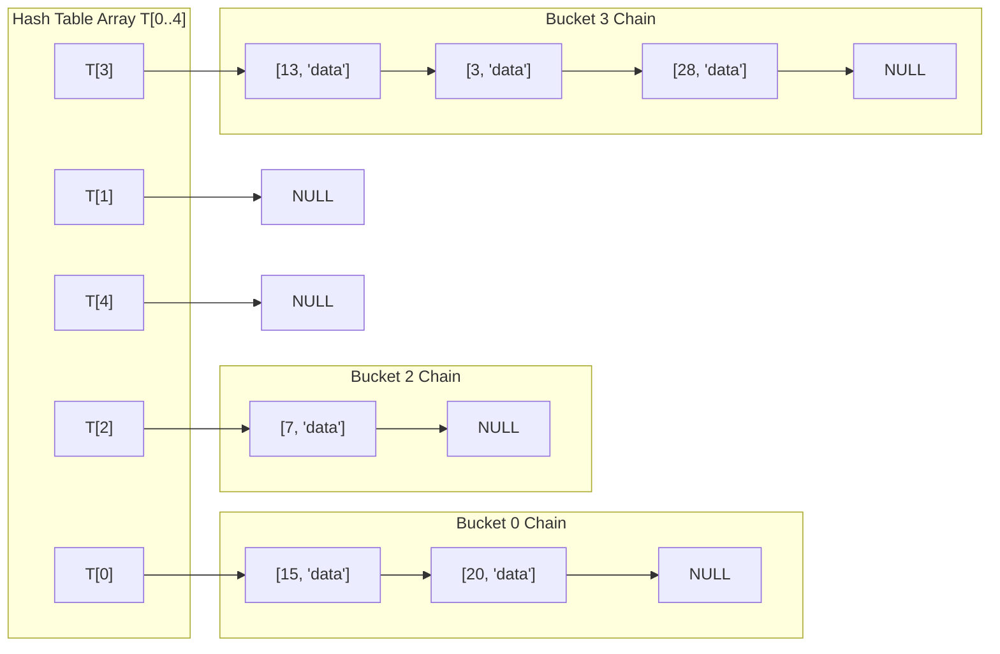
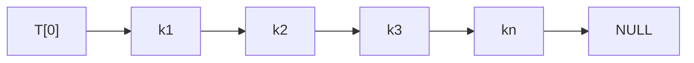
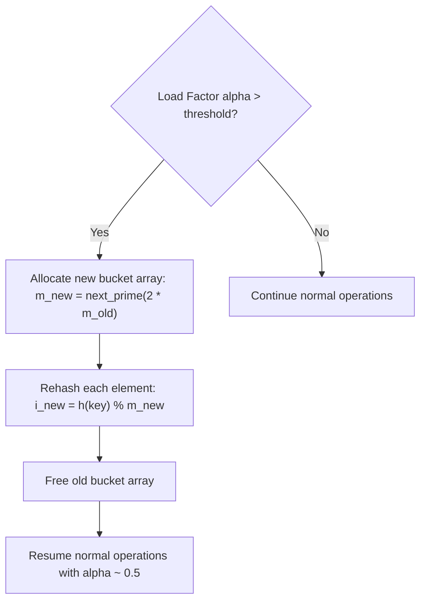

[DSA Index](../README.md) / [Unit 4: Graphs and Hashing](Introduction.md)

# L07: Collision Resolution - Open Hashing

In L06, the Pigeonhole Principle established an inescapable truth: no matter how sophisticated our hash function is, whenever the key universe $|U|$ exceeds the table size $m$, collisions will occur. Two distinct keys $k_1 \neq k_2$ will eventually evaluate to the exact same table slot $h(k_1) = h(k_2)$.

What do we do when two keys want the same slot?

There are two major architectural paradigms for resolving collisions:
1. **Open Hashing (Separate Chaining)**: Allow multiple elements to live outside the primary table array by maintaining an auxiliary data structure (typically a linked list) at each bucket.
2. **Closed Hashing (Open Addressing)**: Restrict all elements to the primary table array itself, searching for alternative vacant slots when collisions occur.

In this lecture, we dissect the mechanics, mathematical analysis, and implementation of **Open Hashing**, universally known as **Separate Chaining**.

---

## The Separate Chaining Architecture

In Separate Chaining, the hash table $T$ does not store data records directly. Instead, $T$ is an array of $m$ pointers. Each slot $T[i]$ is the head pointer of an independent linked list (often called a **bucket** or chain).

When a new key-value pair $(k, v)$ arrives:
1. Compute the hash index: $i = h(k)$.
2. Allocate a new linked list node containing $(k, v)$.
3. Insert the node into the linked list rooted at $T[i]$.



If five keys hash to slot 3, no data is overwritten and no slots are displaced. The five keys simply form a linked list of length 5 hanging from $T[3]$.

---

## The Load Factor: $\alpha$

How full is our hash table? To quantify table density, we define the **Load Factor**, universally denoted by the Greek letter $\alpha$:

$$\alpha = \frac{n}{m}$$

Where:
- $n$ is the total number of key-value elements currently stored in the hash table.
- $m$ is the total number of buckets (the size of array $T$).

Notice a critical distinction between Open Hashing and Closed Hashing:
- In Closed Hashing (where all elements live strictly inside the array), each slot can hold at most one element. Therefore, $\alpha \le 1.0$ is a hard physical upper bound.
- In Open Hashing (Separate Chaining), linked lists can grow indefinitely. Thus, $\alpha$ can exceed $1.0$ without causing an overflow error. If $n = 10{,}000$ and $m = 1{,}000$, $\alpha = 10.0$, meaning each bucket contains an average of 10 nodes.

---

## Detailed Operational Mechanics

Let's examine how the three core dictionary operations execute in a separate chaining hash table.

### Insertion (`insert(key, value)`)

Suppose we want to insert key $k$:
1. Calculate index: $i = h(k)$.
2. Traverse the list at $T[i]$ to check if key $k$ already exists:
   - If found: update the associated value (or return false if duplicates are forbidden).
   - If not found: allocate a new node.
3. Where should we attach the new node?
   - **Head Insertion**: Prepend the new node at the front of the list ($O(1)$ pointer update).
   - **Tail Insertion**: Append at the end of the list ($O(L)$ where $L$ is list length).

Head insertion is generally preferred because recently inserted elements are often accessed soon after (temporal locality).

```c
// Prepending at bucket head
Node *new_node = create_node(key, value);
new_node->next = table->buckets[index];
table->buckets[index] = new_node;
table->num_elements++;
```

### Search (`search(key)`)

To retrieve the record for key $k$:
1. Calculate index: $i = h(k)$ ($O(1)$).
2. Scan the linked list starting at head $T[i]$:
   - Compare each node's key with $k$.
   - If a match is found, return the value.
   - If the scan reaches `NULL`, key $k$ is not present in the table.

### Deletion (`delete(key)`)

To delete key $k$:
1. Calculate index: $i = h(k)$ ($O(1)$).
2. Maintain a `prev` pointer while traversing the list at $T[i]$.
3. When matching node `curr` is found:
   - If `curr == T[i]` (head node): update `T[i] = curr->next`.
   - Else: update `prev->next = curr->next`.
4. Free `curr` and decrement element count $n$.

---

## Mathematical Average-Case Complexity Analysis

What is the expected runtime of searching a separate chaining hash table?

To analyze this rigorously, we assume the **Simple Uniform Hashing Assumption (SUHA)**: any given key is equally likely to hash into any of the $m$ slots, independently of where any other key has hashed.

Under SUHA, the expected number of keys in any bucket $T[i]$ is simply the average list length:

$$E[\text{length of list } T[i]] = \frac{n}{m} = \alpha$$

### Case 1: Unsuccessful Search

Suppose the searched key $k$ is not in the table.
1. We compute $h(k)$ in $O(1)$ time.
2. We must search the entire linked list at $T[h(k)]$ until hitting `NULL`.
3. Under SUHA, the expected length of this list is $\alpha$.

Therefore, the expected number of elements examined in an unsuccessful search is:

$$T_{\text{unsuccessful}} = \Theta(1 + \alpha)$$

The term $1$ represents the $O(1)$ time to compute the hash and index into the array, and $\alpha$ represents traversing the bucket's linked list.

### Case 2: Successful Search

Suppose key $k$ is present in the table.
The number of comparisons required equals $1$ plus the number of elements that were inserted into the same bucket *after* key $k$ was inserted.

Assuming all keys are equally likely to be searched, the expected position of a searched key in its list is roughly half the expected list length:

$$T_{\text{successful}} = \Theta\left(1 + \frac{\alpha}{2}\right)$$

### The $O(1)$ Average Guarantee

Notice what these formulas tell us:
If the number of table slots $m$ is maintained roughly proportional to the number of elements $n$ (so $m = \Theta(n)$), then the load factor $\alpha = n/m$ is a **constant**:

$$\alpha \le O(1) \implies T_{\text{search}} = \Theta(1 + O(1)) = O(1)$$

Under SUHA, with a bounded load factor, searching, inserting, and deleting all run in **$O(1)$ expected time**!

### The Worst-Case Nightmare

What if our hash function is compromised, or an adversary feeds inputs designed to cause collisions?
In the worst possible case, every single one of the $n$ keys hashes to the exact same slot $T[0]$:



The hash table degenerates into a single linked list of length $n$. Search and deletion degrade to **$O(n)$ worst-case time**.

To protect against worst-case degradation in production systems (such as Java's `HashMap` in JDK 8+), buckets that exceed a certain length threshold (typically 8) dynamically morph from linked lists into balanced search trees (Red-Black trees), guaranteeing $O(\log n)$ worst-case search even during hash collisions.

---

## Dynamic Rehashing: Preserving the $O(1)$ Invariant

If we continuously insert keys into a fixed-size table with $m = 100$, what happens when $n$ grows to $100{,}000$?
The load factor becomes $\alpha = 1000$. Average search now requires traversing 500 linked list nodes, destroying the $O(1)$ performance.

To prevent this performance degradation, the hash table must dynamically expand when $\alpha$ exceeds a chosen threshold (typically $\alpha_{\max} = 0.75$ or $1.0$).

### The Rehashing Algorithm

When $\alpha > \alpha_{\max}$:
1. Allocate a new bucket array of size $m_{\text{new}} \approx 2 \times m_{\text{old}}$ (ideally the next prime number larger than $2m$).
2. Loop through all $m_{\text{old}}$ buckets of the old table.
3. For every node in every linked list:
   - Recompute its hash index using the **new** table size: $i_{\text{new}} = h(k) \bmod m_{\text{new}}$.
   - Re-link the node into the new bucket array at $i_{\text{new}}$.
4. Free the old bucket array.



### Amortized Analysis of Rehashing

Allocating a new array and migrating $n$ nodes takes $O(n)$ time.
However, doubling the table size occurs infrequently—only after $n$ new insertions have doubled the population.

Using aggregate amortized analysis:
- An insertion that does not trigger rehashing costs $O(1)$.
- An insertion that triggers rehashing costs $O(n)$, but this cost is distributed across the preceding $n/2$ insertions that grew the table.
- Each insertion carries an amortized cost of $O(1) + O(1) = O(1)$.

Thus, dynamic rehashing guarantees **$O(1)$ amortized insertion time**.

---

## Complete C Implementation: Separate Chaining Hash Table

Here is a complete C implementation featuring linked list chaining, key-value storage, duplicate updating, deletion, dynamic rehashing, and clean memory deallocation.

```c
#include <stdio.h>
#include <stdlib.h>
#include <string.h>
#include <stdbool.h>

#define INITIAL_CAPACITY 7
#define MAX_LOAD_FACTOR 0.75

// Node in the bucket linked list
typedef struct HashNode {
    char *key;
    int value;
    struct HashNode *next;
} HashNode;

// Hash Table Structure
typedef struct {
    HashNode **buckets;
    int capacity;
    int size;
} HashTable;

// String hash function (djb2)
static unsigned long hash_function(const char *str, int capacity) {
    unsigned long hash = 5381;
    int c;
    while ((c = (unsigned char)*str++)) {
        hash = ((hash << 5) + hash) + c; // hash * 33 + c
    }
    return hash % capacity;
}

static bool is_prime(int n) {
    if (n <= 1) return false;
    if (n <= 3) return true;
    if (n % 2 == 0 || n % 3 == 0) return false;
    for (int i = 5; i * i <= n; i += 6) {
        if (n % i == 0 || n % (i + 2) == 0) return false;
    }
    return true;
}

static int next_prime(int n) {
    while (!is_prime(n)) {
        n++;
    }
    return n;
}

HashTable *ht_create(int initial_capacity) {
    HashTable *table = (HashTable *)malloc(sizeof(HashTable));
    table->capacity = next_prime(initial_capacity);
    table->size = 0;
    table->buckets = (HashNode **)calloc(table->capacity, sizeof(HashNode *));
    return table;
}

static HashNode *node_create(const char *key, int value) {
    HashNode *node = (HashNode *)malloc(sizeof(HashNode));
    node->key = strdup(key);
    node->value = value;
    node->next = NULL;
    return node;
}

static void ht_rehash(HashTable *table) {
    int old_capacity = table->capacity;
    HashNode **old_buckets = table->buckets;

    int new_capacity = next_prime(old_capacity * 2);
    HashNode **new_buckets = (HashNode **)calloc(new_capacity, sizeof(HashNode *));

    // Migrate all nodes from old buckets to new buckets
    for (int i = 0; i < old_capacity; i++) {
        HashNode *curr = old_buckets[i];
        while (curr != NULL) {
            HashNode *next = curr->next;
            unsigned long new_idx = hash_function(curr->key, new_capacity);

            // Prepend to new bucket
            curr->next = new_buckets[new_idx];
            new_buckets[new_idx] = curr;

            curr = next;
        }
    }

    free(old_buckets);
    table->buckets = new_buckets;
    table->capacity = new_capacity;
}

bool ht_insert(HashTable *table, const char *key, int value) {
    // Check if rehashing is necessary
    if ((double)(table->size + 1) / table->capacity > MAX_LOAD_FACTOR) {
        ht_rehash(table);
    }

    unsigned long idx = hash_function(key, table->capacity);
    HashNode *curr = table->buckets[idx];

    // Check for existing key
    while (curr != NULL) {
        if (strcmp(curr->key, key) == 0) {
            curr->value = value; // Update value
            return true;
        }
        curr = curr->next;
    }

    // Insert new node at head of bucket chain
    HashNode *new_node = node_create(key, value);
    new_node->next = table->buckets[idx];
    table->buckets[idx] = new_node;
    table->size++;
    return true;
}

bool ht_search(HashTable *table, const char *key, int *out_value) {
    unsigned long idx = hash_function(key, table->capacity);
    HashNode *curr = table->buckets[idx];

    while (curr != NULL) {
        if (strcmp(curr->key, key) == 0) {
            if (out_value) *out_value = curr->value;
            return true;
        }
        curr = curr->next;
    }
    return false;
}

bool ht_delete(HashTable *table, const char *key) {
    unsigned long idx = hash_function(key, table->capacity);
    HashNode *curr = table->buckets[idx];
    HashNode *prev = NULL;

    while (curr != NULL) {
        if (strcmp(curr->key, key) == 0) {
            if (prev == NULL) {
                table->buckets[idx] = curr->next;
            } else {
                prev->next = curr->next;
            }
            free(curr->key);
            free(curr);
            table->size--;
            return true;
        }
        prev = curr;
        curr = curr->next;
    }
    return false;
}

void ht_print(HashTable *table) {
    printf("HashTable (size: %d, capacity: %d, load factor: %.2f):\n",
           table->size, table->capacity, (double)table->size / table->capacity);
    for (int i = 0; i < table->capacity; i++) {
        printf("  Bucket [%2d]:", i);
        HashNode *curr = table->buckets[i];
        while (curr) {
            printf(" -> ('%s': %d)", curr->key, curr->value);
            curr = curr->next;
        }
        printf(" -> NULL\n");
    }
}

void ht_destroy(HashTable *table) {
    for (int i = 0; i < table->capacity; i++) {
        HashNode *curr = table->buckets[i];
        while (curr) {
            HashNode *tmp = curr;
            curr = curr->next;
            free(tmp->key);
            free(tmp);
        }
    }
    free(table->buckets);
    free(table);
}
```

---

## Complexity Summary of Separate Chaining

| Operation | Best Case | Average Case (SUHA) | Worst Case (All Collide) | Auxiliary Space |
| :--- | :--- | :--- | :--- | :--- |
| **Insert** | $O(1)$ | $O(1)$ amortized | $O(n)$ (checking duplicates) | $O(1)$ per node |
| **Search** | $O(1)$ | $\Theta(1 + \alpha)$ | $\Theta(n)$ | $O(1)$ |
| **Delete** | $O(1)$ | $\Theta(1 + \alpha)$ | $\Theta(n)$ | $O(1)$ |
| **Rehash ($m \to 2m$)** | $\Theta(n)$ | $\Theta(n)$ | $\Theta(n)$ | $\Theta(n)$ temp |
| **Total Table Space** | $\Theta(m + n)$ | $\Theta(m + n)$ | $\Theta(m + n)$ | $\Theta(m + n)$ |

---

## Key Takeaways

- Open Hashing (Separate Chaining) resolves collisions by maintaining an auxiliary linked list (or dynamic bucket) at each table slot.
- The load factor $\alpha = n / m$ represents the average chain length across all buckets; in separate chaining, $\alpha$ can exceed $1.0$.
- Under the Simple Uniform Hashing Assumption (SUHA), search requires examining $\Theta(1 + \alpha)$ nodes on average.
- Maintaining $\alpha \le O(1)$ guarantees $O(1)$ average-case dictionary operations.
- Dynamic rehashing doubles the table capacity and re-inserts all keys when $\alpha > \alpha_{\max}$, achieving $O(1)$ amortized insertion cost.
- The worst-case runtime degrades to $\Theta(n)$ if all keys collide into a single bucket.

Separate Chaining handles collisions gracefully, but it introduces an architectural trade-off: every inserted element requires a dynamically allocated linked list node with pointer overhead, causing memory fragmentation and frequent CPU cache misses. Can we store all elements directly inside the primary table array without using pointers or linked lists? To explore that approach, let's turn to [L08 - Collision Resolution - Closed Hashing](L08%20-%20Collision%20Resolution%20-%20Closed%20Hashing.md).
