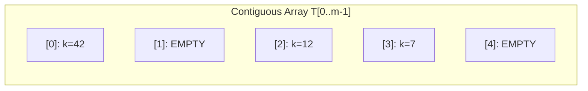
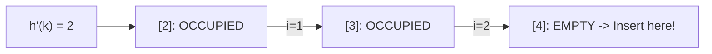
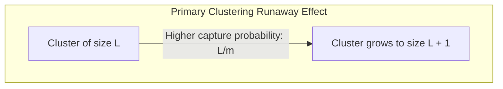
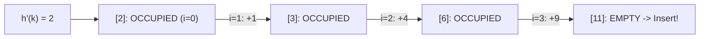
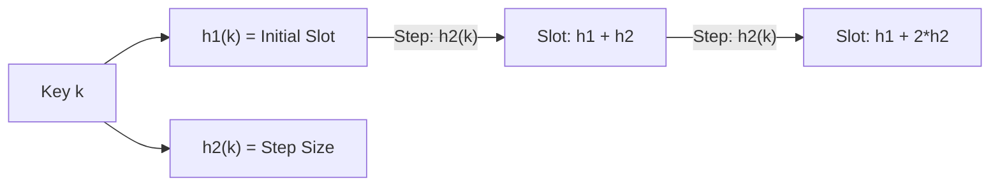
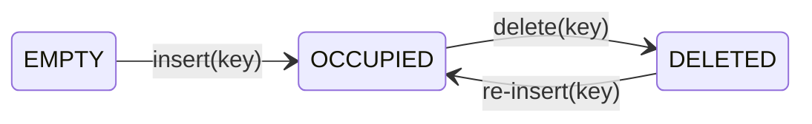

[DSA Index](../README.md) / [Unit 4: Graphs and Hashing](Introduction.md)

# L08: Collision Resolution - Closed Hashing

In L07, we solved collisions using Separate Chaining (Open Hashing) by attaching dynamic linked lists to each table slot. That approach is flexible—the table can never truly overflow because lists can grow indefinitely.

However, from a modern hardware perspective, Separate Chaining has significant trade-offs:
1. **Pointer Memory Overhead**: Every linked list node requires an 8-byte pointer (`next`) alongside its key and value. If your payload is a 4-byte integer, the pointer occupies twice as much memory as the data itself!
2. **Memory Fragmentation**: Each node is allocated independently on the heap via `malloc()`, scattering nodes across non-contiguous memory pages.
3. **CPU Cache Inefficiency**: Modern CPUs do not read individual bytes; they fetch 64-byte chunks of contiguous memory called cache lines into L1/L2 caches. Traversing a linked list chases pointers across arbitrary heap addresses, triggering frequent CPU cache misses.

Can we build a hash table where **all elements live directly inside a single flat contiguous array**, completely eliminating pointers and linked lists?

This is the philosophy of **Closed Hashing**, universally known as **Open Addressing**.

---

## The Open Addressing Paradigm

In Open Addressing, every record is stored directly in an array slot. No elements live outside the table array.



Because every slot can hold at most one element, two physical constraints immediately emerge:
1. The number of elements $n$ can never exceed the table capacity $m$:

$$\alpha = \frac{n}{m} \le 1.0$$

2. When a collision occurs at slot $h_0(k)$, we cannot hang a list from it. Instead, we must systematically **probe** alternative slots in the array until we find an empty slot.

### The General Probing Sequence

To formalize this, an open addressing hash function takes two arguments: the key $k$ and the probe attempt number $i \in \{0, 1, 2, \dots, m-1\}$:

$$h(k, i) = \big( h'(k) + f(i) \big) \bmod m$$

Where:
- $h'(k)$ is an initial baseline hash function mapping key $k$ into $\{0, 1, \dots, m-1\}$.
- $f(i)$ is a collision offset function satisfying $f(0) = 0$.
- $i$ is the probe step: $i = 0$ is the initial attempt, $i = 1$ is the first alternate probe, $i = 2$ is the second, and so on.

The sequence of slot indices produced by $i = 0, 1, 2, \dots, m-1$:

$$\langle h(k, 0), h(k, 1), h(k, 2), \dots, h(k, m-1) \rangle$$

is called the **Probe Sequence**. For the hash table to be robust, this probe sequence must form a complete permutation of all table slots $\{0, 1, \dots, m-1\}$, ensuring every slot is visited before declaring the table full.

---

## Probing Strategies

How we define the offset function $f(i)$ determines the behavior and performance of the hash table. Let's analyze the three classic probing methods.

### Linear Probing

The simplest probing strategy is **Linear Probing**, where the offset is a linear function of the probe count:

$$f(i) = i$$

$$h(k, i) = (h'(k) + i) \bmod m$$

If slot $h'(k)$ is occupied, we try $(h'(k) + 1) \bmod m$, then $(h'(k) + 2) \bmod m$, and so forth. We simply walk sequentially forward through the array, wrapping around to index 0 when we reach the end.



#### The Primary Clustering Phenomenon

Linear probing offers excellent CPU cache locality because it scans contiguous array cells sequentially. However, it suffers from a severe algorithmic flaw known as **Primary Clustering**.

Whenever a collision occurs, elements are placed in adjacent slots, forming contiguous blocks of occupied cells. The moment a cluster forms:
- Any new key hashing into any slot within that cluster will probe to the end of the cluster and append itself to it.
- As a result, larger clusters have a higher mathematical probability of capturing new keys than smaller clusters or empty slots!



As the load factor $\alpha$ climbs above $0.7$, clusters merge into massive contiguous blocks, causing search and insertion times to degrade rapidly.

---

### Quadratic Probing

To eliminate the continuous blocks of primary clustering, **Quadratic Probing** spaces out subsequent probes using a quadratic polynomial:

$$f(i) = c_1 i + c_2 i^2$$

In its most common formulation ($c_1 = 0, c_2 = 1$ or $c_1 = 1, c_2 = 1$):

$$h(k, i) = (h'(k) + i^2) \bmod m$$

The probe offsets grow quadratically: $+0, +1, +4, +9, +16, \dots \pmod m$.



Because adjacent slots are not probed sequentially, primary clusters cannot form.

#### Secondary Clustering and the Coverage Problem

Quadratic probing has two subtleties:
1. **Secondary Clustering**: If two distinct keys $k_1$ and $k_2$ have the same initial hash $h'(k_1) = h'(k_2)$, they will trace the exact same quadratic probe sequence. This is milder than primary clustering, but still causes unnecessary collisions.
2. **The Coverage Problem**: Does a quadratic sequence visit all $m$ slots? Not necessarily. If $m$ is chosen arbitrarily, $i^2 \bmod m$ might cycle through a small subset of indices, failing to find open slots even when the table is mostly empty!

**Mathematical Theorem**: If the table size $m$ is a **prime number** and the load factor satisfies $\alpha \le 0.5$, then quadratic probing with $f(i) = i^2$ is guaranteed to examine at least $\lceil m / 2 \rceil$ distinct slots, ensuring that an empty slot will always be found.

---

### Double Hashing

To eliminate both primary and secondary clustering, we use **Double Hashing**.

Instead of using a fixed offset rule, the probe step size is determined by a **second independent hash function**, $h_2(k)$:

$$f(i) = i \cdot h_2(k)$$

$$h(k, i) = \big( h_1(k) + i \cdot h_2(k) \big) \bmod m$$



Now, even if two keys collide on their initial slot ($h_1(k_1) = h_1(k_2)$), their step sizes $h_2(k_1)$ and $h_2(k_2)$ will almost certainly differ. They diverge into completely different probe trajectories.

#### Rules for Designing $h_2(k)$

For double hashing to visit every slot in the table, the step size $h_2(k)$ must be **coprime** (relatively prime) to the table size $m$:

$$\gcd(h_2(k), m) = 1$$

If $\gcd(h_2(k), m) > 1$, the probe sequence will cycle through a small subgroup of size $m / \gcd(h_2(k))$, skipping most of the table.

Two standard configurations guarantee coprimality:
1. Choose $m$ as a prime number, and let $h_2(k) = 1 + (k \bmod (m - 1))$. Since $1 \le h_2(k) \le m - 1$, $h_2(k)$ is never 0 and is coprime to prime $m$.
2. Choose $m$ as a power of 2 ($m = 2^p$), and ensure $h_2(k)$ always produces an odd integer ($h_2(k) = 2 \cdot k' + 1$). Any odd number is coprime to a power of 2.

---

## The Deletion Dilemma: The Need for Tombstones

Consider what happens when we delete an element in an open addressing hash table.

Suppose keys $A, B, C$ all hash to slot 2 under linear probing:
- $A$ is inserted at slot 2 ($i=0$).
- $B$ collides at slot 2, probes to slot 3, and is inserted at slot 3 ($i=1$).
- $C$ collides at slot 2, probes past 2 and 3, and is inserted at slot 4 ($i=2$).

Table state:
`[2: A, 3: B, 4: C]`

Now suppose someone calls `delete(B)`.
If we simply clear slot 3 back to `EMPTY`:
`[2: A, 3: EMPTY, 4: C]`

Now someone calls `search(C)`:
1. Hash $C \implies h'(C) = 2$. Slot 2 contains $A \neq C$.
2. Probe to slot 3.
3. Slot 3 is `EMPTY`!
4. The search algorithm halts and reports: **"Key C does not exist!"**

By resetting slot 3 to `EMPTY`, we broke the probe chain! The search algorithm assumes that an `EMPTY` slot means the key was never inserted.

### The Solution: Lazy Deletion (Tombstones)

To preserve probe sequences, we must distinguish between two states:
- `EMPTY`: The slot has never held a key. Searches stop here.
- `DELETED` (Tombstone): The slot once held a key that has since been removed.



Rules for operations with tombstones:
- **Search**: Continues probing past `DELETED` slots, stopping only when the matching key is found or an `EMPTY` slot is hit.
- **Insert**: Can overwrite a `DELETED` slot with a new key (recording the first tombstone seen during the probe sequence to reuse memory).

---

## Performance Under Varying Load Factors

Under the assumption of uniform hashing, the expected number of probes required for operations in Open Addressing is given by:

| Operation | Expected Probes Formula | $\alpha = 0.50$ | $\alpha = 0.75$ | $\alpha = 0.90$ |
| :--- | :--- | :--- | :--- | :--- |
| **Unsuccessful Search / Insert** | $\frac{1}{1 - \alpha}$ | $2.0$ probes | $4.0$ probes | $10.0$ probes |
| **Successful Search** | $\frac{1}{\alpha} \ln \frac{1}{1 - \alpha}$ | $1.39$ probes | $1.85$ probes | $2.56$ probes |

Notice the critical difference between Open Addressing and Separate Chaining:
- In Separate Chaining, search time scales **linearly** with load factor: $\Theta(1 + \alpha)$. At $\alpha = 2.0$, search takes $\sim 2$ checks.
- In Open Addressing, search time scales **asymptotically toward infinity** as $\alpha \to 1.0$: $\frac{1}{1 - \alpha}$. At $\alpha = 0.95$, an unsuccessful search requires an average of 20 probes!

This is why open addressing hash tables must trigger rehashing early—typically when $\alpha$ reaches **$0.70$ to $0.75$**.

---

## Complete C Implementation: Open Addressing Hash Table

Here is a complete C implementation supporting Linear Probing, Quadratic Probing, and Double Hashing with tombstone management.

```c
#include <stdio.h>
#include <stdlib.h>
#include <string.h>
#include <stdbool.h>

typedef enum {
    SLOT_EMPTY,
    SLOT_OCCUPIED,
    SLOT_DELETED
} SlotState;

typedef enum {
    PROBE_LINEAR,
    PROBE_QUADRATIC,
    PROBE_DOUBLE_HASH
} ProbingMethod;

typedef struct {
    char *key;
    int value;
    SlotState state;
} HashEntry;

typedef struct {
    HashEntry *table;
    int capacity;
    int size;
    ProbingMethod method;
} OpenAddrHashTable;

// Helper: check primality
static bool is_prime(int n) {
    if (n <= 1) return false;
    if (n <= 3) return true;
    if (n % 2 == 0 || n % 3 == 0) return false;
    for (int i = 5; i * i <= n; i += 6) {
        if (n % i == 0 || n % (i + 2) == 0) return false;
    }
    return true;
}

static int next_prime(int n) {
    while (!is_prime(n)) n++;
    return n;
}

// Primary Hash Function: djb2
static unsigned int hash1(const char *str, int m) {
    unsigned long hash = 5381;
    int c;
    while ((c = (unsigned char)*str++)) {
        hash = ((hash << 5) + hash) + c;
    }
    return (unsigned int)(hash % m);
}

// Secondary Hash Function for Double Hashing: must be coprime to m
static unsigned int hash2(const char *str, int m) {
    unsigned long hash = 0;
    while (*str) {
        hash = (hash * 31) + (unsigned char)(*str++);
    }
    return (unsigned int)(1 + (hash % (m - 1))); // Guarantees 1 <= h2 < m
}

// Calculate probe index based on method
static int get_probe_index(OpenAddrHashTable *ht, const char *key, int i) {
    unsigned int h1 = hash1(key, ht->capacity);
    switch (ht->method) {
        case PROBE_LINEAR:
            return (h1 + i) % ht->capacity;
        case PROBE_QUADRATIC:
            return (h1 + i + i * i) % ht->capacity;
        case PROBE_DOUBLE_HASH: {
            unsigned int h2 = hash2(key, ht->capacity);
            return (h1 + i * h2) % ht->capacity;
        }
    }
    return h1;
}

OpenAddrHashTable *oa_create(int min_capacity, ProbingMethod method) {
    OpenAddrHashTable *ht = (OpenAddrHashTable *)malloc(sizeof(OpenAddrHashTable));
    ht->capacity = next_prime(min_capacity);
    ht->size = 0;
    ht->method = method;
    ht->table = (HashEntry *)calloc(ht->capacity, sizeof(HashEntry));
    for (int i = 0; i < ht->capacity; i++) {
        ht->table[i].state = SLOT_EMPTY;
    }
    return ht;
}

bool oa_insert(OpenAddrHashTable *ht, const char *key, int value) {
    if ((double)(ht->size + 1) / ht->capacity > 0.70) {
        // Table load factor exceeded 70%
        printf("Table high load (size %d, cap %d). Rehash required.\n", ht->size, ht->capacity);
        return false;
    }

    int first_tombstone = -1;

    for (int i = 0; i < ht->capacity; i++) {
        int idx = get_probe_index(ht, key, i);

        if (ht->table[idx].state == SLOT_OCCUPIED) {
            if (strcmp(ht->table[idx].key, key) == 0) {
                ht->table[idx].value = value; // Key already exists; update value
                return true;
            }
        } else if (ht->table[idx].state == SLOT_DELETED) {
            if (first_tombstone == -1) {
                first_tombstone = idx; // Remember first deleted slot
            }
        } else if (ht->table[idx].state == SLOT_EMPTY) {
            // Found empty slot. Insert into tombstone if available, else here
            int target = (first_tombstone != -1) ? first_tombstone : idx;
            ht->table[target].key = strdup(key);
            ht->table[target].value = value;
            ht->table[target].state = SLOT_OCCUPIED;
            ht->size++;
            return true;
        }
    }

    // If whole table probed and only tombstones available
    if (first_tombstone != -1) {
        ht->table[first_tombstone].key = strdup(key);
        ht->table[first_tombstone].value = value;
        ht->table[first_tombstone].state = SLOT_OCCUPIED;
        ht->size++;
        return true;
    }

    return false; // Table full
}

bool oa_search(OpenAddrHashTable *ht, const char *key, int *out_value) {
    for (int i = 0; i < ht->capacity; i++) {
        int idx = get_probe_index(ht, key, i);

        if (ht->table[idx].state == SLOT_EMPTY) {
            return false; // Encountered unpopulated slot -> key cannot exist
        }

        if (ht->table[idx].state == SLOT_OCCUPIED) {
            if (strcmp(ht->table[idx].key, key) == 0) {
                if (out_value) *out_value = ht->table[idx].value;
                return true;
            }
        }
        // If SLOT_DELETED, continue probing!
    }
    return false;
}

bool oa_delete(OpenAddrHashTable *ht, const char *key) {
    for (int i = 0; i < ht->capacity; i++) {
        int idx = get_probe_index(ht, key, i);

        if (ht->table[idx].state == SLOT_EMPTY) {
            return false;
        }

        if (ht->table[idx].state == SLOT_OCCUPIED) {
            if (strcmp(ht->table[idx].key, key) == 0) {
                free(ht->table[idx].key);
                ht->table[idx].key = NULL;
                ht->table[idx].state = SLOT_DELETED; // Lazy deletion!
                ht->size--;
                return true;
            }
        }
    }
    return false;
}

void oa_destroy(OpenAddrHashTable *ht) {
    for (int i = 0; i < ht->capacity; i++) {
        if (ht->table[i].state == SLOT_OCCUPIED) {
            free(ht->table[i].key);
        }
    }
    free(ht->table);
    free(ht);
}
```

---

## Architectural Comparison: Separate Chaining vs. Open Addressing

| Dimension | Separate Chaining (Open Hashing) | Open Addressing (Closed Hashing) |
| :--- | :--- | :--- |
| **Storage Location** | Primary array of buckets + external linked lists | Strictly inside contiguous table array |
| **Load Factor ($\alpha = n/m$)** | Can exceed $1.0$ (e.g. $\alpha = 2.0, 5.0$) | Strictly bounded: $\alpha \le 1.0$ (typically $\le 0.7$) |
| **Memory Overhead** | Requires pointers (`next`) for every node | Zero pointer overhead per record |
| **CPU Cache Locality** | Poor (heap pointer chasing causes cache misses) | Excellent (linear probing reads sequential cache lines) |
| **Clustering Issues** | No clustering; chains grow independently | Suffers from primary/secondary clustering |
| **Deletion Complexity** | Simple node unlinking and `free()` | Requires tombstone management (`SLOT_DELETED`) |
| **Rehashing Trigger** | Typically $\alpha \ge 0.75 - 1.0$ | Strictly required when $\alpha \ge 0.70$ |
| **Behavior When Full** | Degrades gracefully into longer lists | Fails completely if no free slots exist |

---

## Key Takeaways

- Closed Hashing (Open Addressing) stores all records directly within a contiguous table array, eliminating pointer overhead and maximizing CPU cache locality.
- Because all elements live in the array, the load factor is strictly constrained: $\alpha \le 1.0$.
- Linear Probing ($f(i) = i$) offers optimal cache locality but suffers from severe primary clustering.
- Quadratic Probing ($f(i) = i^2$) breaks primary clusters but requires prime table sizes and $\alpha \le 0.5$ to guarantee slot coverage.
- Double Hashing ($f(i) = i \cdot h_2(k)$) eliminates both primary and secondary clustering by computing per-key probe strides coprime to $m$.
- Hard deletion breaks probe sequences; open addressing requires lazy deletion using tombstones (`SLOT_DELETED`).
- Average probe counts scale as $1/(1-\alpha)$, requiring aggressive resizing when $\alpha$ approaches $0.70$.

Hash tables give us near-instantaneous $O(1)$ exact-key retrieval. But suppose your task is not to find an exact key, but to find all words starting with the prefix `"auto"`, determine the longest common prefix, or run an autocomplete search engine. In a hash table, hashing completely scatters related strings, making prefix queries take $O(n \cdot L)$ brute-force time. To solve prefix retrieval with elegance and speed, let's proceed to our final lecture: [L09 - Tries - Prefix Trees](L09%20-%20Tries%20-%20Prefix%20Trees.md).
