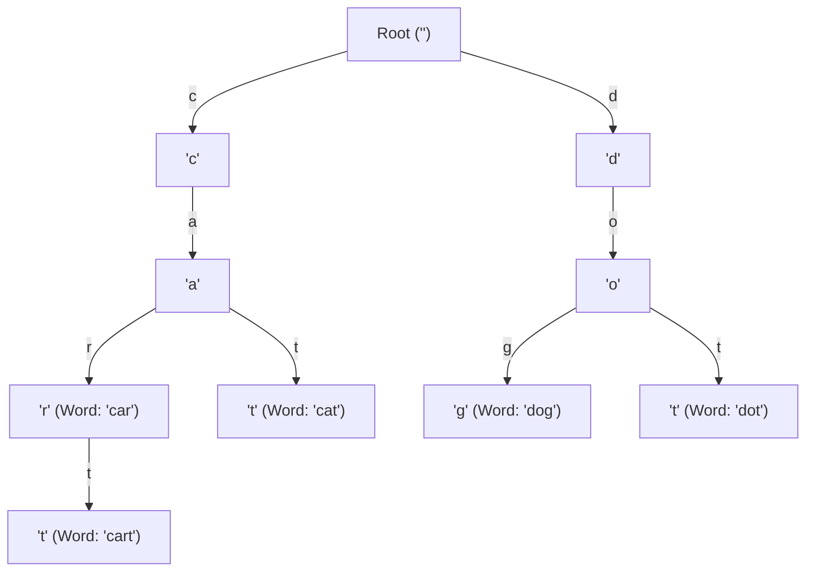
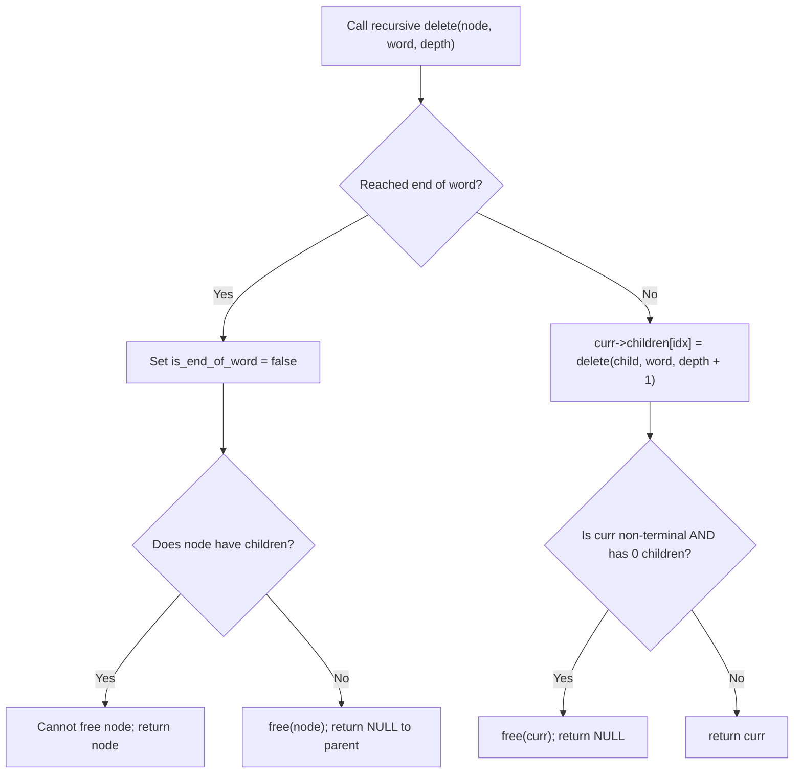
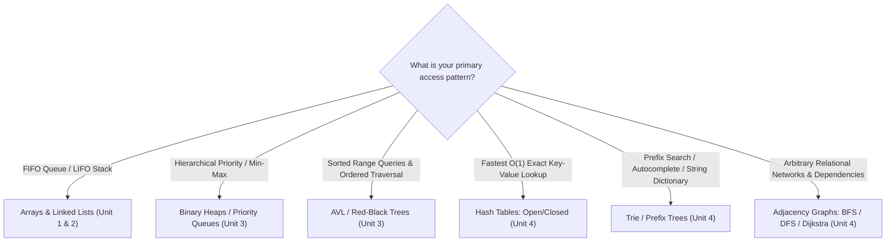

[DSA Index](../README.md) / [Unit 4: Graphs and Hashing](Introduction.md)

# L09: Tries - Prefix Trees

Over the course of this unit, we engineered two distinct mechanisms for retrieving data:
1. **Binary Search Trees & AVL Trees**: Maintain keys in sorted order, providing $O(\log n)$ search, insert, and range queries.
2. **Hash Tables**: Map keys into compact arrays via hash functions, achieving average $O(1)$ constant-time exact lookups.

Now consider a different problem common to real-world software systems:
- A search engine's query bar suggests completions in real time as the user types `"algo..."`.
- A spell checker highlights words that do not share a valid dictionary prefix.
- An IP router determines the next network hop using Longest Prefix Matching (LPM) on 32-bit or 128-bit addresses.
- A DNA sequence analyzer searches for recurring gene substrings across billions of base pairs.

Can a Hash Table or a Binary Search Tree solve these prefix problems efficiently?

---

## Why Hash Tables and Search Trees Fall Short

Let's test our existing tools against prefix queries:

### Hash Tables Destroy Prefix Structure
In L06, we saw that a core property of any good hash function is **bit diffusion** (the avalanche effect). Changing a single character must scatter the hash value to an unrelated slot:
- `hash("cat")` $\implies 241$
- `hash("caterpillar")` $\implies 9182$
- `hash("catch")` $\implies 412$

Because hashing intentionally scatters keys to prevent clustering, related words with common prefixes share no spatial relationship in the hash table. To find all words starting with `"cat"`, you have no choice but to scan all $n$ entries in the table, checking `strncmp()` against each. That takes brute-force $\Theta(n \cdot L)$ time.

### Binary Search Trees Compare Entire Strings
In an AVL tree or Red-Black tree storing $n$ strings, each comparison at a tree node compares entire strings of length $L$, taking $O(L)$ time per node.
Traversing from root to leaf takes:

$$O(L \cdot \log n)$$

When dictionary size $n$ reaches millions of words, $\log n \approx 20$, and comparing long strings at every branch adds significant overhead.

We need a data structure where **search time is strictly proportional to the length of the query string $L$, and completely independent of the number of words stored $n$**.

This is the **Trie** (derived from the word re**trie**val, historically pronounced either "tree" or "try").

---

## The Trie Anatomy

A **Trie** (also known as a **Prefix Tree** or **Digital Search Tree**) is an $M$-ary tree where:
1. The **root** represents the empty string `""`.
2. Nodes do **not** store entire strings. Instead, the path from the root to any given node spells out a string prefix.
3. Each edge leaving a node is labeled with a single character (or corresponds to an index in a fixed alphabet array).
4. Each node maintains a boolean flag: `is_end_of_word` (or `is_terminal`). This flag indicates whether the string spelled out from the root to this node constitutes a complete, valid dictionary word.



Notice how much space and structure is shared:
- The words `"cat"`, `"car"`, and `"cart"` share the identical root branch: `'c' \to 'a'`.
- The common prefix `"ca"` is stored only **once** in memory, not three separate times.
- `"car"` is a complete word (`is_end_of_word = true`), but its node also serves as the internal trunk for the longer word `"cart"`.

---

## Core Operations

Let's trace how insertion, search, prefix matching, and deletion work down to the pointer level.

### Word Insertion (`insert(word)`)

To insert a string of length $L$:
1. Start at `curr = root`.
2. For each character $c$ in the word:
   - Calculate alphabet index: `idx = c - 'a'`.
   - If `curr->children[idx] == NULL`: allocate a new `TrieNode` and set `curr->children[idx]` to point to it.
   - Advance: `curr = curr->children[idx]`.
3. After the loop processes the final character, set `curr->is_end_of_word = true`.

Every character requires exactly one pointer check and at most one allocation:

$$T_{\text{insert}}(L) = \Theta(L)$$

Notice that $T_{\text{insert}}$ does not depend on the dictionary size $n$. Inserting a word into a dictionary of 10 words takes the exact same number of steps as inserting into a dictionary of 10,000,000 words.

### Exact Word Search (`search(word)`)

To search for a complete word:
1. Start at `curr = root`.
2. For each character $c$ in the word:
   - Calculate index: `idx = c - 'a'`.
   - If `curr->children[idx] == NULL`: the prefix does not exist $\implies$ return `false`.
   - Advance: `curr = curr->children[idx]`.
3. When the string is exhausted, return `curr->is_end_of_word`.

Why must we check `curr->is_end_of_word`?
If our Trie contains `"cart"`, and we search for `"car"`:
- The characters `'c'`, `'a'`, `'r'` all exist.
- But if `"car"` was never explicitly inserted as a standalone word, its node has `is_end_of_word = false`. It is merely an internal prefix, not a dictionary entry.

### Prefix Search (`startsWith(prefix)`)

To check whether any dictionary word begins with a given prefix:
1. Walk down the tree following the characters of `prefix`.
2. If at any step `curr->children[idx] == NULL`, return `false`.
3. If the entire prefix is traversed successfully, return `true` regardless of whether `curr->is_end_of_word` is true or false.

This simple routine powers autocomplete search engines. Once you reach `curr` at the end of the prefix, a simple DFS/BFS traversal of the subtree rooted at `curr` yields all words beginning with that prefix.

### Word Deletion (`delete(word)`)

Deletion is more nuanced than insertion because of shared branches.

Consider deleting `"cat"` when `"cart"` and `"car"` are also in the Trie:
- Can we delete the `'c'` or `'a'` nodes? Absolutely not; `"car"` and `"cart"` rely on them.
- Can we delete the `'t'` node of `"cat"`? Yes, because `'t'` has no children and `"cat"` is not a prefix of any other word.
- What if we delete `"car"`, but `"cart"` is in the Trie? We cannot free the `'r'` node; we merely toggle its `is_end_of_word` flag from `true` to `false`!



Deletion requires a **post-order traversal** (backtracking from bottom to top), pruning unused leaf nodes while preserving shared trunks.

---

## Memory vs. Time Trade-Off: Fixed Arrays vs. Dynamic Children

The standard textbook implementation of a Trie allocates a fixed-size array of child pointers at every node:

```c
#define ALPHABET_SIZE 26

typedef struct TrieNode {
    bool is_end_of_word;
    struct TrieNode *children[ALPHABET_SIZE];
} TrieNode;
```

Let's calculate the memory cost:
- Each pointer is 8 bytes.
- $26 \times 8 = 208$ bytes per node (plus bool and padding $\approx 216$ bytes).
- If your dictionary contains 100,000 nodes, the Trie consumes $\sim 21.6 \text{ MB}$.
- Most slots in `children[]` are `NULL` pointers, especially at deeper levels.

For large alphabets (e.g., Unicode UTF-8 with thousands of characters), a fixed array per node is impractical. Real-world systems optimize this using:
1. **Dynamic Child Collections**: Use a small sorted array, balanced BST, or hash map of children at each node, trading small access time overhead for massive memory savings.
2. **Compressed Tries (Radix Trees / Patricia Tries)**: Nodes with only a single child are collapsed into their parent, merging multi-character edge labels (e.g., merging `'c' \to 'a' \to 'r'` into a single edge `"car"`). This guarantees that every internal node has at least two children, bounding the total number of nodes to at most $2n$.

---

## Complete C Implementation: Trie Engine

```c
#include <stdio.h>
#include <stdlib.h>
#include <stdbool.h>
#include <string.h>

#define ALPHABET_SIZE 26

// Trie Node Definition
typedef struct TrieNode {
    bool is_end_of_word;
    struct TrieNode *children[ALPHABET_SIZE];
} TrieNode;

// Create a newly allocated Trie node
TrieNode *trie_node_create(void) {
    TrieNode *node = (TrieNode *)malloc(sizeof(TrieNode));
    if (!node) return NULL;

    node->is_end_of_word = false;
    for (int i = 0; i < ALPHABET_SIZE; i++) {
        node->children[i] = NULL;
    }
    return node;
}

// Insert a word into the Trie
void trie_insert(TrieNode *root, const char *word) {
    TrieNode *curr = root;
    for (int i = 0; word[i] != '\0'; i++) {
        int idx = word[i] - 'a';
        if (idx < 0 || idx >= ALPHABET_SIZE) continue; // Skip non-lowercase characters

        if (curr->children[idx] == NULL) {
            curr->children[idx] = trie_node_create();
        }
        curr = curr->children[idx];
    }
    curr->is_end_of_word = true;
}

// Search for a complete word in the Trie
bool trie_search(TrieNode *root, const char *word) {
    TrieNode *curr = root;
    for (int i = 0; word[i] != '\0'; i++) {
        int idx = word[i] - 'a';
        if (idx < 0 || idx >= ALPHABET_SIZE) return false;

        if (curr->children[idx] == NULL) {
            return false;
        }
        curr = curr->children[idx];
    }
    return curr != NULL && curr->is_end_of_word;
}

// Check if any word begins with the given prefix
bool trie_starts_with(TrieNode *root, const char *prefix) {
    TrieNode *curr = root;
    for (int i = 0; prefix[i] != '\0'; i++) {
        int idx = prefix[i] - 'a';
        if (idx < 0 || idx >= ALPHABET_SIZE) return false;

        if (curr->children[idx] == NULL) {
            return false;
        }
        curr = curr->children[idx];
    }
    return curr != NULL;
}

// Helper to check if a node has any active children
static bool has_children(TrieNode *node) {
    for (int i = 0; i < ALPHABET_SIZE; i++) {
        if (node->children[i] != NULL) return true;
    }
    return false;
}

// Recursive word deletion
static TrieNode *trie_delete_helper(TrieNode *curr, const char *word, int depth) {
    if (!curr) return NULL;

    // Base case: reached end of word
    if (word[depth] == '\0') {
        if (curr->is_end_of_word) {
            curr->is_end_of_word = false; // Unmark terminal
        }

        // If this node has no children, it can be safely pruned
        if (!has_children(curr)) {
            free(curr);
            curr = NULL;
        }
        return curr;
    }

    // Recursive case: step down to child
    int idx = word[depth] - 'a';
    curr->children[idx] = trie_delete_helper(curr->children[idx], word, depth + 1);

    // Backtracking: if current node is not end-of-word and has no children left, prune it
    if (!curr->is_end_of_word && !has_children(curr)) {
        free(curr);
        curr = NULL;
    }

    return curr;
}

void trie_delete(TrieNode *root, const char *word) {
    if (!root || !word) return;
    trie_delete_helper(root, word, 0);
}

// Free all allocated nodes post-order
void trie_destroy(TrieNode *root) {
    if (!root) return;
    for (int i = 0; i < ALPHABET_SIZE; i++) {
        if (root->children[i] != NULL) {
            trie_destroy(root->children[i]);
        }
    }
    free(root);
}
```

---

## Complexity Comparison Across Data Structures

| Data Structure | Exact Search Time | Prefix Search Time | Space Overhead | Order Maintained? |
| :--- | :--- | :--- | :--- | :--- |
| **Unsorted Array** | $O(n \cdot L)$ | $O(n \cdot L)$ | $\Theta(n \cdot L)$ | Insertion order |
| **Sorted Array** | $O(L \cdot \log n)$ | $O(L \cdot \log n)$ | $\Theta(n \cdot L)$ | Lexicographical |
| **Balanced BST (AVL)** | $O(L \cdot \log n)$ | $O(L \cdot \log n)$ | $\Theta(n \cdot L)$ | Lexicographical |
| **Hash Table** | $O(L)$ average | $O(n \cdot L)$ (brute force) | $\Theta(n \cdot L)$ | None (destroyed) |
| **Standard Trie** | $\Theta(L)$ | $\Theta(L)$ | $O(\Sigma \cdot N \cdot L)$ | Lexicographical |
| **Radix Tree (Compressed Trie)** | $\Theta(L)$ | $\Theta(L)$ | $\Theta(n \cdot L)$ | Lexicographical |

Notice the remarkable property of the Trie:
Both exact search and prefix search execute in **$\Theta(L)$ time**, where $L$ is the length of the string, completely independent of the number of words $n$ stored in the dictionary.

---

## Course-Wide Data Structure Selection Guide

With the completion of Unit 4, we have assembled the complete canonical toolkit of Data Structures and Algorithms. When designing software architectures, how do you choose the right data structure for the job?



---

## Unit 4 Synthesis and Course Arc

Let's trace how the entire curriculum developed:
- **Unit 1**: We grounded our thinking in computer memory, pointer arithmetic, dynamic heap allocation, and the linear primitives of Stacks and Linked Lists.
- **Unit 2**: We mastered specialized linear structures—Circular Linked Lists, Doubly Linked Lists, Double-Ended Queues, and Priority Queues.
- **Unit 3**: We broke out of linear constraints into hierarchical structures: Binary Search Trees, self-balancing AVL Trees, and Binary Heaps.
- **Unit 4**: We explored unconstrained relationships:
  - **Graphs**: Modeling arbitrary topologies with Adjacency Matrices and Lists.
  - **BFS & DFS**: Exploring networks in wavefronts and depth-first descents, classifying edges into trees, back-edges, and cross-edges.
  - **Connectivity & Cycles**: Uncovering connected components, bipartite testing, cycle detection, and strongly connected components with Kosaraju's algorithm.
  - **Dijkstra's Algorithm**: Finding optimal weighted routes through greedy edge relaxation.
  - **Hashing**: Escaping comparison limits to achieve $O(1)$ dictionary operations via hash functions, separate chaining, and open addressing probing.
  - **Tries**: Organizing strings into shared prefix trees for $O(L)$ retrieval and autocomplete.

---

## Key Takeaways

- Tries solve prefix retrieval and autocomplete queries in $\Theta(L)$ time, independent of dictionary size $n$.
- Characters label the transitions between nodes; nodes themselves store terminal state flags (`is_end_of_word`).
- Insertion and exact search navigate character by character down the tree, taking $\Theta(L)$ time.
- Deletion requires post-order recursive backtracking to prune unshared leaf branches while keeping shared prefixes intact.
- The standard Trie trades memory ($26$ pointers per node) for speed; Radix trees compress single-child nodes to eliminate this overhead.
- Choose your data structure based on access pattern: Hash Tables for $O(1)$ exact match, AVL trees for ordered range searches, Tries for string prefixes, and Graphs for relational networks.

This concludes Unit 4 and completes the **Data Structures and Applications** lecture series. You now possess a rigorous conceptual and practical foundation spanning memory allocation, linear lists, search trees, relational graph traversals, shortest path optimization, constant-time hashing, and multi-way string retrieval. To review other units or explore the full curriculum, return to the [DSA Master Index](../README.md).
