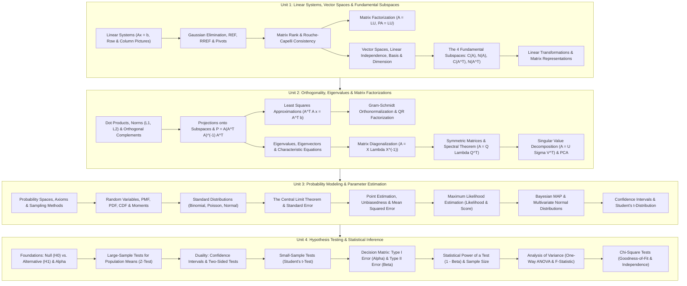

# Mathematical Foundation for AI & Data Science: Complete Coursework Curriculum and Topic Index

Welcome to the comprehensive coursework study vault for **Mathematical Foundation for AI & Data Science (Maths / MFAD / Linear Algebra & Statistics)**.

This vault contains exhaustive, highly structured, and intuitive coursework notes synthesizing lecture decks from PES University and foundational principles from the prescribed textbooks:
- **T1: Gilbert Strang**, *Linear Algebra and Its Applications* (4th/5th Edition, Cengage Learning / Wellesley-Cambridge).
- **T2: Douglas C. Montgomery & George C. Runger**, *Applied Statistics and Probability for Engineers* (7th Edition, Wiley).
- **R1: Sheldon Ross**, *Introduction to Probability Models* (12th Edition, Academic Press).

Every note is written in a think-out-loud, pedagogical style: explaining geometric intuitions in $\mathbb{R}^n$, algebraic proofs, optimization objectives, probabilistic uncertainties, and statistical decision pipelines underpinning modern Artificial Intelligence, Machine Learning, and Data Science.

---

## Mathematical Foundations Architectural Map

The diagram below illustrates the mathematical progression from deterministic vector spaces to spectral matrix factorizations, probabilistic parameter estimation, and formal statistical hypothesis testing:

---

## Master Table of Contents

### [Unit 1: Systems of Linear Equations, Vector Spaces, and Fundamental Subspaces](Unit%201/Introduction.md)

- [**Unit 1 Introduction & Roadmap**](Unit%201/Introduction.md) — The algebraic and geometric language of linear equations and vector spaces.
- [**L01 - Systems of Linear Equations and Matrix Representation**](Unit%201/L01%20-%20Systems%20of%20Linear%20Equations%20and%20Matrix%20Representation.md) — Linear systems $A\mathbf{x} = \mathbf{b}$, the row picture (intersecting hyperplanes) vs. the column picture (linear combination of columns), coefficient matrix, and augmented matrix.
- [**L02 - Gaussian Elimination and Row Echelon Form**](Unit%201/L02%20-%20Gaussian%20Elimination%20and%20Row%20Echelon%20Form.md) — Elementary row operations, forward elimination, pivots, Row Echelon Form (REF), Reduced Row Echelon Form (RREF), back-substitution, and computational complexity.
- [**L03 - Matrix Rank and Consistency of Linear Systems**](Unit%201/L03%20-%20Matrix%20Rank%20and%20Consistency%20of%20Linear%20Systems.md) — Rank of a matrix, pivot variables vs. free variables, the Rouche-Capelli theorem, homogeneous systems, and classifying systems into unique solution, infinite solutions, or inconsistent (no solution).
- [**L04 - LU Decomposition**](Unit%201/L04%20-%20LU%20Decomposition.md) — Factoring $A = LU$, elimination matrices $E_{ij}$, unit lower triangular $L$, upper triangular $U$, solving $A\mathbf{x}=\mathbf{b}$ via $L\mathbf{y}=\mathbf{b}$ and $U\mathbf{x}=\mathbf{y}$, permutation matrices, and $PA = LU$.
- [**L05 - Matrix Inversion by Gauss-Jordan Elimination**](Unit%201/L05%20-%20Matrix%20Inversion%20by%20Gauss-Jordan%20Elimination.md) — Definition of inverse, invertibility conditions, Gauss-Jordan method $[A \mid I] \to [I \mid A^{-1}]$, singular matrices, and computational pitfalls.
- [**L06 - Vector Spaces and Subspaces**](Unit%201/L06%20-%20Vector%20Spaces%20and%20Subspaces.md) — The 8 vector space axioms over $\mathbb{R}^n$, closure under vector addition and scalar multiplication, the subspace test, and geometric examples in $\mathbb{R}^2$ and $\mathbb{R}^3$.
- [**L07 - Linear Independence, Basis, and Dimension**](Unit%201/L07%20-%20Linear%20Independence,%20Basis,%20and%20Dimension.md) — Linear combinations, linear span $\text{span}(S)$, linear independence and dependence tests, basis of a vector space, dimension, and minimal spanning sets.
- [**L08 - The Four Fundamental Subspaces**](Unit%201/L08%20-%20The%20Four%20Fundamental%20Subspaces.md) — Column Space $C(A)$, Null Space $N(A)$, Row Space $C(A^T)$, Left Null Space $N(A^T)$, finding bases and dimensions, the Rank-Nullity Theorem ($r + (n-r) = n$), and the Fundamental Theorem of Linear Algebra.
- [**L09 - Linear Transformations**](Unit%201/L09%20-%20Linear%20Transformations.md) — Definition of linear transformations $T: V \to W$, properties, matrix representation with respect to standard and non-standard bases, kernel (null space), range (column space), and change of basis.

---

### [Unit 2: Orthogonality, Eigenvalues, and Matrix Factorizations](Unit%202/Introduction.md)

- [**Unit 2 Introduction & Roadmap**](Unit%202/Introduction.md) — Geometry in vector spaces, orthogonal projections, least squares modeling, and spectral matrix decompositions.
- [**L01 - Dot Product, Vector Norms, and Orthogonality**](Unit%202/L01%20-%20Dot%20Product,%20Vector%20Norms,%20and%20Orthogonality.md) — Inner products in $\mathbb{R}^n$, dot product algebraic properties, vector norms ($L_1, L_2, L_\infty$), distance metrics, angles between vectors, Cauchy-Schwarz inequality, and orthogonal vectors.
- [**L02 - Orthogonal Complements and Fundamental Subspaces**](Unit%202/L02%20-%20Orthogonal%20Complements%20and%20Fundamental%20Subspaces.md) — Orthogonal subspace complements $V^\perp$, geometric proof that Row Space is orthogonal to Null Space ($C(A^T) \perp N(A)$), and Column Space is orthogonal to Left Null Space ($C(A) \perp N(A^T)$).
- [**L03 - Projections onto Lines and Subspaces**](Unit%202/L03%20-%20Projections%20onto%20Lines%20and%20Subspaces.md) — 1D scalar and vector projections, projection matrices for lines, general subspace projection matrix $P = A(A^T A)^{-1}A^T$, and idempotent/symmetric properties ($P^2 = P, P^T = P$).
- [**L04 - Least Squares Approximations**](Unit%202/L04%20-%20Least%20Squares%20Approximations.md) — Solving inconsistent overdetermined systems $A\mathbf{x} = \mathbf{b}$, normal equations $A^T A \hat{\mathbf{x}} = A^T \mathbf{b}$, error vector orthogonality, and fitting linear models to noisy empirical data.
- [**L05 - The Gram-Schmidt Process and QR Factorization**](Unit%202/L05%20-%20The%20Gram-Schmidt%20Process%20and%20QR%20Factorization.md) — Gram-Schmidt orthogonalization algorithm, converting an arbitrary basis into an orthonormal basis, standardizing coordinates, and the $A = QR$ matrix decomposition.
- [**L06 - Introduction to Eigenvalues and Eigenvectors**](Unit%202/L06%20-%20Introduction%20to%20Eigenvalues%20and%20Eigenvectors.md) — The fundamental eigenvalue equation $A\mathbf{x} = \lambda\mathbf{x}$, characteristic polynomial $\det(A - \lambda I) = 0$, trace and determinant theorems, and algebraic vs. geometric multiplicity.
- [**L07 - Diagonalization of a Matrix**](Unit%202/L07%20-%20Diagonalization%20of%20a%20Matrix.md) — Diagonalizability conditions, matrix powers $A^k$, constructing the eigenvector matrix $X$ and eigenvalue matrix $\Lambda$, the similarity transformation $A = X \Lambda X^{-1}$, and applications in discrete dynamical systems.
- [**L08 - Symmetric Matrices and the Spectral Theorem**](Unit%202/L08%20-%20Symmetric%20Matrices%20and%20the%20Spectral%20Theorem.md) — Real eigenvalues of symmetric matrices, orthogonal eigenvectors, the Spectral Decomposition $A = Q \Lambda Q^T = \sum \lambda_i \mathbf{q}_i \mathbf{q}_i^T$, and positive definite matrices.
- [**L09 - Singular Value Decomposition and PCA Foundations**](Unit%202/L09%20-%20Singular%20Value%20Decomposition%20and%20PCA%20Foundations.md) — Limitations of diagonalization for non-square matrices, geometry of SVD ($A = U \Sigma V^T$), singular values $\sigma_i$, low-rank matrix approximation, and the mathematical foundations of Principal Component Analysis (PCA).

---

### [Unit 3: Probability Modeling and Parameter Estimation](Unit%203/Introduction.md)

- [**Unit 3 Introduction & Roadmap**](Unit%203/Introduction.md) — Quantifying uncertainty, probabilistic distributions, sampling models, and parameter estimation.
- [**L01 - Introduction to Probability Modeling and Sampling**](Unit%203/L01%20-%20Introduction%20to%20Probability%20Modeling%20and%20Sampling.md) — Population vs. sample, sample spaces, probability axioms, sampling techniques (simple random, stratified, cluster, systematic), and sampling bias.
- [**L02 - Random Variables and Probability Distributions**](Unit%203/L02%20-%20Random%20Variables%20and%20Probability%20Distributions.md) — Discrete vs. continuous random variables, PMF, PDF, CDF properties, expectation (mean), variance, and standard deviation.
- [**L03 - Common Probability Distributions**](Unit%203/L03%20-%20Common%20Probability%20Distributions.md) — Bernoulli trials, Binomial distribution, Poisson process, Uniform distribution, and the Gaussian / Normal distribution ($Z$-score standardization).
- [**L04 - Multivariate Distributions and Independence**](Unit%203/L04%20-%20Multivariate%20Distributions%20and%20Independence.md) — Joint PMF/PDF, marginal distributions, conditional distributions, statistical independence, covariance, and Pearson correlation coefficient.
- [**L05 - The Central Limit Theorem**](Unit%203/L05%20-%20The%20Central%20Limit%20Theorem.md) — Sampling distribution of the sample mean, standard error of the mean, the Central Limit Theorem statement, convergence mechanics, and sample size guidelines ($n \ge 30$).
- [**L06 - Principles of Point Estimation**](Unit%203/L06%20-%20Principles%20of%20Point%20Estimation.md) — Estimators vs. estimates, unbiasedness, efficiency, consistency, Mean Squared Error (MSE), and the Bias-Variance tradeoff.
- [**L07 - Maximum Likelihood Estimation**](Unit%203/L07%20-%20Maximum%20Likelihood%20Estimation.md) — Likelihood function $L(\theta)$, log-likelihood $\ln L(\theta)$, score function, solving score equations for Bernoulli and Normal parameters ($\mu$ and $\sigma^2$).
- [**L08 - Maximum A Posteriori and Multivariate Normal**](Unit%203/L08%20-%20Maximum%20A%20Posteriori%20and%20Multivariate%20Normal.md) — Bayes' theorem in parameter estimation, prior distributions, posterior distributions, MAP estimation, and the geometry of the Multivariate Normal distribution.
- [**L09 - Interval Estimation and Confidence Intervals**](Unit%203/L09%20-%20Interval%20Estimation%20and%20Confidence%20Intervals.md) — Point estimate limitations, confidence levels ($1 - \alpha$), critical values $z_{\alpha/2}$, large-sample confidence intervals for population mean, and sample size determination.
- [**L10 - Student's t-Distribution and Small Sample Intervals**](Unit%203/L10%20-%20Student's%20t-Distribution%20and%20Small%20Sample%20Intervals.md) — Unknown population variance, degrees of freedom, heavy-tailed properties of Student's t-distribution, small-sample confidence intervals, and factors affecting the Margin of Error.

---

### [Unit 4: Hypothesis Testing and Statistical Inference](Unit%204/Introduction.md)

- [**Unit 4 Introduction & Roadmap**](Unit%204/Introduction.md) — The logic of statistical falsification, significance testing, decision errors, and category analysis.
- [**L01 - Foundations of Hypothesis Testing**](Unit%204/L01%20-%20Foundations%20of%20Hypothesis%20Testing.md) — The scientific logic of statistical falsification, formulating Null ($H_0$) and Alternative ($H_1$) hypotheses, one-tailed vs. two-tailed tests, test statistics, and significance level $\alpha$.
- [**L02 - Large-Sample Tests for a Population Mean**](Unit%204/L02%20-%20Large-Sample%20Tests%20for%20a%20Population%20Mean.md) — Large sample $Z$-test for a single mean, critical values ($z_\alpha, z_{\alpha/2}$), calculating and interpreting $p$-values, and making rigorous accept/reject decisions.
- [**L03 - Confidence Intervals and Hypothesis Testing Relationship**](Unit%204/L03%20-%20Confidence%20Intervals%20and%20Hypothesis%20Testing%20Relationship.md) — Duality between $(1-\alpha)$ confidence intervals and two-sided $\alpha$-level tests, equivalence proofs, and statistical vs. practical significance.
- [**L04 - Small-Sample Tests for a Population Mean**](Unit%204/L04%20-%20Small-Sample%20Tests%20for%20a%20Population%20Mean.md) — The one-sample $t$-test with unknown variance, degrees of freedom, robustness against non-normality, and two-sample pooled/unpooled $t$-tests.
- [**L05 - Type I and Type II Errors**](Unit%204/L05%20-%20Type%20I%20and%20Type%20II%20Errors.md) — The error matrix, false positives (Type I error $\alpha$), false negatives (Type II error $\beta$), trade-offs between $\alpha$ and $\beta$, and the consequences of sample size on error rates.
- [**L06 - Power of a Test and Factors Affecting Power**](Unit%204/L06%20-%20Power%20of%20a%20Test%20and%20Factors%20Affecting%20Power.md) — Statistical power ($1 - \beta$), power curves, effect size (Cohen's $d$), sample size determination for desired power, and trade-offs in experimental design.
- [**L07 - Analysis of Variance - One-Way ANOVA**](Unit%204/L07%20-%20Analysis%20of%20Variance%20-%20One-Way%20ANOVA.md) — Multiple group comparisons, inflation of family-wise Type I error rate, Sum of Squares (Total, Between, Within), mean squares, and the $F$-test statistic.
- [**L08 - Chi-Square Goodness-of-Fit Test**](Unit%204/L08%20-%20Chi-Square%20Goodness-of-Fit%20Test.md) — Testing categorical distributions against theoretical expectations, observed vs. expected frequencies, degrees of freedom, and the $\chi^2$ test statistic.
- [**L09 - Chi-Square Tests of Independence and Homogeneity**](Unit%204/L09%20-%20Chi-Square%20Tests%20of%20Independence%20and%20Homogeneity.md) — Contingency tables ($r \times c$), calculating expected cell counts, testing independence between two categorical variables, and testing homogeneity across distinct populations.

---

## Pedagogical Structure & Navigation Rules

Every lecture note follows a rigorous, uniform format:
1. **Breadcrumb**: Direct link back to this master index and unit roadmap.
2. **Geometric & Probabilistic Intuition**: Physical meaning and data science relevance introduced before formal algebra.
3. **Mermaid Visualizations**: Geometric hyperplanes, transformation diagrams, probability spaces, and decision flowcharts.
4. **LaTeX Mathematical Formulations**: Clean display and inline equations for all definitions, theorems, and derivations.
5. **Step-by-Step Worked Numerical Examples**: Complete calculations walked through from start to finish.
6. **Key Takeaways & Forward Bridges**: Concise bulleted summaries followed by a natural narrative transition to the next topic.
