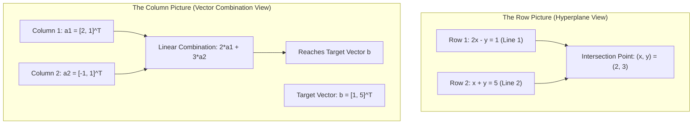

[Maths Index](../README.md) / [Unit 1: Systems of Linear Equations, Vector Spaces, and Fundamental Subspaces](Introduction.md)

# Systems of Linear Equations and Matrix Representation

When we begin our study of artificial intelligence, machine learning, and high-dimensional data science, we immediately confront a fundamental reality: virtually every algorithm we encounter is an exercise in linear algebra. Whether we are training a deep neural network with millions of synaptic weights, estimating regression coefficients on high-dimensional tabular datasets, or performing dimensionality reduction with principal component analysis, the underlying mathematical object is always a system of linear equations.

Before we can manipulate these systems with algorithms like Gaussian elimination or decompose them into structural factorizations, we must build an ironclad intuition for what a system of linear equations actually represents. 

Now, most people are taught to view a linear equation as a static algebraic constraint. But in linear algebra, there are two distinct, complementary ways to see the exact same system: the row picture and the column picture. Mastering the interplay between these two geometric viewpoints is the single most important conceptual leap in foundational mathematics for data science.

---

## The Algebraic Definition of a Linear System

Let's start from first principles. What makes an equation linear? 

An equation in variables $x_1, x_2, \dots, x_n$ is called linear if each variable appears only to the first power, is not multiplied by any other variable, and does not sit inside non-linear functions such as trigonometric, exponential, or logarithmic expressions.

Formally, a general linear equation over the real numbers $\mathbb{R}$ is written as:

$$a_1 x_1 + a_2 x_2 + \dots + a_n x_n = b$$

Here, the real numbers $a_1, a_2, \dots, a_n$ are the coefficients, $x_1, x_2, \dots, x_n$ are the unknowns (or variables), and $b$ is the constant term.

A system of $m$ linear equations in $n$ unknowns is simply a collection of $m$ such equations that must be satisfied simultaneously:

$$\begin{aligned}
a_{11} x_1 + a_{12} x_2 + \dots + a_{1n} x_n &= b_1 \\
a_{21} x_1 + a_{22} x_2 + \dots + a_{2n} x_n &= b_2 \\
&\;\;\vdots \\
a_{m1} x_1 + a_{m2} x_2 + \dots + a_{mn} x_n &= b_m
\end{aligned}$$

Notice the double-subscript notation $a_{ij}$: the first index $i \in \{1, \dots, m\}$ denotes the equation (row) number, and the second index $j \in \{1, \dots, n\}$ denotes the variable (column) number.

A solution to this system is an ordered $n$-tuple of real numbers $(s_1, s_2, \dots, s_n)$ that satisfies every single equation simultaneously when substituted for $(x_1, x_2, \dots, x_n)$. The set of all such solutions is called the solution set.

---

## Matrix-Vector Representation: The Compact Form

Writing out long lists of summations and indices is tedious and obscures the structural relationships between the variables and equations. We package this entire system into a single matrix-vector equation:

$$A\mathbf{x} = \mathbf{b}$$

Let's dissect each component of this equation:

1. The coefficient matrix $A \in \mathbb{R}^{m \times n}$ gathers all coefficients into a rectangular grid with $m$ rows and $n$ columns:

$$A = \begin{bmatrix}
a_{11} & a_{12} & \dots & a_{1n} \\
a_{21} & a_{22} & \dots & a_{2n} \\
\vdots & \vdots & \ddots & \vdots \\
a_{m1} & a_{m2} & \dots & a_{mn}
\end{bmatrix}$$

2. The vector of unknowns $\mathbf{x} \in \mathbb{R}^n$ is an $n$-dimensional column vector:

$$\mathbf{x} = \begin{bmatrix} x_1 \\ x_2 \\ \vdots \\ x_n \end{bmatrix}$$

3. The constant vector $\mathbf{b} \in \mathbb{R}^m$ is an $m$-dimensional column vector:

$$\mathbf{b} = \begin{bmatrix} b_1 \\ b_2 \\ \vdots \\ b_m \end{bmatrix}$$

When solving these systems algorithmically, we frequently concatenate the matrix $A$ and the vector $\mathbf{b}$ into a single unified entity called the augmented matrix $[A \mid \mathbf{b}] \in \mathbb{R}^{m \times (n+1)}$:

$$[A \mid \mathbf{b}] = \left[\begin{array}{cccc|c}
a_{11} & a_{12} & \dots & a_{1n} & b_1 \\
a_{21} & a_{22} & \dots & a_{2n} & b_2 \\
\vdots & \vdots & \ddots & \vdots & \vdots \\
a_{m1} & a_{m2} & \dots & a_{mn} & b_m
\end{array}\right]$$

The augmented matrix contains every piece of numerical data needed to solve the system, without carrying around the names of the variables.

---

## The Dual Geometric Perspectives: Row Picture vs. Column Picture

Now here is where deep mathematical insight begins. How should we visualize the system $A\mathbf{x} = \mathbf{b}$?

There are two fundamental geometric views:
1. The Row Picture: Focuses on equations and intersections of hyperplanes.
2. The Column Picture: Focuses on vectors, directions, and linear combinations.

Let's explore both viewpoints in detail using a concrete $2 \times 2$ system:

$$\begin{aligned}
2x - y &= 1 \\
x + y &= 5
\end{aligned}$$

In matrix form $A\mathbf{x} = \mathbf{b}$:

$$\begin{bmatrix} 2 & -1 \\ 1 & 1 \end{bmatrix} \begin{bmatrix} x \\ y \end{bmatrix} = \begin{bmatrix} 1 \\ 5 \end{bmatrix}$$

### The Row Picture: Intersecting Hyperplanes

In the row picture, we read the matrix equation row by row. Each row represents a single constraint, which geometrically defines an $(n-1)$-dimensional hyperplane in $\mathbb{R}^n$.

For our $2 \times 2$ system:
- The first row is the equation of a line: $2x - y = 1 \implies y = 2x - 1$.
- The second row is another line: $x + y = 5 \implies y = 5 - x$.

Every point on the first line satisfies equation 1. Every point on the second line satisfies equation 2. 

The solution to the entire system is the intersection of these two lines: the unique point $(x, y)$ that lies simultaneously on both lines.

Solving this algebraically:
Adding the two equations yields $(2x - y) + (x + y) = 1 + 5 \implies 3x = 6 \implies x = 2$.
Substituting $x = 2$ into the second equation yields $2 + y = 5 \implies y = 3$.

Thus, the row picture shows two straight lines intersecting in the Euclidean plane at the single point $(2, 3)$.

What happens when we move to $\mathbb{R}^3$? 
In 3 dimensions, each equation represents a 2-dimensional flat plane. Two planes typically intersect along a line. A third plane intersects that line at a single point (if a unique solution exists). 

In $\mathbb{R}^n$, each equation represents an $(n-1)$-dimensional hyperplane. The row picture asks: where do these $m$ hyperplanes intersect?

While the row picture is intuitive for $n = 2$ and $n = 3$, it becomes nearly impossible to visualize when $n = 100$ or $n = 10{,}000$, which is routine in machine learning. Trying to visualize the intersection of 10,000 hyperplanes in a 10,000-dimensional space breaks human spatial intuition.

This is why we need the column picture.

### The Column Picture: Linear Combination of Column Vectors

Now look at the exact same matrix equation, but rewrite it by columns instead of rows:

$$x \begin{bmatrix} 2 \\ 1 \end{bmatrix} + y \begin{bmatrix} -1 \\ 1 \end{bmatrix} = \begin{bmatrix} 1 \\ 5 \end{bmatrix}$$

Notice what just happened. We are no longer looking at intersecting lines. 

Instead, we have two column vectors living in $\mathbb{R}^2$:

$$\mathbf{a}_1 = \begin{bmatrix} 2 \\ 1 \end{bmatrix}, \quad \mathbf{a}_2 = \begin{bmatrix} -1 \\ 1 \end{bmatrix}$$

And we are asked: can we stretch vector $\mathbf{a}_1$ by some factor $x$, stretch vector $\mathbf{a}_2$ by some factor $y$, and add them together using the parallelogram rule to land exactly on the target vector $\mathbf{b} = \begin{bmatrix} 1 \\ 5 \end{bmatrix}$?

Let's test our algebraic solution $x = 2$ and $y = 3$:

$$2 \begin{bmatrix} 2 \\ 1 \end{bmatrix} + 3 \begin{bmatrix} -1 \\ 1 \end{bmatrix} = \begin{bmatrix} 4 \\ 2 \end{bmatrix} + \begin{bmatrix} -3 \\ 3 \end{bmatrix} = \begin{bmatrix} 4 - 3 \\ 2 + 3 \end{bmatrix} = \begin{bmatrix} 1 \\ 5 \end{bmatrix}$$

It matches perfectly.

The column picture asks a fundamentally constructive question: 
"Is the vector $\mathbf{b}$ reachable as a linear combination of the column vectors of $A$?"

The column picture scales effortlessly to any number of dimensions. Even in a 1,000-dimensional space, the question is always the same: we have a collection of column vectors, and we want to know what space they fill when we take all possible linear combinations.

This space of all possible combinations is what we will formally define later as the column space $C(A)$.

---

## Matrix Multiplication: Two Ways to Multiply $A\mathbf{x}$

The duality between the row picture and column picture corresponds directly to two equivalent algebraic interpretations of matrix-vector multiplication $A\mathbf{x}$.

### Row-by-Row Interpretation (Dot Products)

To compute the $i$-th component of the output vector $\mathbf{y} = A\mathbf{x}$, we take the dot product (inner product) of the $i$-th row of $A$ with the vector $\mathbf{x}$:

$$y_i = \text{Row}_i(A) \cdot \mathbf{x} = \sum_{j=1}^n a_{ij} x_j$$

For example:

$$\begin{bmatrix} 2 & -1 \\ 1 & 1 \end{bmatrix} \begin{bmatrix} 2 \\ 3 \end{bmatrix} = \begin{bmatrix} 2(2) + (-1)(3) \\ 1(2) + 1(3) \end{bmatrix} = \begin{bmatrix} 4 - 3 \\ 2 + 3 \end{bmatrix} = \begin{bmatrix} 1 \\ 5 \end{bmatrix}$$

This is the standard definition taught in introductory algebra.

### Column Interpretation (Linear Combination of Columns)

The column interpretation states that the product $A\mathbf{x}$ is fundamentally a linear combination of the columns of $A$, weighted by the entries of $\mathbf{x}$:

$$A\mathbf{x} = x_1 \mathbf{a}_1 + x_2 \mathbf{a}_2 + \dots + x_n \mathbf{a}_n$$

Where $\mathbf{a}_j$ is the $j$-th column of $A$.

This perspective is central to modern machine learning. In neural networks, when an input layer $\mathbf{x}$ is multiplied by a weight matrix $W$, the resulting vector is a linear combination of the feature representations encoded in the columns of $W$.

---

## A Detailed 3-Dimensional Worked Example

To solidify both perspectives, let's work through a full 3-variable system:

$$\begin{aligned}
x + 2y + 3z &= 6 \\
2x + 5y + 2z &= 4 \\
6x - 3y + z &= 2
\end{aligned}$$

### Formulating the Matrix Representation

The coefficient matrix $A$, unknown vector $\mathbf{x}$, and right-hand side vector $\mathbf{b}$ are:

$$A = \begin{bmatrix} 1 & 2 & 3 \\ 2 & 5 & 2 \\ 6 & -3 & 1 \end{bmatrix}, \quad \mathbf{x} = \begin{bmatrix} x \\ y \\ z \end{bmatrix}, \quad \mathbf{b} = \begin{bmatrix} 6 \\ 4 \\ 2 \end{bmatrix}$$

The augmented matrix is:

$$[A \mid \mathbf{b}] = \left[\begin{array}{ccc|c}
1 & 2 & 3 & 6 \\
2 & 5 & 2 & 4 \\
6 & -3 & 1 & 2
\end{array}\right]$$

### Geometric Interpretation

In the row picture, we have three equations defining three planes in $\mathbb{R}^3$:
- Plane 1: $x + 2y + 3z = 6$
- Plane 2: $2x + 5y + 2z = 4$
- Plane 3: $6x - 3y + z = 2$

The solution $(x, y, z)$ is the unique point in 3-dimensional Euclidean space where all three planes intersect.

In the column picture, we express the system as:

$$x \begin{bmatrix} 1 \\ 2 \\ 6 \end{bmatrix} + y \begin{bmatrix} 2 \\ 5 \\ -3 \end{bmatrix} + z \begin{bmatrix} 3 \\ 2 \\ 1 \end{bmatrix} = \begin{bmatrix} 6 \\ 4 \\ 2 \end{bmatrix}$$

Here, we have three column vectors in $\mathbb{R}^3$:

$$\mathbf{a}_1 = \begin{bmatrix} 1 \\ 2 \\ 6 \end{bmatrix}, \quad \mathbf{a}_2 = \begin{bmatrix} 2 \\ 5 \\ -3 \end{bmatrix}, \quad \mathbf{a}_3 = \begin{bmatrix} 3 \\ 2 \\ 1 \end{bmatrix}$$

We ask whether the vector $\mathbf{b} = [6, 4, 2]^T$ lies in the 3D volume spanned by $\mathbf{a}_1, \mathbf{a}_2, \mathbf{a}_3$. If the three column vectors do not all lie in the same flat 2D plane (that is, if they are linearly independent), they span the entire 3-dimensional space $\mathbb{R}^3$, guaranteeing that any vector $\mathbf{b}$ can be synthesized uniquely.

---

## When Do Linear Systems Break Down?

So far, we have looked at systems with a single unique solution. But linear systems can behave in three fundamentally different ways:

1. Exactly one unique solution (consistent, independent).
2. Infinitely many solutions (consistent, dependent).
3. No solution at all (inconsistent).

Let's look at how this appears in both the row and column pictures.

### The Inconsistent Case (No Solution)

Consider the system:

$$\begin{aligned}
x + y &= 2 \\
x + y &= 4
\end{aligned}$$

In the row picture:
The two lines $y = 2 - x$ and $y = 4 - x$ are parallel. They have the same slope ($-1$) but different intercepts ($2$ and $4$). Because parallel lines never intersect, there is no point that lies on both lines. The solution set is empty $\emptyset$.

In the column picture:

$$x \begin{bmatrix} 1 \\ 1 \end{bmatrix} + y \begin{bmatrix} 1 \\ 1 \end{bmatrix} = \begin{bmatrix} 2 \\ 4 \end{bmatrix} \implies (x + y) \begin{bmatrix} 1 \\ 1 \end{bmatrix} = \begin{bmatrix} 2 \\ 4 \end{bmatrix}$$

Notice that both column vectors point in the exact same direction: along the line $y = x$. Any linear combination of them can only produce vectors where the first and second coordinates are identical: $[c, c]^T$. 

The target vector $\mathbf{b} = [2, 4]^T$ has unequal coordinates, so it lies completely outside the line spanned by the columns. It is unreachable.

### The Dependent Case (Infinitely Many Solutions)

Now consider:

$$\begin{aligned}
x + y &= 2 \\
2x + 2y &= 4
\end{aligned}$$

In the row picture:
The second equation is just the first equation multiplied by 2. Geometrically, both equations describe the exact same line. The intersection is the entire line itself, giving infinitely many solutions of the form $(x, 2 - x)$ for any $x \in \mathbb{R}$.

In the column picture:

$$(x + 2y) \begin{bmatrix} 1 \\ 2 \end{bmatrix} = \begin{bmatrix} 2 \\ 4 \end{bmatrix}$$

The target vector $\mathbf{b} = [2, 4]^T = 2 [1, 2]^T$ lies directly along the line spanned by the columns. There are infinitely many ways to choose $x$ and $y$ such that $x + 2y = 2$.

---

## Key Takeaways

- A system of $m$ linear equations in $n$ variables can be compactly represented as $A\mathbf{x} = \mathbf{b}$, where $A \in \mathbb{R}^{m \times n}$ is the coefficient matrix, $\mathbf{x} \in \mathbb{R}^n$ is the unknown vector, and $\mathbf{b} \in \mathbb{R}^m$ is the constant vector.
- The augmented matrix $[A \mid \mathbf{b}]$ bundles the coefficients and constants for algorithmic computation.
- The row picture views the system as the intersection of $m$ hyperplanes in $n$-dimensional space. A unique solution exists if and only if these hyperplanes meet at a single point.
- The column picture views the system as a linear combination of the column vectors of $A$: $x_1 \mathbf{a}_1 + \dots + x_n \mathbf{a}_n = \mathbf{b}$. The system is solvable if and only if the target vector $\mathbf{b}$ can be formed from the columns of $A$.
- Matrix-vector multiplication $A\mathbf{x}$ can be interpreted as dot products of the rows of $A$ with $\mathbf{x}$, or as a linear combination of the columns of $A$ weighted by the components of $\mathbf{x}$.
- A linear system always has either exactly one unique solution, infinitely many solutions, or no solution at all.

---

Now that we understand what a linear system represents geometrically, we need a systematic, fail-safe algorithm to actually solve it without trial and error. In the next lecture, we develop the classic computational workhorse of linear algebra: forward elimination, elementary row operations, and row echelon forms. Read [L02 - Gaussian Elimination and Row Echelon Form](L02%20-%20Gaussian%20Elimination%20and%20Row%20Echelon%20Form.md).
