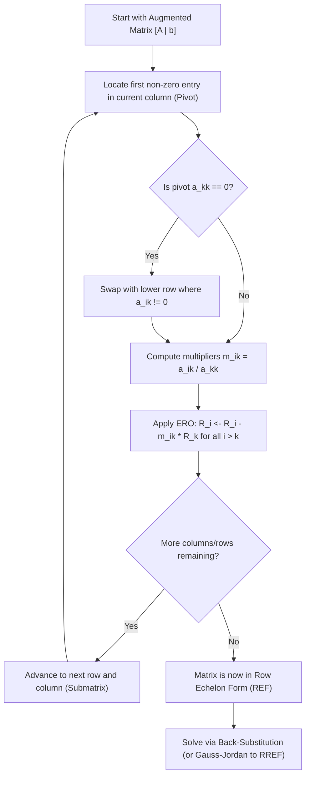

[Maths Index](../README.md) / [Unit 1: Systems of Linear Equations, Vector Spaces, and Fundamental Subspaces](Introduction.md)

# Gaussian Elimination and Row Echelon Form

In the previous lecture, we established that solving a system of linear equations $A\mathbf{x} = \mathbf{b}$ means finding where $m$ hyperplanes intersect or finding which weights combine the columns of $A$ to produce $\mathbf{b}$. But looking at equations or plotting planes does not give us an algorithm. When we have 100 equations in 100 variables, we cannot guess the answer. We need a systematic, deterministic procedure that transforms any system into a form that is trivial to solve.

That procedure is Gaussian elimination. 

Invented in antiquity and formalized by Carl Friedrich Gauss, Gaussian elimination is arguably the most foundational numerical algorithm in linear algebra. It transforms a messy, fully coupled system into a clean triangular system through a sequence of reversible, solution-preserving steps called elementary row operations.

---

## Elementary Row Operations

When we look at the augmented matrix $[A \mid \mathbf{b}]$, what operations can we perform on the rows without changing the underlying solution set?

Think about what a row represents: an entire equation. If you have an equation, you can swap its order with another equation, multiply both sides by a non-zero scalar, or add a multiple of one equation to another. The set of $(x_1, \dots, x_n)$ that satisfies the system remains completely unchanged.

Formally, there are three Elementary Row Operations (EROs):

1. Row Interchange (Swap):
   Swap row $i$ and row $j$:
   $$R_i \longleftrightarrow R_j$$

2. Row Scaling:
   Multiply every entry in row $i$ by a non-zero scalar $c \neq 0$:
   $$R_i \longleftarrow c R_i$$

3. Row Addition (Elimination):
   Add a scalar multiple of row $i$ to row $j$:
   $$R_j \longleftarrow R_j + c R_i \quad \text{or} \quad R_j \longleftarrow R_j - m_{ji} R_i$$

Notice an essential property: every single one of these operations is strictly reversible (invertible).
- The inverse of swapping $R_i \leftrightarrow R_j$ is swapping them back.
- The inverse of scaling $R_i \leftarrow c R_i$ is scaling by $1/c$ (which is why $c \neq 0$ is required).
- The inverse of $R_j \leftarrow R_j + c R_i$ is subtracting $c R_i$: $R_j \leftarrow R_j - c R_i$.

Because every operation can be undone, no information is lost, and no false solutions are introduced. Two matrices that can be transformed into one another via a finite sequence of EROs are called row equivalent.

---

## The Forward Elimination Algorithm

The goal of forward elimination is to systematically introduce zeros below the main diagonal, converting the coefficient matrix into an upper triangular matrix $U$.

Let's trace how the algorithm proceeds step-by-step:

### Step 1: Locating the First Pivot

We look at the first non-zero column from the left (usually column 1). The top entry $a_{11}$ is our candidate for the first pivot. 

A pivot is the first non-zero entry in a working row used to eliminate entries below it. 

The moment our candidate pivot is zero ($a_{11} = 0$), we have a problem: we cannot divide by zero. To fix this, we scan down column 1 to find any row $k > 1$ where $a_{k1} \neq 0$, and perform a row swap $R_1 \leftrightarrow R_k$. If all entries in column 1 are zero, column 1 has no pivot, and we move to column 2.

### Step 2: Eliminating Entries Below the Pivot

Once we have a non-zero pivot $a_{11}$, we eliminate the entry in row 2, column 1 ($a_{21}$) by subtracting a precise multiple of row 1 from row 2:

$$m_{21} = \frac{a_{21}}{a_{11}}$$

$$R_2 \longleftarrow R_2 - m_{21} R_1$$

Under this subtraction, the new entry in position $(2, 1)$ becomes:

$$a_{21}^{\text{new}} = a_{21} - \left(\frac{a_{21}}{a_{11}}\right) a_{11} = a_{21} - a_{21} = 0$$

We repeat this for every remaining row $i = 3, 4, \dots, m$:

$$m_{i1} = \frac{a_{i1}}{a_{11}}, \quad R_i \longleftarrow R_i - m_{i1} R_1$$

After completing these operations, the entire first column below $a_{11}$ consists exclusively of zeros.

### Step 3: Recursing on the Submatrix

Now we ignore row 1 and column 1, and repeat the exact same procedure on the remaining submatrix. We find the second pivot in position $(2, 2)$, compute multipliers $m_{i2} = a_{i2} / a_{22}$, and eliminate all entries below it.

We continue column by column until the matrix reaches a stepped, staircase shape known as Row Echelon Form.

---

## Row Echelon Form (REF)

A matrix is said to be in Row Echelon Form (REF) if it satisfies three structural conditions:

1. All non-zero rows are strictly above any rows of all zeros (any row of zeros sits at the very bottom).
2. The leading entry (the first non-zero number from the left) of each non-zero row is strictly to the right of the leading entry of the row above it.
3. All entries in a column below a leading entry are zero.

The leading entries in an REF matrix are called the pivots. The columns containing these pivots are called pivot columns. The remaining columns are called free columns.

Here is what a general REF matrix looks like, where $\bullet$ represents a non-zero pivot and $*$ represents any real number:

$$\begin{bmatrix}
\bullet & * & * & * & * \\
0 & \bullet & * & * & * \\
0 & 0 & 0 & \bullet & * \\
0 & 0 & 0 & 0 & 0
\end{bmatrix}$$

Notice that in column 3, there is no pivot. The staircase stepped to the right by two columns between row 2 and row 3. This means variable 3 is a free variable, while variables 1, 2, and 4 are pivot variables.

---

## Back-Substitution

Once the augmented matrix is in Row Echelon Form, the system of equations has been decoupled into a triangular form. We can now solve for the unknown variables working from the bottom row up to the top row. This phase is called back-substitution.

Consider an upper triangular $3 \times 3$ system:

$$\begin{aligned}
u_{11} x_1 + u_{12} x_2 + u_{13} x_3 &= c_1 \\
u_{22} x_2 + u_{23} x_3 &= c_2 \\
u_{33} x_3 &= c_3
\end{aligned}$$

Because the last equation contains only $x_3$, we solve it immediately:

$$x_3 = \frac{c_3}{u_{33}}$$

Now that $x_3$ is a known number, we substitute it into the second equation:

$$u_{22} x_2 + u_{23} \left(\frac{c_3}{u_{33}}\right) = c_2 \implies x_2 = \frac{c_2 - u_{23} x_3}{u_{22}}$$

Finally, substituting both $x_2$ and $x_3$ into the first equation:

$$x_1 = \frac{c_1 - u_{12} x_2 - u_{13} x_3}{u_{11}}$$

Back-substitution is computationally lightweight because each equation requires solving for only a single unknown.

---

## Reduced Row Echelon Form (RREF)

What if, instead of stopping at an upper triangular matrix and doing back-substitution by hand, we continued applying row operations upwards?

This brings us to Gauss-Jordan elimination and the Reduced Row Echelon Form (RREF).

A matrix is in Reduced Row Echelon Form (RREF) if:
1. It is already in Row Echelon Form (REF).
2. Every pivot (leading entry) is equal to $1$.
3. Every pivot is the only non-zero entry in its entire column (zeros both below and above each pivot).

A matrix in RREF looks like this:

$$\begin{bmatrix}
1 & 0 & * & 0 & * \\
0 & 1 & * & 0 & * \\
0 & 0 & 0 & 1 & * \\
0 & 0 & 0 & 0 & 0
\end{bmatrix}$$

While a matrix can have many different Row Echelon Forms depending on the sequence of row operations used, the Reduced Row Echelon Form of any matrix is mathematically unique. No matter what valid sequence of elementary row operations you perform, you will always arrive at the exact same RREF.

In RREF, the solution to the system can be read directly off the matrix with zero additional algebra.

---

## Complete Step-by-Step Numerical Example

Let's solve a complete $3 \times 3$ system from scratch, documenting every single arithmetic operation.

$$\begin{aligned}
x_1 + 2x_2 + x_3 &= 2 \\
3x_1 + 8x_2 + x_3 &= 12 \\
2x_1 + 6x_2 - 2x_3 &= 14
\end{aligned}$$

### Setting up the Augmented Matrix

$$[A \mid \mathbf{b}] = \left[\begin{array}{ccc|c}
1 & 2 & 1 & 2 \\
3 & 8 & 1 & 12 \\
2 & 6 & -2 & 14
\end{array}\right]$$

### Forward Elimination: Step 1 (Clear Column 1)

Our first pivot is $a_{11} = 1$. It sits in row 1, column 1.

To eliminate $a_{21} = 3$, multiplier is $m_{21} = 3/1 = 3$. We perform $R_2 \leftarrow R_2 - 3 R_1$:

$$\begin{aligned}
R_2: &\quad [3, \ 8, \ 1 \mid 12] \\
- 3 R_1: &\quad -[3, \ 6, \ 3 \mid 6] \\
\hline
\text{New } R_2: &\quad [0, \ 2, \ -2 \mid 6]
\end{aligned}$$

To eliminate $a_{31} = 2$, multiplier is $m_{31} = 2/1 = 2$. We perform $R_3 \leftarrow R_3 - 2 R_1$:

$$\begin{aligned}
R_3: &\quad [2, \ 6, \ -2 \mid 14] \\
- 2 R_1: &\quad -[2, \ 4, \ 2 \mid 4] \\
\hline
\text{New } R_3: &\quad [0, \ 2, \ -4 \mid 10]
\end{aligned}$$

Our updated augmented matrix is now:

$$\left[\begin{array}{ccc|c}
1 & 2 & 1 & 2 \\
0 & 2 & -2 & 6 \\
0 & 2 & -4 & 10
\end{array}\right]$$

### Forward Elimination: Step 2 (Clear Column 2)

Our second pivot is $a_{22} = 2$ in row 2, column 2.

To eliminate $a_{32} = 2$, multiplier is $m_{32} = 2/2 = 1$. We perform $R_3 \leftarrow R_3 - 1 R_2$:

$$\begin{aligned}
R_3: &\quad [0, \ 2, \ -4 \mid 10] \\
- 1 R_2: &\quad -[0, \ 2, \ -2 \mid 6] \\
\hline
\text{New } R_3: &\quad [0, \ 0, \ -2 \mid 4]
\end{aligned}$$

The matrix is now in Row Echelon Form (REF):

$$[U \mid \mathbf{c}] = \left[\begin{array}{ccc|c}
1 & 2 & 1 & 2 \\
0 & 2 & -2 & 6 \\
0 & 0 & -2 & 4
\end{array}\right]$$

The pivots are $d_1 = 1, d_2 = 2, d_3 = -2$. All three pivots are non-zero, meaning the system has a unique solution.

### Solving via Back-Substitution

From row 3:
$$-2x_3 = 4 \implies x_3 = -2$$

From row 2:
$$2x_2 - 2x_3 = 6 \implies 2x_2 - 2(-2) = 6 \implies 2x_2 + 4 = 6 \implies 2x_2 = 2 \implies x_2 = 1$$

From row 1:
$$x_1 + 2x_2 + x_3 = 2 \implies x_1 + 2(1) + (-2) = 2 \implies x_1 + 0 = 2 \implies x_1 = 2$$

Thus, the unique solution vector is:

$$\mathbf{x} = \begin{bmatrix} 2 \\ 1 \\ -2 \end{bmatrix}$$

### Upward Elimination to RREF

Alternatively, let's take $[U \mid \mathbf{c}]$ and drive it all the way to RREF using Gauss-Jordan elimination.

Scale each row so pivots become 1:
- $R_2 \leftarrow \frac{1}{2} R_2 \implies [0, \ 1, \ -1 \mid 3]$
- $R_3 \leftarrow -\frac{1}{2} R_3 \implies [0, \ 0, \ 1 \mid -2]$

$$\left[\begin{array}{ccc|c}
1 & 2 & 1 & 2 \\
0 & 1 & -1 & 3 \\
0 & 0 & 1 & -2
\end{array}\right]$$

Eliminate upwards using pivot in row 3 ($x_3 = -2$):
- $R_2 \leftarrow R_2 + R_3 \implies [0, \ 1, \ 0 \mid 3 + (-2)] = [0, \ 1, \ 0 \mid 1]$
- $R_1 \leftarrow R_1 - R_3 \implies [1, \ 2, \ 0 \mid 2 - (-2)] = [1, \ 2, \ 0 \mid 4]$

$$\left[\begin{array}{ccc|c}
1 & 2 & 0 & 4 \\
0 & 1 & 0 & 1 \\
0 & 0 & 1 & -2
\end{array}\right]$$

Eliminate upwards using pivot in row 2:
- $R_1 \leftarrow R_1 - 2 R_2 \implies [1, \ 0, \ 0 \mid 4 - 2(1)] = [1, \ 0, \ 0 \mid 2]$

$$\left[\begin{array}{ccc|c}
1 & 0 & 0 & 2 \\
0 & 1 & 0 & 1 \\
0 & 0 & 1 & -2
\end{array}\right]$$

We have arrived at $[I \mid \mathbf{x}]$. The solution $[x_1, x_2, x_3]^T = [2, 1, -2]^T$ is directly visible in the final column.

---

## Computational Complexity: Flop Count

When implementing Gaussian elimination in software (such as NumPy, SciPy, or PyTorch), computational cost is measured in floating-point operations (flops). A flop is one arithmetic operation (multiplication, division, addition, or subtraction).

For an $n \times n$ system:
1. Forward Elimination:
   - For column $k$, there are $n - k$ rows below the pivot.
   - For each row, computing multiplier takes 1 division.
   - Updating the row takes $(n - k)$ multiplications and $(n - k)$ subtractions.
   - Total operations over all columns:
   $$\sum_{k=1}^{n-1} (n - k)[2(n - k) + 1] \approx 2 \sum_{j=1}^{n-1} j^2 \approx \frac{2}{3} n^3 \text{ flops}$$

2. Back-Substitution:
   - Row $k$ requires $(n - k)$ multiplications, $(n - k)$ subtractions, and 1 division.
   - Total operations:
   $$\sum_{k=1}^n (2k - 1) \approx n^2 \text{ flops}$$

Notice the stark contrast: forward elimination takes $\frac{2}{3} n^3$ flops (cubic time), while back-substitution takes only $n^2$ flops (quadratic time).

For $n = 1{,}000$, $\frac{2}{3} n^3 \approx 6.67 \times 10^8$ operations, while back-substitution is only $10^6$ operations. Forward elimination does more than 99.8% of all the work.

This asymmetry is the exact motivation for LU decomposition, which we will study in Lecture 4: if we need to solve $A\mathbf{x} = \mathbf{b}$ for many different right-hand sides $\mathbf{b}$, we should never repeat the $O(n^3)$ forward elimination phase.

---

## Numerical Stability: Partial Pivoting

In pure mathematics, any non-zero pivot is acceptable. But in real-world computer arithmetic, numbers are stored with finite precision (such as 32-bit or 64-bit IEEE 754 floating-point numbers).

If a pivot $a_{kk}$ is extremely small in magnitude (e.g., $10^{-16}$), the multiplier $m_{ik} = a_{ik} / a_{kk}$ becomes gigantic (e.g., $10^{16}$). Multiplying the entire row by this massive number causes catastrophic cancellation and severe loss of numerical precision.

To prevent this, production linear algebra libraries use partial pivoting:
Before eliminating below column $k$, the algorithm scans down column $k$ from row $k$ to row $n$, finds the entry with the largest absolute value $|a_{ik}|$, and swaps row $i$ with row $k$.

By ensuring that the pivot is the largest available number in that column, all multipliers satisfy $|m_{ik}| \le 1$, keeping numerical errors strictly bounded.

---

## Key Takeaways

- Elementary Row Operations (row swaps, row scaling, row addition) preserve the exact solution set of a linear system because each operation is fully reversible.
- Forward elimination uses row additions to zero out all entries below the pivots, converting the coefficient matrix into an upper triangular Row Echelon Form (REF).
- If a pivot is zero, a row swap with a lower non-zero row is required. If no such row exists, that column lacks a pivot and corresponds to a free variable.
- Back-substitution solves the upper triangular REF system from the bottom row up to the top row in $O(n^2)$ operations.
- Reduced Row Echelon Form (RREF) further normalizes all pivots to 1 and eliminates entries above the pivots. Unlike REF, RREF is mathematically unique for every matrix.
- Forward elimination requires $\approx \frac{2}{3} n^3$ flops, while back-substitution requires $\approx n^2$ flops.
- In floating-point arithmetic, partial pivoting (swapping to select the largest absolute value pivot) is critical to prevent numerical overflow and precision loss.

---

We have mastered how to reduce any matrix to row echelon form. But what happens when the number of non-zero rows does not equal the number of variables? How can we tell instantly whether a system has a unique solution, infinitely many solutions, or no solution at all? In the next lecture, we define matrix rank and establish the Rouché-Capelli consistency theorem. Read [L03 - Matrix Rank and Consistency of Linear Systems](L03%20-%20Matrix%20Rank%20and%20Consistency%20of%20Linear%20Systems.md).
