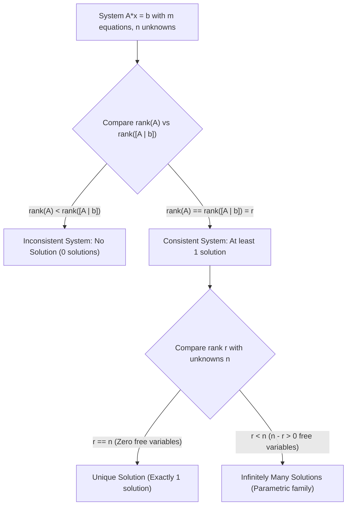

[Maths Index](../README.md) / [Unit 1: Systems of Linear Equations, Vector Spaces, and Fundamental Subspaces](Introduction.md)

# Matrix Rank and Consistency of Linear Systems

Whenever we feed data into an optimization pipeline or solve a regression problem, we must know whether a valid solution exists, whether that solution is unique, or whether infinitely many configurations could explain the data. In the previous lecture, we used Gaussian elimination to mechanically reduce a matrix to Row Echelon Form. But what do the pivots and zero rows actually tell us about the structural geometry of the system?

The answer lies in a single, deeply informative number: the rank of a matrix.

Matrix rank reveals how much true, non-redundant information a matrix contains. Coupled with the celebrated Rouché–Capelli theorem, rank allows us to diagnose the consistency and solution space of any linear system $A\mathbf{x} = \mathbf{b}$ instantly.

---

## Defining Matrix Rank

When we look at an $m \times n$ matrix $A$, we can view it either as a collection of $m$ row vectors in $\mathbb{R}^n$, or as a collection of $n$ column vectors in $\mathbb{R}^m$.

Naturally, this leads to two questions:
1. How many of the rows are genuinely independent and not redundant linear combinations of other rows? This is the row rank.
2. How many of the columns are genuinely independent and point in unique directions? This is the column rank.

Now here is one of the most astonishing theorems in all of mathematics:

$$\text{Row Rank}(A) = \text{Column Rank}(A)$$

No matter how tall, short, or rectangular the matrix is, the number of independent rows is always strictly equal to the number of independent columns. We simply call this shared value the rank of the matrix:

$$\text{rank}(A) = r$$

Because a matrix cannot have more independent rows than total rows ($m$), nor more independent columns than total columns ($n$), the rank is fundamentally bounded by:

$$0 \le \text{rank}(A) \le \min(m, n)$$

When we perform Gaussian elimination on $A$ and reach Row Echelon Form (REF), the rank $r$ is simply the total number of non-zero rows, which is identical to the total number of pivots.

### Full Rank Terminology

Depending on how $r$ compares to $m$ and $n$, we categorize matrices into specific rank classes:

- Full Row Rank: $\text{rank}(A) = m$. Every row has a pivot; there are no zero rows in REF. The system $A\mathbf{x} = \mathbf{b}$ is solvable for every possible right-hand side $\mathbf{b} \in \mathbb{R}^m$.
- Full Column Rank: $\text{rank}(A) = n$. Every column has a pivot; there are zero free variables. If a solution exists, it is strictly unique.
- Full Rank (Square Matrix): $\text{rank}(A) = m = n$. The matrix is invertible, non-singular, and $A\mathbf{x} = \mathbf{b}$ has a unique solution for every $\mathbf{b}$.
- Rank Deficient: $\text{rank}(A) < \min(m, n)$. The matrix contains linear dependencies among both its rows and columns.

---

## Pivot Variables vs. Free Variables

Suppose an $m \times n$ matrix $A$ has rank $r$. When we look at its Row Echelon Form, the $n$ columns split cleanly into two distinct groups:

1. Pivot Columns ($r$ columns): Columns that contain a leading non-zero entry (a pivot). The corresponding unknowns $x_j$ are called pivot variables (or basic variables).
2. Free Columns ($n - r$ columns): Columns that do not contain a pivot. The corresponding unknowns are called free variables.

Why are they called free variables? 

Because during back-substitution, free variables can be assigned any arbitrary real number whatsoever:

$$x_{\text{free}} \in \mathbb{R}$$

Once values for the free variables are chosen, the pivot variables are uniquely and deterministically fixed by the equations.

Each free variable represents an independent degree of freedom in the solution space. 
- If $n - r = 0$, there are no free variables. Every variable is locked down by a pivot. If a solution exists, it is unique.
- If $n - r = 1$, the solutions form a 1-dimensional line in $\mathbb{R}^n$.
- If $n - r = 2$, the solutions form a 2-dimensional plane in $\mathbb{R}^n$.
- In general, $n - r$ free variables sweep out an $(n - r)$-dimensional affine subspace of solutions.

---

## The Rouché–Capelli Consistency Theorem

Now we confront the central question: given a general system $A\mathbf{x} = \mathbf{b}$, when does a solution exist?

Recall the column picture: $A\mathbf{x} = \mathbf{b}$ asks whether $\mathbf{b}$ can be assembled as a linear combination of the columns of $A$. 

Think about this from the perspective of rank:
- If $\mathbf{b}$ already lies in the space spanned by the columns of $A$, adding $\mathbf{b}$ as a new column to form the augmented matrix $[A \mid \mathbf{b}]$ brings no new independent directions. Therefore, the rank of the augmented matrix remains unchanged: $\text{rank}([A \mid \mathbf{b}]) = \text{rank}(A)$.
- But if $\mathbf{b}$ points outside the space spanned by the columns of $A$, then adding $\mathbf{b}$ introduces a brand new independent direction! The rank of the augmented matrix increases by 1: $\text{rank}([A \mid \mathbf{b}]) = \text{rank}(A) + 1$.

This is the exact insight formalised by the Rouché–Capelli Theorem.

A linear system $A\mathbf{x} = \mathbf{b}$ is consistent (has at least one solution) if and only if the rank of the coefficient matrix equals the rank of the augmented matrix:

$$\text{rank}(A) = \text{rank}([A \mid \mathbf{b}])$$

If $\text{rank}(A) < \text{rank}([A \mid \mathbf{b}])$, the system is inconsistent and possesses no solutions.

### The Contradiction Row

How does inconsistency manifest during Gaussian elimination?

If $\text{rank}([A \mid \mathbf{b}]) > \text{rank}(A)$, forward elimination will inevitably produce an augmented row where every entry on the left is zero, but the constant on the right is non-zero:

$$\left[\begin{array}{cccc|c}
0 & 0 & \dots & 0 & d
\end{array}\right] \quad \text{where } d \neq 0$$

Translating this row back into an algebraic equation yields:

$$0 x_1 + 0 x_2 + \dots + 0 x_n = d \implies 0 = d$$

Since $0$ can never equal a non-zero number $d$, this is a flat mathematical impossibility. The system is inconsistent.

---

## Complete Classification of Linear Systems

Combining the Rouché–Capelli theorem with the count of free variables ($n - r$) gives a complete, exhaustive classification of any linear system:

Let's summarize this in a clean reference table:

| Condition on Ranks | Pivot vs. Free Variables | Geometric Reality | Number of Solutions |
| :--- | :--- | :--- | :--- |
| $\text{rank}(A) < \text{rank}([A \mid \mathbf{b}])$ | Contradiction row $[0 \dots 0 \mid d]$ exists | Hyperplanes do not have a common intersection | **Zero** (Inconsistent) |
| $\text{rank}(A) = \text{rank}([A \mid \mathbf{b}]) = n$ | All $n$ variables are pivot variables ($0$ free variables) | Hyperplanes intersect at a single unique point | **Exactly One** (Unique) |
| $\text{rank}(A) = \text{rank}([A \mid \mathbf{b}]) = r < n$ | $r$ pivot variables, $k = n - r$ free variables | Hyperplanes intersect along a $k$-dimensional line/plane | **Infinitely Many** |

---

## Homogeneous Systems: $A\mathbf{x} = \mathbf{0}$

A special case of paramount importance is the homogeneous system, where the constant vector is all zeros:

$$A\mathbf{x} = \mathbf{0}$$

Notice something immediate about homogeneous systems: they can never be inconsistent. 

Why? Because substituting $\mathbf{x} = \mathbf{0}$ always satisfies the equation:

$$A \mathbf{0} = \mathbf{0}$$

This guaranteed solution is called the trivial solution. Therefore:

$$\text{rank}(A) = \text{rank}([A \mid \mathbf{0}])$$

is always true. Inconsistency is impossible.

The only question for a homogeneous system is: does there exist a non-trivial solution ($\mathbf{x} \neq \mathbf{0}$)?

- If $\text{rank}(A) = n$: There are no free variables. The only solution is the trivial solution $\mathbf{x} = \mathbf{0}$.
- If $\text{rank}(A) < n$: There are $n - r > 0$ free variables. There exist infinitely many non-trivial solutions.

This gives rise to a foundational result:

If a homogeneous system has more unknowns than equations ($n > m$), it is guaranteed to have infinitely many non-trivial solutions.

Proof: The rank $r \le \min(m, n) \le m$. Since $m < n$, we must have $r < n$. The number of free variables is $n - r \ge n - m > 0$. Because at least one free variable exists, non-trivial solutions are guaranteed.

The set of all solutions to $A\mathbf{x} = \mathbf{0}$ forms what we will later define as the null space $N(A)$.

---

## Detailed Numerical Examples

### Example 1: Diagnosing an Inconsistent System

Let's analyze the following system:

$$\begin{aligned}
x_1 + x_2 + 2x_3 &= 3 \\
x_1 + 2x_2 + 4x_3 &= 5 \\
2x_1 + 3x_2 + 6x_3 &= 7
\end{aligned}$$

Form the augmented matrix:

$$[A \mid \mathbf{b}] = \left[\begin{array}{ccc|c}
1 & 1 & 2 & 3 \\
1 & 2 & 4 & 5 \\
2 & 3 & 6 & 7
\end{array}\right]$$

Perform forward elimination:
1. $R_2 \leftarrow R_2 - R_1$:
   $$[1, \ 2, \ 4 \mid 5] - [1, \ 1, \ 2 \mid 3] = [0, \ 1, \ 2 \mid 2]$$

2. $R_3 \leftarrow R_3 - 2 R_1$:
   $$[2, \ 3, \ 6 \mid 7] - [2, \ 2, \ 4 \mid 6] = [0, \ 1, \ 2 \mid 1]$$

The matrix is now:

$$\left[\begin{array}{ccc|c}
1 & 1 & 2 & 3 \\
0 & 1 & 2 & 2 \\
0 & 1 & 2 & 1
\end{array}\right]$$

3. Eliminate below the second pivot: $R_3 \leftarrow R_3 - R_2$:
   $$[0, \ 1, \ 2 \mid 1] - [0, \ 1, \ 2 \mid 2] = [0, \ 0, \ 0 \mid -1]$$

Our final Row Echelon Form is:

$$\left[\begin{array}{ccc|c}
1 & 1 & 2 & 3 \\
0 & 1 & 2 & 2 \\
0 & 0 & 0 & -1
\end{array}\right]$$

Notice row 3: $[0 \ 0 \ 0 \mid -1]$, which translates to $0x_1 + 0x_2 + 0x_3 = -1 \implies 0 = -1$.
- $\text{rank}(A) = 2$ (only two pivots in the coefficient matrix).
- $\text{rank}([A \mid \mathbf{b}]) = 3$ (three pivots in the augmented matrix).

Because $\text{rank}(A) \neq \text{rank}([A \mid \mathbf{b}])$, the system is inconsistent. Solution set = $\emptyset$.

---

### Example 2: Finding the Parametric Solution of an Underdetermined System

Now let's examine a consistent system with free variables:

$$\begin{aligned}
x_1 + 2x_2 - x_3 + 3x_4 &= 4 \\
2x_1 + 4x_2 - x_3 + 7x_4 &= 11 \\
x_1 + 2x_2 + 0x_3 + 4x_4 &= 7
\end{aligned}$$

Form the augmented matrix:

$$[A \mid \mathbf{b}] = \left[\begin{array}{cccc|c}
1 & 2 & -1 & 3 & 4 \\
2 & 4 & -1 & 7 & 11 \\
1 & 2 & 0 & 4 & 7
\end{array}\right]$$

Apply forward elimination:
- $R_2 \leftarrow R_2 - 2 R_1 \implies [0, \ 0, \ 1, \ 1 \mid 3]$
- $R_3 \leftarrow R_3 - R_1 \implies [0, \ 0, \ 1, \ 1 \mid 3]$

$$\left[\begin{array}{cccc|c}
1 & 2 & -1 & 3 & 4 \\
0 & 0 & 1 & 1 & 3 \\
0 & 0 & 1 & 1 & 3
\end{array}\right]$$

- $R_3 \leftarrow R_3 - R_2 \implies [0, \ 0, \ 0, \ 0 \mid 0]$

$$\left[\begin{array}{cccc|c}
1 & 2 & -1 & 3 & 4 \\
0 & 0 & 1 & 1 & 3 \\
0 & 0 & 0 & 0 & 0
\end{array}\right]$$

Now drive to Reduced Row Echelon Form (RREF) by eliminating upwards:
- $R_1 \leftarrow R_1 + R_2 \implies [1, \ 2, \ 0, \ 4 \mid 7]$

$$\text{RREF} = \left[\begin{array}{cccc|c}
1 & 2 & 0 & 4 & 7 \\
0 & 0 & 1 & 1 & 3 \\
0 & 0 & 0 & 0 & 0
\end{array}\right]$$

Let's read off the structural data:
- Number of variables: $n = 4$.
- $\text{rank}(A) = 2$ and $\text{rank}([A \mid \mathbf{b}]) = 2$. Consistent!
- Number of pivots: $r = 2$. Pivot columns are column 1 and column 3.
- Pivot variables: $x_1$ and $x_3$.
- Free variables: $x_2$ and $x_4$. Number of free variables = $n - r = 4 - 2 = 2$.

Let's assign free parameters $s, t \in \mathbb{R}$:

$$x_2 = s, \quad x_4 = t$$

Express the pivot variables in terms of $s$ and $t$ using the RREF equations:
- From row 1: $x_1 + 2x_2 + 4x_4 = 7 \implies x_1 = 7 - 2s - 4t$
- From row 2: $x_3 + x_4 = 3 \implies x_3 = 3 - t$

Now, gather all four variables into parametric vector form:

$$\mathbf{x} = \begin{bmatrix} x_1 \\ x_2 \\ x_3 \\ x_4 \end{bmatrix} = \begin{bmatrix} 7 - 2s - 4t \\ s \\ 3 - t \\ t \end{bmatrix} = \begin{bmatrix} 7 \\ 0 \\ 3 \\ 0 \end{bmatrix} + s \begin{bmatrix} -2 \\ 1 \\ 0 \\ 0 \end{bmatrix} + t \begin{bmatrix} -4 \\ 0 \\ -1 \\ 1 \end{bmatrix}$$

Notice the structure of this solution:

$$\mathbf{x} = \mathbf{x}_p + s \mathbf{v}_1 + t \mathbf{v}_2$$

Where:
- $\mathbf{x}_p = [7, 0, 3, 0]^T$ is a particular solution to $A\mathbf{x} = \mathbf{b}$ (setting all free variables $s = 0, t = 0$).
- $\mathbf{v}_1 = [-2, 1, 0, 0]^T$ and $\mathbf{v}_2 = [-4, 0, -1, 1]^T$ are special solutions spanning the null space of $A$, satisfying $A\mathbf{v}_1 = \mathbf{0}$ and $A\mathbf{v}_2 = \mathbf{0}$.

This is a general truth: the complete solution to any consistent linear system is always a single particular solution plus any linear combination of vectors from the null space.

---

## Key Takeaways

- The rank $r$ of a matrix is the maximum number of linearly independent rows, which equals the maximum number of linearly independent columns.
- The rank $r$ equals the number of non-zero rows (pivots) in Row Echelon Form.
- A system of $n$ variables has $r$ pivot variables and $n - r$ free variables.
- According to the Rouché–Capelli Theorem, $A\mathbf{x} = \mathbf{b}$ is consistent if and only if $\text{rank}(A) = \text{rank}([A \mid \mathbf{b}])$.
- If $\text{rank}(A) < \text{rank}([A \mid \mathbf{b}])$, a contradiction row $[0 \dots 0 \mid d]$ ($d \neq 0$) appears, and no solution exists.
- If consistent, the system has a unique solution when $r = n$ (zero free variables), and infinitely many solutions when $r < n$ ($n - r$ free variables).
- Homogeneous systems $A\mathbf{x} = \mathbf{0}$ are always consistent ($\mathbf{x} = \mathbf{0}$ is always a solution). Non-trivial solutions exist if and only if $r < n$.
- Any system with more variables than equations ($n > m$) has free variables and guaranteed non-trivial solutions in the homogeneous case.

---

Now that we know how to analyze the consistency and rank of any linear system, think about what happens when we need to solve $A\mathbf{x} = \mathbf{b}$ for hundreds of different $\mathbf{b}$ vectors. Repeating Gaussian elimination from scratch every time takes $O(n^3)$ operations per vector. Can we record the elimination process directly inside matrix factors so that subsequent solves take only $O(n^2)$ time? In the next lecture, we unpack the engine of computational linear algebra: LU Decomposition. Read [L04 - LU Decomposition](L04%20-%20LU%20Decomposition.md).
