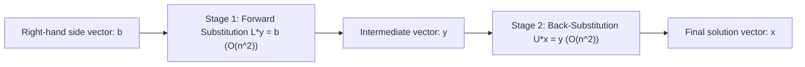

[Maths Index](../README.md) / [Unit 1: Systems of Linear Equations, Vector Spaces, and Fundamental Subspaces](Introduction.md)

# LU Decomposition

In the previous two lectures, we treated Gaussian elimination as a mechanical sequence of row operations performed directly on an augmented matrix $[A \mid \mathbf{b}]$. That works well when you have a single equation to solve on paper. But consider what happens in modern machine learning, dynamic systems, or scientific simulation: you often have a fixed system matrix $A$ (such as a graph Laplacian, a covariance matrix, or a discretized differential operator), but thousands or millions of different right-hand side vectors $\mathbf{b}_1, \mathbf{b}_2, \dots, \mathbf{b}_k$ arriving sequentially over time.

If you run full Gaussian elimination on $[A \mid \mathbf{b}_k]$ every single time a new vector arrives, you pay $\frac{2}{3} n^3$ operations per solve. That is an enormous computational waste.

The matrix $A$ never changed. Why should we repeat all that work?

The breakthrough idea is matrix factorization: we record the entire history of Gaussian elimination into two triangular matrices, $L$ and $U$, such that:

$$A = LU$$

Once this factorization is computed in $O(n^3)$ time, any future solve $A\mathbf{x} = \mathbf{b}$ requires only two rapid triangular substitutions taking $O(n^2)$ time.

---

## Elimination as Matrix Multiplication

To understand how $A$ factors into $LU$, we must translate elementary row operations from verbal instructions into matrix multiplications.

What matrix performs the operation: "subtract $m$ times row 1 from row 2"?

Recall that multiplying a matrix $A$ on the left by another matrix $E$ performs row operations on $A$. 
Consider the $3 \times 3$ identity matrix $I$:

$$I = \begin{bmatrix} 1 & 0 & 0 \\ 0 & 1 & 0 \\ 0 & 0 & 1 \end{bmatrix}$$

If we want to subtract $m_{21}$ times row 1 from row 2, we apply that exact operation to the identity matrix. This gives the elementary elimination matrix $E_{21}$:

$$E_{21} = \begin{bmatrix} 1 & 0 & 0 \\ -m_{21} & 1 & 0 \\ 0 & 0 & 1 \end{bmatrix}$$

When $E_{21}$ multiplies any $3 \times 3$ matrix $A$ from the left, its effect is:
- Row 1 of $E_{21} A$ is $1 \cdot (\text{Row } 1) = \text{Row } 1$.
- Row 2 of $E_{21} A$ is $-m_{21} \cdot (\text{Row } 1) + 1 \cdot (\text{Row } 2) = \text{Row } 2 - m_{21} \text{Row } 1$.
- Row 3 of $E_{21} A$ is $1 \cdot (\text{Row } 3) = \text{Row } 3$.

In general, an elimination matrix $E_{ij}$ has $1$s on the diagonal and the negative multiplier $-m_{ij}$ in row $i$, column $j$.

### Inverting an Elimination Matrix

Now, how do we undo this operation?

If $E_{21}$ subtracted $m_{21}$ times row 1 from row 2, the inverse operation must simply add $m_{21}$ times row 1 back to row 2!

Therefore, the inverse matrix $E_{21}^{-1}$ is astonishingly simple: you just change the sign of the multiplier from $-m_{21}$ to $+m_{21}$:

$$E_{21}^{-1} = \begin{bmatrix} 1 & 0 & 0 \\ m_{21} & 1 & 0 \\ 0 & 0 & 1 \end{bmatrix}$$

Verify this directly:

$$\begin{bmatrix} 1 & 0 & 0 \\ -m_{21} & 1 & 0 \\ 0 & 0 & 1 \end{bmatrix} \begin{bmatrix} 1 & 0 & 0 \\ m_{21} & 1 & 0 \\ 0 & 0 & 1 \end{bmatrix} = \begin{bmatrix} 1 & 0 & 0 \\ -m_{21} + m_{21} & 1 & 0 \\ 0 & 0 & 1 \end{bmatrix} = \begin{bmatrix} 1 & 0 & 0 \\ 0 & 1 & 0 \\ 0 & 0 & 1 \end{bmatrix} = I$$

---

## Assembling $A = LU$

During forward elimination on a $3 \times 3$ matrix without row swaps, we apply a sequence of elimination matrices to eliminate below the diagonal:

1. $E_{21}$ eliminates entry $(2, 1)$ using pivot 1.
2. $E_{31}$ eliminates entry $(3, 1)$ using pivot 1.
3. $E_{32}$ eliminates entry $(3, 2)$ using pivot 2.

At the end of this sequence, the original matrix $A$ has been transformed into an upper triangular matrix $U$:

$$(E_{32} E_{31} E_{21}) A = U$$

Now, let's solve for $A$ by multiplying both sides from the left by the inverses in reverse order:

$$A = (E_{21}^{-1} E_{31}^{-1} E_{32}^{-1}) U$$

Let's define the product of these inverse elimination matrices as $L$:

$$L = E_{21}^{-1} E_{31}^{-1} E_{32}^{-1}$$

So we have:

$$A = LU$$

Now here is the magic of $L$. 

If you multiply the forward elimination matrices $(E_{32} E_{31} E_{21})$, unwanted cross-terms appear in the lower corner because later row operations act on earlier row modifications. 

But when you multiply their inverses $(E_{21}^{-1} E_{31}^{-1} E_{32}^{-1})$ in the reverse order, something remarkable happens: the cross-terms completely cancel out!

$$L = \begin{bmatrix} 1 & 0 & 0 \\ m_{21} & 1 & 0 \\ 0 & 0 & 1 \end{bmatrix} \begin{bmatrix} 1 & 0 & 0 \\ 0 & 1 & 0 \\ m_{31} & 0 & 1 \end{bmatrix} \begin{bmatrix} 1 & 0 & 0 \\ 0 & 1 & 0 \\ 0 & m_{32} & 1 \end{bmatrix} = \begin{bmatrix} 1 & 0 & 0 \\ m_{21} & 1 & 0 \\ m_{31} & m_{32} & 1 \end{bmatrix}$$

Notice what this means: you never actually need to perform matrix multiplications to construct $L$. 
$L$ is simply a unit lower triangular matrix (1s on the diagonal) whose entries below the diagonal are the exact multipliers $m_{ij}$ used during forward elimination.

---

## Solving $A\mathbf{x} = \mathbf{b}$ in Two Triangular Stages

Once we have factored $A = LU$, solving $A\mathbf{x} = \mathbf{b}$ becomes a two-step process:

$$A\mathbf{x} = (LU)\mathbf{x} = L(U\mathbf{x}) = \mathbf{b}$$

Let's introduce an intermediate helper vector $\mathbf{y} = U\mathbf{x}$. The single difficult problem breaks cleanly into two simple triangular systems:

### Stage 1: Forward Substitution ($L\mathbf{y} = \mathbf{b}$)

Because $L$ is lower triangular, the first equation involves only $y_1$. We solve for $y_1$ instantly, substitute it into the second equation to get $y_2$, and work our way down:

$$\begin{bmatrix}
1 & 0 & 0 \\
m_{21} & 1 & 0 \\
m_{31} & m_{32} & 1
\end{bmatrix}
\begin{bmatrix} y_1 \\ y_2 \\ y_3 \end{bmatrix} = \begin{bmatrix} b_1 \\ b_2 \\ b_3 \end{bmatrix}$$

$$\begin{aligned}
y_1 &= b_1 \\
y_2 &= b_2 - m_{21} y_1 \\
y_3 &= b_3 - m_{31} y_1 - m_{32} y_2
\end{aligned}$$

Cost: exactly $\frac{1}{2} n^2$ flops.

### Stage 2: Back-Substitution ($U\mathbf{x} = \mathbf{y}$)

Now that $\mathbf{y}$ is known, we solve the upper triangular system $U\mathbf{x} = \mathbf{y}$ from the bottom row up, exactly as in Gaussian elimination:

$$\begin{bmatrix}
u_{11} & u_{12} & u_{13} \\
0 & u_{22} & u_{23} \\
0 & 0 & u_{33}
\end{bmatrix}
\begin{bmatrix} x_1 \\ x_2 \\ x_3 \end{bmatrix} = \begin{bmatrix} y_1 \\ y_2 \\ y_3 \end{bmatrix}$$

Cost: exactly $\frac{1}{2} n^2$ flops.

Total cost to solve $A\mathbf{x} = \mathbf{b}$ given $L$ and $U$: $n^2$ flops.

---

## Complete Step-by-Step Numerical Example

Let's factor the matrix:

$$A = \begin{bmatrix} 2 & 1 & 1 \\ 4 & -6 & 0 \\ -2 & 7 & 2 \end{bmatrix}$$

and solve $A\mathbf{x} = \mathbf{b}$ for $\mathbf{b} = \begin{bmatrix} 5 \\ -2 \\ 9 \end{bmatrix}$.

### Step 1: Forward Elimination and Recording Multipliers

Pivot 1 is $a_{11} = 2$.

To eliminate entry $(2, 1) = 4$:
$$m_{21} = \frac{4}{2} = 2, \quad R_2 \leftarrow R_2 - 2 R_1$$
$$R_2 = [4, \ -6, \ 0] - 2[2, \ 1, \ 1] = [0, \ -8, \ -2]$$

To eliminate entry $(3, 1) = -2$:
$$m_{31} = \frac{-2}{2} = -1, \quad R_3 \leftarrow R_3 - (-1) R_1 = R_3 + 1 R_1$$
$$R_3 = [-2, \ 7, \ 2] + 1[2, \ 1, \ 1] = [0, \ 8, \ 3]$$

The matrix after clearing column 1 is:

$$\begin{bmatrix} 2 & 1 & 1 \\ 0 & -8 & -2 \\ 0 & 8 & 3 \end{bmatrix}$$

Now, Pivot 2 is $a_{22} = -8$.

To eliminate entry $(3, 2) = 8$:
$$m_{32} = \frac{8}{-8} = -1, \quad R_3 \leftarrow R_3 - (-1) R_2 = R_3 + 1 R_2$$
$$R_3 = [0, \ 8, \ 3] + 1[0, \ -8, \ -2] = [0, \ 0, \ 1]$$

We have reached upper triangular form $U$:

$$U = \begin{bmatrix} 2 & 1 & 1 \\ 0 & -8 & -2 \\ 0 & 0 & 1 \end{bmatrix}$$

### Step 2: Assembling $L$

We place $1$s on the diagonal of $L$ and insert our multipliers $m_{21} = 2$, $m_{31} = -1$, and $m_{32} = -1$ into their respective coordinates below the diagonal:

$$L = \begin{bmatrix} 1 & 0 & 0 \\ m_{21} & 1 & 0 \\ m_{31} & m_{32} & 1 \end{bmatrix} = \begin{bmatrix} 1 & 0 & 0 \\ 2 & 1 & 0 \\ -1 & -1 & 1 \end{bmatrix}$$

Let's verify by multiplying $L$ and $U$:

$$LU = \begin{bmatrix} 1 & 0 & 0 \\ 2 & 1 & 0 \\ -1 & -1 & 1 \end{bmatrix} \begin{bmatrix} 2 & 1 & 1 \\ 0 & -8 & -2 \\ 0 & 0 & 1 \end{bmatrix}$$

- Row 1: $[2, \ 1, \ 1]$
- Row 2: $[2(2), \ 2(1) - 8, \ 2(1) - 2] = [4, \ -6, \ 0]$
- Row 3: $[-1(2), \ -1(1) + 8, \ -1(1) + 2 + 1] = [-2, \ 7, \ 2]$

The product equals $A$ exactly.

### Step 3: Solving via Forward and Back Substitution

Now solve $A\mathbf{x} = \mathbf{b}$ for $\mathbf{b} = [5, -2, 9]^T$.

First solve $L\mathbf{y} = \mathbf{b}$:

$$\begin{bmatrix} 1 & 0 & 0 \\ 2 & 1 & 0 \\ -1 & -1 & 1 \end{bmatrix} \begin{bmatrix} y_1 \\ y_2 \\ y_3 \end{bmatrix} = \begin{bmatrix} 5 \\ -2 \\ 9 \end{bmatrix}$$

- Row 1: $y_1 = 5$
- Row 2: $2y_1 + y_2 = -2 \implies 2(5) + y_2 = -2 \implies y_2 = -12$
- Row 3: $-y_1 - y_2 + y_3 = 9 \implies -5 - (-12) + y_3 = 9 \implies 7 + y_3 = 9 \implies y_3 = 2$

So:

$$\mathbf{y} = \begin{bmatrix} 5 \\ -12 \\ 2 \end{bmatrix}$$

Now solve $U\mathbf{x} = \mathbf{y}$:

$$\begin{bmatrix} 2 & 1 & 1 \\ 0 & -8 & -2 \\ 0 & 0 & 1 \end{bmatrix} \begin{bmatrix} x_1 \\ x_2 \\ x_3 \end{bmatrix} = \begin{bmatrix} 5 \\ -12 \\ 2 \end{bmatrix}$$

- Row 3: $1 x_3 = 2 \implies x_3 = 2$
- Row 2: $-8x_2 - 2x_3 = -12 \implies -8x_2 - 4 = -12 \implies -8x_2 = -8 \implies x_2 = 1$
- Row 1: $2x_1 + x_2 + x_3 = 5 \implies 2x_1 + 1 + 2 = 5 \implies 2x_1 = 2 \implies x_1 = 1$

The final solution is:

$$\mathbf{x} = \begin{bmatrix} 1 \\ 1 \\ 2 \end{bmatrix}$$

Verify against original system:
$A\mathbf{x} = \begin{bmatrix} 2(1) + 1(1) + 1(2) \\ 4(1) - 6(1) + 0(2) \\ -2(1) + 7(1) + 2(2) \end{bmatrix} = \begin{bmatrix} 5 \\ -2 \\ 9 \end{bmatrix} = \mathbf{b}$. Perfectly verified.

---

## When Row Swaps Are Unavoidable: $PA = LU$

What happens if a zero appears on the diagonal where a pivot is needed? Or what if, for numerical stability, we want to swap rows to pick the largest available pivot?

Whenever a row swap occurs, the clean triangular structure $A = LU$ breaks down. But we can salvage it completely using permutation matrices.

### Permutation Matrices

A permutation matrix $P$ is an identity matrix whose rows have been reordered. Multiplying $P A$ from the left permutes the rows of $A$ in the exact same way.

For instance, to swap row 1 and row 2 of a $3 \times 3$ matrix:

$$P_{12} = \begin{bmatrix} 0 & 1 & 0 \\ 1 & 0 & 0 \\ 0 & 0 & 1 \end{bmatrix}$$

Permutation matrices possess two crucial properties:
1. They are orthogonal: $P^{-1} = P^T$.
2. They preserve lengths and angles: multiplying by $P$ merely re-indexes coordinates without altering any values.

### The Factored Form $PA = LU$

If we know all row swaps in advance (or perform partial pivoting during elimination), we can conceptually permute the rows of $A$ upfront. 

Theorem: For every invertible matrix $A$, there exists a permutation matrix $P$, a unit lower triangular matrix $L$, and an upper triangular matrix $U$ such that:

$$PA = LU$$

To solve $A\mathbf{x} = \mathbf{b}$ using $PA = LU$:
1. Permute the right-hand side: $\mathbf{b}' = P\mathbf{b}$.
2. Forward substitute: $L\mathbf{y} = \mathbf{b}'$.
3. Back substitute: $U\mathbf{x} = \mathbf{y}$.

Every modern numerical library (such as LAPACK, BLAS, NumPy's `scipy.linalg.lu`, and PyTorch's `torch.linalg.lu`) computes the $PA = LU$ factorization as its primary linear equation solver.

---

## The $LDU$ Factorization

Notice that in $A = LU$, $L$ has $1$s on its diagonal, but $U$ has the pivots $d_1, d_2, \dots, d_n$ on its diagonal:

$$U = \begin{bmatrix}
d_1 & u_{12} & \dots & u_{1n} \\
0 & d_2 & \dots & u_{2n} \\
\vdots & \vdots & \ddots & \vdots \\
0 & 0 & \dots & d_n
\end{bmatrix}$$

We can factor out these diagonal pivot values into a pure diagonal matrix $D$:

$$D = \begin{bmatrix}
d_1 & 0 & \dots & 0 \\
0 & d_2 & \dots & 0 \\
\vdots & \vdots & \ddots & \vdots \\
0 & 0 & \dots & d_n
\end{bmatrix}$$

Dividing each row of $U$ by its respective pivot yields a unit upper triangular matrix $U'$ (with $1$s on the diagonal). 

This produces the symmetric $LDU$ decomposition:

$$A = L D U'$$

When $A$ is symmetric ($A = A^T$) and positive definite, $U'$ turns out to be exactly $L^T$, leading to the celebrated Cholesky factorization $A = L D L^T$ (or $A = R^T R$), which is ubiquitous in Gaussian processes, Kalman filtering, and portfolio optimization.

---

## Key Takeaways

- LU decomposition factors an invertible matrix $A$ into a unit lower triangular matrix $L$ and an upper triangular matrix $U$: $A = LU$.
- Forward elimination corresponds to multiplying $A$ by elementary elimination matrices $E_{ij}$.
- The factor $L$ is the product of the inverse elimination matrices $E_{ij}^{-1}$. The entries below the diagonal in $L$ are simply the forward elimination multipliers $m_{ij}$.
- Solving $A\mathbf{x} = \mathbf{b}$ breaks into two $O(n^2)$ triangular problems: forward substitution $L\mathbf{y} = \mathbf{b}$ followed by back-substitution $U\mathbf{x} = \mathbf{y}$.
- For multiple right-hand sides, the initial $O(n^3)$ factorization is done once, reducing all subsequent solves to $O(n^2)$ time.
- When row swaps are needed for zero pivots or numerical stability (partial pivoting), the decomposition generalizes to $PA = LU$, where $P$ is a permutation matrix satisfying $P^{-1} = P^T$.
- Factoring out the diagonal pivots yields the $A = LDU$ form, which reduces to $A = LDL^T$ for symmetric matrices.

---

We now know how to solve $A\mathbf{x} = \mathbf{b}$ with extreme computational efficiency. But what if we actually want to find the inverse matrix $A^{-1}$ explicitly? When does an inverse exist, and how can we compute it using row operations? In the next lecture, we extend Gauss-Jordan elimination to compute matrix inverses and explore the numerical hazards of explicit inversion. Read [L05 - Matrix Inversion by Gauss-Jordan Elimination](L05%20-%20Matrix%20Inversion%20by%20Gauss-Jordan%20Elimination.md).
