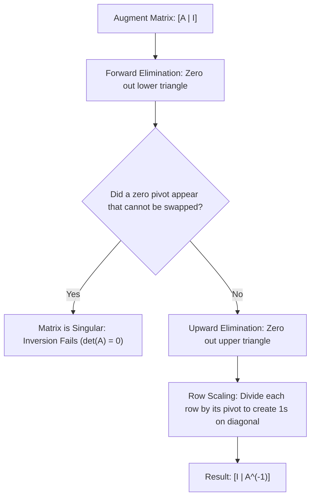

[Maths Index](../README.md) / [Unit 1: Systems of Linear Equations, Vector Spaces, and Fundamental Subspaces](Introduction.md)

# Matrix Inversion by Gauss-Jordan Elimination

In ordinary scalar algebra, if we have the equation $a x = b$ where $a \neq 0$, finding $x$ is trivial: we simply divide by $a$, which is mathematically equivalent to multiplying both sides by the scalar inverse $a^{-1} = \frac{1}{a}$:

$$x = a^{-1} b$$

When we transition to matrix equations $A\mathbf{x} = \mathbf{b}$, the temptation is to ask: can we do the exact same thing? Can we define a matrix inverse $A^{-1}$ such that multiplying both sides yields:

$$\mathbf{x} = A^{-1}\mathbf{b}$$

The answer is yes — but only under strict mathematical conditions, and with significant computational caveats. 

In this lecture, we formalize the concept of matrix invertibility, derive the Gauss-Jordan elimination algorithm to compute $A^{-1}$, and explain why machine learning practitioners and numerical analysts almost never compute an explicit inverse in production code.

---

## The Concept of Matrix Inversion

Let $A$ be a square matrix of size $n \times n$. 

An $n \times n$ matrix $B$ is called the inverse of $A$ if it satisfies the two-sided identity property:

$$A B = B A = I_n$$

Where $I_n$ is the $n \times n$ identity matrix.

If such a matrix $B$ exists, we say that $A$ is invertible (or non-singular), and we denote its unique inverse by $A^{-1}$:

$$A A^{-1} = A^{-1} A = I_n$$

If no such matrix exists, $A$ is called singular (or non-invertible).

Notice two immediate consequences:
1. Only square matrices ($n \times n$) can have a true two-sided inverse. For rectangular matrices ($m \neq n$), the dimensions do not allow a single matrix to act as both a left- and right-inverse.
2. The inverse of an invertible matrix is unique. 

Proof of uniqueness: Suppose $B$ and $C$ are both inverses of $A$. Then $A B = I$ and $C A = I$. Multiplying $C(AB) = C(I) = C$. But by associativity, $C(AB) = (CA)B = (I)B = B$. Therefore, $B = C$.

### Properties of Matrix Inverses

For any invertible matrices $A, B \in \mathbb{R}^{n \times n}$ and scalar $c \neq 0$:

1. Inverse of an Inverse:
   $$(A^{-1})^{-1} = A$$
2. Product Rule (Reverse Order):
   $$(A B)^{-1} = B^{-1} A^{-1}$$
   Notice that the order flips! Why? Because $(A B)(B^{-1} A^{-1}) = A (B B^{-1}) A^{-1} = A I A^{-1} = A A^{-1} = I$.
3. Transpose Rule:
   $$(A^T)^{-1} = (A^{-1})^T$$
4. Scalar Multiplication:
   $$(c A)^{-1} = \frac{1}{c} A^{-1}$$

---

## The Invertible Matrix Theorem

The property of invertibility is not an isolated algebraic curiosity. It is tied to every fundamental concept in linear algebra.

The Invertible Matrix Theorem states that for any square $n \times n$ matrix $A$, the following statements are completely equivalent (if one is true, all are true; if one fails, all fail):

1. $A$ is invertible ($A^{-1}$ exists).
2. The determinant of $A$ is non-zero: $\det(A) \neq 0$.
3. The rank of $A$ is full: $\text{rank}(A) = n$.
4. The system $A\mathbf{x} = \mathbf{0}$ has only the trivial solution $\mathbf{x} = \mathbf{0}$.
5. The Reduced Row Echelon Form of $A$ is the identity matrix: $\text{RREF}(A) = I_n$.
6. $A$ has $n$ non-zero pivots during Gaussian elimination.
7. The columns of $A$ are linearly independent.
8. The columns of $A$ span $\mathbb{R}^n$.
9. For every vector $\mathbf{b} \in \mathbb{R}^n$, the system $A\mathbf{x} = \mathbf{b}$ has a unique solution $\mathbf{x} = A^{-1}\mathbf{b}$.

This theorem is our central diagnostic toolkit. If an $n \times n$ matrix fails even one of these criteria, it is singular.

---

## The Gauss-Jordan Elimination Algorithm

How do we compute $A^{-1}$?

Think about what $A A^{-1} = I$ actually means. 
Let the columns of $A^{-1}$ be the vectors $\mathbf{x}_1, \mathbf{x}_2, \dots, \mathbf{x}_n$, and let the columns of $I$ be the standard unit vectors $\mathbf{e}_1, \mathbf{e}_2, \dots, \mathbf{e}_n$:

$$A \begin{bmatrix} \mathbf{x}_1 & \mathbf{x}_2 & \dots & \mathbf{x}_n \end{bmatrix} = \begin{bmatrix} \mathbf{e}_1 & \mathbf{e}_2 & \dots & \mathbf{e}_n \end{bmatrix}$$

By matrix multiplication, this is equivalent to solving $n$ distinct linear systems simultaneously:

$$A\mathbf{x}_1 = \mathbf{e}_1, \quad A\mathbf{x}_2 = \mathbf{e}_2, \quad \dots, \quad A\mathbf{x}_n = \mathbf{e}_n$$

Instead of solving each system separately, we can solve them all at once by creating a large augmented matrix:

$$[A \mid I_n] = \left[\begin{array}{cccc|cccc}
a_{11} & a_{12} & \dots & a_{1n} & 1 & 0 & \dots & 0 \\
a_{21} & a_{22} & \dots & a_{2n} & 0 & 1 & \dots & 0 \\
\vdots & \vdots & \ddots & \vdots & \vdots & \vdots & \ddots & \vdots \\
a_{n1} & a_{n2} & \dots & a_{nn} & 0 & 0 & \dots & 1
\end{array}\right]$$

Now we apply elementary row operations to reduce the left-hand side from $A$ to $I_n$.

### Why Does This Produce $A^{-1}$ on the Right?

Every elementary row operation is equivalent to multiplying on the left by an elementary matrix $E$. 
If a sequence of row operations $E_k \cdots E_2 E_1$ transforms $A$ into $I$, let $M$ denote their cumulative product:

$$M = E_k \cdots E_2 E_1$$

Then:

$$M A = I$$

Multiplying both sides on the right by $A^{-1}$:

$$M A A^{-1} = I A^{-1} \implies M = A^{-1}$$

Therefore, the exact same sequence of row operations $M$, when applied to the right-hand block $I$, automatically computes:

$$M I = A^{-1} I = A^{-1}$$

Thus, Gauss-Jordan elimination accomplishes the transformation:

$$[A \mid I_n] \xrightarrow{\text{Elementary Row Operations}} [I_n \mid A^{-1}]$$



---

## Complete Step-by-Step Numerical Example

Let's compute the inverse of the $3 \times 3$ matrix:

$$A = \begin{bmatrix} 1 & 2 & 3 \\ 2 & 5 & 3 \\ 1 & 0 & 8 \end{bmatrix}$$

### Step 1: Augment $A$ with the $3 \times 3$ Identity Matrix

$$[A \mid I] = \left[\begin{array}{ccc|ccc}
1 & 2 & 3 & 1 & 0 & 0 \\
2 & 5 & 3 & 0 & 1 & 0 \\
1 & 0 & 8 & 0 & 0 & 1
\end{array}\right]$$

### Step 2: Forward Elimination (Clear Below Diagonal)

Pivot 1 is $a_{11} = 1$.

- $R_2 \leftarrow R_2 - 2 R_1$:
  $$[2, \ 5, \ 3 \mid 0, \ 1, \ 0] - 2[1, \ 2, \ 3 \mid 1, \ 0, \ 0] = [0, \ 1, \ -3 \mid -2, \ 1, \ 0]$$

- $R_3 \leftarrow R_3 - 1 R_1$:
  $$[1, \ 0, \ 8 \mid 0, \ 0, \ 1] - 1[1, \ 2, \ 3 \mid 1, \ 0, \ 0] = [0, \ -2, \ 5 \mid -1, \ 0, \ 1]$$

The augmented matrix is now:

$$\left[\begin{array}{ccc|ccc}
1 & 2 & 3 & 1 & 0 & 0 \\
0 & 1 & -3 & -2 & 1 & 0 \\
0 & -2 & 5 & -1 & 0 & 1
\end{array}\right]$$

Pivot 2 is $a_{22} = 1$.

- $R_3 \leftarrow R_3 - (-2) R_2 = R_3 + 2 R_2$:
  $$[0, \ -2, \ 5 \mid -1, \ 0, \ 1] + 2[0, \ 1, \ -3 \mid -2, \ 1, \ 0] = [0, \ 0, \ -1 \mid -5, \ 2, \ 1]$$

The augmented matrix is now:

$$\left[\begin{array}{ccc|ccc}
1 & 2 & 3 & 1 & 0 & 0 \\
0 & 1 & -3 & -2 & 1 & 0 \\
0 & 0 & -1 & -5 & 2 & 1
\end{array}\right]$$

Pivot 3 is $a_{33} = -1$. All three pivots are non-zero, so $A$ is guaranteed to be invertible.

Normalize row 3 by multiplying by $-1$:
- $R_3 \leftarrow -1 R_3$:
  $$[0, \ 0, \ 1 \mid 5, \ -2, \ -1]$$

$$\left[\begin{array}{ccc|ccc}
1 & 2 & 3 & 1 & 0 & 0 \\
0 & 1 & -3 & -2 & 1 & 0 \\
0 & 0 & 1 & 5 & -2 & -1
\end{array}\right]$$

### Step 3: Upward Elimination (Clear Above Diagonal)

Now use pivot 3 ($a_{33} = 1$) to eliminate entries above it:

- $R_2 \leftarrow R_2 + 3 R_3$:
  $$[0, \ 1, \ -3 \mid -2, \ 1, \ 0] + 3[0, \ 0, \ 1 \mid 5, \ -2, \ -1] = [0, \ 1, \ 0 \mid 13, \ -5, \ -3]$$

- $R_1 \leftarrow R_1 - 3 R_3$:
  $$[1, \ 2, \ 3 \mid 1, \ 0, \ 0] - 3[0, \ 0, \ 1 \mid 5, \ -2, \ -1] = [1, \ 2, \ 0 \mid -14, \ 6, \ 3]$$

$$\left[\begin{array}{ccc|ccc}
1 & 2 & 0 & -14 & 6 & 3 \\
0 & 1 & 0 & 13 & -5 & -3 \\
0 & 0 & 1 & 5 & -2 & -1
\end{array}\right]$$

Finally, use pivot 2 ($a_{22} = 1$) to eliminate entry $(1, 2)$:

- $R_1 \leftarrow R_1 - 2 R_2$:
  $$[1, \ 2, \ 0 \mid -14, \ 6, \ 3] - 2[0, \ 1, \ 0 \mid 13, \ -5, \ -3] = [1, \ 0, \ 0 \mid -40, \ 16, \ 9]$$

We have completed the reduction to $[I \mid A^{-1}]$:

$$\left[\begin{array}{ccc|ccc}
1 & 0 & 0 & -40 & 16 & 9 \\
0 & 1 & 0 & 13 & -5 & -3 \\
0 & 0 & 1 & 5 & -2 & -1
\end{array}\right]$$

Therefore, the inverse matrix is:

$$A^{-1} = \begin{bmatrix} -40 & 16 & 9 \\ 13 & -5 & -3 \\ 5 & -2 & -1 \end{bmatrix}$$

### Step 4: Verification

Let's multiply $A A^{-1}$ explicitly to verify:

$$A A^{-1} = \begin{bmatrix} 1 & 2 & 3 \\ 2 & 5 & 3 \\ 1 & 0 & 8 \end{bmatrix} \begin{bmatrix} -40 & 16 & 9 \\ 13 & -5 & -3 \\ 5 & -2 & -1 \end{bmatrix}$$

- Row 1:
  - $(1)(-40) + (2)(13) + (3)(5) = -40 + 26 + 15 = 1$
  - $(1)(16) + (2)(-5) + (3)(-2) = 16 - 10 - 6 = 0$
  - $(1)(9) + (2)(-3) + (3)(-1) = 9 - 6 - 3 = 0$
- Row 2:
  - $(2)(-40) + (5)(13) + (3)(5) = -80 + 65 + 15 = 0$
  - $(2)(16) + (5)(-5) + (3)(-2) = 32 - 25 - 6 = 1$
  - $(2)(9) + (5)(-3) + (3)(-1) = 18 - 15 - 3 = 0$
- Row 3:
  - $(1)(-40) + (0)(13) + (8)(5) = -40 + 0 + 40 = 0$
  - $(1)(16) + (0)(-5) + (8)(-2) = 16 + 0 - 16 = 0$
  - $(1)(9) + (0)(-3) + (8)(-1) = 9 + 0 - 8 = 1$

The product is exactly the identity matrix $I_3$.

---

## When Inversion Breaks Down: The Singular Case

What happens when we attempt Gauss-Jordan elimination on a singular matrix?

Consider:

$$B = \begin{bmatrix} 1 & 2 & 3 \\ 2 & 4 & 6 \\ 1 & 1 & 1 \end{bmatrix}$$

Set up the augmented matrix $[B \mid I]$:

$$\left[\begin{array}{ccc|ccc}
1 & 2 & 3 & 1 & 0 & 0 \\
2 & 4 & 6 & 0 & 1 & 0 \\
1 & 1 & 1 & 0 & 0 & 1
\end{array}\right]$$

Perform $R_2 \leftarrow R_2 - 2 R_1$:

$$\left[\begin{array}{ccc|ccc}
1 & 2 & 3 & 1 & 0 & 0 \\
0 & 0 & 0 & -2 & 1 & 0 \\
1 & 1 & 1 & 0 & 0 & 1
\end{array}\right]$$

Notice row 2 on the left: it is an entire row of zeros $[0 \ 0 \ 0]$.

No possible row swap with row 3 can fix this, because there are only two non-zero rows remaining for three variables. We can never produce three pivots, which means the left block can never become $I_3$. 

The algorithm terminates immediately: $B$ is singular, and $B^{-1}$ does not exist.

---

## Practical AI & Data Science Considerations: The Golden Rule

Now here is a critical lesson for any machine learning engineer or data scientist:

> In numerical computation, you should almost never explicitly compute $A^{-1}$ to solve $A\mathbf{x} = \mathbf{b}$.

Why? There are two profound reasons: computational efficiency and numerical stability.

### 1. Computational Efficiency (Flop Count)

- Computing $A^{-1}$ via Gauss-Jordan elimination takes $\approx 2 n^3$ flops.
- Computing $\mathbf{x} = A^{-1}\mathbf{b}$ then requires a matrix-vector multiplication taking $2 n^2$ flops.
- Total flops: $2 n^3 + 2 n^2$.

In contrast:
- Factoring $A = LU$ takes $\approx \frac{2}{3} n^3$ flops.
- Solving $L\mathbf{y} = \mathbf{b}$ and $U\mathbf{x} = \mathbf{y}$ takes $2 n^2$ flops.
- Total flops: $\frac{2}{3} n^3 + 2 n^2$.

Computing the explicit inverse requires **3 times as many operations** as solving via LU decomposition.

### 2. Numerical Stability and Condition Numbers

In floating-point arithmetic, matrices can be ill-conditioned. 

The condition number of a matrix measures how sensitive the solution of $A\mathbf{x} = \mathbf{b}$ is to tiny perturbations in $\mathbf{b}$ or $A$:

$$\kappa(A) = \|A\| \cdot \|A^{-1}\|$$

If $\kappa(A) \approx 1$, the matrix is well-conditioned. If $\kappa(A) \approx 10^{14}$, the matrix is ill-conditioned (nearly singular).

Explicitly computing $A^{-1}$ rounds intermediate results and squares the numerical error. Solving via triangular factorization ($LU$ or Cholesky) with partial pivoting preserves floating-point precision much better.

In Python:
```python
# Bad practice: slow and numerically unstable
x = np.linalg.inv(A) @ b

# Best practice: 3x faster and numerically stable (uses LU decomposition)
x = np.linalg.solve(A, b)
```

The only time computing $A^{-1}$ is justified is when the individual entries of the inverse matrix themselves carry physical or statistical meaning — for example, the inverse of the Fisher Information Matrix in maximum likelihood estimation, which gives the asymptotic covariance matrix of parameter estimates.

---

## Key Takeaways

- A square matrix $A$ is invertible if and only if there exists a matrix $A^{-1}$ such that $A A^{-1} = A^{-1} A = I$.
- The Invertible Matrix Theorem connects invertibility to full rank ($r = n$), non-zero determinant, trivial null space ($N(A) = \{\mathbf{0}\}$), and linearly independent columns.
- The product of invertible matrices reverses order: $(AB)^{-1} = B^{-1} A^{-1}$.
- Gauss-Jordan elimination computes $A^{-1}$ by reducing the augmented super-matrix $[A \mid I_n] \to [I_n \mid A^{-1}]$ using elementary row operations.
- If a row of zeros appears on the left block during forward elimination, the matrix is singular and has no inverse.
- Computing $A^{-1}$ explicitly requires $\approx 2 n^3$ flops, three times more expensive than LU decomposition ($\frac{2}{3} n^3$ flops).
- Production numerical code should always use solver routines (`np.linalg.solve`) rather than multiplying by an explicit inverse (`np.linalg.inv`).

---

Up to this point, we have treated vectors as concrete lists of numbers and matrices as rectangular grids of numbers. But linear algebra is far more profound than number manipulation. What makes a collection of objects a "vector space"? What allows us to treat functions, polynomials, and neural network weights as vectors? In the next lecture, we step into abstract geometry and define vector spaces and subspaces. Read [L06 - Vector Spaces and Subspaces](L06%20-%20Vector%20Spaces%20and%20Subspaces.md).
