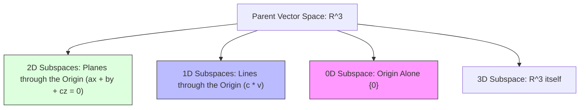

[Maths Index](../README.md) / [Unit 1: Systems of Linear Equations, Vector Spaces, and Fundamental Subspaces](Introduction.md)

# Vector Spaces and Subspaces

Until now, we have treated a vector primarily as an ordered list of real numbers, such as $\mathbf{x} = [x_1, x_2, \dots, x_n]^T \in \mathbb{R}^n$, representing points in Euclidean space or rows in a dataset. This coordinate-based view is intuitive and computationally indispensable.

However, modern machine learning and advanced data science demand a much broader perspective. 

Consider the space of all continuous audio signals, the space of activation functions in a neural network, or the space of probability density functions. Can we add two audio signals together? Yes. Can we scale a signal's amplitude by a constant? Yes. Do these operations behave with the exact same structural rules as column vectors in $\mathbb{R}^n$? Absolutely.

To capture this universal behavior, linear algebra abstracts the concept of vectors away from mere lists of numbers into the formal theory of vector spaces. In this lecture, we define what makes a mathematical structure a vector space, master the subspace test, and examine the geometric hierarchy of subspaces in Euclidean space.

---

## The Formal Definition of a Vector Space

A real vector space (or linear space) is a non-empty set $V$ of mathematical objects called vectors, equipped with two operations:
1. Vector Addition: A rule that takes any pair of vectors $\mathbf{u}, \mathbf{v} \in V$ and produces a vector $\mathbf{u} + \mathbf{v} \in V$.
2. Scalar Multiplication: A rule that takes any real scalar $c \in \mathbb{R}$ and any vector $\mathbf{u} \in V$ and produces a vector $c\mathbf{u} \in V$.

For $(V, +, \cdot)$ to qualify as a vector space, these two operations must satisfy eight fundamental axioms for all vectors $\mathbf{u}, \mathbf{v}, \mathbf{w} \in V$ and all real scalars $c, d \in \mathbb{R}$:

### Axioms of Vector Addition

1. Commutativity:
   $$\mathbf{u} + \mathbf{v} = \mathbf{v} + \mathbf{u}$$
2. Associativity:
   $$(\mathbf{u} + \mathbf{v}) + \mathbf{w} = \mathbf{u} + (\mathbf{v} + \mathbf{w})$$
3. Existence of Zero Vector (Additive Identity):
   There exists an element $\mathbf{0} \in V$ such that:
   $$\mathbf{u} + \mathbf{0} = \mathbf{u}$$
4. Existence of Additive Inverse:
   For every $\mathbf{u} \in V$, there exists an element $-\mathbf{u} \in V$ such that:
   $$\mathbf{u} + (-\mathbf{u}) = \mathbf{0}$$

### Axioms of Scalar Multiplication

5. Distributivity over Vector Addition:
   $$c(\mathbf{u} + \mathbf{v}) = c\mathbf{u} + c\mathbf{v}$$
6. Distributivity over Scalar Addition:
   $$(c + d)\mathbf{u} = c\mathbf{u} + d\mathbf{u}$$
7. Associativity of Scalar Multiplication:
   $$c(d\mathbf{u}) = (cd)\mathbf{u}$$
8. Multiplicative Identity:
   $$1 \cdot \mathbf{u} = \mathbf{u}$$

Notice something here: before checking these 8 axioms, the set $V$ must first be closed under both operations:
- Additive Closure: If $\mathbf{u}, \mathbf{v} \in V$, then $\mathbf{u} + \mathbf{v}$ must stay inside $V$.
- Scalar Multiplicative Closure: If $\mathbf{u} \in V$ and $c \in \mathbb{R}$, then $c\mathbf{u}$ must stay inside $V$.

---

## Important Vector Spaces in Machine Learning

While Euclidean space $\mathbb{R}^n$ is our primary workspace, many other mathematical structures satisfy these axioms:

1. Euclidean Space $\mathbb{R}^n$: Column vectors of $n$ real numbers with standard component-wise addition and scaling.
2. Matrix Space $\mathbb{R}^{m \times n}$: The set of all $m \times n$ matrices. Adding two matrices and multiplying a matrix by a scalar satisfies all 8 axioms. A neural network layer's weight space is a matrix vector space.
3. Polynomial Space $\mathcal{P}_n$: The set of all polynomials of degree $\le n$:
   $$p(x) = a_0 + a_1 x + a_2 x^2 + \dots + a_n x^n$$
   Polynomial regression fits models within this space.
4. Function Space $C[a, b]$: The set of all real-valued continuous functions defined on interval $[a, b]$. This is an infinite-dimensional vector space, foundational to functional data analysis and reproducing kernel Hilbert spaces (RKHS) in kernel methods (e.g., Support Vector Machines).

---

## Subspaces of a Vector Space

Now that we have the overarching concept of a vector space $V$, we frequently study smaller subsets living inside $V$.

A subset $S \subseteq V$ is called a subspace of $V$ if $S$ is itself a vector space under the exact same addition and scalar multiplication rules defined on $V$.

Do we need to test all 8 axioms every time we want to verify that a subset is a subspace? 

Fortunately, no. 

Because the elements of $S$ already live inside $V$, properties like commutativity, associativity, and distributivity are inherited automatically from the parent space. The only things that could possibly fail are closure and the existence of the zero vector.

This leads to the Three-Part Subspace Test.

### The Three-Part Subspace Test

A non-empty subset $S \subseteq V$ is a subspace of $V$ if and only if it satisfies three conditions:

1. Zero Vector Criterion:
   The zero vector of $V$ belongs to $S$:
   $$\mathbf{0} \in S$$
2. Closure under Addition:
   For every pair of vectors $\mathbf{u}, \mathbf{v} \in S$:
   $$\mathbf{u} + \mathbf{v} \in S$$
3. Closure under Scalar Multiplication:
   For every vector $\mathbf{u} \in S$ and every scalar $c \in \mathbb{R}$:
   $$c\mathbf{u} \in S$$

Alternatively, conditions 2 and 3 can be combined into a single linear combination test:

$$c\mathbf{u} + d\mathbf{v} \in S \quad \text{for all } \mathbf{u}, \mathbf{v} \in S \text{ and } c, d \in \mathbb{R}$$

Notice why condition 1 is so vital: setting $c = 0$ in the scalar multiplication rule gives $0 \cdot \mathbf{u} = \mathbf{0}$. Therefore, any valid subspace is mathematically required to pass through the origin.

If a subset does not contain the origin, it cannot be a subspace.

---

## Geometric Subspaces of $\mathbb{R}^2$ and $\mathbb{R}^3$

Let's ground this theory in physical Euclidean geometry. What do subspaces actually look like?

### Subspaces of $\mathbb{R}^2$

In two-dimensional space $\mathbb{R}^2$, there are exactly three types of subspaces:

1. The Zero Subspace: The single point containing only the origin $\{\mathbf{0}\} = \{[0, 0]^T\}$. (Dimension 0).
2. Straight Lines Passing Through the Origin: Any line defined by $a x + b y = 0$. (Dimension 1).
3. The Entire Space: $\mathbb{R}^2$ itself. (Dimension 2).

Any line that does not pass through $(0, 0)$ (such as $y = 2x + 1$) is not a subspace.

### Subspaces of $\mathbb{R}^3$

In three-dimensional space $\mathbb{R}^3$, there are exactly four types of subspaces:

1. The Zero Subspace: $\{\mathbf{0}\}$. (Dimension 0).
2. Straight Lines Passing Through the Origin: Direction vectors stretched by all real scalars $c \mathbf{v}$. (Dimension 1).
3. Flat Planes Passing Through the Origin: Planes defined by $a x + b y + c z = 0$. (Dimension 2).
4. The Entire Space: $\mathbb{R}^3$ itself. (Dimension 3).

---

## Non-Subspace Counterexamples: Where Intuition Traps Us

To truly understand what a subspace is, we must study subsets that fail the criteria.

### Counterexample 1: An Affine Line (Missing the Origin)

Consider the set of points in $\mathbb{R}^2$ lying on the line:

$$S_1 = \left\{ \begin{bmatrix} x \\ y \end{bmatrix} \in \mathbb{R}^2 : x + y = 1 \right\}$$

Does $S_1$ pass the subspace test?
1. Zero Vector: Substitute $(0, 0)$: $0 + 0 = 0 \neq 1$. The origin does not belong to $S_1$.
2. Closure under Addition: Take $\mathbf{u} = \begin{bmatrix} 1 \\ 0 \end{bmatrix} \in S_1$ and $\mathbf{v} = \begin{bmatrix} 0 \\ 1 \end{bmatrix} \in S_1$.
   Their sum is:
   $$\mathbf{u} + \mathbf{v} = \begin{bmatrix} 1 \\ 1 \end{bmatrix}$$
   Testing the condition: $x + y = 1 + 1 = 2 \neq 1$. The sum is not in $S_1$.

$S_1$ fails both condition 1 and condition 2. It is an affine set, not a linear subspace.

### Counterexample 2: The First Quadrant (Fails Scalar Multiplication)

Consider the set of all vectors with non-negative coordinates:

$$S_2 = \left\{ \begin{bmatrix} x \\ y \end{bmatrix} \in \mathbb{R}^2 : x \ge 0, \ y \ge 0 \right\}$$

Let's test the criteria:
1. Zero Vector: $[0, 0]^T$ satisfies $0 \ge 0$. Pass.
2. Closure under Addition: If $x_1 \ge 0, y_1 \ge 0$ and $x_2 \ge 0, y_2 \ge 0$, then $x_1 + x_2 \ge 0$ and $y_1 + y_2 \ge 0$. Pass.
3. Closure under Scalar Multiplication: Take $\mathbf{u} = \begin{bmatrix} 2 \\ 3 \end{bmatrix} \in S_2$ and scalar $c = -1$.
   $$c\mathbf{u} = -1 \begin{bmatrix} 2 \\ 3 \end{bmatrix} = \begin{bmatrix} -2 \\ -3 \end{bmatrix}$$
   Here, $x = -2 < 0$, which falls outside the first quadrant!

$S_2$ fails closure under scalar multiplication. It is a cone, not a subspace.

### Counterexample 3: The Union of Two Subspaces (Fails Addition)

Consider the union of the $x$-axis and the $y$-axis in $\mathbb{R}^2$:

$$S_3 = \left\{ \begin{bmatrix} x \\ y \end{bmatrix} \in \mathbb{R}^2 : x = 0 \text{ or } y = 0 \right\}$$

Both axes independently pass through the origin and are closed under scalar multiplication.
Take $\mathbf{u} = \begin{bmatrix} 3 \\ 0 \end{bmatrix} \in S_3$ (lies on the $x$-axis) and $\mathbf{v} = \begin{bmatrix} 0 \\ 4 \end{bmatrix} \in S_3$ (lies on the $y$-axis).

Their sum is:

$$\mathbf{u} + \mathbf{v} = \begin{bmatrix} 3 \\ 4 \end{bmatrix}$$

Notice that for $\mathbf{u} + \mathbf{v}$, neither $x = 0$ nor $y = 0$ is true! The sum sits in the interior of the plane, off both axes. 

Therefore, the union of two subspaces is generally not a subspace.

---

## Operations on Subspaces: Intersections and Sums

While the union of subspaces fails closure, two other operations reliably produce new subspaces.

### 1. The Intersection of Subspaces

Theorem: If $U$ and $W$ are both subspaces of a vector space $V$, then their intersection $U \cap W$ is always a subspace of $V$.

Let's prove this directly using the three-part test:
1. Zero Vector: Since $U$ and $W$ are subspaces, $\mathbf{0} \in U$ and $\mathbf{0} \in W$. Therefore, $\mathbf{0} \in U \cap W$.
2. Closure under Addition: Let $\mathbf{u}_1, \mathbf{u}_2 \in U \cap W$.
   - Because they are in $U$, $\mathbf{u}_1 + \mathbf{u}_2 \in U$ (by closure of $U$).
   - Because they are in $W$, $\mathbf{u}_1 + \mathbf{u}_2 \in W$ (by closure of $W$).
   - Therefore, $\mathbf{u}_1 + \mathbf{u}_2 \in U \cap W$.
3. Closure under Scalar Multiplication: Let $\mathbf{u} \in U \cap W$ and $c \in \mathbb{R}$.
   - Since $\mathbf{u} \in U$, $c\mathbf{u} \in U$.
   - Since $\mathbf{u} \in W$, $c\mathbf{u} \in W$.
   - Therefore, $c\mathbf{u} \in U \cap W$.

Geometrically in $\mathbb{R}^3$, the intersection of two distinct 2D planes through the origin is a 1D line through the origin — a valid subspace.

### 2. The Sum of Subspaces

Instead of the raw set-theoretic union, the proper linear algebraic combination of two subspaces is their sum:

$$U + W = \{\mathbf{u} + \mathbf{w} \mid \mathbf{u} \in U, \ \mathbf{w} \in W\}$$

The sum $U + W$ is the smallest subspace containing both $U$ and $W$.

If the two subspaces intersect only at the zero vector ($U \cap W = \{\mathbf{0}\}$), their sum is called a direct sum, denoted by:

$$U \oplus W$$

In a direct sum, every vector $\mathbf{v} \in U \oplus W$ can be uniquely written as $\mathbf{v} = \mathbf{u} + \mathbf{w}$ with $\mathbf{u} \in U$ and $\mathbf{w} \in W$. This concept will be crucial when we study orthogonal decomposition and projection in Unit 2.

---

## Key Takeaways

- A vector space $V$ is a set of objects closed under vector addition and scalar multiplication satisfying 8 algebraic axioms.
- A subspace $S \subseteq V$ is a subset that is itself a vector space under the operations of $V$.
- The Three-Part Subspace Test requires: (1) containing the zero vector $\mathbf{0}$, (2) closure under vector addition, and (3) closure under scalar multiplication.
- Every subspace in Euclidean space must pass through the origin. Lines and planes not containing $\mathbf{0}$ are affine spaces, not linear subspaces.
- In $\mathbb{R}^3$, the only valid subspaces are the origin $\{\mathbf{0}\}$, straight lines through the origin, flat planes through the origin, and $\mathbb{R}^3$ itself.
- The union of two subspaces is generally not a subspace because it fails closure under addition.
- The intersection of two subspaces $U \cap W$ is always a subspace.
- The sum of two subspaces $U + W$ is always a subspace, and when $U \cap W = \{\mathbf{0}\}$, it forms a direct sum $U \oplus W$.

---

Now that we understand what a subspace is, how do we efficiently describe and generate one? Rather than listing infinitely many points, can we find a minimal set of essential vectors that build the entire subspace through linear combinations? In the next lecture, we explore linear combinations, linear independence, basis, and dimension. Read [L07 - Linear Independence, Basis, and Dimension](L07%20-%20Linear%20Independence,%20Basis,%20and%20Dimension.md).
