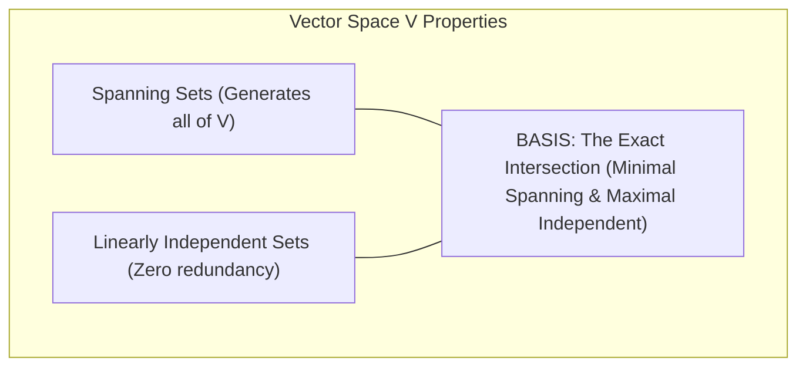

[Maths Index](../README.md) / [Unit 1: Systems of Linear Equations, Vector Spaces, and Fundamental Subspaces](Introduction.md)

# Linear Independence, Basis, and Dimension

In data science and machine learning, we frequently work with tabular datasets containing hundreds of features. But how many of those features actually provide new, independent information, and how many are redundant measurements that can be constructed as combinations of existing columns?

In the previous lecture, we established the abstract rules of vector spaces and subspaces. A subspace typically contains infinitely many vectors. We cannot store or manipulate an infinite collection of points on a computer. We need an efficient, compact way to represent entire subspaces using a finite set of generative vectors.

This leads to the triumvirate of linear algebra: linear independence, basis, and dimension. 

Together, these concepts allow us to strip away all redundant information and find the minimal coordinate frame that spans a subspace.

---

## Linear Combinations and the Span

Let $V$ be a vector space, and let $S = \{\mathbf{v}_1, \mathbf{v}_2, \dots, \mathbf{v}_k\}$ be a set of vectors in $V$.

A vector $\mathbf{w} \in V$ is called a linear combination of the vectors in $S$ if there exist real scalars $c_1, c_2, \dots, c_k \in \mathbb{R}$ such that:

$$\mathbf{w} = c_1 \mathbf{v}_1 + c_2 \mathbf{v}_2 + \dots + c_k \mathbf{v}_k = \sum_{i=1}^k c_i \mathbf{v}_i$$

Now, what happens if we collect every single vector that can possibly be constructed by varying the coefficients $c_1, \dots, c_k$ over all real numbers?

We get the linear span:

$$\text{span}(\mathbf{v}_1, \mathbf{v}_2, \dots, \mathbf{v}_k) = \left\{ \sum_{i=1}^k c_i \mathbf{v}_i \;\middle|\; c_1, \dots, c_k \in \mathbb{R} \right\}$$

### The Span Theorem

Theorem: The span of any set of vectors $S = \{\mathbf{v}_1, \dots, \mathbf{v}_k\}$ in a vector space $V$ is guaranteed to be a valid subspace of $V$. Furthermore, it is the smallest subspace of $V$ that contains $S$.

Proof: Let's test the three subspace conditions on $W = \text{span}(S)$:
1. Zero Vector: Setting all scalars $c_i = 0$ yields $\sum 0 \mathbf{v}_i = \mathbf{0} \in W$.
2. Closure under Addition: Let $\mathbf{u} = \sum c_i \mathbf{v}_i$ and $\mathbf{w} = \sum d_i \mathbf{v}_i$. Their sum is $\mathbf{u} + \mathbf{w} = \sum (c_i + d_i)\mathbf{v}_i$, which is a valid linear combination of $S$.
3. Closure under Scalar Multiplication: For scalar $\alpha \in \mathbb{R}$, $\alpha \mathbf{u} = \sum (\alpha c_i)\mathbf{v}_i \in W$.

All three conditions are satisfied. Thus, spanning a set of vectors is an automatic machine for generating valid subspaces.

If $\text{span}(S) = V$, we say that the set $S$ spans the vector space $V$.

---

## Linear Independence and Dependence

While the span tells us what space a set of vectors can reach, it says nothing about efficiency.

Suppose we have two vectors in $\mathbb{R}^2$: $\mathbf{v}_1 = \begin{bmatrix} 1 \\ 2 \end{bmatrix}$ and $\mathbf{v}_2 = \begin{bmatrix} 2 \\ 4 \end{bmatrix}$. 
Because $\mathbf{v}_2 = 2\mathbf{v}_1$, adding $\mathbf{v}_2$ to our collection gives us nothing new. The span of $\{\mathbf{v}_1, \mathbf{v}_2\}$ is still just the 1-dimensional line through $\begin{bmatrix} 1 \\ 2 \end{bmatrix}$. The vector $\mathbf{v}_2$ is completely redundant.

How do we formalize this absence of redundancy mathematically?

### The Formal Definition

A set of vectors $\{\mathbf{v}_1, \mathbf{v}_2, \dots, \mathbf{v}_k\}$ is called linearly independent if the only scalars $c_1, c_2, \dots, c_k$ that satisfy:

$$c_1 \mathbf{v}_1 + c_2 \mathbf{v}_2 + \dots + c_k \mathbf{v}_k = \mathbf{0}$$

are the all-zero scalars:

$$c_1 = c_2 = \dots = c_k = 0$$

If there exists even one set of scalars that are not all zero such that $\sum c_i \mathbf{v}_i = \mathbf{0}$, then the vectors are linearly dependent.

### Why This Definition Captures Redundancy

To see why the zero-sum condition tests redundancy, suppose the vectors are linearly dependent. Then there exists a non-trivial combination where at least one coefficient is non-zero — say $c_1 \neq 0$:

$$c_1 \mathbf{v}_1 + c_2 \mathbf{v}_2 + \dots + c_k \mathbf{v}_k = \mathbf{0}$$

Because $c_1 \neq 0$, we can divide by $c_1$ and isolate $\mathbf{v}_1$:

$$\mathbf{v}_1 = -\frac{c_2}{c_1}\mathbf{v}_2 - \frac{c_3}{c_1}\mathbf{v}_3 - \dots - \frac{c_k}{c_1}\mathbf{v}_k$$

This proves that $\mathbf{v}_1$ is a linear combination of the remaining vectors. It brings zero new directions to the span and can be discarded without shrinking the spanned subspace.

### The Matrix Test for Linear Independence

In Euclidean space $\mathbb{R}^m$, we can test linear independence mechanically. 

Place the vectors $\mathbf{v}_1, \dots, \mathbf{v}_k$ as the columns of an $m \times k$ matrix $A$:

$$A = \begin{bmatrix} \mathbf{v}_1 & \mathbf{v}_2 & \dots & \mathbf{v}_k \end{bmatrix}$$

The linear combination $\sum c_i \mathbf{v}_i = \mathbf{0}$ is identical to the matrix equation:

$$A\mathbf{c} = \mathbf{0} \quad \text{where } \mathbf{c} = \begin{bmatrix} c_1 \\ \vdots \\ c_k \end{bmatrix}$$

Therefore:
- The vectors are linearly independent if and only if $A\mathbf{c} = \mathbf{0}$ has only the trivial solution $\mathbf{c} = \mathbf{0}$.
- This occurs if and only if every column is a pivot column ($\text{rank}(A) = k$, zero free variables).
- If $\text{rank}(A) < k$, there are free variables, non-trivial solutions exist, and the vectors are linearly dependent.

---

## The Concept of a Basis

Now we combine spanning and linear independence into the central concept of linear algebra.

A set of vectors $\mathcal{B} = \{\mathbf{v}_1, \mathbf{v}_2, \dots, \mathbf{v}_n\}$ is called a basis for a vector space $V$ if it satisfies two conditions simultaneously:

1. $\mathcal{B}$ is linearly independent (no waste, no redundancy).
2. $\mathcal{B}$ spans $V$ ($\text{span}(\mathcal{B}) = V$, enough vectors to generate everything).

A basis represents the ideal balance:
- It is a minimal spanning set: if you remove even one vector from a basis, it will no longer span $V$.
- It is a maximal linearly independent set: if you add any other vector from $V$ to a basis, the enlarged set becomes linearly dependent.

### The Unique Representation Theorem

Why is a basis so powerful? Because it gives every vector a unique set of coordinates.

Theorem: If $\mathcal{B} = \{\mathbf{v}_1, \dots, \mathbf{v}_n\}$ is a basis for $V$, then every vector $\mathbf{v} \in V$ can be written as a linear combination of the basis vectors in one and only one way:

$$\mathbf{v} = c_1 \mathbf{v}_1 + c_2 \mathbf{v}_2 + \dots + c_n \mathbf{v}_n$$

The unique scalars $(c_1, c_2, \dots, c_n)$ are called the coordinates of $\mathbf{v}$ with respect to basis $\mathcal{B}$.

Proof of uniqueness: Suppose $\mathbf{v}$ could also be written with different coefficients $d_i$:
$$\mathbf{v} = d_1 \mathbf{v}_1 + \dots + d_n \mathbf{v}_n$$
Subtracting the two expressions gives:
$$\mathbf{0} = (c_1 - d_1)\mathbf{v}_1 + (c_2 - d_2)\mathbf{v}_2 + \dots + (c_n - d_n)\mathbf{v}_n$$
Because the basis vectors are linearly independent, every scalar must be zero: $c_i - d_i = 0 \implies c_i = d_i$ for all $i$. The representation is strictly unique.

### The Standard Basis of $\mathbb{R}^n$

The simplest basis for $\mathbb{R}^n$ is the standard basis $\{\mathbf{e}_1, \mathbf{e}_2, \dots, \mathbf{e}_n\}$:

$$\mathbf{e}_1 = \begin{bmatrix} 1 \\ 0 \\ \vdots \\ 0 \end{bmatrix}, \quad \mathbf{e}_2 = \begin{bmatrix} 0 \\ 1 \\ \vdots \\ 0 \end{bmatrix}, \quad \dots, \quad \mathbf{e}_n = \begin{bmatrix} 0 \\ 0 \\ \vdots \\ 1 \end{bmatrix}$$

In this basis, the coordinates of any vector $\mathbf{x} = [x_1, x_2, \dots, x_n]^T$ are simply its entries: $\mathbf{x} = \sum x_i \mathbf{e}_i$.

---

## Dimension of a Vector Space

While a vector space can have infinitely many different bases, all bases share a universal invariant property:

Theorem: If a vector space $V$ has a basis containing $n$ vectors, then every other basis for $V$ must also contain exactly $n$ vectors.

This invariant integer $n$ is called the dimension of the vector space:

$$\dim(V) = n$$

By convention, the zero vector space $\{\mathbf{0}\}$ contains no linearly independent vectors, so $\dim(\{\mathbf{0}\}) = 0$.

### Fundamental Dimension Theorems

For an $n$-dimensional vector space $V$:

1. Any set of more than $n$ vectors in $V$ must be linearly dependent.
2. Any set of fewer than $n$ vectors in $V$ cannot span $V$.
3. If a set contains exactly $n$ vectors:
   - If they are linearly independent, they automatically span $V$ (they form a basis).
   - If they span $V$, they are automatically linearly independent (they form a basis).

This third property is a massive computational shortcut: in an $n$-dimensional space, you only need to check one condition (independence or spanning) for a set of $n$ vectors. The other condition follows for free.

---

## Complete Step-by-Step Numerical Example

Let's work through a practical problem:
Given four vectors in $\mathbb{R}^4$:

$$\mathbf{v}_1 = \begin{bmatrix} 1 \\ 2 \\ 0 \\ 1 \end{bmatrix}, \quad \mathbf{v}_2 = \begin{bmatrix} 2 \\ 4 \\ 1 \\ 3 \end{bmatrix}, \quad \mathbf{v}_3 = \begin{bmatrix} 3 \\ 6 \\ 1 \\ 4 \end{bmatrix}, \quad \mathbf{v}_4 = \begin{bmatrix} 1 \\ 2 \\ 2 \\ 3 \end{bmatrix}$$

Let $W = \text{span}(\mathbf{v}_1, \mathbf{v}_2, \mathbf{v}_3, \mathbf{v}_4)$. 
We want to:
1. Determine if the four vectors are linearly independent.
2. Find any linear dependence relations among them.
3. Extract a basis for the subspace $W$.
4. Determine the dimension $\dim(W)$.

### Step 1: Form the Matrix and Row Reduce to RREF

Assemble the vectors into the columns of a matrix $A$:

$$A = \begin{bmatrix} \mathbf{v}_1 & \mathbf{v}_2 & \mathbf{v}_3 & \mathbf{v}_4 \end{bmatrix} = \begin{bmatrix}
1 & 2 & 3 & 1 \\
2 & 4 & 6 & 2 \\
0 & 1 & 1 & 2 \\
1 & 3 & 4 & 3
\end{bmatrix}$$

Perform forward elimination:
- $R_2 \leftarrow R_2 - 2 R_1$: $[2, 4, 6, 2] - 2[1, 2, 3, 1] = [0, 0, 0, 0]$
- $R_4 \leftarrow R_4 - R_1$: $[1, 3, 4, 3] - 1[1, 2, 3, 1] = [0, 1, 1, 2]$

$$\begin{bmatrix}
1 & 2 & 3 & 1 \\
0 & 0 & 0 & 0 \\
0 & 1 & 1 & 2 \\
0 & 1 & 1 & 2
\end{bmatrix}$$

Swap rows to move the zero row down: $R_2 \leftrightarrow R_3$:

$$\begin{bmatrix}
1 & 2 & 3 & 1 \\
0 & 1 & 1 & 2 \\
0 & 0 & 0 & 0 \\
0 & 1 & 1 & 2
\end{bmatrix}$$

Eliminate row 4 using pivot in row 2: $R_4 \leftarrow R_4 - R_2$:

$$\begin{bmatrix}
1 & 2 & 3 & 1 \\
0 & 1 & 1 & 2 \\
0 & 0 & 0 & 0 \\
0 & 0 & 0 & 0
\end{bmatrix}$$

Now eliminate upwards to find RREF:
- $R_1 \leftarrow R_1 - 2 R_2$: $[1, 2, 3, 1] - 2[0, 1, 1, 2] = [1, 0, 1, -3]$

$$\text{RREF}(A) = \begin{bmatrix}
\mathbf{1} & 0 & 1 & -3 \\
0 & \mathbf{1} & 1 & 2 \\
0 & 0 & 0 & 0 \\
0 & 0 & 0 & 0
\end{bmatrix}$$

### Step 2: Identify Pivot and Free Columns

Notice where the leading 1s (pivots) sit:
- Pivot columns: Column 1 and Column 2.
- Free columns: Column 3 and Column 4.

Because there are free columns, the vectors are linearly dependent.

### Step 3: Read Dependence Relations from RREF

The columns of $\text{RREF}(A)$ have the exact same linear dependence relationships as the columns of original matrix $A$.

Looking at free column 3:
$$\begin{bmatrix} 1 \\ 1 \\ 0 \\ 0 \end{bmatrix} = 1 \begin{bmatrix} 1 \\ 0 \\ 0 \\ 0 \end{bmatrix} + 1 \begin{bmatrix} 0 \\ 1 \\ 0 \\ 0 \end{bmatrix}$$
This means:

$$\mathbf{v}_3 = 1 \mathbf{v}_1 + 1 \mathbf{v}_2$$

Verify: $\mathbf{v}_1 + \mathbf{v}_2 = \begin{bmatrix} 1 + 2 \\ 2 + 4 \\ 0 + 1 \\ 1 + 3 \end{bmatrix} = \begin{bmatrix} 3 \\ 6 \\ 1 \\ 4 \end{bmatrix} = \mathbf{v}_3$. Exactly matches!

Looking at free column 4:
$$\begin{bmatrix} -3 \\ 2 \\ 0 \\ 0 \end{bmatrix} = -3 \begin{bmatrix} 1 \\ 0 \\ 0 \\ 0 \end{bmatrix} + 2 \begin{bmatrix} 0 \\ 1 \\ 0 \\ 0 \end{bmatrix}$$
This means:

$$\mathbf{v}_4 = -3 \mathbf{v}_1 + 2 \mathbf{v}_2$$

Verify: $-3\mathbf{v}_1 + 2\mathbf{v}_2 = \begin{bmatrix} -3(1) + 2(2) \\ -3(2) + 2(4) \\ -3(0) + 2(1) \\ -3(1) + 2(3) \end{bmatrix} = \begin{bmatrix} 1 \\ 2 \\ 2 \\ 3 \end{bmatrix} = \mathbf{v}_4$. Matches!

### Step 4: Extract the Basis and Dimension

Since $\mathbf{v}_3$ and $\mathbf{v}_4$ are redundant combinations of $\mathbf{v}_1$ and $\mathbf{v}_2$, the pivot columns of the original matrix form a basis for $W$:

$$\text{Basis}(W) = \left\{ \begin{bmatrix} 1 \\ 2 \\ 0 \\ 1 \end{bmatrix}, \ \begin{bmatrix} 2 \\ 4 \\ 1 \\ 3 \end{bmatrix} \right\}$$

The dimension of subspace $W$ is the number of vectors in its basis:

$$\dim(W) = 2$$

Despite sitting inside 4-dimensional space $\mathbb{R}^4$, the subspace spanned by these four vectors is merely a 2-dimensional flat plane.

---

## Key Takeaways

- A linear combination scales and sums vectors: $\sum c_i \mathbf{v}_i$. The span is the set of all possible linear combinations and is always a valid subspace.
- A set of vectors is linearly independent if $c_1 \mathbf{v}_1 + \dots + c_k \mathbf{v}_k = \mathbf{0} \implies c_i = 0$ for all $i$. If any non-zero combination produces $\mathbf{0}$, the vectors are linearly dependent (redundant).
- A basis is a linearly independent set that spans the entire vector space. It is simultaneously a minimal spanning set and a maximal independent set.
- Every vector in a space has a unique representation with respect to a chosen basis.
- The dimension $\dim(V)$ is the number of vectors in any basis of $V$.
- Any set of $> n$ vectors in an $n$-dimensional space is linearly dependent. Any set of $< n$ vectors cannot span $V$.
- To find a basis for the span of a set of column vectors, place them into a matrix, row-reduce to RREF, and select the original vectors corresponding to the pivot columns.

---

We now have the language to describe the internal geometric anatomy of any matrix. When an $m \times n$ matrix $A$ acts on vectors, it carves up $\mathbb{R}^n$ and $\mathbb{R}^m$ into four tightly interconnected vector spaces. In the next lecture, we explore the crown jewel of linear algebra: The Four Fundamental Subspaces and the Fundamental Theorem of Linear Algebra. Read [L08 - The Four Fundamental Subspaces](L08%20-%20The%20Four%20Fundamental%20Subspaces.md).
