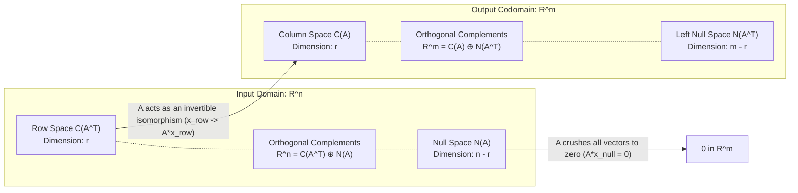

[Maths Index](../README.md) / [Unit 1: Systems of Linear Equations, Vector Spaces, and Fundamental Subspaces](Introduction.md)

# The Four Fundamental Subspaces

Every mathematical discipline has a unifying conceptual summit where all its seemingly disparate tools come together into a coherent whole. In linear algebra, that summit is the Four Fundamental Subspaces of a matrix.

When an $m \times n$ matrix $A$ acts on a vector $\mathbf{x} \in \mathbb{R}^n$ to produce a vector $\mathbf{b} \in \mathbb{R}^m$, it does not merely shuffle numbers around. It carves both the input space $\mathbb{R}^n$ and the output space $\mathbb{R}^m$ into two pairs of mutually orthogonal vector subspaces. 

Understanding these four subspaces — their definitions, their dimensions, their bases, and their geometric orthogonality — is what unlocks modern data science: from least-squares regression and pseudo-inverses to Principal Component Analysis (PCA) and the Singular Value Decomposition (SVD).

---

## The Big Picture: The Four Subspaces

For any real $m \times n$ matrix $A$ with rank $r$, there are four fundamental subspaces:

Two subspaces live inside the input domain $\mathbb{R}^n$:
1. The Row Space: $C(A^T) \subseteq \mathbb{R}^n$
2. The Null Space: $N(A) \subseteq \mathbb{R}^n$

Two subspaces live inside the output codomain $\mathbb{R}^m$:
3. The Column Space: $C(A) \subseteq \mathbb{R}^m$
4. The Left Null Space: $N(A^T) \subseteq \mathbb{R}^m$

Notice the remarkable symmetry:
- The input domain $\mathbb{R}^n$ is divided cleanly between the row space ($r$ dimensions) and the null space ($n - r$ dimensions).
- The output codomain $\mathbb{R}^m$ is divided cleanly between the column space ($r$ dimensions) and the left null space ($m - r$ dimensions).

---

## Deep Dive into the Four Subspaces

Let's examine the mechanics, basis construction, and dimension of each subspace.

### 1. The Column Space: $C(A)$

The column space (also called the range or image of $A$) is the set of all linear combinations of the columns of $A$. It represents all vectors $\mathbf{b} \in \mathbb{R}^m$ that can be reached by the system $A\mathbf{x} = \mathbf{b}$:

$$C(A) = \{A\mathbf{x} \mid \mathbf{x} \in \mathbb{R}^n\} \subseteq \mathbb{R}^m$$

- Living Space: Subspace of $\mathbb{R}^m$.
- Dimension: $\dim(C(A)) = r$ (the rank of $A$).
- How to Find a Basis:
  1. Reduce $A$ to Row Echelon Form (REF) or Reduced Row Echelon Form (RREF).
  2. Identify the pivot columns.
  3. Select the corresponding columns from the **original matrix $A$**.

> **Crucial Warning**: Never use the columns of the reduced matrix $R$ as the basis for $C(A)$. Row operations combine rows, which completely changes the column space! The pivot columns of the original matrix $A$ are what span $C(A)$.

### 2. The Null Space: $N(A)$

The null space (or kernel of $A$) is the set of all vectors $\mathbf{x} \in \mathbb{R}^n$ that $A$ completely annihilates to the zero vector:

$$N(A) = \{\mathbf{x} \in \mathbb{R}^n \mid A\mathbf{x} = \mathbf{0}\} \subseteq \mathbb{R}^n$$

- Living Space: Subspace of $\mathbb{R}^n$.
- Dimension: $\dim(N(A)) = n - r$ (called the nullity of $A$).
- How to Find a Basis:
  1. Reduce $A$ to $\text{RREF}(A) = R$.
  2. Set up the homogeneous system $R\mathbf{x} = \mathbf{0}$.
  3. Express the $r$ pivot variables in terms of the $n - r$ free variables.
  4. Set one free variable to 1 and the other free variables to 0 to generate each "special solution" vector. These special solutions form the basis for $N(A)$.

### 3. The Row Space: $C(A^T)$

The row space is the set of all linear combinations of the rows of $A$ (which is identically the column space of the transpose $A^T$):

$$C(A^T) = \{A^T \mathbf{y} \mid \mathbf{y} \in \mathbb{R}^m\} \subseteq \mathbb{R}^n$$

- Living Space: Subspace of $\mathbb{R}^n$.
- Dimension: $\dim(C(A^T)) = r$ (Row Rank = Column Rank).
- How to Find a Basis:
  Because elementary row operations are just linear combinations of existing rows, row operations **do not change the row space**:
  $$\text{Row Space}(A) = \text{Row Space}(R)$$
  Therefore, the non-zero rows of the Row Echelon Form $R$ form a clean, orthogonal-like basis for $C(A^T)$.

### 4. The Left Null Space: $N(A^T)$

The left null space is the null space of the transpose matrix $A^T$. It consists of all vectors $\mathbf{y} \in \mathbb{R}^m$ such that:

$$A^T \mathbf{y} = \mathbf{0} \iff \mathbf{y}^T A = \mathbf{0}^T$$

Notice why it is called the *left* null space: when written with row vectors, $\mathbf{y}^T$ multiplies $A$ from the left.

- Living Space: Subspace of $\mathbb{R}^m$.
- Dimension: $\dim(N(A^T)) = m - r$.
- How to Find a Basis:
  1. Solve $A^T \mathbf{y} = \mathbf{0}$ directly by reducing $A^T$.
  2. Alternatively, record the row operations that reduced $A$ to $R$ using an elimination matrix $E$: $E A = R$. The rows of $E$ that correspond to the all-zero rows at the bottom of $R$ form a basis for $N(A^T)$.

---

## The Rank-Nullity Theorem

The first structural pillar of the Fundamental Theorem is the Rank-Nullity Theorem:

For any $m \times n$ matrix $A$ with rank $r$:

$$\dim(C(A)) + \dim(N(A)) = r + (n - r) = n$$

$$\text{Rank} + \text{Nullity} = \text{Number of Columns (Input Dimension)}$$

Think about what this means geometrically:
Every vector $\mathbf{x} \in \mathbb{R}^n$ lives in an $n$-dimensional world. When $A$ acts on $\mathbf{x}$, it routes the vector:
- The part of $\mathbf{x}$ lying in the row space ($r$ dimensions) is preserved and mapped invertibly into the column space $C(A)$.
- The part of $\mathbf{x}$ lying in the null space ($n - r$ dimensions) is crushed to zero.

No dimensions are ever lost into thin air:

$$r + (n - r) = n$$

Similarly, in the codomain $\mathbb{R}^m$:

$$\dim(C(A)) + \dim(N(A^T)) = r + (m - r) = m$$

---

## The Fundamental Theorem of Linear Algebra: Orthogonality

Now here is the second, breathtaking insight: the subspaces sharing a domain are not just complementary in dimension — they are strictly perpendicular to each other.

Theorem (Fundamental Theorem of Linear Algebra, Part 1):
1. In $\mathbb{R}^n$, the row space $C(A^T)$ and the null space $N(A)$ are orthogonal complements:
   $$N(A) = (C(A^T))^\perp \quad \text{and} \quad \mathbb{R}^n = C(A^T) \oplus N(A)$$
2. In $\mathbb{R}^m$, the column space $C(A)$ and the left null space $N(A^T)$ are orthogonal complements:
   $$N(A^T) = (C(A))^\perp \quad \text{and} \quad \mathbb{R}^m = C(A) \oplus N(A^T)$$

### Why are the Row Space and Null Space Orthogonal?

The proof is so direct that it is unforgettable. 
Write out $A\mathbf{x} = \mathbf{0}$ row by row:

$$\begin{bmatrix}
\text{---} & \mathbf{r}_1^T & \text{---} \\
\text{---} & \mathbf{r}_2^T & \text{---} \\
& \vdots & \\
\text{---} & \mathbf{r}_m^T & \text{---}
\end{bmatrix} \mathbf{x} = \begin{bmatrix} 0 \\ 0 \\ \vdots \\ 0 \end{bmatrix} \iff \begin{aligned}
\mathbf{r}_1 \cdot \mathbf{x} &= 0 \\
\mathbf{r}_2 \cdot \mathbf{x} &= 0 \\
&\;\;\vdots \\
\mathbf{r}_m \cdot \mathbf{x} &= 0
\end{aligned}$$

Every row vector $\mathbf{r}_i$ has a dot product of zero with $\mathbf{x}$. 

Now take any arbitrary vector $\mathbf{v}$ in the row space. By definition, $\mathbf{v} = \sum c_i \mathbf{r}_i$. 
Compute the dot product of $\mathbf{v}$ with any null space vector $\mathbf{x} \in N(A)$:

$$\mathbf{v} \cdot \mathbf{x} = \left(\sum_{i=1}^m c_i \mathbf{r}_i\right) \cdot \mathbf{x} = \sum_{i=1}^m c_i (\mathbf{r}_i \cdot \mathbf{x}) = \sum_{i=1}^m c_i (0) = 0$$

Every vector in the row space is strictly perpendicular to every vector in the null space. 

Because their dimensions sum to $n$ ($r + (n - r) = n$), they are orthogonal complements. Any vector $\mathbf{x} \in \mathbb{R}^n$ can be uniquely decomposed into:

$$\mathbf{x} = \mathbf{x}_{\text{row}} + \mathbf{x}_{\text{null}} \quad \text{where } \mathbf{x}_{\text{row}} \in C(A^T), \ \mathbf{x}_{\text{null}} \in N(A)$$

And because $A\mathbf{x}_{\text{null}} = \mathbf{0}$:

$$A\mathbf{x} = A(\mathbf{x}_{\text{row}} + \mathbf{x}_{\text{null}}) = A\mathbf{x}_{\text{row}}$$

The null space component is completely eliminated, and only the row space component produces the output.

---

## Complete Numerical Example: $3 \times 4$ Matrix

Let's find all four fundamental subspaces for the matrix:

$$A = \begin{bmatrix}
1 & 3 & 3 & 2 \\
2 & 6 & 9 & 7 \\
-1 & -3 & 3 & 4
\end{bmatrix}$$

Here, $m = 3$ rows and $n = 4$ columns.

### Step 1: Forward Elimination to RREF

Augment with an identity matrix to track row operations:

$$\left[\begin{array}{cccc|ccc}
1 & 3 & 3 & 2 & 1 & 0 & 0 \\
2 & 6 & 9 & 7 & 0 & 1 & 0 \\
-1 & -3 & 3 & 4 & 0 & 0 & 1
\end{array}\right]$$

- $R_2 \leftarrow R_2 - 2 R_1$: $[0, \ 0, \ 3, \ 3 \mid -2, \ 1, \ 0]$
- $R_3 \leftarrow R_3 + 1 R_1$: $[0, \ 0, \ 6, \ 6 \mid 1, \ 0, \ 1]$

$$\left[\begin{array}{cccc|ccc}
1 & 3 & 3 & 2 & 1 & 0 & 0 \\
0 & 0 & 3 & 3 & -2 & 1 & 0 \\
0 & 0 & 6 & 6 & 1 & 0 & 1
\end{array}\right]$$

- $R_3 \leftarrow R_3 - 2 R_2$: $[0, \ 0, \ 0, \ 0 \mid 5, \ -2, \ 1]$

$$\left[\begin{array}{cccc|ccc}
1 & 3 & 3 & 2 & 1 & 0 & 0 \\
0 & 0 & 3 & 3 & -2 & 1 & 0 \\
0 & 0 & 0 & 0 & 5 & -2 & 1
\end{array}\right]$$

Scale row 2: $R_2 \leftarrow \frac{1}{3} R_2$:

$$\left[\begin{array}{cccc|ccc}
1 & 3 & 3 & 2 & 1 & 0 & 0 \\
0 & 0 & 1 & 1 & -2/3 & 1/3 & 0 \\
0 & 0 & 0 & 0 & 5 & -2 & 1
\end{array}\right]$$

Eliminate upwards: $R_1 \leftarrow R_1 - 3 R_2$:

$$\text{RREF } R = \begin{bmatrix}
\mathbf{1} & 3 & 0 & -1 \\
0 & 0 & \mathbf{1} & 1 \\
0 & 0 & 0 & 0
\end{bmatrix}$$

Let's read the rank: $r = 2$ pivots (sitting in column 1 and column 3).

### Step 2: Basis and Dimension for $C(A)$

The pivot columns of $R$ are columns 1 and 3. We take the corresponding columns from the **original matrix $A$**:

$$\text{Basis}(C(A)) = \left\{ \begin{bmatrix} 1 \\ 2 \\ -1 \end{bmatrix}, \ \begin{bmatrix} 3 \\ 9 \\ 3 \end{bmatrix} \right\}, \quad \dim(C(A)) = r = 2$$

$C(A)$ is a 2-dimensional plane living in $\mathbb{R}^3$.

### Step 3: Basis and Dimension for $N(A)$

Solve $R\mathbf{x} = \mathbf{0}$.
- Pivot variables: $x_1, x_3$.
- Free variables: $x_2, x_4$.
- Number of free variables: $n - r = 4 - 2 = 2$.

From row 2: $x_3 + x_4 = 0 \implies x_3 = -x_4$.
From row 1: $x_1 + 3x_2 - x_4 = 0 \implies x_1 = -3x_2 + x_4$.

Write in vector form:

$$\mathbf{x} = \begin{bmatrix} x_1 \\ x_2 \\ x_3 \\ x_4 \end{bmatrix} = \begin{bmatrix} -3x_2 + x_4 \\ x_2 \\ -x_4 \\ x_4 \end{bmatrix} = x_2 \begin{bmatrix} -3 \\ 1 \\ 0 \\ 0 \end{bmatrix} + x_4 \begin{bmatrix} 1 \\ 0 \\ -1 \\ 1 \end{bmatrix}$$

$$\text{Basis}(N(A)) = \left\{ \begin{bmatrix} -3 \\ 1 \\ 0 \\ 0 \end{bmatrix}, \ \begin{bmatrix} 1 \\ 0 \\ -1 \\ 1 \end{bmatrix} \right\}, \quad \dim(N(A)) = n - r = 2$$

$N(A)$ is a 2-dimensional subspace living in $\mathbb{R}^4$.

### Step 4: Basis and Dimension for $C(A^T)$

The non-zero rows of $R$ form a basis for the row space:

$$\text{Basis}(C(A^T)) = \left\{ \begin{bmatrix} 1 \\ 3 \\ 0 \\ -1 \end{bmatrix}, \ \begin{bmatrix} 0 \\ 0 \\ 1 \\ 1 \end{bmatrix} \right\}, \quad \dim(C(A^T)) = r = 2$$

$C(A^T)$ is a 2-dimensional subspace living in $\mathbb{R}^4$.

### Step 5: Basis and Dimension for $N(A^T)$

The left null space has dimension $m - r = 3 - 2 = 1$. It lives in $\mathbb{R}^3$.
Looking at the third row of our row operations tracker:
$$R_3 = 5(\text{Row } 1) - 2(\text{Row } 2) + 1(\text{Row } 3) = [0, 0, 0, 0]$$
This means:

$$\mathbf{y} = \begin{bmatrix} 5 \\ -2 \\ 1 \end{bmatrix}$$

Verify:
$$A^T \mathbf{y} = \begin{bmatrix} 1 & 2 & -1 \\ 3 & 6 & -3 \\ 3 & 9 & 3 \\ 2 & 7 & 4 \end{bmatrix} \begin{bmatrix} 5 \\ -2 \\ 1 \end{bmatrix} = \begin{bmatrix} 5 - 4 - 1 \\ 15 - 12 - 3 \\ 15 - 18 + 3 \\ 10 - 14 + 4 \end{bmatrix} = \begin{bmatrix} 0 \\ 0 \\ 0 \\ 0 \end{bmatrix}$$

$$\text{Basis}(N(A^T)) = \left\{ \begin{bmatrix} 5 \\ -2 \\ 1 \end{bmatrix} \right\}, \quad \dim(N(A^T)) = m - r = 1$$

### Step 6: Verifying Rank-Nullity and Orthogonality

Let's check the theorems:
1. Rank-Nullity in $\mathbb{R}^4$:
   $$\dim(C(A^T)) + \dim(N(A)) = 2 + 2 = 4 = n \quad \checkmark$$
2. Rank-Nullity in $\mathbb{R}^3$:
   $$\dim(C(A)) + \dim(N(A^T)) = 2 + 1 = 3 = m \quad \checkmark$$
3. Orthogonality in $\mathbb{R}^4$ ($C(A^T) \perp N(A)$):
   - Row 1 of $R \cdot$ Basis Vector 1 of $N(A)$:
     $[1, 3, 0, -1] \cdot [-3, 1, 0, 0] = -3 + 3 + 0 + 0 = 0 \quad \checkmark$
   - Row 1 of $R \cdot$ Basis Vector 2 of $N(A)$:
     $[1, 3, 0, -1] \cdot [1, 0, -1, 1] = 1 + 0 + 0 - 1 = 0 \quad \checkmark$
   - Row 2 of $R \cdot$ Basis Vector 1 of $N(A)$:
     $[0, 0, 1, 1] \cdot [-3, 1, 0, 0] = 0 + 0 + 0 + 0 = 0 \quad \checkmark$
   - Row 2 of $R \cdot$ Basis Vector 2 of $N(A)$:
     $[0, 0, 1, 1] \cdot [1, 0, -1, 1] = 0 + 0 - 1 + 1 = 0 \quad \checkmark$
4. Orthogonality in $\mathbb{R}^3$ ($C(A) \perp N(A^T)$):
   - Column 1 of $A \cdot \mathbf{y}$:
     $[1, 2, -1] \cdot [5, -2, 1] = 5 - 4 - 1 = 0 \quad \checkmark$
   - Column 3 of $A \cdot \mathbf{y}$:
     $[3, 9, 3] \cdot [5, -2, 1] = 15 - 18 + 3 = 0 \quad \checkmark$

Every single relationship holds with mathematical precision.

---

## Key Takeaways

- Every $m \times n$ matrix $A$ of rank $r$ defines four fundamental subspaces: Column Space $C(A) \subseteq \mathbb{R}^m$, Null Space $N(A) \subseteq \mathbb{R}^n$, Row Space $C(A^T) \subseteq \mathbb{R}^n$, and Left Null Space $N(A^T) \subseteq \mathbb{R}^m$.
- Dimensions: $\dim(C(A)) = r$, $\dim(C(A^T)) = r$, $\dim(N(A)) = n - r$, and $\dim(N(A^T)) = m - r$.
- The Rank-Nullity Theorem states that $\dim(C(A)) + \dim(N(A)) = n$.
- Row Space basis: The non-zero rows of the Row Echelon Form $R$.
- Column Space basis: The pivot columns of the **original matrix $A$**.
- Null Space basis: The special solutions obtained from $R\mathbf{x} = \mathbf{0}$.
- Left Null Space basis: The solutions to $A^T \mathbf{y} = \mathbf{0}$, or the combination rows of $E$ yielding zero rows in $R$.
- The Fundamental Theorem of Linear Algebra proves that $C(A^T) \perp N(A)$ in $\mathbb{R}^n$, and $C(A) \perp N(A^T)$ in $\mathbb{R}^m$.

---

We have now uncovered the complete internal geometry of a static matrix. But what happens when a matrix is viewed dynamically as a function that transforms space — stretching, rotating, reflecting, and projecting vectors? In the final lecture of Unit 1, we study Linear Transformations and the bridge between abstract operators and matrix algebra. Read [L09 - Linear Transformations](L09%20-%20Linear%20Transformations.md).
