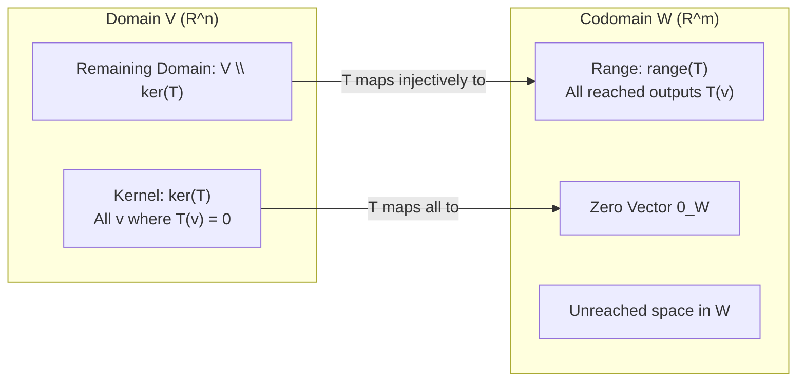

[Maths Index](../README.md) / [Unit 1: Systems of Linear Equations, Vector Spaces, and Fundamental Subspaces](Introduction.md)

# Linear Transformations

Throughout this unit, we have largely viewed a matrix $A$ as an array of data or as a set of linear equations to be solved. We eliminated rows, computed ranks, and found bases for fundamental subspaces. But this static view misses the true power and elegance of linear algebra.

A matrix is not just a static table of numbers. A matrix is a dynamic operator. It is a machine that takes a vector from an input space, moves it, rotates it, scales it, projects it, or reflects it, and lands it in an output space.

When we view matrices as functions that transform space while preserving its linear structure, we enter the theory of Linear Transformations. In this final lecture of Unit 1, we formalize linear mappings, derive how standard basis vectors determine a transformation's matrix representation, analyze kernels and ranges, and establish the geometric bridge to Unit 2.

---

## From Matrices to Mappings

Let $V$ and $W$ be two real vector spaces. A function $T: V \to W$ is a rule that assigns to each vector $\mathbf{v} \in V$ a unique vector $T(\mathbf{v}) \in W$.

We call $V$ the domain and $W$ the codomain.

Now, most functions in mathematics are non-linear (e.g., $f(x) = x^2$, $f(x) = \sin(x)$, or activation functions like $\text{ReLU}(x) = \max(0, x)$). 

What makes a transformation linear?

A linear transformation is a mapping that strictly preserves the two defining operations of vector spaces: vector addition and scalar multiplication.

### The Formal Definition

A transformation $T: V \to W$ is called a linear transformation if it satisfies two axioms for all vectors $\mathbf{u}, \mathbf{v} \in V$ and all real scalars $c \in \mathbb{R}$:

1. Additivity (Preservation of Addition):
   $$T(\mathbf{u} + \mathbf{v}) = T(\mathbf{u}) + T(\mathbf{v})$$
2. Homogeneity (Preservation of Scaling):
   $$T(c\mathbf{u}) = c T(\mathbf{u})$$

These two conditions can be encapsulated into a single superposition principle:

$$T(c\mathbf{u} + d\mathbf{v}) = c T(\mathbf{u}) + d T(\mathbf{v}) \quad \text{for all } \mathbf{u}, \mathbf{v} \in V \text{ and } c, d \in \mathbb{R}$$

### Essential Consequences of Linearity

From this definition, two critical geometric properties follow immediately:

1. The Zero Vector Must Map to Zero:
   Setting $c = 0$ in the homogeneity axiom gives:
   $$T(\mathbf{0}_V) = T(0 \cdot \mathbf{u}) = 0 \cdot T(\mathbf{u}) = \mathbf{0}_W$$
   Any transformation that does not map the origin of $V$ to the origin of $W$ is strictly non-linear.
2. Straight Lines Remain Straight Lines:
   Linear transformations map straight lines to straight lines (or to a single point) and keep parallel lines parallel. They never bend, curve, or warp space.

Now notice something vital for deep learning: 
An affine transformation $f(\mathbf{x}) = A\mathbf{x} + \mathbf{b}$ where $\mathbf{b} \neq \mathbf{0}$ (the standard operation inside every neural network dense layer) is **not** a linear transformation! 
Why? Because $f(\mathbf{0}) = A\mathbf{0} + \mathbf{b} = \mathbf{b} \neq \mathbf{0}$. 

An affine transformation is a linear transformation followed by a translation.

---

## Geometric Linear Transformations in $\mathbb{R}^2$

To build visual intuition, let's look at how elementary linear transformations act on vectors in the 2-dimensional Cartesian plane $\mathbb{R}^2$.

### 1. Counterclockwise Rotation by Angle $\theta$

Consider rotating every vector in $\mathbb{R}^2$ counterclockwise around the origin by an angle $\theta$. 

Where do our standard basis vectors $\mathbf{e}_1 = \begin{bmatrix} 1 \\ 0 \end{bmatrix}$ and $\mathbf{e}_2 = \begin{bmatrix} 0 \\ 1 \end{bmatrix}$ land?
- Rotating $\mathbf{e}_1$ by $\theta$ yields:
  $$T(\mathbf{e}_1) = \begin{bmatrix} \cos\theta \\ \sin\theta \end{bmatrix}$$
- Rotating $\mathbf{e}_2$ by $\theta$ yields:
  $$T(\mathbf{e}_2) = \begin{bmatrix} -\sin\theta \\ \cos\theta \end{bmatrix}$$

Putting these output vectors into the columns of a matrix gives the celebrated 2D rotation matrix:

$$R_\theta = \begin{bmatrix} \cos\theta & -\sin\theta \\ \sin\theta & \cos\theta \end{bmatrix}$$

Any vector $\mathbf{x} = \begin{bmatrix} x \\ y \end{bmatrix}$ rotated by $\theta$ is simply:

$$T(\mathbf{x}) = R_\theta \mathbf{x} = \begin{bmatrix} x\cos\theta - y\sin\theta \\ x\sin\theta + y\cos\theta \end{bmatrix}$$

### 2. Scaling (Dilation / Contraction)

Scaling the $x$-axis by factor $s_x$ and the $y$-axis by factor $s_y$:

$$S = \begin{bmatrix} s_x & 0 \\ 0 & s_y \end{bmatrix} \implies S \begin{bmatrix} x \\ y \end{bmatrix} = \begin{bmatrix} s_x x \\ s_y y \end{bmatrix}$$

### 3. Horizontal Shear

Sliding horizontal lines parallel to the $x$-axis by an amount proportional to $y$:

$$H_k = \begin{bmatrix} 1 & k \\ 0 & 1 \end{bmatrix} \implies H_k \begin{bmatrix} x \\ y \end{bmatrix} = \begin{bmatrix} x + ky \\ y \end{bmatrix}$$

Notice that the $x$-axis remains completely stationary, while points higher up the $y$-axis are shifted further to the right.

### 4. Orthogonal Projection onto an Axis

Projecting any vector onto the horizontal $x$-axis by discarding its vertical component:

$$P_x = \begin{bmatrix} 1 & 0 \\ 0 & 0 \end{bmatrix} \implies P_x \begin{bmatrix} x \\ y \end{bmatrix} = \begin{bmatrix} x \\ 0 \end{bmatrix}$$

Notice that $P_x$ cannot be inverted because all vertical information ($y$) is permanently destroyed.

---

## The Matrix Representation Theorem

Now here is the central theorem connecting abstract linear transformations to matrix algebra:

Theorem: Every linear transformation $T: \mathbb{R}^n \to \mathbb{R}^m$ can be represented as multiplication by a unique $m \times n$ matrix $A$:

$$T(\mathbf{x}) = A\mathbf{x} \quad \text{for all } \mathbf{x} \in \mathbb{R}^n$$

### How to Construct the Matrix $A$

How do we find this matrix $A$? 

Think about what any vector $\mathbf{x} \in \mathbb{R}^n$ is: it is a linear combination of the standard basis vectors:

$$\mathbf{x} = x_1 \mathbf{e}_1 + x_2 \mathbf{e}_2 + \dots + x_n \mathbf{e}_n$$

Apply the linear transformation $T$ to both sides and use the superposition property:

$$T(\mathbf{x}) = T\left(\sum_{j=1}^n x_j \mathbf{e}_j\right) = \sum_{j=1}^n x_j T(\mathbf{e}_j)$$

Notice what this reveals: if you know what $T$ does to the standard basis vectors $\mathbf{e}_1, \dots, \mathbf{e}_n$, you know what $T$ does to every vector in the entire universe!

The output $T(\mathbf{x})$ is simply a linear combination of the image vectors $T(\mathbf{e}_j)$, weighted by the entries $x_j$. 
And from Lecture 1, what is a linear combination of vectors? It is a matrix-vector product!

Therefore, the matrix $A$ is constructed simply by packaging the transformed basis vectors into its columns:

$$A = \begin{bmatrix} T(\mathbf{e}_1) & T(\mathbf{e}_2) & \dots & T(\mathbf{e}_n) \end{bmatrix}$$

This matrix $A$ is called the standard matrix for the linear transformation $T$.

---

## Kernel and Range

Just as matrices have null spaces and column spaces, linear transformations have kernels and ranges.

### 1. The Kernel (Null Space of $T$)

The kernel of $T$ is the set of all vectors in the domain $V$ that $T$ maps to the zero vector in $W$:

$$\ker(T) = \{\mathbf{v} \in V \mid T(\mathbf{v}) = \mathbf{0}_W\}$$

When $T(\mathbf{x}) = A\mathbf{x}$, the kernel is identically the null space of the matrix $A$:

$$\ker(T) = N(A)$$

The kernel measures what information $T$ destroys.

### 2. The Range (Image of $T$)

The range (or image) of $T$ is the set of all vectors in the codomain $W$ that are actually reached by applying $T$ to some vector in $V$:

$$\text{range}(T) = \{T(\mathbf{v}) \mid \mathbf{v} \in V\}$$

When $T(\mathbf{x}) = A\mathbf{x}$, the range is identically the column space of the matrix $A$:

$$\text{range}(T) = C(A)$$

### Injectivity, Surjectivity, and Bijectivity

Using the kernel and range, we characterize transformations:

- Injective (One-to-One): $T$ maps distinct inputs to distinct outputs:
  $$T(\mathbf{u}) = T(\mathbf{v}) \implies \mathbf{u} = \mathbf{v}$$
  Theorem: $T$ is injective if and only if its kernel contains only the zero vector:
  $$\ker(T) = \{\mathbf{0}\}$$
  In matrix terms, this means $A$ has full column rank ($\text{rank}(A) = n$, zero free variables).

- Surjective (Onto): The range fills the entire codomain:
  $$\text{range}(T) = W$$
  In matrix terms, this means $A$ has full row rank ($\text{rank}(A) = m$, every row has a pivot).

- Bijective (Isomorphism): $T$ is both injective and surjective. 
  An isomorphism means $V$ and $W$ have identical linear algebraic structure. A matrix transformation is an isomorphism if and only if $A$ is a square invertible matrix.

### The Dimension Theorem for Linear Transformations

The Rank-Nullity Theorem translates directly into the Dimension Theorem for mappings:

$$\dim(\ker(T)) + \dim(\text{range}(T)) = \dim(V)$$

---

## Composition of Linear Transformations

Suppose we have two linear transformations:
- $T: U \to V$ represented by matrix $A \in \mathbb{R}^{m \times k}$
- $S: V \to W$ represented by matrix $B \in \mathbb{R}^{p \times m}$

What happens when we compose them, applying $T$ first and then $S$?

$$(S \circ T)(\mathbf{u}) = S(T(\mathbf{u}))$$

Using their matrix representations:

$$S(T(\mathbf{u})) = S(A\mathbf{u}) = B(A\mathbf{u}) = (BA)\mathbf{u}$$

Notice what this demonstrates:

> Matrix multiplication is fundamentally defined the way it is so that the product of matrices corresponds directly to the composition of linear transformations.

This explains two profound properties of matrix algebra:

1. Why Matrix Multiplication is Associative:
   Function composition is naturally associative: $(R \circ (S \circ T)) = ((R \circ S) \circ T)$. 
   Therefore, matrix multiplication must be associative: $C(BA) = (CB)A$.

2. Why Matrix Multiplication is Non-Commutative:
   In general, the order in which you apply transformations changes the physical result. 
   Rotating by $90^\circ$ and then reflecting across the $x$-axis produces a completely different outcome than reflecting first and then rotating. 
   Therefore, $A B \neq B A$.

---

## Change of Basis and Matrix Similarity

So far, we have written the matrix of a transformation with respect to the standard basis. But what if we observe a system in an alternative coordinate frame?

Let $\mathcal{B} = \{\mathbf{v}_1, \dots, \mathbf{v}_n\}$ be a non-standard basis for $V$. 
Any vector $\mathbf{x} \in V$ has coordinate vector $[\mathbf{x}]_\mathcal{B}$ defined by:

$$\mathbf{x} = \sum_{j=1}^n c_j \mathbf{v}_j \implies [\mathbf{x}]_\mathcal{B} = \begin{bmatrix} c_1 \\ \vdots \\ c_n \end{bmatrix}$$

Let $P$ be the change-of-basis matrix whose columns are the basis vectors $\mathbf{v}_j$:

$$P = \begin{bmatrix} \mathbf{v}_1 & \mathbf{v}_2 & \dots & \mathbf{v}_n \end{bmatrix}$$

Then the standard coordinates and $\mathcal{B}$-coordinates are related by:

$$\mathbf{x} = P [\mathbf{x}]_\mathcal{B} \quad \text{and} \quad [\mathbf{x}]_\mathcal{B} = P^{-1}\mathbf{x}$$

If a linear transformation is represented by matrix $A$ in standard coordinates, what is its matrix $A'$ in the $\mathcal{B}$-basis?

1. Start with coordinate vector $[\mathbf{x}]_\mathcal{B}$.
2. Convert to standard coordinates: $\mathbf{x} = P [\mathbf{x}]_\mathcal{B}$.
3. Apply the transformation in standard coordinates: $\mathbf{y} = A \mathbf{x} = A P [\mathbf{x}]_\mathcal{B}$.
4. Convert the output back to $\mathcal{B}$-coordinates: $[\mathbf{y}]_\mathcal{B} = P^{-1} \mathbf{y} = P^{-1} A P [\mathbf{x}]_\mathcal{B}$.

Therefore:

$$A' = P^{-1} A P$$

Two matrices $A$ and $A'$ that satisfy $A' = P^{-1} A P$ are called similar matrices. 

They represent the **exact same linear transformation**, viewed through two different coordinate frames.

This formula is the launching pad for Unit 2: if we can choose a special basis $P$ made of eigenvectors, $P^{-1} A P$ becomes a pure diagonal matrix $\Lambda$, decoupling complex multidimensional systems into independent 1-dimensional scalings.

---

## Complete Step-by-Step Numerical Example

Let's find the standard matrix for a geometric transformation in $\mathbb{R}^2$:
Let $T: \mathbb{R}^2 \to \mathbb{R}^2$ be the orthogonal projection onto the line $y = 2x$.

### Step 1: Find a Vector along the Line and an Orthogonal Vector

The line $y = 2x$ passes through the origin. A direction vector along this line is:

$$\mathbf{u}_1 = \begin{bmatrix} 1 \\ 2 \end{bmatrix}$$

A vector perpendicular to the line (satisfying $x + 2y = 0 \implies x = -2y$) is:

$$\mathbf{u}_2 = \begin{bmatrix} -2 \\ 1 \end{bmatrix}$$

Notice that $\mathbf{u}_1 \cdot \mathbf{u}_2 = 1(-2) + 2(1) = 0$. They form an orthogonal basis for $\mathbb{R}^2$.

### Step 2: Determine What the Projection Does to Basis Vectors

By definition of projection onto the line $\text{span}(\mathbf{u}_1)$:
- Any vector along the line stays unchanged: $T(\mathbf{u}_1) = \mathbf{u}_1 = \begin{bmatrix} 1 \\ 2 \end{bmatrix}$.
- Any vector perpendicular to the line is crushed to zero: $T(\mathbf{u}_2) = \mathbf{0} = \begin{bmatrix} 0 \\ 0 \end{bmatrix}$.

### Step 3: Express the Standard Basis in Terms of $\mathbf{u}_1$ and $\mathbf{u}_2$

Let's express $\mathbf{e}_1 = \begin{bmatrix} 1 \\ 0 \end{bmatrix}$ as a linear combination $c_1 \mathbf{u}_1 + c_2 \mathbf{u}_2$:

$$\begin{bmatrix} 1 \\ 0 \end{bmatrix} = c_1 \begin{bmatrix} 1 \\ 2 \end{bmatrix} + c_2 \begin{bmatrix} -2 \\ 1 \end{bmatrix}$$

$$\begin{aligned}
c_1 - 2c_2 &= 1 \\
2c_1 + c_2 &= 0 \implies c_2 = -2c_1
\end{aligned}$$

Substitute: $c_1 - 2(-2c_1) = 1 \implies 5c_1 = 1 \implies c_1 = \frac{1}{5}$, and $c_2 = -\frac{2}{5}$.

Now compute $T(\mathbf{e}_1)$ using linearity:

$$T(\mathbf{e}_1) = c_1 T(\mathbf{u}_1) + c_2 T(\mathbf{u}_2) = \frac{1}{5} \begin{bmatrix} 1 \\ 2 \end{bmatrix} + \left(-\frac{2}{5}\right) \begin{bmatrix} 0 \\ 0 \end{bmatrix} = \begin{bmatrix} 1/5 \\ 2/5 \end{bmatrix}$$

Now express $\mathbf{e}_2 = \begin{bmatrix} 0 \\ 1 \end{bmatrix} = d_1 \mathbf{u}_1 + d_2 \mathbf{u}_2$:

$$\begin{aligned}
d_1 - 2d_2 &= 0 \implies d_1 = 2d_2 \\
2d_1 + d_2 &= 1 \implies 2(2d_2) + d_2 = 1 \implies 5d_2 = 1 \implies d_2 = \frac{1}{5}, \quad d_1 = \frac{2}{5}
\end{aligned}$$

Compute $T(\mathbf{e}_2)$ using linearity:

$$T(\mathbf{e}_2) = d_1 T(\mathbf{u}_1) + d_2 T(\mathbf{u}_2) = \frac{2}{5} \begin{bmatrix} 1 \\ 2 \end{bmatrix} + \frac{1}{5} \begin{bmatrix} 0 \\ 0 \end{bmatrix} = \begin{bmatrix} 2/5 \\ 4/5 \end{bmatrix}$$

### Step 4: Assemble the Standard Matrix $A$

The columns of $A$ are $T(\mathbf{e}_1)$ and $T(\mathbf{e}_2)$:

$$A = \begin{bmatrix} T(\mathbf{e}_1) & T(\mathbf{e}_2) \end{bmatrix} = \begin{bmatrix} 1/5 & 2/5 \\ 2/5 & 4/5 \end{bmatrix} = \frac{1}{5} \begin{bmatrix} 1 & 2 \\ 2 & 4 \end{bmatrix}$$

### Step 5: Verify Properties of the Projection Matrix

1. Projecting a point already on the line: Take $\mathbf{v} = \begin{bmatrix} 3 \\ 6 \end{bmatrix}$ (lies on $y = 2x$):
   $$A\mathbf{v} = \frac{1}{5} \begin{bmatrix} 1 & 2 \\ 2 & 4 \end{bmatrix} \begin{bmatrix} 3 \\ 6 \end{bmatrix} = \frac{1}{5} \begin{bmatrix} 3 + 12 \\ 6 + 24 \end{bmatrix} = \frac{1}{5} \begin{bmatrix} 15 \\ 30 \end{bmatrix} = \begin{bmatrix} 3 \\ 6 \end{bmatrix} = \mathbf{v} \quad \checkmark$$

2. Projecting a perpendicular point: Take $\mathbf{w} = \begin{bmatrix} -4 \\ 2 \end{bmatrix}$ (perpendicular to $y = 2x$):
   $$A\mathbf{w} = \frac{1}{5} \begin{bmatrix} 1 & 2 \\ 2 & 4 \end{bmatrix} \begin{bmatrix} -4 \\ 2 \end{bmatrix} = \frac{1}{5} \begin{bmatrix} -4 + 4 \\ -8 + 8 \end{bmatrix} = \begin{bmatrix} 0 \\ 0 \end{bmatrix} \quad \checkmark$$

3. Idempotence: Projecting twice is identical to projecting once ($A^2 = A$):
   $$A^2 = \frac{1}{25} \begin{bmatrix} 1 & 2 \\ 2 & 4 \end{bmatrix} \begin{bmatrix} 1 & 2 \\ 2 & 4 \end{bmatrix} = \frac{1}{25} \begin{bmatrix} 1+4 & 2+8 \\ 2+8 & 4+16 \end{bmatrix} = \frac{1}{25} \begin{bmatrix} 5 & 10 \\ 10 & 20 \end{bmatrix} = \frac{1}{5} \begin{bmatrix} 1 & 2 \\ 2 & 4 \end{bmatrix} = A \quad \checkmark$$

---

## Key Takeaways

- A linear transformation $T: V \to W$ preserves addition ($T(\mathbf{u} + \mathbf{v}) = T(\mathbf{u}) + T(\mathbf{v})$) and scalar multiplication ($T(c\mathbf{u}) = c T(\mathbf{u})$).
- Every linear transformation necessarily maps the zero vector to the zero vector: $T(\mathbf{0}) = \mathbf{0}$.
- Affine transformations $A\mathbf{x} + \mathbf{b}$ ($\mathbf{b} \neq \mathbf{0}$) are not linear transformations because they do not map the origin to the origin.
- Every linear transformation $T: \mathbb{R}^n \to \mathbb{R}^m$ is uniquely represented by an $m \times n$ matrix $A = \begin{bmatrix} T(\mathbf{e}_1) & \dots & T(\mathbf{e}_n) \end{bmatrix}$, whose columns are the transformed standard basis vectors.
- The kernel $\ker(T) = N(A)$ is the subspace of vectors mapped to $\mathbf{0}$. The range $\text{range}(T) = C(A)$ is the subspace of reachable outputs.
- The Dimension Theorem states that $\dim(\ker(T)) + \dim(\text{range}(T)) = \dim(V)$.
- Composition of transformations corresponds to matrix multiplication: $(S \circ T)(\mathbf{x}) = (BA)\mathbf{x}$.
- A change of basis transforms the matrix representation via a similarity transformation: $A' = P^{-1} A P$.

---

Congratulations on completing Unit 1! You have journeyed from the mechanical steps of Gaussian elimination to the deep geometric duality of the Four Fundamental Subspaces and the dynamic action of Linear Transformations. 

With this structural foundation firmly in place, we are ready to explore the geometric metrics of length, angle, and projection, unravel the mysteries of eigenvalues and eigenvectors, and master the indispensable matrix factorizations that power modern machine learning. Continue to [Unit 2: Orthogonality, Eigenvalues, and Matrix Factorizations](../Unit%202/Introduction.md) and dive into [L01 - Dot Product, Vector Norms, and Orthogonality](../Unit%202/L01%20-%20Dot%20Product,%20Vector%20Norms,%20and%20Orthogonality.md).
