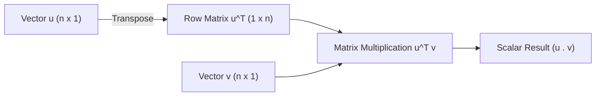
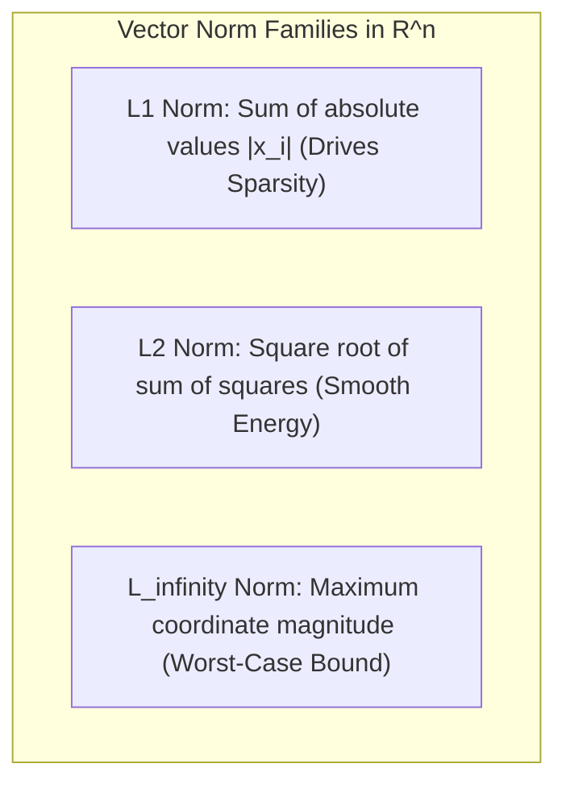
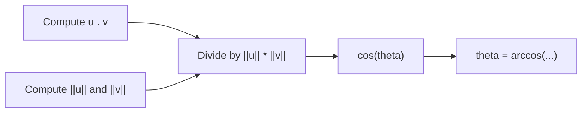
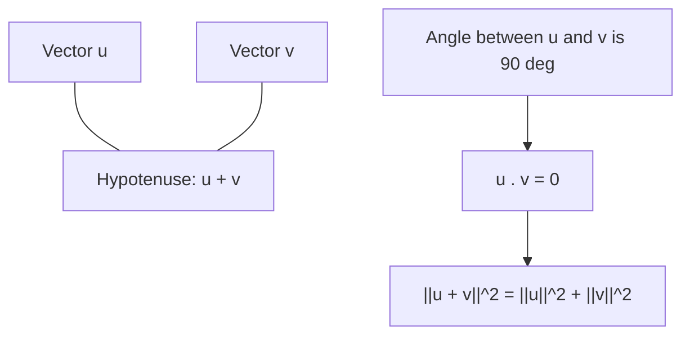

[Maths Index](../README.md) / [Unit 2: Orthogonality, Eigenvalues, and Matrix Factorizations](Introduction.md)

---

In Unit 1, we treated vectors purely as algebraic objects that we could add together and scale. We explored linear combinations, linear independence, spans, and the dimensions of vector spaces. But if you stop there, linear algebra is missing its most intuitive quality: physical geometry.

In the real physical world—and especially in machine learning and data science—we need to know more than just whether two vectors can be combined to form a third. We need to measure how long a vector is, how far apart two data points sit in high-dimensional space, whether two feature directions point along the same path, and when two vectors are completely perpendicular to each other.

The mathematical device that unlocks all of this geometry is the dot product.

---

## The Dot Product: Algebraic Definition and Core Properties

Let's take two vectors $\mathbf{u}$ and $\mathbf{v}$ living in $\mathbb{R}^n$:

$$\mathbf{u} = \begin{bmatrix} u_1 \\ u_2 \\ \vdots \\ u_n \end{bmatrix}, \quad \mathbf{v} = \begin{bmatrix} v_1 \\ v_2 \\ \vdots \\ v_n \end{bmatrix}$$

The dot product (also known as the Euclidean inner product) takes these two lists of $n$ numbers and collapses them into a single scalar real number. We compute it by multiplying matching entries and adding the results:

$$\mathbf{u} \cdot \mathbf{v} = \mathbf{u}^T \mathbf{v} = u_1 v_1 + u_2 v_2 + \dots + u_n v_n = \sum_{i=1}^n u_i v_i$$

Notice the matrix notation $\mathbf{u}^T \mathbf{v}$. A transposed column vector $\mathbf{u}^T$ is a $1 \times n$ row matrix, and $\mathbf{v}$ is an $n \times 1$ column matrix. By standard matrix multiplication, the result is a $1 \times 1$ matrix, which is just a scalar.

Four fundamental algebraic properties govern the dot product for all vectors $\mathbf{u}, \mathbf{v}, \mathbf{w} \in \mathbb{R}^n$ and any real scalar $c$:

- **Symmetry (Commutativity)**: $\mathbf{u} \cdot \mathbf{v} = \mathbf{v} \cdot \mathbf{u}$. The order does not matter because scalar multiplication is commutative ($u_i v_i = v_i u_i$).
- **Linearity in the First Argument**: $(\mathbf{u} + \mathbf{w}) \cdot \mathbf{v} = \mathbf{u} \cdot \mathbf{v} + \mathbf{w} \cdot \mathbf{v}$, and $(c\mathbf{u}) \cdot \mathbf{v} = c(\mathbf{u} \cdot \mathbf{v})$. Combined with symmetry, the dot product is bilinear.
- **Positivity**: $\mathbf{u} \cdot \mathbf{u} \ge 0$ for all $\mathbf{u}$. This is immediate because $\mathbf{u} \cdot \mathbf{u} = u_1^2 + u_2^2 + \dots + u_n^2$, which is a sum of squares.
- **Definiteness**: $\mathbf{u} \cdot \mathbf{u} = 0$ if and only if $\mathbf{u} = \mathbf{0}$. A sum of non-negative squares can only equal zero if every individual term is zero.

Together, these properties define an *inner product space*. Whenever an operation satisfies these axioms, it behaves like a generalized dot product.

---

## Measuring Vector Length: Vector Norms

Now, what happens when we take the dot product of a vector with itself? We just saw that $\mathbf{u} \cdot \mathbf{u} = \sum_{i=1}^n u_i^2$. 

By the Pythagorean theorem in 2D or 3D space, the square root of that sum of squares is precisely the Euclidean length of the arrow. This motivates our definition of the Euclidean norm.

### The Euclidean Norm ($L_2$ Norm)

The Euclidean norm, written $\|\mathbf{u}\|$ or $\|\mathbf{u}\|_2$, is defined as:

$$\|\mathbf{u}\|_2 = \sqrt{\mathbf{u} \cdot \mathbf{u}} = \sqrt{\mathbf{u}^T \mathbf{u}} = \sqrt{u_1^2 + u_2^2 + \dots + u_n^2}$$

A vector with length equal to 1 is called a *unit vector*. Whenever we have a non-zero vector $\mathbf{v}$, we can create a unit vector pointing in the exact same direction by dividing the vector by its own norm:

$$\mathbf{u} = \frac{\mathbf{v}}{\|\mathbf{v}\|_2}$$

This process is called *normalization*. Notice that scaling $\mathbf{v}$ by $c = 1/\|\mathbf{v}\|_2$ scales its length by $|c|$, producing $\| \mathbf{u} \|_2 = \frac{1}{\|\mathbf{v}\|_2} \|\mathbf{v}\|_2 = 1$.

### General $L_p$ Norms in AI and Data Science

The Euclidean norm is familiar, but it is by no means the only way to measure vector magnitude. In modern machine learning, different loss functions and regularizers rely on the family of $L_p$ norms, defined for $p \ge 1$ as:

$$\|\mathbf{x}\|_p = \left( \sum_{i=1}^n |x_i|^p \right)^{1/p}$$

Three specific norms appear constantly across deep learning and optimization:

- **The $L_1$ Norm (Manhattan or Taxicab Norm)**:
  $$\|\mathbf{x}\|_1 = \sum_{i=1}^n |x_i| = |x_1| + |x_2| + \dots + |x_n|$$
  This measures distance along grid lines (like navigating city blocks in Manhattan). In machine learning, $L_1$ regularization (Lasso regression) forces weights to become exactly zero, driving feature selection and parameter sparsity.

- **The $L_2$ Norm (Euclidean Norm)**:
  $$\|\mathbf{x}\|_2 = \sqrt{\sum_{i=1}^n x_i^2}$$
  The straight-line geometric distance. In machine learning, $L_2$ regularization (Ridge regression / Weight Decay) penalizes large weights smoothly, preventing overfitting without forcing coefficients to become strictly zero.

- **The $L_\infty$ Norm (Max Norm / Chebyshev Norm)**:
  $$\|\mathbf{x}\|_\infty = \lim_{p \to \infty} \|\mathbf{x}\|_p = \max_{1 \le i \le n} |x_i|$$
  This measures the single largest component magnitude in the vector. It is widely used in adversarial machine learning to define perturbation bounds for adversarial attacks (e.g., FGSM).

Every valid norm $\|\cdot\|$ on a real vector space must satisfy three non-negotiable axioms:
1. **Positivity and Definiteness**: $\|\mathbf{x}\| \ge 0$, and $\|\mathbf{x}\| = 0 \iff \mathbf{x} = \mathbf{0}$.
2. **Absolute Homogeneity**: $\|c\mathbf{x}\| = |c| \|\mathbf{x}\|$ for any real scalar $c$.
3. **Triangle Inequality**: $\|\mathbf{x} + \mathbf{y}\| \le \|\mathbf{x}\| + \|\mathbf{y}\|$.

---

## Distance Metrics and Geometric Angles

Once we have a norm, measuring the distance between two vectors $\mathbf{u}$ and $\mathbf{v}$ becomes straightforward. The distance is simply the norm of the difference vector:

$$d(\mathbf{u}, \mathbf{v}) = \|\mathbf{u} - \mathbf{v}\|_2 = \sqrt{\sum_{i=1}^n (u_i - v_i)^2}$$

Now, where do angles come from?

In high school trigonometry, the Law of Cosines relates the three sides of a triangle formed by vectors $\mathbf{u}$, $\mathbf{v}$, and $\mathbf{u} - \mathbf{v}$:

$$\|\mathbf{u} - \mathbf{v}\|^2 = \|\mathbf{u}\|^2 + \|\mathbf{v}\|^2 - 2\|\mathbf{u}\|\|\mathbf{v}\|\cos\theta$$

Let's expand the left-hand side using the algebraic properties of the dot product:

$$\|\mathbf{u} - \mathbf{v}\|^2 = (\mathbf{u} - \mathbf{v}) \cdot (\mathbf{u} - \mathbf{v}) = \mathbf{u} \cdot \mathbf{u} - 2(\mathbf{u} \cdot \mathbf{v}) + \mathbf{v} \cdot \mathbf{v} = \|\mathbf{u}\|^2 - 2(\mathbf{u} \cdot \mathbf{v}) + \|\mathbf{v}\|^2$$

Now equate both expressions:

$$\|\mathbf{u}\|^2 - 2(\mathbf{u} \cdot \mathbf{v}) + \|\mathbf{v}\|^2 = \|\mathbf{u}\|^2 + \|\mathbf{v}\|^2 - 2\|\mathbf{u}\|\|\mathbf{v}\|\cos\theta$$

Subtract $\|\mathbf{u}\|^2 + \|\mathbf{v}\|^2$ from both sides, divide by $-2$, and we arrive at the geometric formula for the dot product:

$$\mathbf{u} \cdot \mathbf{v} = \|\mathbf{u}\| \|\mathbf{v}\| \cos\theta$$

Solving for $\cos\theta$ gives the cosine of the angle between any two non-zero vectors in any dimension $\mathbb{R}^n$:

$$\cos\theta = \frac{\mathbf{u} \cdot \mathbf{v}}{\|\mathbf{u}\| \|\mathbf{v}\|} = \left(\frac{\mathbf{u}}{\|\mathbf{u}\|}\right) \cdot \left(\frac{\mathbf{v}}{\|\mathbf{v}\|}\right)$$

Notice what this means: the cosine of the angle between two vectors is simply the dot product of their normalized unit vectors.

In Natural Language Processing (NLP) and information retrieval, this quantity is known as **Cosine Similarity**. When embedding text into dense vectors (e.g., embeddings from language models), document length can vary wildly while semantic meaning remains identical. Cosine similarity isolates directional alignment from vector magnitude.

---

## The Cauchy-Schwarz and Triangle Inequalities

For the expression $\cos\theta = \frac{\mathbf{u} \cdot \mathbf{v}}{\|\mathbf{u}\| \|\mathbf{v}\|}$ to make geometric sense, the value on the right-hand side must lie between $-1$ and $+1$. This is guaranteed by one of the most important theorems in mathematics.

### The Cauchy-Schwarz Inequality

For any vectors $\mathbf{u}, \mathbf{v} \in \mathbb{R}^n$:

$$|\mathbf{u} \cdot \mathbf{v}| \le \|\mathbf{u}\| \|\mathbf{v}\|$$

Equality holds if and only if $\mathbf{u}$ and $\mathbf{v}$ are linearly dependent (meaning one is a scalar multiple of the other: $\mathbf{u} = c\mathbf{v}$).

To see why this must be true without hand-waving, consider a real parameter $t$ and look at the squared length of the vector $t\mathbf{u} + \mathbf{v}$. Because the norm of any vector is non-negative:

$$\|t\mathbf{u} + \mathbf{v}\|^2 \ge 0 \quad \text{for all } t \in \mathbb{R}$$

Expanding this using the dot product:

$$(t\mathbf{u} + \mathbf{v}) \cdot (t\mathbf{u} + \mathbf{v}) = t^2 (\mathbf{u} \cdot \mathbf{u}) + 2t (\mathbf{u} \cdot \mathbf{v}) + (\mathbf{v} \cdot \mathbf{v}) \ge 0$$

Let $a = \|\mathbf{u}\|^2$, $b = 2(\mathbf{u} \cdot \mathbf{v})$, and $c = \|\mathbf{v}\|^2$. This is a quadratic polynomial in $t$:

$$a t^2 + b t + c \ge 0$$

Because this quadratic parabola never dips below the horizontal axis, it can have at most one real root. Therefore, its algebraic discriminant $b^2 - 4ac$ cannot be strictly positive:

$$b^2 - 4ac \le 0$$

Substituting $a, b, c$ back in:

$$(2(\mathbf{u} \cdot \mathbf{v}))^2 - 4 \|\mathbf{u}\|^2 \|\mathbf{v}\|^2 \le 0$$

$$4 (\mathbf{u} \cdot \mathbf{v})^2 \le 4 \|\mathbf{u}\|^2 \|\mathbf{v}\|^2 \implies (\mathbf{u} \cdot \mathbf{v})^2 \le \|\mathbf{u}\|^2 \|\mathbf{v}\|^2$$

Taking the square root of both sides immediately gives:

$$|\mathbf{u} \cdot \mathbf{v}| \le \|\mathbf{u}\| \|\mathbf{v}\|$$

### The Triangle Inequality

With Cauchy-Schwarz established, proving the Triangle Inequality takes only two lines:

$$\|\mathbf{u} + \mathbf{v}\|^2 = (\mathbf{u} + \mathbf{v}) \cdot (\mathbf{u} + \mathbf{v}) = \|\mathbf{u}\|^2 + 2(\mathbf{u} \cdot \mathbf{v}) + \|\mathbf{v}\|^2$$

By Cauchy-Schwarz, $\mathbf{u} \cdot \mathbf{v} \le |\mathbf{u} \cdot \mathbf{v}| \le \|\mathbf{u}\| \|\mathbf{v}\|$. Therefore:

$$\|\mathbf{u} + \mathbf{v}\|^2 \le \|\mathbf{u}\|^2 + 2\|\mathbf{u}\|\|\mathbf{v}\| + \|\mathbf{v}\|^2 = (\|\mathbf{u}\| + \|\mathbf{v}\|)^2$$

Taking square roots yields:

$$\|\mathbf{u} + \mathbf{v}\| \le \|\mathbf{u}\| + \|\mathbf{v}\|$$

Geometrically, the straight path from the origin to $\mathbf{u} + \mathbf{v}$ is never longer than traversing along $\mathbf{u}$ and then along $\mathbf{v}$.

---

## Orthogonality and the Pythagorean Theorem

Now we arrive at the central theme of this entire unit: orthogonality.

When are two vectors perpendicular? Geometrically, perpendicular vectors form an angle of $\theta = 90^\circ$ ($\pi/2$ radians). Since $\cos(90^\circ) = 0$, our dot product formula gives:

$$\mathbf{u} \cdot \mathbf{v} = \|\mathbf{u}\| \|\mathbf{v}\| \cos(90^\circ) = 0$$

This motivates the formal algebraic definition: two vectors $\mathbf{u}, \mathbf{v} \in \mathbb{R}^n$ are **orthogonal** (written $\mathbf{u} \perp \mathbf{v}$) if and only if their dot product is zero:

$$\mathbf{u} \perp \mathbf{v} \iff \mathbf{u}^T \mathbf{v} = 0$$

Notice a subtle point: what about the zero vector $\mathbf{0}$? 

Since $\mathbf{0}^T \mathbf{v} = 0$ for every vector $\mathbf{v} \in \mathbb{R}^n$, **the zero vector is orthogonal to every vector in the space**, including itself.

### The Pythagorean Theorem in $\mathbb{R}^n$

In Euclidean geometry, right triangles satisfy $a^2 + b^2 = c^2$. In $\mathbb{R}^n$, the hypotenuse vector is $\mathbf{u} + \mathbf{v}$. Let's compute its squared length:

$$\|\mathbf{u} + \mathbf{v}\|^2 = (\mathbf{u} + \mathbf{v}) \cdot (\mathbf{u} + \mathbf{v}) = \|\mathbf{u}\|^2 + \|\mathbf{v}\|^2 + 2(\mathbf{u} \cdot \mathbf{v})$$

Notice what happens:

$$\|\mathbf{u} + \mathbf{v}\|^2 = \|\mathbf{u}\|^2 + \|\mathbf{v}\|^2 \iff 2(\mathbf{u} \cdot \mathbf{v}) = 0 \iff \mathbf{u} \cdot \mathbf{v} = 0$$

The Pythagorean equation holds if and only if the cross-term vanishes. That cross-term is precisely the dot product!

---

## Step-by-Step Numerical Example

Let's ground every formula we just derived with a concrete numerical calculation.

Consider two vectors in $\mathbb{R}^3$:

$$\mathbf{u} = \begin{bmatrix} 1 \\ 2 \\ -1 \end{bmatrix}, \quad \mathbf{v} = \begin{bmatrix} 2 \\ -1 \\ 0 \end{bmatrix}$$

### Step 1: Compute the Dot Product

$$\mathbf{u} \cdot \mathbf{v} = (1)(2) + (2)(-1) + (-1)(0) = 2 - 2 + 0 = 0$$

Because $\mathbf{u} \cdot \mathbf{v} = 0$, $\mathbf{u}$ and $\mathbf{v}$ are strictly orthogonal ($\mathbf{u} \perp \mathbf{v}$). The angle between them is $\theta = 90^\circ$.

### Step 2: Compute Norms

For $\mathbf{u}$:
- $L_1$ Norm: $\|\mathbf{u}\|_1 = |1| + |2| + |-1| = 4$
- $L_2$ Norm: $\|\mathbf{u}\|_2 = \sqrt{1^2 + 2^2 + (-1)^2} = \sqrt{1 + 4 + 1} = \sqrt{6} \approx 2.449$
- $L_\infty$ Norm: $\|\mathbf{u}\|_\infty = \max(|1|, |2|, |-1|) = 2$

For $\mathbf{v}$:
- $L_1$ Norm: $\|\mathbf{v}\|_1 = |2| + |-1| + |0| = 3$
- $L_2$ Norm: $\|\mathbf{v}\|_2 = \sqrt{2^2 + (-1)^2 + 0^2} = \sqrt{4 + 1 + 0} = \sqrt{5} \approx 2.236$
- $L_\infty$ Norm: $\|\mathbf{v}\|_\infty = \max(|2|, |-1|, |0|) = 2$

### Step 3: Verify the Pythagorean Theorem

Let's compute the sum vector $\mathbf{w} = \mathbf{u} + \mathbf{v}$:

$$\mathbf{w} = \begin{bmatrix} 1 + 2 \\ 2 + (-1) \\ -1 + 0 \end{bmatrix} = \begin{bmatrix} 3 \\ 1 \\ -1 \end{bmatrix}$$

Now compute $\|\mathbf{w}\|_2^2$:

$$\|\mathbf{u} + \mathbf{v}\|_2^2 = 3^2 + 1^2 + (-1)^2 = 9 + 1 + 1 = 11$$

Now sum the individual squared lengths:

$$\|\mathbf{u}\|_2^2 + \|\mathbf{v}\|_2^2 = (\sqrt{6})^2 + (\sqrt{5})^2 = 6 + 5 = 11$$

Since $\|\mathbf{u} + \mathbf{v}\|_2^2 = \|\mathbf{u}\|_2^2 + \|\mathbf{v}\|_2^2 = 11$, the Pythagorean theorem holds exactly.

### Step 4: Normalize $\mathbf{u}$ to a Unit Vector

To construct a unit vector $\hat{\mathbf{u}}$ pointing along $\mathbf{u}$:

$$\hat{\mathbf{u}} = \frac{1}{\sqrt{6}} \begin{bmatrix} 1 \\ 2 \\ -1 \end{bmatrix} = \begin{bmatrix} 1/\sqrt{6} \\ 2/\sqrt{6} \\ -1/\sqrt{6} \end{bmatrix}$$

Check its length:

$$\|\hat{\mathbf{u}}\|_2 = \sqrt{\left(\frac{1}{\sqrt{6}}\right)^2 + \left(\frac{2}{\sqrt{6}}\right)^2 + \left(\frac{-1}{\sqrt{6}}\right)^2} = \sqrt{\frac{1 + 4 + 1}{6}} = \sqrt{\frac{6}{6}} = 1$$

---

## Key Takeaways

- The dot product $\mathbf{u} \cdot \mathbf{v} = \mathbf{u}^T \mathbf{v} = \sum_{i=1}^n u_i v_i$ combines algebra and geometry, collapsing two vectors into a scalar.
- The $L_2$ norm $\|\mathbf{u}\|_2 = \sqrt{\mathbf{u}^T \mathbf{u}}$ measures straight-line length; the $L_1$ norm $\|\mathbf{u}\|_1 = \sum |u_i|$ induces parameter sparsity in Lasso regression; the $L_\infty$ norm bounds maximum coordinate variations.
- Geometric angle: $\cos\theta = \frac{\mathbf{u} \cdot \mathbf{v}}{\|\mathbf{u}\|_2 \|\mathbf{v}\|_2}$. Cosine similarity measures angular alignment independent of magnitude.
- The Cauchy-Schwarz inequality $|\mathbf{u} \cdot \mathbf{v}| \le \|\mathbf{u}\|_2 \|\mathbf{v}\|_2$ guarantees that $-1 \le \cos\theta \le 1$.
- Orthogonality is defined by $\mathbf{u}^T \mathbf{v} = 0$. The zero vector is orthogonal to every vector in the space.
- The Pythagorean theorem holds in $\mathbb{R}^n$: $\|\mathbf{u} + \mathbf{v}\|^2 = \|\mathbf{u}\|^2 + \|\mathbf{v}\|^2$ if and only if $\mathbf{u} \perp \mathbf{v}$.

---

Now that we know how to check whether two individual vectors are orthogonal, think about what happens when we scale this up to entire collections of vectors. In data science, we rarely deal with isolated vectors; we deal with subspaces spanning feature spaces and solution manifolds.

What does it mean for two whole *subspaces* to be completely perpendicular to each other? That brings us directly to the Fundamental Theorem of Linear Algebra and the geometry of [L02 - Orthogonal Complements and Fundamental Subspaces](L02%20-%20Orthogonal%20Complements%20and%20Fundamental%20Subspaces.md).
