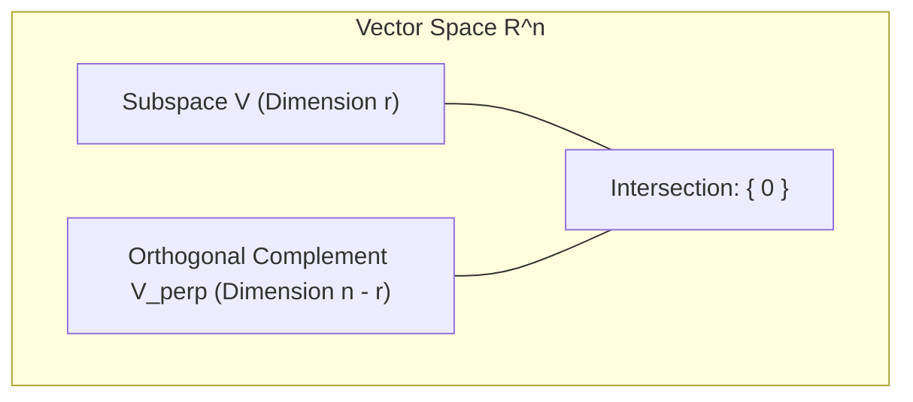
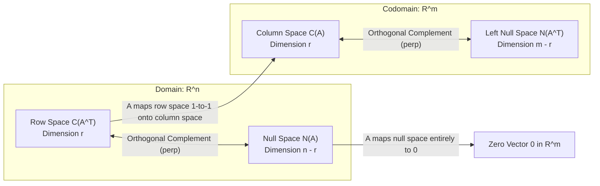

[Maths Index](../README.md) / [Unit 2: Orthogonality, Eigenvalues, and Matrix Factorizations](Introduction.md)

---

In the previous lecture, we worked with individual vectors and tested whether $\mathbf{u}^T \mathbf{v} = 0$. That is simple enough when we have two arrows on a page. 

Now, imagine we have two infinite planes intersecting at the origin in three-dimensional space. Can two entire subspaces be perpendicular to each other? 

Your immediate physical intuition might say yes: two perpendicular walls meeting in a room. But mathematically, that intuition is actually wrong! Two walls in a room share a whole line of intersection along the corner, and vectors along that line have non-zero dot products with themselves. 

To make sense of geometry in high dimensions, we must establish what orthogonality means between infinite subspaces.

---

## Subspace Orthogonality and the Orthogonal Complement

Two subspaces $V$ and $W$ of $\mathbb{R}^n$ are said to be **orthogonal subspaces** (written $V \perp W$) if *every* vector in $V$ is perpendicular to *every* vector in $W$:

$$\mathbf{v}^T \mathbf{w} = 0 \quad \text{for every } \mathbf{v} \in V \text{ and every } \mathbf{w} \in W$$

Notice the immediate consequence of this requirement: what vectors can possibly sit in both $V$ and $W$?

If a vector $\mathbf{x}$ belongs to both $V$ and $W$, then because $V \perp W$, the vector must be orthogonal to itself:

$$\mathbf{x}^T \mathbf{x} = \|\mathbf{x}\|^2 = 0$$

By the definiteness property of norms, this forces $\mathbf{x} = \mathbf{0}$. Therefore, two orthogonal subspaces can only intersect at the zero vector:

$$V \cap W = \{\mathbf{0}\}$$

This explains why two 2D planes in $\mathbb{R}^3$ cannot be orthogonal subspaces: their intersection must be at least a 1D line ($\dim(V \cap W) \ge 2 + 2 - 3 = 1$). A line contains infinitely many non-zero vectors, which contradicts $V \cap W = \{\mathbf{0}\}$.

### The Orthogonal Complement ($V^\perp$)

Now, suppose we are given a subspace $V \subseteq \mathbb{R}^n$. If we collect *all* vectors in $\mathbb{R}^n$ that are perpendicular to every single vector in $V$, we get the **orthogonal complement** of $V$, denoted $V^\perp$ (pronounced "V-perp"):

$$V^\perp = \{ \mathbf{w} \in \mathbb{R}^n \mid \mathbf{v}^T \mathbf{w} = 0 \text{ for all } \mathbf{v} \in V \}$$

The orthogonal complement has several fundamental structural properties:

- **$V^\perp$ is a subspace**: If $\mathbf{w}_1, \mathbf{w}_2 \in V^\perp$, then for any $\mathbf{v} \in V$, $(\mathbf{w}_1 + \mathbf{w}_2)^T \mathbf{v} = \mathbf{w}_1^T \mathbf{v} + \mathbf{w}_2^T \mathbf{v} = 0 + 0 = 0$. Similarly, $(c\mathbf{w}_1)^T \mathbf{v} = c(\mathbf{w}_1^T \mathbf{v}) = 0$.
- **Dimension Formula**: The dimensions of a subspace and its orthogonal complement add up to the dimension of the whole space:
  $$\dim(V) + \dim(V^\perp) = n$$
- **Double Complement**: Taking the complement twice returns the original subspace:
  $$(V^\perp)^\perp = V$$
- **Direct Sum**: Every vector $\mathbf{x} \in \mathbb{R}^n$ can be decomposed uniquely into a sum of a vector from $V$ and a vector from $V^\perp$:
  $$\mathbf{x} = \mathbf{v} + \mathbf{w}, \quad \text{where } \mathbf{v} \in V \text{ and } \mathbf{w} \in V^\perp$$
  We write this direct sum as $\mathbb{R}^n = V \oplus V^\perp$.

---

## The Four Fundamental Subspaces: Orthogonality Revealed

In Unit 1, we introduced the Four Fundamental Subspaces associated with any $m \times n$ matrix $A$ of rank $r$:

- **Row Space** $C(A^T) \subseteq \mathbb{R}^n$: spanned by the rows of $A$, dimension $r$.
- **Null Space** $N(A) \subseteq \mathbb{R}^n$: solutions to $A\mathbf{x} = \mathbf{0}$, dimension $n - r$.
- **Column Space** $C(A) \subseteq \mathbb{R}^m$: spanned by the columns of $A$, dimension $r$.
- **Left Null Space** $N(A^T) \subseteq \mathbb{R}^m$: solutions to $A^T \mathbf{y} = \mathbf{0}$, dimension $m - r$.

Notice where they live: two subspaces live in the domain $\mathbb{R}^n$, and two subspaces live in the codomain $\mathbb{R}^m$. Furthermore, their dimensions in each space add up precisely to the ambient dimension: $r + (n - r) = n$ and $r + (m - r) = m$.

Now we can state the Fundamental Theorem of Linear Algebra (Part 2):

$$N(A) = (C(A^T))^\perp \quad \text{in } \mathbb{R}^n$$

$$N(A^T) = (C(A))^\perp \quad \text{in } \mathbb{R}^m$$

The null space is the orthogonal complement of the row space in $\mathbb{R}^n$, and the left null space is the orthogonal complement of the column space in $\mathbb{R}^m$.

---

## Proving the Orthogonality of the Fundamental Subspaces

Let's prove why $N(A) \perp C(A^T)$. The proof is remarkably clean and exposes the inner mechanics of matrix multiplication.

Let $\mathbf{x}$ be any vector in the null space $N(A)$. By definition, $A\mathbf{x} = \mathbf{0}$. 

Write out the matrix $A$ explicitly by its rows $\mathbf{r}_1^T, \mathbf{r}_2^T, \dots, \mathbf{r}_m^T$:

$$A\mathbf{x} = \begin{bmatrix} \text{—} & \mathbf{r}_1^T & \text{—} \\ \text{—} & \mathbf{r}_2^T & \text{—} \\ & \vdots & \\ \text{—} & \mathbf{r}_m^T & \text{—} \end{bmatrix} \begin{bmatrix} x_1 \\ x_2 \\ \vdots \\ x_n \end{bmatrix} = \begin{bmatrix} \mathbf{r}_1^T \mathbf{x} \\ \mathbf{r}_2^T \mathbf{x} \\ \vdots \\ \mathbf{r}_m^T \mathbf{x} \end{bmatrix} = \begin{bmatrix} 0 \\ 0 \\ \vdots \\ 0 \end{bmatrix}$$

Look closely at each row:

$$\mathbf{r}_1^T \mathbf{x} = 0, \quad \mathbf{r}_2^T \mathbf{x} = 0, \quad \dots, \quad \mathbf{r}_m^T \mathbf{x} = 0$$

Every single row of $A$ has a zero dot product with $\mathbf{x}$. 

Now, any vector $\mathbf{v}$ in the row space $C(A^T)$ is an arbitrary linear combination of these rows:

$$\mathbf{v} = c_1 \mathbf{r}_1 + c_2 \mathbf{r}_2 + \dots + c_m \mathbf{r}_m$$

Take the dot product of $\mathbf{v}$ with $\mathbf{x}$:

$$\mathbf{v}^T \mathbf{x} = (c_1 \mathbf{r}_1 + \dots + c_m \mathbf{r}_m)^T \mathbf{x} = c_1 (\mathbf{r}_1^T \mathbf{x}) + c_2 (\mathbf{r}_2^T \mathbf{x}) + \dots + c_m (\mathbf{r}_m^T \mathbf{x})$$

$$= c_1(0) + c_2(0) + \dots + c_m(0) = 0$$

This holds for every $\mathbf{v} \in C(A^T)$ and every $\mathbf{x} \in N(A)$. Therefore, every vector in the row space is orthogonal to every vector in the null space.

Because $\dim(C(A^T)) + \dim(N(A)) = r + (n - r) = n$, the null space does not just sit orthogonal to the row space—it accounts for every orthogonal direction in $\mathbb{R}^n$. Thus, $N(A) = (C(A^T))^\perp$.

The exact same logic applies to $A^T$. Since $A^T \mathbf{y} = \mathbf{0}$ means $\mathbf{y}$ is perpendicular to every row of $A^T$ (which are the columns of $A$), we have $N(A^T) \perp C(A)$, and because $r + (m - r) = m$, we obtain $N(A^T) = (C(A))^\perp$.

---

## The Big Picture of Linear Algebra

Gilbert Strang calls this diagram "The Big Picture of Linear Algebra." It visualizes how any matrix transformation $A$ operates across its four fundamental subspaces:

Look at what this diagram tells us about the action of $A$ on an arbitrary vector $\mathbf{x} \in \mathbb{R}^n$:

Because $\mathbb{R}^n = C(A^T) \oplus N(A)$, we can decompose $\mathbf{x}$ uniquely into:

$$\mathbf{x} = \mathbf{x}_r + \mathbf{x}_n$$

where $\mathbf{x}_r \in C(A^T)$ and $\mathbf{x}_n \in N(A)$.

Now, apply the matrix transformation $A$:

$$A\mathbf{x} = A(\mathbf{x}_r + \mathbf{x}_n) = A\mathbf{x}_r + A\mathbf{x}_n = A\mathbf{x}_r + \mathbf{0} = A\mathbf{x}_r$$

The null space component $\mathbf{x}_n$ is completely crushed to the zero vector. 

All the information that survives the transformation comes entirely from the row space component $\mathbf{x}_r$. Furthermore, the mapping from the $r$-dimensional row space $C(A^T)$ to the $r$-dimensional column space $C(A)$ is strictly **one-to-one and invertible**.

---

## Step-by-Step Numerical Example

Let's trace all four subspaces, verify their orthogonality, and decompose a vector using a concrete matrix.

Consider the $2 \times 3$ matrix:

$$A = \begin{bmatrix} 1 & 2 & 1 \\ 2 & 4 & 2 \end{bmatrix}$$

### Step 1: Find Rank and Row Space

Row 2 is simply $2 \times (\text{Row } 1)$. Performing row reduction:

$$\begin{bmatrix} 1 & 2 & 1 \\ 0 & 0 & 0 \end{bmatrix}$$

There is only 1 pivot, so the rank is $r = 1$.

The row space $C(A^T)$ is the 1D line in $\mathbb{R}^3$ spanned by the pivot row:

$$\text{Basis for } C(A^T): \quad \mathbf{v}_r = \begin{bmatrix} 1 \\ 2 \\ 1 \end{bmatrix}$$

### Step 2: Find the Null Space $N(A)$

Solutions to $A\mathbf{x} = \mathbf{0}$ satisfy $x_1 + 2x_2 + x_3 = 0$, or:

$$x_1 = -2x_2 - x_3$$

Variables $x_2$ and $x_3$ are free. Setting $(x_2 = 1, x_3 = 0)$ and $(x_2 = 0, x_3 = 1)$ yields two basis vectors for $N(A)$:

$$\mathbf{n}_1 = \begin{bmatrix} -2 \\ 1 \\ 0 \end{bmatrix}, \quad \mathbf{n}_2 = \begin{bmatrix} -1 \\ 0 \\ 1 \end{bmatrix}$$

Dimension of $N(A)$ is $n - r = 3 - 1 = 2$ (a 2D plane in $\mathbb{R}^3$).

### Step 3: Verify $C(A^T) \perp N(A)$

Let's test the dot product between the row space basis vector and each null space basis vector:

$$\mathbf{v}_r^T \mathbf{n}_1 = (1)(-2) + (2)(1) + (1)(0) = -2 + 2 + 0 = 0$$

$$\mathbf{v}_r^T \mathbf{n}_2 = (1)(-1) + (2)(0) + (1)(1) = -1 + 0 + 1 = 0$$

The row space line is perpendicular to both spanning vectors of the null space plane, proving that $C(A^T) \perp N(A)$.

### Step 4: Decompose an Arbitrary Vector into Row Space and Null Space Components

Take the vector:

$$\mathbf{x} = \begin{bmatrix} 3 \\ 1 \\ 4 \end{bmatrix} \in \mathbb{R}^3$$

We want to express $\mathbf{x} = \mathbf{x}_r + \mathbf{x}_n$, where $\mathbf{x}_r = c \mathbf{v}_r \in C(A^T)$ and $\mathbf{x}_n \in N(A)$.

Since $\mathbf{x}_n \perp \mathbf{v}_r$, if we take the dot product of both sides with $\mathbf{v}_r$:

$$\mathbf{v}_r^T \mathbf{x} = \mathbf{v}_r^T (\mathbf{x}_r + \mathbf{x}_n) = \mathbf{v}_r^T (c \mathbf{v}_r) + 0 = c (\mathbf{v}_r^T \mathbf{v}_r)$$

Solving for scalar $c$:

$$c = \frac{\mathbf{v}_r^T \mathbf{x}}{\mathbf{v}_r^T \mathbf{v}_r} = \frac{(1)(3) + (2)(1) + (1)(4)}{1^2 + 2^2 + 1^2} = \frac{3 + 2 + 4}{1 + 4 + 1} = \frac{9}{6} = \frac{3}{2}$$

Now construct $\mathbf{x}_r$:

$$\mathbf{x}_r = \frac{3}{2} \begin{bmatrix} 1 \\ 2 \\ 1 \end{bmatrix} = \begin{bmatrix} 1.5 \\ 3.0 \\ 1.5 \end{bmatrix}$$

Now obtain the null space component by subtraction:

$$\mathbf{x}_n = \mathbf{x} - \mathbf{x}_r = \begin{bmatrix} 3 \\ 1 \\ 4 \end{bmatrix} - \begin{bmatrix} 1.5 \\ 3.0 \\ 1.5 \end{bmatrix} = \begin{bmatrix} 1.5 \\ -2.0 \\ 2.5 \end{bmatrix}$$

Let's verify that $\mathbf{x}_n \in N(A)$:

$$A\mathbf{x}_n = \begin{bmatrix} 1 & 2 & 1 \\ 2 & 4 & 2 \end{bmatrix} \begin{bmatrix} 1.5 \\ -2.0 \\ 2.5 \end{bmatrix} = \begin{bmatrix} 1.5 - 4.0 + 2.5 \\ 3.0 - 8.0 + 5.0 \end{bmatrix} = \begin{bmatrix} 0 \\ 0 \end{bmatrix}$$

It lies exactly in $N(A)$. And notice:

$$A\mathbf{x} = \begin{bmatrix} 1 & 2 & 1 \\ 2 & 4 & 2 \end{bmatrix} \begin{bmatrix} 3 \\ 1 \\ 4 \end{bmatrix} = \begin{bmatrix} 3 + 2 + 4 \\ 6 + 4 + 8 \end{bmatrix} = \begin{bmatrix} 9 \\ 18 \end{bmatrix}$$

$$A\mathbf{x}_r = \begin{bmatrix} 1 & 2 & 1 \\ 2 & 4 & 2 \end{bmatrix} \begin{bmatrix} 1.5 \\ 3.0 \\ 1.5 \end{bmatrix} = \begin{bmatrix} 1.5 + 6.0 + 1.5 \\ 3.0 + 12.0 + 3.0 \end{bmatrix} = \begin{bmatrix} 9 \\ 18 \end{bmatrix}$$

$A\mathbf{x} = A\mathbf{x}_r = \begin{bmatrix} 9 \\ 18 \end{bmatrix}$. The null space component contributed nothing to the output.

---

## Key Takeaways

- Two subspaces $V$ and $W$ are orthogonal if and only if every vector in $V$ is perpendicular to every vector in $W$. Their intersection must be strictly $\{\mathbf{0}\}$.
- The orthogonal complement $V^\perp$ contains all vectors perpendicular to $V$. In $\mathbb{R}^n$, $\dim(V) + \dim(V^\perp) = n$, and $(V^\perp)^\perp = V$.
- Fundamental Theorem of Linear Algebra: In $\mathbb{R}^n$, $N(A) = (C(A^T))^\perp$. In $\mathbb{R}^m$, $N(A^T) = (C(A))^\perp$.
- Any vector $\mathbf{x} \in \mathbb{R}^n$ uniquely splits into $\mathbf{x} = \mathbf{x}_r + \mathbf{x}_n$, with $\mathbf{x}_r \in C(A^T)$ and $\mathbf{x}_n \in N(A)$.
- The matrix $A$ annihilates the null space component ($A\mathbf{x}_n = \mathbf{0}$) and maps the row space $C(A^T)$ invertibly onto the column space $C(A)$.

---

Notice the trick we used in the numerical example to pull $\mathbf{x}_r$ out of $\mathbf{x}$: we dropped a perpendicular from $\mathbf{x}$ onto the line spanned by $\mathbf{v}_r$. That was a 1-dimensional orthogonal projection.

What happens when the target subspace isn't just a 1D line, but a high-dimensional hyperplane or the column space of a large data matrix? How do we build an operator that drops any vector onto an arbitrary subspace?

We explore that fundamental tool next in [L03 - Projections onto Lines and Subspaces](L03%20-%20Projections%20onto%20Lines%20and%20Subspaces.md).
