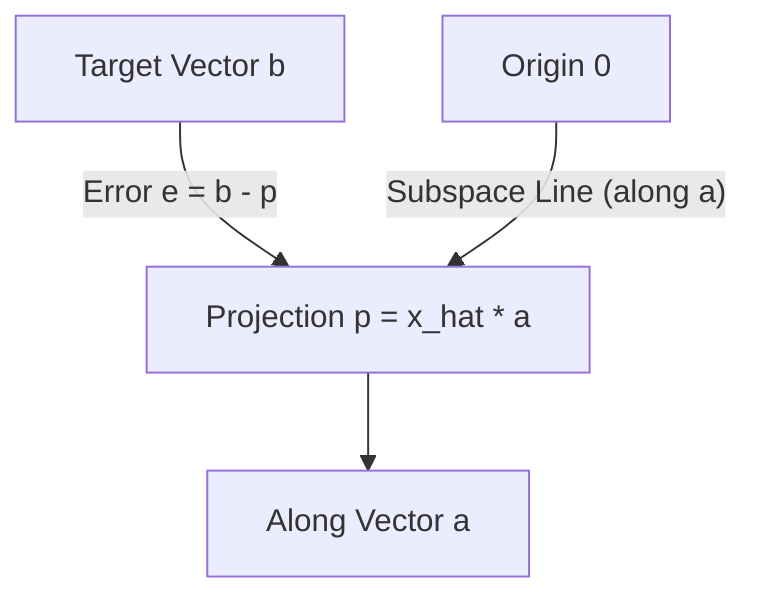
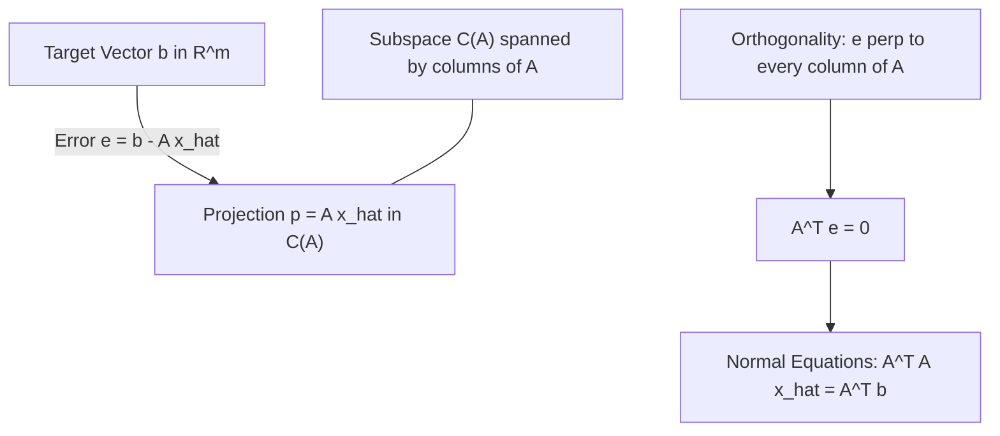

[Maths Index](../README.md) / [Unit 2: Orthogonality, Eigenvalues, and Matrix Factorizations](Introduction.md)

---

In textbook linear algebra, we are often asked to solve linear systems $A\mathbf{x} = \mathbf{b}$. If $A$ is square and invertible, we find a unique solution $\mathbf{x} = A^{-1}\mathbf{b}$. 

Now here's the reality in data science and machine learning: $A$ is almost never square, and $A\mathbf{x} = \mathbf{b}$ almost never has an exact solution. 

When you have 10,000 empirical data points and only 5 model parameters, you have 10,000 equations in 5 unknowns. The target vector $\mathbf{b}$ lives in $\mathbb{R}^{10,000}$, while the column space $C(A)$—the space of all possible model outputs—is only a 5-dimensional subspace. Because of sensor noise and real-world fluctuations, $\mathbf{b}$ will almost certainly lie outside $C(A)$.

The moment $\mathbf{b} \notin C(A)$, an exact solution is impossible. 

So what do we do? We do not give up. We find the next best thing: the vector $\mathbf{p}$ inside the subspace $C(A)$ that is as close as possible to the target vector $\mathbf{b}$. That closest point is the **orthogonal projection** of $\mathbf{b}$ onto $C(A)$.

---

## Projection onto a One-Dimensional Line

Let's build the intuition in one dimension first. 

Suppose we have a fixed non-zero vector $\mathbf{a} \in \mathbb{R}^m$ defining a line passing through the origin. Given an arbitrary vector $\mathbf{b} \in \mathbb{R}^m$, we want to drop a perpendicular from $\mathbf{b}$ onto that line.

The projection point $\mathbf{p}$ lies along the line of $\mathbf{a}$, so it must be some scalar multiple of $\mathbf{a}$:

$$\mathbf{p} = \hat{x} \mathbf{a}$$

where $\hat{x}$ is a scalar to be determined.

The difference between where we want to be ($\mathbf{b}$) and where we landed ($\mathbf{p}$) is the **error vector** $\mathbf{e}$:

$$\mathbf{e} = \mathbf{b} - \mathbf{p} = \mathbf{b} - \hat{x} \mathbf{a}$$

To make the distance $\|\mathbf{e}\|$ as small as possible, the line segment from $\mathbf{b}$ to the line must be perpendicular to the line. That means the error vector $\mathbf{e}$ must be orthogonal to the direction vector $\mathbf{a}$:

$$\mathbf{a} \perp \mathbf{e} \iff \mathbf{a}^T \mathbf{e} = 0$$

Substitute the expression for $\mathbf{e}$:

$$\mathbf{a}^T (\mathbf{b} - \hat{x}\mathbf{a}) = 0$$

$$\mathbf{a}^T \mathbf{b} - \hat{x} (\mathbf{a}^T \mathbf{a}) = 0$$

Because $\mathbf{a} \ne \mathbf{0}$, the scalar $\mathbf{a}^T \mathbf{a} = \|\mathbf{a}\|^2 > 0$. We can divide by it to isolate $\hat{x}$:

$$\hat{x} = \frac{\mathbf{a}^T \mathbf{b}}{\mathbf{a}^T \mathbf{a}}$$

Now that we have the scalar coefficient $\hat{x}$, we plug it back into $\mathbf{p} = \hat{x}\mathbf{a}$:

$$\mathbf{p} = \left(\frac{\mathbf{a}^T \mathbf{b}}{\mathbf{a}^T \mathbf{a}}\right) \mathbf{a} = \mathbf{a} \left(\frac{\mathbf{a}^T \mathbf{b}}{\mathbf{a}^T \mathbf{a}}\right) = \frac{\mathbf{a}\mathbf{a}^T}{\mathbf{a}^T \mathbf{a}} \mathbf{b}$$

Look closely at that last algebraic step. In the numerator, $\mathbf{a}$ is an $m \times 1$ column matrix and $\mathbf{a}^T$ is a $1 \times m$ row matrix. Their outer product $\mathbf{a}\mathbf{a}^T$ is an $m \times m$ matrix! Meanwhile, the denominator $\mathbf{a}^T \mathbf{a}$ is a scalar.

This defines the **1D Projection Matrix** $P$:

$$P = \frac{\mathbf{a}\mathbf{a}^T}{\mathbf{a}^T \mathbf{a}}$$

Multiplied by any vector $\mathbf{b}$, the matrix $P$ immediately drops $\mathbf{b}$ onto the line of $\mathbf{a}$: $\mathbf{p} = P\mathbf{b}$.

---

## Projection onto a General Subspace

Now, let's step up from a 1D line to a general $n$-dimensional subspace $S \subset \mathbb{R}^m$. 

Suppose the subspace $S$ is spanned by $n$ linearly independent vectors $\mathbf{a}_1, \mathbf{a}_2, \dots, \mathbf{a}_n$. We collect these vectors as the columns of an $m \times n$ matrix $A$:

$$A = \begin{bmatrix} \mathbf{a}_1 & \mathbf{a}_2 & \dots & \mathbf{a}_n \end{bmatrix}$$

The subspace $S$ is simply the column space $C(A)$. Because the columns are linearly independent, the matrix has full column rank $r = n$.

Given any vector $\mathbf{b} \in \mathbb{R}^m$, we seek the projection vector $\mathbf{p} \in C(A)$ closest to $\mathbf{b}$.

Since $\mathbf{p} \in C(A)$, it must be a linear combination of the columns of $A$. In matrix form, this means there exists some unknown vector of coefficients $\hat{\mathbf{x}} \in \mathbb{R}^n$ such that:

$$\mathbf{p} = A\hat{\mathbf{x}} = \hat{x}_1 \mathbf{a}_1 + \hat{x}_2 \mathbf{a}_2 + \dots + \hat{x}_n \mathbf{a}_n$$

The error vector is:

$$\mathbf{e} = \mathbf{b} - \mathbf{p} = \mathbf{b} - A\hat{\mathbf{x}}$$

For $\mathbf{p}$ to be the closest point in the entire subspace $C(A)$ to $\mathbf{b}$, the error vector $\mathbf{e}$ must be orthogonal to *every* vector in $C(A)$. 

That means $\mathbf{e}$ must be perpendicular to every column of $A$:

$$\mathbf{a}_1^T \mathbf{e} = 0, \quad \mathbf{a}_2^T \mathbf{e} = 0, \quad \dots, \quad \mathbf{a}_n^T \mathbf{e} = 0$$

Stacking these equations into matrix form:

$$\begin{bmatrix} \mathbf{a}_1^T \\ \mathbf{a}_2^T \\ \vdots \\ \mathbf{a}_n^T \end{bmatrix} \mathbf{e} = \mathbf{0} \implies A^T \mathbf{e} = \mathbf{0}$$

Notice the connection to Lecture 2: $A^T \mathbf{e} = \mathbf{0}$ means the error vector $\mathbf{e}$ lies in the left null space $N(A^T)$, which is the orthogonal complement of the column space $C(A)$!

Now substitute $\mathbf{e} = \mathbf{b} - A\hat{\mathbf{x}}$:

$$A^T (\mathbf{b} - A\hat{\mathbf{x}}) = \mathbf{0}$$

$$A^T A \hat{\mathbf{x}} = A^T \mathbf{b}$$

This system of equations is known as the **Normal Equations**.

---

## Why is $A^T A$ Invertible?

To solve the Normal Equations for $\hat{\mathbf{x}}$, we need to invert the matrix $A^T A$. 

Notice that $A$ is $m \times n$, so $A^T$ is $n \times m$. The product $A^T A$ is a square $n \times n$ matrix. But can we guarantee that $(A^T A)^{-1}$ actually exists?

Let's prove that if the columns of $A$ are linearly independent, $A^T A$ is guaranteed to be invertible.

Suppose there is a vector $\mathbf{x} \in \mathbb{R}^n$ such that $A^T A \mathbf{x} = \mathbf{0}$. 

Multiply both sides on the left by $\mathbf{x}^T$:

$$\mathbf{x}^T (A^T A \mathbf{x}) = \mathbf{x}^T \mathbf{0} = 0$$

Using the associative property of matrix multiplication:

$$(A\mathbf{x})^T (A\mathbf{x}) = 0 \implies \|A\mathbf{x}\|^2 = 0$$

By the definiteness property of vector norms, $\|A\mathbf{x}\|^2 = 0$ forces:

$$A\mathbf{x} = \mathbf{0}$$

Now, because the columns of $A$ are linearly independent, the only linear combination of columns that equals zero is the trivial one: $\mathbf{x} = \mathbf{0}$. Therefore, the null space of $A^T A$ contains only the zero vector:

$$N(A^T A) = \{\mathbf{0}\}$$

A square matrix with a trivial null space has full rank and is strictly invertible. 

Therefore, whenever $A$ has linearly independent columns, $(A^T A)^{-1}$ exists, is unique, and is symmetric.

---

## The Subspace Projection Matrix

Now that we know $A^T A$ is invertible, we solve the Normal Equations directly for $\hat{\mathbf{x}}$:

$$\hat{\mathbf{x}} = (A^T A)^{-1} A^T \mathbf{b}$$

Plugging $\hat{\mathbf{x}}$ back into $\mathbf{p} = A\hat{\mathbf{x}}$ gives the projection vector:

$$\mathbf{p} = A (A^T A)^{-1} A^T \mathbf{b}$$

This reveals the **Subspace Projection Matrix** $P$:

$$P = A (A^T A)^{-1} A^T$$

Notice how general this formula is:
- If $A$ is a single column $\mathbf{a}$, $A^T A = \mathbf{a}^T \mathbf{a}$ is a scalar, so $(A^T A)^{-1} = \frac{1}{\mathbf{a}^T \mathbf{a}}$. The formula reduces to $P = \frac{\mathbf{a}\mathbf{a}^T}{\mathbf{a}^T \mathbf{a}}$, matching our 1D line projection exactly!
- If $A$ is a square, invertible $n \times n$ matrix, its column space is the entire space $\mathbb{R}^n$. The inverse product expands as $(A^T A)^{-1} = A^{-1} (A^T)^{-1}$, so $P = A A^{-1} (A^T)^{-1} A^T = I \cdot I = I$. Projecting any vector onto the full space leaves it completely unchanged!

---

## The Two Defining Properties of Projection Matrices

Every valid orthogonal projection matrix $P$ satisfies two defining algebraic properties:

### 1. Symmetry: $P^T = P$

Let's compute the transpose of $P = A(A^T A)^{-1}A^T$:

$$P^T = \left( A (A^T A)^{-1} A^T \right)^T = (A^T)^T \left( (A^T A)^{-1} \right)^T A^T$$

Since $(A^T)^T = A$, and the inverse of a symmetric matrix is symmetric ($((A^T A)^T)^{-1} = (A^T A)^{-1}$):

$$P^T = A (A^T A)^{-1} A^T = P$$

### 2. Idempotence: $P^2 = P$

What happens if you project a vector that is already inside the subspace? It should not move at all. Projecting twice should be identical to projecting once:

$$P^2 = \left( A(A^T A)^{-1}A^T \right) \left( A(A^T A)^{-1}A^T \right)$$

Group the middle terms $(A^T A)$:

$$P^2 = A (A^T A)^{-1} \underbrace{\left( A^T A \right) (A^T A)^{-1}}_{I} A^T = A (A^T A)^{-1} A^T = P$$

Any matrix satisfying both $P^T = P$ and $P^2 = P$ is an orthogonal projection matrix.

### The Complementary Projection Matrix: $I - P$

If $P$ projects a vector onto the subspace $S = C(A)$, what projects it onto the orthogonal complement $S^\perp = N(A^T)$?

Notice that $\mathbf{b} = \mathbf{p} + \mathbf{e} = P\mathbf{b} + \mathbf{e}$. 

Rearranging for the error vector:

$$\mathbf{e} = \mathbf{b} - P\mathbf{b} = (I - P)\mathbf{b}$$

The matrix $I - P$ is itself an orthogonal projection matrix projecting onto $N(A^T)$:
- Symmetry: $(I - P)^T = I^T - P^T = I - P$.
- Idempotence: $(I - P)^2 = I - 2P + P^2 = I - 2P + P = I - P$.

---

## Step-by-Step Numerical Examples

### Example 1: Projecting onto a 1D Line

Project the vector $\mathbf{b} = \begin{bmatrix} 1 \\ 2 \\ 3 \end{bmatrix}$ onto the line spanned by $\mathbf{a} = \begin{bmatrix} 1 \\ 1 \\ 1 \end{bmatrix}$.

1. Compute dot products:
   $$\mathbf{a}^T \mathbf{b} = (1)(1) + (1)(2) + (1)(3) = 1 + 2 + 3 = 6$$
   $$\mathbf{a}^T \mathbf{a} = 1^2 + 1^2 + 1^2 = 3$$

2. Compute scalar $\hat{x}$:
   $$\hat{x} = \frac{\mathbf{a}^T \mathbf{b}}{\mathbf{a}^T \mathbf{a}} = \frac{6}{3} = 2$$

3. Compute projection vector $\mathbf{p}$:
   $$\mathbf{p} = \hat{x} \mathbf{a} = 2 \begin{bmatrix} 1 \\ 1 \\ 1 \end{bmatrix} = \begin{bmatrix} 2 \\ 2 \\ 2 \end{bmatrix}$$

4. Compute error vector $\mathbf{e}$:
   $$\mathbf{e} = \mathbf{b} - \mathbf{p} = \begin{bmatrix} 1 \\ 2 \\ 3 \end{bmatrix} - \begin{bmatrix} 2 \\ 2 \\ 2 \end{bmatrix} = \begin{bmatrix} -1 \\ 0 \\ 1 \end{bmatrix}$$

5. Verify orthogonality:
   $$\mathbf{a}^T \mathbf{e} = (1)(-1) + (1)(0) + (1)(1) = -1 + 0 + 1 = 0$$

6. Construct the projection matrix:
   $$P = \frac{\mathbf{a}\mathbf{a}^T}{\mathbf{a}^T \mathbf{a}} = \frac{1}{3} \begin{bmatrix} 1 \\ 1 \\ 1 \end{bmatrix} \begin{bmatrix} 1 & 1 & 1 \end{bmatrix} = \frac{1}{3} \begin{bmatrix} 1 & 1 & 1 \\ 1 & 1 & 1 \\ 1 & 1 & 1 \end{bmatrix}$$
   Notice $P \mathbf{b} = \frac{1}{3} \begin{bmatrix} 6 \\ 6 \\ 6 \end{bmatrix} = \begin{bmatrix} 2 \\ 2 \\ 2 \end{bmatrix} = \mathbf{p}$.

---

### Example 2: Projecting onto a 2D Subspace in $\mathbb{R}^3$

Project $\mathbf{b} = \begin{bmatrix} 1 \\ 2 \\ 3 \end{bmatrix}$ onto the plane spanned by $\mathbf{a}_1 = \begin{bmatrix} 1 \\ 0 \\ 1 \end{bmatrix}$ and $\mathbf{a}_2 = \begin{bmatrix} 0 \\ 1 \\ 1 \end{bmatrix}$.

1. Assemble matrix $A$:
   $$A = \begin{bmatrix} 1 & 0 \\ 0 & 1 \\ 1 & 1 \end{bmatrix}$$

2. Compute $A^T A$:
   $$A^T A = \begin{bmatrix} 1 & 0 & 1 \\ 0 & 1 & 1 \end{bmatrix} \begin{bmatrix} 1 & 0 \\ 0 & 1 \\ 1 & 1 \end{bmatrix} = \begin{bmatrix} 1+0+1 & 0+0+1 \\ 0+0+1 & 0+1+1 \end{bmatrix} = \begin{bmatrix} 2 & 1 \\ 1 & 2 \end{bmatrix}$$

3. Compute $(A^T A)^{-1}$:
   The determinant is $\det(A^T A) = (2)(2) - (1)(1) = 3$.
   $$(A^T A)^{-1} = \frac{1}{3} \begin{bmatrix} 2 & -1 \\ -1 & 2 \end{bmatrix}$$

4. Compute $A^T \mathbf{b}$:
   $$A^T \mathbf{b} = \begin{bmatrix} 1 & 0 & 1 \\ 0 & 1 & 1 \end{bmatrix} \begin{bmatrix} 1 \\ 2 \\ 3 \end{bmatrix} = \begin{bmatrix} 1 + 3 \\ 2 + 3 \end{bmatrix} = \begin{bmatrix} 4 \\ 5 \end{bmatrix}$$

5. Compute $\hat{\mathbf{x}} = (A^T A)^{-1} A^T \mathbf{b}$:
   $$\hat{\mathbf{x}} = \frac{1}{3} \begin{bmatrix} 2 & -1 \\ -1 & 2 \end{bmatrix} \begin{bmatrix} 4 \\ 5 \end{bmatrix} = \frac{1}{3} \begin{bmatrix} 8 - 5 \\ -4 + 10 \end{bmatrix} = \frac{1}{3} \begin{bmatrix} 3 \\ 6 \end{bmatrix} = \begin{bmatrix} 1 \\ 2 \end{bmatrix}$$

6. Compute the projection vector $\mathbf{p} = A\hat{\mathbf{x}}$:
   $$\mathbf{p} = \begin{bmatrix} 1 & 0 \\ 0 & 1 \\ 1 & 1 \end{bmatrix} \begin{bmatrix} 1 \\ 2 \end{bmatrix} = 1 \begin{bmatrix} 1 \\ 0 \\ 1 \end{bmatrix} + 2 \begin{bmatrix} 0 \\ 1 \\ 1 \end{bmatrix} = \begin{bmatrix} 1 \\ 2 \\ 3 \end{bmatrix} = \mathbf{b}$$

Notice something remarkable: $\mathbf{p} = \mathbf{b}$! The error vector is $\mathbf{e} = \mathbf{b} - \mathbf{p} = \mathbf{0}$. 

Why? Because $\mathbf{b} = \begin{bmatrix} 1 \\ 2 \\ 3 \end{bmatrix} = 1 \cdot \mathbf{a}_1 + 2 \cdot \mathbf{a}_2$. The target vector was already lying directly inside the plane! Projecting a vector that already lives in the subspace leaves it completely unaltered.

---

## Key Takeaways

- When $A\mathbf{x} = \mathbf{b}$ has no solution because $\mathbf{b} \notin C(A)$, projection finds the closest possible point $\mathbf{p} \in C(A)$.
- 1D line projection formula: $\mathbf{p} = \frac{\mathbf{a}\mathbf{a}^T}{\mathbf{a}^T \mathbf{a}}\mathbf{b}$.
- General subspace projection matrix: $P = A(A^T A)^{-1}A^T$, where the error vector $\mathbf{e} = \mathbf{b} - \mathbf{p}$ satisfies the Normal Equations $A^T A \hat{\mathbf{x}} = A^T \mathbf{b}$.
- If $A$ has linearly independent columns, $A^T A$ is strictly invertible.
- Every projection matrix is symmetric ($P^T = P$) and idempotent ($P^2 = P$).
- The complementary matrix $I - P$ orthogonally projects vectors onto the left null space $N(A^T) = (C(A))^\perp$.

---

Now that we have derived the projection matrix and the Normal Equations $A^T A \hat{\mathbf{x}} = A^T \mathbf{b}$, we are ready to tackle the single most widespread application of linear algebra in data science: fitting predictive models to noisy real-world data.

How do we find the best-fitting line or hyper-surface through thousands of scattered data points? 

We turn to [L04 - Least Squares Approximations](L04%20-%20Least%20Squares%20Approximations.md).
