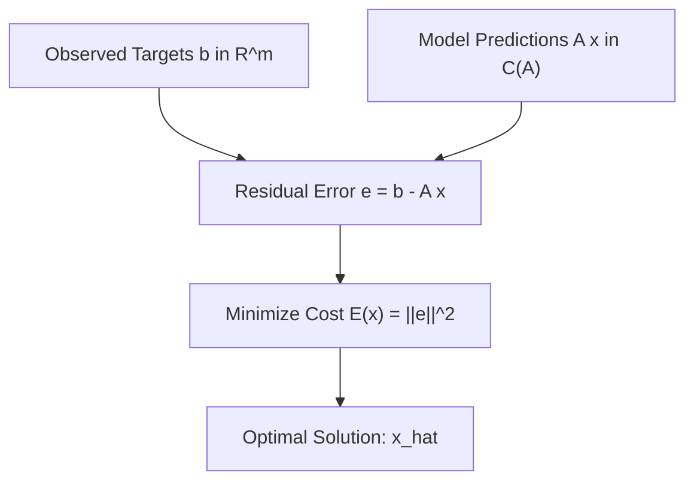

[Maths Index](../README.md) / [Unit 2: Orthogonality, Eigenvalues, and Matrix Factorizations](Introduction.md)

---

Every scientist, engineer, and machine learning practitioner eventually faces the same challenge: you collect experimental measurements, plot them on a graph, and find that no clean theoretical curve passes through all the data points simultaneously. 

Measurement instruments have tolerances. Biological systems fluctuate. Sensor channels pick up thermal noise. 

If you try to write down an exact system of equations matching every single observation, you get an **overdetermined system**: more equations ($m$) than model parameters ($n$). Because the observations do not lie on a perfect theoretical line or surface, the target vector $\mathbf{b}$ sits outside the column space of your design matrix $A$. 

The system $A\mathbf{x} = \mathbf{b}$ has zero exact solutions.

So what do we do? We redefine what it means to "solve" the system. Instead of demanding $A\mathbf{x} = \mathbf{b}$, we look for a parameter vector $\hat{\mathbf{x}}$ that makes the model prediction $A\hat{\mathbf{x}}$ as close as humanly possible to the real target $\mathbf{b}$. 

This is the principle of **Least Squares Approximation**.

---

## The Least Squares Criterion

Let $A$ be an $m \times n$ matrix representing our linear model structure, with $m > n$, and let $\mathbf{b} \in \mathbb{R}^m$ be the vector of observed targets. 

For any parameter choice $\mathbf{x} \in \mathbb{R}^n$, the model produces a predicted vector $\hat{\mathbf{b}} = A\mathbf{x}$. 

The difference between what actually occurred and what our model predicted is the **residual error vector** $\mathbf{e}$:

$$\mathbf{e} = \mathbf{b} - A\mathbf{x} = \begin{bmatrix} b_1 - (A\mathbf{x})_1 \\ b_2 - (A\mathbf{x})_2 \\ \vdots \\ b_m - (A\mathbf{x})_m \end{bmatrix}$$

We want this error to be as small as possible. But how should we measure the "size" of an $m$-dimensional error vector? 

The standard choice in statistics and machine learning is the **Sum of Squared Errors (SSE)**, which is the squared Euclidean norm of the residual:

$$E(\mathbf{x}) = \|\mathbf{e}\|^2 = \|\mathbf{b} - A\mathbf{x}\|^2 = \sum_{i=1}^m \left( b_i - \sum_{j=1}^n A_{ij} x_j \right)^2$$

Our mathematical objective is to find the optimal vector $\hat{\mathbf{x}}$ that minimizes this scalar cost function:

$$\hat{\mathbf{x}} = \arg\min_{\mathbf{x} \in \mathbb{R}^n} \|\mathbf{b} - A\mathbf{x}\|^2$$

---

## Two Perspectives: Why the Normal Equations Must Hold

There are two completely independent ways to derive the optimal parameter vector $\hat{\mathbf{x}}$: one through geometry, and one through multivariate calculus. Both arrive at the exact same matrix equation.

### 1. The Geometric Derivation: Error Orthogonal to Model Space

As we established in Lecture 3, the set of all possible model predictions $A\mathbf{x}$ forms the column space $C(A) \subset \mathbb{R}^m$.

The shortest distance from an external point $\mathbf{b}$ to the subspace $C(A)$ is obtained by dropping a perpendicular. The optimal predicted vector $\mathbf{p} = A\hat{\mathbf{x}}$ is the orthogonal projection of $\mathbf{b}$ onto $C(A)$.

Because $\mathbf{p}$ is the orthogonal projection, the residual vector $\mathbf{e} = \mathbf{b} - A\hat{\mathbf{x}}$ must be perpendicular to the entire subspace $C(A)$. 

This requires $\mathbf{e}$ to be orthogonal to every column of $A$:

$$\mathbf{a}_j^T \mathbf{e} = 0 \quad \text{for all } j = 1, 2, \dots, n$$

In matrix form:

$$A^T \mathbf{e} = \mathbf{0}$$

Substituting $\mathbf{e} = \mathbf{b} - A\hat{\mathbf{x}}$:

$$A^T (\mathbf{b} - A\hat{\mathbf{x}}) = \mathbf{0} \implies A^T A \hat{\mathbf{x}} = A^T \mathbf{b}$$

### 2. The Calculus Derivation: Minimizing the Quadratic Surface

Now let's verify this from an optimization perspective. Let's expand the squared error function $E(\mathbf{x}) = \|\mathbf{b} - A\mathbf{x}\|^2$:

$$E(\mathbf{x}) = (\mathbf{b} - A\mathbf{x})^T (\mathbf{b} - A\mathbf{x}) = \mathbf{b}^T \mathbf{b} - \mathbf{b}^T A \mathbf{x} - (A\mathbf{x})^T \mathbf{b} + (A\mathbf{x})^T (A\mathbf{x})$$

Because $\mathbf{b}^T A \mathbf{x}$ is a scalar, it equals its transpose $\mathbf{x}^T A^T \mathbf{b}$. Combining terms:

$$E(\mathbf{x}) = \mathbf{x}^T (A^T A) \mathbf{x} - 2\mathbf{x}^T A^T \mathbf{b} + \mathbf{b}^T \mathbf{b}$$

This is a smooth, convex quadratic bowl in $n$ dimensions. To find the global minimum, we compute the gradient with respect to $\mathbf{x}$ and set it to zero:

$$\nabla_{\mathbf{x}} E(\mathbf{x}) = 2 (A^T A) \mathbf{x} - 2 A^T \mathbf{b} = \mathbf{0}$$

Dividing by 2 gives:

$$A^T A \mathbf{x} = A^T \mathbf{b}$$

Both geometry and calculus yield the exact same **Normal Equations**. 

When the columns of $A$ are linearly independent, $A^T A$ is invertible, giving the unique closed-form solution:

$$\hat{\mathbf{x}} = (A^T A)^{-1} A^T \mathbf{b}$$

---

## Linear Regression: Fitting a Straight Line to Data

The quintessential least squares problem is **Simple Linear Regression**: fitting a straight line $y = \beta_0 + \beta_1 t$ to a collection of $m$ data points:

$$(t_1, y_1), (t_2, y_2), \dots, (t_m, y_m)$$

If the line were perfect, every point would satisfy:

$$\begin{matrix}
\beta_0 + \beta_1 t_1 = y_1 \\
\beta_0 + \beta_1 t_2 = y_2 \\
\vdots \\
\beta_0 + \beta_1 t_m = y_m
\end{matrix}$$

Let's write this in matrix format $A\mathbf{x} = \mathbf{b}$:

$$\begin{bmatrix} 1 & t_1 \\ 1 & t_2 \\ \vdots & \vdots \\ 1 & t_m \end{bmatrix} \begin{bmatrix} \beta_0 \\ \beta_1 \end{bmatrix} = \begin{bmatrix} y_1 \\ y_2 \\ \vdots \\ y_m \end{bmatrix}$$

Here, the design matrix $A$ has $m$ rows and 2 columns. The first column of ones accounts for the intercept $\beta_0$, and the second column holds the input feature values $t_i$.

Let's compute the components of the Normal Equations explicitly:

$$A^T A = \begin{bmatrix} 1 & 1 & \dots & 1 \\ t_1 & t_2 & \dots & t_m \end{bmatrix} \begin{bmatrix} 1 & t_1 \\ 1 & t_2 \\ \vdots & \vdots \\ 1 & t_m \end{bmatrix} = \begin{bmatrix} m & \sum t_i \\ \sum t_i & \sum t_i^2 \end{bmatrix}$$

And the right-hand side vector:

$$A^T \mathbf{b} = \begin{bmatrix} 1 & 1 & \dots & 1 \\ t_1 & t_2 & \dots & t_m \end{bmatrix} \begin{bmatrix} y_1 \\ y_2 \\ \vdots \\ y_m \end{bmatrix} = \begin{bmatrix} \sum y_i \\ \sum t_i y_i \end{bmatrix}$$

Solving $A^T A \hat{\mathbf{x}} = A^T \mathbf{b}$ reproduces the standard linear regression formulas derived in introductory statistics textbooks—all from a single, compact matrix operation!

---

## Fitting Higher-Order Polynomials and Multivariable Models

The method of least squares is called "linear" not because the model must be a straight line, but because the model is **linear in the unknown parameters**.

Suppose the relationship appears curved, and we want to fit a quadratic parabola:

$$y = \beta_0 + \beta_1 t + \beta_2 t^2$$

Even though $t^2$ is non-linear with respect to $t$, the unknown coefficients $\beta_0, \beta_1, \beta_2$ appear purely linearly!

We set up the design matrix $A$ with three columns:

$$A = \begin{bmatrix} 1 & t_1 & t_1^2 \\ 1 & t_2 & t_2^2 \\ \vdots & \vdots & \vdots \\ 1 & t_m & t_m^2 \end{bmatrix}, \quad \hat{\mathbf{x}} = \begin{bmatrix} \beta_0 \\ \beta_1 \\ \beta_2 \end{bmatrix}, \quad \mathbf{b} = \begin{bmatrix} y_1 \\ y_2 \\ \vdots \\ y_m \end{bmatrix}$$

The exact same Normal Equations $A^T A \hat{\mathbf{x}} = A^T \mathbf{b}$ apply without modification. The exact same machinery works for multivariate regression with $d$ features: $y = \beta_0 + \beta_1 x_1 + \dots + \beta_d x_d$.

---

## Step-by-Step Numerical Example

Let's fit the best straight line $y = \beta_0 + \beta_1 t$ to three empirical observations:

$$(0, 1), \quad (1, 2), \quad (2, 4)$$

Notice that $(0, 1)$ to $(1, 2)$ has slope 1, but $(1, 2)$ to $(2, 4)$ has slope 2. The points are not collinear. No single line passes through all three.

### Step 1: Set Up $A$, $\mathbf{x}$, and $\mathbf{b}$

$$A = \begin{bmatrix} 1 & 0 \\ 1 & 1 \\ 1 & 2 \end{bmatrix}, \quad \mathbf{x} = \begin{bmatrix} \beta_0 \\ \beta_1 \end{bmatrix}, \quad \mathbf{b} = \begin{bmatrix} 1 \\ 2 \\ 4 \end{bmatrix}$$

### Step 2: Compute $A^T A$ and $A^T \mathbf{b}$

$$A^T A = \begin{bmatrix} 1 & 1 & 1 \\ 0 & 1 & 2 \end{bmatrix} \begin{bmatrix} 1 & 0 \\ 1 & 1 \\ 1 & 2 \end{bmatrix} = \begin{bmatrix} 1+1+1 & 0+1+2 \\ 0+1+2 & 0+1+4 \end{bmatrix} = \begin{bmatrix} 3 & 3 \\ 3 & 5 \end{bmatrix}$$

$$A^T \mathbf{b} = \begin{bmatrix} 1 & 1 & 1 \\ 0 & 1 & 2 \end{bmatrix} \begin{bmatrix} 1 \\ 2 \\ 4 \end{bmatrix} = \begin{bmatrix} 1 + 2 + 4 \\ 0 + 2 + 8 \end{bmatrix} = \begin{bmatrix} 7 \\ 10 \end{bmatrix}$$

### Step 3: Invert $A^T A$ and Solve for $\hat{\mathbf{x}}$

Determinant of $A^T A$:

$$\det(A^T A) = (3)(5) - (3)(3) = 15 - 9 = 6$$

The $2 \times 2$ inverse is:

$$(A^T A)^{-1} = \frac{1}{6} \begin{bmatrix} 5 & -3 \\ -3 & 3 \end{bmatrix}$$

Now compute $\hat{\mathbf{x}}$:

$$\hat{\mathbf{x}} = (A^T A)^{-1} A^T \mathbf{b} = \frac{1}{6} \begin{bmatrix} 5 & -3 \\ -3 & 3 \end{bmatrix} \begin{bmatrix} 7 \\ 10 \end{bmatrix} = \frac{1}{6} \begin{bmatrix} 35 - 30 \\ -21 + 30 \end{bmatrix} = \frac{1}{6} \begin{bmatrix} 5 \\ 9 \end{bmatrix} = \begin{bmatrix} 5/6 \\ 3/2 \end{bmatrix} = \begin{bmatrix} 0.833 \\ 1.500 \end{bmatrix}$$

The optimal regression line is:

$$y = \frac{5}{6} + \frac{3}{2} t \approx 0.833 + 1.5 t$$

### Step 4: Compute Fitted Values and Error Vector

The predicted values $\mathbf{p} = A\hat{\mathbf{x}}$ are:

$$\mathbf{p} = \begin{bmatrix} 1 & 0 \\ 1 & 1 \\ 1 & 2 \end{bmatrix} \begin{bmatrix} 5/6 \\ 3/2 \end{bmatrix} = \begin{bmatrix} 5/6 \\ 5/6 + 9/6 \\ 5/6 + 18/6 \end{bmatrix} = \begin{bmatrix} 5/6 \\ 14/6 \\ 23/6 \end{bmatrix} \approx \begin{bmatrix} 0.833 \\ 2.333 \\ 3.833 \end{bmatrix}$$

The residual error vector $\mathbf{e} = \mathbf{b} - \mathbf{p}$ is:

$$\mathbf{e} = \begin{bmatrix} 1 \\ 2 \\ 4 \end{bmatrix} - \begin{bmatrix} 5/6 \\ 14/6 \\ 23/6 \end{bmatrix} = \begin{bmatrix} 1/6 \\ -2/6 \\ 1/6 \end{bmatrix}$$

### Step 5: Verify Orthogonality of Residuals

Let's verify that $A^T \mathbf{e} = \mathbf{0}$:

$$A^T \mathbf{e} = \begin{bmatrix} 1 & 1 & 1 \\ 0 & 1 & 2 \end{bmatrix} \begin{bmatrix} 1/6 \\ -2/6 \\ 1/6 \end{bmatrix} = \begin{bmatrix} \frac{1 - 2 + 1}{6} \\ \frac{0 - 2 + 2}{6} \end{bmatrix} = \begin{bmatrix} 0 \\ 0 \end{bmatrix}$$

The residual vector is strictly orthogonal to both columns of $A$.

The minimal Sum of Squared Errors is:

$$SSE = \|\mathbf{e}\|^2 = \left(\frac{1}{6}\right)^2 + \left(-\frac{2}{6}\right)^2 + \left(\frac{1}{6}\right)^2 = \frac{1 + 4 + 1}{36} = \frac{6}{36} = \frac{1}{6} \approx 0.1667$$

No straight line in existence can produce a sum of squared errors smaller than $1/6$ for these three points.

---

## Practical AI Considerations: The Inversion Bottleneck

In modern deep learning and large-scale data science, the closed-form solution $\hat{\mathbf{x}} = (A^T A)^{-1} A^T \mathbf{b}$ reveals two significant computational vulnerabilities:

1. **Computational Cost**: Inverting an $n \times n$ matrix takes $O(n^3)$ operations. If a neural network or feature matrix has $n = 100,000$ parameters, inverting $A^T A$ directly is computationally impossible. This is why machine learning relies on iterative first-order methods like Stochastic Gradient Descent (SGD) for large parameter regimes.
2. **Ill-Conditioning and Multicollinearity**: If two feature columns in $A$ are nearly parallel (highly correlated), the determinant of $A^T A$ becomes near-zero. Computing $(A^T A)^{-1}$ amplifies tiny measurement noise into enormous, unstable parameter swings.

---

## Key Takeaways

- Overdetermined systems $A\mathbf{x} = \mathbf{b}$ ($m > n$) typically have no exact solution because $\mathbf{b} \notin C(A)$.
- Least Squares minimizes the sum of squared errors $E(\mathbf{x}) = \|\mathbf{b} - A\mathbf{x}\|^2$.
- The optimal solution satisfies the Normal Equations $A^T A \hat{\mathbf{x}} = A^T \mathbf{b}$.
- The residual vector $\mathbf{e} = \mathbf{b} - A\hat{\mathbf{x}}$ is strictly orthogonal to the column space $C(A)$, satisfying $A^T \mathbf{e} = \mathbf{0}$.
- Linear regression models straight lines, polynomials, and multi-feature models using the exact same matrix formalism.
- When $n$ is very large or columns are nearly collinear, direct matrix inversion becomes computationally prohibitive or numerically unstable.

---

Notice the recurring headache in both L03 and L04: computing $(A^T A)^{-1}$. 

Every time we project onto a subspace or solve a least-squares problem, we have to invert the matrix $A^T A$. But what if $A^T A$ was the simplest possible matrix—what if $A^T A = I$, the identity matrix? 

If $A^T A = I$, then $(A^T A)^{-1} = I$, and the Normal Equations solve instantly with zero inversion required: $\hat{\mathbf{x}} = A^T \mathbf{b}$!

Can we take an arbitrary set of linearly independent columns and convert them into a set of perfectly perpendicular, unit-length vectors? 

Yes, we can. That brings us to [L05 - The Gram-Schmidt Process and QR Factorization](L05%20-%20The%20Gram-Schmidt%20Process%20and%20QR%20Factorization.md).
