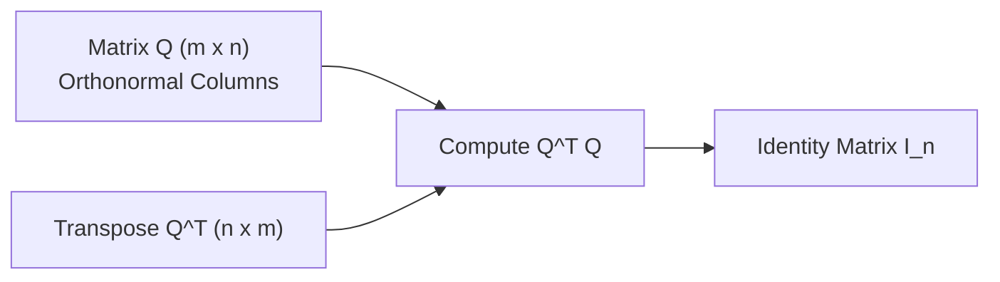
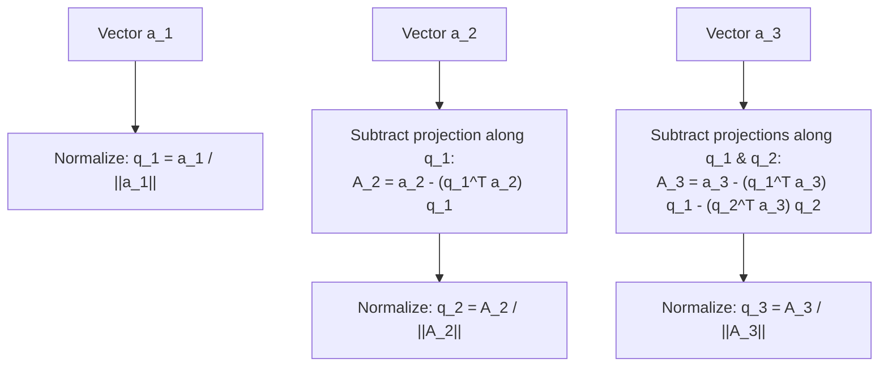

[Maths Index](../README.md) / [Unit 2: Orthogonality, Eigenvalues, and Matrix Factorizations](Introduction.md)

---

In the last two lectures, we discovered that orthogonal projections and least-squares fits always depend on the matrix product $A^T A$. And to compute predictions or parameter estimates, we had to invert it: $(A^T A)^{-1}$.

Now think about what happens when two columns of $A$ point in nearly the same direction. The columns are technically linearly independent, but geometrically they are almost parallel. 

When that happens, the matrix $A^T A$ becomes **ill-conditioned**: its determinant collapses close to zero, and numerical floating-point errors blow up exponentially. Inverting it becomes a numerical nightmare.

Why did this problem occur? Because our original basis vectors were arbitrary. They were pointing at skewed, awkward angles to each other.

If we could choose our basis, what would the ideal basis look like? 

Every vector would have length 1, and every pair of vectors would meet at a clean $90^\circ$ angle. In other words, we want an **orthonormal basis**.

---

## Orthonormal Vectors and Orthogonal Matrices

A set of vectors $\mathbf{q}_1, \mathbf{q}_2, \dots, \mathbf{q}_n$ is called **orthonormal** if every vector has unit length and distinct vectors are mutually perpendicular:

$$\mathbf{q}_i^T \mathbf{q}_j = \begin{cases} 0 & \text{if } i \ne j \\ 1 & \text{if } i = j \end{cases}$$

This compact condition is written using the Kronecker delta: $\mathbf{q}_i^T \mathbf{q}_j = \delta_{ij}$.

Now, let's assemble these orthonormal vectors as the columns of an $m \times n$ matrix $Q$:

$$Q = \begin{bmatrix} \mathbf{q}_1 & \mathbf{q}_2 & \dots & \mathbf{q}_n \end{bmatrix}$$

Watch what happens when we compute $Q^T Q$:

$$Q^T Q = \begin{bmatrix} \mathbf{q}_1^T \\ \mathbf{q}_2^T \\ \vdots \\ \mathbf{q}_n^T \end{bmatrix} \begin{bmatrix} \mathbf{q}_1 & \mathbf{q}_2 & \dots & \mathbf{q}_n \end{bmatrix} = \begin{bmatrix} \mathbf{q}_1^T \mathbf{q}_1 & \mathbf{q}_1^T \mathbf{q}_2 & \dots & \mathbf{q}_1^T \mathbf{q}_n \\ \mathbf{q}_2^T \mathbf{q}_1 & \mathbf{q}_2^T \mathbf{q}_2 & \dots & \mathbf{q}_2^T \mathbf{q}_n \\ \vdots & \vdots & \ddots & \vdots \\ \mathbf{q}_n^T \mathbf{q}_1 & \mathbf{q}_n^T \mathbf{q}_2 & \dots & \mathbf{q}_n^T \mathbf{q}_n \end{bmatrix} = \begin{bmatrix} 1 & 0 & \dots & 0 \\ 0 & 1 & \dots & 0 \\ \vdots & \vdots & \ddots & \vdots \\ 0 & 0 & \dots & 1 \end{bmatrix} = I_n$$

The product $Q^T Q$ is identically the $n \times n$ identity matrix!

### Square Orthogonal Matrices

When $Q$ is square ($n \times n$), it is called an **orthogonal matrix**. 

Because $Q^T Q = I$, the transpose of an orthogonal matrix is its exact matrix inverse:

$$Q^{-1} = Q^T$$

This is one of the most powerful properties in all of computing: inverting an orthogonal matrix requires zero arithmetic—you simply transpose it!

Furthermore, orthogonal matrices preserve geometric lengths and dot products:
- **Length Preservation**: $\|Q\mathbf{x}\|^2 = (Q\mathbf{x})^T (Q\mathbf{x}) = \mathbf{x}^T Q^T Q \mathbf{x} = \mathbf{x}^T I \mathbf{x} = \|\mathbf{x}\|^2$.
- **Angle Preservation**: $(Q\mathbf{x})^T (Q\mathbf{y}) = \mathbf{x}^T Q^T Q \mathbf{y} = \mathbf{x}^T \mathbf{y}$.

An orthogonal matrix performs pure rigid rotations and reflections in space. It never stretches, compresses, or shears vectors.

---

## Projections Decouple Completely Under Orthonormal Bases

Remember our general subspace projection matrix from Lecture 3:

$$P = A (A^T A)^{-1} A^T$$

If the columns of our subspace matrix are orthonormal ($A = Q$), look at what happens:

$$P = Q (Q^T Q)^{-1} Q^T = Q (I)^{-1} Q^T = Q Q^T$$

The inversion $(A^T A)^{-1}$ completely vanishes!

Even better, let's write out the projection of a vector $\mathbf{b}$ onto $C(Q)$:

$$\mathbf{p} = Q Q^T \mathbf{b} = \begin{bmatrix} \mathbf{q}_1 & \dots & \mathbf{q}_n \end{bmatrix} \begin{bmatrix} \mathbf{q}_1^T \mathbf{b} \\ \vdots \\ \mathbf{q}_n^T \mathbf{b} \end{bmatrix} = (\mathbf{q}_1^T \mathbf{b})\mathbf{q}_1 + (\mathbf{q}_2^T \mathbf{b})\mathbf{q}_2 + \dots + (\mathbf{q}_n^T \mathbf{b})\mathbf{q}_n$$

Notice how clean this is: the projection onto the entire $n$-dimensional subspace is simply the sum of $n$ independent 1D projections! 

With an arbitrary basis, changing one basis vector changes every coordinate of the projection. With an orthonormal basis, each direction decouples completely.

---

## The Gram-Schmidt Process

So how do we turn an arbitrary set of linearly independent vectors $\mathbf{a}_1, \mathbf{a}_2, \dots, \mathbf{a}_n$ into an orthonormal set $\mathbf{q}_1, \mathbf{q}_2, \dots, \mathbf{q}_n$?

We use the **Gram-Schmidt Orthogonalization Process**. The core idea is greedy subtraction: keep the first vector as our reference direction, then take each subsequent vector and subtract its projections onto all previously established directions.

Let's trace each step systematically:

### Step 1: Establish the First Direction
Start with $\mathbf{a}_1$. It has no prior vectors to be orthogonal to, so we keep its direction and normalize it to length 1:

$$\mathbf{A}_1 = \mathbf{a}_1, \quad \mathbf{q}_1 = \frac{\mathbf{A}_1}{\|\mathbf{A}_1\|}$$

### Step 2: Make $\mathbf{a}_2$ Orthogonal to $\mathbf{q}_1$
Take $\mathbf{a}_2$. It generally has some component pointing along $\mathbf{q}_1$. We subtract that 1D projection:

$$\mathbf{A}_2 = \mathbf{a}_2 - (\mathbf{q}_1^T \mathbf{a}_2)\mathbf{q}_1$$

Check orthogonality: $\mathbf{q}_1^T \mathbf{A}_2 = \mathbf{q}_1^T \mathbf{a}_2 - (\mathbf{q}_1^T \mathbf{a}_2)(\mathbf{q}_1^T \mathbf{q}_1) = \mathbf{q}_1^T \mathbf{a}_2 - \mathbf{q}_1^T \mathbf{a}_2 = 0$. 

Now normalize to obtain unit vector $\mathbf{q}_2$:

$$\mathbf{q}_2 = \frac{\mathbf{A}_2}{\|\mathbf{A}_2\|}$$

### Step $k$: The General Step
For any vector $\mathbf{a}_k$, subtract its projections along all previously computed orthonormal vectors $\mathbf{q}_1, \dots, \mathbf{q}_{k-1}$:

$$\mathbf{A}_k = \mathbf{a}_k - \sum_{j=1}^{k-1} (\mathbf{q}_j^T \mathbf{a}_k)\mathbf{q}_j, \quad \mathbf{q}_k = \frac{\mathbf{A}_k}{\|\mathbf{A}_k\|}$$

Because we strip away all components lying in $\text{span}(\mathbf{q}_1, \dots, \mathbf{q}_{k-1})$, the remaining vector $\mathbf{A}_k$ is guaranteed to be orthogonal to all preceding $\mathbf{q}_j$.

---

## The $A = QR$ Factorization

Now, let's express the Gram-Schmidt process in matrix form.

Rearranging the Gram-Schmidt formulas to express our original vectors $\mathbf{a}_k$ in terms of the new orthonormal vectors $\mathbf{q}_j$:

$$\begin{aligned}
\mathbf{a}_1 &= r_{11} \mathbf{q}_1 \\
\mathbf{a}_2 &= r_{12} \mathbf{q}_1 + r_{22} \mathbf{q}_2 \\
\mathbf{a}_3 &= r_{13} \mathbf{q}_1 + r_{23} \mathbf{q}_2 + r_{33} \mathbf{q}_3 \\
&\;\;\vdots \\
\mathbf{a}_n &= r_{1n} \mathbf{q}_1 + r_{2n} \mathbf{q}_2 + \dots + r_{nn} \mathbf{q}_n
\end{aligned}$$

where the coefficients are:
- Off-diagonal entries: $r_{jk} = \mathbf{q}_j^T \mathbf{a}_k$ (the projection scalar of $\mathbf{a}_k$ along $\mathbf{q}_j$)
- Diagonal entries: $r_{kk} = \|\mathbf{A}_k\|$ (the length of the orthogonalized vector before normalization)

Stacking this into a single matrix equation gives:

$$\begin{bmatrix} \mathbf{a}_1 & \mathbf{a}_2 & \dots & \mathbf{a}_n \end{bmatrix} = \begin{bmatrix} \mathbf{q}_1 & \mathbf{q}_2 & \dots & \mathbf{q}_n \end{bmatrix} \begin{bmatrix} r_{11} & r_{12} & \dots & r_{1n} \\ 0 & r_{22} & \dots & r_{2n} \\ \vdots & \vdots & \ddots & \vdots \\ 0 & 0 & \dots & r_{nn} \end{bmatrix}$$

This is the famous **$A = QR$ Factorization**:
- $Q$ is an $m \times n$ matrix with orthonormal columns ($Q^T Q = I_n$).
- $R$ is an $n \times n$ **upper triangular matrix** with strictly positive diagonal entries ($r_{kk} > 0$).

Why is $R$ triangular? Because vector $\mathbf{a}_k$ is built exclusively from the first $k$ orthonormal vectors $\mathbf{q}_1, \dots, \mathbf{q}_k$. It has zero contribution from subsequent directions $\mathbf{q}_{k+1}, \dots, \mathbf{q}_n$!

---

## Solving Least Squares Instantly with $QR$

In Lecture 4, solving least squares required setting up the Normal Equations:

$$A^T A \hat{\mathbf{x}} = A^T \mathbf{b}$$

Substitute $A = QR$ into this equation:

$$(QR)^T (QR) \hat{\mathbf{x}} = (QR)^T \mathbf{b}$$

$$(R^T Q^T) (QR) \hat{\mathbf{x}} = R^T Q^T \mathbf{b}$$

Because $Q^T Q = I$:

$$R^T I R \hat{\mathbf{x}} = R^T Q^T \mathbf{b} \implies R^T R \hat{\mathbf{x}} = R^T Q^T \mathbf{b}$$

Since $R$ is upper triangular with non-zero diagonal entries, $R^T$ is lower triangular and strictly invertible. We multiply both sides by $(R^T)^{-1}$:

$$R \hat{\mathbf{x}} = Q^T \mathbf{b}$$

Look at this equation. We never inverted $A^T A$. We never even computed $A^T A$!

Because $R$ is upper triangular, this system can be solved directly by **back-substitution** in $O(n^2)$ time:
1. Solve for $\hat{x}_n$ from the last equation.
2. Back-substitute into the row above to find $\hat{x}_{n-1}$.
3. Repeat upwards to $\hat{x}_1$.

This is why production scientific libraries (LAPACK, NumPy, SciPy, PyTorch) solve linear regression and least squares via $QR$ decomposition or SVD rather than inverting $A^T A$.

---

## Step-by-Step Numerical Example

Let's compute the $QR$ factorization of the following matrix in $\mathbb{R}^3$:

$$A = \begin{bmatrix} 1 & 1 & 0 \\ 1 & 0 & 1 \\ 0 & 1 & 1 \end{bmatrix}$$

Its column vectors are:

$$\mathbf{a}_1 = \begin{bmatrix} 1 \\ 1 \\ 0 \end{bmatrix}, \quad \mathbf{a}_2 = \begin{bmatrix} 1 \\ 0 \\ 1 \end{bmatrix}, \quad \mathbf{a}_3 = \begin{bmatrix} 0 \\ 1 \\ 1 \end{bmatrix}$$

### Step 1: Process $\mathbf{a}_1$

$$\mathbf{A}_1 = \mathbf{a}_1 = \begin{bmatrix} 1 \\ 1 \\ 0 \end{bmatrix}$$

Compute length:

$$r_{11} = \|\mathbf{A}_1\| = \sqrt{1^2 + 1^2 + 0^2} = \sqrt{2}$$

Normalize:

$$\mathbf{q}_1 = \frac{1}{\sqrt{2}} \begin{bmatrix} 1 \\ 1 \\ 0 \end{bmatrix}$$

### Step 2: Process $\mathbf{a}_2$

Compute projection scalar $r_{12} = \mathbf{q}_1^T \mathbf{a}_2$:

$$r_{12} = \frac{1}{\sqrt{2}} \begin{bmatrix} 1 & 1 & 0 \end{bmatrix} \begin{bmatrix} 1 \\ 0 \\ 1 \end{bmatrix} = \frac{1 + 0 + 0}{\sqrt{2}} = \frac{1}{\sqrt{2}}$$

Subtract projection along $\mathbf{q}_1$:

$$\mathbf{A}_2 = \mathbf{a}_2 - r_{12} \mathbf{q}_1 = \begin{bmatrix} 1 \\ 0 \\ 1 \end{bmatrix} - \frac{1}{\sqrt{2}} \left( \frac{1}{\sqrt{2}} \begin{bmatrix} 1 \\ 1 \\ 0 \end{bmatrix} \right) = \begin{bmatrix} 1 \\ 0 \\ 1 \end{bmatrix} - \begin{bmatrix} 1/2 \\ 1/2 \\ 0 \end{bmatrix} = \begin{bmatrix} 1/2 \\ -1/2 \\ 1 \end{bmatrix}$$

Compute length:

$$r_{22} = \|\mathbf{A}_2\| = \sqrt{\left(\frac{1}{2}\right)^2 + \left(-\frac{1}{2}\right)^2 + 1^2} = \sqrt{\frac{1}{4} + \frac{1}{4} + 1} = \sqrt{\frac{6}{4}} = \frac{\sqrt{6}}{2}$$

Normalize:

$$\mathbf{q}_2 = \frac{\mathbf{A}_2}{r_{22}} = \frac{2}{\sqrt{6}} \begin{bmatrix} 1/2 \\ -1/2 \\ 1 \end{bmatrix} = \frac{1}{\sqrt{6}} \begin{bmatrix} 1 \\ -1 \\ 2 \end{bmatrix}$$

Check orthogonality: $\mathbf{q}_1^T \mathbf{q}_2 = \frac{1}{\sqrt{12}}(1 - 1 + 0) = 0$.

### Step 3: Process $\mathbf{a}_3$

Compute projection scalars:

$$r_{13} = \mathbf{q}_1^T \mathbf{a}_3 = \frac{1}{\sqrt{2}} \begin{bmatrix} 1 & 1 & 0 \end{bmatrix} \begin{bmatrix} 0 \\ 1 \\ 1 \end{bmatrix} = \frac{1}{\sqrt{2}}$$

$$r_{23} = \mathbf{q}_2^T \mathbf{a}_3 = \frac{1}{\sqrt{6}} \begin{bmatrix} 1 & -1 & 2 \end{bmatrix} \begin{bmatrix} 0 \\ 1 \\ 1 \end{bmatrix} = \frac{-1 + 2}{\sqrt{6}} = \frac{1}{\sqrt{6}}$$

Subtract both projections:

$$\mathbf{A}_3 = \mathbf{a}_3 - r_{13} \mathbf{q}_1 - r_{23} \mathbf{q}_2$$

$$\mathbf{A}_3 = \begin{bmatrix} 0 \\ 1 \\ 1 \end{bmatrix} - \frac{1}{2} \begin{bmatrix} 1 \\ 1 \\ 0 \end{bmatrix} - \frac{1}{6} \begin{bmatrix} 1 \\ -1 \\ 2 \end{bmatrix}$$

Combining components:
- First component: $0 - \frac{1}{2} - \frac{1}{6} = -\frac{3}{6} - \frac{1}{6} = -\frac{4}{6} = -\frac{2}{3}$
- Second component: $1 - \frac{1}{2} + \frac{1}{6} = \frac{6 - 3 + 1}{6} = \frac{4}{6} = \frac{2}{3}$
- Third component: $1 - 0 - \frac{2}{6} = \frac{6 - 2}{6} = \frac{4}{6} = \frac{2}{3}$

$$\mathbf{A}_3 = \begin{bmatrix} -2/3 \\ 2/3 \\ 2/3 \end{bmatrix}$$

Compute length:

$$r_{33} = \|\mathbf{A}_3\| = \sqrt{\left(-\frac{2}{3}\right)^2 + \left(\frac{2}{3}\right)^2 + \left(\frac{2}{3}\right)^2} = \sqrt{\frac{4 + 4 + 4}{9}} = \frac{\sqrt{12}}{3} = \frac{2\sqrt{3}}{3} = \frac{2}{\sqrt{3}}$$

Normalize:

$$\mathbf{q}_3 = \frac{\sqrt{3}}{2} \begin{bmatrix} -2/3 \\ 2/3 \\ 2/3 \end{bmatrix} = \frac{1}{\sqrt{3}} \begin{bmatrix} -1 \\ 1 \\ 1 \end{bmatrix}$$

Check orthogonality:
- $\mathbf{q}_1^T \mathbf{q}_3 = \frac{1}{\sqrt{6}} (-1 + 1 + 0) = 0$
- $\mathbf{q}_2^T \mathbf{q}_3 = \frac{1}{\sqrt{18}} (-1 - 1 + 2) = 0$

### Step 4: Assemble $Q$ and $R$

$$Q = \begin{bmatrix} 1/\sqrt{2} & 1/\sqrt{6} & -1/\sqrt{3} \\ 1/\sqrt{2} & -1/\sqrt{6} & 1/\sqrt{3} \\ 0 & 2/\sqrt{6} & 1/\sqrt{3} \end{bmatrix}$$

$$R = \begin{bmatrix} r_{11} & r_{12} & r_{13} \\ 0 & r_{22} & r_{23} \\ 0 & 0 & r_{33} \end{bmatrix} = \begin{bmatrix} \sqrt{2} & 1/\sqrt{2} & 1/\sqrt{2} \\ 0 & \sqrt{6}/2 & 1/\sqrt{6} \\ 0 & 0 & 2/\sqrt{3} \end{bmatrix}$$

Let's check $QR$ for column 1:

$$Q \begin{bmatrix} \sqrt{2} \\ 0 \\ 0 \end{bmatrix} = \sqrt{2} \mathbf{q}_1 = \begin{bmatrix} 1 \\ 1 \\ 0 \end{bmatrix} = \mathbf{a}_1$$

And column 2:

$$Q \begin{bmatrix} 1/\sqrt{2} \\ \sqrt{6}/2 \\ 0 \end{bmatrix} = \frac{1}{2}\begin{bmatrix} 1 \\ 1 \\ 0 \end{bmatrix} + \frac{1}{2}\begin{bmatrix} 1 \\ -1 \\ 2 \end{bmatrix} = \begin{bmatrix} 1 \\ 0 \\ 1 \end{bmatrix} = \mathbf{a}_2$$

The factorization $A = QR$ holds identically.

---

## Key Takeaways

- Orthonormal vectors satisfy $\mathbf{q}_i^T \mathbf{q}_j = \delta_{ij}$. An orthogonal matrix $Q$ satisfies $Q^T Q = I$ and $Q^{-1} = Q^T$.
- Orthogonal transformations preserve Euclidean lengths ($\|Q\mathbf{x}\| = \|\mathbf{x}\|$) and angles.
- When projection uses an orthonormal basis, $P = Q Q^T$, and the projections along each basis direction decouple into a simple sum.
- The Gram-Schmidt process orthogonalizes independent vectors by iteratively subtracting projections onto all preceding directions.
- In matrix form, Gram-Schmidt produces the factorization $A = QR$, where $Q$ has orthonormal columns and $R$ is upper triangular with positive diagonal entries.
- Least squares reduces to the upper triangular system $R\hat{\mathbf{x}} = Q^T \mathbf{b}$, solved quickly and stably by back-substitution without forming $A^T A$.

---

Up to this point, our transformations have been about projecting vectors, measuring distances, and finding best fits. 

Now, we shift our focus to an entirely different question: what does a square matrix *do* to space? 

When a matrix multiplies a vector, it usually rotates it, bends it, and stretches it. But for almost every square matrix, there exist special directions that do not rotate at all—they merely get scaled by a constant factor. 

These invariant directions are the natural axes of the matrix. They are the eigenvectors, and their scaling factors are the eigenvalues.

We explore this foundational concept in [L06 - Introduction to Eigenvalues and Eigenvectors](L06%20-%20Introduction%20to%20Eigenvalues%20and%20Eigenvectors.md).
