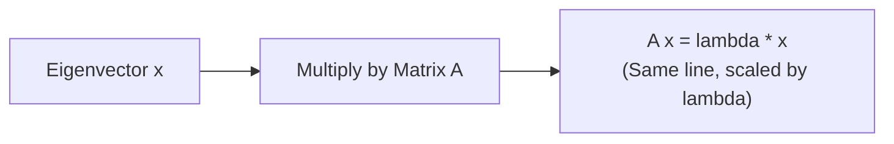
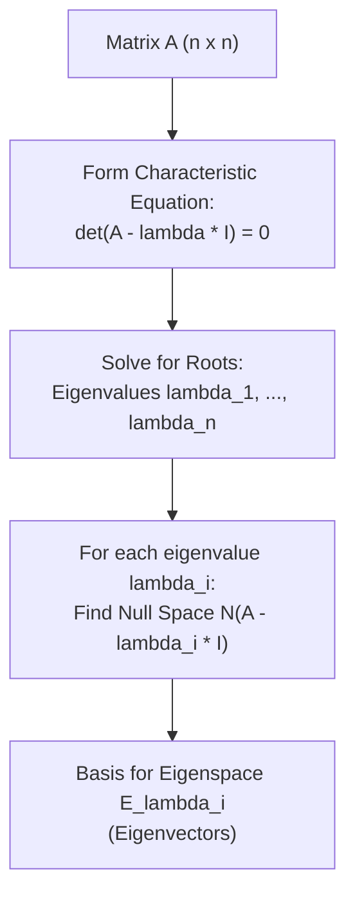

[Maths Index](../README.md) / [Unit 2: Orthogonality, Eigenvalues, and Matrix Factorizations](Introduction.md)

---

When an $n \times n$ matrix $A$ multiplies an arbitrary vector $\mathbf{x}$, it typically does two distinct things simultaneously: it changes the vector's length, and it rotates the vector into a completely new direction. 

Take a random vector in 2D space, multiply it by a matrix, and the output arrow almost never points along the original line. 

Now, imagine searching through all of $\mathbb{R}^n$ for special vectors that refuse to rotate. When multiplied by $A$, these vectors stay strictly on their own line. The matrix merely stretches, shrinks, or flips them.

These special directions are the **eigenvectors** of $A$, and their stretching factors are the **eigenvalues**. 

In machine learning and physical sciences, discovering the eigenvectors of a system is like finding its natural coordinate system. Vibration frequencies in mechanical structures, principal directions of variation in data, stability of dynamical systems, and Google's original PageRank algorithm all reduce to finding the eigenvalues and eigenvectors of a matrix.

---

## The Fundamental Eigenvalue Equation

Let $A$ be a square $n \times n$ matrix. A non-zero vector $\mathbf{x} \in \mathbb{R}^n$ is called an **eigenvector** of $A$ if multiplying by $A$ produces a scalar multiple of $\mathbf{x}$:

$$A\mathbf{x} = \lambda \mathbf{x}, \quad \text{where } \mathbf{x} \ne \mathbf{0}$$

The scalar $\lambda$ is the **eigenvalue** associated with $\mathbf{x}$.

Look closely at the definition:
- If $\lambda > 1$, $A$ stretches $\mathbf{x}$ further along its original direction.
- If $0 < \lambda < 1$, $A$ compresses $\mathbf{x}$.
- If $\lambda < 0$, $A$ reverses the direction of $\mathbf{x}$ through the origin.
- If $\lambda = 0$, $A\mathbf{x} = 0 \cdot \mathbf{x} = \mathbf{0}$. This means $\mathbf{x}$ lies in the null space $N(A)$! An eigenvalue of zero means the matrix is singular.
- The condition $\mathbf{x} \ne \mathbf{0}$ is critical: $A\mathbf{0} = \lambda \mathbf{0}$ is trivially true for every matrix and every scalar $\lambda$, so the zero vector provides zero geometric information and is excluded.

---

## The Characteristic Equation: Finding Eigenvalues

How do we solve $A\mathbf{x} = \lambda \mathbf{x}$ when both the scalar $\lambda$ and the vector $\mathbf{x}$ are unknown? 

Let's pull all terms to the left-hand side:

$$A\mathbf{x} - \lambda \mathbf{x} = \mathbf{0}$$

We cannot directly subtract a scalar $\lambda$ from a matrix $A$. We insert the $n \times n$ identity matrix $I$:

$$(A - \lambda I)\mathbf{x} = \mathbf{0}$$

Look at what this equation says: we are searching for a **non-zero** vector $\mathbf{x}$ that the matrix $(A - \lambda I)$ maps to zero.

From Unit 1, we know that a square matrix has a non-trivial null space if and only if the matrix is singular (not invertible). And a matrix is singular if and only if its determinant is zero!

Therefore, the non-trivial solutions exist if and only if:

$$\det(A - \lambda I) = 0$$

This is the **Characteristic Equation**. 

When we evaluate the determinant $\det(A - \lambda I)$, we get an $n$-th degree polynomial in $\lambda$:

$$p(\lambda) = \det(A - \lambda I) = (-1)^n \lambda^n + c_{n-1} \lambda^{n-1} + \dots + c_1 \lambda + c_0$$

This polynomial is called the **characteristic polynomial**. By the Fundamental Theorem of Algebra, every $n$-th degree polynomial has exactly $n$ complex roots (counting multiplicities). 

These roots are precisely the eigenvalues $\lambda_1, \lambda_2, \dots, \lambda_n$ of the matrix.

---

## Finding the Eigenvectors: The Eigenspace

Once we compute an eigenvalue $\lambda$ from the characteristic equation, finding its associated eigenvectors is simple: we plug $\lambda$ back into $(A - \lambda I)\mathbf{x} = \mathbf{0}$ and find the null space!

The set of all eigenvectors corresponding to $\lambda$, together with the zero vector, forms a subspace of $\mathbb{R}^n$ called the **eigenspace** of $\lambda$:

$$E_\lambda = N(A - \lambda I) = \{ \mathbf{x} \in \mathbb{R}^n \mid (A - \lambda I)\mathbf{x} = \mathbf{0} \}$$

Because the eigenspace is a null space, any non-zero linear combination of eigenvectors sharing the same eigenvalue $\lambda$ is also an eigenvector for $\lambda$:

$$A(c_1 \mathbf{x}_1 + c_2 \mathbf{x}_2) = c_1 A\mathbf{x}_1 + c_2 A\mathbf{x}_2 = c_1 \lambda \mathbf{x}_1 + c_2 \lambda \mathbf{x}_2 = \lambda (c_1 \mathbf{x}_1 + c_2 \mathbf{x}_2)$$

---

## Two Essential Shortcuts: Trace and Determinant

Two remarkable theorems connect the eigenvalues of an $n \times n$ matrix directly to its entries without having to factor the characteristic polynomial:

### 1. The Trace Theorem
The sum of all $n$ eigenvalues equals the **trace** of the matrix (the sum of the diagonal entries):

$$\sum_{i=1}^n \lambda_i = \text{tr}(A) = a_{11} + a_{22} + \dots + a_{nn}$$

### 2. The Determinant Theorem
The product of all $n$ eigenvalues equals the **determinant** of the matrix:

$$\prod_{i=1}^n \lambda_i = \lambda_1 \lambda_2 \dots \lambda_n = \det(A)$$

These two theorems provide an instant sanity check on any eigenvalue calculation:
- If your eigenvalues don't add up to the diagonal sum, you made an arithmetic error.
- If $A$ is singular ($\det(A) = 0$), at least one eigenvalue must be zero.
- If all eigenvalues are non-zero, $\det(A) \ne 0$, meaning $A$ is invertible!

---

## Helpful Operational Properties of Eigenvalues

If we already know that $A\mathbf{x} = \lambda \mathbf{x}$, several matrix operations leave the eigenvectors unchanged and transform the eigenvalues in predictable ways:

- **Matrix Powers**: $A^2 \mathbf{x} = A(A\mathbf{x}) = A(\lambda\mathbf{x}) = \lambda(A\mathbf{x}) = \lambda^2 \mathbf{x}$. By induction, $A^k \mathbf{x} = \lambda^k \mathbf{x}$. The eigenvectors of $A^k$ are identical to $A$, and the eigenvalues are simply $\lambda^k$.
- **Matrix Inverse**: If $A$ is invertible ($\lambda \ne 0$), then $A^{-1} A \mathbf{x} = A^{-1} (\lambda \mathbf{x}) \implies \mathbf{x} = \lambda A^{-1}\mathbf{x} \implies A^{-1}\mathbf{x} = \frac{1}{\lambda}\mathbf{x}$. The eigenvectors are identical, and the eigenvalues invert to $1/\lambda$.
- **Scalar Shift**: $(A + cI)\mathbf{x} = A\mathbf{x} + c\mathbf{x} = \lambda\mathbf{x} + c\mathbf{x} = (\lambda + c)\mathbf{x}$. Shifting $A$ by $cI$ shifts every eigenvalue by $c$ while leaving the eigenvectors unchanged.
- **Triangular Matrices**: If $A$ is upper triangular, lower triangular, or diagonal, $\det(A - \lambda I)$ is simply the product of the diagonal elements $(a_{11} - \lambda)(a_{22} - \lambda)\dots(a_{nn} - \lambda)$. Thus, **the eigenvalues of any triangular matrix are simply its diagonal entries**.

---

## Algebraic vs. Geometric Multiplicity

When an eigenvalue appears as a repeated root of the characteristic polynomial, we must distinguish between two different types of multiplicity:

- **Algebraic Multiplicity ($AM$)**: The number of times the root $(\lambda - \lambda_i)$ appears as a factor in the characteristic polynomial $p(\lambda) = 0$.
- **Geometric Multiplicity ($GM$)**: The number of linearly independent eigenvectors associated with that eigenvalue. This is the dimension of the null space:
  $$GM(\lambda) = \dim(N(A - \lambda I)) = n - \text{rank}(A - \lambda I)$$

The relationship between these two multiplicities is governed by a fundamental inequality:

$$1 \le GM(\lambda) \le AM(\lambda)$$

Every eigenvalue has at least one independent eigenvector ($GM \ge 1$), but the geometric multiplicity can never exceed the algebraic multiplicity.

When $GM(\lambda) = AM(\lambda)$ for all eigenvalues, the matrix has a full set of $n$ linearly independent eigenvectors. 

However, if $GM(\lambda) < AM(\lambda)$ for even one eigenvalue, the matrix is called **defective**. A defective matrix does not have enough independent eigenvectors to span $\mathbb{R}^n$.

---

## Step-by-Step Numerical Examples

### Example 1: $2 \times 2$ Matrix with Distinct Eigenvalues

Consider the matrix:

$$A = \begin{bmatrix} 4 & 1 \\ 2 & 3 \end{bmatrix}$$

**Step 1: Set up the Characteristic Equation**

$$\det(A - \lambda I) = \det\begin{bmatrix} 4 - \lambda & 1 \\ 2 & 3 - \lambda \end{bmatrix} = 0$$

$$(4 - \lambda)(3 - \lambda) - (1)(2) = 0$$

$$\lambda^2 - 7\lambda + 12 - 2 = 0 \implies \lambda^2 - 7\lambda + 10 = 0$$

Factor the quadratic:

$$(\lambda - 5)(\lambda - 2) = 0$$

The eigenvalues are:

$$\lambda_1 = 5, \quad \lambda_2 = 2$$

**Sanity check via Trace and Determinant:**
- $\text{tr}(A) = 4 + 3 = 7$. Sum of eigenvalues: $5 + 2 = 7$.
- $\det(A) = (4)(3) - (1)(2) = 12 - 2 = 10$. Product of eigenvalues: $5 \times 2 = 10$. Both match!

**Step 2: Find the Eigenvector for $\lambda_1 = 5$**

Substitute $\lambda_1 = 5$ into $(A - 5I)\mathbf{x} = \mathbf{0}$:

$$\begin{bmatrix} 4 - 5 & 1 \\ 2 & 3 - 5 \end{bmatrix} \begin{bmatrix} x_1 \\ x_2 \end{bmatrix} = \begin{bmatrix} -1 & 1 \\ 2 & -2 \end{bmatrix} \begin{bmatrix} x_1 \\ x_2 \end{bmatrix} = \begin{bmatrix} 0 \\ 0 \end{bmatrix}$$

Both equations say $-x_1 + x_2 = 0 \implies x_1 = x_2$. 

Setting $x_1 = 1$ gives the first eigenvector:

$$\mathbf{x}_1 = \begin{bmatrix} 1 \\ 1 \end{bmatrix}$$

Check: $A\mathbf{x}_1 = \begin{bmatrix} 4 & 1 \\ 2 & 3 \end{bmatrix} \begin{bmatrix} 1 \\ 1 \end{bmatrix} = \begin{bmatrix} 5 \\ 5 \end{bmatrix} = 5 \begin{bmatrix} 1 \\ 1 \end{bmatrix} = \lambda_1 \mathbf{x}_1$.

**Step 3: Find the Eigenvector for $\lambda_2 = 2$**

Substitute $\lambda_2 = 2$ into $(A - 2I)\mathbf{x} = \mathbf{0}$:

$$\begin{bmatrix} 4 - 2 & 1 \\ 2 & 3 - 2 \end{bmatrix} \begin{bmatrix} x_1 \\ x_2 \end{bmatrix} = \begin{bmatrix} 2 & 1 \\ 2 & 1 \end{bmatrix} \begin{bmatrix} x_1 \\ x_2 \end{bmatrix} = \begin{bmatrix} 0 \\ 0 \end{bmatrix}$$

This yields $2x_1 + x_2 = 0 \implies x_2 = -2x_1$. 

Setting $x_1 = 1$ gives the second eigenvector:

$$\mathbf{x}_2 = \begin{bmatrix} 1 \\ -2 \end{bmatrix}$$

Check: $A\mathbf{x}_2 = \begin{bmatrix} 4 & 1 \\ 2 & 3 \end{bmatrix} \begin{bmatrix} 1 \\ -2 \end{bmatrix} = \begin{bmatrix} 4 - 2 \\ 2 - 6 \end{bmatrix} = \begin{bmatrix} 2 \\ -4 \end{bmatrix} = 2 \begin{bmatrix} 1 \\ -2 \end{bmatrix} = \lambda_2 \mathbf{x}_2$.

The two eigenvectors $\mathbf{x}_1 = \begin{bmatrix} 1 \\ 1 \end{bmatrix}$ and $\mathbf{x}_2 = \begin{bmatrix} 1 \\ -2 \end{bmatrix}$ are linearly independent and span all of $\mathbb{R}^2$.

---

### Example 2: A Defective Matrix ($GM < AM$)

Consider the shear matrix:

$$B = \begin{bmatrix} 3 & 1 \\ 0 & 3 \end{bmatrix}$$

Because $B$ is upper triangular, its eigenvalues are simply the diagonal entries:

$$\lambda_1 = 3, \quad \lambda_2 = 3$$

The eigenvalue $\lambda = 3$ has an Algebraic Multiplicity of $AM = 2$.

Now, let's find the eigenvectors by solving $(B - 3I)\mathbf{x} = \mathbf{0}$:

$$\begin{bmatrix} 3 - 3 & 1 \\ 0 & 3 - 3 \end{bmatrix} \begin{bmatrix} x_1 \\ x_2 \end{bmatrix} = \begin{bmatrix} 0 & 1 \\ 0 & 0 \end{bmatrix} \begin{bmatrix} x_1 \\ x_2 \end{bmatrix} = \begin{bmatrix} 0 \\ 0 \end{bmatrix}$$

From the first row, $0x_1 + 1x_2 = 0 \implies x_2 = 0$. 

The variable $x_1$ is free! Any eigenvector must have the form:

$$\mathbf{x} = \begin{bmatrix} x_1 \\ 0 \end{bmatrix} = x_1 \begin{bmatrix} 1 \\ 0 \end{bmatrix}$$

The eigenspace $E_3$ is only a 1-dimensional line along the x-axis. 

Therefore, the Geometric Multiplicity is $GM = 1$. 

Because $GM(3) = 1 < AM(3) = 2$, this matrix is **defective**. It is missing an eigenvector and cannot provide an eigenbasis for $\mathbb{R}^2$.

---

## Geometric Interpretations of Familiar Transformations

Thinking about eigenvalues purely as roots of an equation obscures their physical meaning. Consider how familiar geometric transformations behave:

- **Reflection across the line $y = x$**: Vectors lying on the line $y = x$ are untouched ($\lambda = 1$). Vectors perpendicular to the line ($y = -x$) are flipped across it ($\lambda = -1$).
- **Projection onto the x-axis**: Vectors on the x-axis are unchanged ($\lambda = 1$). Vectors on the y-axis are flattened to zero ($\lambda = 0$).
- **Pure $90^\circ$ Counter-Clockwise Rotation**:
  $$R_{90^\circ} = \begin{bmatrix} 0 & -1 \\ 1 & 0 \end{bmatrix}$$
  Characteristic equation: $\lambda^2 + 1 = 0 \implies \lambda = \pm i$. 
  Every non-zero real vector has its direction changed by $90^\circ$. No real vector can remain on its original line, so the eigenvalues must be purely imaginary!

---

## Key Takeaways

- An eigenvector satisfies $A\mathbf{x} = \lambda \mathbf{x}$ ($\mathbf{x} \ne \mathbf{0}$); $A$ acts on $\mathbf{x}$ by purely scaling it by $\lambda$.
- Eigenvalues are the roots of the characteristic equation $\det(A - \lambda I) = 0$.
- Trace Theorem: $\sum \lambda_i = \text{tr}(A)$. Determinant Theorem: $\prod \lambda_i = \det(A)$.
- An eigenvalue $\lambda = 0$ means the matrix is singular and has a non-trivial null space ($N(A) \ne \{\mathbf{0}\}$).
- Algebraic Multiplicity ($AM$) is the root count in $p(\lambda) = 0$; Geometric Multiplicity ($GM$) is $\dim(N(A - \lambda I))$. Always $1 \le GM \le AM$.
- If $GM < AM$, the matrix is defective and lacks a complete basis of eigenvectors.

---

In Example 1, we found two linearly independent eigenvectors for our $2 \times 2$ matrix. What happens when we glue those eigenvectors together into a new matrix $X = [\mathbf{x}_1 \; \mathbf{x}_2]$? 

When we change coordinates using this eigenvector matrix, something extraordinary happens: the messy, coupled matrix $A$ transforms into a pure diagonal matrix of eigenvalues. 

This process is called **Diagonalization**, and it is the key to calculating massive matrix powers $A^{100}$ and solving coupled differential equations in a single step.

We unlock that power next in [L07 - Diagonalization of a Matrix](L07%20-%20Diagonalization%20of%20a%20Matrix.md).
