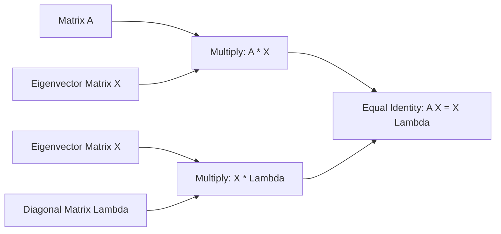
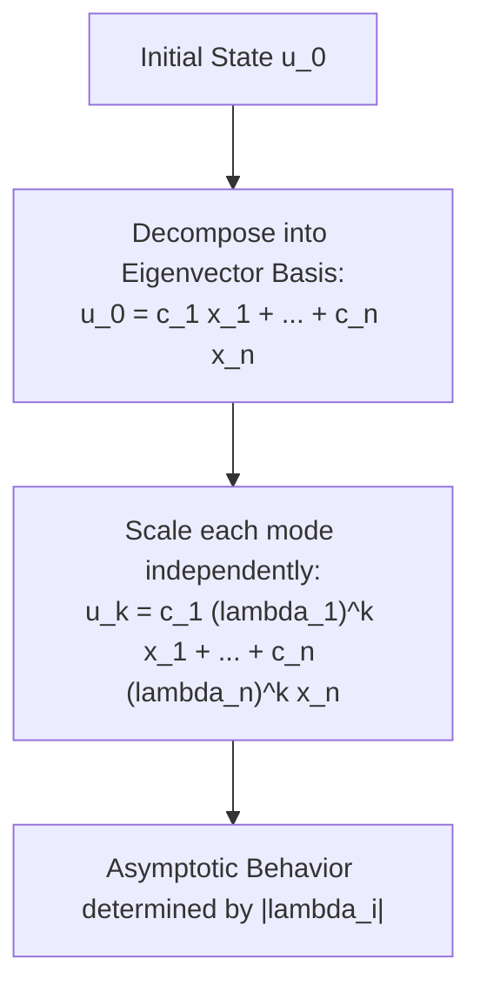

[Maths Index](../README.md) / [Unit 2: Orthogonality, Eigenvalues, and Matrix Factorizations](Introduction.md)

---

Multiplying a vector by an $n \times n$ matrix $A$ mixes all the coordinates together. Each output component is a tangled combination of all $n$ input components:

$$\begin{aligned}
y_1 &= a_{11} x_1 + a_{12} x_2 + \dots + a_{1n} x_n \\
y_2 &= a_{21} x_1 + a_{22} x_2 + \dots + a_{2n} x_n
\end{aligned}$$

This coupling makes analyzing dynamic processes—like repeating the transformation 100 times to compute $A^{100}\mathbf{x}$—seem daunting. Every multiplication entangles the variables further.

Now, contrast that with multiplying by a **diagonal matrix** $D$:

$$\begin{bmatrix} y_1 \\ y_2 \end{bmatrix} = \begin{bmatrix} d_1 & 0 \\ 0 & d_2 \end{bmatrix} \begin{bmatrix} x_1 \\ x_2 \end{bmatrix} = \begin{bmatrix} d_1 x_1 \\ d_2 x_2 \end{bmatrix}$$

Here, there is zero entanglement. Variable $x_1$ is multiplied strictly by $d_1$, and $x_2$ is multiplied strictly by $d_2$. 

If you want $D^{100}$, you don't do 100 matrix multiplications; you simply raise each individual diagonal scalar to the 100th power: $d_1^{100}$ and $d_2^{100}$.

This raises a fundamental question: can we change our coordinate system so that a complicated coupled matrix $A$ acts like a simple decoupled diagonal matrix? 

The answer is yes—provided the matrix has enough eigenvectors. This transformation is called **Diagonalization**.

---

## The Diagonalization Theorem

Let $A$ be an $n \times n$ matrix. Suppose $A$ possesses $n$ linearly independent eigenvectors $\mathbf{x}_1, \mathbf{x}_2, \dots, \mathbf{x}_n$, with corresponding eigenvalues $\lambda_1, \lambda_2, \dots, \lambda_n$.

Let's place these $n$ eigenvectors into the columns of an $n \times n$ **eigenvector matrix** $X$:

$$X = \begin{bmatrix} \mathbf{x}_1 & \mathbf{x}_2 & \dots & \mathbf{x}_n \end{bmatrix}$$

Now, multiply $A$ by $X$, working column by column:

$$A X = A \begin{bmatrix} \mathbf{x}_1 & \mathbf{x}_2 & \dots & \mathbf{x}_n \end{bmatrix} = \begin{bmatrix} A\mathbf{x}_1 & A\mathbf{x}_2 & \dots & A\mathbf{x}_n \end{bmatrix}$$

Because each $\mathbf{x}_i$ is an eigenvector, $A\mathbf{x}_i = \lambda_i \mathbf{x}_i$:

$$A X = \begin{bmatrix} \lambda_1 \mathbf{x}_1 & \lambda_2 \mathbf{x}_2 & \dots & \lambda_n \mathbf{x}_n \end{bmatrix}$$

Now watch how this matrix of scaled columns factors:

$$\begin{bmatrix} \lambda_1 \mathbf{x}_1 & \lambda_2 \mathbf{x}_2 & \dots & \lambda_n \mathbf{x}_n \end{bmatrix} = \begin{bmatrix} \mathbf{x}_1 & \mathbf{x}_2 & \dots & \mathbf{x}_n \end{bmatrix} \begin{bmatrix} \lambda_1 & 0 & \dots & 0 \\ 0 & \lambda_2 & \dots & 0 \\ \vdots & \vdots & \ddots & \vdots \\ 0 & 0 & \dots & \lambda_n \end{bmatrix} = X \Lambda$$

where $\Lambda$ (capital lambda) is the diagonal matrix holding the eigenvalues along its main diagonal:

$$\Lambda = \text{diag}(\lambda_1, \lambda_2, \dots, \lambda_n)$$

This establishes the central identity:

$$A X = X \Lambda$$

Because the $n$ eigenvectors were assumed to be linearly independent, the matrix $X$ has full rank and is strictly invertible ($X^{-1}$ exists). 

Multiplying on the right by $X^{-1}$ gives the **Diagonalization Factorization**:

$$A = X \Lambda X^{-1}$$

Multiplying on the left by $X^{-1}$ gives the equivalent form:

$$\Lambda = X^{-1} A X$$

This reveals that $A$ is **similar** to the diagonal matrix $\Lambda$. The matrix $X^{-1}$ rotates/shears the standard basis into the eigenvector coordinate frame, $\Lambda$ performs pure independent scaling along each eigenvector axis, and $X$ transforms the result back to the original coordinates.

---

## Conditions for Diagonalizability

When is an $n \times n$ matrix guaranteed to be diagonalizable?

- **Sufficient Condition (Distinct Eigenvalues)**: If $A$ has $n$ distinct eigenvalues ($\lambda_i \ne \lambda_j$ for all $i \ne j$), then its $n$ corresponding eigenvectors are automatically linearly independent. Therefore, **any matrix with $n$ distinct eigenvalues is guaranteed to be diagonalizable**.
- **Necessary and Sufficient Condition**: An $n \times n$ matrix $A$ is diagonalizable if and only if the geometric multiplicity equals the algebraic multiplicity for every eigenvalue:
  $$GM(\lambda_i) = AM(\lambda_i) \quad \text{for all } i$$
  In other words, the matrix must not be defective.

Notice an important nuance: **invertibility is not the same as diagonalizability!**
- A matrix can be singular (non-invertible) but perfectly diagonalizable. For example, $A = \begin{bmatrix} 1 & 0 \\ 0 & 0 \end{bmatrix}$ has $\det(A) = 0$, but it is already diagonal!
- A matrix can be invertible but non-diagonalizable. The shear matrix $B = \begin{bmatrix} 2 & 1 \\ 0 & 2 \end{bmatrix}$ has $\det(B) = 4 \ne 0$ (invertible), but its repeated eigenvalue $\lambda = 2$ has only one independent eigenvector ($GM = 1 < AM = 2$), so it cannot be diagonalized.

---

## Computing Matrix Powers $A^k$

The most immediate practical superpower of diagonalization is computing powers of a matrix.

Suppose we need to compute $A^2$:

$$A^2 = (X \Lambda X^{-1})(X \Lambda X^{-1}) = X \Lambda \underbrace{(X^{-1} X)}_{I} \Lambda X^{-1} = X \Lambda^2 X^{-1}$$

The internal $X^{-1}$ and $X$ collapse into the identity! 

By induction, for any positive integer $k$:

$$A^k = X \Lambda^k X^{-1}$$

And for a diagonal matrix, raising it to the power $k$ is effortless:

$$\Lambda^k = \begin{bmatrix} \lambda_1^k & 0 & \dots & 0 \\ 0 & \lambda_2^k & \dots & 0 \\ \vdots & \vdots & \ddots & \vdots \\ 0 & 0 & \dots & \lambda_n^k \end{bmatrix}$$

Think about the computational savings: multiplying an $n \times n$ matrix by itself $k$ times takes $(k-1) O(n^3)$ operations. With diagonalization, we diagonalize once ($O(n^3)$), compute $n$ scalar powers $\lambda_i^k$, and perform two matrix multiplications. To calculate $A^{1000}$, the work is virtually identical to calculating $A^2$!

---

## Discrete Dynamical Systems and Recurrence Relations

In machine learning and statistics, we frequently model systems that evolve in discrete time steps:

$$\mathbf{u}_{k+1} = A \mathbf{u}_k$$

Starting from an initial state $\mathbf{u}_0$, the state at step $k$ is:

$$\mathbf{u}_k = A^k \mathbf{u}_0$$

If we express the initial state vector $\mathbf{u}_0$ as a linear combination of the eigenvectors $\mathbf{x}_1, \dots, \mathbf{x}_n$:

$$\mathbf{u}_0 = c_1 \mathbf{x}_1 + c_2 \mathbf{x}_2 + \dots + c_n \mathbf{x}_n$$

then applying $A^k$ yields:

$$\mathbf{u}_k = A^k (c_1 \mathbf{x}_1 + \dots + c_n \mathbf{x}_n) = c_1 A^k \mathbf{x}_1 + \dots + c_n A^k \mathbf{x}_n$$

Because $A^k \mathbf{x}_i = \lambda_i^k \mathbf{x}_i$:

$$\mathbf{u}_k = c_1 \lambda_1^k \mathbf{x}_1 + c_2 \lambda_2^k \mathbf{x}_2 + \dots + c_n \lambda_n^k \mathbf{x}_n$$

Look at how clear this makes the long-term behavior of the system as $k \to \infty$:
- **Decay**: If $|\lambda_i| < 1$, then $\lambda_i^k \to 0$. That component dies out.
- **Steady State**: If $\lambda_1 = 1$ and all other $|\lambda_i| < 1$, then as $k \to \infty$, all other terms vanish, leaving $\mathbf{u}_\infty = c_1 \mathbf{x}_1$. This is the exact mechanism behind **Markov Chains** and Google's PageRank.
- **Explosion**: If any $|\lambda_i| > 1$, the system is unstable and blows up exponentially along the direction of $\mathbf{x}_i$.

---

## Step-by-Step Numerical Example

Let's diagonalize the matrix from Lecture 6:

$$A = \begin{bmatrix} 4 & 1 \\ 2 & 3 \end{bmatrix}$$

In Lecture 6, we found:
- $\lambda_1 = 5$ with eigenvector $\mathbf{x}_1 = \begin{bmatrix} 1 \\ 1 \end{bmatrix}$
- $\lambda_2 = 2$ with eigenvector $\mathbf{x}_2 = \begin{bmatrix} 1 \\ -2 \end{bmatrix}$

### Step 1: Construct $X$ and $\Lambda$

Assemble the eigenvectors into the columns of $X$:

$$X = \begin{bmatrix} 1 & 1 \\ 1 & -2 \end{bmatrix}$$

Assemble the corresponding eigenvalues on the diagonal of $\Lambda$:

$$\Lambda = \begin{bmatrix} 5 & 0 \\ 0 & 2 \end{bmatrix}$$

### Step 2: Compute $X^{-1}$

The determinant of $X$ is:

$$\det(X) = (1)(-2) - (1)(1) = -2 - 1 = -3$$

The inverse matrix is:

$$X^{-1} = \frac{1}{-3} \begin{bmatrix} -2 & -1 \\ -1 & 1 \end{bmatrix} = \frac{1}{3} \begin{bmatrix} 2 & 1 \\ 1 & -1 \end{bmatrix}$$

### Step 3: Verify $A = X \Lambda X^{-1}$

First compute $X \Lambda$:

$$X \Lambda = \begin{bmatrix} 1 & 1 \\ 1 & -2 \end{bmatrix} \begin{bmatrix} 5 & 0 \\ 0 & 2 \end{bmatrix} = \begin{bmatrix} 5 & 2 \\ 5 & -4 \end{bmatrix}$$

Now multiply by $X^{-1}$:

$$(X \Lambda) X^{-1} = \begin{bmatrix} 5 & 2 \\ 5 & -4 \end{bmatrix} \left( \frac{1}{3} \begin{bmatrix} 2 & 1 \\ 1 & -1 \end{bmatrix} \right) = \frac{1}{3} \begin{bmatrix} 10 + 2 & 5 - 2 \\ 10 - 4 & 5 + 4 \end{bmatrix} = \frac{1}{3} \begin{bmatrix} 12 & 3 \\ 6 & 9 \end{bmatrix} = \begin{bmatrix} 4 & 1 \\ 2 & 3 \end{bmatrix} = A$$

The factorization $A = X \Lambda X^{-1}$ is confirmed.

### Step 4: Compute a Closed-Form Formula for $A^k$

Using $A^k = X \Lambda^k X^{-1}$:

$$\Lambda^k = \begin{bmatrix} 5^k & 0 \\ 0 & 2^k \end{bmatrix}$$

$$X \Lambda^k = \begin{bmatrix} 1 & 1 \\ 1 & -2 \end{bmatrix} \begin{bmatrix} 5^k & 0 \\ 0 & 2^k \end{bmatrix} = \begin{bmatrix} 5^k & 2^k \\ 5^k & -2(2^k) \end{bmatrix}$$

Now multiply by $X^{-1} = \frac{1}{3} \begin{bmatrix} 2 & 1 \\ 1 & -1 \end{bmatrix}$:

$$A^k = \frac{1}{3} \begin{bmatrix} 2(5^k) + 2^k & 5^k - 2^k \\ 2(5^k) - 2(2^k) & 5^k + 2(2^k) \end{bmatrix}$$

Let's test this formula for $k = 1$:

$$A^1 = \frac{1}{3} \begin{bmatrix} 2(5) + 2 & 5 - 2 \\ 2(5) - 4 & 5 + 4 \end{bmatrix} = \frac{1}{3} \begin{bmatrix} 12 & 3 \\ 6 & 9 \end{bmatrix} = \begin{bmatrix} 4 & 1 \\ 2 & 3 \end{bmatrix}$$

Now let's compute $A^3$ instantly:

$$5^3 = 125, \quad 2^3 = 8$$

$$A^3 = \frac{1}{3} \begin{bmatrix} 2(125) + 8 & 125 - 8 \\ 2(125) - 2(8) & 125 + 2(8) \end{bmatrix} = \frac{1}{3} \begin{bmatrix} 258 & 117 \\ 234 & 141 \end{bmatrix} = \begin{bmatrix} 86 & 39 \\ 78 & 47 \end{bmatrix}$$

No manual repeated matrix multiplications needed.

---

## Classic Case Study: The Fibonacci Sequence via Diagonalization

Consider the classic Fibonacci sequence: $0, 1, 1, 2, 3, 5, 8, 13, \dots$ defined by:

$$F_{k+2} = F_{k+1} + F_k, \quad F_0 = 0, F_1 = 1$$

To put this second-order recurrence into a first-order matrix system, we introduce a state vector $\mathbf{u}_k = \begin{bmatrix} F_{k+1} \\ F_k \end{bmatrix}$.

Then the next state is:

$$\mathbf{u}_{k+1} = \begin{bmatrix} F_{k+2} \\ F_{k+1} \end{bmatrix} = \begin{bmatrix} F_{k+1} + F_k \\ F_{k+1} \end{bmatrix} = \begin{bmatrix} 1 & 1 \\ 1 & 0 \end{bmatrix} \begin{bmatrix} F_{k+1} \\ F_k \end{bmatrix} = A \mathbf{u}_k$$

with transition matrix $A = \begin{bmatrix} 1 & 1 \\ 1 & 0 \end{bmatrix}$.

Let's find the eigenvalues of $A$:

$$\det(A - \lambda I) = \det\begin{bmatrix} 1 - \lambda & 1 \\ 1 & -\lambda \end{bmatrix} = -\lambda(1 - \lambda) - 1 = \lambda^2 - \lambda - 1 = 0$$

Using the quadratic formula:

$$\lambda = \frac{1 \pm \sqrt{1 - 4(1)(-1)}}{2} = \frac{1 \pm \sqrt{5}}{2}$$

The two eigenvalues are:

$$\lambda_1 = \frac{1 + \sqrt{5}}{2} \approx 1.618 \quad (\text{the Golden Ratio } \phi), \quad \lambda_2 = \frac{1 - \sqrt{5}}{2} = 1 - \phi \approx -0.618$$

Because $\lambda_1 \ne \lambda_2$, $A$ is diagonalizable. The state after $k$ steps is:

$$\mathbf{u}_k = c_1 \lambda_1^k \mathbf{x}_1 + c_2 \lambda_2^k \mathbf{x}_2$$

Matching the initial condition $\mathbf{u}_0 = \begin{bmatrix} F_1 \\ F_0 \end{bmatrix} = \begin{bmatrix} 1 \\ 0 \end{bmatrix}$ yields the famous **Binet's Formula**:

$$F_k = \frac{1}{\sqrt{5}} \left[ \left(\frac{1 + \sqrt{5}}{2}\right)^k - \left(\frac{1 - \sqrt{5}}{2}\right)^k \right]$$

Because $|\lambda_2| = |1 - \phi| \approx 0.618 < 1$, the second term decays to zero as $k$ grows. For large $k$, the $k$-th Fibonacci number is simply the nearest integer to $\frac{1}{\sqrt{5}} \phi^k$. 

Linear algebra turns a recursive loop into a single direct calculation!

---

## Key Takeaways

- An $n \times n$ matrix $A$ is diagonalizable if and only if it has $n$ linearly independent eigenvectors: $A = X \Lambda X^{-1}$.
- If $A$ has $n$ distinct eigenvalues, diagonalizability is guaranteed.
- Invertibility ($\det(A) \ne 0$) and diagonalizability are completely independent properties.
- Powers of a diagonalizable matrix satisfy $A^k = X \Lambda^k X^{-1}$, reducing $k$ matrix multiplications to $n$ scalar powers.
- In dynamical systems $\mathbf{u}_k = A^k \mathbf{u}_0$, the eigenvalues govern asymptotic behavior: $|\lambda| < 1$ decays, $\lambda = 1$ leads to steady states, and $|\lambda| > 1$ explodes.

---

In general, the eigenvector matrix $X$ can be any invertible matrix. Its columns might be oblique, tilted, and far from perpendicular. Inverting $X$ can still involve messy fractions and potential numerical instability.

Now, ask yourself: what kind of matrices guarantee that their eigenvectors are not just linearly independent, but **strictly perpendicular to each other**?

When that happens, $X$ becomes an orthogonal matrix $Q$, and $X^{-1}$ becomes simply $Q^T$. 

This miracle happens for the most important class of matrices in all of data science: **Symmetric Matrices**. 

We prove this in [L08 - Symmetric Matrices and the Spectral Theorem](L08%20-%20Symmetric%20Matrices%20and%20the%20Spectral%20Theorem.md).
