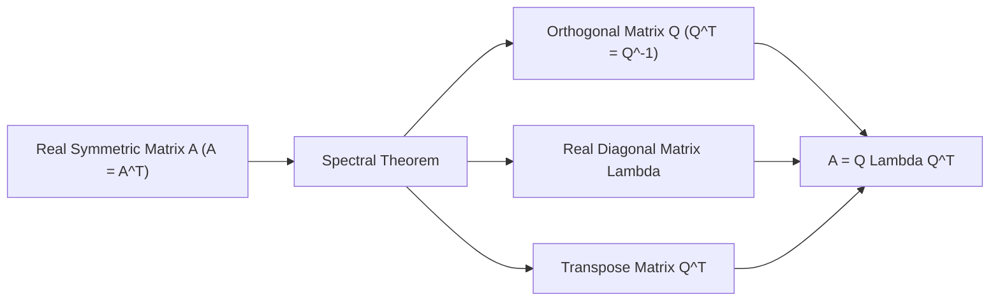
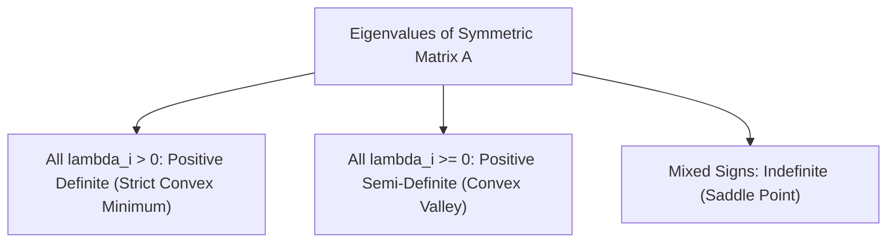

[Maths Index](../README.md) / [Unit 2: Orthogonality, Eigenvalues, and Matrix Factorizations](Introduction.md)

---

In general linear algebra, matrices can be messy. Their eigenvalues can be complex numbers even if the matrix contains only real numbers. Their eigenvectors can be tilted at bizarre angles, and some matrices are defective—lacking a complete basis of eigenvectors altogether.

Now, what if we restrict our attention to matrices that equal their own transpose: $A = A^T$?

These are **symmetric matrices**, and in data science and artificial intelligence, they are everywhere:
- **Covariance Matrices** in statistics and PCA: $\Sigma = \frac{1}{N} X^T X$
- **Hessian Matrices** in multivariable optimization: $H_{ij} = \frac{\partial^2 L}{\partial \theta_i \partial \theta_j}$
- **Graph Laplacians** in spectral clustering and graph neural networks: $L = D - A$
- **Kernel Gram Matrices** in Support Vector Machines: $K_{ij} = k(\mathbf{x}_i, \mathbf{x}_j)$

When a matrix is real and symmetric, all mathematical complications vanish. Two fundamental theorems ensure that symmetric matrices possess the cleanest geometry in all of mathematics.

---

## Two Guarantees of Real Symmetric Matrices

Every real symmetric matrix $A = A^T$ comes with two structural guarantees:

### 1. All Eigenvalues are Guaranteed to be Real Numbers
Even if you build a massive $1000 \times 1000$ symmetric matrix with arbitrary real numbers, not a single eigenvalue will ever have an imaginary component.

Let's prove why. Suppose $A\mathbf{x} = \lambda \mathbf{x}$, where $\mathbf{x} \ne \mathbf{0}$. We allow $\lambda$ and $\mathbf{x}$ to be complex for the sake of contradiction.

Take the conjugate transpose (Hermitian transpose, denoted $H$) of both sides:

$$(A\mathbf{x})^H = (\lambda \mathbf{x})^H \implies \mathbf{x}^H A^H = \bar{\lambda} \mathbf{x}^H$$

Because $A$ is real and symmetric, $A^H = (A^T)^* = A^T = A$. Substituting this in:

$$\mathbf{x}^H A = \bar{\lambda} \mathbf{x}^H$$

Now multiply on the right by $\mathbf{x}$:

$$\mathbf{x}^H A \mathbf{x} = \bar{\lambda} \mathbf{x}^H \mathbf{x}$$

Next, go back to our starting equation $A\mathbf{x} = \lambda \mathbf{x}$ and multiply on the left by $\mathbf{x}^H$:

$$\mathbf{x}^H A \mathbf{x} = \lambda \mathbf{x}^H \mathbf{x}$$

Look at the left-hand sides: both equal $\mathbf{x}^H A \mathbf{x}$. Therefore, the right-hand sides must be equal:

$$\lambda \mathbf{x}^H \mathbf{x} = \bar{\lambda} \mathbf{x}^H \mathbf{x} \implies (\lambda - \bar{\lambda}) \mathbf{x}^H \mathbf{x} = 0$$

Because $\mathbf{x} \ne \mathbf{0}$, the quantity $\mathbf{x}^H \mathbf{x} = |x_1|^2 + |x_2|^2 + \dots + |x_n|^2 > 0$. 

Dividing by this strictly positive scalar forces:

$$\lambda - \bar{\lambda} = 0 \implies \lambda = \bar{\lambda}$$

A number that equals its own complex conjugate has zero imaginary part. Therefore, **$\lambda$ is strictly real**.

---

### 2. Eigenvectors from Different Eigenvalues are Mutually Orthogonal
If $\lambda_1 \ne \lambda_2$, their corresponding eigenvectors $\mathbf{x}_1$ and $\mathbf{x}_2$ are automatically perpendicular: $\mathbf{x}_1^T \mathbf{x}_2 = 0$.

Let's prove this directly. Suppose $A\mathbf{x}_1 = \lambda_1 \mathbf{x}_1$ and $A\mathbf{x}_2 = \lambda_2 \mathbf{x}_2$.

Compute the scalar product $(A\mathbf{x}_1)^T \mathbf{x}_2$ in two different ways:

- Forward calculation:
  $$(A\mathbf{x}_1)^T \mathbf{x}_2 = (\lambda_1 \mathbf{x}_1)^T \mathbf{x}_2 = \lambda_1 (\mathbf{x}_1^T \mathbf{x}_2)$$
- Using the transpose property $(A\mathbf{x}_1)^T = \mathbf{x}_1^T A^T = \mathbf{x}_1^T A$:
  $$(A\mathbf{x}_1)^T \mathbf{x}_2 = \mathbf{x}_1^T (A \mathbf{x}_2) = \mathbf{x}_1^T (\lambda_2 \mathbf{x}_2) = \lambda_2 (\mathbf{x}_1^T \mathbf{x}_2)$$

Equating both expressions:

$$\lambda_1 (\mathbf{x}_1^T \mathbf{x}_2) = \lambda_2 (\mathbf{x}_1^T \mathbf{x}_2) \implies (\lambda_1 - \lambda_2)(\mathbf{x}_1^T \mathbf{x}_2) = 0$$

Since we assumed $\lambda_1 \ne \lambda_2$, the difference $(\lambda_1 - \lambda_2) \ne 0$. 

Dividing by the non-zero difference leaves:

$$\mathbf{x}_1^T \mathbf{x}_2 = 0$$

The eigenvectors are perpendicular.

---

## The Spectral Theorem for Symmetric Matrices

Combining these two guarantees leads to one of the crown jewels of linear algebra: **The Spectral Theorem**.

Every real symmetric matrix $A$ can be factored into:

$$A = Q \Lambda Q^T$$

where:
- $Q$ is an **orthogonal matrix** ($Q^T = Q^{-1}$) whose columns are an orthonormal basis of eigenvectors: $\mathbf{q}_1, \dots, \mathbf{q}_n$.
- $\Lambda$ is a real **diagonal matrix** whose entries are the eigenvalues: $\lambda_1, \dots, \lambda_n$.

What if eigenvalues are repeated? Even when an eigenvalue has algebraic multiplicity $AM > 1$, a symmetric matrix is **never defective** ($GM = AM$ always). 

The eigenspace will always have full dimension matching its multiplicity, and we can choose an orthonormal basis for that eigenspace using Gram-Schmidt.

Therefore, **every real symmetric matrix can be diagonalized by an orthogonal matrix**.

---

## The Spectral Decomposition: Sum of Rank-1 Projections

Let's write out the product $A = Q \Lambda Q^T$ by expanding the matrices column-by-row:

$$A = \begin{bmatrix} \mathbf{q}_1 & \mathbf{q}_2 & \dots & \mathbf{q}_n \end{bmatrix} \begin{bmatrix} \lambda_1 & 0 & \dots & 0 \\ 0 & \lambda_2 & \dots & 0 \\ \vdots & \vdots & \ddots & \vdots \\ 0 & 0 & \dots & \lambda_n \end{bmatrix} \begin{bmatrix} \mathbf{q}_1^T \\ \mathbf{q}_2^T \\ \vdots \\ \mathbf{q}_n^T \end{bmatrix}$$

First multiply $Q$ and $\Lambda$:

$$Q \Lambda = \begin{bmatrix} \lambda_1 \mathbf{q}_1 & \lambda_2 \mathbf{q}_2 & \dots & \lambda_n \mathbf{q}_n \end{bmatrix}$$

Now multiply by $Q^T$:

$$A = \lambda_1 \mathbf{q}_1 \mathbf{q}_1^T + \lambda_2 \mathbf{q}_2 \mathbf{q}_2^T + \dots + \lambda_n \mathbf{q}_n \mathbf{q}_n^T = \sum_{i=1}^n \lambda_i \mathbf{q}_i \mathbf{q}_i^T$$

Look closely at each individual piece $P_i = \mathbf{q}_i \mathbf{q}_i^T$:
- Each $P_i$ is an $n \times n$ matrix with rank 1.
- Each $P_i$ is an orthogonal projection matrix onto the 1D line along eigenvector $\mathbf{q}_i$ ($P_i^T = P_i$ and $P_i^2 = P_i$).
- Distinct projection pieces annihilate each other: $P_i P_j = (\mathbf{q}_i \mathbf{q}_i^T)(\mathbf{q}_j \mathbf{q}_j^T) = \mathbf{q}_i (\mathbf{q}_i^T \mathbf{q}_j) \mathbf{q}_j^T = 0$ for $i \ne j$.
- Sum of all projections is the identity: $\sum_{i=1}^n P_i = I$.

This is the **Spectral Decomposition**: any real symmetric matrix is simply a weighted sum of independent, mutually perpendicular projection matrices, with the weights being the eigenvalues!

---

## Positive Definite and Semi-Definite Matrices

In optimization and machine learning, we frequently examine the **quadratic form** associated with a symmetric matrix $A$:

$$q(\mathbf{x}) = \mathbf{x}^T A \mathbf{x} = \sum_{i=1}^n \sum_{j=1}^n A_{ij} x_i x_j$$

Using the spectral decomposition, let's substitute $\mathbf{x} = Q\mathbf{y}$, where $\mathbf{y} = Q^T \mathbf{x}$ represents $\mathbf{x}$ in the eigenvector coordinate system:

$$\mathbf{x}^T A \mathbf{x} = (Q\mathbf{y})^T (Q \Lambda Q^T) (Q\mathbf{y}) = \mathbf{y}^T (Q^T Q) \Lambda (Q^T Q) \mathbf{y} = \mathbf{y}^T \Lambda \mathbf{y}$$

Because $\Lambda$ is diagonal, this expands to:

$$\mathbf{x}^T A \mathbf{x} = \lambda_1 y_1^2 + \lambda_2 y_2^2 + \dots + \lambda_n y_n^2$$

This reveals that the signs of the eigenvalues completely dictate the curvature of the quadratic surface!

| Matrix Type | Condition on Quadratic Form | Eigenvalue Condition | Geometric Surface |
|---|---|---|---|
| **Positive Definite (PD)** | $\mathbf{x}^T A \mathbf{x} > 0$ for all $\mathbf{x} \ne \mathbf{0}$ | All $\lambda_i > 0$ | Upward bowl (strict minimum) |
| **Positive Semi-Definite (PSD)** | $\mathbf{x}^T A \mathbf{x} \ge 0$ for all $\mathbf{x}$ | All $\lambda_i \ge 0$ | Valley / trough (minimum) |
| **Negative Definite (ND)** | $\mathbf{x}^T A \mathbf{x} < 0$ for all $\mathbf{x} \ne \mathbf{0}$ | All $\lambda_i < 0$ | Downward bowl (strict maximum) |
| **Indefinite** | Takes both positive and negative values | Mixed signs ($\lambda_i > 0$ and $\lambda_j < 0$) | Saddle point |

In deep learning, if the Hessian matrix $\nabla^2 L(\boldsymbol{\theta})$ of a loss function is positive definite at a stationary point, that point is guaranteed to be a strict local minimum. If the Hessian is indefinite, the optimizer has landed on a saddle point.

### Why $A^T A$ is Always Symmetric and Positive Semi-Definite

Notice an immediate result for any rectangular $m \times n$ matrix $A$:

1. Symmetry: $(A^T A)^T = A^T (A^T)^T = A^T A$. It is always symmetric.
2. Positive semi-definiteness:
   $$\mathbf{x}^T (A^T A) \mathbf{x} = (A\mathbf{x})^T (A\mathbf{x}) = \|A\mathbf{x}\|^2 \ge 0$$
   Because a squared norm cannot be negative, all eigenvalues of $A^T A$ must be $\ge 0$.
3. If $A$ has linearly independent columns, then $A\mathbf{x} = \mathbf{0}$ only when $\mathbf{x} = \mathbf{0}$. Therefore $\|A\mathbf{x}\|^2 > 0$ for all $\mathbf{x} \ne \mathbf{0}$, meaning **$A^T A$ is strictly Positive Definite**.

---

## Step-by-Step Numerical Example

Let's orthogonally diagonalize the symmetric matrix:

$$A = \begin{bmatrix} 3 & 1 \\ 1 & 3 \end{bmatrix}$$

### Step 1: Find Eigenvalues

$$\det(A - \lambda I) = \det\begin{bmatrix} 3 - \lambda & 1 \\ 1 & 3 - \lambda \end{bmatrix} = (3 - \lambda)^2 - 1 = 0$$

$$\lambda^2 - 6\lambda + 9 - 1 = 0 \implies \lambda^2 - 6\lambda + 8 = 0$$

$$(\lambda - 4)(\lambda - 2) = 0 \implies \lambda_1 = 4, \quad \lambda_2 = 2$$

Both eigenvalues are strictly positive ($4 > 0, 2 > 0$), so $A$ is **Positive Definite**.

### Step 2: Find Eigenvectors

For $\lambda_1 = 4$:

$$(A - 4I)\mathbf{x} = \begin{bmatrix} -1 & 1 \\ 1 & -1 \end{bmatrix} \begin{bmatrix} x_1 \\ x_2 \end{bmatrix} = \begin{bmatrix} 0 \\ 0 \end{bmatrix} \implies x_1 = x_2 \implies \mathbf{x}_1 = \begin{bmatrix} 1 \\ 1 \end{bmatrix}$$

Normalize to unit length:

$$\mathbf{q}_1 = \frac{1}{\sqrt{1^2 + 1^2}} \begin{bmatrix} 1 \\ 1 \end{bmatrix} = \frac{1}{\sqrt{2}} \begin{bmatrix} 1 \\ 1 \end{bmatrix}$$

For $\lambda_2 = 2$:

$$(A - 2I)\mathbf{x} = \begin{bmatrix} 1 & 1 \\ 1 & 1 \end{bmatrix} \begin{bmatrix} x_1 \\ x_2 \end{bmatrix} = \begin{bmatrix} 0 \\ 0 \end{bmatrix} \implies x_1 + x_2 = 0 \implies \mathbf{x}_2 = \begin{bmatrix} 1 \\ -1 \end{bmatrix}$$

Normalize to unit length:

$$\mathbf{q}_2 = \frac{1}{\sqrt{1^2 + (-1)^2}} \begin{bmatrix} 1 \\ -1 \end{bmatrix} = \frac{1}{\sqrt{2}} \begin{bmatrix} 1 \\ -1 \end{bmatrix}$$

Notice: $\mathbf{q}_1^T \mathbf{q}_2 = \frac{1}{2}(1 - 1) = 0$. They are strictly orthogonal.

### Step 3: Assemble $Q$ and $\Lambda$

$$Q = \frac{1}{\sqrt{2}} \begin{bmatrix} 1 & 1 \\ 1 & -1 \end{bmatrix}, \quad \Lambda = \begin{bmatrix} 4 & 0 \\ 0 & 2 \end{bmatrix}$$

Check $Q^T Q$:

$$Q^T Q = \frac{1}{2} \begin{bmatrix} 1 & 1 \\ 1 & -1 \end{bmatrix} \begin{bmatrix} 1 & 1 \\ 1 & -1 \end{bmatrix} = \frac{1}{2} \begin{bmatrix} 2 & 0 \\ 0 & 2 \end{bmatrix} = \begin{bmatrix} 1 & 0 \\ 0 & 1 \end{bmatrix} = I$$

### Step 4: Expand into Rank-1 Spectral Decomposition

Compute the two rank-1 projection matrices:

$$P_1 = \mathbf{q}_1 \mathbf{q}_1^T = \left(\frac{1}{\sqrt{2}} \begin{bmatrix} 1 \\ 1 \end{bmatrix}\right) \left(\frac{1}{\sqrt{2}} \begin{bmatrix} 1 & 1 \end{bmatrix}\right) = \frac{1}{2} \begin{bmatrix} 1 & 1 \\ 1 & 1 \end{bmatrix}$$

$$P_2 = \mathbf{q}_2 \mathbf{q}_2^T = \left(\frac{1}{\sqrt{2}} \begin{bmatrix} 1 \\ -1 \end{bmatrix}\right) \left(\frac{1}{\sqrt{2}} \begin{bmatrix} 1 & -1 \end{bmatrix}\right) = \frac{1}{2} \begin{bmatrix} 1 & -1 \\ -1 & 1 \end{bmatrix}$$

Now multiply by their eigenvalues and sum:

$$\lambda_1 P_1 + \lambda_2 P_2 = 4 \left( \frac{1}{2} \begin{bmatrix} 1 & 1 \\ 1 & 1 \end{bmatrix} \right) + 2 \left( \frac{1}{2} \begin{bmatrix} 1 & -1 \\ -1 & 1 \end{bmatrix} \right)$$

$$= \begin{bmatrix} 2 & 2 \\ 2 & 2 \end{bmatrix} + \begin{bmatrix} 1 & -1 \\ -1 & 1 \end{bmatrix} = \begin{bmatrix} 3 & 1 \\ 1 & 3 \end{bmatrix} = A$$

The decomposition matches $A$ identically.

---

## Key Takeaways

- Real symmetric matrices ($A = A^T$) always have strictly real eigenvalues and mutually orthogonal eigenvectors.
- Spectral Theorem: Every real symmetric matrix can be orthogonally diagonalized as $A = Q \Lambda Q^T$, where $Q^{-1} = Q^T$.
- Spectral Decomposition: $A = \sum_{i=1}^n \lambda_i \mathbf{q}_i \mathbf{q}_i^T$ represents the matrix as a sum of $n$ mutually orthogonal rank-1 projections.
- A symmetric matrix is Positive Definite if all $\lambda_i > 0$ and Positive Semi-Definite if all $\lambda_i \ge 0$.
- For any real matrix $A$, the product $A^T A$ is always symmetric and positive semi-definite (and strictly positive definite if $A$ has full column rank).

---

The Spectral Theorem gives us orthogonal diagonalization $A = Q \Lambda Q^T$. But it has one massive catch: it **only works for square, symmetric matrices**.

In the real world of AI and data science, data matrices are almost never square. You have 10,000 samples and 300 features ($10,000 \times 300$). A rectangular matrix cannot have eigenvalues.

Can we generalize the Spectral Theorem so that **any matrix of any shape** can be decomposed into orthogonal coordinate systems?

Yes, we can. This ultimate generalization is the **Singular Value Decomposition (SVD)** and the mathematical foundation of **Principal Component Analysis (PCA)**. 

We explore both in our final lecture: [L09 - Singular Value Decomposition and PCA Foundations](L09%20-%20Singular%20Value%20Decomposition%20and%20PCA%20Foundations.md).
