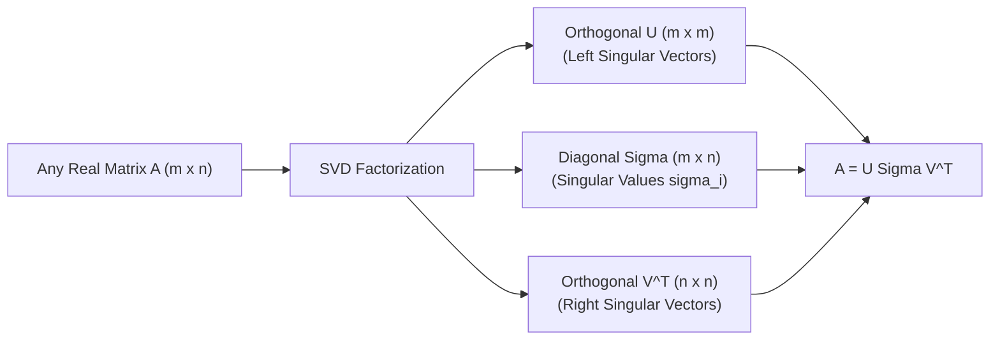
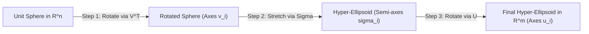
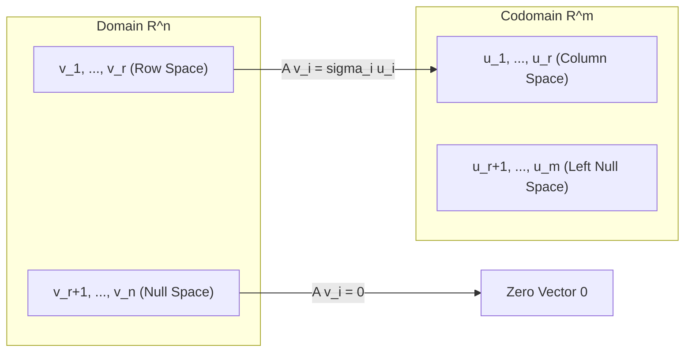
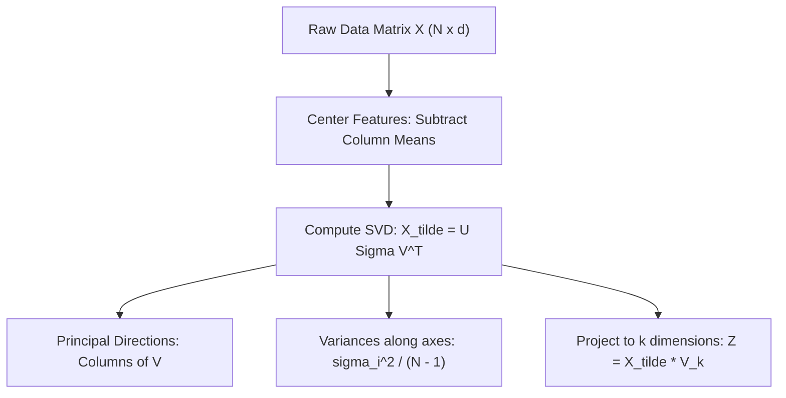

[Maths Index](../README.md) / [Unit 2: Orthogonality, Eigenvalues, and Matrix Factorizations](Introduction.md)

---

Throughout this unit, we have watched linear algebra assemble increasingly sophisticated tools. In Lecture 7, we diagonalized square matrices using $A = X \Lambda X^{-1}$. In Lecture 8, we discovered that symmetric matrices achieve the ideal decomposition: $A = Q \Lambda Q^T$, where the coordinate axes are strictly orthonormal.

Now here is the unavoidable reality: **real-world data matrices are almost never square, and never symmetric**.

In machine learning and data science, your data table typically contains $m$ observations (rows) across $n$ features (columns). An $m \times n$ matrix where $m \ne n$ cannot have eigenvalues. It does not map $\mathbb{R}^n$ back to $\mathbb{R}^n$; it maps $\mathbb{R}^n$ to an entirely different space $\mathbb{R}^m$.

Does this mean our dream of finding clean, perpendicular coordinate systems is dead?

No. In fact, linear algebra has one final, ultimate theorem that works for **every single matrix of every size and shape**: the **Singular Value Decomposition (SVD)**.

---

## The Singular Value Decomposition Theorem

Let $A$ be any real $m \times n$ matrix with rank $r \le \min(m, n)$. 

There exist an $m \times m$ orthogonal matrix $U$, an $n \times n$ orthogonal matrix $V$, and an $m \times n$ diagonal-like matrix $\Sigma$ such that:

$$A = U \Sigma V^T$$

Look at what this theorem guarantees:
- $V = [\mathbf{v}_1 \; \mathbf{v}_2 \; \dots \; \mathbf{v}_n]$ is an $n \times n$ orthogonal matrix ($V^T V = I_n$). Its columns are called the **right singular vectors**.
- $U = [\mathbf{u}_1 \; \mathbf{u}_2 \; \dots \; \mathbf{u}_m]$ is an $m \times m$ orthogonal matrix ($U^T U = I_m$). Its columns are called the **left singular vectors**.
- $\Sigma$ is an $m \times n$ matrix with non-negative real numbers $\sigma_1 \ge \sigma_2 \ge \dots \ge \sigma_r > 0$ on its main diagonal, and zeroes everywhere else:
  $$\Sigma = \begin{bmatrix} \sigma_1 & & & 0 & \dots & 0 \\ & \sigma_2 & & 0 & \dots & 0 \\ & & \ddots & \vdots & & \vdots \\ & & & \sigma_r & \dots & 0 \\ 0 & 0 & \dots & 0 & \dots & 0 \end{bmatrix}$$
  The non-negative numbers $\sigma_i$ are the **singular values** of $A$.

---

## The Geometry of SVD: How Any Matrix Warps Space

What does $A = U \Sigma V^T$ mean geometrically? 

Every linear transformation, no matter how complicated, can be decomposed into three elementary geometric steps:

1. **Rotate in the domain $\mathbb{R}^n$ ($V^T$)**: The matrix $V^T$ rotates the standard input coordinate system to align with the orthonormal right singular vectors $\mathbf{v}_1, \dots, \mathbf{v}_n$.
2. **Stretch along the axes ($\Sigma$)**: The matrix $\Sigma$ stretches or compresses each axis independently by the factor $\sigma_i$. If $r < n$, the remaining dimensions are crushed to zero.
3. **Rotate in the codomain $\mathbb{R}^m$ ($U$)**: The matrix $U$ rotates the stretched axes into their final orientations in the output space, aligned with the left singular vectors $\mathbf{u}_1, \dots, \mathbf{u}_m$.

Think about this: take a round unit sphere in $\mathbb{R}^n$. Any matrix $A$ maps that sphere into a hyper-ellipsoid in $\mathbb{R}^m$. 
- The directions of the principal axes of the ellipsoid are the left singular vectors $\mathbf{u}_i$.
- The half-lengths of those principal axes are the singular values $\sigma_i$.
- The directions on the original sphere that got stretched into those axes are the right singular vectors $\mathbf{v}_i$.

---

## Deriving SVD from Symmetric Matrices

How do we actually find $U, \Sigma$, and $V$? We connect $A$ back to the symmetric matrices we mastered in Lecture 8!

Even though $A$ is not symmetric, the two products $A^T A$ and $A A^T$ are **always symmetric and positive semi-definite**.

Let's substitute $A = U \Sigma V^T$ into $A^T A$:

$$A^T A = (U \Sigma V^T)^T (U \Sigma V^T) = V \Sigma^T \underbrace{U^T U}_{I_m} \Sigma V^T = V (\Sigma^T \Sigma) V^T$$

Look at that expression: $A^T A = V (\Sigma^T \Sigma) V^T$. 

This is nothing other than the **orthogonal diagonalization** of the symmetric matrix $A^T A$!
- The right singular vectors $\mathbf{v}_i$ are the orthonormal **eigenvectors of $A^T A$**.
- The squared singular values $\sigma_i^2$ are the **eigenvalues of $A^T A$**:
  $$\sigma_i = \sqrt{\lambda_i(A^T A)}$$

Now, let's substitute $A = U \Sigma V^T$ into $A A^T$:

$$A A^T = (U \Sigma V^T)(U \Sigma V^T)^T = U \Sigma \underbrace{V^T V}_{I_n} \Sigma^T U^T = U (\Sigma \Sigma^T) U^T$$

This is the orthogonal diagonalization of $A A^T$!
- The left singular vectors $\mathbf{u}_i$ are the orthonormal **eigenvectors of $A A^T$**.

### Connecting Left and Right Singular Vectors

Once we find the right singular vectors $\mathbf{v}_i$ from $A^T A$, we don't even need to separately diagonalize $A A^T$ to find the first $r$ left singular vectors. 

Because $A V = U \Sigma$, comparing the $i$-th column gives:

$$A \mathbf{v}_i = \sigma_i \mathbf{u}_i \implies \mathbf{u}_i = \frac{1}{\sigma_i} A \mathbf{v}_i \quad (i = 1, 2, \dots, r)$$

Each $\mathbf{u}_i$ is simply the normalized image of $\mathbf{v}_i$ under the mapping $A$.

---

## SVD and the Four Fundamental Subspaces

In Lecture 2, we introduced the Four Fundamental Subspaces. SVD provides the ultimate, clean orthonormal bases for all four subspaces simultaneously:

- **Row Space $C(A^T)$**: The first $r$ right singular vectors $\{\mathbf{v}_1, \dots, \mathbf{v}_r\}$ form an orthonormal basis for $C(A^T)$ (dimension $r$).
- **Null Space $N(A)$**: The remaining $n - r$ right singular vectors $\{\mathbf{v}_{r+1}, \dots, \mathbf{v}_n\}$ form an orthonormal basis for $N(A)$ (dimension $n - r$).
- **Column Space $C(A)$**: The first $r$ left singular vectors $\{\mathbf{u}_1, \dots, \mathbf{u}_r\}$ form an orthonormal basis for $C(A)$ (dimension $r$).
- **Left Null Space $N(A^T)$**: The remaining $m - r$ left singular vectors $\{\mathbf{u}_{r+1}, \dots, \mathbf{u}_m\}$ form an orthonormal basis for $N(A^T)$ (dimension $m - r$).

SVD completely uncouples the action of $A$: it maps the orthonormal basis of the row space directly onto the orthonormal basis of the column space, with each basis vector scaled strictly by its singular value $\sigma_i$.

---

## The Outer Product Expansion and Low-Rank Approximations

If we multiply out $A = U \Sigma V^T$ as a sum of rank-1 outer products, we obtain:

$$A = \sum_{i=1}^r \sigma_i \mathbf{u}_i \mathbf{v}_i^T = \sigma_1 \mathbf{u}_1 \mathbf{v}_1^T + \sigma_2 \mathbf{u}_2 \mathbf{v}_2^T + \dots + \sigma_r \mathbf{u}_r \mathbf{v}_r^T$$

Each piece $A_i = \mathbf{u}_i \mathbf{v}_i^T$ is an $m \times n$ matrix with rank 1. 

Because the singular values are sorted in decreasing order ($\sigma_1 \ge \sigma_2 \ge \dots \ge \sigma_r > 0$), the first few terms carry the vast majority of the "energy" and information contained in $A$.

### The Eckart-Young-Mirsky Theorem

Suppose we want to compress the matrix $A$ into a lower-rank matrix $A_k$ of rank $k < r$. What is the best possible rank-$k$ approximation?

The **Eckart-Young-Mirsky Theorem** proves that the optimal rank-$k$ approximation (minimizing both the Frobenius norm $\|A - A_k\|_F$ and spectral norm $\|A - A_k\|_2$) is obtained by simply **truncating the SVD sum to the first $k$ terms**:

$$A_k = \sum_{i=1}^k \sigma_i \mathbf{u}_i \mathbf{v}_i^T$$

The approximation error is simply governed by the dropped singular values:

$$\|A - A_k\|_2 = \sigma_{k+1}$$

This theorem is the mathematical foundation of:
- **Image Compression**: Storing an image with rank $k \ll r$ requires storing only $k(m + n + 1)$ numbers instead of $m \times n$ pixels.
- **Latent Semantic Analysis (LSA)**: Finding semantic topic clusters in term-document matrices.
- **Collaborative Filtering**: Netflix-style recommendation engines predicting user preference matrices.

---

## Mathematical Foundations of Principal Component Analysis (PCA)

Now let's connect SVD directly to the most famous unsupervised learning algorithm in data science: **Principal Component Analysis (PCA)**.

Suppose we have a data matrix $X$ with $N$ data observations and $d$ features ($N \times d$).

### Step 1: Center the Data
Subtract the sample mean of each feature column so that every feature has mean zero:

$$\tilde{X} = X - \mathbf{1} \boldsymbol{\mu}^T$$

### Step 2: Form the Sample Covariance Matrix
The empirical $d \times d$ covariance matrix $S$ is:

$$S = \frac{1}{N - 1} \tilde{X}^T \tilde{X}$$

The diagonal entries $S_{jj}$ are the variances of each feature, and the off-diagonal entries $S_{jk}$ are the covariances between features.

### Step 3: Decompose the Centered Data via SVD
Take the SVD of the centered data matrix $\tilde{X}$:

$$\tilde{X} = U \Sigma V^T$$

Now substitute this into the covariance matrix $S$:

$$S = \frac{1}{N - 1} (U \Sigma V^T)^T (U \Sigma V^T) = \frac{1}{N - 1} V \Sigma^T \underbrace{U^T U}_{I} \Sigma V^T = V \left( \frac{\Sigma^2}{N - 1} \right) V^T$$

Look at what this means:
- The right singular vectors $\mathbf{v}_1, \dots, \mathbf{v}_d$ of the data matrix $\tilde{X}$ are **the principal component directions** (the eigenvectors of the covariance matrix $S$).
- The variance along the $i$-th principal direction is:
  $$\text{Var}_i = \frac{\sigma_i^2}{N - 1}$$
- The **Explained Variance Ratio** of the $i$-th principal component is:
  $$\text{EVR}_i = \frac{\sigma_i^2}{\sum_{j=1}^d \sigma_j^2}$$

To reduce the dimensionality of your data from $d$ dimensions down to $k$ dimensions ($k < d$), you simply project the centered data onto the first $k$ right singular vectors:

$$Z = \tilde{X} V_k$$

The resulting $N \times k$ matrix $Z$ preserves the maximum possible variance of the original dataset while eliminating feature correlation.

---

## Step-by-Step Numerical Example

Let's compute the complete SVD of the $2 \times 3$ matrix:

$$A = \begin{bmatrix} 3 & 2 & 2 \\ 2 & 3 & -2 \end{bmatrix}$$

### Step 1: Compute $A A^T$ and Left Singular Vectors $U$

$$A A^T = \begin{bmatrix} 3 & 2 & 2 \\ 2 & 3 & -2 \end{bmatrix} \begin{bmatrix} 3 & 2 \\ 2 & 3 \\ 2 & -2 \end{bmatrix} = \begin{bmatrix} 9+4+4 & 6+6-4 \\ 6+6-4 & 4+9+4 \end{bmatrix} = \begin{bmatrix} 17 & 8 \\ 8 & 17 \end{bmatrix}$$

Find eigenvalues of $A A^T$:

$$\det\begin{bmatrix} 17 - \lambda & 8 \\ 8 & 17 - \lambda \end{bmatrix} = (17 - \lambda)^2 - 64 = 0$$

$$17 - \lambda = \pm 8 \implies \lambda_1 = 25, \quad \lambda_2 = 9$$

The singular values are the square roots:

$$\sigma_1 = \sqrt{25} = 5, \quad \sigma_2 = \sqrt{9} = 3$$

Now find eigenvectors of $A A^T$ (the columns of $U$):

For $\lambda_1 = 25$:

$$\begin{bmatrix} 17 - 25 & 8 \\ 8 & 17 - 25 \end{bmatrix} \begin{bmatrix} u_1 \\ u_2 \end{bmatrix} = \begin{bmatrix} -8 & 8 \\ 8 & -8 \end{bmatrix} \begin{bmatrix} u_1 \\ u_2 \end{bmatrix} = \begin{bmatrix} 0 \\ 0 \end{bmatrix} \implies u_1 = u_2$$

Normalizing:

$$\mathbf{u}_1 = \frac{1}{\sqrt{2}} \begin{bmatrix} 1 \\ 1 \end{bmatrix}$$

For $\lambda_2 = 9$:

$$\begin{bmatrix} 17 - 9 & 8 \\ 8 & 17 - 9 \end{bmatrix} \begin{bmatrix} u_1 \\ u_2 \end{bmatrix} = \begin{bmatrix} 8 & 8 \\ 8 & 8 \end{bmatrix} \begin{bmatrix} u_1 \\ u_2 \end{bmatrix} = \begin{bmatrix} 0 \\ 0 \end{bmatrix} \implies u_1 = -u_2$$

Normalizing:

$$\mathbf{u}_2 = \frac{1}{\sqrt{2}} \begin{bmatrix} 1 \\ -1 \end{bmatrix}$$

Thus:

$$U = \frac{1}{\sqrt{2}} \begin{bmatrix} 1 & 1 \\ 1 & -1 \end{bmatrix}$$

### Step 2: Compute Right Singular Vectors $\mathbf{v}_1, \mathbf{v}_2$

Using $\mathbf{v}_i = \frac{1}{\sigma_i} A^T \mathbf{u}_i$:

For $\mathbf{v}_1$:

$$\mathbf{v}_1 = \frac{1}{5} \begin{bmatrix} 3 & 2 \\ 2 & 3 \\ 2 & -2 \end{bmatrix} \left( \frac{1}{\sqrt{2}} \begin{bmatrix} 1 \\ 1 \end{bmatrix} \right) = \frac{1}{5\sqrt{2}} \begin{bmatrix} 3 + 2 \\ 2 + 3 \\ 2 - 2 \end{bmatrix} = \frac{1}{5\sqrt{2}} \begin{bmatrix} 5 \\ 5 \\ 0 \end{bmatrix} = \frac{1}{\sqrt{2}} \begin{bmatrix} 1 \\ 1 \\ 0 \end{bmatrix}$$

For $\mathbf{v}_2$:

$$\mathbf{v}_2 = \frac{1}{3} \begin{bmatrix} 3 & 2 \\ 2 & 3 \\ 2 & -2 \end{bmatrix} \left( \frac{1}{\sqrt{2}} \begin{bmatrix} 1 \\ -1 \end{bmatrix} \right) = \frac{1}{3\sqrt{2}} \begin{bmatrix} 3 - 2 \\ 2 - 3 \\ 2 + 2 \end{bmatrix} = \frac{1}{3\sqrt{2}} \begin{bmatrix} 1 \\ -1 \\ 4 \end{bmatrix} = \frac{1}{\sqrt{18}} \begin{bmatrix} 1 \\ -1 \\ 4 \end{bmatrix}$$

Check lengths and orthogonality:
- $\|\mathbf{v}_1\|^2 = \frac{1}{2}(1 + 1 + 0) = 1$
- $\|\mathbf{v}_2\|^2 = \frac{1}{18}(1 + 1 + 16) = 1$
- $\mathbf{v}_1^T \mathbf{v}_2 = \frac{1}{6}(1 - 1 + 0) = 0$

### Step 3: Find $\mathbf{v}_3$ to Complete Basis for $\mathbb{R}^3$

The vector $\mathbf{v}_3$ lies in the null space $N(A)$, so it must be orthogonal to both $\mathbf{v}_1$ and $\mathbf{v}_2$. 

Taking the cross product of $\begin{bmatrix} 1 \\ 1 \\ 0 \end{bmatrix}$ and $\begin{bmatrix} 1 \\ -1 \\ 4 \end{bmatrix}$:

$$\begin{bmatrix} (1)(4) - (0)(-1) \\ (0)(1) - (1)(4) \\ (1)(-1) - (1)(1) \end{bmatrix} = \begin{bmatrix} 4 \\ -4 \\ -2 \end{bmatrix} = 2 \begin{bmatrix} 2 \\ -2 \\ -1 \end{bmatrix}$$

Normalizing $\begin{bmatrix} 2 \\ -2 \\ -1 \end{bmatrix}$ (length is $\sqrt{4 + 4 + 1} = 3$):

$$\mathbf{v}_3 = \frac{1}{3} \begin{bmatrix} 2 \\ -2 \\ -1 \end{bmatrix}$$

Check $A\mathbf{v}_3$:

$$A\mathbf{v}_3 = \frac{1}{3} \begin{bmatrix} 3 & 2 & 2 \\ 2 & 3 & -2 \end{bmatrix} \begin{bmatrix} 2 \\ -2 \\ -1 \end{bmatrix} = \frac{1}{3} \begin{bmatrix} 6 - 4 - 2 \\ 4 - 6 + 2 \end{bmatrix} = \begin{bmatrix} 0 \\ 0 \end{bmatrix}$$

It is strictly in the null space.

### Step 4: Assemble Full SVD

$$U = \begin{bmatrix} 1/\sqrt{2} & 1/\sqrt{2} \\ 1/\sqrt{2} & -1/\sqrt{2} \end{bmatrix}, \quad \Sigma = \begin{bmatrix} 5 & 0 & 0 \\ 0 & 3 & 0 \end{bmatrix}, \quad V = \begin{bmatrix} 1/\sqrt{2} & 1/\sqrt{18} & 2/3 \\ 1/\sqrt{2} & -1/\sqrt{18} & -2/3 \\ 0 & 4/\sqrt{18} & -1/3 \end{bmatrix}$$

### Step 5: Rank-1 Optimal Approximation $A_1$

Using the Eckart-Young theorem, the best rank-1 approximation is:

$$A_1 = \sigma_1 \mathbf{u}_1 \mathbf{v}_1^T = 5 \left( \frac{1}{\sqrt{2}} \begin{bmatrix} 1 \\ 1 \end{bmatrix} \right) \left( \frac{1}{\sqrt{2}} \begin{bmatrix} 1 & 1 & 0 \end{bmatrix} \right) = \frac{5}{2} \begin{bmatrix} 1 & 1 & 0 \\ 1 & 1 & 0 \end{bmatrix} = \begin{bmatrix} 2.5 & 2.5 & 0 \\ 2.5 & 2.5 & 0 \end{bmatrix}$$

This single rank-1 matrix captures $(5^2) / (5^2 + 3^2) = 25 / 34 \approx 73.5\%$ of the total variance in $A$.

---

## Key Takeaways

- SVD exists for *every* real matrix $A$ ($m \times n$): $A = U \Sigma V^T$.
- Geometrically, any linear transformation decomposes into domain rotation ($V^T$), coordinate stretching ($\Sigma$), and codomain rotation ($U$).
- The singular values $\sigma_i = \sqrt{\lambda_i(A^T A)}$ are non-negative and arranged in decreasing order.
- The columns of $V$ and $U$ form complete orthonormal bases for all four fundamental subspaces.
- By the Eckart-Young-Mirsky Theorem, truncating SVD to $k$ terms gives the provably optimal rank-$k$ approximation $A_k = \sum_{i=1}^k \sigma_i \mathbf{u}_i \mathbf{v}_i^T$.
- In Principal Component Analysis (PCA), the right singular vectors of the centered data matrix are the principal component directions, and $\frac{\sigma_i^2}{N - 1}$ gives the variance along each principal axis.

---

Across Units 1 and 2, we have studied the deterministic foundations of AI and data science: vector spaces, matrix factorizations, projections, least-squares fits, and spectral decompositions. In every case, we assumed our equations and vectors were fixed, deterministic numbers.

Now, we face the next major frontier of data science. Real-world data is never purely deterministic—it is noisy, fluctuating, and inherently random. 

To model uncertainty, quantify sampling error, and estimate unknown parameters from limited empirical samples, we leave behind purely deterministic linear mappings and step into the realm of probability theory.

Begin the journey into the foundations of statistical modeling in [Unit 3: Probability Modeling and Parameter Estimation](../Unit%203/Introduction.md) and start with [L01 - Introduction to Probability Modeling and Sampling](../Unit%203/L01%20-%20Introduction%20to%20Probability%20Modeling%20and%20Sampling.md).
