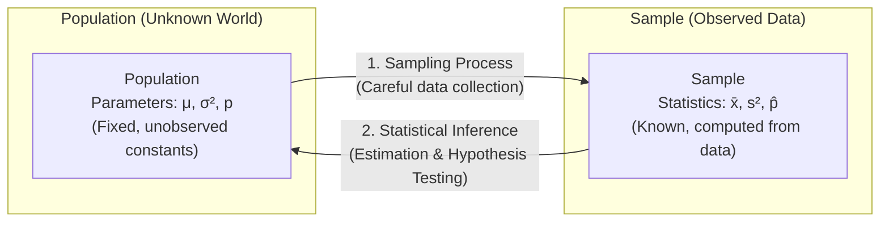
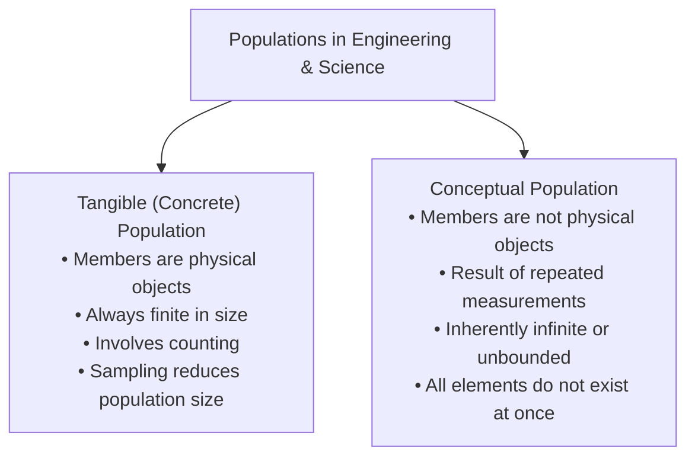
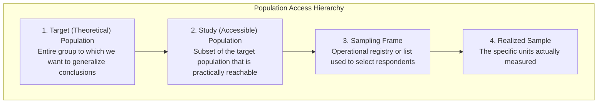
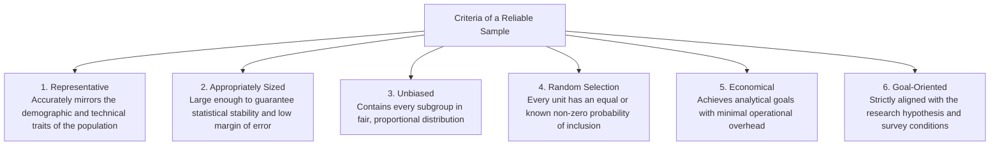
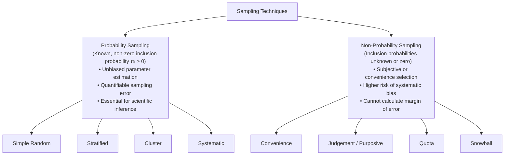
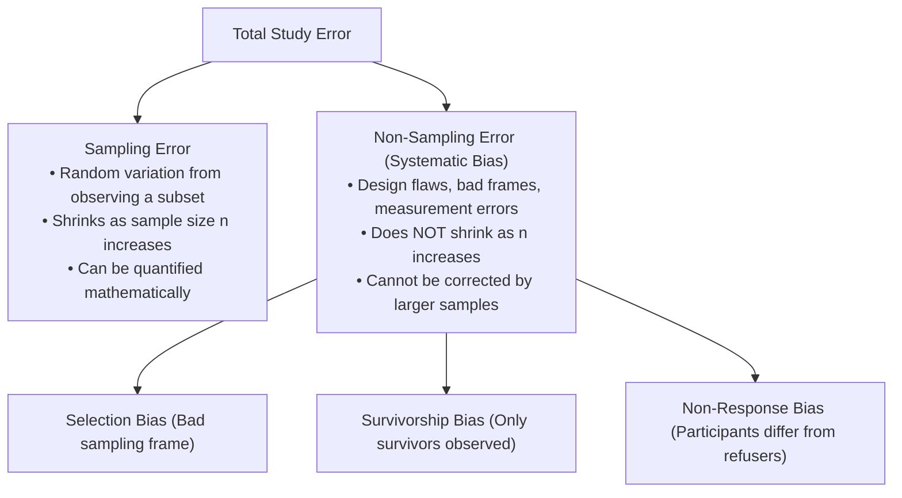

[Maths Index](../README.md) / [Unit 3: Probability Modeling and Parameter Estimation](Introduction.md)

# Introduction to Probability Modeling and Sampling

When we studied linear algebra in Units 1 and 2, our mathematical universe was deterministic and exact. If a system of equations $A\mathbf{x} = \mathbf{b}$ was consistent and had full column rank, Gaussian elimination found the unique solution vector with certainty. Every vector lived at a known coordinate, and every matrix transformation produced a predictable output.

Now step into real-world artificial intelligence, engineering, and data science. The moment we measure battery life, record server latencies, test software algorithms, or poll human users, that neat determinism disappears. Measurements are subject to sensor noise. Datasets represent only tiny snapshots of an ongoing, unobservable process. Uncontrolled external factors introduce variations we cannot observe directly.

To build intelligent systems that make reliable decisions under uncertainty, we cannot treat data as static numbers in an isolated spreadsheet. We must understand how data is generated, collected, and abstracted. That shift requires statistical analysis, probability modeling, and rigorous sampling methodology.

---

## What is Statistical Analysis?

Before writing formulas, let's understand the engineering goal of statistics:

> **Statistical Analysis** is the science of collecting, exploring, and presenting data to discover underlying patterns, relationships, and trends.

In engineering and data science, statistics provides a scientific framework for decision-making. We rarely have the resources to inspect every single transaction, user, or manufactured component. The core principle of statistical inference is simple:

> We make rigorous inferences about an entire population by studying a relatively small, carefully selected sample drawn from it.

### Real-World Problems We Seek to Solve

In university coursework and industry research, statistical analysis addresses questions such as:
- What is the mean height of all male university students across India?
- What are the average examination marks of female students at PES University?
- Is there a measurable relationship between the time a student spends studying and the grade they achieve?
- What is the quantifiable impact of an increase in course assignments on student performance?

To answer any of these questions, we must clearly define what we are studying.

---

## Populations, Samples, and the Core Terminology

Every statistical inquiry begins by distinguishing between the entire group of interest and the subset we actually measure.

### Population
A population is the entire collection of objects, individuals, or outcomes about which information is sought.

In everyday language, "population" implies people. In data science and engineering, a population can be anything you wish to study:
- Physical objects: bolts produced in a factory, autonomous vehicles on roads, server blades in a datacenter.
- Events: HTTP network requests, credit card transactions, system errors.
- Entities: countries, software repositories, species.

### Sample
A sample is a finite, observable subset drawn from the population. We collect data from the sample, compute descriptive metrics, and infer conclusions about the population.

### Parameters versus Statistics
There is a fundamental difference in terminology between populations and samples:

| Dimension | Population Attribute (Parameter) | Sample Attribute (Statistic) |
| :--- | :--- | :--- |
| **Definition** | A numerical summary of the whole population. | A numerical summary computed from the sample. |
| **Notation** | Greek letters: $\mu$ (mean), $\sigma^2$ (variance), $p$ (proportion). | Latin letters / accents: $\bar{x}$ (mean), $s^2$ (variance), $\hat{p}$ (proportion). |
| **Status in Frequentist Statistics** | Fixed, true constants (unknown to us). | Random variables (values change with each sample). |
| **Computational Accessibility** | Almost never directly computable. | Directly computable from observed data. |

Because different samples yield different values of $\bar{x}$, our sample statistics have their own probability distributions (sampling distributions). Our objective is to design sampling methods and estimators that ensure our sample statistics are close to the true population parameters.

---

## Tangible Populations versus Conceptual Populations

One of the most important classifications in engineering statistics is the distinction between tangible and conceptual populations.

### 1. Tangible (Concrete) Populations
A tangible population is one whose members are physical, concrete objects: cars, apples, students, machine bolts, or integrated circuits.

Key properties:
- Tangible populations are always finite. Evaluating them involves counting physical items.
- When an item is sampled without replacement, the physical population decreases by $1$.
- In theory, an item could be returned to the population before drawing the next (sampling with replacement), but in engineering quality inspection, this is rarely done (especially in destructive testing).

### 2. Conceptual Populations
A conceptual population does not consist of physical objects sitting in a warehouse. Instead, it consists of all the potential values that could be produced by a process or measurement.

Key properties:
- Conceptual populations are mostly the result of measurements made under specified experimental conditions.
- They consist of a group whose elements are not all available at the time of sampling, because the population grows each time the process runs.
- The size of a conceptual population is modeled as infinite.
- For example, if you measure the length of a manufactured metal rod with a precision caliper, the conceptual population consists of all possible measurement readings that the caliper could ever produce under those conditions. The five readings you record are a sample from this infinite conceptual population.

### Classroom Diagnostic Problem Set: Tangible versus Conceptual

Let's test these definitions on standard engineering scenarios:

1. **Shipment of Bolts**: A shipment of bolts is received from a vendor. To test shear strength, an engineer selects 10 bolts from the container.
   - *Target Group*: All the bolts in the container.
   - *Classification*: **Tangible population** (the bolts are physical objects already manufactured and countable).

2. **Resistor Measurement**: The electrical resistance of a specific carbon resistor is measured 5 times using an ohmmeter.
   - *Target Group*: All potential resistance readings that could ever be produced by that ohmmeter on that resistor.
   - *Classification*: **Conceptual population** (the readings are the result of repeated measurement; they do not exist as physical objects on a shelf).

3. **Geologist Weighing a Rock**: A geologist weighs a mineral specimen several times on a sensitive laboratory balance.
   - *Target Group*: All possible weight readings the balance could output.
   - *Classification*: **Conceptual population** (the measurements represent an infinite population of hypothetical readings).

4. **Voter Polling**: A polling agency interviews 1,000 registered voters in Karnataka regarding their preferred candidate.
   - *Target Group*: All registered voters in Karnataka.
   - *Classification*: **Tangible population** (the voters are living individuals who can be counted).

5. **Assembly Line Shift**: A quality assurance engineer samples the last 100 bolts manufactured during a factory's afternoon shift to test tensile strength.
   - *Target Group*: All bolts manufactured during that shift.
   - *Classification*: **Tangible population** (finite physical bolts produced on that day).

6. **Clinical Drug Trial**: In a medical trial for a new cholesterol-lowering compound, 100 individuals with elevated cholesterol are recruited.
   - *Target Group*: All people currently living with high cholesterol.
   - *Classification*: **Tangible population** (existing individuals).

---

## Target Population versus Study Population

In real-world data science, we rarely have access to the exact population we want to draw conclusions about. We must distinguish between our theoretical target and our accessible reality.

### Definitions

1. **Target (Theoretical) Population**: The entire group of individuals, objects, or phenomena to which the researcher wants to generalize conclusions. The target population is defined by specific criteria of scientific interest.
2. **Study (Accessible) Population**: The subset of the target population to which the researcher can practically apply conclusions and from which subjects can be recruited. It is often constrained by geographical region, time, institution, or legal access.
3. **Sampling Frame**: The physical or digital list from which potential units are drawn (e.g., student registry, phone directory, customer database).
4. **Sampling Unit**: The smallest indivisible unit selected from the sampling frame (e.g., an individual student, a server, an account).

### Real-World Comparison Table

| Research Context | Target (Theoretical) Population | Study (Accessible) Population |
| :--- | :--- | :--- |
| **Neurological Research** | All institutionalized elderly individuals with Alzheimer's disease | All institutionalized elderly Alzheimer's patients residing in St. Louis county nursing homes |
| **Epidemiological Study** | All individuals diagnosed with HIV/AIDS globally | All individuals with HIV/AIDS treated in the metropolitan St. Louis healthcare system |
| **Pediatric Medicine** | All low birth weight infants | All low birth weight infants admitted to neonatal ICUs in St. Louis city and county hospitals |
| **Respiratory Health** | All school-age children suffering from asthma | All school-age children with asthma treated at designated regional emergency care clinics |

### The Four-Question Breakdown Framework

Whenever designing or auditing a data collection pipeline, answer these four questions:

1. **Whom do you want to generalize your results to?**  
   $\to$ **Target Population** (e.g., all university students across India).
2. **What population can you realistically access?**  
   $\to$ **Study Population** (e.g., all university students in Karnataka).
3. **How can you get access to them?**  
   $\to$ **Sampling Frame** (e.g., official registrar lists of enrolled students across Karnataka universities).
4. **Who is actually in your dataset?**  
   $\to$ **Sample** (e.g., 500 students randomly selected from two universities in Bengaluru).

---

## Why Sample? The Five Practical Drivers

Why not measure every unit in the population? In practice, a full census is almost always impractical or impossible. Sampling is driven by five factors:

1. **Necessity**: In conceptual populations (measurements) or destructive quality testing (testing bolt shear strength destroys the bolt), measuring the entire population is physically impossible.
2. **Practicality**: Contacting and measuring millions of geographically dispersed units is logistically intractable.
3. **Cost-Effectiveness**: Sampling drastically reduces laboratory, surveyor, computational, and storage expenditures.
4. **Manageability**: Working with clean, manageable sample datasets allows for stricter quality control, fewer data-entry errors, and faster exploratory analysis.
5. **Time Efficiency**: Samples can be collected and analyzed rapidly, enabling real-time decision-making in production environments.

---

## Characteristics of an Effective Sample

Not every sample yields valid conclusions. To ensure reliable statistical inferences, a sample must satisfy six criteria:

### Case Studies on Sample Validity

Let's evaluate whether the following sampling setups represent sound data collection:

#### Scenario A: University Job Prospects Survey
- **Study Goal**: Evaluate post-graduation job prospects of students at a university.
- **Sampling Method**: Administering questionnaires exclusively to students sitting in the campus canteen at 1:00 PM.
- **Verdict**: **Poor, biased sample.**
  - Students in the canteen at 1:00 PM are not representative of the broader student body (e.g., working students, laboratory researchers, and interns are excluded).
  - The selection is not random: students who do not eat at the canteen have zero chance of selection.

#### Scenario B: High School Curriculum Evaluation
- **Study Goal**: Test the academic effectiveness of a newly introduced high school curriculum across a state.
- **Sampling Method**: Dividing the state into school districts, randomly selecting a designated number of schools from each district, and drawing random samples of students from each selected school.
- **Verdict**: **Good, unbiased sample.**
  - Every school district has proportional representation, accounting for socio-economic and geographic diversity.
  - Randomization at both the school and student levels prevents selection bias.

#### Scenario C: Monitoring Corporate Best Practices
- **Study Goal**: Verify that software engineers follow security best practices.
- **Sampling Method**: A program assigns every engineer a unique ID and uses a pseudorandom number generator to select 20 engineers each week for code auditing.
- **Verdict**: **Good, unbiased sample.**
  - Every engineer has an equal, known probability of being audited each cycle.
  - Human favoritism or auditing bias is eliminated.

---

## Sampling Techniques: Probability versus Non-Probability

Sampling techniques are divided into two main categories: probability sampling and non-probability sampling.

---

## Probability Sampling Methods

In probability sampling, every unit in the population has a known, non-zero probability $\pi_i > 0$ of being selected. When all units have the exact same probability of selection ($\pi_i = n/N$), the design is called an **Equal Probability of Selection (EPS)** or **self-weighting** design.

### 1. Simple Random Sampling (SRS)
In a Simple Random Sample of size $n$ from a population of size $N$, every possible combination of $n$ elements has the same chance of selection:

$$P(\text{Any specific subset of size } n) = \frac{1}{\binom{N}{n}}$$

There are two operational variations:
- **With Replacement (SRSWR)**: A chosen unit is recorded and returned to the population before the next draw. Individual draws are statistically independent, but the same item can be picked more than once.
- **Without Replacement (SRSWOR)**: Once chosen, an item is removed. While individual draws are technically dependent, SRSWOR produces smaller estimation variance than SRSWR by a factor called the Finite Population Correction (FPC): $\frac{N-n}{N-1}$. When $N \gg n$, the difference is negligible.

### 2. Stratified Sampling
When a population is heterogeneous overall but contains homogeneous subgroups (strata), pure SRS can introduce high variance by under-sampling key groups.

In stratified sampling:
1. Divide the population into $K$ non-overlapping strata based on a relevant feature (e.g., student major, account tier).
2. Draw an independent simple random sample from **every single stratum**.

Under proportional allocation, the sample size $n_h$ for stratum $h$ matches its share of the total population:
$$n_h = n \cdot \frac{N_h}{N}$$

#### Worked Numerical Example: Proportional Allocation
An enterprise SaaS platform has $N = 50{,}000$ active customer accounts across three tiers:
- Tier 1 (Enterprise): $N_1 = 2{,}500$ accounts ($5\%$)
- Tier 2 (Mid-Market): $N_2 = 12{,}500$ accounts ($25\%$)
- Tier 3 (Startup): $N_3 = 35{,}000$ accounts ($70\%$)

We have budget to survey $n = 1{,}000$ accounts. Using proportional stratified allocation:
$$\begin{aligned}
n_1 &= 1{,}000 \times \frac{2{,}500}{50{,}000} = 1{,}000 \times 0.05 = 50 \text{ accounts} \\
n_2 &= 1{,}000 \times \frac{12{,}500}{50{,}000} = 1{,}000 \times 0.25 = 250 \text{ accounts} \\
n_3 &= 1{,}000 \times \frac{35{,}000}{50{,}000} = 1{,}000 \times 0.70 = 700 \text{ accounts}
\end{aligned}$$

Stratification guarantees all three tiers are represented in correct proportions, reducing the variance of our overall mean estimator.

### 3. Cluster Sampling
When sampling units are geographically dispersed or difficult to compile into an exhaustive individual list, stratified sampling becomes too expensive.

In cluster sampling:
1. Divide the population into groups called clusters. Clusters should be mini-representations of the broader population (internally heterogeneous).
2. Take a simple random sample of **entire clusters**.
3. Measure all units within the chosen clusters (single-stage), or take random subsamples within them (two-stage).

The key contrast:
- **Stratified Sampling**: Sample **some** units from **all** strata (reduces estimation variance).
- **Cluster Sampling**: Sample **all** units from **some** clusters (reduces collection cost, but increases variance due to intra-cluster similarity).

### 4. Systematic Sampling
In systematic sampling, we arrange the sampling frame $1, 2, \dots, N$ and calculate a sampling interval:

$$k = \left\lfloor \frac{N}{n} \right\rfloor$$

We choose a random starting integer $r$ uniformly between $1$ and $k$. The sample consists of elements:
$$r, \; r+k, \; r+2k, \; \dots, \; r+(n-1)k$$

Systematic sampling is fast and easy to implement. However, if the frame contains hidden cyclical patterns matching $k$ (such as logging server spikes every 100 requests), systematic sampling will consistently sample only the peaks or only the troughs.

---

## Non-Probability Sampling Methods

In non-probability sampling, units are selected based on subjective judgment, accessibility, or non-random criteria. Because inclusion probabilities cannot be calculated, sampling error cannot be mathematically bounded.

1. **Convenience Sampling**: Subjects are selected because they are easiest to reach (e.g., asking whoever walks past a desk). Fast and inexpensive, but prone to high bias.
2. **Judgement (Purposive) Sampling**: The researcher uses their own subjective expertise to select units they believe are representative of the target phenomenon.
3. **Quota Sampling**: The researcher sets targets for specific demographics (e.g., 50 men and 50 women) but fills those quotas using convenience rather than random selection.
4. **Snowball Sampling**: Initial participants refer subsequent participants from their network. Useful for hard-to-reach, hidden populations (e.g., specialized security researchers, rare disease sufferers).

---

## Sampling Error versus Non-Sampling Error

Total error in an empirical study consists of two components:

### Abraham Wald and Survivorship Bias
A classic example of systematic non-sampling error occurred during World War II. The military examined returning aircraft and noted bullet holes concentrated on the wings and fuselage. Initial military planners recommended adding armor to those areas.

The statistician Abraham Wald recognized the survivorship bias: they were only examining planes that survived and returned. Planes shot in the engines crashed and were never inspected. The armor needed to be added to the engines—where returning planes had no holes.

In data science and machine learning, survivorship bias frequently occurs when training credit risk models using only customers who were approved for loans, or evaluating algorithmic trading strategies using only companies currently active in the market.

---

## Key Takeaways

- A population is the complete group about which conclusions are sought, characterized by fixed, unobservable parameters ($\mu, \sigma^2, p$). A sample is an observed subset producing statistics ($\bar{x}, s^2, \hat{p}$).
- Tangible populations consist of countable, physical objects (bolts, apples, people). Sampling an item without replacement decreases population size by 1.
- Conceptual populations are the result of repeated measurements (calipers, ohmmeters, sensors) and are modeled as infinite and unbounded.
- The target population is the theoretical group we want to generalize to; the study population is the practical subset accessible through our sampling frame.
- Probability sampling (Simple Random, Stratified, Cluster, Systematic) gives every unit a known non-zero selection probability, allowing valid inference and error calculation.
- Non-probability sampling (Convenience, Judgement, Quota, Snowball) relies on accessibility or subjective choice and cannot provide mathematical error bounds.
- Sampling error naturally diminishes as sample size $n$ increases; systematic non-sampling bias does not diminish with sample size and must be addressed through sound experimental design.

---

Now that we understand how data is drawn from a population into a sample, we need a mathematical mechanism to translate real-world qualitative events—coin flips, image pixels, user clicks—into numerical values that algorithms can process. In the next lecture, we formalize this mapping through discrete and continuous random variables, probability mass and density functions, and the fundamental expectations that govern them. Read [L02 - Random Variables and Probability Distributions](L02%20-%20Random%20Variables%20and%20Probability%20Distributions.md).
