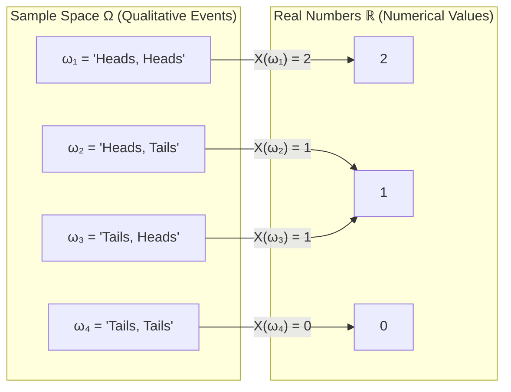
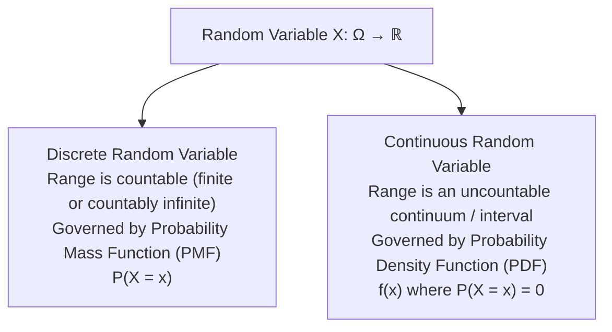
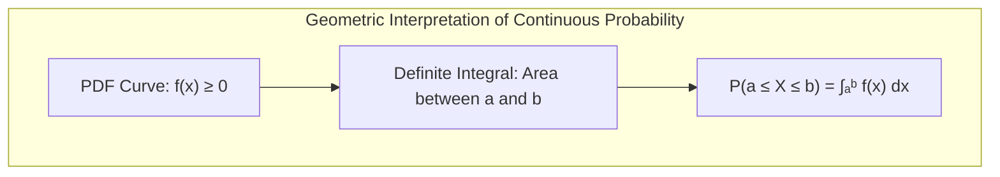
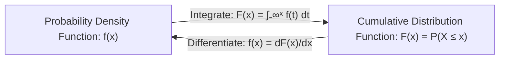
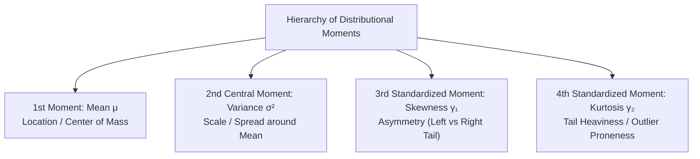

[Maths Index](../README.md) / [Unit 3: Probability Modeling and Parameter Estimation](Introduction.md)

# Random Variables and Probability Distributions

In the previous lecture, we established probability over abstract sample spaces: coin tosses yielding $\{H, T\}$, patients testing positive or negative, or web visitors converting or bouncing. 

Now think about how computers and machine learning algorithms actually operate. A neural network cannot multiply a weight matrix by "Head" or "Tail". An optimization algorithm cannot compute the gradient of "User churned". Algorithms require numbers.

We need a mathematical mechanism that translates qualitative, unpredictable real-world outcomes into real numbers that we can compute with. That mechanism is the random variable.

---

## What is a Random Variable?

Despite its name, a random variable is neither random nor a variable in the traditional algebraic sense. It is a deterministic mathematical function.

Formally, given a sample space $\Omega$, a random variable $X$ is a function that maps every outcome $\omega \in \Omega$ to a real number in $\mathbb{R}$:

$$X: \Omega \to \mathbb{R}$$

Consider flipping a fair coin twice. The sample space is:
$$\Omega = \{HH, HT, TH, TT\}$$

Define the random variable $X$ as the total number of heads observed:
- $X(HH) = 2$
- $X(HT) = 1$
- $X(TH) = 1$
- $X(TT) = 0$

Notice how the randomness lives in the underlying physical process that selects $\omega \in \Omega$. Once that outcome is picked, the rule $X(\omega)$ deterministically assigns a number.

We use capital letters like $X, Y, Z$ to denote the random variable (the rule), and lowercase letters like $x, y, z$ to denote the realized values that the variable can take. When we write $P(X = 1)$, it is shorthand for the probability of the set of all outcomes in $\Omega$ that map to 1:
$$P(X = 1) = P(\{\omega \in \Omega \mid X(\omega) = 1\}) = P(\{HT, TH\}) = \frac{2}{4} = 0.5$$

---

## Discrete versus Continuous Random Variables

Random variables fall into two fundamental classes based on the nature of their range (the set of values they can take):

1. Discrete Random Variables:
   A random variable is discrete if its range is finite or countably infinite. Examples include:
   - Number of failed requests to a server in an hour: $X \in \{0, 1, 2, \dots\}$.
   - Binary classification label: $Y \in \{0, 1\}$.
   - Number of attempts until a user successfully enters their password: $K \in \{1, 2, 3, \dots\}$.

2. Continuous Random Variables:
   A random variable is continuous if its range is an uncountable interval of real numbers. Examples include:
   - Server execution time: $T \in [0, \infty)$ milliseconds.
   - Temperature of a GPU cluster: $C \in (-\infty, \infty)$.
   - Financial asset price return: $R \in (-1, \infty)$.

This distinction alters how we define probability itself. For a discrete variable, we can assign a non-zero probability to an exact point. For a continuous variable, assigning non-zero probability to individual points breaks mathematics entirely.

---

## Discrete Distributions: The Probability Mass Function (PMF)

For a discrete random variable $X$, the Probability Mass Function (PMF), denoted $p_X(x)$ or simply $p(x)$, specifies the probability that $X$ takes the exact value $x$:

$$p(x) = P(X = x)$$

Every valid PMF must satisfy two axiomatic conditions:
1. Non-negativity:
   $$p(x) \ge 0 \quad \text{for all } x$$
2. Total probability sums to 1:
   $$\sum_{x \in \text{Range}(X)} p(x) = 1$$

### The Discrete Cumulative Distribution Function (CDF)

The Cumulative Distribution Function (CDF), denoted $F_X(x)$ or $F(x)$, gives the probability that $X$ takes a value less than or equal to $x$:

$$F(x) = P(X \le x) = \sum_{t \le x} p(t)$$

For discrete random variables, the CDF is a non-decreasing step function. It starts at $0$ (as $x \to -\infty$), jumps upward at each point where $p(x) > 0$ by the exact amount $p(x)$, and levels off at $1$ (as $x \to +\infty$).

---

## Continuous Distributions: The Probability Density Function (PDF)

Now consider a continuous random variable $X$, like measuring the exact time $T$ an algorithm takes to train.

What is the probability that $T$ takes *exactly* $3.14159265...$ seconds?

Think about how many possible real numbers exist between $3$ and $4$ seconds. There are uncountably infinite numbers. If every exact real number had even the slightest positive probability $\epsilon > 0$, the sum of probabilities over the interval would be infinite, violating the fundamental probability rule that the total probability of all outcomes in the sample space must equal $1$ ($P(\Omega) = 1$).

Therefore, for any continuous random variable and any specific single point $c \in \mathbb{R}$:

$$P(X = c) = 0$$

The moment we realize that, we face an apparent paradox: if the probability of every individual point is zero, how does any outcome happen at all?

The resolution is that continuous probabilities only make sense over intervals. We do not measure probability *at* a point; we measure probability *density* around a point.

A function $f(x)$ is a Probability Density Function (PDF) for a continuous random variable $X$ if:
1. $f(x) \ge 0$ for all $x \in \mathbb{R}$.
2. The total area under the curve equals 1:
   $$\int_{-\infty}^\infty f(x) \, dx = 1$$
3. The probability that $X$ falls within an interval $[a, b]$ is the definite integral of $f(x)$ over that interval:
   $$P(a \le X \le b) = \int_a^b f(x) \, dx$$

Notice something critical here — the value $f(x)$ itself is not a probability! It is a probability density, with units of $\frac{\text{probability}}{\text{unit of } x}$.

For very small interval widths $\Delta x$:
$$P(x \le X \le x + \Delta x) \approx f(x) \, \Delta x$$

Because $f(x)$ is a density and not a probability, $f(x)$ can be greater than 1. For instance, if $X$ is uniformly distributed over the interval $[0, 0.1]$, its density is $f(x) = 10$ everywhere on that interval. The area, however, remains $\int_0^{0.1} 10 \, dx = 10 \times 0.1 = 1$.

### The Continuous Cumulative Distribution Function (CDF)

For a continuous random variable $X$, the CDF is defined identically to the discrete case:

$$F(x) = P(X \le x) = \int_{-\infty}^x f(t) \, dt$$

The relationship between the PDF and the CDF is given by the Fundamental Theorem of Calculus:

$$f(x) = \frac{d}{dx} F(x)$$

The PDF is the derivative (instantaneous rate of accumulation) of the CDF, and the CDF is the running integral of the PDF.

### Universal Properties of Any CDF

Whether a random variable is discrete, continuous, or mixed, its CDF $F(x)$ always satisfies four mathematical invariants:
1. Bounds: $0 \le F(x) \le 1$ for all $x$.
2. Asymptotes:
   $$\lim_{x \to -\infty} F(x) = 0 \quad \text{and} \quad \lim_{x \to +\infty} F(x) = 1$$
3. Monotonicity: If $x_1 \le x_2$, then $F(x_1) \le F(x_2)$ (it never decreases).
4. Interval Calculation:
   $$P(a < X \le b) = F(b) - F(a)$$

---

## Expected Value: The Center of Mass

Now that we can describe distributions mathematically, we need summary measures to capture their typical behavior and dispersion.

The expected value (also called the expectation or population mean), denoted $E[X]$ or $\mu$, is the probability-weighted average of all possible values of $X$.

For a discrete random variable:
$$E[X] = \sum_{x} x \cdot p(x)$$

For a continuous random variable:
$$E[X] = \int_{-\infty}^\infty x \cdot f(x) \, dx$$

Physically, the expected value represents the center of mass (the balance point) of the distribution. If you cut out the shape of the PDF from a solid sheet of cardboard, $E[X]$ is the exact coordinate along the horizontal axis where the cutout balances on a knife-edge.

### The Law of the Unconscious Statistician (LOTUS)

Suppose we have a random variable $X$ and a deterministic function $g(x)$. We create a new random variable $Y = g(X)$. How do we compute $E[g(X)]$?

Do we have to find the distribution of $Y$ first? Fortunately, no. LOTUS states that we can compute the expected value of $g(X)$ directly using the original distribution of $X$:

- Discrete:
  $$E[g(X)] = \sum_x g(x) \, p(x)$$
- Continuous:
  $$E[g(X)] = \int_{-\infty}^\infty g(x) \, f(x) \, dx$$

### Linearity of Expectation

Expectation is a linear operator. For any constants $a, b \in \mathbb{R}$:

$$E[aX + b] = a E[X] + b$$

Furthermore, for any two random variables $X$ and $Y$ defined on the same sample space:

$$E[X + Y] = E[X] + E[Y]$$

Notice something profound about this second property: linearity of expectation holds regardless of whether $X$ and $Y$ are independent or heavily dependent. This identity is one of the most frequently used algebraic shortcuts in machine learning theory.

---

## Variance and Standard Deviation: Quantifying Dispersion

The expected value tells us where the distribution is centered, but nothing about how spread out it is. Two distributions can have identical means of zero, while one concentrates within $[-0.01, 0.01]$ and the other swings wildly between $[-1000, 1000]$.

The variance, denoted $\text{Var}(X)$ or $\sigma^2$, measures the expected squared deviation of $X$ from its mean $\mu = E[X]$:

$$\text{Var}(X) = E\left[(X - \mu)^2\right]$$

Why square the deviation $(X - \mu)$?
If we simply took the expected signed deviation $E[X - \mu]$, positive and negative errors would cancel each other out completely:
$$E[X - \mu] = E[X] - \mu = \mu - \mu = 0$$

Squaring ensures that all deviations are strictly positive, while penalizing large outliers much more aggressively than small fluctuations.

### The Computational Formula for Variance

Expanding the definition gives the most convenient formula for manual and symbolic calculation:

$$\begin{aligned}
\text{Var}(X) &= E\left[(X - \mu)^2\right] \\
&= E\left[X^2 - 2\mu X + \mu^2\right] \\
&= E[X^2] - 2\mu E[X] + \mu^2 \\
&= E[X^2] - 2\mu(\mu) + \mu^2 \\
&= E[X^2] - \mu^2 \\
&= E[X^2] - (E[X])^2
\end{aligned}$$

Variance is the mean of the square minus the square of the mean:
$$\text{Var}(X) = E[X^2] - (E[X])^2$$

### Standard Deviation

Because variance involves squared deviations, its units are the square of the original measurement units (e.g., dollars squared, milliseconds squared). To return to the original interpretable scale, we take the square root.

The standard deviation, denoted $\sigma$, is:
$$\sigma = \sqrt{\text{Var}(X)}$$

### Algebraic Properties of Variance

1. Non-negativity: $\text{Var}(X) \ge 0$, with $\text{Var}(X) = 0$ if and only if $X$ is a deterministic constant.
2. Adding a constant does not change spread:
   $$\text{Var}(X + c) = \text{Var}(X)$$
3. Scaling by a constant scales variance by the square:
   $$\text{Var}(aX) = a^2 \text{Var}(X)$$
4. Combining both:
   $$\text{Var}(aX + b) = a^2 \text{Var}(X)$$
   $$\sigma(aX + b) = |a| \sigma(X)$$

---

## Higher-Order Moments: Shape of the Distribution

Mean (first moment) and variance (second central moment) capture location and spread. To describe the finer shape of a distribution, we use higher moments:

### Skewness
Skewness measures distributional asymmetry:
$$\text{Skew}(X) = E\left[\left(\frac{X - \mu}{\sigma}\right)^3\right]$$
- $\text{Skew} = 0$: Perfectly symmetric (like a Normal distribution).
- $\text{Skew} > 0$ (Right / Positive Skew): Long right tail; bulk of values are low, with rare extreme positive values (e.g., user incomes, web latency). Mean exceeds median.
- $\text{Skew} < 0$ (Left / Negative Skew): Long left tail; bulk of values are high, with rare severe crashes (e.g., human lifespan). Mean is below median.

### Kurtosis
Kurtosis measures the weight of the tails relative to the center:
$$\text{Kurt}(X) = E\left[\left(\frac{X - \mu}{\sigma}\right)^4\right]$$
A standard Gaussian has a kurtosis of 3. We often report excess kurtosis:
$$\text{Excess Kurtosis} = \text{Kurt}(X) - 3$$
- Leptokurtic ($\text{Excess} > 0$): Heavy tails and sharp central peak. High probability of extreme outliers (crucial in financial risk and anomaly detection).
- Platykurtic ($\text{Excess} < 0$): Thin tails and flat shoulders (e.g., Uniform distribution).

---

## Complete Numerical Worked Examples

Let's work through two full derivations: one discrete and one continuous.

### Example 1: Discrete Random Variable

Suppose a server cluster processes incoming tasks. Let $X$ be the number of CPU retries needed to complete a batch job. The probability distribution is observed as:

| $x$ | $p(x)$ |
|:---:|:------:|
| 0 | 0.50 |
| 1 | 0.30 |
| 2 | 0.15 |
| 3 | 0.05 |

Step 1: Verify normalization.
$$\sum_{x=0}^3 p(x) = 0.50 + 0.30 + 0.15 + 0.05 = 1.00 \quad \checkmark$$

Step 2: Compute expected value $E[X]$.
$$\begin{aligned}
E[X] &= \sum_{x=0}^3 x \cdot p(x) \\
&= (0)(0.50) + (1)(0.30) + (2)(0.15) + (3)(0.05) \\
&= 0 + 0.30 + 0.30 + 0.15 = 0.75 \text{ retries}
\end{aligned}$$

Step 3: Compute second moment $E[X^2]$.
$$\begin{aligned}
E[X^2] &= \sum_{x=0}^3 x^2 \cdot p(x) \\
&= (0^2)(0.50) + (1^2)(0.30) + (2^2)(0.15) + (3^2)(0.05) \\
&= 0 + (1)(0.30) + (4)(0.15) + (9)(0.05) \\
&= 0.30 + 0.60 + 0.45 = 1.35
\end{aligned}$$

Step 4: Compute variance $\text{Var}(X)$ and standard deviation $\sigma$.
$$\begin{aligned}
\text{Var}(X) &= E[X^2] - (E[X])^2 \\
&= 1.35 - (0.75)^2 \\
&= 1.35 - 0.5625 = 0.7875 \text{ retries}^2
\end{aligned}$$

$$\sigma = \sqrt{0.7875} \approx 0.8874 \text{ retries}$$

---

### Example 2: Continuous Random Variable

A continuous random variable $X$ has a probability density function given by:
$$f(x) = \begin{cases} c x (2 - x), & 0 \le x \le 2 \\ 0, & \text{otherwise} \end{cases}$$

Step 1: Find the normalization constant $c$.
By Axiom 2, the total integral must equal 1:
$$\int_0^2 c x (2 - x) \, dx = 1$$

Factor out $c$ and integrate:
$$\begin{aligned}
c \int_0^2 (2x - x^2) \, dx &= c \left[ x^2 - \frac{x^3}{3} \right]_0^2 \\
&= c \left( 2^2 - \frac{2^3}{3} \right) = c \left( 4 - \frac{8}{3} \right) = c \left( \frac{4}{3} \right)
\end{aligned}$$

Set equal to 1:
$$c \cdot \frac{4}{3} = 1 \implies c = \frac{3}{4}$$

Thus, the exact PDF is:
$$f(x) = \frac{3}{4} x (2 - x) = \frac{3}{2}x - \frac{3}{4}x^2 \quad \text{for } x \in [0, 2]$$

Step 2: Derive the Cumulative Distribution Function $F(x)$ for $x \in [0, 2]$.
$$F(x) = \int_0^x f(t) \, dt = \int_0^x \left(\frac{3}{2}t - \frac{3}{4}t^2\right) dt = \left[ \frac{3}{4}t^2 - \frac{1}{4}t^3 \right]_0^x = \frac{3}{4}x^2 - \frac{1}{4}x^3$$

Check boundary conditions:
- $F(0) = 0$
- $F(2) = \frac{3}{4}(4) - \frac{1}{4}(8) = 3 - 2 = 1 \quad \checkmark$

Step 3: Calculate $P(0.5 \le X \le 1.5)$.
Using the CDF:
$$\begin{aligned}
F(1.5) &= \frac{3}{4}(1.5)^2 - \frac{1}{4}(1.5)^3 = \frac{3}{4}(2.25) - \frac{1}{4}(3.375) = 1.6875 - 0.84375 = 0.84375 \\
F(0.5) &= \frac{3}{4}(0.5)^2 - \frac{1}{4}(0.5)^3 = \frac{3}{4}(0.25) - \frac{1}{4}(0.125) = 0.1875 - 0.03125 = 0.15625
\end{aligned}$$

$$P(0.5 \le X \le 1.5) = F(1.5) - F(0.5) = 0.84375 - 0.15625 = 0.6875 \quad (68.75\%)$$

Step 4: Compute $E[X]$.
$$\begin{aligned}
E[X] &= \int_0^2 x \cdot f(x) \, dx = \int_0^2 x \left(\frac{3}{2}x - \frac{3}{4}x^2\right) dx \\
&= \int_0^2 \left(\frac{3}{2}x^2 - \frac{3}{4}x^3\right) dx = \left[ \frac{1}{2}x^3 - \frac{3}{16}x^4 \right]_0^2 \\
&= \frac{1}{2}(8) - \frac{3}{16}(16) = 4 - 3 = 1
\end{aligned}$$
Notice that $E[X] = 1$ makes intuitive sense because the parabolic PDF is perfectly symmetric across $[0, 2]$.

Step 5: Compute $\text{Var}(X)$.
First, evaluate $E[X^2]$:
$$\begin{aligned}
E[X^2] &= \int_0^2 x^2 \left(\frac{3}{2}x - \frac{3}{4}x^2\right) dx = \int_0^2 \left(\frac{3}{2}x^3 - \frac{3}{4}x^4\right) dx \\
&= \left[ \frac{3}{8}x^4 - \frac{3}{20}x^5 \right]_0^2 = \frac{3}{8}(16) - \frac{3}{20}(32) \\
&= 6 - \frac{96}{20} = 6 - 4.8 = 1.2
\end{aligned}$$

Now apply the computational variance formula:
$$\text{Var}(X) = E[X^2] - (E[X])^2 = 1.2 - (1)^2 = 0.2$$
$$\sigma = \sqrt{0.2} \approx 0.4472$$

---

## Key Takeaways

- A random variable is a deterministic function $X: \Omega \to \mathbb{R}$ that maps sample space outcomes to real numbers.
- Discrete random variables have countable ranges and are defined by a Probability Mass Function (PMF) $p(x) = P(X = x)$ where $\sum p(x) = 1$.
- Continuous random variables have uncountable ranges. The probability of any single point is zero ($P(X = c) = 0$); probabilities exist only over intervals via the Probability Density Function (PDF): $P(a \le X \le b) = \int_a^b f(x) dx$.
- The Cumulative Distribution Function $F(x) = P(X \le x)$ accumulates probability from $-\infty$ to $x$. For continuous variables, $f(x) = \frac{d}{dx} F(x)$.
- Expectation $E[X]$ represents the balance point of the distribution. Expectation is strictly linear: $E[aX + bY] = aE[X] + bE[Y]$ regardless of independence.
- Variance $\text{Var}(X) = E[X^2] - (E[X])^2$ measures dispersion. Scaling multiplies variance by $a^2$: $\text{Var}(aX + b) = a^2 \text{Var}(X)$.
- Skewness measures distribution asymmetry, while kurtosis quantifies tail heaviness and outlier risk.

---

Now that we possess the analytical framework for general random variables, we do not need to invent new distributions from scratch every time we encounter data. Certain generative mechanisms recur constantly throughout nature and computational systems: binary trials, event counting over time, and symmetric measurement noise. In the next lecture, we study the standard parametric families that model these universal processes: Bernoulli, Binomial, Poisson, Uniform, and the Gaussian distribution. Read [L03 - Common Probability Distributions](L03%20-%20Common%20Probability%20Distributions.md).
