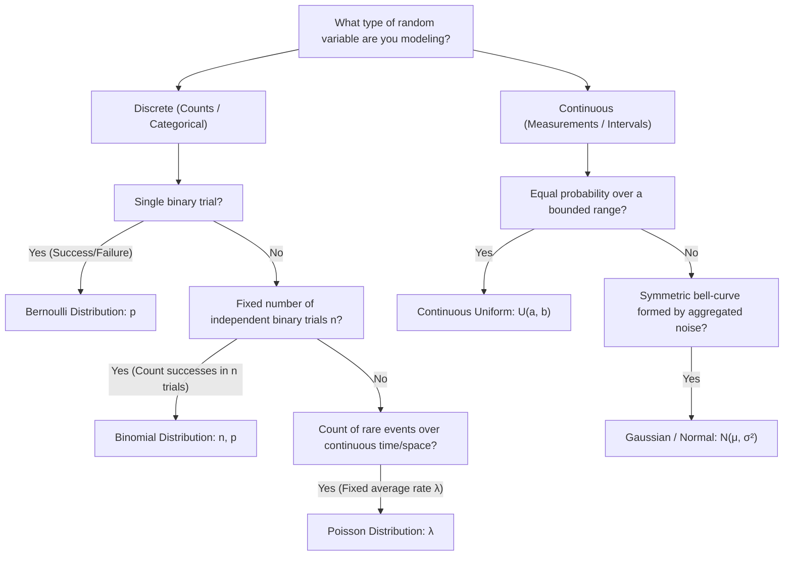
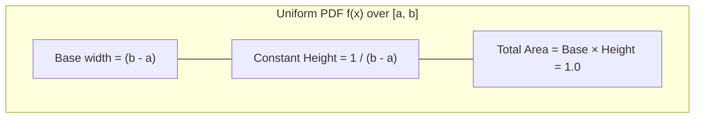
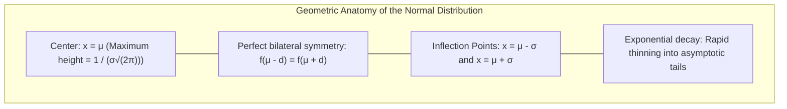

[Maths Index](../README.md) / [Unit 3: Probability Modeling and Parameter Estimation](Introduction.md)

# Common Probability Distributions

When we observe data in the real world—the number of malicious network packets hitting a firewall, the height of adult humans, the conversion rate of an e-commerce checkout page, or the sensor noise in a lidar unit—we do not need to invent an arbitrary probability distribution from scratch each time.

Physical, computational, and social processes tend to follow universal generative mechanisms. A trial succeeds or fails. Independent events accumulate over continuous time. Many small, independent fluctuations compound together.

These mechanisms give rise to standard parametric probability distributions. Instead of specifying an infinite list of probabilities, we characterize an entire distribution using a mathematical formula governed by a few parameters $\boldsymbol{\theta}$. Once we know the family and the parameters, we know everything about the process.

---

## Distribution Selection Architecture

Before diving into algebraic derivations, let's look at the decision tree that connects practical data science problems to their corresponding distribution families:

---

## The Bernoulli Distribution: The Atom of Binary Data

The simplest non-trivial random variable models a single experiment with exactly two mutually exclusive outcomes: success ($1$) or failure ($0$).

Let $p \in [0, 1]$ denote the probability of success. The random variable $X$ follows a Bernoulli distribution, denoted $X \sim \text{Bernoulli}(p)$:

$$X = \begin{cases} 1, & \text{with probability } p \\ 0, & \text{with probability } 1 - p \end{cases}$$

We can write this compactly in a single algebraic expression as a Probability Mass Function (PMF):

$$p(x) = p^x (1 - p)^{1 - x}, \quad \text{for } x \in \{0, 1\}$$

Notice why this exponent trick works:
- If $x = 1$: $p^1 (1 - p)^0 = p$.
- If $x = 0$: $p^0 (1 - p)^1 = 1 - p$.

This compact form is not just a mathematical curiosity; it is the exact likelihood equation that powers binary cross-entropy loss in logistic regression and deep learning classifiers.

### Mean and Variance Derivation

Applying the definitions of expectation and variance:

$$E[X] = \sum_{x \in \{0, 1\}} x \cdot p(x) = (0)(1 - p) + (1)(p) = p$$

To find variance, we first compute $E[X^2]$:
$$E[X^2] = (0^2)(1 - p) + (1^2)(p) = p$$

Now subtract the square of the mean:
$$\text{Var}(X) = E[X^2] - (E[X])^2 = p - p^2 = p(1 - p)$$

Notice something intuitive about the variance $p(1 - p)$:
- If $p = 0$ or $p = 1$, the outcome is completely deterministic, and $\text{Var}(X) = 0$.
- Maximizing $p(1 - p)$ by taking the derivative with respect to $p$ and setting it to zero yields $1 - 2p = 0 \implies p = 0.5$. Maximum uncertainty occurs when the outcome is an unbiased coin flip ($\sigma^2 = 0.25$).

---

## The Binomial Distribution: Aggregating Independent Trials

Now suppose we perform not one, but $n$ independent and identically distributed (i.i.d.) Bernoulli trials, each with success probability $p$.

Let $X$ be the total number of successes observed across all $n$ trials. Then $X$ follows a Binomial distribution, denoted $X \sim \text{Bin}(n, p)$.

What is the probability of observing exactly $k$ successes (where $k \in \{0, 1, \dots, n\}$)?

Think about how this event happens:
1. Any specific sequence of $k$ successes and $n - k$ failures has probability $p^k (1 - p)^{n - k}$, because the trials are statistically independent.
2. But order does not matter. The successes can appear in any of the $n$ positions.
3. The number of distinct ways to choose $k$ positions out of $n$ trials is given by the binomial coefficient:
   $$\binom{n}{k} = \frac{n!}{k!(n - k)!}$$

Multiplying the number of mutually exclusive configurations by the probability of each configuration gives the Binomial PMF:

$$P(X = k) = \binom{n}{k} p^k (1 - p)^{n - k}, \quad \text{for } k \in \{0, 1, \dots, n\}$$

### Mean and Variance via Decomposition

We could derive $E[X]$ and $\text{Var}(X)$ by evaluating combinatorial sums $\sum_{k=0}^n k \binom{n}{k} p^k (1-p)^{n-k}$, but linear algebra and probability reward us for thinking structurally.

Notice that the Binomial variable $X$ is simply the sum of $n$ independent Bernoulli random variables $Y_1, Y_2, \dots, Y_n$:

$$X = \sum_{i=1}^n Y_i, \quad \text{where } Y_i \stackrel{\text{i.i.d.}}{\sim} \text{Bernoulli}(p)$$

By linearity of expectation:
$$E[X] = E\left[\sum_{i=1}^n Y_i\right] = \sum_{i=1}^n E[Y_i] = \sum_{i=1}^n p = np$$

Because the trials are independent, the variance of the sum is the sum of the variances:
$$\text{Var}(X) = \text{Var}\left(\sum_{i=1}^n Y_i\right) = \sum_{i=1}^n \text{Var}(Y_i) = \sum_{i=1}^n p(1 - p) = np(1 - p)$$

### Step-by-Step Numerical Example: Classification Evaluation

An automated email spam classifier has an independent error rate of $p = 0.05$ (meaning $5\%$ of legitimate emails are falsely flagged). If an inbox receives $n = 20$ legitimate emails in a day, what is the probability that:
1. Exactly $2$ legitimate emails are misclassified?
2. At most $1$ legitimate email is misclassified?

Let $X \sim \text{Bin}(20, 0.05)$. Here $n = 20, p = 0.05, 1 - p = 0.95$.

Part 1: Exactly 2 errors ($k = 2$)
$$\binom{20}{2} = \frac{20 \times 19}{2 \times 1} = 190$$
$$P(X = 2) = 190 \times (0.05)^2 \times (0.95)^{18}$$
$$(0.05)^2 = 0.0025$$
$$(0.95)^{18} \approx 0.3972$$
$$P(X = 2) = 190 \times 0.0025 \times 0.3972 \approx 0.1887 \quad (18.87\%)$$

Part 2: At most 1 error ($P(X \le 1) = P(X = 0) + P(X = 1)$)
$$\begin{aligned}
P(X = 0) &= \binom{20}{0} (0.05)^0 (0.95)^{20} = 1 \times 1 \times (0.95)^{20} \approx 0.3585 \\
P(X = 1) &= \binom{20}{1} (0.05)^1 (0.95)^{19} = 20 \times 0.05 \times (0.95)^{19} = 1 \times 0.3774 = 0.3774
\end{aligned}$$
$$P(X \le 1) = 0.3585 + 0.3774 = 0.7359 \quad (73.59\%)$$

---

## The Poisson Distribution: Counting Rare Events in Continuous Time

What happens if events occur continuously over time or space rather than across discrete trials? 

Consider counting:
- The number of visitors landing on a website per second.
- The number of defective pixels on a high-resolution display panel.
- The number of mutations in a DNA strand.

A process generating counts in a fixed interval of length $T$ is a Poisson Process if:
1. Events occur independently.
2. The average rate of occurrence $\lambda > 0$ is constant over the interval.
3. Two events cannot happen at the exact same instantaneous infinitesimal instant.

Under these conditions, the count of events $X$ follows a Poisson distribution, denoted $X \sim \text{Poisson}(\lambda)$:

$$P(X = k) = \frac{\lambda^k e^{-\lambda}}{k!}, \quad \text{for } k \in \{0, 1, 2, \dots\}$$

### Poisson as the Mathematical Limit of Binomial

Now here is a beautiful connection: the Poisson distribution is the mathematical limit of the Binomial distribution when the number of trials $n \to \infty$ while the success probability $p \to 0$ such that the expected product $np = \lambda$ remains constant.

Let's prove this explicitly. Substitute $p = \frac{\lambda}{n}$ into the Binomial PMF:

$$\begin{aligned}
P(X = k) &= \binom{n}{k} \left(\frac{\lambda}{n}\right)^k \left(1 - \frac{\lambda}{n}\right)^{n - k} \\
&= \frac{n(n - 1)(n - 2)\dots(n - k + 1)}{k!} \cdot \frac{\lambda^k}{n^k} \cdot \left(1 - \frac{\lambda}{n}\right)^n \cdot \left(1 - \frac{\lambda}{n}\right)^{-k} \\
&= \frac{\lambda^k}{k!} \cdot \left[\frac{n}{n} \cdot \frac{n - 1}{n} \dots \frac{n - k + 1}{n}\right] \cdot \left(1 - \frac{\lambda}{n}\right)^n \cdot \left(1 - \frac{\lambda}{n}\right)^{-k}
\end{aligned}$$

Now take the limit as $n \to \infty$:
- The bracketed product of $k$ terms converges to $1 \times 1 \dots \times 1 = 1$.
- By the classical calculus definition of the exponential function, $\lim_{n \to \infty} \left(1 - \frac{\lambda}{n}\right)^n = e^{-\lambda}$.
- The term $\lim_{n \to \infty} \left(1 - \frac{\lambda}{n}\right)^{-k} = (1 - 0)^{-k} = 1$.

Putting these pieces together:
$$\lim_{n \to \infty} P(X = k) = \frac{\lambda^k e^{-\lambda}}{k!}$$

### Mean and Variance of Poisson

A distinctive signature of the Poisson distribution is that its mean and variance are identical:

$$E[X] = \lambda$$
$$\text{Var}(X) = \lambda$$

If you analyze empirical count data in a data science project and find that the sample variance is significantly larger than the sample mean, the data exhibits overdispersion, indicating that the true rate $\lambda$ is varying (which often calls for a Negative Binomial model instead of pure Poisson).

### Step-by-Step Numerical Example: API Rate Limiting

An API gateway receives an average of $\lambda = 3$ incoming requests per millisecond. What is the probability that in any given millisecond:
1. Exactly 0 requests arrive?
2. Exactly 4 requests arrive?

Using $\lambda = 3$:
$$P(X = 0) = \frac{3^0 e^{-3}}{0!} = \frac{1 \cdot e^{-3}}{1} \approx 0.0498 \quad (4.98\%)$$
$$P(X = 4) = \frac{3^4 e^{-3}}{4!} = \frac{81 \cdot e^{-3}}{24} = \frac{81 \times 0.049787}{24} \approx 0.1680 \quad (16.80\%)$$

---

## The Continuous Uniform Distribution: Maximum Ignorance

Moving to continuous random variables, the simplest model is the Continuous Uniform distribution over an interval $[a, b]$, denoted $X \sim \mathcal{U}(a, b)$.

Every sub-interval of equal length within $[a, b]$ is equally likely to contain $X$.

### PDF and CDF

The PDF is constant on $[a, b]$:

$$f(x) = \begin{cases} \frac{1}{b - a}, & a \le x \le b \\ 0, & \text{otherwise} \end{cases}$$

The CDF is the running integral from $a$ to $x$:

$$F(x) = \int_a^x \frac{1}{b - a} \, dt = \frac{x - a}{b - a}, \quad \text{for } x \in [a, b]$$

### Mean and Variance Derivation

Expectation is the midpoint of the interval:
$$E[X] = \int_a^b x \left(\frac{1}{b - a}\right) dx = \frac{1}{b - a} \left[ \frac{x^2}{2} \right]_a^b = \frac{b^2 - a^2}{2(b - a)} = \frac{(b - a)(b + a)}{2(b - a)} = \frac{a + b}{2}$$

For variance, compute $E[X^2]$:
$$E[X^2] = \int_a^b x^2 \left(\frac{1}{b - a}\right) dx = \frac{1}{b - a} \left[ \frac{x^3}{3} \right]_a^b = \frac{b^3 - a^3}{3(b - a)} = \frac{a^2 + ab + b^2}{3}$$

Now compute $\text{Var}(X) = E[X^2] - (E[X])^2$:
$$\text{Var}(X) = \frac{a^2 + ab + b^2}{3} - \frac{(a + b)^2}{4} = \frac{4(a^2 + ab + b^2) - 3(a^2 + 2ab + b^2)}{12} = \frac{a^2 - 2ab + b^2}{12} = \frac{(b - a)^2}{12}$$

In data science, the uniform distribution on $[0, 1]$ serves as the primary engine for random number generation: by the Inverse Transform Sampling theorem, applying the inverse CDF $F^{-1}(U)$ to a uniform variable $U \sim \mathcal{U}(0, 1)$ generates samples from any continuous distribution.

---

## The Gaussian (Normal) Distribution: The King of Distributions

The Gaussian (Normal) distribution is the single most important probability distribution in artificial intelligence, mathematics, and physics.

A continuous random variable $X$ follows a Normal distribution with mean $\mu \in \mathbb{R}$ and variance $\sigma^2 > 0$, denoted $X \sim \mathcal{N}(\mu, \sigma^2)$, if its PDF is:

$$f(x) = \frac{1}{\sigma \sqrt{2\pi}} \exp\left(-\frac{(x - \mu)^2}{2\sigma^2}\right), \quad \text{for } x \in (-\infty, \infty)$$

### Key Geometric Properties of the Gaussian PDF

1. Bilateral Symmetry: The curve is perfectly symmetric around $x = \mu$. The mean, median, and mode are all identical and equal to $\mu$.
2. Peak Height: The maximum density occurs at $x = \mu$, where the exponential term becomes $e^0 = 1$:
   $$f(\mu) = \frac{1}{\sigma \sqrt{2\pi}}$$
3. Inflection Points: Taking the second derivative $f''(x)$ and setting it to zero reveals that the curve transitions from concave downward to concave upward at exactly $x = \mu - \sigma$ and $x = \mu + \sigma$.
4. Total Probability: Even though $e^{-x^2}$ has no elementary anti-derivative, the normalization constant $\frac{1}{\sigma \sqrt{2\pi}}$ guarantees that $\int_{-\infty}^\infty f(x) \, dx = 1$ (via the celebrated Poisson-Gauss polar integration trick).

### The Empirical Rule (The 68–95–99.7 Rule)

For any Gaussian distribution, regardless of $\mu$ and $\sigma$:
- Approximately $68.27\%$ of the probability mass lies within $1\sigma$ of the mean: $[\mu - \sigma, \mu + \sigma]$.
- Approximately $95.45\%$ of the probability mass lies within $2\sigma$ of the mean: $[\mu - 2\sigma, \mu + 2\sigma]$.
- Approximately $99.73\%$ of the probability mass lies within $3\sigma$ of the mean: $[\mu - 3\sigma, \mu + 3\sigma]$.

Values falling beyond $3\sigma$ represent less than $0.27\%$ of observations, making the $3\sigma$ boundary a standard threshold for anomaly detection and outlier filtering.

---

## The Standard Normal Distribution and $Z$-Score Standardization

Because every pair of $(\mu, \sigma^2)$ generates a different Gaussian curve, integrating $f(x)$ directly for arbitrary parameters would require infinite precomputed tables.

Instead, we standardize.

The Standard Normal Distribution, denoted $Z \sim \mathcal{N}(0, 1)$, is the special case where $\mu = 0$ and $\sigma^2 = 1$:

$$\phi(z) = \frac{1}{\sqrt{2\pi}} e^{-\frac{z^2}{2}}$$

Its CDF is denoted by the Greek capital letter $\Phi(z)$:
$$\Phi(z) = P(Z \le z) = \int_{-\infty}^z \frac{1}{\sqrt{2\pi}} e^{-\frac{t^2}{2}} dt$$

### The $Z$-Transformation

Any general Normal variable $X \sim \mathcal{N}(\mu, \sigma^2)$ can be mapped to a Standard Normal variable $Z \sim \mathcal{N}(0, 1)$ via the linear transformation:

$$Z = \frac{X - \mu}{\sigma}$$

Let's verify why this transformation works using the properties of expectation and variance:
$$E[Z] = E\left[\frac{X - \mu}{\sigma}\right] = \frac{E[X] - \mu}{\sigma} = \frac{\mu - \mu}{\sigma} = 0$$
$$\text{Var}(Z) = \text{Var}\left(\frac{X - \mu}{\sigma}\right) = \frac{\text{Var}(X - \mu)}{\sigma^2} = \frac{\text{Var}(X)}{\sigma^2} = \frac{\sigma^2}{\sigma^2} = 1$$

Because any linear combination of a Gaussian variable remains Gaussian, $Z$ is guaranteed to be $\mathcal{N}(0, 1)$.

To calculate any probability for $X$:
$$P(a \le X \le b) = P\left(\frac{a - \mu}{\sigma} \le Z \le \frac{b - \mu}{\sigma}\right) = \Phi\left(\frac{b - \mu}{\sigma}\right) - \Phi\left(\frac{a - \mu}{\sigma}\right)$$

Due to symmetry around 0:
$$\Phi(-z) = 1 - \Phi(z)$$

### Step-by-Step Numerical Example: Standardization in Action

The latency of database queries on a production cluster is normally distributed with mean $\mu = 120\text{ ms}$ and standard deviation $\sigma = 15\text{ ms}$.

What is the probability that a randomly chosen query:
1. Takes longer than $150\text{ ms}$?
2. Takes between $100\text{ ms}$ and $135\text{ ms}$?

Part 1: $P(X > 150)$
Standardize $x = 150$:
$$z = \frac{150 - 120}{15} = \frac{30}{15} = 2.0$$

$$P(X > 150) = P(Z > 2.0) = 1 - \Phi(2.0)$$
Looking up $\Phi(2.0)$ in a standard normal table gives $\Phi(2.0) = 0.9772$.
$$P(X > 150) = 1 - 0.9772 = 0.0228 \quad (2.28\%)$$

Part 2: $P(100 \le X \le 135)$
Standardize both boundaries:
$$z_1 = \frac{100 - 120}{15} = -\frac{20}{15} \approx -1.33$$
$$z_2 = \frac{135 - 120}{15} = \frac{15}{15} = 1.00$$

$$\begin{aligned}
P(100 \le X \le 135) &= \Phi(1.00) - \Phi(-1.33) \\
&= \Phi(1.00) - [1 - \Phi(1.33)]
\end{aligned}$$

From the standard normal table:
- $\Phi(1.00) \approx 0.8413$
- $\Phi(1.33) \approx 0.9082 \implies \Phi(-1.33) = 1 - 0.9082 = 0.0918$

$$P(100 \le X \le 135) = 0.8413 - 0.0918 = 0.7495 \quad (74.95\%)$$

---

## Summary Comparison of Parametric Distributions

| Distribution | Support | Parameters | PMF / PDF | Mean $E[X]$ | Variance $\text{Var}(X)$ |
|:---|:---:|:---:|:---|:---:|:---:|
| **Bernoulli** | $\{0, 1\}$ | $p \in [0, 1]$ | $p^x (1-p)^{1-x}$ | $p$ | $p(1-p)$ |
| **Binomial** | $\{0, 1, \dots, n\}$ | $n \in \mathbb{N}, p \in [0, 1]$ | $\binom{n}{k} p^k (1-p)^{n-k}$ | $np$ | $np(1-p)$ |
| **Poisson** | $\{0, 1, 2, \dots\}$ | $\lambda > 0$ | $\frac{\lambda^k e^{-\lambda}}{k!}$ | $\lambda$ | $\lambda$ |
| **Uniform** | $[a, b]$ | $a < b$ | $\frac{1}{b-a}$ | $\frac{a+b}{2}$ | $\frac{(b-a)^2}{12}$ |
| **Gaussian** | $(-\infty, \infty)$ | $\mu \in \mathbb{R}, \sigma > 0$ | $\frac{1}{\sigma \sqrt{2\pi}} e^{-\frac{(x-\mu)^2}{2\sigma^2}}$ | $\mu$ | $\sigma^2$ |

---

## Key Takeaways

- The Bernoulli distribution models a single binary outcome with mean $p$ and variance $p(1-p)$, reaching maximum variance at $p = 0.5$.
- The Binomial distribution counts successes across $n$ independent Bernoulli trials. Its mean is $np$ and variance is $np(1-p)$, derived by summing $n$ independent Bernoulli variables.
- The Poisson distribution counts occurrences of rare events in continuous intervals. Its mean and variance are both equal to $\lambda$, and it arises as the mathematical limit of the Binomial distribution as $n \to \infty$ and $p \to 0$ with $np = \lambda$.
- The Continuous Uniform distribution models complete absence of bias over an interval $[a, b]$, with mean $\frac{a+b}{2}$ and variance $\frac{(b-a)^2}{12}$.
- The Gaussian distribution $\mathcal{N}(\mu, \sigma^2)$ is symmetric, bell-shaped, and governed by the Empirical Rule ($68\%$, $95\%$, $99.7\%$).
- Standardization via $Z = \frac{X - \mu}{\sigma}$ shifts the mean to 0 and scales the variance to 1, allowing probabilities for any Gaussian to be calculated using the Standard Normal CDF $\Phi(z)$.

---

Up to this point, we have analyzed random variables in total isolation. But real-world data science is fundamentally multi-dimensional: features interact, inputs correlate, and variables depend on one another. To model tabular datasets, neural network feature layers, and multidimensional sensor readings, we must generalize our probability calculus from single variables to pairs and vectors of random variables. In the next lecture, we establish joint, marginal, and conditional distributions, statistical independence, covariance, and the correlation coefficient. Read [L04 - Multivariate Distributions and Independence](L04%20-%20Multivariate%20Distributions%20and%20Independence.md).
