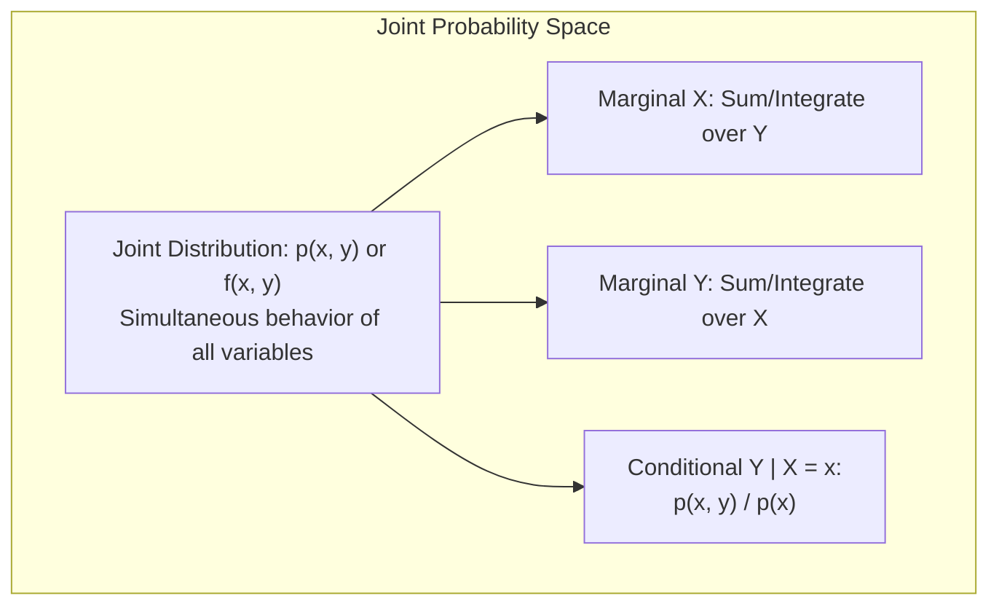
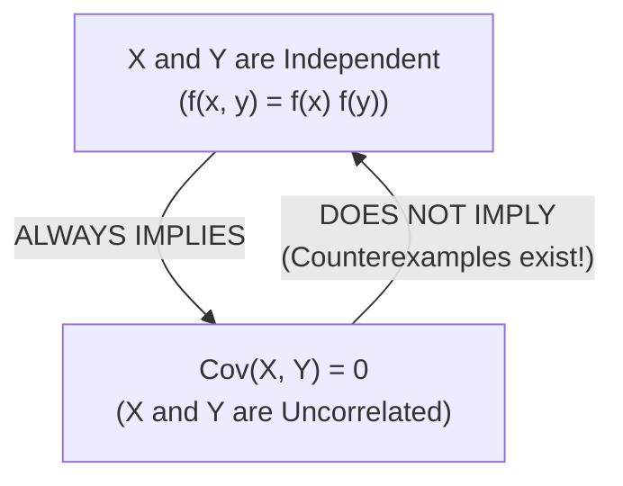

[Maths Index](../README.md) / [Unit 3: Probability Modeling and Parameter Estimation](Introduction.md)

# Multivariate Distributions and Independence

In machine learning and data science, we almost never analyze a single scalar feature in isolation. A dataset is not a lone column of numbers; it is a matrix of observations where each row is a high-dimensional vector $\mathbf{x} = [x_1, x_2, \dots, x_d]^T \in \mathbb{R}^d$.

A patient's medical profile combines blood pressure, heart rate, blood glucose, and age. An image consists of thousands of correlated pixel intensities. An audio clip contains frequency coefficients across time.

To model how multiple variables behave together, how knowledge of one feature updates our belief about another, and how variables correlate or decouple, we must extend probability from univariate scalars to multivariate distributions.

---

## Joint Probability Distributions

When two or more random variables are defined on the same sample space $\Omega$, their simultaneous behavior is governed by a joint distribution.

### The Joint Probability Mass Function (Discrete)

For two discrete random variables $X$ and $Y$, the Joint Probability Mass Function (Joint PMF) is defined as:

$$p_{X,Y}(x, y) = P(X = x \text{ and } Y = y) = P(\{X = x\} \cap \{Y = y\})$$

A valid joint PMF must satisfy:
1. $p_{X,Y}(x, y) \ge 0$ for all pairs $(x, y)$.
2. The total sum over all possible combinations equals 1:
   $$\sum_{x} \sum_{y} p_{X,Y}(x, y) = 1$$

### The Joint Probability Density Function (Continuous)

For two continuous random variables $X$ and $Y$, their joint behavior is governed by a Joint Probability Density Function (Joint PDF) $f_{X,Y}(x, y)$ such that:

1. $f_{X,Y}(x, y) \ge 0$ for all $(x, y) \in \mathbb{R}^2$.
2. The total volume under the 2D surface equals 1:
   $$\int_{-\infty}^\infty \int_{-\infty}^\infty f_{X,Y}(x, y) \, dx \, dy = 1$$
3. The probability that the pair $(X, Y)$ falls into any two-dimensional region $A \subseteq \mathbb{R}^2$ is the double integral over $A$:
   $$P((X, Y) \in A) = \iint_A f_{X,Y}(x, y) \, dx \, dy$$

---

## Marginal Distributions: Collapsing Dimensions

Suppose we have the full joint distribution of $(X, Y)$, but we only care about $X$. How do we recover the univariate distribution of $X$?

We perform marginalization: we sum out (or integrate out) the variable we want to ignore.

### Discrete Marginalization

For discrete variables, we sum the joint probabilities across all possible values of $Y$:

$$p_X(x) = \sum_{y} p_{X,Y}(x, y)$$
$$p_Y(y) = \sum_{x} p_{X,Y}(x, y)$$

Why is this called "marginal"? Historically, when joint probabilities were written down in a two-dimensional grid, statisticians summed across each row and down each column, writing the totals in the literal *margins* of the page.

### Continuous Marginalization

For continuous variables, summation becomes integration across the entire domain of the nuisance variable:

$$f_X(x) = \int_{-\infty}^\infty f_{X,Y}(x, y) \, dy$$
$$f_Y(y) = \int_{-\infty}^\infty f_{X,Y}(x, y) \, dx$$

Geometrically, integrating out $y$ corresponds to projecting the three-dimensional density surface $f_{X,Y}(x, y)$ onto the $x$-axis to form a two-dimensional cross-sectional area profile.

---

## Conditional Distributions and the Regression Function

What is the distribution of $Y$ once we have already observed that $X = x$?

### Conditional PMF and PDF

Following the definition of conditional probability $P(A \mid B) = \frac{P(A \cap B)}{P(B)}$:

- Discrete Conditional PMF:
  $$p_{Y \mid X}(y \mid x) = \frac{p_{X,Y}(x, y)}{p_X(x)}, \quad \text{defined for } p_X(x) > 0$$

- Continuous Conditional PDF:
  $$f_{Y \mid X}(y \mid x) = \frac{f_{X,Y}(x, y)}{f_X(x)}, \quad \text{defined for } f_X(x) > 0$$

Notice what conditional density represents: we take a vertical slice of the joint density surface along the line $X = x$, and then divide that slice by the marginal density $f_X(x)$. This division rescales the slice so that its area integrates to 1:
$$\int_{-\infty}^\infty f_{Y \mid X}(y \mid x) \, dy = \frac{1}{f_X(x)} \int_{-\infty}^\infty f_{X,Y}(x, y) \, dy = \frac{f_X(x)}{f_X(x)} = 1$$

### Conditional Expectation and Supervised Learning

Once we have the conditional distribution $f_{Y \mid X}(y \mid x)$, we can compute its expected value:

$$E[Y \mid X = x] = \int_{-\infty}^\infty y \, f_{Y \mid X}(y \mid x) \, dy$$

Now here is the core connection to artificial intelligence:
$E[Y \mid X = x]$ is a deterministic function of $x$, often denoted $m(x)$. This function is the regression function.

In supervised regression, when we train a model (such as a neural network or gradient boosted tree) using Mean Squared Error loss:
$$\min_{g} E\left[(Y - g(X))^2\right]$$

The theoretical optimal predictor that minimizes mean squared error is precisely the conditional expectation:
$$g^*(x) = E[Y \mid X = x]$$

### The Law of Iterated Expectations (Tower Property)

The expected value of the conditional expectation equals the unconditional expectation:

$$E_X\left[E_{Y \mid X}[Y \mid X]\right] = E[Y]$$

This theorem tells us that to find the overall average of a target variable $Y$, we can first average $Y$ within each subgroup $X = x$, and then average those subgroup means weighted by how often each subgroup occurs.

---

## Statistical Independence

Two random variables $X$ and $Y$ are statistically independent (denoted $X \perp Y$) if knowing the realized value of one variable provides zero information about the probability distribution of the other.

Formally, $X$ and $Y$ are independent if and only if their joint distribution factors into the product of their marginal distributions for all possible values:

- Discrete case:
  $$p_{X,Y}(x, y) = p_X(x) \cdot p_Y(y) \quad \text{for all } x, y$$
- Continuous case:
  $$f_{X,Y}(x, y) = f_X(x) \cdot f_Y(y) \quad \text{for all } x, y$$

Notice the equivalent conditional formulation: if $X$ and $Y$ are independent, then:
$$f_{Y \mid X}(y \mid x) = \frac{f_{X,Y}(x, y)}{f_X(x)} = \frac{f_X(x) f_Y(y)}{f_X(x)} = f_Y(y)$$

The conditional distribution of $Y$ given $X = x$ is simply the unconditional distribution of $Y$. Conditioning on $X$ changes nothing.

### Expectation of a Product Under Independence

If $X$ and $Y$ are independent, the expected value of their product equals the product of their expected values:

$$E[XY] = E[X] \cdot E[Y]$$

Let's prove this for continuous independent variables:
$$\begin{aligned}
E[XY] &= \int_{-\infty}^\infty \int_{-\infty}^\infty xy \, f_{X,Y}(x, y) \, dx \, dy \\
&= \int_{-\infty}^\infty \int_{-\infty}^\infty xy \, f_X(x) f_Y(y) \, dx \, dy \\
&= \left(\int_{-\infty}^\infty x f_X(x) \, dx\right) \left(\int_{-\infty}^\infty y f_Y(y) \, dy\right) \\
&= E[X] \cdot E[Y]
\end{aligned}$$

---

## Covariance: Measuring Linear Association

When variables are not independent, how do we quantify the strength and direction of their relationship?

The covariance between two random variables $X$ and $Y$, denoted $\text{Cov}(X, Y)$ or $\sigma_{XY}$, measures the joint variability of $X$ and $Y$ around their respective means:

$$\text{Cov}(X, Y) = E\left[(X - \mu_X)(Y - \mu_Y)\right]$$

- If $X$ tends to be above its mean when $Y$ is above its mean, both $(X - \mu_X)$ and $(Y - \mu_Y)$ are positive, yielding a positive product.
- If $X$ tends to be above its mean when $Y$ is below its mean, the terms have opposite signs, yielding a negative product.
- If deviations in $X$ have no systematic direction relative to deviations in $Y$, positive and negative products cancel out, yielding covariance near zero.

### The Computational Formula for Covariance

Expanding the algebraic definition gives:
$$\begin{aligned}
\text{Cov}(X, Y) &= E\left[XY - \mu_Y X - \mu_X Y + \mu_X \mu_Y\right] \\
&= E[XY] - \mu_Y E[X] - \mu_X E[Y] + \mu_X \mu_Y \\
&= E[XY] - \mu_Y \mu_X - \mu_X \mu_Y + \mu_X \mu_Y \\
&= E[XY] - E[X]E[Y]
\end{aligned}$$

$$\text{Cov}(X, Y) = E[XY] - E[X]E[Y]$$

### Fundamental Properties of Covariance

1. Self-covariance is variance:
   $$\text{Cov}(X, X) = E[(X - \mu_X)^2] = \text{Var}(X)$$
2. Symmetry:
   $$\text{Cov}(X, Y) = \text{Cov}(Y, X)$$
3. Bilinearity: For constants $a, b, c, d \in \mathbb{R}$:
   $$\text{Cov}(aX + b, cY + d) = ac \, \text{Cov}(X, Y)$$
   Notice that constants $b$ and $d$ vanish because shifts do not alter spread or association.
4. Variance of a Sum:
   $$\text{Var}(X + Y) = \text{Var}(X) + \text{Var}(Y) + 2\text{Cov}(X, Y)$$
   $$\text{Var}(X - Y) = \text{Var}(X) + \text{Var}(Y) - 2\text{Cov}(X, Y)$$
   If $X$ and $Y$ are uncorrelated ($\text{Cov}(X, Y) = 0$), the variance of the sum is strictly the sum of the variances.

---

## Independence versus Zero Covariance: A Critical Warning

Here is one of the most common conceptual pitfalls in machine learning and statistics:

- If $X$ and $Y$ are independent, then:
  $$\text{Cov}(X, Y) = E[XY] - E[X]E[Y] = E[X]E[Y] - E[X]E[Y] = 0$$
  Independence strictly implies zero covariance.
- But zero covariance does NOT imply independence!

Covariance only detects linear relationships. If two variables share a strong non-linear relationship, their covariance can be identically zero while the variables remain completely dependent.

### Rigorous Counterexample

Let $X$ be a continuous random variable uniformly distributed on $[-1, 1]$:
$$X \sim \mathcal{U}(-1, 1) \implies f_X(x) = \frac{1}{1 - (-1)} = \frac{1}{2}, \quad x \in [-1, 1]$$

Let $Y = X^2$. Notice that $Y$ is completely, deterministically dependent on $X$. If you tell me $X = 0.5$, I know with $100\%$ mathematical certainty that $Y = 0.25$. They could not be more dependent.

Now, let's compute their covariance:
1. $E[X] = \frac{-1 + 1}{2} = 0$.
2. $E[XY] = E[X \cdot X^2] = E[X^3] = \int_{-1}^1 x^3 \left(\frac{1}{2}\right) dx = \frac{1}{2} \left[ \frac{x^4}{4} \right]_{-1}^1 = \frac{1}{8}(1 - 1) = 0$.

Now compute covariance:
$$\text{Cov}(X, Y) = E[XY] - E[X]E[Y] = 0 - (0)E[Y] = 0$$

The covariance is exactly zero! An algorithm checking only covariance would declare $X$ and $Y$ unrelated, even though $Y$ is an exact deterministic quadratic function of $X$.

*(The only major exception is when $X$ and $Y$ are jointly Gaussian; for jointly normal variables, zero covariance does imply independence).*

---

## The Pearson Correlation Coefficient

While covariance reveals whether variables move together, its magnitude is difficult to interpret because it depends on the units of measurement. If we measure height in meters and weight in kilograms, we get one covariance; if we measure height in millimeters and weight in grams, the covariance explodes by a factor of $1{,}000{,}000$, despite the underlying physical relationship being identical.

To create a dimensionless, unit-invariant metric of linear association, we normalize covariance by the product of the individual standard deviations.

The Pearson correlation coefficient, denoted $\rho_{X,Y}$ (or simply $\rho$), is:

$$\rho_{X,Y} = \frac{\text{Cov}(X, Y)}{\sigma_X \sigma_Y} = \frac{E[(X - \mu_X)(Y - \mu_Y)]}{\sqrt{E[(X - \mu_X)^2]} \sqrt{E[(Y - \mu_Y)^2]}}$$

### Cauchy-Schwarz Bound: Proof that $-1 \le \rho \le 1$

Why is correlation bounded strictly between $-1$ and $+1$?

Consider the standardized variables $\tilde{X} = \frac{X - \mu_X}{\sigma_X}$ and $\tilde{Y} = \frac{Y - \mu_Y}{\sigma_Y}$.
Notice that $E[\tilde{X}] = 0$, $E[\tilde{Y}] = 0$, $\text{Var}(\tilde{X}) = 1$, and $\text{Var}(\tilde{Y}) = 1$.

The correlation is simply the expected product of the standardized variables:
$$\rho = E[\tilde{X}\tilde{Y}]$$

Now evaluate the variance of $(\tilde{X} - \tilde{Y})$ and $(\tilde{X} + \tilde{Y})$. Because variance is always non-negative:
$$\text{Var}(\tilde{X} - \tilde{Y}) = \text{Var}(\tilde{X}) + \text{Var}(\tilde{Y}) - 2\text{Cov}(\tilde{X}, \tilde{Y}) \ge 0$$
$$1 + 1 - 2\rho \ge 0 \implies 2 \ge 2\rho \implies \rho \le 1$$

Similarly, for the sum:
$$\text{Var}(\tilde{X} + \tilde{Y}) = \text{Var}(\tilde{X}) + \text{Var}(\tilde{Y}) + 2\text{Cov}(\tilde{X}, \tilde{Y}) \ge 0$$
$$1 + 1 + 2\rho \ge 0 \implies 2 + 2\rho \ge 0 \implies \rho \ge -1$$

Combining both inequalities establishes:
$$-1 \le \rho_{X,Y} \le 1$$

- $\rho = +1$: Perfect positive linear relationship ($Y = aX + b$ with $a > 0$).
- $\rho = -1$: Perfect negative linear relationship ($Y = aX + b$ with $a < 0$).
- $\rho = 0$: No linear relationship.

---

## The Covariance Matrix for Random Vectors

In modern AI, data points are vectors $\mathbf{X} = [X_1, X_2, \dots, X_d]^T \in \mathbb{R}^d$.

The expected value of a random vector is the vector of its individual component means:
$$\boldsymbol{\mu} = E[\mathbf{X}] = \begin{bmatrix} E[X_1] \\ E[X_2] \\ \vdots \\ E[X_d] \end{bmatrix} \in \mathbb{R}^d$$

The Covariance Matrix, denoted $\boldsymbol{\Sigma} \in \mathbb{R}^{d \times d}$, is defined as the expected outer product of the centered vector with itself:

$$\boldsymbol{\Sigma} = E\left[(\mathbf{X} - \boldsymbol{\mu})(\mathbf{X} - \boldsymbol{\mu})^T\right]$$

Written out element by element:

$$\boldsymbol{\Sigma} = \begin{bmatrix}
\text{Var}(X_1) & \text{Cov}(X_1, X_2) & \dots & \text{Cov}(X_1, X_d) \\
\text{Cov}(X_2, X_1) & \text{Var}(X_2) & \dots & \text{Cov}(X_2, X_d) \\
\vdots & \vdots & \ddots & \vdots \\
\text{Cov}(X_d, X_1) & \text{Cov}(X_d, X_2) & \dots & \text{Var}(X_d)
\end{bmatrix}$$

Notice two critical linear algebraic properties:
1. Symmetry: Because $\text{Cov}(X_i, X_j) = \text{Cov}(X_j, X_i)$, $\boldsymbol{\Sigma} = \boldsymbol{\Sigma}^T$.
2. Positive Semi-Definiteness: For any non-zero real vector $\mathbf{v} \in \mathbb{R}^d$:
   $$\mathbf{v}^T \boldsymbol{\Sigma} \mathbf{v} = \mathbf{v}^T E\left[(\mathbf{X} - \boldsymbol{\mu})(\mathbf{X} - \boldsymbol{\mu})^T\right] \mathbf{v} = E\left[\left(\mathbf{v}^T(\mathbf{X} - \boldsymbol{\mu})\right)^2\right] \ge 0$$
   Because the expectation of a squared scalar quantity is always $\ge 0$, $\boldsymbol{\Sigma}$ is always positive semi-definite ($\boldsymbol{\Sigma} \succeq 0$). Its eigenvalues are non-negative real numbers, forming the foundation for Principal Component Analysis (PCA).

---

## Complete Step-by-Step Numerical Example

Let $X$ represent the number of GPUs requested by a training job ($X \in \{1, 2\}$) and $Y$ represent the execution priority level ($Y \in \{1, 2, 3\}$). The joint probability mass function $p_{X,Y}(x, y)$ is given in the table below:

| $X \setminus Y$ | $Y = 1$ | $Y = 2$ | $Y = 3$ |
|:---:|:---:|:---:|:---:|
| **$X = 1$** | $0.10$ | $0.20$ | $0.10$ |
| **$X = 2$** | $0.05$ | $0.25$ | $0.30$ |

### Step 1: Marginal Distributions

Sum across rows to find $p_X(x)$:
- $p_X(1) = 0.10 + 0.20 + 0.10 = 0.40$
- $p_X(2) = 0.05 + 0.25 + 0.30 = 0.60$
- Total: $0.40 + 0.60 = 1.00 \quad \checkmark$

Sum down columns to find $p_Y(y)$:
- $p_Y(1) = 0.10 + 0.05 = 0.15$
- $p_Y(2) = 0.20 + 0.25 = 0.45$
- $p_Y(3) = 0.10 + 0.30 = 0.40$
- Total: $0.15 + 0.45 + 0.40 = 1.00 \quad \checkmark$

### Step 2: Conditional PMF of $Y$ given $X = 1$

Using $p_{Y \mid X}(y \mid 1) = \frac{p(1, y)}{p_X(1)} = \frac{p(1, y)}{0.40}$:
- $p_{Y \mid X}(1 \mid 1) = \frac{0.10}{0.40} = 0.25$
- $p_{Y \mid X}(2 \mid 1) = \frac{0.20}{0.40} = 0.50$
- $p_{Y \mid X}(3 \mid 1) = \frac{0.10}{0.40} = 0.25$
- Total: $0.25 + 0.50 + 0.25 = 1.00 \quad \checkmark$

### Step 3: Individual Means and Variances

$$\begin{aligned}
E[X] &= (1)(0.40) + (2)(0.60) = 0.40 + 1.20 = 1.60 \\
E[X^2] &= (1^2)(0.40) + (2^2)(0.60) = 0.40 + 2.40 = 2.80 \\
\text{Var}(X) &= 2.80 - (1.60)^2 = 2.80 - 2.56 = 0.24 \\
\sigma_X &= \sqrt{0.24} \approx 0.4899
\end{aligned}$$

$$\begin{aligned}
E[Y] &= (1)(0.15) + (2)(0.45) + (3)(0.40) = 0.15 + 0.90 + 1.20 = 2.25 \\
E[Y^2] &= (1^2)(0.15) + (2^2)(0.45) + (3^2)(0.40) = 0.15 + 1.80 + 3.60 = 5.55 \\
\text{Var}(Y) &= 5.55 - (2.25)^2 = 5.55 - 5.0625 = 0.4875 \\
\sigma_Y &= \sqrt{0.4875} \approx 0.6982
\end{aligned}$$

### Step 4: Joint Expectation $E[XY]$

Sum $x \cdot y \cdot p(x, y)$ over all 6 cells:
$$\begin{aligned}
E[XY] &= (1)(1)(0.10) + (1)(2)(0.20) + (1)(3)(0.10) \\
&\quad + (2)(1)(0.05) + (2)(2)(0.25) + (2)(3)(0.30) \\
&= 0.10 + 0.40 + 0.30 + 0.10 + 1.00 + 1.80 \\
&= 3.70
\end{aligned}$$

### Step 5: Covariance and Pearson Correlation

$$\text{Cov}(X, Y) = E[XY] - E[X]E[Y] = 3.70 - (1.60)(2.25) = 3.70 - 3.60 = 0.10$$

Now compute Pearson correlation $\rho$:
$$\rho_{X,Y} = \frac{\text{Cov}(X, Y)}{\sigma_X \sigma_Y} = \frac{0.10}{(0.4899)(0.6982)} = \frac{0.10}{0.3420} \approx 0.2924$$

The positive correlation ($\rho \approx 0.292$) indicates that jobs requesting more GPUs ($X = 2$) tend to be assigned higher priority levels ($Y = 3$).

---

## Key Takeaways

- Joint distributions describe the simultaneous behavior of multiple random variables; marginal distributions collapse dimensions by summing or integrating out nuisance variables.
- The conditional expectation $E[Y \mid X = x]$ defines the regression function, representing the optimal theoretical predictor under Mean Squared Error loss.
- Two variables are independent if and only if their joint distribution factors into the product of marginals: $f(x, y) = f_X(x) f_Y(y)$.
- Covariance $\text{Cov}(X, Y) = E[XY] - E[X]E[Y]$ measures linear association. Independence strictly implies zero covariance, but zero covariance does NOT imply independence.
- Pearson correlation $\rho = \frac{\text{Cov}(X, Y)}{\sigma_X \sigma_Y}$ normalizes covariance to the dimensionless interval $[-1, 1]$.
- For a random vector $\mathbf{X} \in \mathbb{R}^d$, the covariance matrix $\boldsymbol{\Sigma} = E[(\mathbf{X} - \boldsymbol{\mu})(\mathbf{X} - \boldsymbol{\mu})^T]$ is always symmetric and positive semi-definite ($\boldsymbol{\Sigma} \succeq 0$).

---

Now that we understand how multiple random variables interact, what happens when we take a sample of $n$ independent observations and compute their average? Even if the individual variables come from a wildly non-normal distribution—skewed, discrete, or multimodal—something miraculous happens to their sum and mean as $n$ grows. In the next lecture, we uncover the mathematical bedrock of all inferential statistics: The Central Limit Theorem. Read [L05 - The Central Limit Theorem](L05%20-%20The%20Central%20Limit%20Theorem.md).
