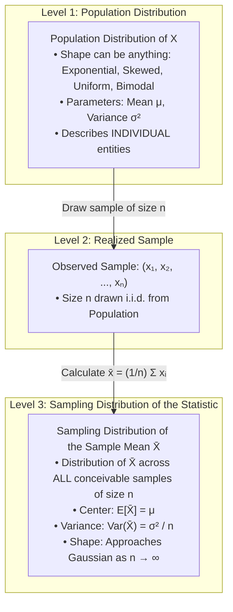
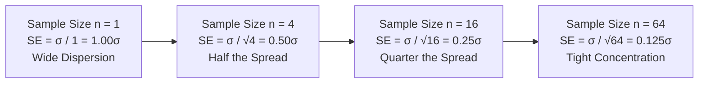
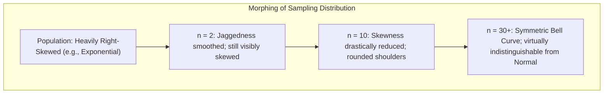

[Maths Index](../README.md) / [Unit 3: Probability Modeling and Parameter Estimation](Introduction.md)

# The Central Limit Theorem

In data science and statistics, a curious phenomenon appears over and over again. If you measure human heights, the measurement noise of an astronomical telescope, the average click-through rate of ad campaigns, or the weights of a neural network initialized with Xavier initialization, they all form the exact same bell-shaped curve: the Gaussian distribution.

Why does nature and computation have such an overwhelming obsession with the normal distribution? Is it an empirical coincidence?

It is not. It is governed by one of the most powerful, mathematically profound theorems in all of probability theory: The Central Limit Theorem (CLT). The CLT proves that whenever independent random factors are added together, their sum and their average converge to a Gaussian distribution, regardless of the original distribution of the individual components.

---

## Population Distribution versus Sampling Distribution

To understand the Central Limit Theorem without confusion, we must draw an unambiguous conceptual line between two distributions that novices constantly conflate:

1. The Population Distribution: The probability distribution of the raw random variable $X$ from which individual observations are drawn. This distribution can be anything: heavily skewed, discrete, bimodal, or uniform. It has fixed mean $\mu$ and fixed variance $\sigma^2$.
2. The Sampling Distribution of the Sample Mean: The probability distribution of the statistic $\bar{X} = \frac{1}{n} \sum_{i=1}^n X_i$ across all possible random samples of size $n$ that could ever be drawn from that population.

When you collect a single dataset, you compute a single number: $\bar{x}$. But that $\bar{x}$ is just one realized draw from the theoretical sampling distribution of $\bar{X}$.

---

## The Sample Mean as a Random Variable

Let $X_1, X_2, \dots, X_n$ be a sequence of $n$ independent and identically distributed (i.i.d.) random variables, each drawn from a population with mean $\mu$ and variance $\sigma^2$.

The sample mean is defined as:

$$\bar{X} = \frac{1}{n} \sum_{i=1}^n X_i = \frac{X_1 + X_2 + \dots + X_n}{n}$$

Because the inputs $X_i$ are random variables, their linear combination $\bar{X}$ is itself a random variable. What are its mean and variance?

### Expected Value of the Sample Mean

Using the linearity of expectation:

$$\begin{aligned}
E[\bar{X}] &= E\left[\frac{1}{n} \sum_{i=1}^n X_i\right] \\
&= \frac{1}{n} \sum_{i=1}^n E[X_i] \\
&= \frac{1}{n} \sum_{i=1}^n \mu = \frac{1}{n} (n\mu) = \mu
\end{aligned}$$

Notice this fundamental result: $E[\bar{X}] = \mu$.

The expected value of the sample mean is exactly the true population mean. This property holds for *any* sample size $n$ (even $n = 1$), and for *any* underlying distribution, provided the mean exists. The sample mean never systematically overestimates or underestimates the population mean.

### Variance of the Sample Mean

Now evaluate the variance of $\bar{X}$. Using the scaling property $\text{Var}(aX) = a^2 \text{Var}(X)$, and because the observations $X_i$ are independent (meaning all covariances are zero):

$$\begin{aligned}
\text{Var}(\bar{X}) &= \text{Var}\left(\frac{1}{n} \sum_{i=1}^n X_i\right) \\
&= \frac{1}{n^2} \text{Var}\left(\sum_{i=1}^n X_i\right) \\
&= \frac{1}{n^2} \sum_{i=1}^n \text{Var}(X_i) \\
&= \frac{1}{n^2} \sum_{i=1}^n \sigma^2 = \frac{1}{n^2} (n\sigma^2) = \frac{\sigma^2}{n}
\end{aligned}$$

$$\text{Var}(\bar{X}) = \frac{\sigma^2}{n}$$

The variance of the sample mean is the population variance divided by the sample size $n$. As you collect more data ($n \to \infty$), the variance of $\bar{X}$ shrinks directly to zero. The distribution of $\bar{X}$ collapses into a tight spike centered squarely at $\mu$ (the Weak Law of Large Numbers).

---

## The Standard Error of the Mean (SEM)

The standard deviation of a sampling distribution is given a special name to distinguish it from the standard deviation of individual observations: the Standard Error.

The Standard Error of the Mean (SEM), denoted $\sigma_{\bar{X}}$ or $\text{SE}(\bar{X})$, is:

$$\text{SE}(\bar{X}) = \sqrt{\text{Var}(\bar{X})} = \frac{\sigma}{\sqrt{n}}$$

Look at the denominator: $\sqrt{n}$.

This square root relationship dictates the fundamental economics of empirical data science. Because error diminishes at the rate of $\frac{1}{\sqrt{n}}$:
- To cut your estimation uncertainty in half, you do not double your sample size; you must quadruple it ($4\times$).
- To reduce your standard error by a factor of 10, you must collect 100 times more data ($100\times$).

---

## Formal Statement of the Central Limit Theorem

Knowing that $E[\bar{X}] = \mu$ and $\text{Var}(\bar{X}) = \frac{\sigma^2}{n}$ tells us about the center and spread of $\bar{X}$, but it tells us nothing about its *shape*. If $X$ is drawn from a heavily right-skewed exponential distribution, is $\bar{X}$ also exponential?

The Central Limit Theorem provides the answer.

### The Lindeberg-Lévy Central Limit Theorem

Let $X_1, X_2, \dots, X_n$ be independent and identically distributed (i.i.d.) random variables drawn from an arbitrary probability distribution with finite mean $\mu$ and finite variance $\sigma^2 > 0$.

Define the standardized sample mean $Z_n$:

$$Z_n = \frac{\bar{X} - \mu}{\sigma / \sqrt{n}} = \frac{\sum_{i=1}^n X_i - n\mu}{\sigma \sqrt{n}}$$

Then, as the sample size $n$ approaches infinity, the cumulative distribution function of $Z_n$ converges pointwise to the cumulative distribution function of the Standard Normal distribution:

$$\lim_{n \to \infty} P(Z_n \le z) = \Phi(z) = \int_{-\infty}^z \frac{1}{\sqrt{2\pi}} e^{-\frac{t^2}{2}} dt$$

In mathematical shorthand, $Z_n$ converges in distribution to standard normal:
$$Z_n \xrightarrow{d} \mathcal{N}(0, 1)$$

### Practical Interpretations for Large $n$

For sufficiently large sample sizes $n$, the CLT gives two approximations:

1. For the Sample Mean:
   $$\bar{X} \stackrel{\text{approx}}{\sim} \mathcal{N}\left(\mu, \frac{\sigma^2}{n}\right)$$

2. For the Sum of Observations $S_n = \sum_{i=1}^n X_i$:
   Because $S_n = n\bar{X}$, its mean is $n\mu$ and its variance is $n^2 \left(\frac{\sigma^2}{n}\right) = n\sigma^2$:
   $$S_n \stackrel{\text{approx}}{\sim} \mathcal{N}\left(n\mu, n\sigma^2\right)$$

Notice how remarkable this is: you can know literally nothing about the functional form of the population PDF $f(x)$—it could be a jagged, multimodal mess—and yet the distribution of the average of $n$ draws from that population is guaranteed to be Gaussian.

---

## The Mechanics of Convergence: Why Does It Morph?

Why does summing random variables turn any distribution into a Gaussian?

From probability theory, the PDF of the sum of two independent continuous random variables $X + Y$ is the convolution of their individual PDFs:
$$f_{X+Y}(s) = \int_{-\infty}^\infty f_X(t) f_Y(s - t) \, dt$$

Convolution is a mathematical smoothing operator. When you convolve a function with itself repeatedly:
1. Sharp corners, discontinuities, and isolated spikes are smoothed out.
2. Extreme values in one direction are balanced out by typical values in the opposite direction.
3. In the frequency domain (via characteristic functions $\varphi_X(t) = E[e^{itX}]$), the Taylor series expansion of $\ln \varphi(t)$ has its higher-order cumulants suppressed by factors of $n^{k/2 - 1}$. The only term that survives normalization is the quadratic term $-\frac{1}{2}t^2$, which is the unique characteristic function of the Gaussian distribution.

### Sample Size Guidelines ($n \ge 30$)

How large does $n$ need to be for the Gaussian approximation to be reliable?

- If the population is already Normal: The sampling distribution of $\bar{X}$ is *exactly* Normal for any $n$, even $n = 1$.
- If the population is symmetric and unimodal (like a Uniform distribution): The distribution converges extremely quickly; $n = 10$ or $12$ already yields a nearly perfect normal curve.
- The standard rule of thumb ($n \ge 30$): For moderately skewed distributions without extreme outliers, $n \ge 30$ is generally sufficient to apply the normal approximation.
- Heavily skewed or heavy-tailed distributions: If the population is severely skewed (such as income distributions, insurance payouts, or web response latencies), $n$ may need to be $100$, $500$, or even larger before the tails match the Gaussian distribution.

### When Does the Central Limit Theorem Fail?

The CLT is universal, but it is not unconditional. It requires that the population variance $\sigma^2$ is finite ($\sigma^2 < \infty$).

If a distribution has infinite or undefined variance, the CLT fails completely. The most famous example is the Cauchy Distribution:
$$f(x) = \frac{1}{\pi (1 + x^2)}$$

The Cauchy distribution has tails so heavy that neither its mean nor its variance exists. If you average $n$ independent Cauchy random variables, the sample mean $\bar{X}$ does not converge to a normal distribution. In fact, $\bar{X}$ has the exact same Cauchy distribution as a single draw! No amount of sample size increase narrows the spread.

---

## Step-by-Step Numerical Worked Example

Let's apply the Central Limit Theorem to solve a concrete engineering problem.

A cloud server's API execution time follows an Exponential distribution with a mean of $\mu = 50\text{ ms}$. 

Recall that for an Exponential distribution, the standard deviation equals the mean:
$$\sigma = \mu = 50\text{ ms}$$

Notice that the population distribution is heavily skewed to the right (density decays as $e^{-x/50}$).

Suppose a batch monitor records the latency of $n = 100$ independent API requests. What is the probability that the sample mean latency $\bar{X}$ exceeds $55\text{ ms}$?

### Step 1: Identify Parameters and Check Conditions

- Population Mean: $\mu = 50$
- Population Standard Deviation: $\sigma = 50$
- Sample Size: $n = 100$
- Condition check: $n = 100 \ge 30$, and the exponential distribution has finite variance ($\sigma^2 = 2500 < \infty$). The Central Limit Theorem applies.

### Step 2: Determine the Sampling Distribution of $\bar{X}$

By the CLT, the sample mean $\bar{X}$ is approximately normally distributed:
$$\bar{X} \stackrel{\text{approx}}{\sim} \mathcal{N}\left(\mu, \frac{\sigma^2}{n}\right)$$

Compute the Standard Error:
$$\text{SE}(\bar{X}) = \frac{\sigma}{\sqrt{n}} = \frac{50}{\sqrt{100}} = \frac{50}{10} = 5.0\text{ ms}$$

Thus:
$$\bar{X} \stackrel{\text{approx}}{\sim} \mathcal{N}(50, 5^2)$$

### Step 3: Compute the $Z$-Score

We want to find $P(\bar{X} > 55)$. Standardize the sample mean threshold $\bar{x} = 55$:

$$z = \frac{\bar{x} - \mu}{\text{SE}(\bar{X})} = \frac{55 - 50}{5.0} = \frac{5.0}{5.0} = 1.00$$

### Step 4: Evaluate the Probability

Using the standard normal cumulative distribution function $\Phi(z)$:
$$P(\bar{X} > 55) = P(Z > 1.00) = 1 - \Phi(1.00)$$

From the standard normal table:
$$\Phi(1.00) \approx 0.8413$$

$$P(\bar{X} > 55) = 1 - 0.8413 = 0.1587 \quad (15.87\%)$$

Notice something intuitive: for a single individual request, the probability of exceeding $55\text{ ms}$ is $e^{-55/50} = e^{-1.1} \approx 0.3329$ ($33.29\%$). But when averaging 100 requests, extreme high latencies are offset by typical low latencies, shrinking the probability of the *average* exceeding $55\text{ ms}$ down to $15.87\%$.

---

## Key Takeaways

- The population distribution governs individual observations $X_i$; the sampling distribution governs the behavior of a sample statistic $\bar{X}$ across repeated sampling.
- The expected value of the sample mean is always equal to the population mean ($E[\bar{X}] = \mu$) regardless of sample size or population distribution shape.
- The variance of the sample mean shrinks inversely with sample size: $\text{Var}(\bar{X}) = \frac{\sigma^2}{n}$. The Standard Error is $\text{SE}(\bar{X}) = \frac{\sigma}{\sqrt{n}}$, meaning quadrupling the data cuts estimation uncertainty in half.
- The Central Limit Theorem proves that for any population with finite mean $\mu$ and finite variance $\sigma^2$, the standardized sample mean $Z_n = \frac{\bar{X} - \mu}{\sigma/\sqrt{n}}$ converges in distribution to $\mathcal{N}(0, 1)$ as $n \to \infty$.
- For large samples ($n \ge 30$), we can treat $\bar{X} \sim \mathcal{N}(\mu, \sigma^2/n)$ and $\sum X_i \sim \mathcal{N}(n\mu, n\sigma^2)$ even when the population is non-normal.
- The CLT fails if the underlying population has infinite variance (such as the Cauchy distribution).

---

The Central Limit Theorem provides the bridge from probability to statistical inference: it allows us to quantify how sample statistics behave around population parameters. But how do we choose the right formula to estimate an unknown parameter in the first place? If we want to estimate the true center of a population, should we use the sample mean, the sample median, or the midpoint of the extremes? In the next lecture, we establish the mathematical criteria for evaluating estimators: unbiasedness, efficiency, consistency, and the Bias-Variance tradeoff. Read [L06 - Principles of Point Estimation](L06%20-%20Principles%20of%20Point%20Estimation.md).
