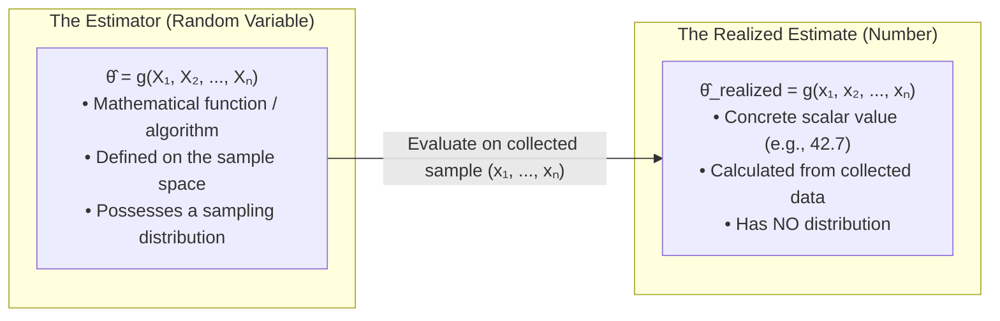
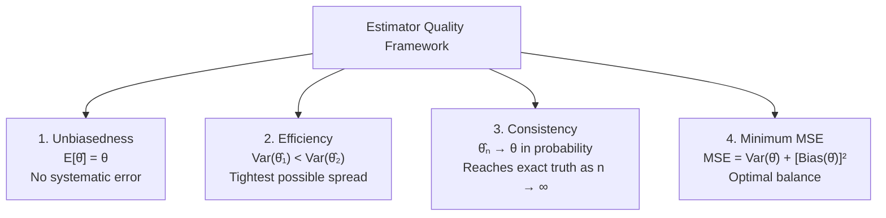
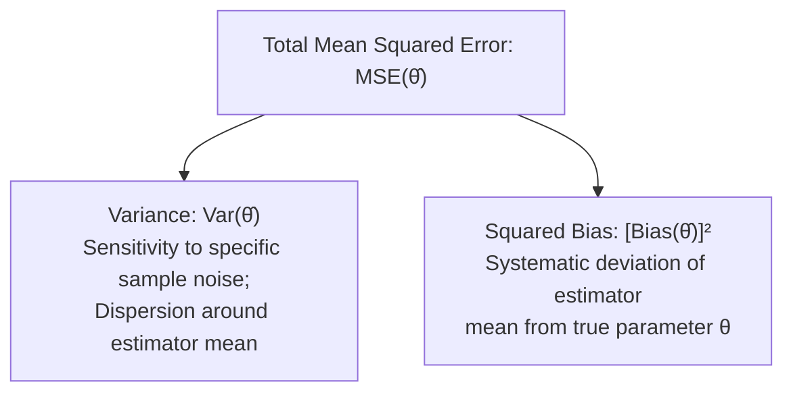

[Maths Index](../README.md) / [Unit 3: Probability Modeling and Parameter Estimation](Introduction.md)

# Principles of Point Estimation

In probability theory, we move deductively: we assume the parameters of a distribution are known (e.g., $X \sim \mathcal{N}(10, 4)$), and we calculate the probability of observing specific data.

In data science and statistics, we are forced to work in the exact opposite direction. We observe empirical data points $x_1, x_2, \dots, x_n$, but the true underlying parameters $\theta$ (the mean, the conversion rate, the noise variance) are completely hidden from us. We must work inductively: inferring the invisible parameters from the visible data.

This process is called point estimation. We seek a formula that takes our sample and produces a single numerical best guess for the unknown parameter. But that raises an immediate question: among the infinite possible formulas we could invent, what makes one estimator mathematically superior to another?

---

## Estimator versus Estimate

First, let's establish precise mathematical terminology:

An estimator, denoted $\hat{\theta}$ or $\hat{\theta}(X_1, \dots, X_n)$, is a mathematical function (a rule or algorithm) that maps a random sample to a parameter value. Because the sample $(X_1, \dots, X_n)$ is a collection of random variables, the estimator $\hat{\theta}$ is itself a random variable. It has an expected value, a variance, and a sampling distribution.

An estimate, denoted $\hat{\theta}_{\text{obs}}$, is the single, concrete numerical value obtained when the estimator is evaluated on a realized sample $(x_1, \dots, x_n)$. It is just a number. It has no variance.

---

## The Four Desirable Properties of Point Estimators

To evaluate the mathematical quality of an estimator $\hat{\theta}$, statisticians examine four fundamental criteria:
1. Unbiasedness (Accuracy on average)
2. Efficiency (Minimal variance)
3. Consistency (Convergence to truth as data grows)
4. Minimum Mean Squared Error (Optimal trade-off)

---

## Property 1: Unbiasedness

An estimator $\hat{\theta}$ is unbiased for parameter $\theta$ if its expected value across all conceivable samples equals the true parameter:

$$E[\hat{\theta}] = \theta$$

The bias of an estimator is defined as:

$$\text{Bias}(\hat{\theta}) = E[\hat{\theta}] - \theta$$

- If $\text{Bias}(\hat{\theta}) = 0$, the estimator is unbiased. The sampling distribution of $\hat{\theta}$ is centered directly on the truth.
- If $\text{Bias}(\hat{\theta}) > 0$, the estimator systematically overestimates the parameter.
- If $\text{Bias}(\hat{\theta}) < 0$, the estimator systematically underestimates the parameter.

### Unbiasedness of the Sample Mean

Let $X_1, X_2, \dots, X_n$ be an i.i.d. sample from any distribution with mean $\mu$. The sample mean is:
$$\bar{X} = \frac{1}{n} \sum_{i=1}^n X_i$$

As derived in L05, by linearity of expectation:
$$E[\bar{X}] = E\left[\frac{1}{n} \sum_{i=1}^n X_i\right] = \frac{1}{n} \sum_{i=1}^n E[X_i] = \frac{1}{n}(n\mu) = \mu$$

Therefore:
$$\text{Bias}(\bar{X}) = E[\bar{X}] - \mu = \mu - \mu = 0$$
The sample mean is an unconditionally unbiased estimator of the population mean $\mu$.

---

## The Biased Sample Variance and Bessel's Correction

Now let's examine the population variance $\sigma^2 = E[(X - \mu)^2]$.

A natural, intuitive estimator would be to replace the unknown population mean $\mu$ with the sample mean $\bar{X}$, and average the squared deviations:

$$S_{\text{naive}}^2 = \frac{1}{n} \sum_{i=1}^n (X_i - \bar{X})^2$$

The moment we do that, we have a problem: $S_{\text{naive}}^2$ is systematically biased! It consistently underestimates the true population variance $\sigma^2$.

Let's prove why this happens from first principles.

### Proof: Derivation of the Bias in Naive Sample Variance

First, rewrite the deviation $(X_i - \bar{X})$ by adding and subtracting the true mean $\mu$:

$$X_i - \bar{X} = (X_i - \mu) - (\bar{X} - \mu)$$

Square both sides:
$$(X_i - \bar{X})^2 = (X_i - \mu)^2 - 2(X_i - \mu)(\bar{X} - \mu) + (\bar{X} - \mu)^2$$

Now sum across all $n$ observations from $i = 1$ to $n$:
$$\sum_{i=1}^n (X_i - \bar{X})^2 = \sum_{i=1}^n (X_i - \mu)^2 - 2(\bar{X} - \mu) \sum_{i=1}^n (X_i - \mu) + \sum_{i=1}^n (\bar{X} - \mu)^2$$

Notice the middle summation:
$$\sum_{i=1}^n (X_i - \mu) = \sum_{i=1}^n X_i - n\mu = n\bar{X} - n\mu = n(\bar{X} - \mu)$$

Substitute this back in:
$$\begin{aligned}
\sum_{i=1}^n (X_i - \bar{X})^2 &= \sum_{i=1}^n (X_i - \mu)^2 - 2(\bar{X} - \mu) [n(\bar{X} - \mu)] + n(\bar{X} - \mu)^2 \\
&= \sum_{i=1}^n (X_i - \mu)^2 - 2n(\bar{X} - \mu)^2 + n(\bar{X} - \mu)^2 \\
&= \sum_{i=1}^n (X_i - \mu)^2 - n(\bar{X} - \mu)^2
\end{aligned}$$

Now take the expectation of both sides:
$$E\left[\sum_{i=1}^n (X_i - \bar{X})^2\right] = \sum_{i=1}^n E\left[(X_i - \mu)^2\right] - n E\left[(\bar{X} - \mu)^2\right]$$

Recall our definitions:
- By definition of population variance: $E[(X_i - \mu)^2] = \sigma^2$.
- By definition of the variance of the sample mean: $E[(\bar{X} - \mu)^2] = \text{Var}(\bar{X}) = \frac{\sigma^2}{n}$.

Substitute these into the expectation:
$$E\left[\sum_{i=1}^n (X_i - \bar{X})^2\right] = \sum_{i=1}^n \sigma^2 - n\left(\frac{\sigma^2}{n}\right) = n\sigma^2 - \sigma^2 = (n - 1)\sigma^2$$

Now divide by $n$ to evaluate the expectation of the naive estimator $S_{\text{naive}}^2$:
$$E\left[S_{\text{naive}}^2\right] = E\left[\frac{1}{n} \sum_{i=1}^n (X_i - \bar{X})^2\right] = \frac{n - 1}{n} \sigma^2$$

Look at that result:
$$E\left[S_{\text{naive}}^2\right] = \frac{n - 1}{n} \sigma^2 < \sigma^2$$

The naive sample variance misses the true variance by a factor of $\frac{n - 1}{n}$.

Why does this happen geometrically?
The observations $X_i$ naturally vary around the true mean $\mu$. But when we compute deviations around the sample mean $\bar{X}$, the sample mean is itself calculated from those exact same points. The sample mean automatically positions itself at the exact algebraic center of the sample, which minimizes the sum of squared deviations for that specific sample. Because the points are closer to $\bar{X}$ than they are to the true $\mu$, $\sum (X_i - \bar{X})^2$ is always smaller than $\sum (X_i - \mu)^2$.

### Bessel's Correction

To eliminate this bias, we multiply the naive estimator by $\frac{n}{n - 1}$, which replaces the divisor $n$ with $n - 1$.

The unbiased sample variance, denoted $S^2$, is:

$$S^2 = \frac{1}{n - 1} \sum_{i=1}^n (X_i - \bar{X})^2$$

Check its expectation:
$$E[S^2] = E\left[\frac{1}{n - 1} \sum_{i=1}^n (X_i - \bar{X})^2\right] = \frac{1}{n - 1} (n - 1)\sigma^2 = \sigma^2 \quad \checkmark$$

The term $n - 1$ represents the degrees of freedom. Because the deviations must sum to zero by definition ($\sum_{i=1}^n (X_i - \bar{X}) = 0$), once you know the first $n - 1$ deviations, the $n$-th deviation is completely fixed. We have "spent" one degree of freedom estimating $\bar{X}$.

---

## Property 2: Efficiency and the Cramér-Rao Bound

Unbiasedness alone is not enough. Suppose we want to estimate the mean $\mu$ of a symmetric distribution. We could use:
1. The sample mean: $\hat{\mu}_1 = \bar{X}$
2. A single randomly chosen observation: $\hat{\mu}_2 = X_1$

Both are completely unbiased:
$$E[\hat{\mu}_1] = \mu \quad \text{and} \quad E[\hat{\mu}_2] = E[X_1] = \mu$$

Yet nobody would choose $\hat{\mu}_2$ over $\bar{X}$. Why? Because $\text{Var}(\hat{\mu}_2) = \sigma^2$, while $\text{Var}(\hat{\mu}_1) = \frac{\sigma^2}{n}$. The sample mean is far more concentrated around the truth.

Given two unbiased estimators $\hat{\theta}_1$ and $\hat{\theta}_2$, we say that $\hat{\theta}_1$ is more efficient than $\hat{\theta}_2$ if:
$$\text{Var}(\hat{\theta}_1) < \text{Var}(\hat{\theta}_2)$$

The relative efficiency of $\hat{\theta}_1$ with respect to $\hat{\theta}_2$ is:
$$\text{Eff}(\hat{\theta}_1, \hat{\theta}_2) = \frac{\text{Var}(\hat{\theta}_2)}{\text{Var}(\hat{\theta}_1)}$$

### The Cramér-Rao Lower Bound (CRLB)

Can an unbiased estimator have zero variance? No, because data is random. How small can the variance of an unbiased estimator possibly get?

The Cramér-Rao Lower Bound (CRLB) establishes a theoretical bedrock lower bound on the variance of *any* unbiased estimator. For any unbiased estimator $\hat{\theta}$ of $\theta$:

$$\text{Var}(\hat{\theta}) \ge \frac{1}{I(\theta)}$$

where $I(\theta)$ is the Fisher Information of the sample, defined as:
$$I(\theta) = E\left[\left(\frac{\partial \ln f(\mathbf{X}; \theta)}{\partial \theta}\right)^2\right] = -E\left[\frac{\partial^2 \ln f(\mathbf{X}; \theta)}{\partial \theta^2}\right]$$

Fisher information measures how sensitive the log-likelihood of the data is to changes in the parameter. If the likelihood curve is sharply curved (high second derivative), $I(\theta)$ is large, meaning the data carries immense information about $\theta$, and the achievable variance $\frac{1}{I(\theta)}$ is small.

An unbiased estimator whose variance achieves the Cramér-Rao lower bound is called an efficient estimator, or a Uniformly Minimum Variance Unbiased Estimator (UMVUE).

---

## Property 3: Consistency

Unbiasedness and efficiency evaluate an estimator for a fixed sample size $n$. Consistency looks at what happens as the sample size grows toward infinity ($n \to \infty$).

An estimator $\hat{\theta}_n$ is consistent for $\theta$ if it converges in probability to $\theta$:

$$\lim_{n \to \infty} P(|\hat{\theta}_n - \theta| > \epsilon) = 0, \quad \text{for any } \epsilon > 0$$

Written in shorthand: $\hat{\theta}_n \xrightarrow{P} \theta$.

As you feed more data into a consistent estimator, the sampling distribution narrows into an infinitely sharp spike positioned directly on the true parameter $\theta$.

### Sufficient Conditions for Consistency

By Chebyshev's Inequality, an estimator $\hat{\theta}_n$ is guaranteed to be consistent if:
1. It is asymptotically unbiased: $\lim_{n \to \infty} \text{Bias}(\hat{\theta}_n) = 0$
2. Its variance vanishes in the limit: $\lim_{n \to \infty} \text{Var}(\hat{\theta}_n) = 0$

Notice that naive sample variance $S_{\text{naive}}^2$ is biased for any finite $n$:
$$\text{Bias}(S_{\text{naive}}^2) = \frac{n-1}{n}\sigma^2 - \sigma^2 = -\frac{\sigma^2}{n}$$

However:
$$\lim_{n \to \infty} \text{Bias}(S_{\text{naive}}^2) = \lim_{n \to \infty} \left(-\frac{\sigma^2}{n}\right) = 0$$

Because its bias goes to zero and its variance goes to zero as $n \to \infty$, $S_{\text{naive}}^2$ is a consistent estimator, even though it is biased!

---

## Mean Squared Error (MSE) and the Bias-Variance Tradeoff

Statisticians initially demanded that all estimators be unbiased. But in machine learning and modern statistics, insistence on strict unbiasedness is often counterproductive.

What if accepting a tiny amount of bias allows us to drastically slash the variance of the estimator?

To evaluate the overall quality of an estimator without requiring unbiasedness, we use the Mean Squared Error (MSE):

$$\text{MSE}(\hat{\theta}) = E\left[(\hat{\theta} - \theta)^2\right]$$

### The Bias-Variance Decomposition

Now let's derive the most celebrated equation in predictive modeling and parameter estimation: the decomposition of MSE into variance and squared bias.

$$\begin{aligned}
\text{MSE}(\hat{\theta}) &= E\left[(\hat{\theta} - \theta)^2\right] \\
&= E\left[(\hat{\theta} - E[\hat{\theta}] + E[\hat{\theta}] - \theta)^2\right]
\end{aligned}$$

Let $A = \hat{\theta} - E[\hat{\theta}]$ and $B = E[\hat{\theta}] - \theta$. Notice that $B$ is a deterministic constant (it contains no random variables).

Expanding the square:
$$(\hat{\theta} - \theta)^2 = (\hat{\theta} - E[\hat{\theta}])^2 + 2(\hat{\theta} - E[\hat{\theta}])(E[\hat{\theta}] - \theta) + (E[\hat{\theta}] - \theta)^2$$

Now take the expectation of all three terms:
$$E\left[(\hat{\theta} - \theta)^2\right] = E\left[(\hat{\theta} - E[\hat{\theta}])^2\right] + 2(E[\hat{\theta}] - \theta) E[\hat{\theta} - E[\hat{\theta}]] + (E[\hat{\theta}] - \theta)^2$$

Notice the middle term:
$$E[\hat{\theta} - E[\hat{\theta}]] = E[\hat{\theta}] - E[\hat{\theta}] = 0$$
The cross-term vanishes completely!

We are left with:
$$E\left[(\hat{\theta} - \theta)^2\right] = E\left[(\hat{\theta} - E[\hat{\theta}])^2\right] + (E[\hat{\theta}] - \theta)^2$$

By definition:
- $E[(\hat{\theta} - E[\hat{\theta}])^2] = \text{Var}(\hat{\theta})$
- $E[\hat{\theta}] - \theta = \text{Bias}(\hat{\theta})$

Therefore:

$$\text{MSE}(\hat{\theta}) = \text{Var}(\hat{\theta}) + \left[\text{Bias}(\hat{\theta})\right]^2$$

### The Bias-Variance Tradeoff in Practice

This decomposition reveals why unbiasedness is not always optimal:
- If an estimator is unbiased, $\text{Bias}(\hat{\theta}) = 0$, so $\text{MSE}(\hat{\theta}) = \text{Var}(\hat{\theta})$.
- If we can introduce a small bias $b$ that reduces variance by more than $b^2$, the total error drops!

This is the exact mathematical principle behind:
- Ridge Regression ($L_2$ regularization): Adding penalty $\lambda \|\mathbf{w}\|^2$ introduces bias into the weight estimates, but substantially shrinks their variance when features are collinear, yielding lower test set MSE.
- Shrinkage Estimators: James-Stein estimation proves that in dimensions $d \ge 3$, shrinking sample means toward zero achieves strictly lower MSE than the unbiased sample mean.

---

## Step-by-Step Numerical Example: Comparing Variance Estimators

Let's see this trade-off numerically. Suppose we have a sample of size $n = 5$ drawn from a Normal distribution $X \sim \mathcal{N}(\mu, \sigma^2)$ with unknown $\sigma^2$.

Consider three competing variance estimators:
1. The unbiased estimator: $S^2 = \frac{1}{n-1} \sum_{i=1}^n (X_i - \bar{X})^2 = \frac{1}{4} \sum (X_i - \bar{X})^2$
2. The naive/MLE estimator: $S_{\text{naive}}^2 = \frac{1}{n} \sum_{i=1}^n (X_i - \bar{X})^2 = \frac{1}{5} \sum (X_i - \bar{X})^2$
3. A shrinkage estimator: $S_{\text{shrink}}^2 = \frac{1}{n+1} \sum_{i=1}^n (X_i - \bar{X})^2 = \frac{1}{6} \sum (X_i - \bar{X})^2$

For a normal population, it is a known statistical fact that $\frac{(n-1)S^2}{\sigma^2} \sim \chi^2(n-1)$.
Using properties of the Chi-Square distribution:
$$\text{Var}(S^2) = \frac{2\sigma^4}{n - 1}$$

For $n = 5$:
$$\text{Var}(S^2) = \frac{2\sigma^4}{4} = 0.50 \sigma^4$$
Because $S^2$ is unbiased, $\text{Bias}(S^2) = 0$, so:
$$\text{MSE}(S^2) = 0.50 \sigma^4 + 0^2 = 0.500 \sigma^4$$

Now evaluate the shrinkage estimator $S_{\text{shrink}}^2 = \frac{n-1}{n+1} S^2 = \frac{4}{6} S^2 = \frac{2}{3} S^2$:
- Expected value: $E[S_{\text{shrink}}^2] = \frac{2}{3} E[S^2] = \frac{2}{3} \sigma^2 \approx 0.667 \sigma^2$
- Bias: $\text{Bias}(S_{\text{shrink}}^2) = \frac{2}{3}\sigma^2 - \sigma^2 = -\frac{1}{3}\sigma^2 \approx -0.333 \sigma^2$
- Squared Bias: $[\text{Bias}]^2 = \left(-\frac{1}{3}\sigma^2\right)^2 = \frac{1}{9}\sigma^4 \approx 0.111 \sigma^4$
- Variance: $\text{Var}\left(\frac{2}{3} S^2\right) = \left(\frac{2}{3}\right)^2 \text{Var}(S^2) = \frac{4}{9} (0.50 \sigma^4) = \frac{2}{9}\sigma^4 \approx 0.222 \sigma^4$

Now compute total MSE:
$$\text{MSE}(S_{\text{shrink}}^2) = \text{Var} + [\text{Bias}]^2 = \frac{2}{9}\sigma^4 + \frac{1}{9}\sigma^4 = \frac{3}{9}\sigma^4 = \frac{1}{3}\sigma^4 \approx 0.333 \sigma^4$$

Compare the two:
- $\text{MSE}(S^2) = 0.500 \sigma^4$ (Unbiased)
- $\text{MSE}(S_{\text{shrink}}^2) = 0.333 \sigma^4$ (Deliberately Biased)

By allowing a bias of $-0.333\sigma^2$, we cut the variance from $0.50\sigma^4$ down to $0.22\sigma^4$, reducing total Mean Squared Error by $33.3\%$!

---

## Key Takeaways

- An estimator $\hat{\theta}(X_1, \dots, X_n)$ is a random variable function; an estimate $\hat{\theta}_{\text{realized}}$ is a single computed numerical number.
- An estimator is unbiased if $E[\hat{\theta}] = \theta$. The sample mean $\bar{X}$ is always unbiased for the population mean $\mu$.
- The naive sample variance $\frac{1}{n}\sum(X_i - \bar{X})^2$ is biased by a factor of $\frac{n-1}{n}$ because deviations are measured around the sample mean $\bar{X}$ rather than the true $\mu$. Bessel's correction divides by $n-1$ to produce an unbiased estimator $S^2$.
- Efficiency measures relative variance between unbiased estimators. The Cramér-Rao Lower Bound (CRLB) $\text{Var}(\hat{\theta}) \ge \frac{1}{I(\theta)}$ defines the absolute minimum variance achievable.
- Consistency means $\hat{\theta}_n \xrightarrow{P} \theta$ as $n \to \infty$. Vanishing bias and vanishing variance together guarantee consistency.
- Mean Squared Error decomposes into variance plus squared bias: $\text{MSE}(\hat{\theta}) = \text{Var}(\hat{\theta}) + [\text{Bias}(\hat{\theta})]^2$. Introducing small bias can significantly lower overall prediction error.

---

We now understand how to evaluate whether an estimator is good or bad. But this still leaves a massive practical problem: how do we derive these formulas in the first place? When we encounter complex, high-dimensional machine learning models with dozens of parameters, we cannot guess estimators by trial and error. We need a general, automated optimization framework to find the best parameter values directly from observed data. In the next lecture, we explore the primary engine of modern estimation: Maximum Likelihood Estimation (MLE). Read [L07 - Maximum Likelihood Estimation](L07%20-%20Maximum%20Likelihood%20Estimation.md).
