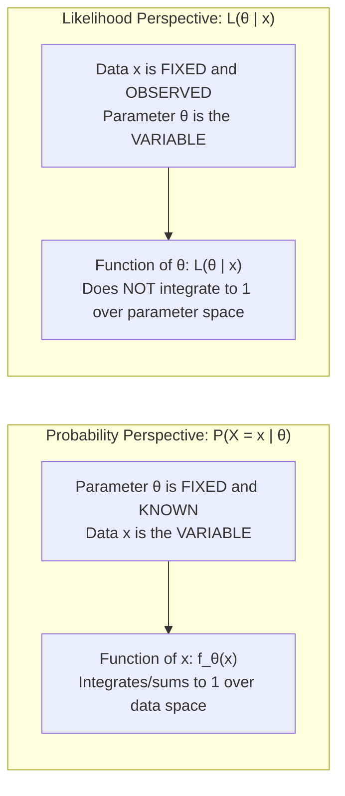
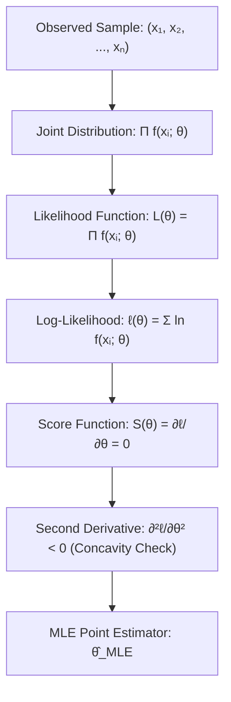

[Maths Index](../README.md) / [Unit 3: Probability Modeling and Parameter Estimation](Introduction.md)

# Maximum Likelihood Estimation

In machine learning and statistics, almost every training algorithm—whether optimizing the weights of a 100-billion-parameter neural network, fitting a logistic regression classifier, or estimating transition probabilities in a hidden Markov model—is an instance of a single mathematical framework: Maximum Likelihood Estimation (MLE).

In the previous lecture, we saw that estimators can be evaluated on bias, variance, and consistency. But knowing how to grade an estimator does not tell us how to build one. 

Maximum Likelihood Estimation gives us a universal, principled recipe: write down the probability of generating the observed data as a function of the unknown parameters, and find the parameter values that make the observed data as probable as possible.

---

## The Likelihood Concept: Flipping the Perspective

To understand MLE, we must master the distinction between probability and likelihood. The two concepts use the exact same mathematical formula $f(x; \theta)$, but with opposite variables held fixed:

- Probability function $f(x \mid \theta)$: The parameter $\theta$ is fixed and known. The argument is the data $x$. It answers: *"Given this known model parameter, what is the probability of observing various outcomes $x$?"*
- Likelihood function $L(\theta \mid x)$: The data $x$ has already been observed and is frozen as a set of fixed numerical constants. The argument is the parameter $\theta$. It answers: *"Given the specific data points we just collected, how plausible are various candidate parameters $\theta$?"*

Notice that $L(\theta \mid x)$ is a function of $\theta$. Crucially, the likelihood function is *not* a probability distribution over $\theta$. Its integral $\int L(\theta \mid x) d\theta$ does not equal 1. It is simply a relative plausibility curve.

---

## The Likelihood Function for i.i.d. Data

Suppose we observe an independent and identically distributed (i.i.d.) random sample $\mathbf{x} = (x_1, x_2, \dots, x_n)$ drawn from a probability distribution governed by parameter vector $\boldsymbol{\theta}$.

Because the observations are independent, their joint probability (or joint density) is the product of their individual probabilities:

$$L(\boldsymbol{\theta}) = L(\boldsymbol{\theta} \mid x_1, x_2, \dots, x_n) = \prod_{i=1}^n f(x_i; \boldsymbol{\theta})$$

The Maximum Likelihood Estimator (MLE), denoted $\hat{\boldsymbol{\theta}}_{\text{MLE}}$, is the parameter value that maximizes this product:

$$\hat{\boldsymbol{\theta}}_{\text{MLE}} = \arg\max_{\boldsymbol{\theta}} L(\boldsymbol{\theta})$$

---

## The Log-Likelihood Function: Transforming Products into Sums

In practice, we virtually never maximize $L(\boldsymbol{\theta})$ directly. We maximize its natural logarithm:

$$\ell(\boldsymbol{\theta}) = \ln L(\boldsymbol{\theta}) = \ln\left(\prod_{i=1}^n f(x_i; \boldsymbol{\theta})\right) = \sum_{i=1}^n \ln f(x_i; \boldsymbol{\theta})$$

Why do we take the logarithm?

There are three compelling mathematical and computational reasons:

1. Product to Sum: Differentiating a product of $n$ terms requires applying the product rule $n$ times, creating an intractable mess of algebraic terms. The logarithm converts products into sums:
   $$\ln(a \cdot b) = \ln(a) + \ln(b)$$
   Differentiating a summation is trivial because the derivative of a sum is the sum of the derivatives.
2. Monotonicity Preserves Maxima: The natural logarithm function $\ln(u)$ is strictly monotonically increasing for all $u > 0$:
   $$u_1 > u_2 \iff \ln(u_1) > \ln(u_2)$$
   Because $\ln(u)$ never changes the ordering of inputs, the location of the peak is identical:
   $$\arg\max_{\boldsymbol{\theta}} L(\boldsymbol{\theta}) = \arg\max_{\boldsymbol{\theta}} \ln L(\boldsymbol{\theta})$$
3. Numerical Stability in Computation: In machine learning, $n$ can be thousands or millions of data points. If each probability $f(x_i; \boldsymbol{\theta}) \approx 0.01 = 10^{-2}$, their product is:
   $$\prod_{i=1}^{1000} 10^{-2} = 10^{-2000}$$
   Standard 64-bit floating-point numbers underflow to absolute zero around $10^{-308}$. Computing $L(\boldsymbol{\theta})$ directly on a computer crashes into underflow. Working in log-space replaces underflow with manageable additions:
   $$\sum_{i=1}^{1000} \ln(10^{-2}) \approx 1000 \times (-4.605) = -4605.17$$

---

## Optimization Mechanics: The Score Function and Fisher Information

To find the maximum of $\ell(\boldsymbol{\theta})$ using calculus:

1. Compute the Score Function: The gradient of the log-likelihood with respect to the parameter vector:
   $$S(\boldsymbol{\theta}) = \nabla_{\boldsymbol{\theta}} \ell(\boldsymbol{\theta}) = \frac{\partial \ell(\boldsymbol{\theta})}{\partial \boldsymbol{\theta}}$$
2. Solve the Likelihood Equation: Set the score equal to zero:
   $$S(\hat{\boldsymbol{\theta}}) = \mathbf{0}$$
3. Verify Concavity (Second Derivative Test): Ensure the critical point is a true maximum by checking that the Hessian matrix of second partial derivatives is negative definite:
   $$\mathbf{H}(\boldsymbol{\theta}) = \frac{\partial^2 \ell(\boldsymbol{\theta})}{\partial \boldsymbol{\theta} \partial \boldsymbol{\theta}^T} \prec 0$$
   For a scalar parameter, this simplifies to $\frac{d^2 \ell}{d\theta^2} < 0$.

The negative expectation of the second derivative is the Fisher Information Matrix:
$$I(\boldsymbol{\theta}) = -E\left[\frac{\partial^2 \ell(\boldsymbol{\theta})}{\partial \boldsymbol{\theta} \partial \boldsymbol{\theta}^T}\right]$$
A sharper peak in $\ell(\theta)$ corresponds to higher curvature, larger Fisher information, and narrower estimation variance.

---

## Step-by-Step Derivation 1: Bernoulli MLE

Suppose we observe $n$ independent binary trials $x_1, x_2, \dots, x_n \in \{0, 1\}$ (e.g., ad clicks, user conversions) generated by a Bernoulli distribution with unknown parameter $p \in (0, 1)$.

### Step 1: Write the Likelihood Function

The Bernoulli PMF for a single observation is $f(x; p) = p^x (1 - p)^{1 - x}$.
For the sample:

$$L(p) = \prod_{i=1}^n p^{x_i} (1 - p)^{1 - x_i} = p^{\sum_{i=1}^n x_i} (1 - p)^{n - \sum_{i=1}^n x_i}$$

Let $k = \sum_{i=1}^n x_i$ denote the total number of successes. Then:
$$L(p) = p^k (1 - p)^{n - k}$$

### Step 2: Take the Natural Logarithm

$$\ell(p) = \ln\left(p^k (1 - p)^{n - k}\right) = k \ln(p) + (n - k) \ln(1 - p)$$

### Step 3: Differentiate and Set to Zero

$$\frac{d\ell}{dp} = \frac{k}{p} - \frac{n - k}{1 - p} = 0$$

Clear denominators by multiplying through by $p(1 - p)$:
$$\begin{aligned}
k(1 - p) - (n - k)p &= 0 \\
k - kp - np + kp &= 0 \\
k - np &= 0 \\
np &= k \\
\hat{p} &= \frac{k}{n}
\end{aligned}$$

Substitute back $k = \sum_{i=1}^n x_i$:

$$\hat{p}_{\text{MLE}} = \frac{1}{n} \sum_{i=1}^n x_i = \bar{x}$$

### Step 4: Verify Maximality (Second Derivative)

$$\frac{d^2\ell}{dp^2} = \frac{d}{dp}\left[\frac{k}{p} - \frac{n - k}{1 - p}\right] = -\frac{k}{p^2} - \frac{n - k}{(1 - p)^2}$$

Because $p \in (0, 1)$, $k \ge 0$, and $n - k \ge 0$ (with at least one strictly positive in any non-trivial sample), both denominators are positive and both terms are strictly negative:
$$\frac{d^2\ell}{dp^2} < 0 \quad \text{for all } p \in (0, 1)$$

The log-likelihood is strictly concave everywhere, proving that $\hat{p}_{\text{MLE}} = \bar{x}$ is the unique global maximum.

---

## Step-by-Step Derivation 2: Gaussian Parameters ($\mu$ and $\sigma^2$)

Now let's derive the MLE for a continuous distribution with two parameters simultaneously.

Suppose $X_1, X_2, \dots, X_n \stackrel{\text{i.i.d.}}{\sim} \mathcal{N}(\mu, \sigma^2)$, with unknown mean $\mu$ and unknown variance $\sigma^2$.

### Step 1: Set Up the Joint Likelihood

The Gaussian PDF is:
$$f(x_i; \mu, \sigma^2) = \frac{1}{\sqrt{2\pi\sigma^2}} \exp\left(-\frac{(x_i - \mu)^2}{2\sigma^2}\right) = (2\pi\sigma^2)^{-1/2} \exp\left(-\frac{(x_i - \mu)^2}{2\sigma^2}\right)$$

The joint likelihood is:
$$L(\mu, \sigma^2) = \prod_{i=1}^n (2\pi\sigma^2)^{-1/2} \exp\left(-\frac{(x_i - \mu)^2}{2\sigma^2}\right) = (2\pi\sigma^2)^{-n/2} \exp\left(-\frac{1}{2\sigma^2} \sum_{i=1}^n (x_i - \mu)^2\right)$$

### Step 2: Compute the Log-Likelihood

$$\begin{aligned}
\ell(\mu, \sigma^2) &= \ln\left[(2\pi\sigma^2)^{-n/2}\right] + \ln\left[\exp\left(-\frac{1}{2\sigma^2} \sum_{i=1}^n (x_i - \mu)^2\right)\right] \\
&= -\frac{n}{2}\ln(2\pi) - \frac{n}{2}\ln(\sigma^2) - \frac{1}{2\sigma^2} \sum_{i=1}^n (x_i - \mu)^2
\end{aligned}$$

### Step 3: Solve for $\hat{\mu}_{\text{MLE}}$

Take the partial derivative of $\ell$ with respect to $\mu$:
$$\frac{\partial \ell}{\partial \mu} = -\frac{1}{2\sigma^2} \sum_{i=1}^n \left(-2(x_i - \mu)\right) = \frac{1}{\sigma^2} \sum_{i=1}^n (x_i - \mu)$$

Set equal to zero:
$$\frac{1}{\sigma^2} \sum_{i=1}^n (x_i - \mu) = 0 \implies \sum_{i=1}^n x_i - n\mu = 0 \implies \hat{\mu}_{\text{MLE}} = \frac{1}{n} \sum_{i=1}^n x_i = \bar{x}$$

The Maximum Likelihood Estimator for the Gaussian mean is the sample mean $\bar{x}$.

### Step 4: Solve for $\hat{\sigma}^2_{\text{MLE}}$

Now take the partial derivative of $\ell$ with respect to the variance parameter $v = \sigma^2$:
$$\frac{\partial \ell}{\partial (\sigma^2)} = -\frac{n}{2\sigma^2} + \frac{1}{2(\sigma^2)^2} \sum_{i=1}^n (x_i - \mu)^2$$

Set equal to zero and substitute $\hat{\mu} = \bar{x}$:
$$\begin{aligned}
-\frac{n}{2\sigma^2} + \frac{1}{2(\sigma^2)^2} \sum_{i=1}^n (x_i - \bar{x})^2 &= 0 \\
\frac{n}{2\sigma^2} &= \frac{1}{2(\sigma^2)^2} \sum_{i=1}^n (x_i - \bar{x})^2
\end{aligned}$$

Multiply both sides by $2(\sigma^2)^2$:
$$n \sigma^2 = \sum_{i=1}^n (x_i - \bar{x})^2 \implies \hat{\sigma}^2_{\text{MLE}} = \frac{1}{n} \sum_{i=1}^n (x_i - \bar{x})^2$$

Look carefully at the denominator: it is $n$, NOT $n - 1$!

Notice what this demonstrates: Maximum Likelihood Estimation yields the *biased* sample variance $S_{\text{naive}}^2$!

MLE has no built-in concern for unbiasedness. The likelihood function simply asks which variance parameter makes the observed sample points most probable. Because the sample points are centered at $\bar{x}$, the variance measured around $\bar{x}$ divided by $n$ produces the highest probability density for that realized data.

---

## Universal Properties of Maximum Likelihood Estimators

Why is MLE the dominant paradigm in statistical computing despite occasionally producing biased estimators?

Because under mild regularity conditions, MLE possesses remarkable theoretical properties:

### 1. Functional Invariance Property
If $\hat{\theta}_{\text{MLE}}$ is the MLE of parameter $\theta$, and $g(\theta)$ is any arbitrary function (not necessarily linear or invertible), then the MLE of $g(\theta)$ is simply:
$$\widehat{g(\theta)}_{\text{MLE}} = g(\hat{\theta}_{\text{MLE}})$$

For example, because $\hat{\sigma}^2_{\text{MLE}} = \frac{1}{n} \sum (x_i - \bar{x})^2$, the MLE for standard deviation is immediately:
$$\hat{\sigma}_{\text{MLE}} = \sqrt{\hat{\sigma}^2_{\text{MLE}}} = \sqrt{\frac{1}{n} \sum_{i=1}^n (x_i - \bar{x})^2}$$
No re-derivation is needed.

### 2. Consistency
Under mild regularity conditions, as the sample size grows to infinity, the MLE converges in probability to the true parameter value:
$$\hat{\boldsymbol{\theta}}_{\text{MLE}} \xrightarrow{P} \boldsymbol{\theta}_0 \quad \text{as } n \to \infty$$

### 3. Asymptotic Normality and Asymptotic Efficiency
As $n \to \infty$, the sampling distribution of the MLE converges to a Gaussian distribution centered at the true parameter:
$$\sqrt{n}(\hat{\boldsymbol{\theta}}_{\text{MLE}} - \boldsymbol{\theta}_0) \xrightarrow{d} \mathcal{N}\left(\mathbf{0}, I_1(\boldsymbol{\theta}_0)^{-1}\right)$$

In large samples, the MLE achieves the Cramér-Rao Lower Bound. No other consistent estimator can have smaller asymptotic variance than the Maximum Likelihood Estimator.

---

## The Machine Learning Bridge: Why We Minimize Negative Log-Likelihood

In artificial intelligence literature, you rarely see authors talk about *maximizing* likelihood. Instead, you see optimization libraries (like PyTorch and TensorFlow) *minimizing* a loss function.

Because standard optimization algorithms perform gradient descent (minimization) rather than gradient ascent:

$$\min_{\boldsymbol{\theta}} \text{NLL}(\boldsymbol{\theta}) \iff \max_{\boldsymbol{\theta}} \ell(\boldsymbol{\theta})$$

where $\text{NLL}(\boldsymbol{\theta}) = -\sum_{i=1}^n \ln f(x_i; \boldsymbol{\theta})$ is the Negative Log-Likelihood.

### Ordinary Least Squares is Gaussian MLE

Now consider standard linear regression: predicting target $y_i$ from feature vector $\mathbf{x}_i$ using linear weights $\mathbf{w}$:
$$y_i = \mathbf{w}^T \mathbf{x}_i + \epsilon_i, \quad \epsilon_i \stackrel{\text{i.i.d.}}{\sim} \mathcal{N}(0, \sigma^2)$$

This implies that conditional on $\mathbf{x}_i$, the target is distributed as:
$$y_i \mid \mathbf{x}_i \sim \mathcal{N}(\mathbf{w}^T \mathbf{x}_i, \sigma^2)$$

Write down the Negative Log-Likelihood:
$$\text{NLL}(\mathbf{w}) = -\sum_{i=1}^n \ln\left[\frac{1}{\sigma\sqrt{2\pi}} \exp\left(-\frac{(y_i - \mathbf{w}^T \mathbf{x}_i)^2}{2\sigma^2}\right)\right] = \frac{n}{2}\ln(2\pi\sigma^2) + \frac{1}{2\sigma^2} \sum_{i=1}^n (y_i - \mathbf{w}^T \mathbf{x}_i)^2$$

With respect to the weights $\mathbf{w}$, the first term is a constant, and the factor $\frac{1}{2\sigma^2}$ is a positive scaling constant.

Therefore:
$$\arg\min_{\mathbf{w}} \text{NLL}(\mathbf{w}) = \arg\min_{\mathbf{w}} \sum_{i=1}^n (y_i - \mathbf{w}^T \mathbf{x}_i)^2$$

Notice the conclusion: Mean Squared Error loss (Ordinary Least Squares) is not an arbitrary heuristic. It is the exact Maximum Likelihood Estimator under the assumption of independent, additive Gaussian noise.

---

## Key Takeaways

- Likelihood $L(\theta \mid \mathbf{x})$ treats the observed data $\mathbf{x}$ as fixed constants and the parameter $\theta$ as the variable to be optimized.
- We maximize the log-likelihood $\ell(\theta) = \ln L(\theta)$ because it turns intractable products into simple sums, preserves extrema via monotonicity, and prevents numerical underflow in floating-point computation.
- Setting the score function $S(\theta) = \nabla_\theta \ell(\theta) = 0$ and verifying concavity via the Hessian yields the MLE.
- For Bernoulli trials, $\hat{p}_{\text{MLE}} = \bar{x}$.
- For Gaussian data, $\hat{\mu}_{\text{MLE}} = \bar{x}$, while $\hat{\sigma}^2_{\text{MLE}} = \frac{1}{n}\sum(x_i - \bar{x})^2$. MLE yields the biased variance estimator because it optimizes data likelihood rather than unbiasedness.
- MLE is functionally invariant ($g(\hat{\theta}_{\text{MLE}}) = \widehat{g(\theta)}_{\text{MLE}}$), consistent, asymptotically normal, and asymptotically efficient (attaining the Cramér-Rao Lower Bound as $n \to \infty$).
- Minimizing Negative Log-Likelihood (NLL) is the mathematical foundation of loss functions across machine learning, directly yielding Mean Squared Error (under Gaussian noise) and Cross-Entropy Loss (under Bernoulli/Multinomial distributions).

---

Maximum Likelihood Estimation assumes the true parameter $\theta$ is an unknown, fixed constant with no prior information. But what if domain physics or prior experiments tell us that certain parameter values are far more plausible than others before collecting any data? And what if our parameters form a coupled, high-dimensional vector rather than a single scalar? In the next lecture, we integrate prior beliefs through Maximum A Posteriori (MAP) estimation and explore the geometric structure of the Multivariate Normal distribution. Read [L08 - Maximum A Posteriori and Multivariate Normal](L08%20-%20Maximum%20A%20Posteriori%20and%20Multivariate%20Normal.md).
