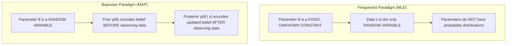
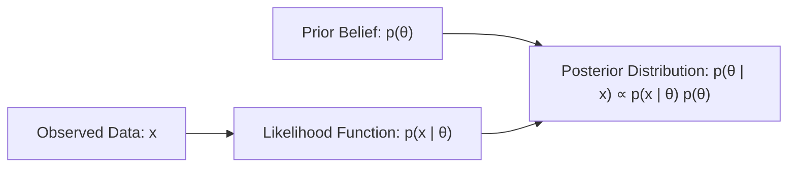
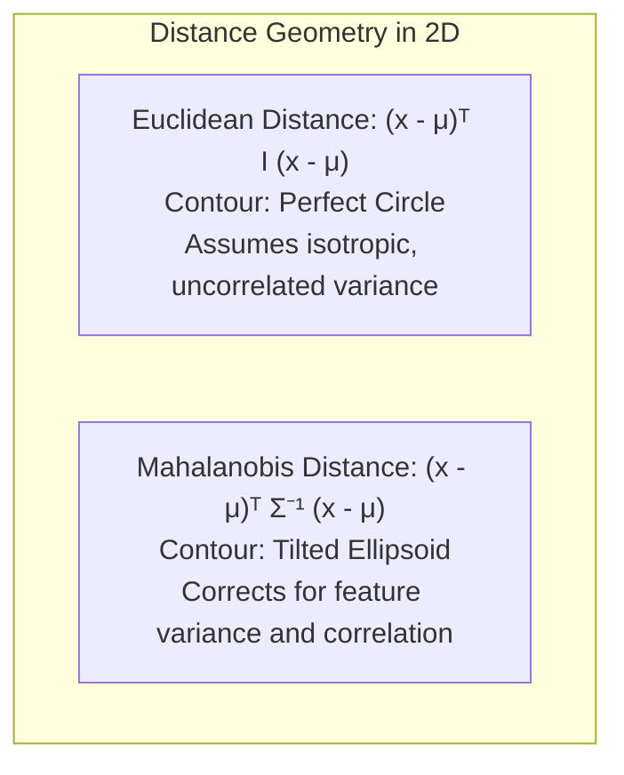
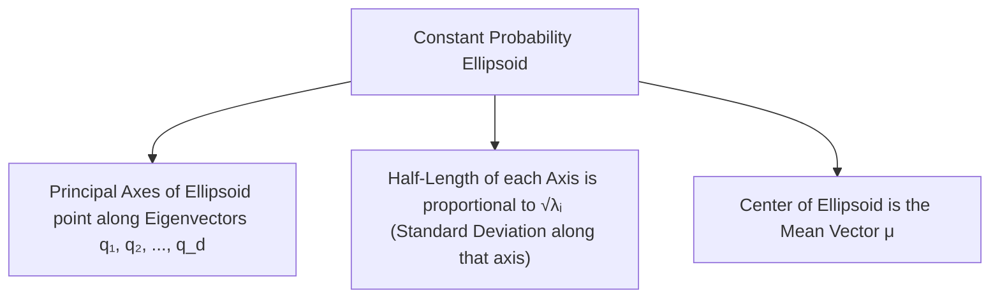

[Maths Index](../README.md) / [Unit 3: Probability Modeling and Parameter Estimation](Introduction.md)

# Maximum A Posteriori and Multivariate Normal

In the previous lecture, we developed Maximum Likelihood Estimation (MLE), which selects parameters that maximize the probability of generating the observed data. 

Now, consider a scenario: you are testing a newly manufactured coin. You flip it 3 times, and it lands on Heads all 3 times ($x = \{1, 1, 1\}$).

If you apply Maximum Likelihood Estimation, your estimator produces:
$$\hat{p}_{\text{MLE}} = \frac{3}{3} = 1.0$$

MLE claims that this coin is literally incapable of ever landing on Tails! If you use this estimate in a predictive system, the probability of Tails is assigned $0$, causing infinite loss the first time Tails occurs.

What went wrong? MLE has zero memory and zero prior knowledge. You, as a human, know that physical coins are stamped pieces of metal that almost certainly have a bias near $p \approx 0.5$. Three flips is nowhere near enough evidence to abandon that baseline belief.

To incorporate prior knowledge into estimation, we transition from the Frequentist paradigm to the Bayesian paradigm via Maximum A Posteriori (MAP) estimation, and explore its multi-dimensional geometric counterpart: the Multivariate Normal Distribution.

---

## Frequentist versus Bayesian Parameter Philosophy

The foundational divergence between Frequentist and Bayesian statistics lies in what is treated as a random variable:

- Frequentist View (MLE): The parameter $\theta$ is an unknown, fixed physical constant of nature. It has no probability distribution. We evaluate the performance of our estimator across hypothetical repeated samples of data.
- Bayesian View (MAP): The parameter $\theta$ is itself a random variable. We quantify our state of knowledge (and subjective uncertainty) about $\theta$ using a probability distribution $p(\theta)$. As data arrives, probability calculus shifts our distribution from our prior belief to an updated posterior belief.

---

## Bayes' Theorem for Parameter Estimation

Applying Bayes' Theorem to a parameter vector $\boldsymbol{\theta}$ given an observed dataset $\mathbf{x} = (x_1, \dots, x_n)$:

$$p(\boldsymbol{\theta} \mid \mathbf{x}) = \frac{p(\mathbf{x} \mid \boldsymbol{\theta}) \, p(\boldsymbol{\theta})}{p(\mathbf{x})} = \frac{p(\mathbf{x} \mid \boldsymbol{\theta}) \, p(\boldsymbol{\theta})}{\int p(\mathbf{x} \mid \boldsymbol{\theta}') \, p(\boldsymbol{\theta}') \, d\boldsymbol{\theta}'}$$

Let's dissect each of the four components:

1. The Prior Distribution $p(\boldsymbol{\theta})$: What we believe about the parameters before collecting data, derived from domain physics, historical experiments, or safety constraints.
2. The Likelihood $p(\mathbf{x} \mid \boldsymbol{\theta})$: The exact same generative probability model used in MLE, evaluating how probable the data $\mathbf{x}$ is under parameter $\boldsymbol{\theta}$.
3. The Marginal Likelihood (Evidence) $p(\mathbf{x})$: The total probability of observing data $\mathbf{x}$ integrated over all possible parameter values. Because this integral does not depend on $\boldsymbol{\theta}$, it acts solely as a normalizing constant.
4. The Posterior Distribution $p(\boldsymbol{\theta} \mid \mathbf{x})$: Our complete, updated probability distribution over the parameters given the observed evidence.

In proportional form:
$$\text{Posterior} \propto \text{Likelihood} \times \text{Prior}$$

---

## Maximum A Posteriori (MAP) Estimation

A full Bayesian analysis computes the entire posterior distribution $p(\boldsymbol{\theta} \mid \mathbf{x})$. But in production machine learning, carrying an entire continuous probability distribution through downstream pipelines is computationally expensive.

We often want a single point estimate: the parameter value that has the highest posterior probability density. This mode of the posterior is the Maximum A Posteriori (MAP) estimator:

$$\hat{\boldsymbol{\theta}}_{\text{MAP}} = \arg\max_{\boldsymbol{\theta}} p(\boldsymbol{\theta} \mid \mathbf{x}) = \arg\max_{\boldsymbol{\theta}} \left[\frac{p(\mathbf{x} \mid \boldsymbol{\theta}) \, p(\boldsymbol{\theta})}{p(\mathbf{x})}\right]$$

Because the denominator $p(\mathbf{x})$ does not depend on $\boldsymbol{\theta}$, it does not affect where the peak occurs. We drop it entirely:

$$\hat{\boldsymbol{\theta}}_{\text{MAP}} = \arg\max_{\boldsymbol{\theta}} \left[p(\mathbf{x} \mid \boldsymbol{\theta}) \, p(\boldsymbol{\theta})\right]$$

Taking the natural logarithm:

$$\hat{\boldsymbol{\theta}}_{\text{MAP}} = \arg\max_{\boldsymbol{\theta}} \left[\ln p(\mathbf{x} \mid \boldsymbol{\theta}) + \ln p(\boldsymbol{\theta})\right]$$

Look closely at this equation:
- The first term, $\ln p(\mathbf{x} \mid \boldsymbol{\theta})$, is the exact log-likelihood from MLE.
- The second term, $\ln p(\boldsymbol{\theta})$, is the log-prior.

If we assume a completely uniform, flat prior ($p(\boldsymbol{\theta}) = c$), then $\ln p(\boldsymbol{\theta})$ is constant, and MAP collapses identically to MLE:
$$\hat{\boldsymbol{\theta}}_{\text{MAP}} \equiv \hat{\boldsymbol{\theta}}_{\text{MLE}} \quad \text{under a uniform prior}$$

---

## MAP as Regularized MLE: The Machine Learning Connection

In modern artificial intelligence, we prevent models from overfitting by adding regularization penalties to the loss function:

$$\min_{\mathbf{w}} \left[\text{Loss}(\mathbf{w}) + \lambda \, \Omega(\mathbf{w})\right]$$

Where does this penalty term $\Omega(\mathbf{w})$ come from? MAP estimation reveals that every standard regularization technique is equivalent to a specific prior belief about the model parameters!

### $L_2$ Regularization (Ridge Regression / Weight Decay) is a Gaussian Prior

Suppose we place an independent zero-mean Gaussian prior on model weights $\mathbf{w} \in \mathbb{R}^d$ with variance $\sigma_0^2$:
$$w_j \stackrel{\text{i.i.d.}}{\sim} \mathcal{N}(0, \sigma_0^2) \implies p(\mathbf{w}) = \prod_{j=1}^d \frac{1}{\sqrt{2\pi\sigma_0^2}} \exp\left(-\frac{w_j^2}{2\sigma_0^2}\right)$$

Take the logarithm of the prior:
$$\ln p(\mathbf{w}) = -\frac{d}{2}\ln(2\pi\sigma_0^2) - \frac{1}{2\sigma_0^2} \sum_{j=1}^d w_j^2 = -\frac{1}{2\sigma_0^2} \|\mathbf{w}\|_2^2 + \text{constant}$$

Substitute this into the MAP objective:
$$\hat{\mathbf{w}}_{\text{MAP}} = \arg\max_{\mathbf{w}} \left[\ln p(\mathbf{x} \mid \mathbf{w}) - \frac{1}{2\sigma_0^2} \|\mathbf{w}\|_2^2\right]$$

Equivalently, minimizing the negative log-posterior:
$$\hat{\mathbf{w}}_{\text{MAP}} = \arg\min_{\mathbf{w}} \left[\text{NLL}(\mathbf{w}) + \lambda \|\mathbf{w}\|_2^2\right], \quad \text{where } \lambda = \frac{1}{2\sigma_0^2}$$

$L_2$ regularization (Ridge regression / weight decay) is mathematically identical to MAP estimation under an independent Gaussian prior centered at zero. The hyperparameter $\lambda$ represents the inverse variance (precision) of our prior belief that the weights should be small.

### $L_1$ Regularization (Lasso) is a Laplace Prior

If we instead place an independent zero-mean Laplace prior on the weights:
$$p(w_j) = \frac{1}{2b} \exp\left(-\frac{|w_j|}{b}\right) \implies \ln p(\mathbf{w}) = -\frac{1}{b} \sum_{j=1}^d |w_j| + \text{constant} = -\frac{1}{b} \|\mathbf{w}\|_1 + \text{const}$$

Minimizing negative log-posterior yields:
$$\hat{\mathbf{w}}_{\text{MAP}} = \arg\min_{\mathbf{w}} \left[\text{NLL}(\mathbf{w}) + \lambda \|\mathbf{w}\|_1\right], \quad \text{where } \lambda = \frac{1}{b}$$

$L_1$ regularization (Lasso) is mathematically identical to MAP estimation under an independent Laplace prior. Because the Laplace density has a sharp, non-differentiable point at zero, its MAP estimate pushes irrelevant weights exactly to zero, producing sparse models.

---

## Step-by-Step Analytical Derivation: Estimating a Gaussian Mean with a Gaussian Prior

Let's derive the analytical MAP estimator for the mean of a Gaussian distribution.

Suppose $X_1, X_2, \dots, X_n \stackrel{\text{i.i.d.}}{\sim} \mathcal{N}(\mu, \sigma^2)$, where the data variance $\sigma^2$ is known, but the mean $\mu$ is unknown.

Before collecting data, our prior belief about $\mu$ is itself Gaussian:
$$\mu \sim \mathcal{N}(\mu_0, \sigma_0^2)$$
Here $\mu_0$ is our prior guess, and $\sigma_0^2$ is our prior uncertainty.

### Step 1: Write the Log-Posterior

$$\ln p(\mu \mid \mathbf{x}) = \ln p(\mathbf{x} \mid \mu) + \ln p(\mu) + \text{const}$$

Expand both terms:
$$\ln p(\mu \mid \mathbf{x}) = -\frac{1}{2\sigma^2} \sum_{i=1}^n (x_i - \mu)^2 - \frac{1}{2\sigma_0^2} (\mu - \mu_0)^2 + C$$

### Step 2: Differentiate with Respect to $\mu$

$$\frac{d}{d\mu} \ln p(\mu \mid \mathbf{x}) = \frac{1}{\sigma^2} \sum_{i=1}^n (x_i - \mu) - \frac{1}{\sigma_0^2} (\mu - \mu_0)$$

Recall that $\sum_{i=1}^n (x_i - \mu) = n(\bar{x} - \mu)$:
$$\frac{d}{d\mu} \ln p(\mu \mid \mathbf{x}) = \frac{n}{\sigma^2}(\bar{x} - \mu) - \frac{1}{\sigma_0^2}(\mu - \mu_0)$$

### Step 3: Set Equal to Zero and Solve for $\hat{\mu}_{\text{MAP}}$

$$\frac{n}{\sigma^2}(\bar{x} - \mu) - \frac{1}{\sigma_0^2}(\mu - \mu_0) = 0$$
$$\frac{n}{\sigma^2}\bar{x} - \frac{n}{\sigma^2}\mu - \frac{1}{\sigma_0^2}\mu + \frac{1}{\sigma_0^2}\mu_0 = 0$$
$$\left(\frac{n}{\sigma^2} + \frac{1}{\sigma_0^2}\right) \mu = \frac{n}{\sigma^2}\bar{x} + \frac{1}{\sigma_0^2}\mu_0$$

Divide through:

$$\hat{\mu}_{\text{MAP}} = \frac{\frac{n}{\sigma^2} \bar{x} + \frac{1}{\sigma_0^2} \mu_0}{\frac{n}{\sigma^2} + \frac{1}{\sigma_0^2}}$$

### The Intuition of Precision-Weighted Averaging

Define precision $\tau$ as the reciprocal of variance ($\tau = \frac{1}{\text{variance}}$):
- Data precision: $\tau_{\text{data}} = \frac{n}{\sigma^2}$ (accumulated information from $n$ points)
- Prior precision: $\tau_{\text{prior}} = \frac{1}{\sigma_0^2}$ (strength of initial conviction)

The MAP estimator is a precision-weighted convex combination:

$$\hat{\mu}_{\text{MAP}} = \frac{\tau_{\text{data}}}{\tau_{\text{data}} + \tau_{\text{prior}}} \bar{x} + \frac{\tau_{\text{prior}}}{\tau_{\text{data}} + \tau_{\text{prior}}} \mu_0$$

Notice how this behaves dynamically:
- When $n = 0$: $\tau_{\text{data}} = 0 \implies \hat{\mu}_{\text{MAP}} = \mu_0$. With zero data, your estimate is purely your prior guess.
- When $n$ is small: The prior pulls the estimate toward $\mu_0$, preventing extreme overreactions to noisy samples.
- As $n \to \infty$: The data precision $\tau_{\text{data}} = \frac{n}{\sigma^2} \to \infty$, completely overwhelming $\tau_{\text{prior}}$. The weights on $\mu_0$ vanish, and:
  $$\lim_{n \to \infty} \hat{\mu}_{\text{MAP}} = \bar{x} = \hat{\mu}_{\text{MLE}}$$
As data accumulates, the evidence overwhelms the prior, and the Bayesian estimator converges to the Frequentist MLE.

---

## The Multivariate Normal Distribution (MVN)

When dealing with high-dimensional feature spaces, parameters and vectors often form joint Gaussian systems. 

A random vector $\mathbf{X} = [X_1, X_2, \dots, X_d]^T \in \mathbb{R}^d$ follows a Multivariate Normal (MVN) distribution with mean vector $\boldsymbol{\mu} \in \mathbb{R}^d$ and covariance matrix $\boldsymbol{\Sigma} \in \mathbb{R}^{d \times d}$, denoted $\mathbf{X} \sim \mathcal{N}_d(\boldsymbol{\mu}, \boldsymbol{\Sigma})$, if its joint PDF is:

$$f(\mathbf{x}) = \frac{1}{(2\pi)^{d/2} |\boldsymbol{\Sigma}|^{1/2}} \exp\left(-\frac{1}{2} (\mathbf{x} - \boldsymbol{\mu})^T \boldsymbol{\Sigma}^{-1} (\mathbf{x} - \boldsymbol{\mu})\right)$$

where:
- $|\boldsymbol{\Sigma}| = \det(\boldsymbol{\Sigma})$ is the determinant of the covariance matrix.
- $\boldsymbol{\Sigma}^{-1}$ is the inverse covariance matrix (also called the precision matrix).
- The covariance matrix $\boldsymbol{\Sigma}$ must be symmetric and strictly positive definite ($\boldsymbol{\Sigma} \succ 0$).

---

## The Mahalanobis Distance: Measuring Distance in Correlated Space

Look at the exponent of the Multivariate Normal PDF:

$$D_M^2 = (\mathbf{x} - \boldsymbol{\mu})^T \boldsymbol{\Sigma}^{-1} (\mathbf{x} - \boldsymbol{\mu})$$

This quadratic form is the squared Mahalanobis distance between point $\mathbf{x}$ and the distribution center $\boldsymbol{\mu}$.

Why don't we use standard Euclidean distance $\|\mathbf{x} - \boldsymbol{\mu}\|^2 = (\mathbf{x} - \boldsymbol{\mu})^T (\mathbf{x} - \boldsymbol{\mu})$?

Because Euclidean distance assumes all features have equal variance and are completely uncorrelated. If feature 1 has variance 10,000 (e.g., annual income) and feature 2 has variance 0.01 (e.g., GPA), a deviation of 50 in income is insignificant, while a deviation of 1.0 in GPA is massive. Euclidean distance would be completely blinded by income.

The inverse covariance matrix $\boldsymbol{\Sigma}^{-1}$ acts as a metric tensor that:
1. Normalizes each axis by dividing by its variance.
2. Rotates the coordinate system to eliminate correlation cross-talk.

---

## Geometry of Multivariate Normal Contours and Eigendecomposition

Points of constant probability density satisfy:
$$f(\mathbf{x}) = c \iff (\mathbf{x} - \boldsymbol{\mu})^T \boldsymbol{\Sigma}^{-1} (\mathbf{x} - \boldsymbol{\mu}) = r^2$$

Geometrically, this defines a family of concentric ellipsoids centered at $\boldsymbol{\mu}$.

By the Spectral Theorem of linear algebra, because $\boldsymbol{\Sigma}$ is symmetric and positive definite, it has an eigendecomposition:
$$\boldsymbol{\Sigma} = \mathbf{Q} \boldsymbol{\Lambda} \mathbf{Q}^T$$
where:
- $\mathbf{Q} = [\mathbf{q}_1, \dots, \mathbf{q}_d]$ is an orthogonal matrix whose columns are the orthonormal eigenvectors of $\boldsymbol{\Sigma}$.
- $\boldsymbol{\Lambda} = \text{diag}(\lambda_1, \dots, \lambda_d)$ is a diagonal matrix of strictly positive eigenvalues ($\lambda_i > 0$).

Its inverse is:
$$\boldsymbol{\Sigma}^{-1} = \mathbf{Q} \boldsymbol{\Lambda}^{-1} \mathbf{Q}^T = \sum_{i=1}^d \frac{1}{\lambda_i} \mathbf{q}_i \mathbf{q}_i^T$$

- The direction of the principal axes of the probability ellipsoid are given by the eigenvectors $\mathbf{q}_1, \mathbf{q}_2, \dots, \mathbf{q}_d$.
- The length of each principal semi-axis is proportional to $\sqrt{\lambda_i}$, the standard deviation along that eigenvector direction.

This connection directly enables Principal Component Analysis (PCA): to find the direction of maximum variance in a dataset, we find the eigenvector $\mathbf{q}_1$ associated with the largest eigenvalue $\lambda_1$ of the covariance matrix $\boldsymbol{\Sigma}$.

---

## Complete Step-by-Step Numerical Example

### Computing MAP for a Gaussian Mean

Suppose an embedded sensor is measuring outdoor ambient temperature. From historical physics models, we have a prior belief:
$$\mu \sim \mathcal{N}(\mu_0 = 20^\circ\text{C}, \, \sigma_0^2 = 4)$$

We deploy the sensor and record $n = 16$ readings. The sensor has known measurement noise variance $\sigma^2 = 9$. The realized sample mean from our 16 readings is:
$$\bar{x} = 24.5^\circ\text{C}$$

Let's compute the MAP estimate $\hat{\mu}_{\text{MAP}}$:

Step 1: Compute precisions.
- Prior precision: $\tau_{\text{prior}} = \frac{1}{\sigma_0^2} = \frac{1}{4} = 0.25$
- Data precision: $\tau_{\text{data}} = \frac{n}{\sigma^2} = \frac{16}{9} \approx 1.7778$
- Total precision: $\tau_{\text{total}} = 0.25 + 1.7778 = 2.0278$

Step 2: Compute weights.
- Weight on prior: $w_{\text{prior}} = \frac{0.25}{2.0278} \approx 0.1233$
- Weight on data: $w_{\text{data}} = \frac{1.7778}{2.0278} \approx 0.8767$

Step 3: Compute $\hat{\mu}_{\text{MAP}}$.
$$\begin{aligned}
\hat{\mu}_{\text{MAP}} &= w_{\text{prior}} \mu_0 + w_{\text{data}} \bar{x} \\
&= (0.1233)(20) + (0.8767)(24.5) \\
&= 2.466 + 21.479 = 23.945^\circ\text{C}
\end{aligned}$$

Notice that while MLE would report $\bar{x} = 24.5^\circ\text{C}$, the Bayesian prior gently pulls (shrinks) the estimate back toward $20^\circ\text{C}$, yielding $23.95^\circ\text{C}$.

---

### Two-Dimensional Mahalanobis Distance Calculation

Let $\boldsymbol{\mu} = \begin{bmatrix} 0 \\ 0 \end{bmatrix}$ and consider the covariance matrix:
$$\boldsymbol{\Sigma} = \begin{bmatrix} 4 & 2 \\ 2 & 2 \end{bmatrix}$$

We want to compute the squared Mahalanobis distance from $\boldsymbol{\mu}$ to the observation point $\mathbf{x} = \begin{bmatrix} 2 \\ 1 \end{bmatrix}$.

Step 1: Compute $\det(\boldsymbol{\Sigma})$.
$$\det(\boldsymbol{\Sigma}) = (4)(2) - (2)(2) = 8 - 4 = 4$$

Step 2: Invert the $2 \times 2$ covariance matrix.
$$\boldsymbol{\Sigma}^{-1} = \frac{1}{\det(\boldsymbol{\Sigma})} \begin{bmatrix} 2 & -2 \\ -2 & 4 \end{bmatrix} = \frac{1}{4} \begin{bmatrix} 2 & -2 \\ -2 & 4 \end{bmatrix} = \begin{bmatrix} 0.5 & -0.5 \\ -0.5 & 1.0 \end{bmatrix}$$

Step 3: Evaluate $D_M^2 = (\mathbf{x} - \boldsymbol{\mu})^T \boldsymbol{\Sigma}^{-1} (\mathbf{x} - \boldsymbol{\mu})$.
Here $\mathbf{x} - \boldsymbol{\mu} = \begin{bmatrix} 2 \\ 1 \end{bmatrix}$.

First compute $\boldsymbol{\Sigma}^{-1} (\mathbf{x} - \boldsymbol{\mu})$:
$$\begin{bmatrix} 0.5 & -0.5 \\ -0.5 & 1.0 \end{bmatrix} \begin{bmatrix} 2 \\ 1 \end{bmatrix} = \begin{bmatrix} (0.5)(2) + (-0.5)(1) \\ (-0.5)(2) + (1.0)(1) \end{bmatrix} = \begin{bmatrix} 1.0 - 0.5 \\ -1.0 + 1.0 \end{bmatrix} = \begin{bmatrix} 0.5 \\ 0 \end{bmatrix}$$

Now take the inner product with $(\mathbf{x} - \boldsymbol{\mu})^T = [2, 1]$:
$$D_M^2 = \begin{bmatrix} 2 & 1 \end{bmatrix} \begin{bmatrix} 0.5 \\ 0 \end{bmatrix} = (2)(0.5) + (1)(0) = 1.0$$

The squared Mahalanobis distance is $D_M^2 = 1.0$.

Compare this to the squared Euclidean distance:
$$\|\mathbf{x} - \boldsymbol{\mu}\|^2 = 2^2 + 1^2 = 5.0$$

Because the point $[2, 1]^T$ lies directly along the positive correlation axis of the covariance matrix, it is statistically much closer to the center ($D_M = 1.0$) than raw Euclidean distance ($D_E = \sqrt{5} \approx 2.24$) would suggest.

---

## Key Takeaways

- Frequentist MLE treats parameters as fixed unknown constants. Bayesian estimation treats parameters as random variables with prior distributions $p(\boldsymbol{\theta})$.
- Maximum A Posteriori (MAP) maximizes the posterior density: $\hat{\boldsymbol{\theta}}_{\text{MAP}} = \arg\max_\theta [\ln p(\mathbf{x} \mid \boldsymbol{\theta}) + \ln p(\boldsymbol{\theta})]$. Under a flat uniform prior, MAP is identical to MLE.
- In machine learning, MAP estimation provides the mathematical justification for regularization: a Gaussian prior produces $L_2$ Ridge regularization, while a Laplace prior produces $L_1$ Lasso regularization.
- For a Gaussian mean with a Gaussian prior, the MAP estimate is a precision-weighted average of the prior mean $\mu_0$ and the sample mean $\bar{x}$. As sample size $n \to \infty$, the sample precision dominates, and MAP converges to MLE.
- The Multivariate Normal (MVN) distribution $\mathcal{N}_d(\boldsymbol{\mu}, \boldsymbol{\Sigma})$ forms ellipsoidal probability contours governed by the Mahalanobis distance $D_M^2 = (\mathbf{x} - \boldsymbol{\mu})^T \boldsymbol{\Sigma}^{-1} (\mathbf{x} - \boldsymbol{\mu})$.
- The principal axes of the MVN probability ellipsoids point along the eigenvectors of $\boldsymbol{\Sigma}$, with semi-axis lengths proportional to the square roots of the eigenvalues ($\sqrt{\lambda_i}$).

---

Point estimates—whether derived from MLE or MAP—produce a single best guess for an unknown parameter. But a single number has an enormous blind spot: it never tells us how confident we should be in that guess. Does an estimate of $\hat{p} = 0.52$ come from 10 coin flips or 10,000 coin flips? To quantify the precision and uncertainty of our estimates, we must move from single points to interval estimation. In the next lecture, we construct Confidence Intervals and analyze large-sample inference. Read [L09 - Interval Estimation and Confidence Intervals](L09%20-%20Interval%20Estimation%20and%20Confidence%20Intervals.md).
