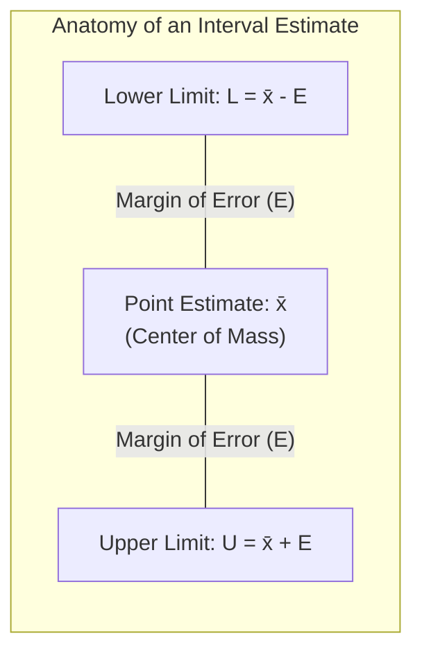
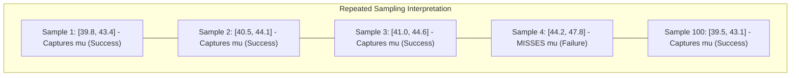
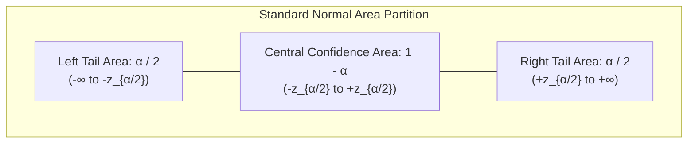
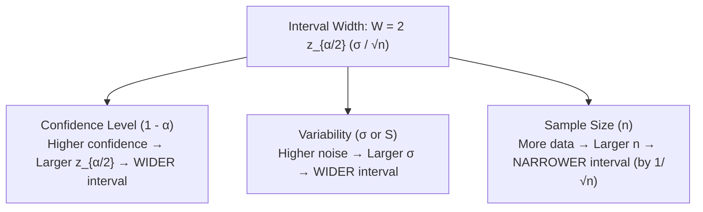

[Maths Index](../README.md) / [Unit 3: Probability Modeling and Parameter Estimation](Introduction.md)

# Interval Estimation and Confidence Intervals

In the previous lectures, we focused on point estimation: computing a single numerical value $\hat{\theta}$ to estimate an unknown population parameter $\theta$.

Now consider reporting a point estimate to a client or engineering team: *"The mean latency of our neural network inference service is 42.0 milliseconds."*

That statement is fundamentally incomplete. How confident are we in that number? Was that average computed from 10 sample requests or 100,000 requests? If we reran the benchmark tomorrow, could the average turn out to be 43 milliseconds, or could it swing to 150 milliseconds?

Furthermore, for any continuous parameter, the probability that a point estimator equals the true parameter is literally zero:
$$P(\hat{\theta} = \theta) = 0$$

A point estimate gives a single best guess, but conveys zero information about uncertainty, dispersion, or sample reliability. To make rigorous, risk-aware decisions, we must move from single points to intervals.

---

## The Concept of an Interval Estimator

An interval estimator uses the sample data $(X_1, \dots, X_n)$ to construct a lower boundary statistic $L(X_1, \dots, X_n)$ and an upper boundary statistic $U(X_1, \dots, X_n)$ that define a range $[L, U]$ believed to contain the true parameter $\theta$.

The confidence level, denoted $1 - \alpha \in (0, 1)$, is the probability that the random interval $[L(\mathbf{X}), U(\mathbf{X})]$ will successfully enclose the true parameter $\theta$:

$$P(L(\mathbf{X}) \le \theta \le U(\mathbf{X})) = 1 - \alpha$$

The value $\alpha$ is the significance level (or allowable error rate). Common industry standards are:
- $90\%$ Confidence Level: $\alpha = 0.10$ ($10\%$ failure rate)
- $95\%$ Confidence Level: $\alpha = 0.05$ ($5\%$ failure rate)
- $99\%$ Confidence Level: $\alpha = 0.01$ ($1\%$ failure rate)

---

## The Frequentist Interpretation: What Does "95% Confidence" Actually Mean?

Here is the most widespread conceptual fallacy in data analysis:

> Fallacy: *"A 95% confidence interval of $[40.2, 43.8]$ means there is a 95% probability that the true population mean $\mu$ lies between 40.2 and 43.8."*

In Frequentist statistics, this statement is completely false.

Why? Because in the Frequentist framework, the true population mean $\mu$ is not a random variable. It is a fixed, deterministic constant of nature. The numbers $40.2$ and $43.8$ are also fixed constants once computed. 

Two fixed numbers and a fixed parameter cannot have a probability of $0.95$. The true parameter $\mu$ is either inside $[40.2, 43.8]$ or it is not. The true probability is either strictly $1$ or strictly $0$; we just happen not to know which.

The correct interpretation:
The probability $1 - \alpha$ applies to the *method*, not to the realized interval.

If we were to repeat our data collection procedure 100 times under identical conditions, generating 100 different random samples and computing 100 different intervals:
- The interval boundaries $[L_i, U_i]$ would bounce around from sample to sample.
- Approximately 95 of those 100 intervals would successfully contain the true, fixed parameter $\mu$.
- Approximately 5 of those 100 intervals would completely miss it.

When we report a single $95\%$ confidence interval $[40.2, 43.8]$, we are asserting that the interval was created by a procedure that succeeds $95\%$ of the time in the long run.

*(If you want to state that the parameter itself has a 95% probability of lying within an interval, you must perform Bayesian estimation and construct a Bayesian Credible Interval using a posterior distribution).*

---

## Deriving the Large-Sample Confidence Interval for $\mu$

How do we construct the random boundaries $L(\mathbf{X})$ and $U(\mathbf{X})$? We use a pivotal quantity whose distribution is known and does not depend on the unknown parameter.

### Case 1: Known Population Variance $\sigma^2$

Let $X_1, X_2, \dots, X_n$ be an i.i.d. sample from a population with mean $\mu$ and known variance $\sigma^2$.

By the Central Limit Theorem (for large $n$) or exact normality (if the population is normal), the sample mean $\bar{X}$ has sampling distribution:
$$\bar{X} \sim \mathcal{N}\left(\mu, \frac{\sigma^2}{n}\right)$$

Standardizing $\bar{X}$ gives a Standard Normal random variable $Z$:
$$Z = \frac{\bar{X} - \mu}{\sigma / \sqrt{n}} \sim \mathcal{N}(0, 1)$$

We choose a two-tailed critical value $z_{\alpha/2}$ such that the probability of $Z$ falling between $-z_{\alpha/2}$ and $+z_{\alpha/2}$ equals $1 - \alpha$:

$$P\left(-z_{\alpha/2} \le Z \le z_{\alpha/2}\right) = 1 - \alpha$$

Now, substitute $Z = \frac{\bar{X} - \mu}{\sigma / \sqrt{n}}$ into the probability statement and solve for $\mu$:

$$P\left(-z_{\alpha/2} \le \frac{\bar{X} - \mu}{\sigma / \sqrt{n}} \le z_{\alpha/2}\right) = 1 - \alpha$$

Multiply all three parts of the inequality by the positive standard error $\frac{\sigma}{\sqrt{n}}$:
$$P\left(-z_{\alpha/2} \frac{\sigma}{\sqrt{n}} \le \bar{X} - \mu \le z_{\alpha/2} \frac{\sigma}{\sqrt{n}}\right) = 1 - \alpha$$

Subtract $\bar{X}$ from all three parts:
$$P\left(-\bar{X} - z_{\alpha/2} \frac{\sigma}{\sqrt{n}} \le -\mu \le -\bar{X} + z_{\alpha/2} \frac{\sigma}{\sqrt{n}}\right) = 1 - \alpha$$

Multiply all parts by $-1$ (which reverses the direction of the inequalities):
$$P\left(\bar{X} + z_{\alpha/2} \frac{\sigma}{\sqrt{n}} \ge \mu \ge \bar{X} - z_{\alpha/2} \frac{\sigma}{\sqrt{n}}\right) = 1 - \alpha$$

Writing this in standard ascending order:

$$P\left(\bar{X} - z_{\alpha/2} \frac{\sigma}{\sqrt{n}} \le \mu \le \bar{X} + z_{\alpha/2} \frac{\sigma}{\sqrt{n}}\right) = 1 - \alpha$$

We have arrived at the two boundary formulas:
- Lower Limit: $L = \bar{X} - z_{\alpha/2} \frac{\sigma}{\sqrt{n}}$
- Upper Limit: $U = \bar{X} + z_{\alpha/2} \frac{\sigma}{\sqrt{n}}$

Expressed in standard shorthand notation:

$$\bar{X} \pm z_{\alpha/2} \frac{\sigma}{\sqrt{n}}$$

### Standard Critical Values $z_{\alpha/2}$

Because the Standard Normal distribution is tabulated, we can look up $z_{\alpha/2}$ directly:

| Confidence Level ($1 - \alpha$) | Significance Level ($\alpha$) | Tail Area ($\alpha/2$) | Critical Value ($z_{\alpha/2}$) |
|:---:|:---:|:---:|:---:|
| **$90\%$** | $0.10$ | $0.05$ | **$1.645$** |
| **$95\%$** | $0.05$ | $0.025$ | **$1.960$** |
| **$98\%$** | $0.02$ | $0.01$ | **$2.326$** |
| **$99\%$** | $0.01$ | $0.005$ | **$2.576$** |

---

## Case 2: Unknown Population Variance with Large Sample ($n \ge 30$)

In real-world data science, we almost never know the true population variance $\sigma^2$. If we knew $\sigma^2$, we would probably already know $\mu$!

When $\sigma$ is unknown, what do we do? We substitute the sample standard deviation:
$$S = \sqrt{\frac{1}{n - 1} \sum_{i=1}^n (X_i - \bar{X})^2}$$

The moment we substitute $S$ for $\sigma$, the ratio is no longer strictly normal:
$$\frac{\bar{X} - \mu}{S / \sqrt{n}}$$

However, by Slutsky's Theorem and the Law of Large Numbers, $S$ converges in probability to $\sigma$ ($S \xrightarrow{P} \sigma$). As long as the sample size is reasonably large ($n \ge 30$), the replacement of $\sigma$ by $S$ introduces negligible distortion.

Thus, for large samples ($n \ge 30$) with unknown $\sigma$, the $(1 - \alpha)$ Large-Sample Confidence Interval is:

$$\bar{X} \pm z_{\alpha/2} \frac{S}{\sqrt{n}}$$

---

## Anatomy of the Margin of Error

The distance between the point estimate $\bar{X}$ and either boundary of the confidence interval is called the Margin of Error (MoE), denoted $E$:

$$E = z_{\alpha/2} \frac{\sigma}{\sqrt{n}}$$

The entire confidence interval is simply:
$$[\bar{x} - E, \bar{x} + E]$$

The total width of the interval is:
$$W = \text{Upper} - \text{Lower} = (\bar{x} + E) - (\bar{x} - E) = 2E = 2 z_{\alpha/2} \frac{\sigma}{\sqrt{n}}$$

Notice what controls the width of our uncertainty window:

There is an unavoidable trade-off between confidence and precision:
- If you demand $99.99\%$ confidence, $z_{\alpha/2}$ becomes huge, making your interval enormously wide. (To be $100\%$ certain of tomorrow's temperature, you would have to say: *"It will be between $-100^\circ\text{C}$ and $+100^\circ\text{C}$."* That statement is $100\%$ confident, but completely useless).
- If you want a narrow, highly precise interval, you must either accept lower confidence (higher risk of being wrong) or collect vastly more data ($n$).

---

## Sample Size Determination for Experimental Design

In data science, we often work in reverse. Before running an expensive A/B test or purchasing compute credits to benchmark a model, we ask:

*How many sample observations $n$ must we collect to guarantee that our estimate is within a specified margin of error $E$ at confidence level $1 - \alpha$?*

We start with the margin of error formula:
$$E = z_{\alpha/2} \frac{\sigma}{\sqrt{n}}$$

Now solve algebraically for $n$:

1. Multiply by $\sqrt{n}$:
   $$\sqrt{n} \cdot E = z_{\alpha/2} \sigma$$
2. Divide by $E$:
   $$\sqrt{n} = \frac{z_{\alpha/2} \sigma}{E}$$
3. Square both sides:

$$n = \left(\frac{z_{\alpha/2} \, \sigma}{E}\right)^2 = \frac{z_{\alpha/2}^2 \, \sigma^2}{E^2}$$

### The Ceiling Rule

Because sample size must be an integer, always round up to the next whole number:
$$n = \left\lceil \left(\frac{z_{\alpha/2} \sigma}{E}\right)^2 \right\rceil$$
Rounding down would cause your margin of error to slightly exceed your target budget.

---

## Complete Step-by-Step Numerical Examples

### Example 1: Large-Sample Confidence Intervals ($95\%$ vs $99\%$)

A cloud infrastructure engineer measures the latency of $n = 64$ API requests to an inference microservice. The sample yields:
- Sample mean: $\bar{x} = 85.0\text{ ms}$
- Sample standard deviation: $s = 12.0\text{ ms}$

Because $n = 64 \ge 30$, we use the large-sample normal approximation.

Step 1: Compute the Standard Error of the Mean.
$$\text{SE} = \frac{s}{\sqrt{n}} = \frac{12.0}{\sqrt{64}} = \frac{12.0}{8} = 1.50\text{ ms}$$

Step 2: Construct the $95\%$ Confidence Interval.
For $95\%$ confidence, $\alpha = 0.05 \implies z_{0.025} = 1.96$.

Compute Margin of Error:
$$E_{95} = z_{0.025} \cdot \text{SE} = 1.96 \times 1.50 = 2.94\text{ ms}$$

Construct the interval:
$$\bar{x} \pm E_{95} = 85.0 \pm 2.94 \implies [82.06\text{ ms}, \; 87.94\text{ ms}]$$

Step 3: Construct the $99\%$ Confidence Interval.
For $99\%$ confidence, $\alpha = 0.01 \implies z_{0.005} = 2.576$.

Compute Margin of Error:
$$E_{99} = z_{0.005} \cdot \text{SE} = 2.576 \times 1.50 = 3.864\text{ ms}$$

Construct the interval:
$$\bar{x} \pm E_{99} = 85.0 \pm 3.864 \implies [81.14\text{ ms}, \; 88.86\text{ ms}]$$

Notice the progression:
- At $95\%$ confidence, the interval width is $2(2.94) = 5.88\text{ ms}$.
- At $99\%$ confidence, the interval width expands to $2(3.864) = 7.73\text{ ms}$.
To be more confident that we captured the true mean latency, we must accept a wider window of uncertainty.

---

### Example 2: Determining Required Sample Size

An autonomous vehicle startup is measuring the stopping distance of an emergency braking system. Preliminary testing indicates that the standard deviation of stopping distance is approximately $\sigma = 4.0\text{ meters}$.

The safety regulator mandates that the average stopping distance must be estimated with a Margin of Error of no more than $E = 0.5\text{ meters}$ at a $95\%$ confidence level.

How many independent test stops must the team conduct?

Step 1: Identify given parameters.
- Target Margin of Error: $E = 0.5$
- Population standard deviation: $\sigma = 4.0$
- Confidence level: $1 - \alpha = 0.95 \implies z_{0.025} = 1.96$

Step 2: Apply the sample size formula.
$$n = \left(\frac{z_{\alpha/2} \, \sigma}{E}\right)^2 = \left(\frac{1.96 \times 4.0}{0.5}\right)^2$$

Compute the numerator:
$$1.96 \times 4.0 = 7.84$$

Divide by $0.5$:
$$\frac{7.84}{0.5} = 15.68$$

Square the result:
$$n = (15.68)^2 = 245.86$$

Step 3: Apply the ceiling rule.
$$n = \lceil 245.86 \rceil = 246\text{ test stops}$$

The engineering team must run at least 246 independent emergency brake tests.

---

## Key Takeaways

- A point estimate gives a single number, but continuous parameters have zero probability of matching a point estimate exactly ($P(\hat{\theta} = \theta) = 0$). Interval estimation wraps estimates in a margin of error.
- A $95\%$ confidence level means that under hypothetical repeated sampling, $95\%$ of constructed intervals will enclose the true, fixed parameter. It does NOT mean the parameter has a $95\%$ chance of falling in that specific computed interval.
- When population variance $\sigma^2$ is known, the large-sample confidence interval for $\mu$ is $\bar{X} \pm z_{\alpha/2} \frac{\sigma}{\sqrt{n}}$.
- When $\sigma^2$ is unknown but sample size is large ($n \ge 30$), Slutsky's theorem permits replacing $\sigma$ with the sample standard deviation $S$: $\bar{X} \pm z_{\alpha/2} \frac{S}{\sqrt{n}}$.
- The Margin of Error $E = z_{\alpha/2} \frac{\sigma}{\sqrt{n}}$ shrinks at rate $1/\sqrt{n}$. Higher confidence widens the interval, while larger sample size narrows it.
- To achieve a desired margin of error $E$, the required sample size is $n = \left\lceil \left(\frac{z_{\alpha/2} \sigma}{E}\right)^2 \right\rceil$.

---

Large-sample confidence intervals rely on the Central Limit Theorem and Slutsky's theorem to substitute $S$ for $\sigma$ without penalty. But what happens when data collection is expensive, and we can only afford a small sample of $n = 8$ or $n = 12$ observations? When $n$ is small, the sample standard deviation $S$ is itself volatile, introducing heavy tail risks that break the Standard Normal distribution. In our final lecture of Unit 3, we resolve this challenge using William Gosset's breakthrough: Student's t-Distribution. Read [L10 - Student's t-Distribution and Small Sample Intervals](L10%20-%20Student's%20t-Distribution%20and%20Small%20Sample%20Intervals.md).
