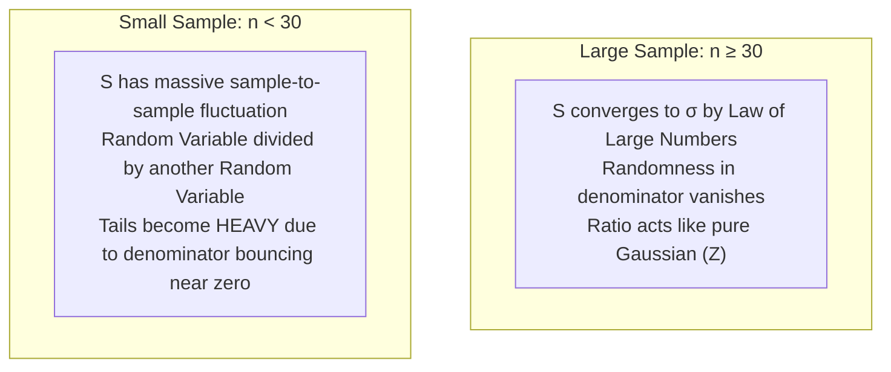
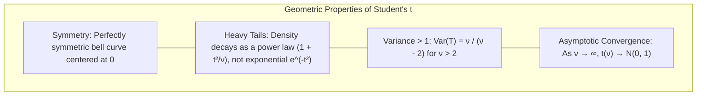
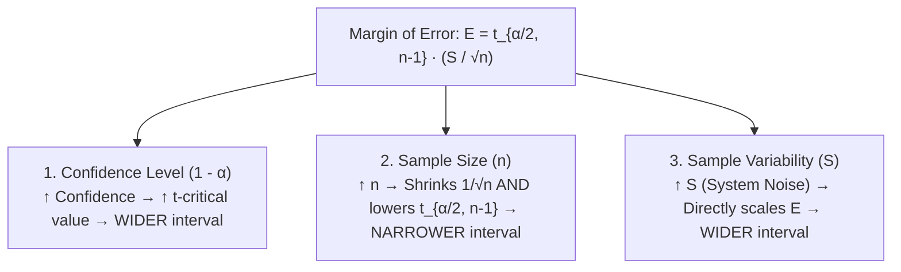
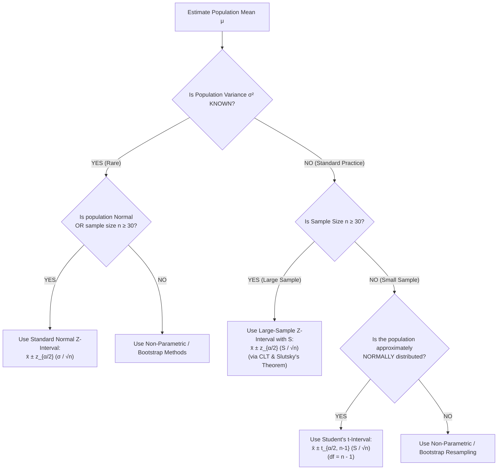

[Maths Index](../README.md) / [Unit 3: Probability Modeling and Parameter Estimation](Introduction.md)

# Student's t-Distribution and Small Sample Intervals

In the previous lecture, we constructed large-sample confidence intervals for a population mean $\mu$ using the formula $\bar{X} \pm z_{\alpha/2} \frac{S}{\sqrt{n}}$. We justified substituting the sample standard deviation $S$ for the unknown population standard deviation $\sigma$ by appealing to the Central Limit Theorem and Slutsky's theorem for large samples ($n \ge 30$).

Now, suppose you are conducting clinical trials for a new drug, benchmarking an expensive deep reinforcement learning run on a specialized supercomputer cluster, or testing physical prototypes of a robotic gripper.

You do not have 1,000 data points. You do not even have 30. You have 8 measurements ($n = 8$).

The moment you have a small sample, substituting $S$ into the Standard Normal $Z$-statistic causes the mathematics to break down completely. If you use $z = 1.96$ to build a "95%" confidence interval for $n = 5$, your interval does not achieve $95\%$ coverage—it misses the true parameter more than $12\%$ of the time!

To conduct rigorous inference on small datasets, we must account for the random variability of $S$ itself. That requires William Sealy Gosset's profound contribution to mathematical statistics: Student's t-Distribution.

---

## The Small-Sample Dilemma: Why the $Z$-Statistic Fails

Let's dissect why substituting $S$ for $\sigma$ fails when $n$ is small.

Recall the standardized $Z$-statistic:
$$Z = \frac{\bar{X} - \mu}{\sigma / \sqrt{n}}$$

In this equation:
- The numerator $(\bar{X} - \mu)$ is a random variable.
- The denominator $(\sigma / \sqrt{n})$ is a deterministic constant, because $\sigma$ is fixed.

Because a Gaussian variable divided by a fixed constant is still Gaussian, $Z$ follows the Standard Normal distribution $\mathcal{N}(0, 1)$ exactly.

Now look at what happens when $\sigma$ is unknown and we replace it with the sample standard deviation $S$:

$$T = \frac{\bar{X} - \mu}{S / \sqrt{n}}$$

Look at the denominator: $S = \sqrt{\frac{1}{n-1}\sum_{i=1}^n (X_i - \bar{X})^2}$ is *not* a constant!

$S$ is a random variable. If you draw a different random sample tomorrow, your sample mean $\bar{X}$ will change, and your sample standard deviation $S$ will *also* change.

When $n$ is small:
1. $S$ frequently fluctuates below the true $\sigma$ by pure chance.
2. When $S$ is small, the denominator $S/\sqrt{n}$ becomes tiny, which blows up the ratio $\frac{\bar{X} - \mu}{S/\sqrt{n}}$ to extreme positive or negative values.
3. This generates extreme values far more frequently than a Gaussian distribution allows. The sampling distribution of $T$ develops thick, heavy tails.

If you ignore this extra noise and use the standard normal critical value $z_{0.025} = 1.96$, your intervals will be far too narrow, generating false certainty.

---

## William Sealy Gosset and the Genesis of the $t$-Distribution

In the early 1900s, William Sealy Gosset worked as a chemist and statistician at the Guinness Brewery in Dublin, Ireland. He was tasked with evaluating the quality of barley and hops, where batch experiments were limited to tiny samples of 3, 4, or 5 observations.

Gosset recognized that existing large-sample statistical theory was failing on small batches. Guinness forbade its scientists from publishing research to protect trade secrets. Gosset obtained special permission to publish his mathematical derivation under the pseudonym "Student" in 1908. His breakthrough became known worldwide as Student's t-Distribution.

---

## Mathematical Construction of the $t$-Statistic

Gosset mathematically derived the exact probability distribution that emerges when a standard normal variable is divided by the square root of an independent chi-square variable.

### Formal Definition of the $t$-Distribution

Let $Z$ be a standard normal random variable:
$$Z \sim \mathcal{N}(0, 1)$$

Let $V$ be an independent Chi-Square random variable with $\nu$ degrees of freedom:
$$V \sim \chi^2(\nu)$$

The random variable $T$ defined by the ratio:

$$T = \frac{Z}{\sqrt{V / \nu}}$$

follows Student's $t$-distribution with $\nu$ degrees of freedom, denoted $T \sim t(\nu)$.

### Connecting the Empirical Sample to the $t$-Distribution

Now let $X_1, X_2, \dots, X_n$ be an i.i.d. random sample of size $n$ from a Normal population $\mathcal{N}(\mu, \sigma^2)$.

From statistical distribution theory:
1. The sample mean produces a standard normal variable:
   $$Z = \frac{\bar{X} - \mu}{\sigma / \sqrt{n}} \sim \mathcal{N}(0, 1)$$
2. The sample variance produces a Chi-Square variable with $\nu = n - 1$ degrees of freedom:
   $$V = \frac{(n - 1)S^2}{\sigma^2} \sim \chi^2(n - 1)$$
3. By Cochran's Theorem, for a normal population, $\bar{X}$ and $S^2$ are statistically independent.

Now substitute $Z$ and $V$ into the definition of $T$ with $\nu = n - 1$:

$$T = \frac{Z}{\sqrt{V / \nu}} = \frac{\frac{\bar{X} - \mu}{\sigma / \sqrt{n}}}{\sqrt{\frac{(n - 1)S^2}{\sigma^2} \Big/ (n - 1)}} = \frac{\frac{\bar{X} - \mu}{\sigma / \sqrt{n}}}{\sqrt{\frac{S^2}{\sigma^2}}} = \frac{\frac{\bar{X} - \mu}{\sigma / \sqrt{n}}}{\frac{S}{\sigma}}$$

Notice what happens to the unknown population parameter $\sigma$:
$$\frac{\sigma}{\sigma} = 1$$

The unknown population standard deviation $\sigma$ cancels out completely!

$$T = \frac{\bar{X} - \mu}{S / \sqrt{n}} \sim t(n - 1)$$

This is a mathematical triumph: we can make exact, rigorous probability statements about the unknown mean $\mu$ without knowing the true population variance $\sigma^2$, even for tiny samples.

---

## Properties of Student's $t$-Distribution

The Probability Density Function of the $t$-distribution with $\nu$ degrees of freedom is:

$$f(t) = \frac{\Gamma\left(\frac{\nu + 1}{2}\right)}{\sqrt{\nu \pi} \, \Gamma\left(\frac{\nu}{2}\right)} \left(1 + \frac{t^2}{\nu}\right)^{-\frac{\nu + 1}{2}}, \quad \text{for } t \in (-\infty, \infty)$$

where $\Gamma(\cdot)$ is the Gamma function.

### 1. Center and Symmetry
Like the Standard Normal distribution, the $t$-distribution is bell-shaped and symmetric around zero. Its mean, median, and mode are all equal to 0 (for $\nu > 1$).

### 2. Variance and Dispersion
The variance of a $t$-distributed variable with $\nu$ degrees of freedom is:

$$\text{Var}(T) = \frac{\nu}{\nu - 2}, \quad \text{for } \nu > 2$$

Notice that for any finite $\nu > 2$:
$$\frac{\nu}{\nu - 2} > 1$$

For example:
- For $\nu = 3$ ($n = 4$): $\text{Var}(T) = \frac{3}{3 - 2} = 3.0$
- For $\nu = 5$ ($n = 6$): $\text{Var}(T) = \frac{5}{5 - 2} = 1.67$
- For $\nu = 10$ ($n = 11$): $\text{Var}(T) = \frac{10}{10 - 2} = 1.25$
- For $\nu = 30$ ($n = 31$): $\text{Var}(T) = \frac{30}{30 - 2} = 1.07$

The variance of $T$ is always strictly greater than $1$ (the variance of $\mathcal{N}(0, 1)$). This extra variance mathematically accounts for the uncertainty in our estimate of $S$.

### 3. Leptokurtic Heavy Tails
Because the PDF decays as a polynomial power $\left(1 + \frac{t^2}{\nu}\right)^{-\frac{\nu+1}{2}}$ rather than an exponential $\exp(-t^2/2)$, the tails of the $t$-distribution are significantly heavier than the Gaussian distribution. Extreme outcomes are much more probable under the $t$-distribution.

### 4. Convergence to Gaussian
As the degrees of freedom $\nu = n - 1 \to \infty$:
$$\lim_{\nu \to \infty} \left(1 + \frac{t^2}{\nu}\right)^{-\frac{\nu + 1}{2}} = e^{-\frac{t^2}{2}}$$

As sample size grows, the sample standard deviation $S$ becomes an increasingly perfect estimate of $\sigma$. The estimation uncertainty vanishes, and the $t$-distribution converges smoothly into the Standard Normal distribution:
$$t(\nu) \xrightarrow{d} \mathcal{N}(0, 1) \quad \text{as } \nu \to \infty$$

---

## Critical Value Comparison: $t_{\alpha/2, \nu}$ versus $z_{\alpha/2}$

Because the $t$-distribution has heavier tails, you must step further away from the center to capture $95\%$ of the probability mass.

Let's examine how the two-tailed critical value for $95\%$ confidence ($\alpha/2 = 0.025$) changes as degrees of freedom increase:

| Sample Size ($n$) | Degrees of Freedom ($\nu = n - 1$) | Critical Value ($t_{0.025, \nu}$) | Inflation over Normal ($z = 1.960$) |
|:---:|:---:|:---:|:---:|
| **2** | $1$ | **$12.706$** | $+548\%$ |
| **3** | $2$ | **$4.303$** | $+120\%$ |
| **5** | $4$ | **$2.776$** | $+41.6\%$ |
| **10** | $9$ | **$2.262$** | $+15.4\%$ |
| **20** | $19$ | **$2.093$** | $+6.8\%$ |
| **30** | $29$ | **$2.045$** | $+4.3\%$ |
| **100** | $99$ | **$1.984$** | $+1.2\%$ |
| **$\infty$** | $\infty$ | **$1.960$** | Baseline ($Z$) |

Look at $n = 5$ ($\nu = 4$): the critical value is $t = 2.776$ compared to $z = 1.960$.
Using the $Z$-multiplier would underestimate your interval width by over $40\%$, producing intervals that fail to provide their claimed confidence level!

---

## Small-Sample Confidence Intervals for $\mu$

To construct a valid small-sample confidence interval, we require one foundational assumption:

> Normality Assumption: The underlying population distribution from which the sample is drawn must be approximately Normal.

Unlike large samples where the Central Limit Theorem rescues non-normal populations, small samples have no CLT protection. If $n = 6$ and the population is severely skewed, neither $Z$ nor $t$ is mathematically valid (requiring non-parametric methods such as bootstrap resampling).

Under the normality assumption with unknown $\sigma$, the $(1 - \alpha)$ Small-Sample Confidence Interval for $\mu$ is:

$$\bar{X} \pm t_{\alpha/2, n-1} \frac{S}{\sqrt{n}}$$

where:
- $\bar{X} = \frac{1}{n} \sum X_i$ is the sample mean.
- $S = \sqrt{\frac{1}{n-1} \sum (X_i - \bar{X})^2}$ is the sample standard deviation.
- $t_{\alpha/2, n-1}$ is the critical value from Student's $t$-distribution with $\nu = n - 1$ degrees of freedom leaving an area of $\alpha/2$ in the upper tail.

---

## Systematic Analysis of Factors Affecting the Margin of Error

The Margin of Error for small samples is:

$$E = t_{\alpha/2, n-1} \frac{S}{\sqrt{n}}$$

Let's examine how each component directly dictates the width of our uncertainty window:

Notice the dual compounding effect of increasing sample size $n$:
1. Denominator shrinkage: Increasing $n$ shrinks the denominator $\sqrt{n}$, reducing error at rate $1/\sqrt{n}$.
2. Degrees of freedom expansion: Increasing $n$ increases $\nu = n - 1$, which systematically pulls the critical value $t_{\alpha/2, \nu}$ downward toward $z_{\alpha/2} = 1.960$.

In small samples, adding even 3 or 4 observations yields massive gains in precision because you benefit from both effects simultaneously.

---

## The Master Decision Architecture for Confidence Intervals

To determine which interval formula to apply in any practical situation, follow this universal decision flow:

---

## Complete Step-by-Step Numerical Example

A robotics research lab develops a new lightweight trajectory planning algorithm. They deploy the algorithm on an embedded microcontroller and measure execution latency across $n = 10$ test runs.

The recorded execution times (in milliseconds) are:
$$24, \; 28, \; 22, \; 26, \; 30, \; 25, \; 27, \; 23, \; 29, \; 26$$

A normality test confirms that execution noise is approximately Gaussian. Construct a $95\%$ confidence interval for the true mean execution latency $\mu$.

### Step 1: Compute Sample Mean $\bar{x}$

Sum of observations:
$$\sum_{i=1}^{10} x_i = 24 + 28 + 22 + 26 + 30 + 25 + 27 + 23 + 29 + 26 = 260$$

$$\bar{x} = \frac{260}{10} = 26.0\text{ ms}$$

### Step 2: Compute Sample Variance $s^2$ and Standard Deviation $s$

Compute squared deviations $(x_i - \bar{x})^2$ around $\bar{x} = 26.0$:
- $(24 - 26)^2 = (-2)^2 = 4$
- $(28 - 26)^2 = (2)^2 = 4$
- $(22 - 26)^2 = (-4)^2 = 16$
- $(26 - 26)^2 = (0)^2 = 0$
- $(30 - 26)^2 = (4)^2 = 16$
- $(25 - 26)^2 = (-1)^2 = 1$
- $(27 - 26)^2 = (1)^2 = 1$
- $(23 - 26)^2 = (-3)^2 = 9$
- $(29 - 26)^2 = (3)^2 = 9$
- $(26 - 26)^2 = (0)^2 = 0$

Sum of squared deviations:
$$\sum_{i=1}^{10} (x_i - \bar{x})^2 = 4 + 4 + 16 + 0 + 16 + 1 + 1 + 9 + 9 + 0 = 60$$

Compute sample variance with Bessel's correction ($n - 1 = 9$):
$$s^2 = \frac{1}{n - 1} \sum_{i=1}^{10} (x_i - \bar{x})^2 = \frac{60}{9} \approx 6.6667\text{ ms}^2$$

Compute sample standard deviation:
$$s = \sqrt{\frac{60}{9}} = \frac{\sqrt{60}}{3} \approx 2.5820\text{ ms}$$

### Step 3: Compute the Estimated Standard Error of the Mean

$$\text{SE} = \frac{s}{\sqrt{n}} = \frac{2.5820}{\sqrt{10}} = \frac{2.5820}{3.1623} \approx 0.8165\text{ ms}$$

### Step 4: Determine Degrees of Freedom and Critical Value

- Sample size: $n = 10$
- Degrees of freedom: $\nu = n - 1 = 10 - 1 = 9$
- Confidence level: $1 - \alpha = 0.95 \implies \alpha = 0.05 \implies \alpha/2 = 0.025$

Looking up $t_{0.025, 9}$ in a Student's $t$-distribution table:
$$t_{0.025, 9} = 2.262$$

### Step 5: Calculate Margin of Error and Construct the Interval

$$E = t_{0.025, 9} \cdot \text{SE} = 2.262 \times 0.8165 \approx 1.847\text{ ms}$$

Construct the interval:
$$\bar{x} \pm E = 26.0 \pm 1.847$$
$$\text{Lower Limit} = 26.0 - 1.847 = 24.153\text{ ms}$$
$$\text{Upper Limit} = 26.0 + 1.847 = 27.847\text{ ms}$$

$$[24.15\text{ ms}, \; 27.85\text{ ms}]$$

### The Contrast: What Happens If You Erroneously Use $Z$?

If an engineer carelessly used the normal critical value $z_{0.025} = 1.96$:
$$E_{\text{erroneous}} = 1.96 \times 0.8165 = 1.600\text{ ms}$$
$$\text{Interval}_{\text{erroneous}} = [24.40\text{ ms}, \; 27.60\text{ ms}]$$

The erroneous $Z$-interval is artificially narrow by $0.49\text{ ms}$ ($13.4\%$ too tight). In safety-critical robotics, that unearned overconfidence can lead to missed deadlines and hardware collisions. The Student's $t$-distribution provides the mathematically required safety margin for small samples.

---

## Key Takeaways

- When population variance $\sigma^2$ is unknown and sample size is small ($n < 30$), the sample standard deviation $S$ fluctuates significantly, causing the ratio $\frac{\bar{X} - \mu}{S/\sqrt{n}}$ to develop heavy tails that break the Standard Normal distribution.
- Student's $t$-statistic represents the ratio of a standard normal variable to the square root of an independent chi-square variable divided by its degrees of freedom: $T = \frac{Z}{\sqrt{V/\nu}} \sim t(\nu)$.
- For a sample drawn from a Normal population, $\frac{\bar{X} - \mu}{S/\sqrt{n}}$ follows Student's $t$-distribution with $\nu = n - 1$ degrees of freedom, completely canceling out the unknown parameter $\sigma$.
- The $t$-distribution is symmetric around zero with variance $\frac{\nu}{\nu - 2} > 1$, reflecting the added uncertainty of estimating $S$. As $\nu \to \infty$, $t(\nu) \xrightarrow{d} \mathcal{N}(0, 1)$.
- Small-sample confidence intervals for $\mu$ are computed as $\bar{X} \pm t_{\alpha/2, n-1} \frac{S}{\sqrt{n}}$ and strictly require that the underlying population is approximately Normal.
- The Margin of Error $E = t_{\alpha/2, n-1} \frac{S}{\sqrt{n}}$ expands with higher confidence levels and higher sample variance, while shrinking with larger sample sizes through the compound effect of the $\sqrt{n}$ denominator and smaller $t$-critical values.

---

Throughout Unit 3, we have developed the mathematical machinery of probability modeling and parameter estimation: deriving point estimates via Maximum Likelihood and Maximum A Posteriori, and constructing confidence intervals via large-sample $Z$-methods and small-sample Student's $t$-distributions.

Yet in scientific inquiry, business optimization, and artificial intelligence deployment, estimation is only half the battle. Often, we are not asking *"What is the parameter value?"*, but rather making a definitive binary choice: *"Does our new deep learning architecture outperform the production baseline by a statistically significant margin, or is the observed lift merely random noise?"*

To answer that question with mathematical rigor, we move from estimation to formal statistical decision theory. In Unit 4, we build the foundations of Hypothesis Testing, Type I and Type II errors, statistical power, ANOVA, and Chi-Square goodness-of-fit tests. Read the [Unit 4: Hypothesis Testing and Statistical Inference](../Unit%204/Introduction.md) roadmap and begin with [L01 - Foundations of Hypothesis Testing](../Unit%204/L01%20-%20Foundations%20of%20Hypothesis%20Testing.md).
