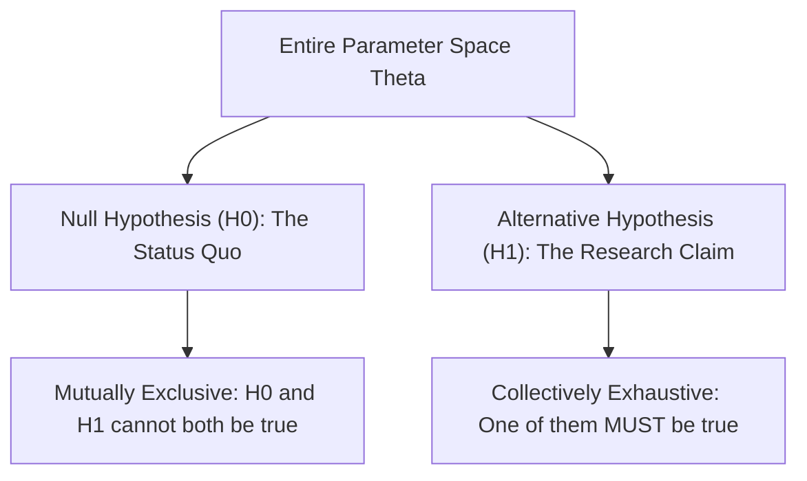
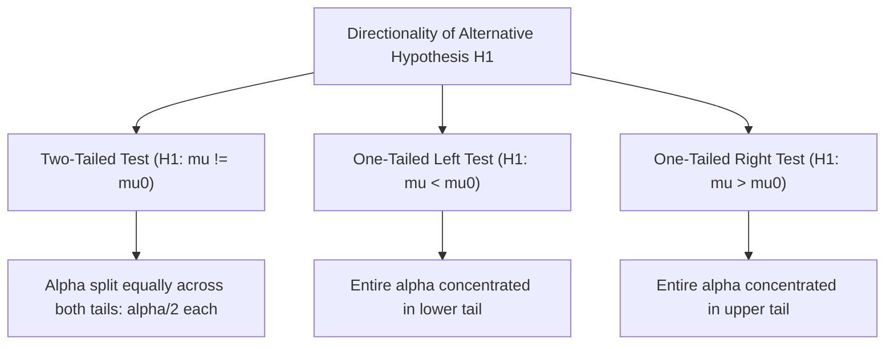
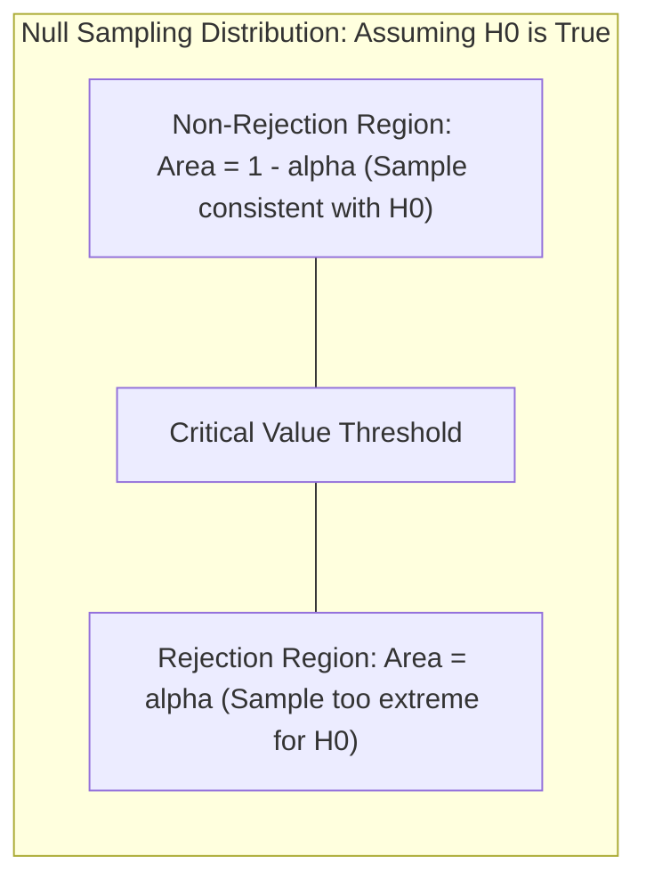

[Maths Index](../README.md) / [Unit 4: Hypothesis Testing and Statistical Inference](Introduction.md)

# Foundations of Hypothesis Testing

In data science, machine learning, and empirical research, we are constantly faced with a fundamental dilemma: when we observe a pattern, an improvement, or an anomaly in our data, is it genuine, or is it merely a ghost produced by random sampling noise?

Suppose you develop a new latency-optimization algorithm for a neural network serving pipeline. Across 100 benchmark queries, the average response time drops from 45.0 milliseconds to 43.2 milliseconds. A 1.8-millisecond gain sounds promising. But latency is inherently noisy due to CPU scheduling, network jitter, and memory bus contention. 

Could a standard baseline server have produced that exact same 1.8-millisecond drop purely by chance? 

If the answer is yes, deploying the new algorithm wastes engineering resources on an illusion. If the answer is no, withholding deployment leaves performance on the table. Hypothesis testing is the formal mathematical machinery designed to resolve this dilemma. It converts qualitative hunches and noisy empirical measurements into rigorous, probability-governed decisions.

---

## The Philosophy of Statistical Falsification

To understand hypothesis testing, we have to start with its philosophical backbone: Karl Popper's principle of falsification.

In deductive mathematics, we can prove a statement true for all cases by exhibiting a direct proof. But in inductive empirical science, we can never prove an empirical hypothesis true beyond all doubt. No matter how many thousands of white swans you observe, you have not proven the statement "all swans are white" — because the very next swan you encounter might be black.

However, observing a single black swan decisively disproves the claim that all swans are white.

Statistical hypothesis testing translates this asymmetry into a probabilistic proof by contradiction:
1. We tentatively assume that nothing interesting is happening (the status quo holds, or there is no effect).
2. Under this baseline assumption, we compute the probability distribution of what our sample data ought to look like.
3. We examine our actual observed sample data.
4. If the observed data would be extraordinarily improbable under the baseline assumption, we reject the baseline assumption as untenable.
5. If the observed data is reasonably consistent with the baseline assumption, we maintain the status quo.

Notice the subtlety: we never "prove" our new idea is correct. We merely demonstrate that the baseline explanation is too improbable to believe.

---

## The Null and Alternative Hypotheses

Every formal hypothesis test begins by partitioning the entire parameter space into two mutually exclusive and collectively exhaustive statements: the Null Hypothesis and the Alternative Hypothesis.

### The Null Hypothesis ($H_0$)

The null hypothesis, denoted $H_0$, represents the default state of skepticism. It asserts that there is no effect, no difference, no improvement, or no relationship between variables. It attributes any observed sample differences entirely to random chance.

In parametric testing, $H_0$ always involves an equality condition ($=$, $\le$, or $\ge$):

$$H_0: \theta = \theta_0 \quad \text{or} \quad H_0: \theta \le \theta_0 \quad \text{or} \quad H_0: \theta \ge \theta_0$$

Why must $H_0$ include equality? 
Because to calculate probabilities, we need a precise mathematical distribution. If we hypothesize that a population mean $\mu$ equals 45, we know exactly where the sampling distribution is centered: at 45. Without an exact equality anchor, we cannot evaluate the probability of our data.

### The Alternative Hypothesis ($H_1$ or $H_a$)

The alternative hypothesis, denoted $H_1$ (or $H_a$), represents the research claim: the assertion that an effect exists, that the parameter has shifted, or that the new algorithm represents a genuine departure from the status quo.

$H_1$ is what the experimenter is typically trying to gather evidence to support. Crucially, $H_1$ is always formulated as a strict inequality ($\ne$, $>$, or $<$):

$$H_1: \theta \ne \theta_0 \quad \text{or} \quad H_1: \theta > \theta_0 \quad \text{or} \quad H_1: \theta < \theta_0$$

Notice something vital here: you never put the claim you want to establish into $H_0$. The burden of proof sits squarely on $H_1$. The null hypothesis enjoys the presumption of innocence until the sample data overwhelms it.

---

## Directionality: One-Tailed vs. Two-Tailed Tests

The exact mathematical inequality chosen for $H_1$ dictates the directionality of the test.

### Two-Tailed (Non-Directional) Tests

A two-tailed test is used when we are interested in detecting any significant difference from the hypothesized value, regardless of whether that difference is positive or negative.

$$\begin{aligned}
H_0: \mu &= \mu_0 \\
H_1: \mu &\ne \mu_0
\end{aligned}$$

For example, when calibrating an automated manufacturing sensor that must cut silicon wafers to exactly 300 mm, both wafers that are too thick ($\mu > 300$) and wafers that are too thin ($\mu < 300$) represent defective processes. We must look for departures in both directions.

Because an extreme deviation in either direction counts as evidence against $H_0$, the significance level $\alpha$ is divided equally between the two tails of the null distribution, placing $\alpha/2$ in the left tail and $\alpha/2$ in the right tail.

### One-Tailed (Directional) Tests

A one-tailed test is used when prior theoretical grounding, physical constraints, or business objectives make deviations in only one specific direction relevant.

**Right-Tailed (Upper-Tail) Test**:
Used when we claim the parameter is strictly greater than the baseline:

$$\begin{aligned}
H_0: \mu &\le \mu_0 \quad (\text{often written simply as } \mu = \mu_0) \\
H_1: \mu &> \mu_0
\end{aligned}$$

Example: Testing whether a new compiler optimization increases throughput (queries per second).

**Left-Tailed (Lower-Tail) Test**:
Used when we claim the parameter is strictly less than the baseline:

$$\begin{aligned}
H_0: \mu &\ge \mu_0 \quad (\text{often written simply as } \mu = \mu_0) \\
H_1: \mu &< \mu_0
\end{aligned}$$

Example: Testing whether a new caching strategy reduces query latency.

Now here's the thing — and it represents a dangerous pitfall in data science: you must decide whether a test is one-tailed or two-tailed **before** looking at the data. 

If you run an experiment, observe a positive sample mean, and then switch from a two-tailed test to a one-tailed test to cut your critical threshold and force a "statistically significant" result, you have inflated your false-positive rate. In experimental methodology, this practice is a form of $p$-hacking.

---

## The Anatomy of a Statistical Test

Once the hypotheses are formulated, conducting the test requires four mathematical components:

1. **The Test Statistic**: A random variable calculated directly from sample data that summarizes the evidence against $H_0$. It measures how far the sample estimate sits from the null value in standardized units of standard error:
   $$\text{Test Statistic} = \frac{\text{Sample Estimate} - \text{Hypothesized Parameter Value}}{\text{Standard Error of the Estimate}}$$

2. **The Null Distribution**: The theoretical probability distribution that the test statistic would follow if the null hypothesis were strictly true. Under the Central Limit Theorem or normality assumptions, this is often a Standard Normal ($\mathcal{N}(0, 1)$), Student's $t$, Chi-Square ($\chi^2$), or $F$ distribution.

3. **The Significance Level ($\alpha$)**: A pre-selected probability threshold that defines how rare an event must be before we refuse to believe it happened by chance alone. Common choices are $\alpha = 0.05$ (a 1-in-20 threshold), $\alpha = 0.01$ (a 1-in-100 threshold), or $\alpha = 0.001$.

4. **The Rejection Region (Critical Region)**: The set of test statistic values that lead to the rejection of $H_0$. The boundary separating the rejection region from the non-rejection region is called the **critical value**.

If the calculated test statistic falls into the rejection region, the observed data is so unlikely under $H_0$ that we reject $H_0$ in favor of $H_1$.

---

## Two Decision Paradigms: Critical Values vs. $p$-Values

There are two mathematically equivalent frameworks for making the accept/reject decision. Both lead to the identical conclusion, but they provide different depths of information.

### 1. The Critical Value Approach

In the critical value approach, we set our threshold in the scale of the test statistic:
- We choose $\alpha$.
- Using the inverse cumulative distribution function (quantile function) of the null distribution, we find the critical cutoff $c$.
- For a right-tailed test: if $\text{Test Statistic} \ge c$, reject $H_0$.
- For a left-tailed test: if $\text{Test Statistic} \le -c$, reject $H_0$.
- For a two-tailed test: if $|\text{Test Statistic}| \ge c$, reject $H_0$.

This approach acts as a binary gatekeeper. It tells you whether your test statistic crossed the threshold, but it does not tell you whether it barely crossed or obliterated it.

### 2. The $p$-Value Approach

The $p$-value approach translates the observed test statistic into a probability.

Formally, the **$p$-value** is the probability, computed assuming the null hypothesis is true, of observing a test statistic at least as extreme as the one actually computed from our sample data:

$$p\text{-value} = P(\text{Data at least as extreme as observed} \mid H_0 \text{ is true})$$

- For a right-tailed test: $p\text{-value} = P(T \ge t_{\text{calc}} \mid H_0)$.
- For a left-tailed test: $p\text{-value} = P(T \le t_{\text{calc}} \mid H_0)$.
- For a two-tailed test: $p\text{-value} = 2 \times P(T \ge |t_{\text{calc}}| \mid H_0)$.

The decision rule is universal and straightforward:
- If $p\text{-value} \le \alpha$: **Reject $H_0$** (the result is statistically significant).
- If $p\text{-value} > \alpha$: **Fail to Reject $H_0$** (insufficient evidence against the null).

Notice the immense practical value of the $p$-value: it is a continuous measure of evidence against $H_0$. A $p$-value of $0.049$ and a $p$-value of $0.00001$ both lead to rejecting $H_0$ at $\alpha = 0.05$, but the second result provides dramatically stronger evidence.

---

## Why We Say "Fail to Reject" Instead of "Accept"

In formal statistics, we never say "we accept the null hypothesis." We strictly say "we fail to reject the null hypothesis."

Why this linguistic rigidity?

Consider a criminal court trial. The legal presumption of innocence is the null hypothesis:
- $H_0$: The defendant is innocent.
- $H_1$: The defendant is guilty.

The prosecution presents evidence. If that evidence is overwhelming beyond a reasonable doubt (analogous to $p \le \alpha$), the jury returns a verdict of **Guilty** (we reject $H_0$).

However, if the evidence is insufficient, the verdict is **Not Guilty**. The court does not declare the defendant innocent. A verdict of "Not Guilty" simply means the prosecution failed to prove guilt beyond a reasonable doubt. The defendant might be innocent, or they might be guilty with an absence of clear evidence.

The exact same logic applies to data:
- Failing to reject $H_0$ does not prove that $\theta = \theta_0$.
- It simply proves that our sample size or measurement precision was insufficient to distinguish $\theta$ from $\theta_0$ against the background noise.

---

## Complete Step-by-Step Numerical Walkthrough

Let's bring every concept together in an end-to-end numerical example.

### The Scenario
An AI engineering team maintains a production language model server. The long-standing baseline latency has a known population mean of $\mu_0 = 45.0$ ms with a known population standard deviation of $\sigma = 6.4$ ms.

A research engineer implements an INT8 quantization kernel and claims that it significantly decreases mean inference latency. To test this claim without risking user experience, the system routes a random sample of $n = 64$ benchmark queries through the quantized kernel.

The observed sample mean is:

$$\bar{x} = 43.2 \text{ ms}$$

We test this claim at a significance level of $\alpha = 0.05$.

### Step 1: Formulate the Hypotheses
The engineer claims a reduction in latency. This is a directional claim pointing to the left:

$$\begin{aligned}
H_0: \mu &\ge 45.0 \text{ ms} \quad (\text{or } \mu = 45.0) \\
H_1: \mu &< 45.0 \text{ ms}
\end{aligned}$$

### Step 2: Identify the Test Statistic and Null Distribution
Because the sample size is large ($n = 64 \ge 30$) and the population standard deviation $\sigma$ is known, the Central Limit Theorem guarantees that the sample mean $\bar{X}$ is normally distributed under $H_0$:

$$\bar{X} \sim \mathcal{N}\left(\mu_0, \frac{\sigma^2}{n}\right)$$

We standardize $\bar{X}$ into a standard normal test statistic $Z$:

$$Z = \frac{\bar{X} - \mu_0}{\sigma / \sqrt{n}}$$

Under $H_0$, $Z \sim \mathcal{N}(0, 1)$.

### Step 3: Compute the Standard Error and Test Statistic
First, compute the standard error of the mean ($\sigma_{\bar{x}}$):

$$\sigma_{\bar{x}} = \frac{\sigma}{\sqrt{n}} = \frac{6.4}{\sqrt{64}} = \frac{6.4}{8} = 0.80 \text{ ms}$$

Now compute the calculated $Z$-statistic ($z_{\text{calc}}$):

$$z_{\text{calc}} = \frac{43.2 - 45.0}{0.80} = \frac{-1.8}{0.80} = -2.25$$

The sample mean sits $2.25$ standard errors below the hypothesized mean of $45.0$ ms.

### Step 4: Decision via the Critical Value Approach
Our test is left-tailed with $\alpha = 0.05$. 
From standard normal distribution tables, the critical value $z_{\text{crit}} = -z_{0.05}$ that leaves an area of $0.05$ in the left tail is:

$$z_{\text{crit}} = -1.645$$

The rejection region is:

$$RR = \{Z \mid Z \le -1.645\}$$

Since $z_{\text{calc}} = -2.25$ is strictly less than $-1.645$, $z_{\text{calc}}$ falls deeply into the rejection region:

$$-2.25 \le -1.645 \implies \text{Reject } H_0$$

### Step 5: Decision via the $p$-Value Approach
For a left-tailed test, the $p$-value is the cumulative probability to the left of $z_{\text{calc}}$ under the standard normal curve $\Phi(z)$:

$$p\text{-value} = P(Z \le -2.25) = \Phi(-2.25)$$

Looking up $-2.25$ in the standard normal cumulative distribution table:

$$\Phi(-2.25) \approx 0.0122$$

Comparing the $p$-value to our significance level $\alpha = 0.05$:

$$0.0122 \le 0.05 \implies \text{Reject } H_0$$

### Step 6: Engineering Conclusion
At a $5\%$ level of significance, we reject the null hypothesis ($z = -2.25, p = 0.0122$). 

There is statistically significant evidence that the INT8 quantization kernel reduces mean inference latency below $45.0$ ms. The probability of observing a sample mean latency drop of $1.8$ ms or more purely due to random chance is approximately $1.22\%$, which is well below our risk threshold of $5\%$. The team can confidently proceed with staged deployment.

---

## Key Takeaways

- Hypothesis testing is a probabilistic proof by contradiction: we tentatively assume the null hypothesis ($H_0$) is true and ask whether the sample data is too improbable under that assumption.
- The null hypothesis ($H_0$) represents the status quo and always contains an equality condition ($=, \le, \ge$). The alternative hypothesis ($H_1$) represents the research claim and always contains a strict inequality ($\ne, >, <$).
- The choice between a one-tailed and two-tailed test is dictated by the domain question and must be established prior to observing data to prevent $p$-hacking.
- The test statistic standardizes the distance between the sample evidence and the null parameter in units of standard error: $\frac{\text{Estimate} - \text{Null Value}}{\text{Standard Error}}$.
- The $p$-value is $P(\text{Data at least as extreme} \mid H_0 \text{ is true})$. If $p \le \alpha$, reject $H_0$; if $p > \alpha$, fail to reject $H_0$.
- We never "accept" $H_0$; an absence of evidence against $H_0$ is not evidence of its truth.

---

Now that we have established the foundational logic and grammar of statistical falsification, we are ready to build specialized test procedures for real-world distributions. In the next lecture, we examine large-sample testing where sample sizes exceed 30, formalizing both one-sample and two-sample $Z$-tests for population means. Read [L02 - Large-Sample Tests for a Population Mean](L02%20-%20Large-Sample%20Tests%20for%20a%20Population%20Mean.md).
