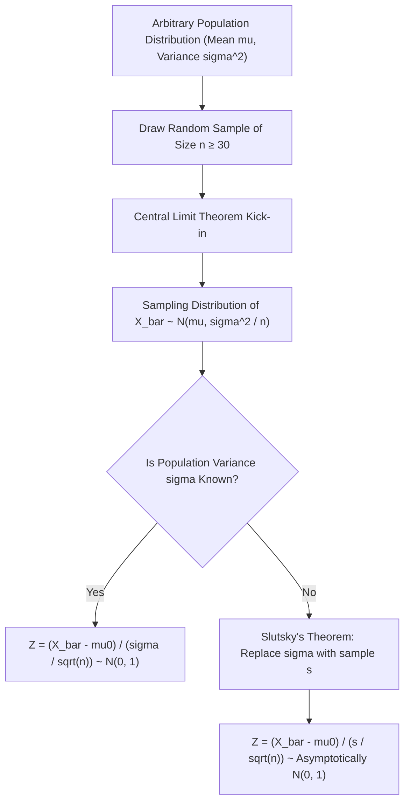
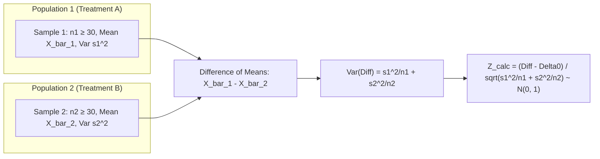

[Maths Index](../README.md) / [Unit 4: Hypothesis Testing and Statistical Inference](Introduction.md)

# Large-Sample Tests for a Population Mean

In our study of probability, we observed how the Central Limit Theorem acts as an astonishing mathematical equalizer. No matter how skewed, bimodal, or heavy-tailed an underlying population distribution might be, the distribution of the sample mean $\bar{X}$ drawn from that population converges inexorably to a Gaussian bell curve as the sample size $n$ grows.

In statistical inference, this theoretical convergence yields an enormous practical payoff: the large-sample $Z$-test.

When sample sizes are sufficiently large (by convention, $n \ge 30$), we can test hypotheses about unknown population means with mathematical precision. We do not need to assume that the underlying population is normally distributed. 

Even better: even if we do not know the true population variance $\sigma^2$, large-sample theory guarantees that we can substitute our sample variance $s^2$ without compromising the asymptotic validity of our standard normal test.

Let's unpack how this works, derive the test statistics, examine both one-sample and two-sample designs, and work through complete numerical problems from first principles.

---

## Theoretical Foundations: Central Limit Theorem and Slutsky's Theorem

Why does the number 30 carry so much weight in introductory statistics?

Let $X_1, X_2, \dots, X_n$ be an independent and identically distributed (i.i.d.) random sample from any arbitrary probability distribution with a finite mean $\mu$ and finite variance $\sigma^2$. 

The sample mean is:

$$\bar{X} = \frac{1}{n} \sum_{i=1}^n X_i$$

By the linearity of expectation and properties of variance for independent variables:

$$E[\bar{X}] = \mu, \quad \operatorname{Var}(\bar{X}) = \frac{\sigma^2}{n}$$

The Central Limit Theorem (CLT) states that as $n \to \infty$, the standardized sample mean converges in distribution to the standard normal distribution $\mathcal{N}(0, 1)$:

$$Z_n = \frac{\bar{X} - \mu}{\sigma / \sqrt{n}} \xrightarrow{d} \mathcal{N}(0, 1)$$

For most non-pathological continuous distributions, the convergence is remarkably rapid. By the time $n \ge 30$, the sampling distribution of $\bar{X}$ is close enough to normal that standard normal critical values introduce negligible approximation error.

### What if the Population Variance $\sigma^2$ is Unknown?

In real-world data science, we rarely know the true population variance $\sigma^2$. We only have access to the sample variance:

$$s^2 = \frac{1}{n-1} \sum_{i=1}^n (X_i - \bar{X})^2$$

The moment we replace $\sigma$ with the random variable $s$, our test statistic becomes:

$$Z^* = \frac{\bar{X} - \mu}{s / \sqrt{n}}$$

Does this ratio still follow a normal distribution?

Technically, no. Because $s$ is itself a random variable that fluctuates from sample to sample, dividing by $s$ adds extra variability to the denominator.

However, by the Weak Law of Large Numbers, the sample variance $s^2$ is a consistent estimator of $\sigma^2$:

$$s \xrightarrow{P} \sigma \quad \text{as } n \to \infty$$

Now we invoke **Slutsky's Theorem**. In probability theory, Slutsky's theorem states that if a sequence of random variables $Y_n$ converges in distribution to $Y$, and another sequence $W_n$ converges in probability to a constant $c$, then $Y_n / W_n$ converges in distribution to $Y / c$.

Applying this to our statistic:

$$Z^* = \left(\frac{\bar{X} - \mu}{\sigma / \sqrt{n}}\right) \cdot \left(\frac{\sigma}{s}\right) \xrightarrow{d} \mathcal{N}(0, 1) \cdot 1 = \mathcal{N}(0, 1)$$

Because $s$ converges tightly to $\sigma$ when $n \ge 30$, the extra variability in the denominator shrinks to insignificance. We can safely treat $Z^*$ as standard normal.

---

## One-Sample $Z$-Test Formulation

Let's formalize the one-sample $Z$-test for testing whether an unknown population mean $\mu$ equals a specified reference value $\mu_0$.

### Hypotheses
Depending on our research question, we choose one of three configurations:

1. **Two-Tailed Test**:
   $$H_0: \mu = \mu_0 \quad \text{vs.} \quad H_1: \mu \ne \mu_0$$
2. **Right-Tailed Test**:
   $$H_0: \mu \le \mu_0 \quad \text{vs.} \quad H_1: \mu > \mu_0$$
3. **Left-Tailed Test**:
   $$H_0: \mu \ge \mu_0 \quad \text{vs.} \quad H_1: \mu < \mu_0$$

### The Test Statistic
Under the null hypothesis assumption that $\mu = \mu_0$, the test statistic is:

$$z_{\text{calc}} = \frac{\bar{x} - \mu_0}{\sigma_{\bar{x}}}$$

Where the standard error $\sigma_{\bar{x}}$ is:

$$\sigma_{\bar{x}} = \begin{cases}
\dfrac{\sigma}{\sqrt{n}}, & \text{if } \sigma \text{ is known} \\
\dfrac{s}{\sqrt{n}}, & \text{if } \sigma \text{ is unknown and } n \ge 30
\end{cases}$$

### Critical Values and Rejection Boundaries

We select a significance level $\alpha$. The critical value $z_p$ satisfies $P(Z > z_p) = p$ under the standard normal density curve $\Phi(z)$.

The table below compiles the critical thresholds for the most common significance levels:

| Significance Level ($\alpha$) | Left-Tailed ($H_1: \mu < \mu_0$) | Right-Tailed ($H_1: \mu > \mu_0$) | Two-Tailed ($H_1: \mu \ne \mu_0$) |
| :--- | :--- | :--- | :--- |
| $\alpha = 0.10$ ($90\%$ Confidence) | $z < -1.282$ | $z > 1.282$ | $|z| > 1.645$ |
| $\alpha = 0.05$ ($95\%$ Confidence) | $z < -1.645$ | $z > 1.645$ | $|z| > 1.960$ |
| $\alpha = 0.01$ ($99\%$ Confidence) | $z < -2.326$ | $z > 2.326$ | $|z| > 2.576$ |

### Calculating the $p$-Value

Once $z_{\text{calc}}$ is evaluated, the exact $p$-value is computed using the standard normal cumulative distribution function $\Phi(z) = \int_{-\infty}^z \frac{1}{\sqrt{2\pi}} e^{-u^2/2} du$:

$$\begin{aligned}
\text{Two-Tailed:} \quad p\text{-value} &= 2 \cdot \left[1 - \Phi(|z_{\text{calc}}|)\right] = 2 \cdot P(Z \ge |z_{\text{calc}}|) \\
\text{Right-Tailed:} \quad p\text{-value} &= 1 - \Phi(z_{\text{calc}}) = P(Z \ge z_{\text{calc}}) \\
\text{Left-Tailed:} \quad p\text{-value} &= \Phi(z_{\text{calc}}) = P(Z \le z_{\text{calc}})
\end{aligned}$$

---

## Step-by-Step Example 1: Two-Tailed Test with Known $\sigma$

Let's execute a complete, rigorous test for an industrial IoT battery monitoring system.

### The Problem
A hardware manufacturer produces low-power IoT microcontrollers designed for environmental sensors. Under nominal operating conditions, the battery life is known from long historical production logs to follow a distribution with a mean of $\mu_0 = 1200$ hours and a known population standard deviation of $\sigma = 120$ hours.

A new supplier provides a batch of power management integrated circuits (PMICs). Quality control must ensure that the new chips do not alter the calibrated baseline operational lifespan: lifespan that is too short causes warranty claims, while lifespan that is unexpectedly long may indicate under-clocking or disabled telemetry features.

The quality assurance team takes a random sample of $n = 64$ microcontrollers equipped with the new PMIC and measures their lifespans under identical test bench conditions. The sample mean lifespan is:

$$\bar{x} = 1235 \text{ hours}$$

Test at $\alpha = 0.05$ whether the mean battery life has significantly changed.

### Execution

#### 1. Hypotheses
Any shift in battery life (positive or negative) must be flagged:

$$\begin{aligned}
H_0: \mu &= 1200 \text{ hours} \\
H_1: \mu &\ne 1200 \text{ hours}
\end{aligned}$$

#### 2. Significance Level and Critical Boundary
We choose $\alpha = 0.05$. For a two-tailed test, the rejection region divides $\alpha$ equally:

$$\frac{\alpha}{2} = 0.025$$

From standard normal tables:

$$z_{0.025} = 1.960$$

Rejection Region:

$$RR = \{z \mid z < -1.960 \text{ or } z > 1.960\}$$

#### 3. Standard Error Computation
Since $\sigma = 120$ is known and $n = 64$:

$$\sigma_{\bar{x}} = \frac{\sigma}{\sqrt{n}} = \frac{120}{\sqrt{64}} = \frac{120}{8} = 15.0 \text{ hours}$$

#### 4. Test Statistic Computation

$$z_{\text{calc}} = \frac{\bar{x} - \mu_0}{\sigma_{\bar{x}}} = \frac{1235 - 1200}{15.0} = \frac{35}{15.0} \approx 2.333$$

#### 5. $p$-Value Calculation
For $z_{\text{calc}} = 2.33$, we look up $\Phi(2.33)$ in the standard normal table:

$$\Phi(2.33) \approx 0.9901$$

The upper-tail probability is:

$$P(Z \ge 2.33) = 1 - 0.9901 = 0.0099$$

Because the test is two-tailed, we double this area:

$$p\text{-value} = 2 \times 0.0099 = 0.0198$$

#### 6. Decision and Conclusion
- Critical Value rule: $z_{\text{calc}} = 2.333 > 1.960$. It falls directly into the rejection region.
- $p$-value rule: $p\text{-value} = 0.0198 \le 0.05$.

Both approaches lead to the exact same decision: **Reject $H_0$**.

At the $\alpha = 0.05$ significance level, there is statistically significant evidence that the mean operational lifespan of the microcontrollers with the new PMIC differs from 1200 hours ($z = 2.33, p = 0.020$). The engineering team must review the clock frequencies and power-draw telemetry before approving the batch for general deployment.

---

## Step-by-Step Example 2: One-Tailed Test with Unknown $\sigma$

Now let's examine a scenario where population variance is completely unknown, requiring the use of sample standard deviation $s$ under Slutsky's theorem.

### The Problem
A distributed key-value store cluster processes queries at an average throughput of $\mu_0 = 8500$ queries per second (QPS). A software engineering team rewrites the asynchronous network I/O loop using Linux `io_uring` and wants to verify if it significantly improves throughput.

They conduct $n = 100$ independent benchmark runs during off-peak simulation hours. The runs produce:
- Sample mean throughput: $\bar{x} = 8680$ QPS
- Sample standard deviation: $s = 800$ QPS

Test at $\alpha = 0.01$ whether the new implementation yields a significant throughput improvement.

### Execution

#### 1. Hypotheses
The team specifically wants to demonstrate an increase in throughput:

$$\begin{aligned}
H_0: \mu &\le 8500 \text{ QPS} \\
H_1: \mu &> 8500 \text{ QPS}
\end{aligned}$$

#### 2. Standard Error
Because $n = 100 \ge 30$, the sample variance $s = 800$ provides an accurate estimate of $\sigma$:

$$\hat{\sigma}_{\bar{x}} = \frac{s}{\sqrt{n}} = \frac{800}{\sqrt{100}} = \frac{800}{10} = 80.0 \text{ QPS}$$

#### 3. Test Statistic

$$z_{\text{calc}} = \frac{\bar{x} - \mu_0}{s / \sqrt{n}} = \frac{8680 - 8500}{80.0} = \frac{180}{80.0} = 2.25$$

#### 4. Critical Value and Decision Rule
This is a right-tailed test with $\alpha = 0.01$. 

The critical value leaving an area of $0.01$ in the right tail is:

$$z_{0.01} = 2.326$$

Rejection Region:

$$RR = \{z \mid z \ge 2.326\}$$

#### 5. $p$-Value Calculation
For a right-tailed test:

$$p\text{-value} = P(Z \ge 2.25) = 1 - \Phi(2.25)$$

From the standard normal distribution table:

$$\Phi(2.25) \approx 0.9878$$

$$p\text{-value} = 1 - 0.9878 = 0.0122$$

#### 6. Decision and Nuance
Let's compare our computed statistic and $p$-value against our strict threshold:
- $z_{\text{calc}} = 2.25 < 2.326$.
- $p\text{-value} = 0.0122 > 0.01$.

Therefore, we **Fail to Reject $H_0$** at the $\alpha = 0.01$ level.

Notice something instructive here: if the team had selected a $5\%$ significance level ($\alpha = 0.05, z_{\text{crit}} = 1.645$), they would have rejected $H_0$ handily ($p = 0.0122 < 0.05$). 

However, because they held their test to a strict $1\%$ standard of evidence ($\alpha = 0.01$), the observed data does not clear the evidentiary hurdle. The conclusion: while the new I/O loop shows an encouraging performance gain of $180$ QPS, there is insufficient evidence at the $1\%$ significance level to rule out random fluctuation.

---

## Two-Sample Large-Sample Tests: Comparing Two Means ($\mu_1 - \mu_2$)

In modern machine learning and data science, we rarely test a single model against an abstract theoretical number. Instead, we run comparative experiments: Model A versus Model B, or Control group versus Treatment group.

Suppose we draw two independent random samples:
- Sample 1: Size $n_1 \ge 30$, mean $\bar{X}_1$, variance $\sigma_1^2$ (or $s_1^2$).
- Sample 2: Size $n_2 \ge 30$, mean $\bar{X}_2$, variance $\sigma_2^2$ (or $s_2^2$).

We want to test whether the two underlying populations have equal means:

$$H_0: \mu_1 - \mu_2 = \Delta_0 \quad (\text{most often } \Delta_0 = 0)$$

### Derivation of the Two-Sample Test Statistic
By the linearity of expectation:

$$E[\bar{X}_1 - \bar{X}_2] = E[\bar{X}_1] - E[\bar{X}_2] = \mu_1 - \mu_2$$

Because the two samples are sampled independently, their covariance is zero. Therefore, the variance of the difference is the sum of the individual variances:

$$\operatorname{Var}(\bar{X}_1 - \bar{X}_2) = \operatorname{Var}(\bar{X}_1) + \operatorname{Var}(\bar{X}_2) = \frac{\sigma_1^2}{n_1} + \frac{\sigma_2^2}{n_2}$$

The standard error of the difference between two sample means is:

$$\sigma_{\bar{X}_1 - \bar{X}_2} = \sqrt{\frac{\sigma_1^2}{n_1} + \frac{\sigma_2^2}{n_2}}$$

By the Central Limit Theorem applied to both samples, the standardized difference follows an asymptotic standard normal distribution:

$$Z = \frac{(\bar{X}_1 - \bar{X}_2) - (\mu_1 - \mu_2)}{\sqrt{\dfrac{\sigma_1^2}{n_1} + \dfrac{\sigma_2^2}{n_2}}} \xrightarrow{d} \mathcal{N}(0, 1)$$

When population variances are unknown and $n_1, n_2 \ge 30$, we substitute sample variances $s_1^2$ and $s_2^2$:

$$z_{\text{calc}} = \frac{(\bar{x}_1 - \bar{x}_2) - \Delta_0}{\sqrt{\dfrac{s_1^2}{n_1} + \dfrac{s_2^2}{n_2}}}$$

---

## Step-by-Step Numerical Example: A/B Testing Two Recommendation Engines

Let's walk through an e-commerce A/B test.

### The Scenario
An e-commerce platform runs an A/B test comparing two personalization algorithms on user spending:
- **Algorithm A (Control - Collaborative Filtering)**:
  - Sample size: $n_1 = 200$
  - Sample mean revenue: $\bar{x}_1 = \$42.50$
  - Sample standard deviation: $s_1 = \$14.00$
- **Algorithm B (Treatment - Graph Neural Network)**:
  - Sample size: $n_2 = 250$
  - Sample mean revenue: $\bar{x}_2 = \$45.80$
  - Sample standard deviation: $s_2 = \$16.50$

The leadership team wants to know if Algorithm B drives significantly higher revenue per user than Algorithm A at $\alpha = 0.01$.

### Execution

#### 1. Formulate Hypotheses
We want to test if Algorithm B produces higher revenue ($\mu_2 > \mu_1 \iff \mu_2 - \mu_1 > 0$):

$$\begin{aligned}
H_0: \mu_2 - \mu_1 &\le 0 \\
H_1: \mu_2 - \mu_1 &> 0
\end{aligned}$$

#### 2. Compute Point Estimate of the Difference

$$\bar{x}_2 - \bar{x}_1 = 45.80 - 42.50 = 3.30 \text{ dollars}$$

#### 3. Compute Standard Error of the Difference

$$\begin{aligned}
\sigma_{\bar{x}_2 - \bar{x}_1} &= \sqrt{\frac{s_2^2}{n_2} + \frac{s_1^2}{n_1}} \\
&= \sqrt{\frac{(16.50)^2}{250} + \frac{(14.00)^2}{200}} \\
&= \sqrt{\frac{272.25}{250} + \frac{196.00}{200}} \\
&= \sqrt{1.089 + 0.980} = \sqrt{2.069} \approx 1.4384 \text{ dollars}
\end{aligned}$$

#### 4. Compute Test Statistic

$$z_{\text{calc}} = \frac{(\bar{x}_2 - \bar{x}_1) - 0}{\sigma_{\bar{x}_2 - \bar{x}_1}} = \frac{3.30}{1.4384} \approx 2.294$$

#### 5. Determine Critical Value and $p$-Value
For a right-tailed test at $\alpha = 0.01$:

$$z_{\text{crit}} = z_{0.01} = 2.326$$

The calculated test statistic is $z_{\text{calc}} = 2.294$.

The $p$-value is:

$$p\text{-value} = P(Z \ge 2.294) = 1 - \Phi(2.294)$$

From normal tables, $\Phi(2.29) \approx 0.9890$:

$$p\text{-value} \approx 1 - 0.9890 = 0.0110$$

#### 6. Decision and Data Science Insight
Comparing the results:
- $z_{\text{calc}} = 2.294 < 2.326$.
- $p\text{-value} = 0.0110 > 0.0100$.

At the strict $\alpha = 0.01$ level, we **Fail to Reject $H_0$**. 

Notice how razor-thin this result is! The calculated statistic ($2.294$) missed the critical value ($2.326$) by a mere $0.032$ standard errors, and the $p$-value ($0.0110$) exceeded the significance threshold by just $0.0010$. 

In an engineering post-mortem, reporting only "fail to reject" would discard crucial nuance. The data strongly suggests that the Graph Neural Network improves revenue, but our sample size was just slightly too small to rule out chance under the stringent $99\%$ confidence requirement. This directly motivates power analysis and sample size determination, which we will formalize in upcoming lectures.

---

## Key Takeaways

- Large-sample tests rely on the Central Limit Theorem: when $n \ge 30$, the sampling distribution of the mean $\bar{X}$ converges to a normal distribution regardless of the underlying population shape.
- When population variance $\sigma^2$ is unknown, Slutsky's theorem allows us to substitute sample variance $s^2$ with negligible loss in accuracy for $n \ge 30$.
- The one-sample $Z$-statistic measures the standardized distance from the null mean: $z = \frac{\bar{x} - \mu_0}{\sigma / \sqrt{n}}$ (or $s / \sqrt{n}$).
- The two-sample $Z$-statistic tests differences between two independent populations: $z = \frac{(\bar{x}_1 - \bar{x}_2) - \Delta_0}{\sqrt{s_1^2/n_1 + s_2^2/n_2}}$.
- Standard critical values for two-tailed tests are $1.645$ ($\alpha = 0.10$), $1.960$ ($\alpha = 0.05$), and $2.576$ ($\alpha = 0.01$).
- A test statistic failing to cross a critical threshold at $\alpha = 0.01$ might easily cross at $\alpha = 0.05$; declaring significance is always conditional on the pre-specified risk threshold.

---

We have now seen how to evaluate hypotheses using test statistics, critical values, and $p$-values. But notice how hypothesis testing gives us an accept/reject verdict while concealing the range of plausible values the parameter might actually take. In the next lecture, we reveal one of the most beautiful unifications in mathematical statistics: the exact mathematical duality between confidence intervals and two-sided hypothesis tests. Read [L03 - Confidence Intervals and Hypothesis Testing Relationship](L03%20-%20Confidence%20Intervals%20and%20Hypothesis%20Testing%20Relationship.md).
