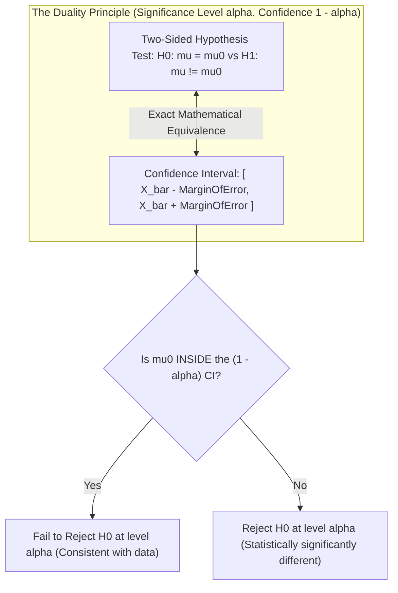
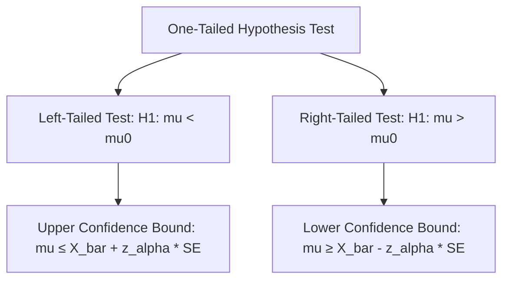
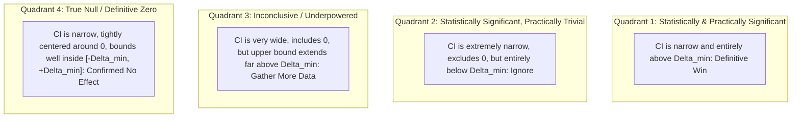

[Maths Index](../README.md) / [Unit 4: Hypothesis Testing and Statistical Inference](Introduction.md)

# Confidence Intervals and Hypothesis Testing Relationship

In introductory statistics courses, estimation and hypothesis testing are frequently introduced in separate chapters as if they were entirely distinct techniques. 

In estimation, we construct a confidence interval around a sample statistic to capture an unknown population parameter with high probability. In hypothesis testing, we formulate a null hypothesis, calculate a test statistic, and either reject or fail to reject a hypothesized parameter value.

Now here's the thing — these two methodologies are not distinct tools at all. They are two mathematical perspectives of the exact same underlying inferential engine.

This profound equivalence is known as the **Duality Principle** between confidence intervals and hypothesis tests. 

Understanding this duality does more than streamline your mathematical toolkit: it provides a vital conceptual safeguard in modern data science. It reveals why relying solely on $p$-values frequently leads to deceptive conclusions, and why confidence intervals provide richer, more actionable intelligence for engineering decisions.

---

## The Duality Theorem

Let's state the mathematical duality theorem formally.

> **Theorem (Equivalence of Two-Sided Tests and Confidence Intervals)**:  
> Let $\mu$ be an unknown population mean, and let $\alpha \in (0, 1)$ be a fixed significance level. A two-sided hypothesis test of:
> 
> $$H_0: \mu = \mu_0 \quad \text{vs.} \quad H_1: \mu \ne \mu_0$$
> 
> will reject the null hypothesis at significance level $\alpha$ if and only if the hypothesized value $\mu_0$ falls strictly **outside** the $(1 - \alpha) \times 100\%$ confidence interval for $\mu$.
> 
> Conversely, the test will fail to reject $H_0$ at level $\alpha$ if and only if $\mu_0$ lies **inside** the $(1 - \alpha) \times 100\%$ confidence interval.

---

## Algebraic Derivation of the Equivalence

Let's prove this theorem directly from first principles using large-sample normal theory. (The exact same algebraic structure holds for Student's $t$-distributions, proportions, and linear regression coefficients).

Suppose we have a sample of size $n$ with sample mean $\bar{X}$ and known standard deviation $\sigma$.

### The Non-Rejection Region of the Two-Sided Test
In a two-sided test at level $\alpha$, the decision rule fails to reject $H_0: \mu = \mu_0$ if the calculated test statistic $Z$ falls between the critical values $-z_{\alpha/2}$ and $+z_{\alpha/2}$:

$$-z_{\alpha/2} \le Z_{\text{calc}} \le z_{\alpha/2}$$

Substituting the explicit formula for $Z_{\text{calc}}$:

$$-z_{\alpha/2} \le \frac{\bar{X} - \mu_0}{\sigma / \sqrt{n}} \le z_{\alpha/2}$$

Now, let's algebraically manipulate these inequalities to isolate $\mu_0$ in the center.

First, multiply all three terms by the positive standard error $\sigma / \sqrt{n}$:

$$-z_{\alpha/2} \frac{\sigma}{\sqrt{n}} \le \bar{X} - \mu_0 \le z_{\alpha/2} \frac{\sigma}{\sqrt{n}}$$

Next, subtract $\bar{X}$ from all three terms:

$$-\bar{X} - z_{\alpha/2} \frac{\sigma}{\sqrt{n}} \le -\mu_0 \le -\bar{X} + z_{\alpha/2} \frac{\sigma}{\sqrt{n}}$$

Finally, multiply the entire compound inequality by $-1$. Recall that multiplying an inequality by a negative number reverses the direction of the inequality signs:

$$\bar{X} + z_{\alpha/2} \frac{\sigma}{\sqrt{n}} \ge \mu_0 \ge \bar{X} - z_{\alpha/2} \frac{\sigma}{\sqrt{n}}$$

Reversing the order so that the smaller term sits on the left:

$$\bar{X} - z_{\alpha/2} \frac{\sigma}{\sqrt{n}} \le \mu_0 \le \bar{X} + z_{\alpha/2} \frac{\sigma}{\sqrt{n}}$$

Look closely at this expression. The left bound is the lower limit of the $(1 - \alpha)$ confidence interval for $\mu$. The right bound is the upper limit of the $(1 - \alpha)$ confidence interval for $\mu$.

$$\mu_0 \in \left[ \bar{X} - z_{\alpha/2} \frac{\sigma}{\sqrt{n}}, \; \bar{X} + z_{\alpha/2} \frac{\sigma}{\sqrt{n}} \right]$$

The algebraic chain is bi-directional:

$$|Z_{\text{calc}}| \le z_{\alpha/2} \iff \mu_0 \in \text{CI}_{1-\alpha}$$

$$|Z_{\text{calc}}| > z_{\alpha/2} \iff \mu_0 \notin \text{CI}_{1-\alpha}$$

This proves the theorem. A $(1-\alpha)$ confidence interval is nothing other than the collection of **all possible null values $\mu_0$ that would not be rejected** by a two-sided hypothesis test at significance level $\alpha$.

---

## One-Sided Tests and One-Sided Confidence Bounds

What about directional (one-tailed) tests? Does duality still apply?

Yes, but instead of a two-sided confidence interval bounded on both sides, a one-tailed test corresponds to a **one-sided confidence bound**.

### 1. Right-Tailed Test ($H_1: \mu > \mu_0$)
In a right-tailed test at level $\alpha$, we fail to reject $H_0$ if:

$$\frac{\bar{X} - \mu_0}{\sigma / \sqrt{n}} \le z_\alpha$$

Isolating $\mu_0$:

$$\bar{X} - \mu_0 \le z_\alpha \frac{\sigma}{\sqrt{n}} \implies \mu_0 \ge \bar{X} - z_\alpha \frac{\sigma}{\sqrt{n}}$$

This means we fail to reject $H_0$ if $\mu_0$ is greater than or equal to the $(1-\alpha)$ **lower confidence bound**:

$$\text{Lower Bound} = \bar{X} - z_\alpha \frac{\sigma}{\sqrt{n}}$$

We reject $H_0: \mu \le \mu_0$ in favor of $H_1: \mu > \mu_0$ if and only if $\mu_0$ lies strictly below this lower confidence bound.

### 2. Left-Tailed Test ($H_1: \mu < \mu_0$)
In a left-tailed test at level $\alpha$, we fail to reject $H_0$ if:

$$\frac{\bar{X} - \mu_0}{\sigma / \sqrt{n}} \ge -z_\alpha$$

Isolating $\mu_0$:

$$\bar{X} - \mu_0 \ge -z_\alpha \frac{\sigma}{\sqrt{n}} \implies \mu_0 \le \bar{X} + z_\alpha \frac{\sigma}{\sqrt{n}}$$

This gives the $(1-\alpha)$ **upper confidence bound**:

$$\text{Upper Bound} = \bar{X} + z_\alpha \frac{\sigma}{\sqrt{n}}$$

We reject $H_0: \mu \ge \mu_0$ in favor of $H_1: \mu < \mu_0$ if and only if $\mu_0$ lies strictly above this upper confidence bound.

Notice a critical detail about critical values: when constructing a one-sided confidence bound at confidence level $95\%$, we use $z_{0.05} = 1.645$, whereas for a two-sided $95\%$ confidence interval, we use $z_{0.025} = 1.960$.

---

## Why Confidence Intervals Convey More Information Than $p$-Values

In modern scientific practice and AI system benchmarking, an exclusive focus on $p$-values is widely recognized as a serious methodological weakness. 

The American Statistical Association (ASA) issued formal statements warning against the misuse of $p$-values. The core problem is that a $p$-value conflates two completely separate elements of an experiment:
1. **The effect size** (the magnitude of the physical or economic difference, $|\bar{X} - \mu_0|$).
2. **The sample size** ($n$, which dictates the standard error $\sigma / \sqrt{n}$).

Notice how the test statistic is structured:

$$Z = \frac{\bar{X} - \mu_0}{\sigma / \sqrt{n}} = \frac{\sqrt{n} \cdot (\bar{X} - \mu_0)}{\sigma}$$

As $n \to \infty$, the test statistic $Z$ scales directly with $\sqrt{n}$. 

This creates a serious distortion:
- If your sample size $n$ is massive (e.g., $n = 1{,}000{,}000$ web clicks), even an infinitesimally tiny difference of $0.0001$ will produce an astronomical $Z$-statistic and a microscopic $p$-value ($p < 10^{-15}$). The test will scream "statistically significant!", even though the difference has zero practical or commercial value.
- Conversely, if your sample size is small (e.g., $n = 15$ medical trials or costly hyperparameter sweeps), a massive, life-saving or transformative effect size may produce $p = 0.08$. The test reports "not statistically significant," causing practitioners to discard a valuable breakthrough.

A confidence interval completely resolves this ambiguity because it explicitly separates the point estimate from its margin of error:

$$\text{CI} = \underbrace{\vphantom{\frac{\sigma}{\sqrt{n}}}\bar{X}}_{\text{Effect Size / Estimate}} \pm \underbrace{z_{\alpha/2} \frac{\sigma}{\sqrt{n}}}_{\text{Measurement Uncertainty}}$$

---

## Statistical Significance vs. Practical Significance

The distinction between statistical significance and practical significance is essential for data science practitioners.

Let's formalize this into four distinct quadrants based on the confidence interval of an improvement metric (where zero means no effect, and $\Delta_{\text{min}}$ is the minimum practically meaningful improvement):

1. **Statistically Significant and Practically Meaningful**: The entire confidence interval lies comfortably above the minimum practically useful threshold $\Delta_{\text{min}}$. The effect is real and large enough to deploy.
2. **Statistically Significant but Practically Trivial**: The confidence interval excludes zero ($p < 0.05$), but the upper bound is smaller than $\Delta_{\text{min}}$. This typically happens when testing massive datasets ($n > 100{,}000$). The effect is real, but too small to justify the operational cost of adoption.
3. **Inconclusive (Underpowered)**: The confidence interval contains zero ($p > 0.05$), but its upper bound extends well beyond $\Delta_{\text{min}}$. We cannot reject the null, but we also cannot rule out a massive positive effect. The experiment was simply underpowered; we need more data.
4. **Precisely Estimated Null (Definitive Zero)**: The confidence interval is extremely tight around zero and completely contained within $[-\Delta_{\text{min}}, +\Delta_{\text{min}}]$. We can confidently state that no meaningful effect exists.

A simple $p$-value gives you a binary pass/fail that lumps Quadrants 1 and 2 together (both have $p < 0.05$) and lumps Quadrants 3 and 4 together (both have $p > 0.05$). Confidence intervals keep these vital distinctions crystal clear.

---

## Complete Step-by-Step Numerical Walkthrough

Let's illustrate the mathematical equivalence and the informational superiority of confidence intervals with an end-to-end numerical problem.

### The Scenario
A database engineering team maintains an in-memory caching layer. Under historical production workloads, the baseline cache hit ratio is known to have a mean of:

$$\mu_0 = 82.0\%$$

The team introduces an adaptive predictive cache pre-fetching algorithm. They run the system across $n = 64$ representative workload traces and measure the cache hit percentage.

The sample results are:
- Sample size: $n = 64$
- Sample mean: $\bar{x} = 84.4\%$
- Population standard deviation (known from historical system stability): $\sigma = 8.0\%$

We want to evaluate whether the predictive pre-fetcher has changed the cache hit ratio at a significance level of $\alpha = 0.05$.

### Approach 1: The Two-Sided Hypothesis Test

#### Step 1: Formulate Hypotheses
$$\begin{aligned}
H_0: \mu &= 82.0\% \\
H_1: \mu &\ne 82.0\%
\end{aligned}$$

#### Step 2: Compute Standard Error

$$\sigma_{\bar{x}} = \frac{\sigma}{\sqrt{n}} = \frac{8.0}{\sqrt{64}} = \frac{8.0}{8} = 1.0\%$$

#### Step 3: Compute Test Statistic

$$z_{\text{calc}} = \frac{\bar{x} - \mu_0}{\sigma_{\bar{x}}} = \frac{84.4 - 82.0}{1.0} = \frac{2.4}{1.0} = 2.40$$

#### Step 4: Decision Rule
For a two-sided test at $\alpha = 0.05$, the critical value is $z_{0.025} = 1.960$.

$$|z_{\text{calc}}| = 2.40 > 1.960$$

The test statistic falls inside the rejection region.

#### Step 5: Compute $p$-Value
From standard normal tables:

$$\Phi(2.40) \approx 0.9918$$

$$p\text{-value} = 2 \times [1 - \Phi(2.40)] = 2 \times (1 - 0.9918) = 2 \times 0.0082 = 0.0164$$

Since $p\text{-value} = 0.0164 \le 0.05$, we **Reject $H_0$**.

---

### Approach 2: The $(1 - \alpha)$ Confidence Interval

Now let's construct the $95\%$ two-sided confidence interval for the true mean $\mu$ using the exact same sample data:

$$\text{CI}_{95\%} = \left[ \bar{x} - z_{\alpha/2} \sigma_{\bar{x}}, \; \bar{x} + z_{\alpha/2} \sigma_{\bar{x}} \right]$$

#### Step 1: Calculate the Margin of Error ($ME$)

$$ME = z_{0.025} \cdot \sigma_{\bar{x}} = 1.960 \times 1.0\% = 1.96\%$$

#### Step 2: Calculate the Interval Bounds

$$\text{Lower Bound} = \bar{x} - ME = 84.4\% - 1.96\% = 82.44\%$$

$$\text{Upper Bound} = \bar{x} + ME = 84.4\% + 1.96\% = 86.36\%$$

The $95\%$ confidence interval for the true mean cache hit ratio is:

$$\text{CI}_{95\%} = [82.44\%, \; 86.36\%]$$

#### Step 3: Decision via the Duality Principle
Now, look at our hypothesized null value $\mu_0 = 82.0\%$.

Is $82.0\%$ inside the confidence interval $[82.44\%, 86.36\%]$?

**No.** The entire interval sits strictly above $82.0\%$:

$$82.0\% < 82.44\% \implies 82.0\% \notin [82.44\%, 86.36\%]$$

By the Duality Principle, because $\mu_0$ falls outside the $95\%$ confidence interval, we immediately **Reject $H_0$ at $\alpha = 0.05$**.

### Comparison of Insights
Notice the difference in what each approach tells the engineering team:
- The hypothesis test yielded: "Reject $H_0$ with $p = 0.0164$." It confirms that the hit ratio is not $82.0\%$, but gives no range for what it actually is.
- The confidence interval yielded: "We are $95\%$ confident that the true long-term cache hit ratio sits between $82.44\%$ and $86.36\%$." 

If the engineering infrastructure requires at least an $85\%$ hit ratio to justify the memory overhead of the pre-fetcher, the confidence interval warns us that while the algorithm is an improvement over $82\%$, the true mean could easily be as low as $82.44\%$. That critical business insight is invisible in the $p$-value alone.

---

## Key Takeaways

- The Duality Principle establishes that two-sided hypothesis tests and confidence intervals are mathematically identical operations: a test at level $\alpha$ rejects $H_0: \mu = \mu_0$ if and only if $\mu_0$ lies outside the $(1-\alpha)$ confidence interval.
- A $(1-\alpha)$ confidence interval contains the entire set of null values $\mu_0$ that our sample data would fail to reject at significance level $\alpha$.
- One-tailed hypothesis tests correspond to one-sided confidence bounds using critical value $z_\alpha$ rather than $z_{\alpha/2}$.
- $p$-values scale with sample size $\sqrt{n}$, making them prone to declaring trivial differences "significant" when $n$ is huge, and declaring major differences "insignificant" when $n$ is small.
- Confidence intervals decouple effect size from sample uncertainty, enabling practitioners to evaluate practical engineering significance alongside statistical significance.

---

Up to this point, our tests and intervals have relied comfortably on the Central Limit Theorem and large sample sizes ($n \ge 30$). But in many real-world machine learning experiments, hyperparameter training runs, and physical benchmarks, gathering 30 independent observations is prohibitively expensive or impossible. In the next lecture, we confront the regime of small samples, deriving Student's $t$-distribution and mastering small-sample inference when the population variance is unknown. Read [L04 - Small-Sample Tests for a Population Mean](L04%20-%20Small-Sample%20Tests%20for%20a%20Population%20Mean.md).
