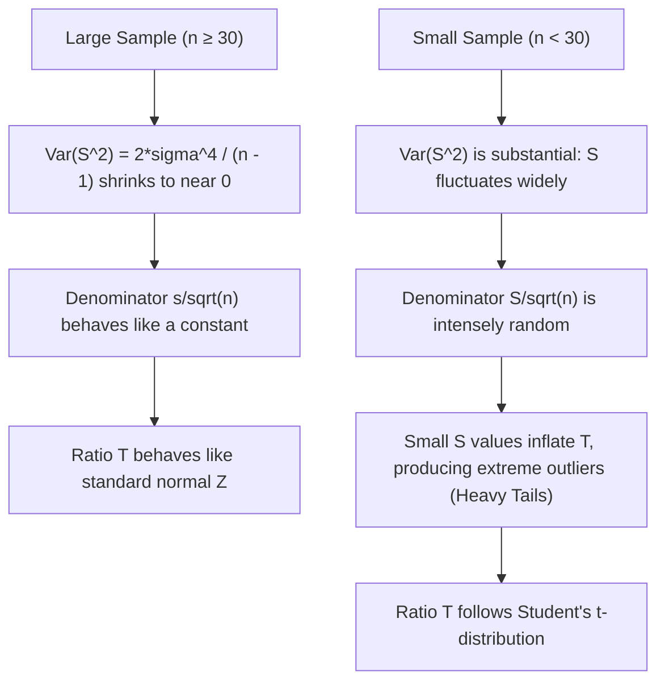
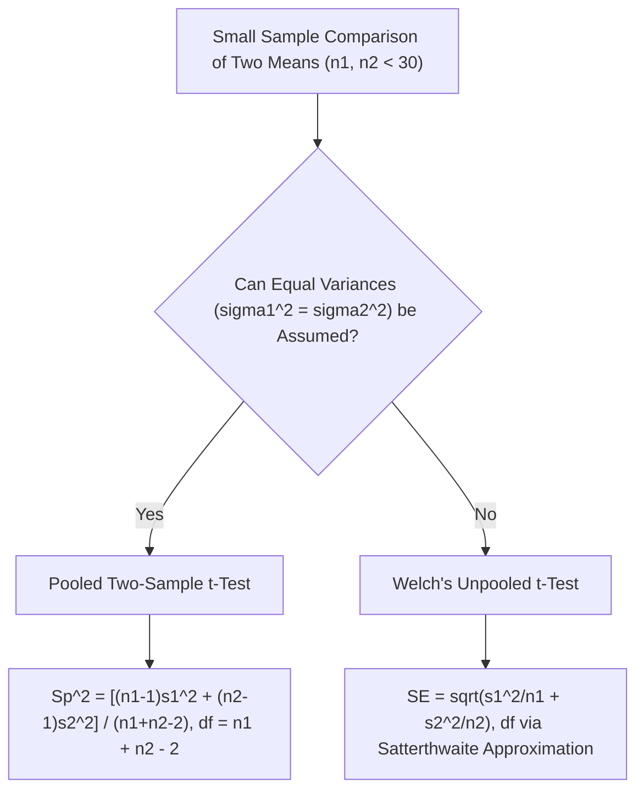
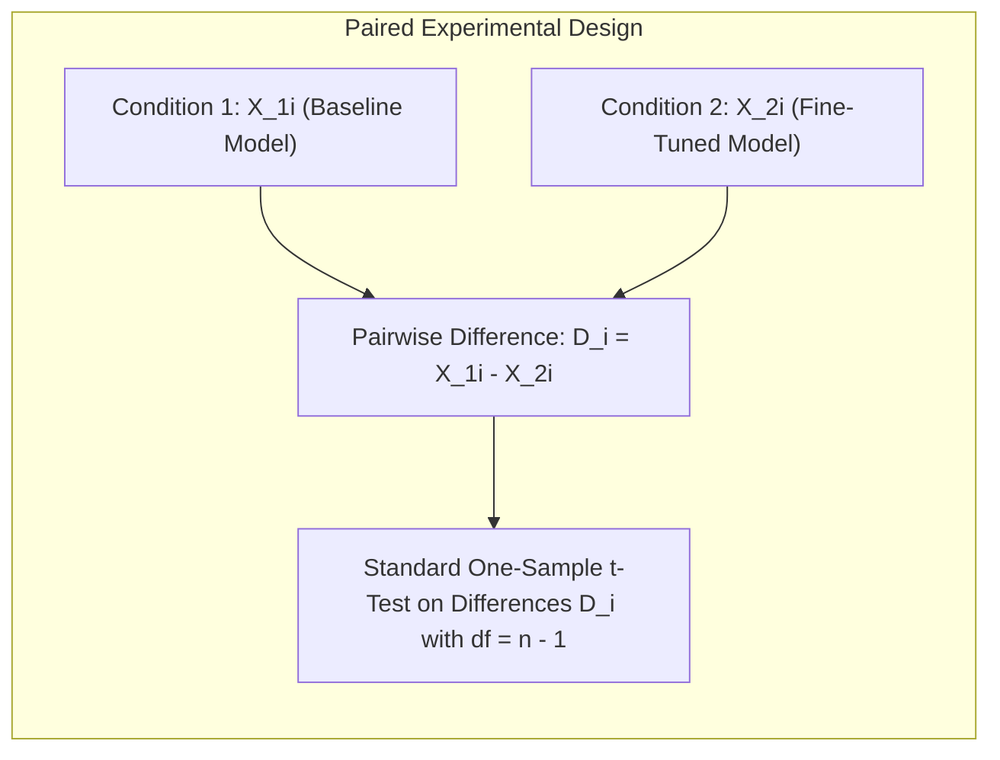

[Maths Index](../README.md) / [Unit 4: Hypothesis Testing and Statistical Inference](Introduction.md)

# Small-Sample Tests for a Population Mean

Large-sample theory is comfortable. When sample sizes exceed 30, the Central Limit Theorem smooths out irregularities, Slutsky's theorem suppresses sample variance noise, and the familiar standard normal distribution $\mathcal{N}(0, 1)$ handles our inference.

Now here's the thing — in real-world engineering and machine learning research, we are frequently forced to operate in data-scarce regimes:
- Training an ultra-large foundation model costs hundreds of thousands of dollars, limiting our ablation experiments to $n = 5$ or $n = 10$ runs.
- Evaluating inference latency on specialized neuromorphic hardware or quantum accelerators where physical chip access is limited to a dozen runs.
- Medical AI diagnostic benchmarks where rare-disease patient samples are strictly limited ($n < 20$).

What happens when we apply the standard normal $Z$-test to a sample of size $n = 10$?

The test breaks down catastrophically. The actual false positive rate shoots far above your declared significance level $\alpha$. If you think you are testing at $\alpha = 0.05$, your true rejection rate under the null could be $10\%$ or $15\%$.

To handle small samples without corrupting our inferences, we must abandon the normal distribution and turn to the exact sampling distribution discovered by William Sealy Gosset: **Student's $t$-distribution**.

---

## Why the Normal Approximation Collapses for Small Samples

Let's dissect the exact mathematical mechanism that causes the standard normal approximation to fail when $n$ is small.

Consider the standardized ratio:

$$T = \frac{\bar{X} - \mu}{S / \sqrt{n}}$$

When $\sigma$ is known and fixed, the denominator $\sigma / \sqrt{n}$ is a constant. The only random variable in the expression is the numerator $\bar{X}$. If the parent population is normal, $\bar{X}$ is normal, so the whole ratio is strictly normal: $Z \sim \mathcal{N}(0, 1)$.

However, when $\sigma$ is unknown, we must estimate it using the sample standard deviation $S$:

$$S = \sqrt{\frac{1}{n-1} \sum_{i=1}^n (X_i - \bar{X})^2}$$

Notice what just happened. Both the numerator ($\bar{X}$) AND the denominator ($S$) are now random variables. They fluctuate independently from sample to sample.

When $n$ is large (say, $n = 500$), the Law of Large Numbers locks $S$ very tightly around $\sigma$. The denominator acts almost like a constant.

When $n$ is small (say, $n = 8$), $S$ fluctuates wildly. In some samples, by pure chance, the observed values cluster tightly together, producing an unusually tiny value of $S$. 

When a small numerator is divided by an abnormally tiny $S$, the ratio $T$ blows up to a large number. 

As a result, the distribution of $T$ produces far more extreme values (outliers) than a standard normal curve. The sampling distribution has **heavier tails** than Gaussian. If you use normal critical values (like $\pm 1.96$), you will reject $H_0$ far too often when $H_0$ is true.

---

## Mathematical Derivation of Student's $t$-Distribution

In 1908, William Sealy Gosset, working as a chemist and statistician at the Guinness Brewery in Dublin, derived the exact probability distribution of this ratio for small samples taken from a normal population. Because Guinness forbade employees from publishing proprietary research, he published under the pseudonym "Student."

Let's derive the structure of the $t$-statistic from first principles.

### Theorem (Definition of Student's $t$)
Let $Z \sim \mathcal{N}(0, 1)$ be a standard normal random variable.  
Let $V \sim \chi^2(\nu)$ be a Chi-Square random variable with $\nu$ degrees of freedom.  
Assume that $Z$ and $V$ are statistically independent.

Then the random variable $T$ defined by:

$$T = \frac{Z}{\sqrt{V / \nu}}$$

follows a **Student's $t$-distribution** with $\nu$ degrees of freedom, denoted $T \sim t(\nu)$.

### Connecting the Sample Mean and Variance to $Z$ and $\chi^2$
Now let $X_1, X_2, \dots, X_n \stackrel{\text{i.i.d.}}{\sim} \mathcal{N}(\mu, \sigma^2)$.

1. From normal distribution theory, the standardized sample mean is standard normal:
   $$Z = \frac{\bar{X} - \mu}{\sigma / \sqrt{n}} \sim \mathcal{N}(0, 1)$$

2. By Cochran's Theorem, the scaled sample variance follows a Chi-Square distribution with $\nu = n - 1$ degrees of freedom:
   $$V = \frac{(n-1)S^2}{\sigma^2} \sim \chi^2(n - 1)$$

3. Crucially, for a normal population, $\bar{X}$ and $S^2$ are statistically independent ($Z \perp V$).

Now substitute $Z$ and $V$ into the definition of $T$:

$$T = \frac{Z}{\sqrt{V / \nu}} = \frac{\dfrac{\bar{X} - \mu}{\sigma / \sqrt{n}}}{\sqrt{\dfrac{(n-1)S^2}{\sigma^2} \cdot \dfrac{1}{n-1}}} = \frac{\dfrac{\bar{X} - \mu}{\sigma / \sqrt{n}}}{\sqrt{\dfrac{S^2}{\sigma^2}}} = \frac{\dfrac{\bar{X} - \mu}{\sigma / \sqrt{n}}}{\dfrac{S}{\sigma}} = \frac{\bar{X} - \mu}{S / \sqrt{n}}$$

The unknown population parameter $\sigma$ cancels out completely.

The resulting test statistic $T = \frac{\bar{X} - \mu}{S / \sqrt{n}}$ follows an exact Student's $t$-distribution with $\nu = n - 1$ degrees of freedom.

---

## Properties of Student's $t$-Distribution

Student's $t$-distribution possesses distinct mathematical properties:

1. **Symmetry**: The probability density function $f(t)$ is perfectly symmetric around $t = 0$:
   $$E[T] = 0 \quad (\text{for } \nu > 1)$$
2. **Variance and Heavy Tails**: The variance of $T$ is:
   $$\operatorname{Var}(T) = \frac{\nu}{\nu - 2} \quad (\text{for } \nu > 2)$$
   Notice that for any finite $\nu$, $\frac{\nu}{\nu - 2} > 1$. The variance of the standard normal distribution is exactly 1. Because $\operatorname{Var}(T) > 1$, the $t$-distribution is more spread out and has fatter (heavier) tails than $\mathcal{N}(0, 1)$.
3. **Degrees of Freedom ($\nu$)**: As the sample size $n$ increases, $\nu = n - 1 \to \infty$. 
   $$\lim_{\nu \to \infty} \operatorname{Var}(T) = \lim_{\nu \to \infty} \frac{\nu}{\nu - 2} = 1$$
   As $\nu \to \infty$, the $t$-distribution converges mathematically to the standard normal distribution $\mathcal{N}(0, 1)$.

| Degrees of Freedom ($\nu$) | Critical Value $t_{0.025}$ ($95\%$ Two-Tailed) | Comparison to Normal $z_{0.025} = 1.960$ |
| :--- | :--- | :--- |
| $\nu = 3$ ($n = 4$) | $3.182$ | $+62.3\%$ wider threshold |
| $\nu = 5$ ($n = 6$) | $2.571$ | $+31.2\%$ wider threshold |
| $\nu = 10$ ($n = 11$) | $2.228$ | $+13.7\%$ wider threshold |
| $\nu = 20$ ($n = 21$) | $2.086$ | $+6.4\%$ wider threshold |
| $\nu = 30$ ($n = 31$) | $2.042$ | $+4.2\%$ wider threshold |
| $\nu = 100$ ($n = 101$) | $1.984$ | $+1.2\%$ wider threshold |
| $\nu \to \infty$ | $1.960$ | Identical to $\mathcal{N}(0, 1)$ |

Notice how wide the threshold must be when $n$ is very small. For $\nu = 3$, an observed difference must exceed $3.182$ standard errors to be declared statistically significant at the $5\%$ level, compared to just $1.960$ for a large sample. The $t$-distribution automatically compensates for the uncertainty of estimating $\sigma$ from limited data.

---

## The One-Sample $t$-Test

Let's formalize the protocol for testing $H_0: \mu = \mu_0$ when sample size is small ($n < 30$) and $\sigma$ is unknown.

### Assumptions
1. **Normality**: The underlying population from which the sample is drawn is normally distributed.
2. **Random Sampling**: Observations are independent and identically distributed.

### Test Statistic

$$t_{\text{calc}} = \frac{\bar{x} - \mu_0}{s / \sqrt{n}}, \quad \text{with } df = n - 1$$

### Decision Rules (Significance Level $\alpha$)
- **Two-Tailed** ($H_1: \mu \ne \mu_0$): Reject $H_0$ if $|t_{\text{calc}}| \ge t_{\alpha/2, n-1}$.
- **Right-Tailed** ($H_1: \mu > \mu_0$): Reject $H_0$ if $t_{\text{calc}} \ge t_{\alpha, n-1}$.
- **Left-Tailed** ($H_1: \mu < \mu_0$): Reject $H_0$ if $t_{\text{calc}} \le -t_{\alpha, n-1}$.

---

## Step-by-Step Numerical Example 1: One-Sample $t$-Test

Let's walk through an AI hardware profiling experiment.

### The Scenario
A team designing an embedded neural processing unit (NPU) targets an average execution time of $\mu_0 = 15.0$ milliseconds for an image segmentation model. 

Manufacturing variations across early wafer prototypes require benchmarking. The team gathers an experimental sample of $n = 12$ physical prototype chips and measures their latency under identical input loads.

The recorded execution times (in milliseconds) are:

$$\{15.8, \; 16.2, \; 14.9, \; 15.5, \; 16.4, \; 15.1, \; 16.7, \; 15.9, \; 16.3, \; 15.2, \; 16.0, \; 16.8\}$$

Test at $\alpha = 0.05$ whether the mean execution time of these prototypes is significantly greater than the $15.0$ ms target.

### Execution

#### 1. Formulate Hypotheses
The question asks whether execution time is significantly greater than $15.0$ ms:

$$\begin{aligned}
H_0: \mu &\le 15.0 \text{ ms} \\
H_1: \mu &> 15.0 \text{ ms}
\end{aligned}$$

#### 2. Compute Sample Mean $\bar{x}$

$$\sum_{i=1}^{12} x_i = 15.8 + 16.2 + 14.9 + 15.5 + 16.4 + 15.1 + 16.7 + 15.9 + 16.3 + 15.2 + 16.0 + 16.8 = 190.8$$

$$\bar{x} = \frac{190.8}{12} = 15.90 \text{ ms}$$

#### 3. Compute Sample Variance $s^2$ and Sample Standard Deviation $s$
Let's compute the squared deviations $(x_i - \bar{x})^2$ where $\bar{x} = 15.90$:

| $x_i$ | $(x_i - 15.90)$ | $(x_i - 15.90)^2$ |
| :--- | :--- | :--- |
| $15.8$ | $-0.10$ | $0.01$ |
| $16.2$ | $+0.30$ | $0.09$ |
| $14.9$ | $-1.00$ | $1.00$ |
| $15.5$ | $-0.40$ | $0.16$ |
| $16.4$ | $+0.50$ | $0.25$ |
| $15.1$ | $-0.80$ | $0.64$ |
| $16.7$ | $+0.80$ | $0.64$ |
| $15.9$ | $0.00$ | $0.00$ |
| $16.3$ | $+0.40$ | $0.16$ |
| $15.2$ | $-0.70$ | $0.49$ |
| $16.0$ | $+0.10$ | $0.01$ |
| $16.8$ | $+0.90$ | $0.81$ |
| **Sum** | **0.00** | **4.26** |

The sample variance is:

$$s^2 = \frac{1}{n - 1} \sum (x_i - \bar{x})^2 = \frac{4.26}{12 - 1} = \frac{4.26}{11} \approx 0.38727$$

The sample standard deviation is:

$$s = \sqrt{0.38727} \approx 0.6223 \text{ ms}$$

#### 4. Compute Standard Error of the Mean

$$\hat{\sigma}_{\bar{x}} = \frac{s}{\sqrt{n}} = \frac{0.6223}{\sqrt{12}} = \frac{0.6223}{3.4641} \approx 0.1796 \text{ ms}$$

#### 5. Compute Test Statistic $t_{\text{calc}}$

$$t_{\text{calc}} = \frac{\bar{x} - \mu_0}{\hat{\sigma}_{\bar{x}}} = \frac{15.90 - 15.00}{0.1796} = \frac{0.90}{0.1796} \approx 5.011$$

#### 6. Determine Critical Value and Decision
The test is right-tailed with $\alpha = 0.05$ and degrees of freedom:

$$df = n - 1 = 12 - 1 = 11$$

Looking up $t_{0.05, 11}$ in the Student's $t$ distribution table:

$$t_{\text{crit}} = t_{0.05, 11} = 1.796$$

Our calculated statistic is:

$$t_{\text{calc}} = 5.011 > 1.796$$

The associated $p$-value for $t = 5.011$ with $11$ degrees of freedom is $p < 0.0002$.

#### 7. Conclusion
We **Reject $H_0$** at the $5\%$ level of significance ($t = 5.01, df = 11, p < 0.001$). 

There is overwhelming statistical evidence that the mean execution time of the prototype chips exceeds the target specification of $15.0$ ms. The observed mean latency of $15.90$ ms represents a statistically significant bottleneck that hardware engineering must address prior to tape-out.

---

## Two-Sample Small-Sample $t$-Tests

When comparing two independent groups with small sample sizes ($n_1, n_2 < 30$), we face an essential design fork: are the population variances $\sigma_1^2$ and $\sigma_2^2$ equal or unequal?

### 1. The Pooled Two-Sample $t$-Test (Equal Variances Assumed)
If we assume that both populations share a common variance ($\sigma_1^2 = \sigma_2^2 = \sigma^2$), we combine both sample variances into a single weighted estimator called the **pooled variance** $s_p^2$:

$$s_p^2 = \frac{(n_1 - 1)s_1^2 + (n_2 - 1)s_2^2}{n_1 + n_2 - 2}$$

The standard error of the difference is:

$$\operatorname{SE}(\bar{X}_1 - \bar{X}_2) = s_p \sqrt{\frac{1}{n_1} + \frac{1}{n_2}}$$

The test statistic follows a $t$-distribution with combined degrees of freedom $\nu = n_1 + n_2 - 2$:

$$t_{\text{calc}} = \frac{(\bar{x}_1 - \bar{x}_2) - \Delta_0}{s_p \sqrt{\dfrac{1}{n_1} + \dfrac{1}{n_2}}} \sim t(n_1 + n_2 - 2)$$

### 2. Welch's $t$-Test (Unequal Variances)
In modern data science, assuming equal variances is rarely justifiable. If $\sigma_1^2 \ne \sigma_2^2$, pooling the variances introduces systematic bias (especially when $n_1 \ne n_2$).

Welch's $t$-test does not pool variances:

$$t_{\text{calc}} = \frac{(\bar{x}_1 - \bar{x}_2) - \Delta_0}{\sqrt{\dfrac{s_1^2}{n_1} + \dfrac{s_2^2}{n_2}}}$$

The degrees of freedom are adjusted downward using the **Welch-Satterthwaite equation**:

$$df = \frac{\left( \dfrac{s_1^2}{n_1} + \dfrac{s_2^2}{n_2} \right)^2}{\dfrac{(s_1^2 / n_1)^2}{n_1 - 1} + \dfrac{(s_2^2 / n_2)^2}{n_2 - 1}}$$

The resulting degrees of freedom is typically a non-integer, rounded down to the nearest integer for conservative tabular lookup. Welch's $t$-test is universally recommended as the default independent two-sample test in modern scientific software.

---

## Paired-Samples $t$-Test (Dependent Observations)

There is a fundamentally different experimental design that must not be confused with independent two-sample testing: **paired (dependent) samples**.

Suppose we test the accuracy of a machine learning model before and after applying LoRA (Low-Rank Adaptation) fine-tuning. If we evaluate both models across the same 10 benchmark datasets, Dataset 1 might be inherently easy for all models, while Dataset 5 is notoriously brutal. 

The two samples are not independent: the score of Model B on Dataset 5 is strongly correlated with the score of Model A on Dataset 5.

By computing the pairwise difference for each matched subject:

$$D_i = X_{1i} - X_{2i} \quad \text{for } i = 1, 2, \dots, n$$

we eliminate all between-subject baseline variation! We convert an apparent two-sample problem into a simple **one-sample $t$-test on the differences**:

$$t_{\text{calc}} = \frac{\bar{d} - \mu_d}{s_d / \sqrt{n}}, \quad \text{with } df = n - 1$$

Where:
- $\bar{d} = \frac{1}{n} \sum D_i$ is the sample mean of the differences.
- $s_d = \sqrt{\frac{\sum (D_i - \bar{d})^2}{n - 1}}$ is the sample standard deviation of the differences.
- $\mu_d$ is the null hypothesized difference (typically $\mu_d = 0$).

---

## Step-by-Step Numerical Example 2: Paired $t$-Test

Let's test an AI optimization fine-tuning pipeline.

### The Scenario
An NLP research team evaluates whether a prompt-compression tokenizer reduces memory footprint without harming output accuracy. They measure the exact BLEU score across $n = 10$ distinct benchmark evaluation tasks under two conditions:
- Baseline Tokenizer ($X_1$)
- Compressed Tokenizer ($X_2$)

The paired BLEU scores are:

| Task $i$ | Baseline ($X_{1i}$) | Compressed ($X_{2i}$) | Difference $D_i = X_{2i} - X_{1i}$ |
| :---: | :---: | :---: | :---: |
| 1 | $74.2$ | $76.0$ | $+1.8$ |
| 2 | $68.5$ | $69.1$ | $+0.6$ |
| 3 | $82.1$ | $83.5$ | $+1.4$ |
| 4 | $71.0$ | $70.8$ | $-0.2$ |
| 5 | $65.4$ | $67.2$ | $+1.8$ |
| 6 | $88.9$ | $89.4$ | $+0.5$ |
| 7 | $79.3$ | $81.5$ | $+2.2$ |
| 8 | $73.0$ | $74.1$ | $+1.1$ |
| 9 | $69.8$ | $71.0$ | $+1.2$ |
| 10 | $84.2$ | $85.6$ | $+1.4$ |

Test at $\alpha = 0.05$ whether the compressed tokenizer yields a significant improvement in BLEU score.

### Execution

#### 1. Formulate Hypotheses
Let $\mu_d$ be the true mean difference $(\text{Compressed} - \text{Baseline})$:

$$\begin{aligned}
H_0: \mu_d &\le 0 \\
H_1: \mu_d &> 0
\end{aligned}$$

#### 2. Compute Mean Difference $\bar{d}$

$$\sum D_i = 1.8 + 0.6 + 1.4 - 0.2 + 1.8 + 0.5 + 2.2 + 1.1 + 1.2 + 1.4 = 11.8$$

$$\bar{d} = \frac{11.8}{10} = 1.18$$

#### 3. Compute Sample Variance of Differences $s_d^2$

Let's compute $(D_i - 1.18)^2$:
- $(1.8 - 1.18)^2 = (0.62)^2 = 0.3844$
- $(0.6 - 1.18)^2 = (-0.58)^2 = 0.3364$
- $(1.4 - 1.18)^2 = (0.22)^2 = 0.0484$
- $(-0.2 - 1.18)^2 = (-1.38)^2 = 1.9044$
- $(1.8 - 1.18)^2 = (0.62)^2 = 0.3844$
- $(0.5 - 1.18)^2 = (-0.68)^2 = 0.4624$
- $(2.2 - 1.18)^2 = (1.02)^2 = 1.0404$
- $(1.1 - 1.18)^2 = (-0.08)^2 = 0.0064$
- $(1.2 - 1.18)^2 = (0.02)^2 = 0.0004$
- $(1.4 - 1.18)^2 = (0.22)^2 = 0.0484$

$$\sum (D_i - \bar{d})^2 = 4.6160$$

$$s_d^2 = \frac{4.6160}{10 - 1} = \frac{4.6160}{9} \approx 0.51289$$

$$s_d = \sqrt{0.51289} \approx 0.7162$$

#### 4. Compute Standard Error of Differences

$$\operatorname{SE}_d = \frac{s_d}{\sqrt{n}} = \frac{0.7162}{\sqrt{10}} = \frac{0.7162}{3.1623} \approx 0.2265$$

#### 5. Compute Test Statistic $t_{\text{calc}}$

$$t_{\text{calc}} = \frac{\bar{d} - 0}{\operatorname{SE}_d} = \frac{1.18}{0.2265} \approx 5.210$$

#### 6. Critical Value and Decision
For a right-tailed test at $\alpha = 0.05$ with $df = n - 1 = 9$:

$$t_{\text{crit}} = t_{0.05, 9} = 1.833$$

Our calculated statistic is:

$$t_{\text{calc}} = 5.210 > 1.833$$

The one-tailed $p$-value for $t = 5.210$ with $df = 9$ is $p = 0.00027 < 0.001$.

#### 7. Conclusion
We **Reject $H_0$** ($t = 5.21, df = 9, p < 0.001$). 

There is strong statistical evidence that the compressed tokenizer significantly improves output BLEU scores, producing an average gain of $1.18$ points across benchmark tasks.

---

## Robustness and Checking the Normality Assumption

The theoretical derivation of the $t$-test assumes that the parent population is normal. What happens if the data is not strictly normal?

Fortunately, the $t$-test is remarkably **robust to mild and moderate departures from normality**, especially when:
1. The sample distribution is symmetric and unimodal.
2. The test is two-tailed (skewness distorts one-tailed critical bounds more severely than two-tailed bounds).
3. Sample size is at least moderately sized ($n \ge 15$).

However, the $t$-test is notoriously sensitive to severe skewness and extreme outliers. A single severe outlier in a sample of size $n = 10$ will simultaneously inflate the sample standard deviation $s$ (exploding the denominator) and drag the mean $\bar{x}$, destroying the power of the test.

Before trusting a small-sample $t$-test, best practice in data science demands verifying the normality assumption:
- **Visual Checks**: Normal Quantile-Quantile (Q-Q) plots. If the sample observations adhere closely to the 45-degree reference line, normality is plausible.
- **Statistical Tests**: Formal normality tests such as the Shapiro-Wilk test or Anderson-Darling test.
- **Non-Parametric Fallbacks**: If normality is severely violated and sample size cannot be expanded, switch to non-parametric alternatives: the Wilcoxon Signed-Rank test for paired data or the Mann-Whitney $U$ test for independent groups.

---

## Key Takeaways

- When $n < 30$ and population variance $\sigma^2$ is unknown, estimating $\sigma$ with the sample variance $S^2$ introduces denominator randomness, producing heavier tails than a standard normal distribution.
- Student's $t$-distribution is the exact sampling distribution of the ratio $T = \frac{\bar{X} - \mu}{S / \sqrt{n}}$ for samples drawn from a normal population.
- The $t$-distribution is symmetric about zero with variance $\frac{\nu}{\nu - 2} > 1$ for degrees of freedom $\nu = n - 1$. As $\nu \to \infty$, $t(\nu)$ converges to $\mathcal{N}(0, 1)$.
- Independent two-sample tests require choosing between pooled $t$-tests (equal variances assumed) and Welch's $t$-test (unequal variances, Satterthwaite adjusted $df$). Welch's test is the safer, standard default.
- Paired samples eliminate between-subject confounding by subtracting matched pairs ($D_i = X_{1i} - X_{2i}$), reducing the problem to a standard one-sample $t$-test with $df = n - 1$.
- The $t$-test is robust to mild non-normality, but vulnerable to extreme outliers; inspect Q-Q plots before drawing final conclusions.

---

Now that we know how to execute both large-sample $Z$-tests and small-sample $t$-tests, we must confront the reality of decision errors. No matter how carefully we set our critical thresholds, statistical inference is never infallible. In the next lecture, we dissect the two fundamental modes of failure — Type I errors (false positives) and Type II errors (false negatives) — and uncover their inevitable mathematical trade-offs. Read [L05 - Type I and Type II Errors](L05%20-%20Type%20I%20and%20Type%20II%20Errors.md).
