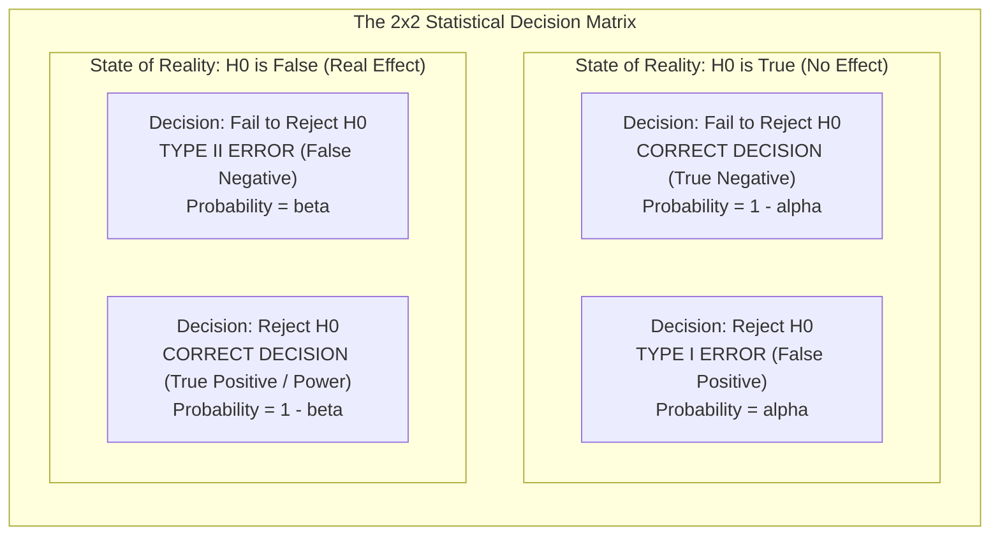
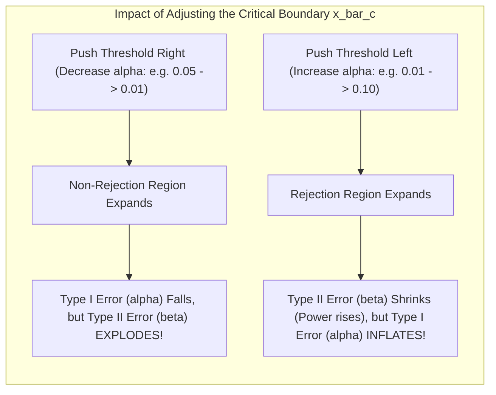

[Maths Index](../README.md) / [Unit 4: Hypothesis Testing and Statistical Inference](Introduction.md)

# Type I and Type II Errors

Whenever we make an empirical decision based on finite sample data, certainty is an impossibility. Because samples are subject to random noise, even the most rigorously designed statistical test can reach the wrong conclusion.

A statistical test acts like an imperfect binary detector. It examines sample evidence and makes a categorical judgment: either maintain the status quo ($H_0$), or sound the alarm that an effect has occurred ($H_1$).

Now here's the thing — there are two distinct ways a detector can fail:
1. It can sound an alarm when there is no danger.
2. It can remain silent when a real crisis is underway.

In statistical hypothesis testing, these two modes of failure are formalized as **Type I Errors** and **Type II Errors**. 

Understanding the mathematical mechanics of these errors is not just an academic exercise. In real-world data science, machine learning deployment, and automated decision systems, balancing these errors represents the fundamental trade-off between risk, sensitivity, and operational cost.

---

## The Statistical Decision Matrix

Let's organize the relationship between objective reality and our empirical decision into a $2 \times 2$ matrix.

There are two possible states of nature:
- The null hypothesis $H_0$ is objectively **True**.
- The null hypothesis $H_0$ is objectively **False** (meaning an alternative state $H_1$ holds).

And there are two possible decisions our statistical procedure can make:
- **Fail to Reject $H_0$** (conclude evidence is insufficient to claim an effect).
- **Reject $H_0$** (declare a statistically significant effect).

Let's define each cell with mathematical precision:

### 1. True Negative: Correct Retention ($1 - \alpha$)
- **Reality**: $H_0$ is True.
- **Decision**: Fail to Reject $H_0$.
- **Interpretation**: Nothing happened, and our test correctly concluded that nothing happened.
- **Probability**: $P(\text{Fail to Reject } H_0 \mid H_0 \text{ is True}) = 1 - \alpha$. This is known as the **confidence coefficient**.

### 2. False Positive: Type I Error ($\alpha$)
- **Reality**: $H_0$ is True.
- **Decision**: Reject $H_0$.
- **Interpretation**: A false alarm. The test claims an effect or improvement exists, but the observed difference was purely a fluke of random sampling.
- **Probability**: $P(\text{Reject } H_0 \mid H_0 \text{ is True}) = \alpha$. This is our chosen **level of significance**.

### 3. False Negative: Type II Error ($\beta$)
- **Reality**: $H_0$ is False (a genuine effect exists).
- **Decision**: Fail to Reject $H_0$.
- **Interpretation**: A missed detection. A real improvement or difference exists in reality, but our test was not sensitive enough to detect it against the background noise.
- **Probability**: $P(\text{Fail to Reject } H_0 \mid H_0 \text{ is False}) = \beta$.

### 4. True Positive: Statistical Power ($1 - \beta$)
- **Reality**: $H_0$ is False.
- **Decision**: Reject $H_0$.
- **Interpretation**: A successful discovery. The test correctly identifies and confirms a genuine effect.
- **Probability**: $P(\text{Reject } H_0 \mid H_0 \text{ is False}) = 1 - \beta$. This is the **Power of the test**.

---

## The Fundamental Trade-Off Between $\alpha$ and $\beta$

Why can't we simply set both $\alpha = 0$ and $\beta = 0$?

Because for any fixed sample size $n$, **$\alpha$ and $\beta$ are inversely related**. Pushing down one error rate mechanically inflates the other.

To see why, visualize how a decision threshold works. Suppose we are running a right-tailed test for a population mean:

Think about this intuitively from an engineering perspective:
- If you become paranoid about False Positives (you demand $\alpha = 0.0001$), you must move your critical threshold extremely far to the right. You will almost never reject $H_0$. But the moment you do that, when a real effect actually occurs, your sample mean will rarely cross that ultra-conservative barrier. Your False Negative rate $\beta$ skyrockets!
- Conversely, if you become terrified of False Negatives (you want $\beta \approx 0$ so you never miss a real signal), you move your critical threshold to the left. The test becomes hyper-sensitive. It flags every tiny bump as a real signal. But now you will constantly sound false alarms: $\alpha$ blows up.

The only way to reduce both $\alpha$ and $\beta$ simultaneously without compromising either is to **increase the sample size $n$** or **reduce the underlying measurement variance $\sigma$**. 

Increasing $n$ shrinks the standard error $\sigma / \sqrt{n}$, compressing the sampling distributions and pulling their overlapping tails apart.

---

## Mathematical Derivation of $\beta$ for a Specific Alternative Mean

Unlike $\alpha$, which is fixed by the experimenter beforehand, $\beta$ cannot be summarized as a single static number. 

Why? Because $H_0$ specifies an exact point ($\mu = \mu_0$), but $H_1$ specifies an entire spectrum of possible truths ($\mu > \mu_0$). 

The probability of missing an effect ($\beta$) depends directly on **how far** the true reality sits from the null hypothesis:
- If the true mean $\mu_a$ is only $0.001$ units away from $\mu_0$, the two distributions almost completely overlap. $\beta$ will be immense.
- If the true mean $\mu_a$ is $50$ units away from $\mu_0$, the distributions are miles apart. $\beta$ will drop to near zero.

Therefore, $\beta$ is always evaluated at a specific alternative mean $\mu_a$. Let's derive its closed-form formula for a right-tailed test with known variance $\sigma^2$.

### Step 1: Establish the Decision Threshold under $H_0$
Under the null hypothesis $H_0: \mu = \mu_0$, the sample mean follows:

$$\bar{X} \sim \mathcal{N}\left(\mu_0, \frac{\sigma^2}{n}\right)$$

For a right-tailed test with significance level $\alpha$, the decision rule rejects $H_0$ if $Z_{\text{calc}} \ge z_\alpha$:

$$\frac{\bar{X} - \mu_0}{\sigma / \sqrt{n}} \ge z_\alpha \implies \bar{X} \ge \bar{x}_c$$

Where $\bar{x}_c$ is the **critical value on the raw data scale**:

$$\bar{x}_c = \mu_0 + z_\alpha \frac{\sigma}{\sqrt{n}}$$

If $\bar{X} < \bar{x}_c$, we fail to reject $H_0$.

### Step 2: Evaluate the Probability under the Alternative Distribution $H_a$
Now suppose that the null hypothesis is false, and the true population mean is actually $\mu_a$ (where $\mu_a > \mu_0$).

Under this true reality, the sample mean $\bar{X}$ is centered at $\mu_a$:

$$\bar{X} \sim \mathcal{N}\left(\mu_a, \frac{\sigma^2}{n}\right)$$

A Type II error occurs if our sample mean fails to cross the critical threshold $\bar{x}_c$, even though $\mu = \mu_a$:

$$\beta = P(\bar{X} < \bar{x}_c \mid \mu = \mu_a)$$

Standardizing $\bar{X}$ under its true distribution centered at $\mu_a$:

$$Z_a = \frac{\bar{X} - \mu_a}{\sigma / \sqrt{n}}$$

Substituting this standardization into the probability expression:

$$\beta = P\left( \frac{\bar{X} - \mu_a}{\sigma / \sqrt{n}} < \frac{\bar{x}_c - \mu_a}{\sigma / \sqrt{n}} \right) = \Phi\left( \frac{\bar{x}_c - \mu_a}{\sigma / \sqrt{n}} \right)$$

Now substitute the formula for $\bar{x}_c = \mu_0 + z_\alpha \frac{\sigma}{\sqrt{n}}$:

$$\frac{\bar{x}_c - \mu_a}{\sigma / \sqrt{n}} = \frac{\mu_0 + z_\alpha \dfrac{\sigma}{\sqrt{n}} - \mu_a}{\sigma / \sqrt{n}} = z_\alpha - \frac{\mu_a - \mu_0}{\sigma / \sqrt{n}}$$

This gives the master formula for Type II error in a right-tailed test:

$$\beta(\mu_a) = \Phi\left( z_\alpha - \frac{\mu_a - \mu_0}{\sigma / \sqrt{n}} \right)$$

Notice how every term in this formula reveals the physics of statistical testing:
- As the effect size $(\mu_a - \mu_0)$ increases, the subtracted term grows, shifting the argument of $\Phi$ into the negative tail, which drives $\beta \to 0$.
- As sample size $n$ increases, the subtracted term grows by $\sqrt{n}$, also driving $\beta \to 0$.
- If you decrease $\alpha$, $z_\alpha$ increases, shifting the argument to the right and inflating $\beta$.

---

## Step-by-Step Numerical Walkthrough

Let's compute $\beta$ and power explicitly for an industrial machine learning monitoring pipeline.

### The Scenario
A fraud detection service screens financial transactions. Under normal operating conditions, the mean transaction risk score is calibrated to:

$$\mu_0 = 50.0$$

The standard deviation of transaction scores is known to be $\sigma = 10.0$.

An automated monitoring script draws an hourly sample of $n = 25$ transactions. If organized bot activity attacks the platform, the mean risk score will increase. The system tests:

$$\begin{aligned}
H_0: \mu &\le 50.0 \\
H_1: \mu &> 50.0
\end{aligned}$$

The engineering team sets a significance level of $\alpha = 0.05$.

### Problem 1: Calculate the Critical Threshold $\bar{x}_c$
First, compute the standard error of the mean:

$$\sigma_{\bar{x}} = \frac{\sigma}{\sqrt{n}} = \frac{10.0}{\sqrt{25}} = \frac{10.0}{5} = 2.0$$

For a right-tailed test at $\alpha = 0.05$, the critical $Z$-value is $z_{0.05} = 1.645$.

The raw score threshold $\bar{x}_c$ is:

$$\bar{x}_c = \mu_0 + z_{0.05} \cdot \sigma_{\bar{x}} = 50.0 + 1.645(2.0) = 50.0 + 3.29 = 53.29$$

Decision rule: If an hourly sample mean $\bar{x} \ge 53.29$, the monitor triggers an alert (rejects $H_0$). If $\bar{x} < 53.29$, the monitor remains silent.

---

### Problem 2: Calculate $\beta$ for an Attack Scenario ($\mu_a = 54.0$)
Now suppose an attack actually occurs, shifting the true population mean risk score to $\mu_a = 54.0$.

What is the probability that our monitoring script fails to detect this attack (Type II Error)?

Using our derived formula:

$$\beta = P(\bar{X} < 53.29 \mid \mu = 54.0)$$

Standardize the cutoff $53.29$ under the new distribution centered at $54.0$:

$$z = \frac{\bar{x}_c - \mu_a}{\sigma_{\bar{x}}} = \frac{53.29 - 54.0}{2.0} = \frac{-0.71}{2.0} = -0.355$$

Using the standard normal CDF:

$$\beta = \Phi(-0.355)$$

From normal distribution tables:
- $\Phi(-0.35) \approx 0.3632$
- $\Phi(-0.36) \approx 0.3594$
- Linear interpolation at $-0.355$:

$$\beta \approx 0.3613 \quad (36.13\%)$$

The statistical power of the test under this attack is:

$$\text{Power} = 1 - \beta = 1 - 0.3613 = 0.6387 \quad (63.87\%)$$

**Interpretation**: If an attack shifts the mean risk score to 54.0, our monitoring script has a $36.13\%$ chance of missing it entirely on any single hourly batch! It will only catch the attack $63.87\%$ of the time.

---

### Problem 3: The Cost of Demanding Greater Certainty ($\alpha = 0.01$)
Suppose a manager complains that a $5\%$ false alarm rate ($\alpha = 0.05$) wakes up on-call engineers too often. The manager insists on tightening the false alarm rate to $\alpha = 0.01$.

Let's trace the mathematical domino effect on $\beta$:

1. For $\alpha = 0.01$, the critical $Z$-value increases:
   $$z_{0.01} = 2.326$$
2. The new critical threshold becomes:
   $$\bar{x}_c^{\text{new}} = 50.0 + 2.326(2.0) = 50.0 + 4.652 = 54.652$$
3. Now re-evaluate $\beta$ when the attack hits at $\mu_a = 54.0$:
   $$z = \frac{\bar{x}_c^{\text{new}} - \mu_a}{\sigma_{\bar{x}}} = \frac{54.652 - 54.0}{2.0} = \frac{0.652}{2.0} = +0.326$$
4. Compute the new Type II error:
   $$\beta^{\text{new}} = \Phi(+0.326) \approx 0.6278 \quad (62.78\%)$$
5. The new statistical power is:
   $$\text{Power}^{\text{new}} = 1 - \beta = 1 - 0.6278 = 0.3722 \quad (37.22\%)$$

Look at what just happened: by lowering the false positive rate from $5\%$ to $1\%$, the false negative rate exploded from $36.13\%$ to $62.78\%$! 

The system will now miss nearly two-thirds of all real attacks. This dramatic demonstration illustrates why statistical thresholds cannot be adjusted casually without modeling the downstream consequences.

---

## Real-World AI Engineering: Asymmetric Error Costs

In pure mathematics, Type I and Type II errors are simply abstract probabilities $\alpha$ and $\beta$. 

In machine learning and data systems engineering, however, **the costs of these two errors are almost never symmetric**. The optimal choice of $\alpha$ depends entirely on the operational penalty of being wrong.

| Domain / Use Case | Type I Error (False Positive) | Type II Error (False Negative) | Asymmetry & Strategy |
| :--- | :--- | :--- | :--- |
| **Autonomous Vehicle Obstacle Detection** | Braking for a non-existent obstacle (phantom brake). Annoying to passengers. | Failing to detect a pedestrian on the road. Catastrophic injury or fatality. | **Type II Error is far worse.** Tolerate a higher $\alpha$ to drive $\beta \to 0$. |
| **Spam / Content Moderation Filter** | Legitimate critical business email routed to Spam folder and missed. | A spam email slips into the Primary inbox. Mild annoyance. | **Type I Error is far worse.** Tolerate a higher $\beta$ to keep $\alpha$ near zero. |
| **Medical Diagnostic Imaging AI** | Patient without tumor flagged for follow-up biopsy. Stress and financial cost. | Malignant tumor missed by AI screener. Delayed treatment and death. | **Type II Error is far worse.** Set high sensitivity (maximize power $1 - \beta$). |
| **Criminal Court / Fraud Accusation** | Accusing an innocent user of money laundering; freezing their bank account. | A fraudster escapes detection this cycle. | **Type I Error is far worse.** Presumption of innocence requires $\alpha \le 0.001$. |

---

## Key Takeaways

- Statistical decisions under uncertainty produce two distinct error types: Type I Error ($\alpha$, false positive) and Type II Error ($\beta$, false negative).
- Type I error probability $\alpha = P(\text{Reject } H_0 \mid H_0 \text{ is True})$ is directly controlled by the experimenter.
- Type II error probability $\beta = P(\text{Fail to Reject } H_0 \mid H_0 \text{ is False})$ is a function of the true alternative parameter value $\mu_a$, effect size, sample size $n$, and $\alpha$.
- For a fixed sample size $n$, $\alpha$ and $\beta$ are inversely linked: lowering $\alpha$ expands the non-rejection region, directly increasing $\beta$.
- The master formula for Type II error in a one-sample right-tailed test is $\beta(\mu_a) = \Phi\left( z_\alpha - \frac{\mu_a - \mu_0}{\sigma / \sqrt{n}} \right)$.
- In production AI engineering, the relative costs of false positives versus false negatives dictate whether you should prioritize minimizing $\alpha$ or maximizing power ($1 - \beta$).

---

Now that we understand how Type II errors arise and why they are dangerous, we need a rigorous methodology to control them proactively. Instead of hoping our sample size is large enough after the experiment is over, can we calculate the exact sample size needed before running the test to guarantee a high probability of detection? In the next lecture, we formalize the Power of a Test, analyze power curves, and derive exact sample size formulas for experimental design. Read [L06 - Power of a Test and Factors Affecting Power](L06%20-%20Power%20of%20a%20Test%20and%20Factors%20Affecting%20Power.md).
