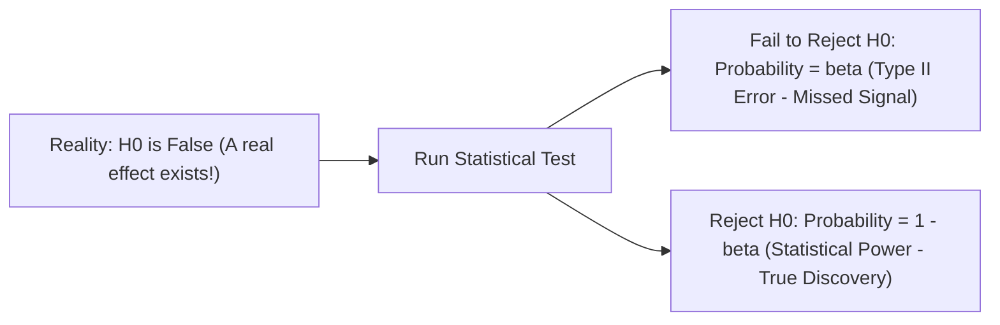
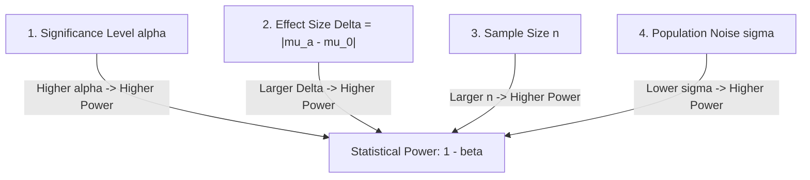
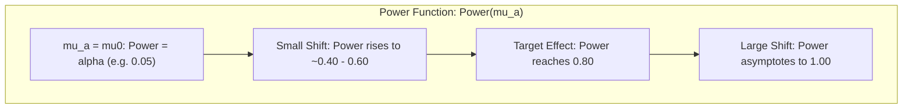
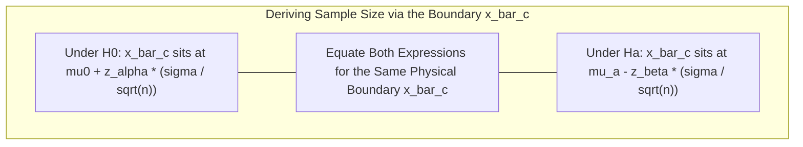
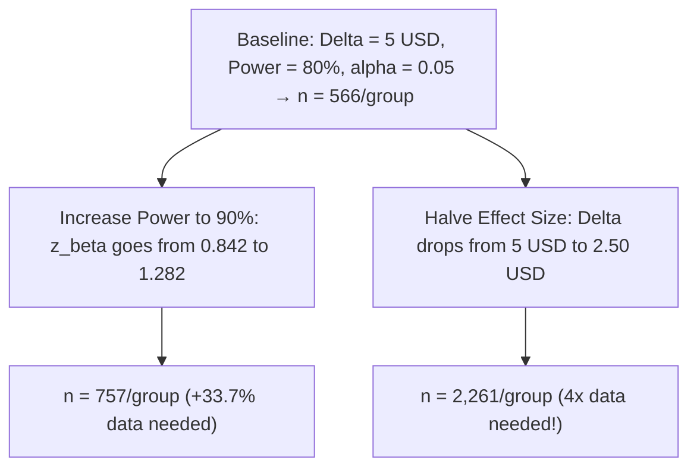

[Maths Index](../README.md) / [Unit 4: Hypothesis Testing and Statistical Inference](Introduction.md)

# Power of a Test and Factors Affecting Power

Imagine building an optical telescope to observe distant galaxies. If the aperture of your mirror is too small, the faint light of distant stars will be drowned out by atmospheric noise. No matter how long you stare into the eyepiece, you will see nothing. The telescope lacks the resolving power to detect the signal.

Statistical hypothesis tests suffer from the exact same limitation.

If an experiment is designed with an insufficient sample size, high background variance, or an overly conservative significance threshold, it will routinely fail to detect genuine improvements. You will walk away concluding "no significant difference was observed," abandoning an innovation that was genuinely effective.

In statistical inference, the resolving power of an experiment is formalized as **Statistical Power**.

Power is the bridge between theoretical statistics and practical experimental engineering. It answers the fundamental question every data scientist and machine learning engineer must answer before launching an A/B test or benchmark: *How much data do I need to collect so that if an effect truly exists, I am practically guaranteed to detect it?*

---

## Defining Statistical Power

Mathematically, the **Power of a Hypothesis Test** is the probability of correctly rejecting the null hypothesis when the null hypothesis is false:

$$\text{Power} = P(\text{Reject } H_0 \mid H_0 \text{ is False}) = 1 - \beta$$

Where $\beta$ is the probability of committing a Type II error (a false negative).

Look at what this means in practice:
- A test with **Power = 0.50** is equivalent to flipping a coin. If your new machine learning architecture is superior, you have only a $50\%$ chance of proving it in your benchmark. Half of your successful innovations will be discarded as "insignificant."
- A test with **Power = 0.80** (the standard industry convention for A/B testing and clinical trials) guarantees that if an effect of the specified magnitude exists, you have an $80\%$ chance of detecting it, and a $20\%$ risk of a false negative.
- A test with **Power = 0.90** or **0.95** represents a high-sensitivity instrument, essential for safety-critical systems or high-stakes business decisions.

Notice a fundamental property: as the true parameter value $\mu_a$ approaches the null value $\mu_0$, the power of the test does not drop to zero. Instead:

$$\lim_{\mu_a \to \mu_0} \text{Power}(\mu_a) = \alpha$$

When there is no difference between reality and the null, the probability of rejecting $H_0$ is simply the Type I error rate $\alpha$.

---

## The Four Interlocking Factors Governing Power

The statistical power of any test is entirely determined by an interconnected system of four operational variables. Changing any one of them forces adjustments in the others.

### 1. Significance Level ($\alpha$)
There is a direct mathematical relationship between $\alpha$ and power:
- **Increasing $\alpha$** (e.g., from $0.01$ to $0.05$) moves the critical rejection boundary closer to the center, expanding the rejection region. This makes it easier for sample statistics to cross the threshold, thereby **increasing power** ($1 - \beta$).
- **Decreasing $\alpha$** (demanding stronger evidence to prevent false alarms) shrinks the rejection region, directly **lowering power**.

### 2. Effect Size ($\delta = |\mu_a - \mu_0|$)
Effect size is the physical magnitude of the difference you wish to detect:
- It is far easier to hear a thunderclap than a whisper. If your new neural network reduces inference latency by $50$ ms, a tiny sample will spot it immediately (high power). 
- If the reduction is only $0.5$ ms, the distributions under $H_0$ and $H_1$ overlap heavily, requiring enormous statistical power to distinguish them.

In data science, we standardize effect size using **Cohen's $d$**:

$$d = \frac{|\mu_a - \mu_0|}{\sigma}$$

Cohen's $d$ measures the distance between the null and alternative distributions in units of population standard deviations:
- $d = 0.2$: Small effect
- $d = 0.5$: Medium effect
- $d = 0.8$: Large effect

### 3. Sample Size ($n$)
Sample size is the primary lever that the experimenter directly controls:
- As $n$ increases, the standard error $\sigma_{\bar{x}} = \frac{\sigma}{\sqrt{n}}$ shrinks.
- A smaller standard error sharpens and narrows both sampling distributions (the null distribution and the alternative distribution).
- As the curves narrow, their overlapping tail area ($\beta$) shrinks exponentially, driving **power toward 1.0**.

### 4. Population Standard Deviation ($\sigma$)
Variance represents background experimental noise:
- If a measurement is inherently noisy (large $\sigma$), the sampling distributions are wide and diffuse, blurring the signal and **lowering power**.
- Engineering techniques that reduce noise — such as stratified sampling, paired experimental designs, or controlling environmental variables — lower $\sigma$ and dramatically **boost power**.

---

## Power Curves (The Operating Characteristic)

Because power depends on the true alternative parameter $\mu_a$, we visualize a test's resolving ability across all possible values of $\mu_a$ using a **Power Curve**.

The power curve exhibits distinct mathematical hallmarks:
1. At $\mu_a = \mu_0$, the curve touches its minimum at $\text{Power} = \alpha$.
2. As $|\mu_a - \mu_0|$ increases in either direction, the curve rises monotonically, adopting an S-shaped sigmoidal trajectory.
3. For large values of $|\mu_a - \mu_0|$, the power curve asymptotically approaches $1.00$ ($100\%$ detection rate).
4. Increasing sample size $n$ steepens the slope of the sigmoid, pulling the curve rapidly toward $1.00$ even for small departures from $\mu_0$.

---

## Derivation of the Sample Size Formula

Let's derive the exact mathematical equation used by data scientists to calculate the sample size $n$ required to achieve a desired power $(1 - \beta)$ at significance level $\alpha$.

Consider a one-sample right-tailed test:

$$H_0: \mu = \mu_0 \quad \text{vs.} \quad H_1: \mu = \mu_a \quad (\text{where } \mu_a > \mu_0)$$

Assume the population has a known standard deviation $\sigma$.

### Step 1: Write the Rejection Boundary from the Perspective of $H_0$
Under $H_0$, the sample mean is distributed as $\bar{X} \sim \mathcal{N}\left(\mu_0, \frac{\sigma^2}{n}\right)$. 

The critical threshold $\bar{x}_c$ that leaves an area of $\alpha$ in the upper tail is:

$$\bar{x}_c = \mu_0 + z_\alpha \frac{\sigma}{\sqrt{n}}$$

### Step 2: Write the Rejection Boundary from the Perspective of $H_a$
Now consider the reality where the alternative hypothesis is true: $\bar{X} \sim \mathcal{N}\left(\mu_a, \frac{\sigma^2}{n}\right)$.

We require the probability of failing to reject $H_0$ (falling to the left of $\bar{x}_c$) to equal exactly $\beta$:

$$P(\bar{X} < \bar{x}_c \mid \mu = \mu_a) = \beta$$

Under this alternative normal distribution, the point that leaves an area of $\beta$ in its lower tail sits exactly $z_\beta$ standard deviations below its mean $\mu_a$:

$$\bar{x}_c = \mu_a - z_\beta \frac{\sigma}{\sqrt{n}}$$

(Where $z_\beta$ is the standard normal quantile satisfying $P(Z > z_\beta) = \beta$, meaning $\Phi(-z_\beta) = \beta$).

### Step 3: Equate the Two Expressions for $\bar{x}_c$
Because $\bar{x}_c$ is the exact same physical threshold on our measurement scale, we set the two expressions equal to each other:

$$\mu_0 + z_\alpha \frac{\sigma}{\sqrt{n}} = \mu_a - z_\beta \frac{\sigma}{\sqrt{n}}$$

### Step 4: Solve for $n$
Rearrange the equation to group the parameter difference on one side and the standard error terms on the other:

$$\mu_a - \mu_0 = z_\alpha \frac{\sigma}{\sqrt{n}} + z_\beta \frac{\sigma}{\sqrt{n}}$$

Factor out $\frac{\sigma}{\sqrt{n}}$:

$$\mu_a - \mu_0 = (z_\alpha + z_\beta) \frac{\sigma}{\sqrt{n}}$$

Multiply both sides by $\sqrt{n}$:

$$\sqrt{n} \cdot (\mu_a - \mu_0) = (z_\alpha + z_\beta) \sigma$$

Divide by the effect size $\delta = (\mu_a - \mu_0)$:

$$\sqrt{n} = \frac{(z_\alpha + z_\beta)\sigma}{\mu_a - \mu_0}$$

Finally, square both sides to isolate $n$:

$$n = \left( \frac{(z_\alpha + z_\beta)\sigma}{\mu_a - \mu_0} \right)^2 = \left( \frac{z_\alpha + z_\beta}{d} \right)^2$$

Where $d = \frac{\mu_a - \mu_0}{\sigma}$ is Cohen's standardized effect size!

---

## Extension to Two-Sided and Two-Sample Tests

The derived formula generalizes cleanly across standard experimental configurations:

### 1. One-Sample Two-Sided Test ($H_1: \mu \ne \mu_0$)
For a two-sided test, the significance level $\alpha$ is split between both tails. We simply replace $z_\alpha$ with $z_{\alpha/2}$:

$$n = \left( \frac{(z_{\alpha/2} + z_\beta)\sigma}{\mu_a - \mu_0} \right)^2$$

### 2. Two-Sample Test for Independent Means ($\mu_1 - \mu_2$)
In an A/B test with two equal groups ($n_1 = n_2 = n_{\text{group}}$), the variance of the difference between means is $\operatorname{Var}(\bar{X}_1 - \bar{X}_2) = \frac{\sigma_1^2}{n} + \frac{\sigma_2^2}{n} = \frac{2\sigma^2}{n}$ (assuming common variance $\sigma^2$).

Carrying this factor of 2 through the derivation yields the **two-sample sample size formula**:

$$n_{\text{per group}} = \frac{2(z_{\alpha/2} + z_\beta)^2 \sigma^2}{(\mu_1 - \mu_2)^2} = 2 \left( \frac{z_{\alpha/2} + z_\beta}{d} \right)^2$$

Total sample size for the entire experiment is $N_{\text{total}} = 2 \times n_{\text{per group}}$.

### Standard Critical Values Table for Power Planning
The table below lists the exact $Z$-scores used in sample size computations:

| Metric | Target Level | Corresponding $Z$-Score |
| :--- | :--- | :--- |
| $\alpha = 0.05$ (Two-Sided) | $z_{\alpha/2} = z_{0.025}$ | $1.960$ |
| $\alpha = 0.01$ (Two-Sided) | $z_{\alpha/2} = z_{0.005}$ | $2.576$ |
| $\alpha = 0.05$ (One-Sided) | $z_\alpha = z_{0.05}$ | $1.645$ |
| $\alpha = 0.01$ (One-Sided) | $z_\alpha = z_{0.01}$ | $2.326$ |
| **Power = 80%** ($\beta = 0.20$) | $z_\beta = z_{0.20}$ | **0.842** |
| **Power = 90%** ($\beta = 0.10$) | $z_\beta = z_{0.10}$ | **1.282** |
| **Power = 95%** ($\beta = 0.05$) | $z_\beta = z_{0.05}$ | **1.645** |
| **Power = 99%** ($\beta = 0.01$) | $z_\beta = z_{0.01}$ | **2.326** |

---

## Step-by-Step Numerical Walkthrough: Designing an A/B Test

Let's work through an end-to-end experimental design problem for a machine learning recommendation system.

### The Problem
An e-commerce company wants to test whether an upgraded contextual transformer recommendation model increases average session spending.

- **Baseline Spending (Control Group)**: Historical data demonstrates a mean spending of $\mu_1 = \$120.00$ per purchasing session with a standard deviation of $\sigma = \$30.00$.
- **Target Practical Improvement**: Product management establishes that an increase of $\Delta = \$5.00$ (raising spending to $\mu_2 = \$125.00$) is the minimum effect size required to justify the additional GPU infrastructure costs of the transformer model.
- **Experimental Parameters**:
  - Significance level: $\alpha = 0.05$ (two-sided test)
  - Desired Statistical Power: $80\%$ ($1 - \beta = 0.80$)

How many purchasing users must be assigned to each variant ($n_{\text{per group}}$) to guarantee an $80\%$ chance of detecting a $\$5.00$ increase?

### Execution

#### 1. Identify Critical Z-Values
- For $\alpha = 0.05$ (two-sided):
  $$z_{\alpha/2} = z_{0.025} = 1.960$$
- For Power $= 0.80 \implies \beta = 0.20$:
  $$z_\beta = z_{0.20} = 0.842$$

#### 2. Compute the Combined Quantile Term

$$z_{\alpha/2} + z_\beta = 1.960 + 0.842 = 2.802$$

$$(z_{\alpha/2} + z_\beta)^2 = (2.802)^2 \approx 7.8512$$

#### 3. Compute Standardized Effect Size (Cohen's $d$)

$$d = \frac{|\mu_2 - \mu_1|}{\sigma} = \frac{5.00}{30.00} = \frac{1}{6} \approx 0.1667$$

Notice that $d = 0.1667$ represents a subtle effect size, reflecting typical real-world e-commerce dynamics.

#### 4. Calculate Required Sample Size per Group

$$n_{\text{per group}} = \frac{2(z_{\alpha/2} + z_\beta)^2 \sigma^2}{(\mu_2 - \mu_1)^2} = \frac{2 \times 7.8512 \times (30)^2}{(5)^2}$$

Compute the numerator:

$$2 \times 7.8512 \times 900 = 14{,}132.16$$

Compute the denominator:

$$(5)^2 = 25$$

Divide:

$$n_{\text{per group}} = \frac{14{,}132.16}{25} \approx 565.286$$

In sample size planning, we **always round up** to the nearest integer to ensure our power does not fall below the target:

$$n_{\text{per group}} = 566 \text{ users}$$

Total experiment sample size:

$$N_{\text{total}} = 2 \times 566 = 1{,}132 \text{ users}$$

---

## Sensitivity Analysis: What Happens When Requirements Change?

Let's examine how the required sample size responds to changes in engineering requirements.

### Scenario A: Demanding 90% Power
What if leadership demands higher certainty: $90\%$ power instead of $80\%$?

- $z_\beta$ increases from $0.842$ to $1.282$.
- $z_{\alpha/2} + z_\beta = 1.960 + 1.282 = 3.242$.
- $(z_{\alpha/2} + z_\beta)^2 = (3.242)^2 \approx 10.5106$.

$$n_{\text{per group}} = \frac{2 \times 10.5106 \times 900}{25} = \frac{18{,}919.08}{25} \approx 756.76 \implies 757 \text{ users}$$

Increasing power from $80\%$ to $90\%$ requires a **$33.7\%$ increase** in sample size.

### Scenario B: Halving the Target Effect Size ($\Delta = \$2.50$)
What if the product team wants to detect a smaller improvement of $\$2.50$ instead of $\$5.00$?

Look at the denominator of our formula: it contains $\Delta^2$.

Because effect size is squared in the denominator:

$$\text{Halving } \Delta \implies \left(\frac{1}{2}\right)^2 = \frac{1}{4} \implies 4 \times \text{ Sample Size!}$$

$$n_{\text{per group}} = \frac{14{,}132.16}{(2.5)^2} = \frac{14{,}132.16}{6.25} \approx 2{,}261.15 \implies 2{,}262 \text{ users}$$

Detecting an effect half as large requires **four times as much data**. This quadratic scaling law is why detecting micro-improvements in massive AI pipelines (like a $0.05\%$ click-through rate boost) requires millions of user impressions.

---

## Key Takeaways

- Statistical Power ($1 - \beta$) is the probability of correctly rejecting the null hypothesis when an effect genuinely exists. The standard engineering target is $80\%$ power.
- Power is governed by four interlocking levers: significance level $\alpha$, effect size $\delta = |\mu_a - \mu_0|$, sample size $n$, and variance $\sigma^2$.
- Power curves plot detection probability against true alternative values; they start at $\alpha$ when $\mu_a = \mu_0$ and rise sigmoidally to $1.00$.
- Standardized effect size (Cohen's $d = \frac{\Delta}{\sigma}$) quantifies signal-to-noise ratio independent of measurement units.
- The sample size required for a two-sample test at significance $\alpha$ and power $(1 - \beta)$ is $n_{\text{per group}} = \frac{2(z_{\alpha/2} + z_\beta)^2 \sigma^2}{\Delta^2}$.
- Sample size scales inversely with the square of the effect size ($\propto 1/\Delta^2$): detecting an effect half as large demands four times the data.

---

Up to this point, our testing procedures have been restricted to comparing at most two conditions: one group against a standard, or Treatment A against Treatment B. But in modern data science and machine learning research, we routinely evaluate three, four, or dozens of conditions simultaneously — comparing multiple model architectures, learning rate schedules, or data augmentation pipelines. If we run multiple pairwise $t$-tests, our false positive rate explodes. In the next lecture, we resolve this multiple comparisons problem with the foundational tool for multi-group comparison: One-Way Analysis of Variance (ANOVA). Read [L07 - Analysis of Variance - One-Way ANOVA](L07%20-%20Analysis%20of%20Variance%20-%20One-Way%20ANOVA.md).
