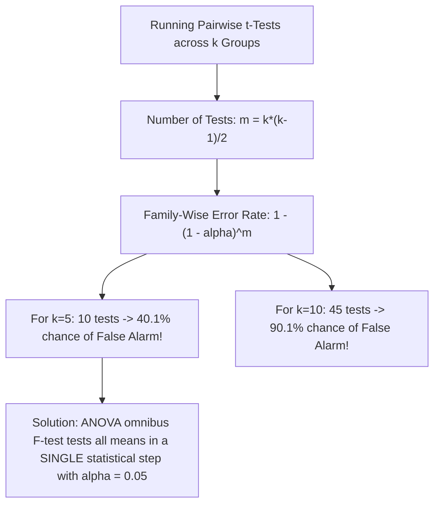
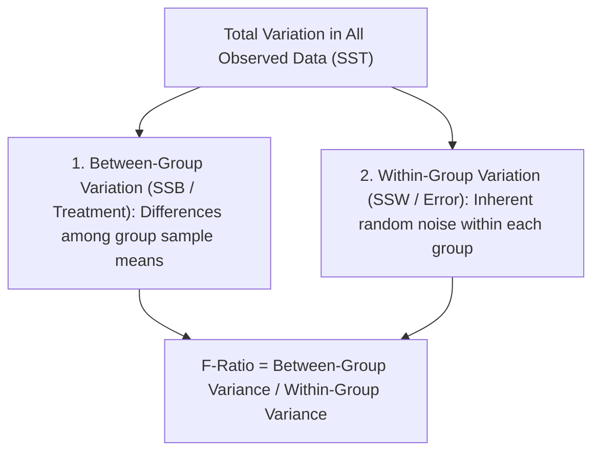

[Maths Index](../README.md) / [Unit 4: Hypothesis Testing and Statistical Inference](Introduction.md)

# Analysis of Variance - One-Way ANOVA

In our earlier lectures, we developed methods to test whether a sample mean differs from a known benchmark, and whether two independent group means differ from each other. 

Now, consider a common scenario in modern machine learning research: you want to evaluate four different optimization algorithms (Adam, RMSprop, SGD with Momentum, and Lion) to see if they yield different validation losses. 

We have $k = 4$ independent groups. The natural hypothesis we want to test is:

$$H_0: \mu_1 = \mu_2 = \mu_3 = \mu_4$$

$$\text{vs. } H_1: \text{At least one group mean is different}$$

How should we test this?

A student's immediate intuition is often: "Why not just run a two-sample $t$-test between every possible pair?"

The moment we do that, we hit a mathematical wall known as the **Multiple Comparisons Problem**. Running repeated $t$-tests causes our false positive rate to explode out of control.

To test multiple group means simultaneously while strictly safeguarding our false positive rate, we must turn to **One-Way Analysis of Variance (ANOVA)**. 

At first glance, the name sounds paradoxical: *how can we test whether population means are equal by analyzing variances?* 

Let's unpack the mathematical elegance behind Sir Ronald Fisher's invention and see how partitioning variance resolves the multi-group comparison problem.

---

## The Multiple Testing Trap: Family-Wise Error Rate

Let's see why running multiple pairwise $t$-tests is an experimental disaster.

Suppose we have $k = 5$ distinct model configurations. To compare all pairs, the number of individual pairwise tests we must conduct is given by the combination formula:

$$m = \binom{k}{2} = \frac{k(k-1)}{2} = \frac{5 \times 4}{2} = 10 \text{ tests}$$

Assume each test is conducted at the standard significance level of $\alpha_{\text{per-test}} = 0.05$. This means each individual test has a $95\%$ probability ($1 - 0.05 = 0.95$) of correctly not rejecting $H_0$ when there is no true difference.

If these 10 comparisons were independent, what would be the probability that **at least one** test commits a Type I error (declares a false positive difference)?

By the complement rule of probability:

$$\begin{aligned}
P(\text{At least one False Positive}) &= 1 - P(\text{Zero False Positives across all 10 tests}) \\
&= 1 - (1 - \alpha_{\text{per-test}})^m \\
&= 1 - (0.95)^{10} \\
&= 1 - 0.5987 \approx 0.4013 \quad (40.1\%)
\end{aligned}$$

Look at that number: **$40.1\%$**! 

Even if all 5 algorithms perform identically in reality, you have a $40\%$ chance of finding a "statistically significant" difference purely by chance. If you compare $k = 10$ groups ($45$ tests), your false positive probability shoots past **$90\%$**!

This runaway inflation is called the **Family-Wise Error Rate (FWER)**.

ANOVA eliminates this issue by performing a single **omnibus test**. It asks a single overarching question: *Is the total variation observed between the group sample means larger than what would be expected from random within-group sampling noise alone?*

---

## The Conceptual Core: Testing Means via Variances

How does comparing variances test the equality of means?

Imagine looking at sample data gathered from $k$ groups. There are two distinct sources of variation present in the numbers:

1. **Within-Group Variation (Error / Noise)**:
   Even inside the exact same group (e.g., five runs of the Adam optimizer), individual runs produce slightly different losses due to random mini-batch shuffling and hardware noise. This within-group spread reflects the baseline noise level ($\sigma^2$) inherent to the experiment.

2. **Between-Group Variation (Treatment Effect + Noise)**:
   Now look at how the group sample means ($\bar{X}_1, \bar{X}_2, \dots, \bar{X}_k$) scatter around the grand overall mean $\bar{X}_{\bullet\bullet}$. This spread reflects two things:
   - Baseline random noise ($\sigma^2$).
   - The actual differences (if any) between the true population means $\mu_i$.

Now consider the two possibilities:
- **If $H_0$ is True ($\mu_1 = \dots = \mu_k$)**: The groups are identical in reality. Any spread between group means is solely caused by random noise. Therefore, the Between-Group variance should roughly **equal** the Within-Group variance. Their ratio should be close to 1.
- **If $H_0$ is False (at least one $\mu_i$ differs)**: The true differences between groups push the group means far apart. The Between-Group variance will be **much larger** than the Within-Group variance. Their ratio will be substantially greater than 1.

By checking whether the ratio of Between-Group variance to Within-Group variance is significantly greater than 1, we test whether the means are equal.

---

## Partitioning the Total Sum of Squares

Let's establish the mathematical notation for One-Way ANOVA:
- Let $k$ be the number of groups (treatments).
- Let $n_i$ be the number of observations in group $i$.
- Let $N = \sum_{i=1}^k n_i$ be the total number of observations across all groups.
- Let $X_{ij}$ denote the $j$-th observation in group $i$ (where $i = 1, \dots, k$ and $j = 1, \dots, n_i$).

We define:
- **Group $i$ Sample Mean**:
  $$\bar{X}_{i\bullet} = \frac{1}{n_i} \sum_{j=1}^{n_i} X_{ij}$$
- **Grand Sample Mean** (overall mean of all $N$ data points):
  $$\bar{X}_{\bullet\bullet} = \frac{1}{N} \sum_{i=1}^k \sum_{j=1}^{n_i} X_{ij} = \frac{1}{N} \sum_{i=1}^k n_i \bar{X}_{i\bullet}$$

### The Fundamental ANOVA Identity
For any single data point $X_{ij}$, we can decompose its total deviation from the grand mean into two additive parts:

$$(X_{ij} - \bar{X}_{\bullet\bullet}) = \underbrace{(\bar{X}_{i\bullet} - \bar{X}_{\bullet\bullet})}_{\text{Between-Group Deviation}} + \underbrace{(X_{ij} - \bar{X}_{i\bullet})}_{\text{Within-Group Deviation}}$$

Squaring both sides and summing over all $i$ and all $j$:

$$\sum_{i=1}^k \sum_{j=1}^{n_i} (X_{ij} - \bar{X}_{\bullet\bullet})^2 = \sum_{i=1}^k \sum_{j=1}^{n_i} (\bar{X}_{i\bullet} - \bar{X}_{\bullet\bullet})^2 + \sum_{i=1}^k \sum_{j=1}^{n_i} (X_{ij} - \bar{X}_{i\bullet})^2 + 2 \sum_{i=1}^k \sum_{j=1}^{n_i} (\bar{X}_{i\bullet} - \bar{X}_{\bullet\bullet})(X_{ij} - \bar{X}_{i\bullet})$$

Look at the cross-product term:

$$2 \sum_{i=1}^k (\bar{X}_{i\bullet} - \bar{X}_{\bullet\bullet}) \left[ \sum_{j=1}^{n_i} (X_{ij} - \bar{X}_{i\bullet}) \right]$$

By definition of the group mean, the sum of deviations around its own mean is identically zero: $\sum_{j=1}^{n_i} (X_{ij} - \bar{X}_{i\bullet}) = 0$. 

Therefore, the cross-product vanishes completely!

This gives **The Fundamental ANOVA Identity**:

$$SST = SSB + SSW$$

Where:
1. **$SST$ (Total Sum of Squares)**: Measures total variability in the entire dataset:
   $$SST = \sum_{i=1}^k \sum_{j=1}^{n_i} (X_{ij} - \bar{X}_{\bullet\bullet})^2, \quad df_{\text{Total}} = N - 1$$
2. **$SSB$ (Between-Group Sum of Squares / Treatment)**: Measures variability between group means:
   $$SSB = \sum_{i=1}^k n_i (\bar{X}_{i\bullet} - \bar{X}_{\bullet\bullet})^2, \quad df_{\text{Between}} = k - 1$$
3. **$SSW$ (Within-Group Sum of Squares / Error)**: Measures pooled random noise within groups:
   $$SSW = \sum_{i=1}^k \sum_{j=1}^{n_i} (X_{ij} - \bar{X}_{i\bullet})^2, \quad df_{\text{Within}} = N - k$$

Notice that the degrees of freedom also partition additively:

$$df_{\text{Total}} = df_{\text{Between}} + df_{\text{Within}} \iff (N - 1) = (k - 1) + (N - k)$$

---

## Mean Squares and the $F$-Test Statistic

Sums of squares grow naturally with sample size. To obtain unbiased estimates of variance, we divide each sum of squares by its corresponding degrees of freedom. These variance estimates are called **Mean Squares**:

1. **Mean Square Between (MSB)**:
   $$MSB = \frac{SSB}{k - 1}$$
2. **Mean Square Within (MSW)**:
   $$MSW = \frac{SSW}{N - k}$$

### Expected Values of Mean Squares
Statistical theory proves the following expected values:

$$E[MSW] = \sigma^2$$

$$E[MSB] = \sigma^2 + \frac{\sum_{i=1}^k n_i (\mu_i - \bar{\mu})^2}{k - 1}$$

Where $\bar{\mu} = \frac{1}{N} \sum n_i \mu_i$.

Notice the structure of these expectations:
- $MSW$ is an **unbiased estimator of $\sigma^2$ regardless of whether $H_0$ is true or false**. It measures pure random error.
- $MSB$ estimates $\sigma^2$ **plus** a positive term representing the true differences between population means.
- If $H_0$ is true ($\mu_1 = \mu_2 = \dots = \mu_k$), the second term vanishes, so $E[MSB] = \sigma^2 = E[MSW]$.
- If $H_0$ is false, $E[MSB] > E[MSW]$.

### The $F$-Statistic
Under the assumption of normality and equal variances, the ratio of two independent chi-square variables divided by their degrees of freedom follows Snedecor's **$F$-distribution**:

$$F_{\text{calc}} = \frac{MSB}{MSW} \sim F(k - 1, \; N - k)$$

Because true treatment differences can only make $MSB$ larger than $MSW$, ANOVA is **always a right-tailed test**. 

We reject $H_0$ if and only if:

$$F_{\text{calc}} \ge F_{\alpha, \; k-1, \; N-k}$$

---

## The Standard ANOVA Summary Table

All ANOVA calculations are organized into a standardized summary table:

| Source of Variation | Sum of Squares ($SS$) | Degrees of Freedom ($df$) | Mean Square ($MS$) | $F$-Statistic | $p$-Value |
| :--- | :--- | :--- | :--- | :--- | :--- |
| **Between Groups (Treatment)** | $SSB = \sum n_i(\bar{X}_{i\bullet} - \bar{X}_{\bullet\bullet})^2$ | $k - 1$ | $MSB = \dfrac{SSB}{k-1}$ | $F = \dfrac{MSB}{MSW}$ | $P(F \ge F_{\text{calc}})$ |
| **Within Groups (Error)** | $SSW = \sum \sum (X_{ij} - \bar{X}_{i\bullet})^2$ | $N - k$ | $MSW = \dfrac{SSW}{N-k}$ | — | — |
| **Total** | $SST = \sum \sum (X_{ij} - \bar{X}_{\bullet\bullet})^2$ | $N - 1$ | — | — | — |

---

## Step-by-Step Numerical Walkthrough

Let's compute a complete One-Way ANOVA table by hand for an AI optimization experiment.

### The Problem
A machine learning engineer tests three optimization algorithms to minimize validation loss on an image classification task:
- Group 1: **Adam**
- Group 2: **RMSprop**
- Group 3: **SGD with Momentum**

The engineer conducts $n = 5$ independent training runs for each algorithm, initializing with different random seeds. The resulting final validation losses are recorded below:

| Run ($j$) | Adam ($i=1$) | RMSprop ($i=2$) | SGD+Momentum ($i=3$) |
| :---: | :---: | :---: | :---: |
| 1 | $0.28$ | $0.32$ | $0.36$ |
| 2 | $0.26$ | $0.35$ | $0.40$ |
| 3 | $0.31$ | $0.37$ | $0.38$ |
| 4 | $0.27$ | $0.34$ | $0.42$ |
| 5 | $0.28$ | $0.32$ | $0.39$ |

Test at $\alpha = 0.05$ whether there is a statistically significant difference in mean validation loss among the three optimizers.

### Step 1: Formulate Hypotheses
$$\begin{aligned}
H_0: \mu_1 &= \mu_2 = \mu_3 \\
H_1: \text{At } &\text{least one optimizer has a different mean validation loss}
\end{aligned}$$

Here, $k = 3$, $n_1 = n_2 = n_3 = 5$, and total sample size $N = 15$.

### Step 2: Compute Group Means and the Grand Mean

**Group 1 (Adam)**:
$$\sum X_{1j} = 0.28 + 0.26 + 0.31 + 0.27 + 0.28 = 1.40$$
$$\bar{X}_{1\bullet} = \frac{1.40}{5} = 0.280$$

**Group 2 (RMSprop)**:
$$\sum X_{2j} = 0.32 + 0.35 + 0.37 + 0.34 + 0.32 = 1.70$$
$$\bar{X}_{2\bullet} = \frac{1.70}{5} = 0.340$$

**Group 3 (SGD+Momentum)**:
$$\sum X_{3j} = 0.36 + 0.40 + 0.38 + 0.42 + 0.39 = 1.95$$
$$\bar{X}_{3\bullet} = \frac{1.95}{5} = 0.390$$

**Grand Mean $\bar{X}_{\bullet\bullet}$**:
$$\bar{X}_{\bullet\bullet} = \frac{1.40 + 1.70 + 1.95}{15} = \frac{5.05}{15} \approx 0.33667$$

### Step 3: Compute Between-Group Sum of Squares ($SSB$)

$$SSB = \sum_{i=1}^3 n_i (\bar{X}_{i\bullet} - \bar{X}_{\bullet\bullet})^2$$

- For Adam: $5 \times (0.280 - 0.33667)^2 = 5 \times (-0.05667)^2 = 5 \times 0.003211 = 0.016057$
- For RMSprop: $5 \times (0.340 - 0.33667)^2 = 5 \times (0.00333)^2 = 5 \times 0.000011 = 0.000056$
- For SGD+Momentum: $5 \times (0.390 - 0.33667)^2 = 5 \times (0.05333)^2 = 5 \times 0.002844 = 0.014222$

Summing the terms:

$$SSB = 0.016057 + 0.000056 + 0.014222 = 0.030335 \approx 0.03033$$

### Step 4: Compute Within-Group Sum of Squares ($SSW$)

$$SSW = \sum_{i=1}^3 \sum_{j=1}^5 (X_{ij} - \bar{X}_{i\bullet})^2$$

- **Adam ($\bar{X}_{1\bullet} = 0.280$)**:
  $$(0.28-0.28)^2 + (0.26-0.28)^2 + (0.31-0.28)^2 + (0.27-0.28)^2 + (0.28-0.28)^2$$
  $$= 0.0000 + 0.0004 + 0.0009 + 0.0001 + 0.0000 = 0.00140$$

- **RMSprop ($\bar{X}_{2\bullet} = 0.340$)**:
  $$(0.32-0.34)^2 + (0.35-0.34)^2 + (0.37-0.34)^2 + (0.34-0.34)^2 + (0.32-0.34)^2$$
  $$= 0.0004 + 0.0001 + 0.0009 + 0.0000 + 0.0004 = 0.00180$$

- **SGD+Momentum ($\bar{X}_{3\bullet} = 0.390$)**:
  $$(0.36-0.39)^2 + (0.40-0.39)^2 + (0.38-0.39)^2 + (0.42-0.39)^2 + (0.39-0.39)^2$$
  $$= 0.0009 + 0.0001 + 0.0001 + 0.0009 + 0.0000 = 0.00200$$

Summing all groups:

$$SSW = 0.00140 + 0.00180 + 0.00200 = 0.00520$$

### Step 5: Check Total Sum of Squares ($SST$)

$$SST = SSB + SSW = 0.030335 + 0.00520 = 0.035535$$

### Step 6: Compute Mean Squares and $F$-Statistic

Degrees of Freedom:
- $df_{\text{Between}} = k - 1 = 3 - 1 = 2$
- $df_{\text{Within}} = N - k = 15 - 3 = 12$
- $df_{\text{Total}} = N - 1 = 15 - 1 = 14$

Mean Squares:
$$MSB = \frac{SSB}{df_{\text{Between}}} = \frac{0.030335}{2} \approx 0.015168$$

$$MSW = \frac{SSW}{df_{\text{Within}}} = \frac{0.005200}{12} \approx 0.0004333$$

$F$-Statistic:
$$F_{\text{calc}} = \frac{MSB}{MSW} = \frac{0.015168}{0.0004333} \approx 35.004$$

### Step 7: Assemble the ANOVA Table

| Source | $SS$ | $df$ | $MS$ | $F_{\text{calc}}$ | $p$-Value |
| :--- | :--- | :--- | :--- | :--- | :--- |
| **Between Groups (Optimizer)** | $0.03034$ | $2$ | $0.01517$ | **$35.00$** | **$< 0.0001$** |
| **Within Groups (Error)** | $0.00520$ | $12$ | $0.00043$ | — | — |
| **Total** | $0.03554$ | $14$ | — | — | — |

### Step 8: Critical Value and Decision
For $\alpha = 0.05$ with numerator degrees of freedom $\nu_1 = 2$ and denominator degrees of freedom $\nu_2 = 12$:

From $F$-distribution tables:

$$F_{0.05, \; 2, \; 12} = 3.885$$

Our calculated statistic is:

$$F_{\text{calc}} = 35.00 \gg 3.885$$

The $p$-value associated with $F = 35.00$ for $(2, 12)$ degrees of freedom is $p = 0.000012$.

**Conclusion**: We decisively **Reject $H_0$**. 

There is overwhelming statistical evidence that the three optimization algorithms do not produce equal mean validation losses ($F(2, 12) = 35.00, p < 0.001$).

---

## Post-Hoc Analysis: Where Does the Difference Lie?

Notice what ANOVA did and did not tell us:
- ANOVA told us that the group means are **not all equal**.
- ANOVA did **not** tell us *which specific pairs* of optimizers differ. Is Adam better than RMSprop? Is RMSprop better than SGD? Or is Adam only better than SGD?

If we run ordinary $t$-tests now, we recreate the Family-Wise Error Rate inflation problem. 

To locate the specific differences safely after rejecting $H_0$, we use **Post-Hoc Procedures**:

### 1. Tukey's Honestly Significant Difference (HSD)
Tukey's HSD calculates a single critical difference threshold based on the **Studentized Range Distribution ($q$)**:

$$\text{HSD} = q_{\alpha, k, N-k} \sqrt{\frac{MSW}{n}}$$

Any pair of group means whose absolute difference $|\bar{X}_i - \bar{X}_j|$ exceeds $\text{HSD}$ is declared significantly different at the overall family-wise level $\alpha$.

### 2. Bonferroni Correction
A universally applicable, conservative method: if conducting $m$ post-hoc comparisons, adjust the significance threshold for each comparison to:

$$\alpha_{\text{adjusted}} = \frac{\alpha_{\text{overall}}}{m}$$

---

## Assumptions of ANOVA

For the $F$-distribution to hold strictly, One-Way ANOVA requires three assumptions:

1. **Normality**: The residuals (within-group errors) must be normally distributed within each treatment group.
2. **Homoscedasticity (Equal Variances)**: All groups must share a common population variance ($\sigma_1^2 = \sigma_2^2 = \dots = \sigma_k^2$). This is formally tested using **Levene's Test** or Bartlett's Test. If violated, use **Welch's ANOVA**.
3. **Independence**: Observations must be sampled independently both within and between groups.

---

## Key Takeaways

- Running multiple pairwise $t$-tests inflates the Family-Wise Error Rate exponentially: $FWER = 1 - (1 - \alpha)^m$. For 5 groups (10 comparisons), false alarm risk reaches $40.1\%$.
- ANOVA conducts a single omnibus test that maintains the global false positive rate at $\alpha$.
- The Fundamental ANOVA Identity partitions total variation additively: $SST = SSB + SSW$, with degrees of freedom $(N - 1) = (k - 1) + (N - k)$.
- $MSW = SSW / (N - k)$ estimates pure experimental noise $\sigma^2$, while $MSB = SSB / (k - 1)$ estimates noise plus treatment differences.
- The test statistic $F = MSB / MSW \sim F(k-1, N-k)$ tests whether between-group spread is significantly larger than within-group random error.
- ANOVA is an omnibus test; once $H_0$ is rejected, post-hoc procedures like Tukey's HSD or Bonferroni adjustments are required to identify which specific groups differ.

---

Up to this point, all our hypothesis tests ($Z$-tests, $t$-tests, ANOVA) have evaluated continuous numerical measurements with means and variances. But what happens when our data is inherently discrete, categorical, or nominal — such as user choices, error types, or token classifications? In the next lecture, we transition to non-parametric inference and develop Pearson's Chi-Square Goodness-of-Fit Test to evaluate categorical distributions. Read [L08 - Chi-Square Goodness-of-Fit Test](L08%20-%20Chi-Square%20Goodness-of-Fit%20Test.md).
