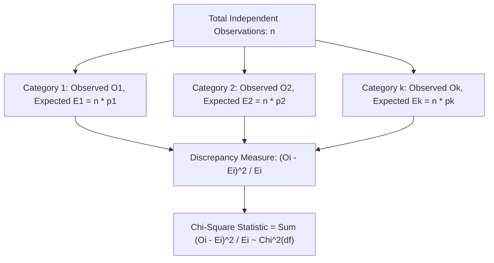
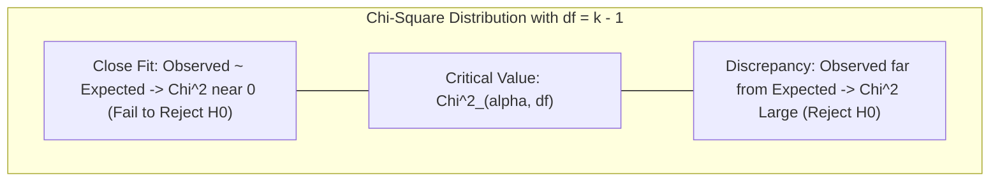

[Maths Index](../README.md) / [Unit 4: Hypothesis Testing and Statistical Inference](Introduction.md)

# Chi-Square Goodness-of-Fit Test

Every hypothesis test we have encountered so far — whether a $Z$-test, a $t$-test, or an ANOVA $F$-test — operated on numeric, continuous measurements: latencies, throughputs, revenues, and loss values. In those settings, summarizing data with means and variances makes intuitive sense.

Now here's the thing — in machine learning, artificial intelligence, and software systems, a massive proportion of our data is not continuous. It is discrete, nominal, or categorical:
- What type of bug caused a production crash: Memory Leak, Null Pointer, Concurrency Race, or Network Timeout?
- Which generative AI model did a user prefer in an evaluation arena: Model A, Model B, Model C, or a Tie?
- Which demographic category does a high-risk loan applicant belong to?

You cannot compute the "mean" of a Null Pointer and a Network Timeout. Calculating standard deviations on category labels is meaningless.

How do we test hypotheses when our data consists entirely of **counts of occurrences across discrete categories**?

In 1900, Karl Pearson formulated the solution: the **Chi-Square ($\chi^2$) Goodness-of-Fit Test**. 

This test allows us to compare an observed categorical frequency distribution against a theoretical probability distribution, determining whether the discrepancy can be chalked up to random sampling noise or represents a genuine structural departure.

---

## The Multinomial Experiment Framework

The Chi-Square Goodness-of-Fit test is the multi-category extension of the Binomial distribution. 

Recall that a binomial experiment consists of $n$ independent trials, each resulting in one of two outcomes (Success or Failure).

A **Multinomial Experiment** generalizes this to $k$ mutually exclusive and collectively exhaustive categories:
1. The experiment consists of $n$ identical, independent trials.
2. The outcome of each trial falls into exactly one of $k$ distinct categories ($C_1, C_2, \dots, C_k$).
3. The probability that an individual trial falls into category $i$ is denoted $p_i$, with the strict probability requirement:
   $$\sum_{i=1}^k p_i = p_1 + p_2 + \dots + p_k = 1$$
4. We record the **observed count** of trials falling into each category: $O_1, O_2, \dots, O_k$, such that:
   $$\sum_{i=1}^k O_i = O_1 + O_2 + \dots + O_k = n$$

The research question is: *Does the true population distribution of probabilities match a specific hypothesized vector $(p_{10}, p_{20}, \dots, p_{k0})$?*

---

## Formulating Hypotheses

The hypotheses for a goodness-of-fit test are expressed in terms of category probabilities:

$$\begin{aligned}
H_0: p_1 &= p_{10}, \; p_2 = p_{20}, \; \dots, \; p_k = p_{k0} \\
H_1: \text{At } &\text{least one probability } p_i \text{ differs from its hypothesized value } p_{i0}
\end{aligned}$$

Notice that the null hypothesis can specify:
- An **Equal (Uniform) Distribution**: Every category is equally likely ($p_1 = p_2 = \dots = p_k = 1/k$).
- A **Non-Uniform Theoretical Distribution**: Specified by an empirical baseline, historical proportions, or a parametric law (such as Poisson, Binomial, or Normal).

---

## The Pearson $\chi^2$ Test Statistic

To test $H_0$, we first compute the **Expected Frequency** ($E_i$) for each category under the assumption that the null hypothesis is strictly true:

$$E_i = n \cdot p_{i0}$$

Notice that just like the observed counts, the expected counts must sum to the total sample size:

$$\sum_{i=1}^k E_i = n \sum_{i=1}^k p_{i0} = n(1) = n$$

Now, we compare the observed count $O_i$ to the expected count $E_i$ for each category. Karl Pearson proposed the test statistic:

$$\chi^2 = \sum_{i=1}^k \frac{(O_i - E_i)^2}{E_i}$$

Let's dissect this formula to see the mathematical intuition behind every component:
1. **$(O_i - E_i)$**: The raw deviation between what we saw and what the null model predicted.
2. **$(O_i - E_i)^2$**: We square the difference because deviations can be positive or negative. Without squaring, the sum of deviations would always cancel out to zero: $\sum (O_i - E_i) = n - n = 0$.
3. **Dividing by $E_i$**: A deviation of 10 counts is massive if you only expected 5 items ($E_i = 5$), but trivial if you expected 10,000 items ($E_i = 10{,}000$). Dividing by $E_i$ scales each squared error by the variance of that count.

---

## Why Does This Ratio Follow a Chi-Square Distribution?

Why should this sum of scaled squared deviations follow a Chi-Square distribution?

Let's look at the asymptotic mechanics:
For any single category $i$, the observed count $O_i$ is a binomial random variable with mean $E[O_i] = np_i$ and variance $\operatorname{Var}(O_i) = np_i(1 - p_i)$.

By the Central Limit Theorem for binomial counts, as $n \to \infty$, the standardized count converges to a standard normal variable:

$$Z_i = \frac{O_i - np_i}{\sqrt{np_i(1 - p_i)}} \approx \mathcal{N}(0, 1)$$

If we square a standard normal variable, we obtain a Chi-Square variable with 1 degree of freedom:

$$Z_i^2 = \frac{(O_i - np_i)^2}{np_i(1 - p_i)} \sim \chi^2(1)$$

When we sum these squared quantities across all $k$ categories, the covariance structure among the multinomial categories mathematically combines so that the $(1 - p_i)$ terms in the denominator collapse, yielding Pearson's exact sum:

$$\sum_{i=1}^k \frac{(O_i - E_i)^2}{E_i} \xrightarrow{d} \chi^2(df)$$

### The Degrees of Freedom ($df = k - 1$)
Why is the degrees of freedom $k - 1$ instead of $k$?

Because the observed counts are bound by a rigid mathematical constraint:

$$O_1 + O_2 + \dots + O_k = n$$

If you know the total sample size $n$ and you are given the observed counts for the first $k - 1$ categories, the count for the final category $O_k$ is completely locked:

$$O_k = n - \sum_{i=1}^{k-1} O_i$$

There are only $k - 1$ independent, freely varying cells. That single linear constraint consumes exactly 1 degree of freedom:

$$df = k - 1$$

*(Note: If $m$ parameters of the theoretical distribution are estimated from the sample data before computing expected values — for example, using $\bar{x}$ to fit a Poisson parameter $\lambda$ — each estimated parameter consumes an additional degree of freedom: $df = k - 1 - m$.)*

---

## Decision Rule and Directionality

Because any deviation from expectation — whether $O_i > E_i$ or $O_i < E_i$ — produces a positive squared term $(O_i - E_i)^2 > 0$, poor fits always drive the $\chi^2$ statistic upward.

Therefore, the Chi-Square Goodness-of-Fit test is **always an upper-tail (right-tailed) test**.

For a given significance level $\alpha$:
- If $\chi^2_{\text{calc}} \ge \chi^2_{\alpha, \; k-1}$: **Reject $H_0$** (the observed data significantly departs from the hypothesized distribution).
- If $\chi^2_{\text{calc}} < \chi^2_{\alpha, \; k-1}$: **Fail to Reject $H_0$** (the data is consistent with the hypothesized distribution).

---

## Assumptions and Validity Conditions

Because the continuous $\chi^2$ distribution is an asymptotic approximation to the discrete multinomial distribution, the test is only valid when the sample size is sufficiently large.

The universal guidelines (known as **Cochran's Rule**) are:
1. **Independence**: All observations must be independent.
2. **Minimum Expected Frequencies**: 
   - Every expected frequency must satisfy $E_i \ge 1$.
   - At least $80\%$ of all categories must have $E_i \ge 5$.
   - For tests with few categories ($k \le 4$), ensure **all** $E_i \ge 5$.

If an expected frequency is too small (e.g., $E_i = 1.2$), the denominator in $(O_i - E_i)^2 / E_i$ becomes tiny, artificially inflating the $\chi^2$ statistic and producing false alarms. The standard remedy is to combine (pool) sparse adjacent categories.

---

## Step-by-Step Numerical Example 1: Testing Uniform Distribution

Let's test an AI load-balancing infrastructure.

### The Problem
A distributed AI gateway routes user inference requests across four specialized model server clusters:
- Cluster A (Vision)
- Cluster B (NLP)
- Cluster C (Code Generation)
- Cluster D (Audio)

Under ideal load-balancing policy, incoming general traffic should be distributed evenly across all four clusters: $p_A = p_B = p_C = p_D = 0.25$.

A site reliability engineer suspects that routing configuration drift is causing certain clusters to receive an unfair share of traffic. They monitor a random batch of $n = 200$ incoming requests and observe the following cluster routing counts:

| Cluster | Observed Count ($O_i$) |
| :---: | :---: |
| A | $62$ |
| B | $41$ |
| C | $65$ |
| D | $32$ |

Test at $\alpha = 0.05$ whether the routing is significantly non-uniform.

### Step 1: Formulate Hypotheses
$$\begin{aligned}
H_0: p_A &= p_B = p_C = p_D = 0.25 \quad (\text{Uniform Routing}) \\
H_1: \text{At } &\text{least one cluster probability differs from } 0.25
\end{aligned}$$

Here, $k = 4$ categories and $n = 200$.

### Step 2: Compute Expected Frequencies
Under $H_0$, each cluster is expected to receive $25\%$ of the 200 requests:

$$E_A = E_B = E_C = E_D = n \cdot p_{i0} = 200 \times 0.25 = 50$$

Check validity condition: all $E_i = 50 \ge 5$. Cochran's condition is satisfied.

### Step 3: Compute Category Contributions to $\chi^2$

Let's tabulate the step-by-step arithmetic:

| Category ($i$) | Observed ($O_i$) | Expected ($E_i$) | Difference $(O_i - E_i)$ | Squared $(O_i - E_i)^2$ | Component $\frac{(O_i - E_i)^2}{E_i}$ |
| :---: | :---: | :---: | :---: | :---: | :---: |
| **A** | $62$ | $50$ | $+12$ | $144$ | $\frac{144}{50} = 2.88$ |
| **B** | $41$ | $50$ | $-9$ | $81$ | $\frac{81}{50} = 1.62$ |
| **C** | $65$ | $50$ | $+15$ | $225$ | $\frac{225}{50} = 4.50$ |
| **D** | $32$ | $50$ | $-18$ | $324$ | $\frac{324}{50} = 6.48$ |
| **Total** | **200** | **200** | **0** | — | **15.48** |

### Step 4: Sum the Test Statistic

$$\chi^2_{\text{calc}} = \sum_{i=1}^4 \frac{(O_i - E_i)^2}{E_i} = 2.88 + 1.62 + 4.50 + 6.48 = 15.48$$

### Step 5: Determine Degrees of Freedom and Critical Value
The degrees of freedom is:

$$df = k - 1 = 4 - 1 = 3$$

For significance level $\alpha = 0.05$ with $df = 3$:

Looking up $\chi^2_{0.05, 3}$ in the Chi-Square distribution table:

$$\chi^2_{\text{crit}} = \chi^2_{0.05, 3} = 7.815$$

### Step 6: Decision and Technical Conclusion
Comparing our test statistic to the critical value:

$$\chi^2_{\text{calc}} = 15.48 \gg 7.815$$

The exact $p$-value for $\chi^2 = 15.48$ with $df = 3$ is:

$$p\text{-value} = P(\chi^2 \ge 15.48) = 0.00145 \le 0.05$$

**Conclusion**: We decisively **Reject $H_0$**. 

There is statistically significant evidence that the gateway is not routing requests uniformly across the four server clusters ($\chi^2 = 15.48, df = 3, p = 0.0015$). 

Looking at the table of contributions, Cluster D is heavily under-utilized ($O_D = 32$ vs $E_D = 50$, contributing $6.48$ to the total $\chi^2$), while Cluster C is overburdened ($O_C = 65$ vs $E_C = 50$). SRE must inspect the load-balancing weights immediately.

---

## Step-by-Step Numerical Example 2: Testing a Non-Uniform Distribution

Now let's test a case where the null hypothesis specifies a non-uniform distribution.

### The Problem
A machine learning ops team monitors user subscription tiers for an enterprise SaaS API. Historical billing records define the long-term customer distribution across three usage tiers:
- Tier 1 (Hobbyist): $p_{10} = 0.50$ ($50\%$)
- Tier 2 (Professional): $p_{20} = 0.35$ ($35\%$)
- Tier 3 (Enterprise): $p_{30} = 0.15$ ($15\%$)

Following the rollout of a new generative code-completion feature, the product team draws a random sample of $n = 300$ active users to see if the tier distribution has shifted:
- Observed Tier 1: $O_1 = 132$
- Observed Tier 2: $O_2 = 117$
- Observed Tier 3: $O_3 = 51$

Test at $\alpha = 0.01$ whether the customer tier distribution has changed.

### Execution

#### 1. Hypotheses
$$\begin{aligned}
H_0: p_1 &= 0.50, \; p_2 = 0.35, \; p_3 = 0.15 \\
H_1: \text{The } &\text{true tier probabilities differ from these historical values}
\end{aligned}$$

#### 2. Expected Frequencies
- $E_1 = 300 \times 0.50 = 150$
- $E_2 = 300 \times 0.35 = 105$
- $E_3 = 300 \times 0.15 = 45$

All $E_i \ge 45 \ge 5$, satisfying validity rules.

#### 3. Compute $\chi^2$ Contributions

- **Tier 1**:
  $$\frac{(O_1 - E_1)^2}{E_1} = \frac{(132 - 150)^2}{150} = \frac{(-18)^2}{150} = \frac{324}{150} = 2.160$$

- **Tier 2**:
  $$\frac{(O_2 - E_2)^2}{E_2} = \frac{(117 - 105)^2}{105} = \frac{(12)^2}{105} = \frac{144}{105} \approx 1.371$$

- **Tier 3**:
  $$\frac{(O_3 - E_3)^2}{E_3} = \frac{(51 - 45)^2}{45} = \frac{(6)^2}{45} = \frac{36}{45} = 0.800$$

Summing the components:

$$\chi^2_{\text{calc}} = 2.160 + 1.371 + 0.800 = 4.331$$

#### 4. Critical Value and Decision
The degrees of freedom is $df = k - 1 = 3 - 1 = 2$.

For $\alpha = 0.01$ with $df = 2$:

$$\chi^2_{\text{crit}} = \chi^2_{0.01, 2} = 9.210$$

Comparing values:

$$\chi^2_{\text{calc}} = 4.331 < 9.210$$

The associated $p$-value is:

$$p\text{-value} = P(\chi^2 \ge 4.331) \approx 0.1147 > 0.01$$

#### 5. Conclusion
We **Fail to Reject $H_0$** at the $\alpha = 0.01$ level. 

There is insufficient evidence to conclude that the user tier distribution has shifted from the historical baseline ($\chi^2 = 4.33, df = 2, p = 0.115$). The observed shifts can reasonably be attributed to ordinary sampling fluctuation.

---

## Key Takeaways

- Pearson's Chi-Square Goodness-of-Fit test evaluates whether an observed categorical frequency distribution matches a hypothesized theoretical distribution.
- The test operates on count data from a multinomial experiment of $n$ independent trials across $k$ mutually exclusive categories.
- The expected frequency for each category is $E_i = n \cdot p_{i0}$, with $\sum E_i = \sum O_i = n$.
- The test statistic standardizes squared discrepancies: $\chi^2 = \sum_{i=1}^k \frac{(O_i - E_i)^2}{E_i}$.
- Under $H_0$, the statistic asymptotically follows a $\chi^2$ distribution with $df = k - 1$ degrees of freedom (or $k - 1 - m$ if $m$ parameters are estimated).
- The test is strictly upper-tailed: discrepancies between observed and expected counts inflate $\chi^2$.
- Validity requires Cochran's rule: all $E_i \ge 1$ and at least $80\%$ of $E_i \ge 5$.

---

In this lecture, we analyzed a single categorical variable classified across $k$ bins. But in data science, we frequently record two categorical variables simultaneously on the same entities — such as user device type and conversion outcome, or geographic region and preferred AI feature. In the next and final lecture of Unit 4, we extend the Chi-Square framework to two-way contingency tables, deriving tests of Independence and Homogeneity. Read [L09 - Chi-Square Tests of Independence and Homogeneity](L09%20-%20Chi-Square%20Tests%20of%20Independence%20and%20Homogeneity.md).
