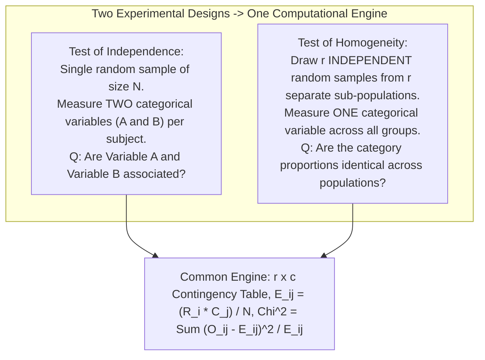
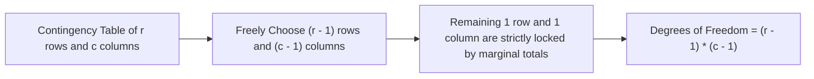

[Maths Index](../README.md) / [Unit 4: Hypothesis Testing and Statistical Inference](Introduction.md)

# Chi-Square Tests of Independence and Homogeneity

In the previous lecture, we evaluated a single categorical variable against an expected theoretical distribution. 

Now, consider a richer, bivariate question that surfaces constantly in data science and artificial intelligence:
- Does a user's subscription tier (Free, Pro, Enterprise) influence the complexity of the prompts they submit to an LLM (Simple, Moderate, Complex)?
- Is the rate of hallucination in a language model independent of the decoding temperature setting?
- Do users in North America, Europe, and Asia prefer different conversational styles?

In each of these cases, we are not looking at a single categorical attribute in isolation. We have **two categorical variables**, and we want to know whether they are related. 

Are the two variables statistically independent, or does knowing the value of one variable provide actionable predictive information about the other?

To answer this, we construct a **Two-Way Contingency Table** and deploy the two-dimensional extensions of Karl Pearson's test: the **Chi-Square Test of Independence** and the **Chi-Square Test of Homogeneity**.

---

## Two Distinct Questions, One Unified Mathematical Engine

Before jumping into the mathematics, notice an interesting conceptual duality. In statistical practice, two completely different experimental designs lead to the exact same test statistic and computational workflow:

### 1. Test of Independence
- **Sampling Scheme**: A single random sample of size $N$ is drawn from one general population. Each sampled unit is cross-classified on two attributes: Variable $A$ (with $r$ levels) and Variable $B$ (with $c$ levels).
- **Hypotheses**:
  $$\begin{aligned}
  H_0: &\text{Variable } A \text{ and Variable } B \text{ are statistically independent} \\
  H_1: &\text{Variable } A \text{ and Variable } B \text{ are dependent (associated)}
  \end{aligned}$$
- **Formal Probability Definition**: Under $H_0$, the joint probability equals the product of the marginal probabilities for every cell:
  $$P(A_i \cap B_j) = P(A_i) \cdot P(B_j) \quad \forall i \in \{1,\dots,r\}, \; j \in \{1,\dots,c\}$$

### 2. Test of Homogeneity
- **Sampling Scheme**: The experimenter predetermines sample sizes and draws $r$ separate, independent random samples from $r$ distinct sub-populations (e.g., users from three different continents). A single categorical variable with $c$ levels is measured on each individual.
- **Hypotheses**:
  $$\begin{aligned}
  H_0: &\text{The distribution of the categorical variable is homogeneous (identical) across all } r \text{ populations} \\
  H_1: &\text{The distribution of the categorical variable is not homogeneous across all populations}
  \end{aligned}$$
- **Formal Probability Definition**: For each category $j \in \{1, \dots, c\}$:
  $$p_{1j} = p_{2j} = \dots = p_{rj}$$

While the sampling methods and interpretations differ, their mathematical execution is completely identical. Both use the $r \times c$ contingency table machinery developed below.

---

## The Two-Way Contingency Table

Let $X$ and $Y$ be two categorical variables. Cross-tabulating their joint observed frequencies creates an **$r \times c$ Contingency Table** (with $r$ rows and $c$ columns):

| Row Category ($A_i$) | Column 1 ($B_1$) | Column 2 ($B_2$) | $\dots$ | Column $c$ ($B_c$) | Row Marginal Total ($R_i$) |
| :---: | :---: | :---: | :---: | :---: | :---: |
| **Row 1** ($A_1$) | $O_{11}$ | $O_{12}$ | $\dots$ | $O_{1c}$ | $R_1 = \sum_{j} O_{1j}$ |
| **Row 2** ($A_2$) | $O_{21}$ | $O_{22}$ | $\dots$ | $O_{2c}$ | $R_2 = \sum_{j} O_{2j}$ |
| $\vdots$ | $\vdots$ | $\vdots$ | $\ddots$ | $\vdots$ | $\vdots$ |
| **Row $r$** ($A_r$) | $O_{r1}$ | $O_{r2}$ | $\dots$ | $O_{rc}$ | $R_r = \sum_{j} O_{rj}$ |
| **Column Total ($C_j$)** | $C_1 = \sum_i O_{i1}$ | $C_2 = \sum_i O_{i2}$ | $\dots$ | $C_c = \sum_i O_{ic}$ | **Grand Total: $N = \sum \sum O_{ij}$** |

Where:
- $O_{ij}$ is the observed count in row $i$, column $j$.
- $R_i$ is the marginal sum of row $i$.
- $C_j$ is the marginal sum of column $j$.
- $N$ is the grand total of all observations.

---

## Derivation of Expected Cell Frequencies ($E_{ij}$)

How many observations should we expect to find in cell $(i, j)$ if the row variable and the column variable are completely independent?

Let's derive the formula from first principles of probability.

By the definition of statistical independence, two events $A_i$ and $B_j$ are independent if and only if:

$$P(A_i \cap B_j) = P(A_i) \cdot P(B_j)$$

We do not know the true population probabilities $P(A_i)$ and $P(B_j)$, but we can estimate them empirically from our sample marginal totals:
- The probability that an observation falls into row $i$ is estimated by the row proportion:
  $$\hat{P}(A_i) = \frac{R_i}{N}$$
- The probability that an observation falls into column $j$ is estimated by the column proportion:
  $$\hat{P}(B_j) = \frac{C_j}{N}$$

Under the null hypothesis of independence, the estimated joint probability of an observation landing in cell $(i, j)$ is the product:

$$\hat{P}(A_i \cap B_j) = \hat{P}(A_i) \cdot \hat{P}(B_j) = \left(\frac{R_i}{N}\right) \cdot \left(\frac{C_j}{N}\right)$$

Now, to obtain the **expected count** $E_{ij}$ out of the total $N$ observations, we multiply the total sample size $N$ by this joint probability:

$$E_{ij} = N \cdot \hat{P}(A_i \cap B_j) = N \cdot \left(\frac{R_i}{N}\right) \cdot \left(\frac{C_j}{N}\right) = \frac{R_i \cdot C_j}{N}$$

This gives the fundamental formula for expected cell frequency:

$$E_{ij} = \frac{(\text{Row } i \text{ Total}) \times (\text{Column } j \text{ Total})}{\text{Grand Total } N}$$

Notice that just like the observed counts, the expected counts preserve the row and column marginal totals:

$$\sum_{j=1}^c E_{ij} = R_i, \quad \sum_{i=1}^r E_{ij} = C_j, \quad \sum_{i=1}^r \sum_{j=1}^c E_{ij} = N$$

---

## The Contingency Test Statistic and Degrees of Freedom

The test statistic sums the standardized squared discrepancies across all $r \times c$ cells:

$$\chi^2 = \sum_{i=1}^r \sum_{j=1}^c \frac{(O_{ij} - E_{ij})^2}{E_{ij}}$$

Under $H_0$, this statistic asymptotically follows a Chi-Square distribution with degrees of freedom:

$$df = (r - 1)(c - 1)$$

### Why is $df = (r - 1)(c - 1)$?
Let's understand where this formula comes from:

The contingency table has $r \times c$ individual cells. However, the expected frequencies are constrained to match the observed row totals ($R_1, \dots, R_r$) and column totals ($C_1, \dots, C_c$).

Suppose you are filling in the numbers of an $r \times c$ table whose marginal row and column sums are fixed:
- In any given row, you can freely choose the first $c - 1$ entries, but the $c$-th entry is completely determined by the row total.
- Similarly, you can freely choose the first $r - 1$ rows, but the final $r$-th row is completely determined by the column totals.

The number of cell values that can vary freely without violating the marginal totals is:

$$df = (r - 1) \times (c - 1)$$

For a $2 \times 2$ table: $df = (2 - 1)(2 - 1) = 1$.  
For a $3 \times 3$ table: $df = (3 - 1)(3 - 1) = 4$.  
For a $4 \times 3$ table: $df = (4 - 1)(3 - 1) = 6$.

---

## Complete Step-by-Step Numerical Walkthrough

Let's work through an end-to-end contingency table analysis for an AI user behavior study.

### The Problem
An AI platform team investigates whether the complexity of prompts submitted by users is independent of their subscription tier. 

They draw a random sample of $N = 600$ user sessions and cross-classify them across:
- **Variable A (Tier)**: Free ($i=1$), Pro ($i=2$), Enterprise ($i=3$).
- **Variable B (Prompt Complexity)**: Simple ($j=1$), Moderate ($j=2$), Complex ($j=3$).

The observed contingency table is:

| Tier | Simple ($j=1$) | Moderate ($j=2$) | Complex ($j=3$) | Row Total ($R_i$) |
| :--- | :---: | :---: | :---: | :---: |
| **Free** ($i=1$) | $120$ | $90$ | $30$ | **$R_1 = 240$** |
| **Pro** ($i=2$) | $80$ | $80$ | $40$ | **$R_2 = 200$** |
| **Enterprise** ($i=3$) | $40$ | $70$ | $50$ | **$R_3 = 160$** |
| **Column Total ($C_j$)** | **$C_1 = 240$** | **$C_2 = 240$** | **$C_3 = 120$** | **$N = 600$** |

Test at $\alpha = 0.05$ whether prompt complexity is independent of subscription tier.

### Step 1: Formulate Hypotheses
$$\begin{aligned}
H_0: &\text{User subscription tier and prompt complexity are independent} \\
H_1: &\text{User subscription tier and prompt complexity are dependent (associated)}
\end{aligned}$$

Significance level: $\alpha = 0.05$.

### Step 2: Compute Expected Frequencies ($E_{ij} = \frac{R_i \times C_j}{N}$)

Let's compute all $3 \times 3 = 9$ expected cell counts using $N = 600$:

- **Row 1 (Free: $R_1 = 240$)**:
  $$E_{11} = \frac{240 \times 240}{600} = \frac{57{,}600}{600} = 96.0$$
  $$E_{12} = \frac{240 \times 240}{600} = 96.0$$
  $$E_{13} = \frac{240 \times 120}{600} = \frac{28{,}800}{600} = 48.0$$

- **Row 2 (Pro: $R_2 = 200$)**:
  $$E_{21} = \frac{200 \times 240}{600} = \frac{48{,}000}{600} = 80.0$$
  $$E_{22} = \frac{200 \times 240}{600} = 80.0$$
  $$E_{23} = \frac{200 \times 120}{600} = \frac{24{,}000}{600} = 40.0$$

- **Row 3 (Enterprise: $R_3 = 160$)**:
  $$E_{31} = \frac{160 \times 240}{600} = \frac{38{,}400}{600} = 64.0$$
  $$E_{32} = \frac{160 \times 240}{600} = 64.0$$
  $$E_{33} = \frac{160 \times 120}{600} = \frac{19{,}200}{600} = 32.0$$

Check validity condition: All expected frequencies are $\ge 32.0 \ge 5$, easily satisfying Cochran's rule.

### Step 3: Compute Discrepancy Components $\frac{(O_{ij} - E_{ij})^2}{E_{ij}}$

Let's evaluate each cell systematically:

| Cell $(i, j)$ | Observed ($O_{ij}$) | Expected ($E_{ij}$) | $(O - E)$ | $(O - E)^2$ | Component $\frac{(O - E)^2}{E}$ |
| :---: | :---: | :---: | :---: | :---: | :---: |
| **(Free, Simple)** | $120$ | $96.0$ | $+24.0$ | $576.0$ | $\frac{576.0}{96.0} = 6.000$ |
| **(Free, Moderate)** | $90$ | $96.0$ | $-6.0$ | $36.0$ | $\frac{36.0}{96.0} = 0.375$ |
| **(Free, Complex)** | $30$ | $48.0$ | $-18.0$ | $324.0$ | $\frac{324.0}{48.0} = 6.750$ |
| **(Pro, Simple)** | $80$ | $80.0$ | $0.0$ | $0.0$ | $\frac{0.0}{80.0} = 0.000$ |
| **(Pro, Moderate)** | $80$ | $80.0$ | $0.0$ | $0.0$ | $\frac{0.0}{80.0} = 0.000$ |
| **(Pro, Complex)** | $40$ | $40.0$ | $0.0$ | $0.0$ | $\frac{0.0}{40.0} = 0.000$ |
| **(Ent, Simple)** | $40$ | $64.0$ | $-24.0$ | $576.0$ | $\frac{576.0}{64.0} = 9.000$ |
| **(Ent, Moderate)** | $70$ | $64.0$ | $+6.0$ | $36.0$ | $\frac{36.0}{64.0} = 0.5625$ |
| **(Ent, Complex)** | $50$ | $32.0$ | $+18.0$ | $324.0$ | $\frac{324.0}{32.0} = 10.125$ |
| **Total** | **600** | **600.0** | **0.0** | — | **32.8125** |

### Step 4: Sum the Test Statistic

$$\chi^2_{\text{calc}} = 6.000 + 0.375 + 6.750 + 0 + 0 + 0 + 9.000 + 0.5625 + 10.125 = 32.8125 \approx 32.81$$

### Step 5: Degrees of Freedom and Critical Value
Here, $r = 3$ and $c = 3$:

$$df = (r - 1)(c - 1) = (3 - 1)(3 - 1) = 2 \times 2 = 4$$

For $\alpha = 0.05$ with $df = 4$:

Looking up $\chi^2_{0.05, 4}$ in the distribution table:

$$\chi^2_{\text{crit}} = \chi^2_{0.05, 4} = 9.488$$

### Step 6: Decision and Substantive Interpretation
Comparing our calculated statistic:

$$\chi^2_{\text{calc}} = 32.81 \gg 9.488$$

The $p$-value for $\chi^2 = 32.81$ with $df = 4$ is:

$$p\text{-value} = P(\chi^2 \ge 32.81) \approx 1.30 \times 10^{-6} \ll 0.001$$

**Decision**: We decisively **Reject $H_0$**. 

Prompt complexity and subscription tier are highly dependent ($\chi^2 = 32.81, df = 4, p < 0.0001$). 

Looking at the table reveals a sharp behavioral pattern:
- **Free users** submit far more simple prompts ($O = 120$ vs $E = 96$) and far fewer complex prompts ($O = 30$ vs $E = 48$) than expected under independence.
- **Enterprise users** show the exact inverse: fewer simple prompts ($O = 40$ vs $E = 64$) and substantially more complex prompts ($O = 50$ vs $E = 32$).
- **Pro users** perfectly match the marginal baseline ($O_{ij} = E_{ij}$ for all three categories).

Product engineering can use this finding to allocate high-compute GPU inference resources primarily to Enterprise-tier routing queues.

---

## Measuring Effect Size: Cramér's $V$

Just as with large-sample $Z$-tests, the Chi-Square statistic $\chi^2$ scales directly with sample size $N$:

$$\chi^2 = N \sum \sum \frac{(\hat{p}_{ij} - \hat{p}_{i\bullet}\hat{p}_{\bullet j})^2}{\hat{p}_{i\bullet}\hat{p}_{\bullet j}}$$

If you analyze $1{,}000{,}000$ web sessions, even a tiny correlation will produce a massive $\chi^2$ and a microscopic $p$-value. 

To measure the **strength of the association** independently of sample size, we compute **Cramér's $V$**:

$$V = \sqrt{\frac{\chi^2}{N \cdot \min(r - 1, \; c - 1)}}$$

Properties of Cramér's $V$:
- $0 \le V \le 1$.
- $V = 0$ indicates complete independence (no association).
- $V = 1$ indicates perfect association (knowing the row category perfectly determines the column category).

### Computing $V$ for Our Numerical Example
In our study, $\chi^2 = 32.8125$, $N = 600$, and $\min(r-1, c-1) = \min(2, 2) = 2$:

$$V = \sqrt{\frac{32.8125}{600 \times 2}} = \sqrt{\frac{32.8125}{1200}} = \sqrt{0.027344} \approx 0.1654$$

A Cramér's $V$ of $0.165$ indicates a **moderate, meaningful association** between subscription tier and prompt complexity.

---

## Pitfalls and Edge Cases

### 1. Small Cell Counts: Fisher's Exact Test
When analyzing small samples (e.g., $2 \times 2$ tables with $N < 30$, or any table where expected counts fall below 5), the continuous Chi-Square approximation breaks down. In $2 \times 2$ tables, researchers use **Fisher's Exact Test**, which calculates the exact hypergeometric probability of the observed contingency configuration directly.

### 2. Simpson's Paradox
A dangerous trap in contingency analysis is Simpson's Paradox: an apparent association observed in an aggregated contingency table can completely reverse direction when the data is disaggregated across a confounding third variable (e.g., user geography or device type). Always inspect stratified sub-tables before drawing causal conclusions.

---

## Key Takeaways

- Two-way contingency tables cross-tabulate two categorical variables to evaluate associations.
- The Test of Independence evaluates whether two variables measured on a single population are associated ($P(A \cap B) = P(A)P(B)$).
- The Test of Homogeneity evaluates whether category proportions are identical across multiple distinct sub-populations. Both share the exact same mathematical engine.
- Expected cell frequencies are calculated from marginal totals: $E_{ij} = \frac{R_i \times C_j}{N}$.
- The test statistic is $\chi^2 = \sum \sum \frac{(O_{ij} - E_{ij})^2}{E_{ij}}$, with degrees of freedom $df = (r - 1)(c - 1)$.
- Cramér's $V = \sqrt{\frac{\chi^2}{N \min(r-1, c-1)}}$ measures the strength of association normalized for sample size.
- For small samples with expected counts below 5, resort to Fisher's Exact Test to prevent false alarms.

---

## Synthesis of Unit 4: The Complete Arc of Statistical Inference

With this final lecture, we have assembled the complete mathematical framework of statistical inference:
1. In **L01**, we formulated the logic of falsification: assuming the status quo ($H_0$), choosing significance level $\alpha$, and rejecting the null when data is too extreme.
2. In **L02**, we used the Central Limit Theorem and Slutsky's theorem to conduct large-sample $Z$-tests for single and two population means ($n \ge 30$).
3. In **L03**, we proved the Duality Principle: showing that two-sided hypothesis tests and confidence intervals are identical operations, and explaining why confidence intervals provide richer operational insights.
4. In **L04**, we derived Student's $t$-distribution to handle small-sample uncertainty ($n < 30$) when population variance is unknown, mastering both independent and paired designs.
5. In **L05**, we dissected the decision matrix, formalizing Type I ($\alpha$) and Type II ($\beta$) errors, and showing why their trade-off requires balancing operational penalties.
6. In **L06**, we harnessed Statistical Power ($1 - \beta$) and derived closed-form sample size equations ($n \propto 1/\Delta^2$) to plan high-sensitivity experiments before collecting data.
7. In **L07**, we resolved the multiple testing crisis using One-Way ANOVA, decomposing total variation ($SST = SSB + SSW$) to compare multiple group means via the $F$-distribution.
8. In **L08 and L09**, we broke free from continuous numeric constraints, developing Pearson's Chi-Square tests to evaluate discrete categorical goodness-of-fit and bivariate independence in contingency tables.

These nine lectures form an unbroken pedagogical foundation for reasoning under uncertainty, designing experiments, evaluating machine learning models, and making principled, data-driven decisions. 

To explore other foundational coursework modules, return to the master curriculum at the [Maths Master Index](../README.md).
