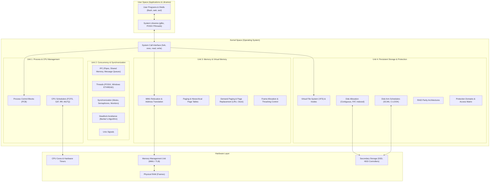

# Operating Systems: Coursework Curriculum and Topic Index

Welcome to the comprehensive study vault for **Operating Systems**. 

This vault contains exhaustive, highly structured, and intuitive coursework notes synthesizing lecture decks from PES University and foundational principles from Abraham Silberschatz, Peter B. Galvin, and Greg Gagne (*Operating System Concepts*, 10th Edition).

Every note is written in a think-out-loud, pedagogical style: explaining the physical realities, mathematical models, kernel data structures, and algorithmic tradeoffs governing modern system software.

---

## Operating System Architectural Map

The diagram below maps the four units of this curriculum to the functional architecture of a modern computer system:

---

## Complete Table of Contents

### [Unit 1: OS Architecture, Process Management, and CPU Scheduling](Unit%201/Introduction.md)
*The fundamental abstraction of modern computing: how raw hardware boots, how dual-mode boundaries protect system memory, how processes are laid out in RAM, and how the CPU scheduler decides which task runs on a core.*

- [**L01 - Introduction and Computer System Organization**](Unit%201/L01%20-%20Introduction%20and%20Computer%20System%20Organization.md) — Hardware bootstrapping (BIOS/UEFI, POST, MBR/GPT), hardware/software interrupts, Interrupt Vector Table (IVT), Interrupt Service Routines (ISR), storage hierarchy, and Direct Memory Access (DMA).
- [**L02 - Computer System Architecture and OS Operations**](Unit%201/L02%20-%20Computer%20System%20Architecture%20and%20OS%20Operations.md) — Single-processor vs. Multiprocessor systems (SMP vs. ASMP), multi-core chips, multiprogramming vs. multitasking (time-sharing), dual-mode execution (User Mode 1 vs. Kernel Mode 0), privileged instructions, and hardware interval timers.
- [**L03 - OS Services and Process Concept**](Unit%201/L03%20-%20OS%20Services%20and%20Process%20Concept.md) — Operating system services, process memory segments (Text, Data, BSS, Heap, Stack), 5-state process lifecycle (New, Ready, Running, Waiting, Terminated), Process Control Block (PCB) anatomy, context switching overhead, and schedulers (long-term, medium-term, short-term).
- [**L04 - Process Creation, Termination, and System Calls**](Unit%201/L04%20-%20Process%20Creation,%20Termination,%20and%20System%20Calls.md) — Process creation mechanics (`fork()`, `exec()`, `wait()`), process hierarchy trees, termination (`exit()`), cascading termination, zombie processes, orphan processes, and init/systemd adoption.
- [**L05 - CPU Scheduling - FCFS and SJF**](Unit%201/L05%20-%20CPU%20Scheduling%20-%20FCFS%20and%20SJF.md) — CPU-I/O burst cycle, preemptive vs. non-preemptive dispatching, scheduling optimization criteria, First-Come First-Served (FCFS) convoy effect, Shortest Job First (SJF), and Shortest Remaining Time First (SRTF) with Gantt chart proofs.
- [**L06 - Priority and Round Robin Scheduling**](Unit%201/L06%20-%20Priority%20and%20Round%20Robin%20Scheduling.md) — Priority scheduling (internal vs. external priorities), indefinite blocking (starvation) and dynamic aging solutions, Round Robin (RR) time quantum ($q$) trade-offs, and context-switching latency boundaries.
- [**L07 - Multilevel Queue and Feedback Queue Scheduling**](Unit%201/L07%20-%20Multilevel%20Queue%20and%20Feedback%20Queue%20Scheduling.md) — Multilevel Queue (MLQ) static process partitioning, Multilevel Feedback Queue (MLFQ) dynamic priority promotion/demotion, multiprocessor scheduling (asymmetric vs. symmetric SMP), processor affinity, and NUMA architectures.
- [**L08 - Bash Shell and cron**](Unit%201/L08%20-%20Bash%20Shell%20and%20cron.md) — Shell command line architecture, file descriptors (stdin 0, stdout 1, stderr 2), redirection and pipes (`|`), shell scripting parameters, environment variables, and automated job scheduling with the Unix `cron` daemon (crontab 5-field syntax).

---

### [Unit 2: IPC, Threads, Synchronization, and Deadlocks](Unit%202/Introduction.md)
*Moving from isolated execution to concurrent cooperation: how processes communicate across address space boundaries, why threads eliminate creation overhead, how race conditions are prevented with semaphores, and how deadlocks are modeled and broken.*

- [**L01 - IPC - Shared Memory and Message Passing**](Unit%202/L01%20-%20IPC%20-%20Shared%20Memory%20and%20Message%20Passing.md) — Inter-Process Communication motivation, independent vs. cooperating processes, Shared Memory model (zero-copy speed, user-level synchronization), Message Passing model (kernel mediation, direct vs. indirect mailboxes, synchronous blocking vs. asynchronous non-blocking), and queue buffering.
- [**L02 - System Calls for IPC**](Unit%202/L02%20-%20System%20Calls%20for%20IPC.md) — POSIX and System V IPC system calls: unidirectional anonymous pipes (`pipe()`), named pipes / FIFOs (`mkfifo()`), shared memory segments (`shmget`, `shmat`, `shmdt`, `shmctl`), and message queues (`msgget`, `msgsnd`, `msgrcv`).
- [**L03 - Threads and Concurrency**](Unit%202/L03%20-%20Threads%20and%20Concurrency.md) — Heavyweight process creation cost vs. lightweight threads, thread memory footprint (shared code, data, heap vs. private registers, stack, PC), benefits of multithreading, and multicore programming challenges (concurrency vs. parallelism, Amdahl's Law).
- [**L04 - Multithreading Models, Creation, and Scheduling**](Unit%202/L04%20-%20Multithreading%20Models,%20Creation,%20and%20Scheduling.md) — User-Level Threads (ULT) vs. Kernel-Level Threads (KLT), Many-to-One model, One-to-One model, Many-to-Many / Two-Level model, POSIX Pthreads API (`pthread_create`, `pthread_join`), and thread scheduling contention scopes (PCS vs. SCS).
- [**L05 - Windows Threads**](Unit%202/L05%20-%20Windows%20Threads.md) — Windows thread architecture, Executive Thread Block (ETHREAD), Kernel Thread Block (KTHREAD), Thread Environment Block (TEB), thread context switching, Asynchronous Procedure Calls (APCs), and thread pooling.
- [**L06 - Mutual Exclusion - Software Approaches**](Unit%202/L06%20-%20Mutual%20Exclusion%20-%20Software%20Approaches.md) — Race conditions on shared variables, the Critical-Section Problem, three mandatory criteria (*Mutual Exclusion*, *Progress*, *Bounded Waiting*), two-process software attempts, and the complete mathematical correctness proof for Peterson's Algorithm.
- [**L07 - Concurrency Principles and Synchronization Hardware**](Unit%202/L07%20-%20Concurrency%20Principles%20and%20Synchronization%20Hardware.md) — Modern hardware architecture realities: compiler instruction reordering, hardware memory models, memory barriers/fences, and atomic read-modify-write instructions (`TestAndSet`, `CompareAndSwap`).
- [**L08 - Mutex Locks and Semaphores**](Unit%202/L08%20-%20Mutex%20Locks%20and%20Semaphores.md) — Mutex locks (spinlocks vs. sleeping locks), Counting Semaphores vs. Binary Semaphores, atomic `wait()` and `signal()` implementations with waiting queues, and synchronization pitfalls (deadlock, priority inversion, priority inheritance protocol).
- [**L09 - Classical Problems of Synchronization**](Unit%202/L09%20-%20Classical%20Problems%20of%20Synchronization.md) — Canonical concurrency benchmarks: Bounded-Buffer (Producer-Consumer with `empty`, `full`, `mutex`), Readers-Writers problem (reader preference vs. writer starvation), and Dining Philosophers problem (deadlock prevention via asymmetric pickup and state tracking).
- [**L10 - Deadlocks**](Unit%202/L10%20-%20Deadlocks.md) — System resource model, the four Coffman conditions (Mutual Exclusion, Hold and Wait, No Preemption, Circular Wait), Resource-Allocation Graphs (RAG) with cycle detection, deadlock prevention strategies, deadlock avoidance via Dijkstra's Banker's Algorithm (Safety & Resource-Request algorithms), detection, and recovery.
- [**L11 - Signals**](Unit%202/L11%20-%20Signals.md) — Asynchronous notification in Unix/Linux: signal generation (hardware exceptions, software events, terminal interrupts), kernel delivery, pending and blocked signal masks, default actions vs. custom signal handlers, and POSIX system calls (`kill()`, `signal()`, `sigaction()`, `sigprocmask()`).

---

### [Unit 3: Memory Management and Virtual Memory](Unit%203/Introduction.md)
*Managing physical and virtual memory: how logical addresses translate to physical DRAM, how paging eliminates external fragmentation, how multi-level page tables scale, and how demand paging creates the illusion of infinite memory.*

- [**L01 - Hardware and Address Translation**](Unit%203/L01%20-%20Hardware%20and%20Address%20Translation.md) — Address binding phases (compile time, load time, execution time), logical vs. physical address spaces, base and limit register hardware protection, Memory Management Unit (MMU) dynamic relocation, dynamic loading, and dynamic linking (stubs, shared objects, position-independent code).
- [**L02 - Swapping, Allocation, and Fragmentation**](Unit%203/L02%20-%20Swapping,%20Allocation,%20and%20Fragmentation.md) — Standard swapping, backing store I/O, contiguous memory allocation, variable-partition multiprogramming, dynamic storage-allocation algorithms (First-Fit, Best-Fit, Worst-Fit), internal vs. external fragmentation, the 50-percent rule, and memory compaction.
- [**L03 - Segmentation**](Unit%203/L03%20-%20Segmentation.md) — User's view of memory, logical segmentation architectures, segment tables (segment base and limit), hardware address translation mechanics, protection bits, and segment sharing across processes.
- [**L04 - Paging**](Unit%203/L04%20-%20Paging.md) — Breaking physical memory into fixed frames and logical memory into pages, elimination of external fragmentation, hardware address translation (page number $p$, page offset $d$), internal fragmentation overhead calculations, and frame allocation tables.
- [**L05 - Structure of the Page Table**](Unit%203/L05%20-%20Structure%20of%20the%20Page%20Table.md) — Memory overhead of page tables in 32-bit and 64-bit systems, Hierarchical Paging (two-level and multi-level page tables), Translation Lookaside Buffer (TLB) hit ratios and Effective Access Time (EAT), Hashed Page Tables with inverted hash buckets, and Inverted Page Tables (mapping frame index to PID and page).
- [**L06 - Virtual Memory and Demand Paging**](Unit%203/L06%20-%20Virtual%20Memory%20and%20Demand%20Paging.md) — The virtual memory abstraction, lazy swappers, valid-invalid bit in page tables, complete 6-step lifecycle of a page fault interrupt, pure demand paging, locality of reference, and Effective Access Time (EAT) equations.
- [**L07 - Page Replacement Algorithms**](Unit%203/L07%20-%20Page%20Replacement%20Algorithms.md) — Frame allocation bottlenecks, modify (dirty) bit optimization, First-In First-Out (FIFO) and Belady's Anomaly, Optimal Page Replacement (OPT), Least Recently Used (LRU) via counters and stack implementations, and LRU approximations (Reference bits, Second-Chance / Clock Algorithm, Enhanced Second-Chance).
- [**L08 - Allocation of Frames and Thrashing**](Unit%203/L08%20-%20Allocation%20of%20Frames%20and%20Thrashing.md) — Minimum frame requirements, equal vs. proportional frame allocation, global vs. local replacement, the mechanics of Thrashing (CPU utilization collapse), the Working-Set Model ($\Delta$), and Page-Fault Frequency (PFF) dynamic allocation.

---

### [Unit 4: Storage Management, File Systems, I/O Scheduling, Protection, and Text Processing](Unit%204/Introduction.md)
*Surviving power-loss through persistent storage: directory hierarchies, inode file layouts, disk block allocation, disk arm scheduling algorithms, RAID arrays, operating system security, and command-line text processing.*

- [**L01 - File System - Directory Structure**](Unit%204/L01%20-%20File%20System%20-%20Directory%20Structure.md) — The file abstraction, naming, attributes, file types, access methods (sequential vs. direct access), directory operations, and directory structures (single-level, two-level, tree-structured, acyclic-graph with hard/soft links, and general-graph with cycle detection).
- [**L02 - Storage Management - File Concept**](Unit%204/L02%20-%20Storage%20Management%20-%20File%20Concept.md) — File operations (`open`, `close`, `read`, `write`, `seek`), per-process file descriptor tables vs. system-wide open-file tables, file pointers, file locks (shared vs. exclusive, mandatory vs. advisory), and internal fragmentation in disk blocks.
- [**L03 - Mounting, File Sharing, and Protection**](Unit%204/L03%20-%20Mounting,%20File%20Sharing,%20and%20Protection.md) — File-system mounting, mount points, multi-user file sharing, Unix user/group/other permission bits (`chmod`), access control lists, and remote distributed file systems (NFS).
- [**L04 - Implementing File Systems**](Unit%204/L04%20-%20Implementing%20File%20Systems.md) — Layered file-system architecture, on-disk structures (boot control block, partition superblock, inode table, directory data blocks), in-memory structures (mount table, system-wide open file table, per-process open file table), and the Virtual File System (VFS) abstraction.
- [**L05 - Disk Space Allocation Methods**](Unit%204/L05%20-%20Disk%20Space%20Allocation%20Methods.md) — Allocation mechanisms: Contiguous Allocation (external fragmentation), Linked Allocation (FAT tables), and Indexed Allocation (direct blocks, single/double/triple indirect blocks in Unix UFS/ext4 multi-level inodes).
- [**L06 - Free Space Management and Efficiency**](Unit%204/L06%20-%20Free%20Space%20Management%20and%20Efficiency.md) — Tracking free disk blocks: Bit Vectors (bitmaps), Linked Free Lists, Grouping, Counting, disk block clustering, and unified page cache / buffer cache architectures.
- [**L07 - Mass-Storage Structure**](Unit%204/L07%20-%20Mass-Storage%20Structure.md) — Physical disk drive mechanics (platters, tracks, sectors, cylinders, read/write heads), seek time, rotational latency, transfer rate, solid-state drive (SSD) flash cells, flash blocks, and wear leveling.
- [**L08 - Disk Scheduling**](Unit%204/L08%20-%20Disk%20Scheduling.md) — Minimizing mechanical head movement: FCFS, Shortest Seek Time First (SSTF), SCAN (Elevator Algorithm), C-SCAN (Circular SCAN), LOOK, and C-LOOK with worked total head movement calculations.
- [**L09 - RAID**](Unit%204/L09%20-%20RAID.md) — Redundant Arrays of Independent Disks: data striping, mirror redundancy, bit-level vs. block-level parity, and comprehensive analysis of RAID levels 0, 1, 4, 5, 6, and hybrid 0+1 / 10.
- [**L10 - Protection**](Unit%204/L10%20-%20Protection.md) — Goals and principles of protection, Principle of Least Privilege, Protection Domains, Domain Switching, and separation of mechanism from policy.
- [**L11 - Access Matrix**](Unit%204/L11%20-%20Access%20Matrix.md) — Formal model of protection: Access Matrix representation, dynamic rights modification (`copy`, `owner`, `control`), implementation via Access Control Lists (ACLs) and Capability Lists (C-Lists), and revocation of capabilities.
- [**L12 - Security**](Unit%204/L12%20-%20Security.md) — Operating system security: Confidentiality, Integrity, Availability, threat modeling, Trojan horses, trap doors, buffer overflows, viruses/worms, and authentication defense mechanisms.
- [**L13 - AWK and SED**](Unit%204/L13%20-%20AWK%20and%20SED.md) — Practical command-line stream manipulation: `sed` stream editor (substitution, deletion, addressing, regex) and `awk` structured text processing (pattern-action paradigm, `BEGIN`/`END` blocks, field variables `$1..$NF`, and associative arrays).

---

## Cross-Unit Conceptual Map

An operating system is deeply interconnected. Concepts introduced in early units provide the foundation for advanced mechanisms in later units:

| Foundational Concept | Related Mechanism in Later Units | Connecting Topic |
| :--- | :--- | :--- |
| **Dual-Mode Operation** ([Unit 1 L02](Unit%201/L02%20-%20Computer%20System%20Architecture%20and%20OS%20Operations.md)) | **MMU Relocation** ([Unit 3 L01](Unit%203/L01%20-%20Hardware%20and%20Address%20Translation.md)) & **Protection Domains** ([Unit 4 L10](Unit%204/L10%20-%20Protection.md)) | Hardware enforcement of memory boundaries and privileged instructions. |
| **Process Control Block** ([Unit 1 L03](Unit%201/L03%20-%20OS%20Services%20and%20Process%20Concept.md)) | **Thread Control Block** ([Unit 2 L03](Unit%202/L03%20-%20Threads%20and%20Concurrency.md)) | Separating resource ownership (PCB) from execution state (TCB). |
| **CPU Scheduling** ([Unit 1 L05-L07](Unit%201/L05%20-%20CPU%20Scheduling%20-%20FCFS%20and%20SJF.md)) | **Disk Arm Scheduling** ([Unit 4 L08](Unit%204/L08%20-%20Disk%20Scheduling.md)) | Applying queueing disciplines to different physical hardware bottlenecks (CPU vs. disk heads). |
| **Semaphores & Mutexes** ([Unit 2 L08](Unit%202/L08%20-%20Mutex%20Locks%20and%20Semaphores.md)) | **File Locking** ([Unit 4 L02](Unit%204/L02%20-%20Storage%20Management%20-%20File%20Concept.md)) & **Inode Synchronization** ([Unit 4 L04](Unit%204/L04%20-%20Implementing%20File%20Systems.md)) | Preventing concurrent corruption across shared files and on-disk file system metadata. |
| **Paging & TLB** ([Unit 3 L04, L05](Unit%203/L04%20-%20Paging.md)) | **Demand Paging** ([Unit 3 L06](Unit%203/L06%20-%20Virtual%20Memory%20and%20Demand%20Paging.md)) & **Swap Space** ([Unit 4 L06](Unit%204/L06%20-%20Free%20Space%20Management%20and%20Efficiency.md)) | Translating virtual pages, handling page faults via disk I/O, and managing backing swap partitions. |
| **Shell Redirection & cron** ([Unit 1 L08](Unit%201/L08%20-%20Bash%20Shell%20and%20cron.md)) | **AWK and SED** ([Unit 4 L13](Unit%204/L13%20-%20AWK%20and%20SED.md)) | Building automated UNIX pipelines combining stream editors, pattern scanners, and cron daemons. |
