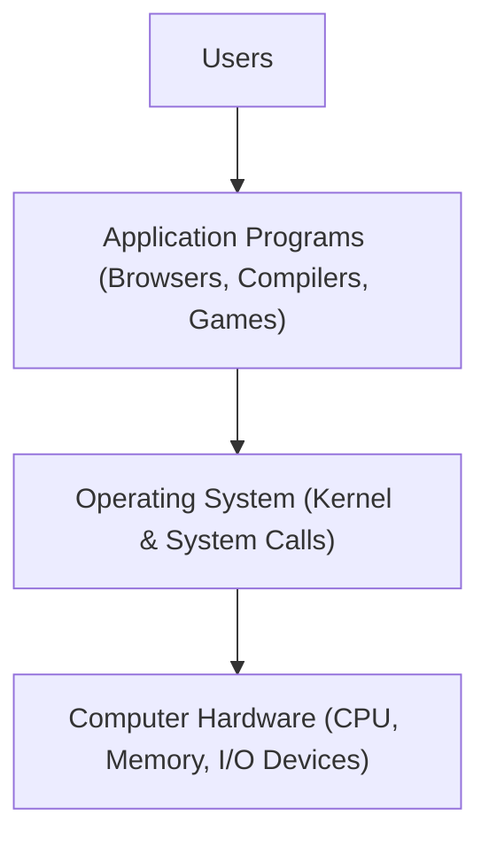
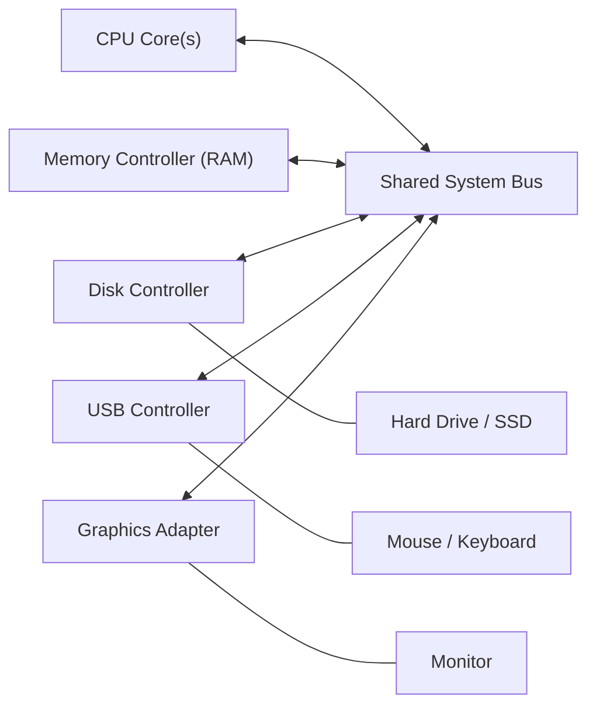
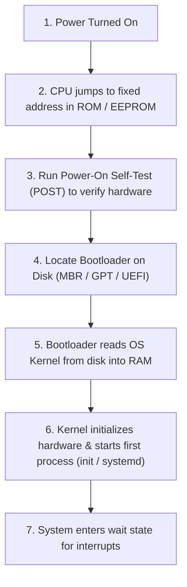
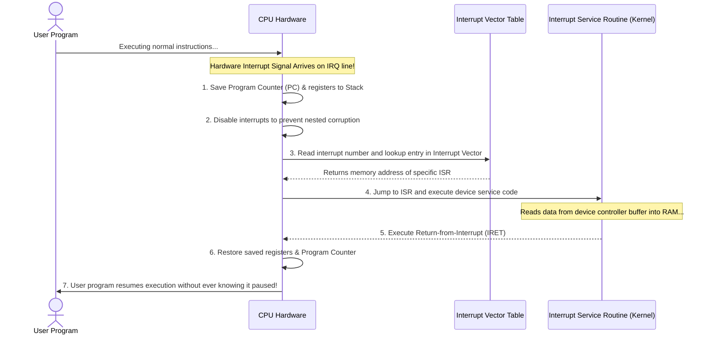
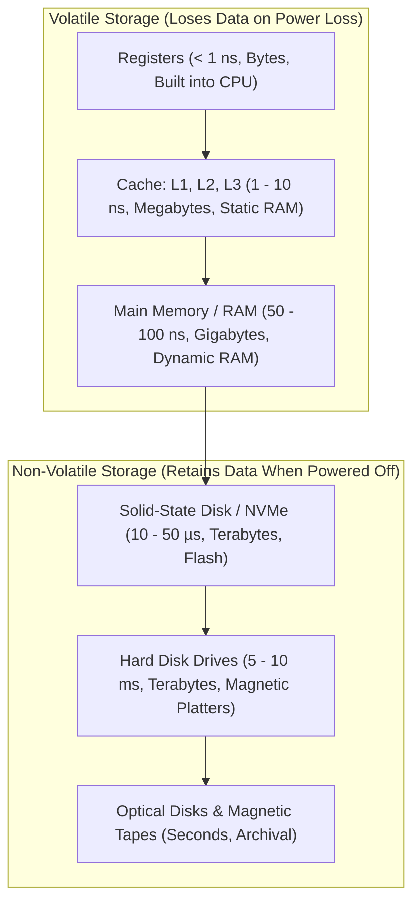
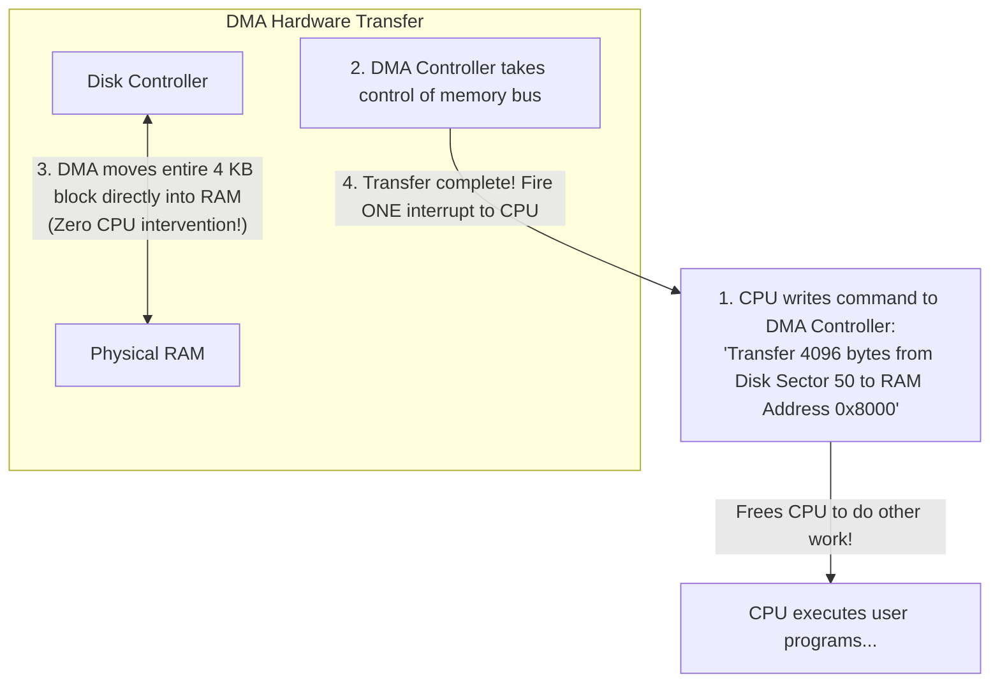

[OS Index](../README.md) / [Unit 1: OS Architecture](Introduction.md)

---

If you open up a computer, you find silicon chips, copper wires, spinning platters or flash cells, and power circuits. None of this hardware knows how to run a web browser, play an audio stream, or compile a C program.

Hardware is just raw computational capability. 

To turn raw silicon into something useful, we need software. And the most fundamental piece of software in any computer is the **operating system**.

---

## What Does an Operating System Actually Do?

Depending on who you ask, an operating system looks completely different:

### 1. The User's View
For an everyday user sitting in front of a laptop or tapping on a smartphone, the OS is designed for **convenience and ease of use**. You don't care how memory bus cycles are scheduled; you care that clicking an icon opens your app instantly, that typing feels responsive, and that your battery lasts through the day.

### 2. The System's View
From the computer's perspective, the operating system is a **resource manager**. 

A computer has finite resources: CPU time, physical memory space, file storage, and I/O devices (network cards, keyboards, displays). When multiple programs run at the same time, they all compete aggressively for these exact same resources.

The OS acts as two things:
- **A Resource Allocator:** It decides who gets CPU time, who gets physical memory frames, and how much disk space each process is allowed to use. It acts as an impartial referee, balancing fairness against system performance.
- **A Control Program:** It supervises the execution of user programs to prevent errors, crash loops, and malicious tampering with hardware or other users' data.

### The Real Definition of an Operating System
If you look at everything installed on your machine, you find compilers, web browsers, text editors, and utilities. Are those part of the operating system?

Technically, no. Computer scientists use a very strict definition:

> **The Operating System is the one program running at all times on the computer.**

Everything else is either a **system program** (utilities shipped with the OS, like the Bash shell or Windows File Explorer) or an **application program** (software written by users, like Chrome or VS Code). The core program that runs permanently in privileged memory from the moment you turn on the computer until it shuts down is called the **kernel**.



---

## How a Computer System is Organized

A modern computer is not one single chip doing all the work. It is a collection of specialized processors connected by a shared communication highway called the **system bus**.



Look at how the components interact:
- One or more **CPUs** execute instructions.
- A **Memory Controller** manages access to main physical RAM.
- Several **Device Controllers** manage specific hardware devices (disks, audio, network, USB).
- Each device controller has its own local buffer storage and a set of special-purpose registers. The disk controller, for example, is actually a tiny specialized microprocessor whose entire job is to spin drive platters and read magnetic sectors.

The CPU and the device controllers all run **concurrently**, competing for access to main memory over the shared bus.

---

## What Happens When You Press the Power Button? (Bootstrapping)

When you first turn on a computer, its RAM is completely blank. The CPU registers are reset to default values. Because main memory is volatile, the operating system kernel isn't in RAM yet!

How does the computer even know what to do?

Through a tiny program called the **Bootstrap Program** (or firmware):



1. **Firmware in ROM/EEPROM:** Because RAM is empty, the CPU is hardwired to jump to a fixed memory address on an onboard non-volatile chip (ROM or flash EEPROM). On modern PCs, this is the **UEFI** (historically BIOS).
2. **POST (Power-On Self-Test):** The firmware tests basic hardware: checks if RAM is present, tests the CPU, and detects attached disks.
3. **Locating the Bootloader:** The firmware searches the boot sector of your storage drive (the Master Boot Record or UEFI partition) to find the **bootloader** (such as GRUB on Linux).
4. **Loading the Kernel:** The bootloader reads the compiled operating system kernel image from disk, uncompresses it, and writes it into physical RAM.
5. **The Kernel Starts Running:** The kernel initializes memory management tables, configures interrupt handlers, detects hardware drivers, and launches the very first user-space process (named `systemd` or `init` in Linux, which always gets Process ID 1).
6. **System Daemons:** Background services (*daemons*) are spawned to handle network connections, printing, and user logins. Once booting is complete, the kernel sits quietly and waits for an event to happen.

How does the outside world signal the kernel that something needs attention?

Through **Interrupts**.

---

## Interrupts: The Heartbeat of an Operating System

An operating system is entirely **event-driven**. If no programs are running, no keys are being pressed, and no network packets are arriving, the CPU halts its execution pipeline and goes to sleep.

The only way to wake up the CPU or notify it of an event is through an **interrupt**.

### Why Not Just Ask the Hardware? (Polling vs. Interrupts)
Imagine if your CPU had to constantly check whether a key was pressed on the keyboard:
```c
while (1) {
    if (keyboard_has_data()) {
        read_key();
    }
}
```
This is called **polling**. It wastes billions of CPU cycles doing nothing but asking "are you ready yet?" over and over again.

Instead, modern computers use **hardware interrupts**: the CPU ignores the keyboard completely and goes about its business. When you finally press a key, the keyboard controller sends an electrical voltage pulse down a dedicated wire on the system bus called the **Interrupt Request (IRQ) line**.

### Hardware Interrupts vs. Software Interrupts (Traps)
Interrupts come from two sources:
1. **Hardware Interrupts:** Triggered by hardware devices outside the CPU (a disk controller signaling a read completed, a network card receiving a packet, or a timer chip ticking).
2. **Software Interrupts (Traps or Exceptions):** Triggered by software instructions executing inside the CPU. Traps happen for two reasons:
   - *An error occurred:* Division by zero, accessing an invalid memory address (segfault), or executing an illegal instruction.
   - *A deliberate request:* A user program explicitly requesting an OS service by issuing a **System Call** (e.g. asking the OS to write data to disk).

---

## How the CPU Handles an Interrupt

When an interrupt fires, the CPU hardware must handle it instantly and seamlessly without corrupting whatever user program was running at that moment:



Look at the critical steps:
1. **Save State:** The CPU immediately pauses execution and pushes the **Program Counter (PC)** and hardware status flags onto the kernel stack. It must record where it was, so it can return later.
2. **Disable Interrupts:** The CPU temporarily disables incoming interrupts so a second interrupt doesn't overwrite the state of the first one before it is saved.
3. **The Interrupt Vector:** Instead of running a slow `switch-case` block in software to figure out what happened, the CPU hardware indexes directly into an array of memory addresses called the **Interrupt Vector Table**.
   - Interrupt 0 $\to$ Divide-by-zero handler
   - Interrupt 14 $\to$ Page fault handler
   - Interrupt 33 $\to$ Keyboard controller handler
   - Interrupt 128 (`0x80`) $\to$ System call handler (in 32-bit Linux)
4. **Execute the ISR:** The CPU jumps to the **Interrupt Service Routine (ISR)** inside the operating system kernel. The ISR reads the incoming bytes from the device controller's local buffer.
5. **Return from Interrupt:** The ISR finishes and executes a special machine instruction (`IRET`). The CPU pops the saved registers and program counter off the stack, and resumes the user program at the exact instruction where it was interrupted.

---

## The Storage Hierarchy

Computers handle many different kinds of storage, and they form a strict hierarchy based on three trade-offs: **speed**, **cost**, and **volatility**.



Notice the dividing line:
- **Volatile Storage:** Registers, Caches, and Main Memory (RAM). They use electrical transistors or capacitors that hold state only while electric current flows. Turn off the power, and their data vanishes instantly.
- **Non-Volatile Storage:** SSDs, HDDs, and magnetic tape. They use flash charges or magnetic orientations that survive power cuts.

And look at the speed gap between levels:
Moving down from registers to magnetic hard disk slows down by a factor of **ten million** ($10^7$). If a register access took 1 second, accessing a spinning hard disk would take over **four months**!

### Caching and Cache Coherency
Because storage at the top of the pyramid is expensive and small, systems rely on **Caching**: copying frequently needed information from a slower, larger storage level into a faster, smaller storage level.

Whenever an instruction requests data, the system first checks the cache:
- If found (**Cache Hit**), access is fast.
- If missing (**Cache Miss**), data is fetched from the slower level and placed into the cache for next time.

In modern multi-core systems, caching creates a major problem called **Cache Coherency**:
If Core 1 and Core 2 each have their own private L1 cache, and both read variable `A = 5` from RAM, what happens when Core 1 updates `A = 10` in its own private cache? Core 2's cache still holds the old stale value `5`! Hardware cache coherency protocols (like MESI) constantly monitor bus traffic so that an update by one core automatically invalidates or updates stale copies in all other caches.

---

## I/O Structure and Direct Memory Access (DMA)

When a computer reads data from a storage drive or receives network packets, how does that data actually move into physical RAM?

In early computers, all I/O was handled by **Interrupt-Driven I/O**:
1. The CPU tells the disk controller: *"Read byte 0."*
2. The controller reads 1 byte into its internal hardware buffer and fires an interrupt.
3. The CPU stops its work, runs the ISR, copies that 1 byte from the controller into RAM, and issues a command for the next byte.

Think about doing that for a 10 GB file:
The CPU would be interrupted **ten billion times**! The entire processing power of the computer would be completely wasted doing nothing but moving bytes from controller pins into RAM.

### The Solution: Direct Memory Access (DMA)
For high-speed I/O devices (disks, NVMe drives, gigabit network cards), modern computers use **Direct Memory Access (DMA)**:



Look at the massive difference:
- Instead of the CPU copying byte by byte, the CPU tells the DMA controller: *"Here is the starting disk sector, here is the destination RAM address, and here is the size (e.g. 4096 bytes). Go do it."*
- The CPU immediately turns around and continues executing user programs!
- The DMA controller takes over the system bus and transfers the **entire block of data directly between the device buffer and physical memory**.
- When the entire 4 KB block is sitting in RAM, the DMA controller fires **one single interrupt** to let the CPU know the transfer is finished.

This drops the interrupt overhead from **one interrupt per byte** down to **one interrupt per block**, freeing 99% of the CPU's time for actual computation.

---

## Key Takeaways

- An operating system acts as a **resource allocator** (fairly distributing CPU, memory, and devices) and a **control program** (preventing errors and illegal access).
- The **Kernel** is the one program running at all times on the machine.
- During **bootstrapping**, the CPU executes firmware (UEFI/BIOS) from ROM, runs hardware self-tests (POST), loads the bootloader from disk, uncompresses the OS kernel into RAM, and launches `init` / `systemd` (PID 1).
- An operating system is **event-driven**, controlled by **hardware interrupts** (from external devices via IRQ lines) and **software traps/exceptions** (from division by zero, segfaults, or deliberate system calls).
- When an interrupt occurs, the CPU saves the Program Counter, disables interrupts, indexes into the **Interrupt Vector Table**, executes the **Interrupt Service Routine (ISR)**, and restores state via `IRET`.
- The storage hierarchy balances speed, cost, and volatility (Registers $\to$ Cache $\to$ RAM $\to$ SSD $\to$ HDD).
- **Direct Memory Access (DMA)** allows high-speed I/O controllers to transfer entire blocks of data directly to physical RAM over the bus, firing only **one interrupt per block** instead of one per byte.

---

Now that we understand how hardware, memory, and interrupts are organized, consider what happens when a computer runs real software:
- How does the CPU ensure that a buggy or malicious user program cannot directly touch hardware controllers, overwrite the interrupt vector, or hijack the machine forever?
- And how do modern operating systems balance multiple CPUs and processor cores running simultaneously?

That brings us to dual-mode protection, timers, and multiprocessor architectures in [**Lecture 2: Computer System Architecture and OS Operations**](L02%20-%20Computer%20System%20Architecture%20and%20OS%20Operations.md).
