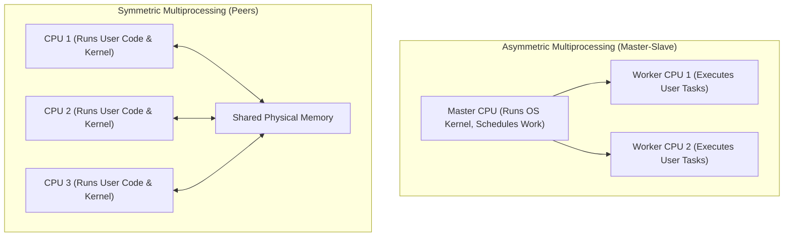
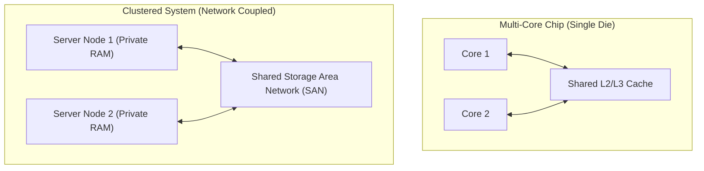
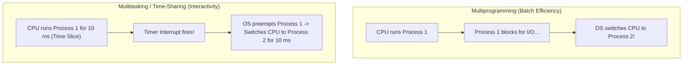
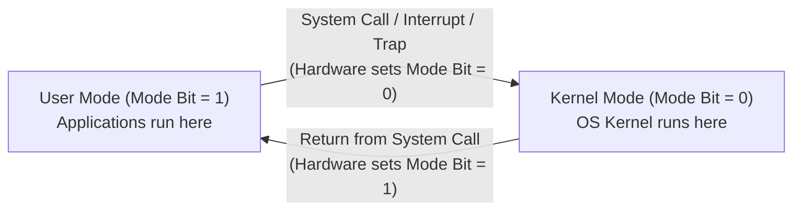
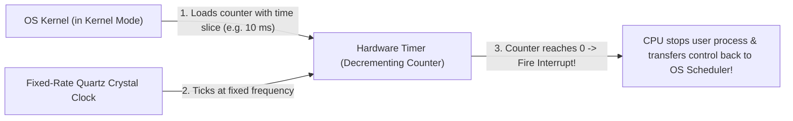

[OS Index](../README.md) / [Unit 1: OS Architecture](Introduction.md)

---

In Lecture 1, we looked at the basic organization of a computer: the CPU, memory, device controllers, and interrupts.

Now we need to look at how computers are structured when we scale up beyond a simple single-processor machine, and more importantly, how the operating system protects the hardware from being crashed, monopolized, or hijacked by user code.

---

## Single-Processor vs. Multiprocessor Systems

When people talk about computer architecture, a common point of confusion is what counts as a "processor."

A modern laptop might have a main CPU, a GPU for graphics, a microprocessor on the NVMe drive, and another controller inside the keyboard. Is that a multiprocessor system?

No. Computer scientists classify a system based on how many **general-purpose processors** it has:

- **General-purpose processor:** Can execute arbitrary user programs and run full instruction sets (like compiling C code or running a browser).
- **Special-purpose processor:** Runs one hardwired, fixed-function task forever. A disk controller's microprocessor only ever schedules disk requests and manages drive arms; it cannot run your homework.

A system with one general-purpose CPU and several specialized controllers is still classified as a **single-processor system**.

---

## Multiprocessor Systems (Parallel / Tightly-Coupled)

A true **multiprocessor system** contains two or more general-purpose processors that share the system bus, clock, physical memory, and peripheral devices. Because they share memory, they are called **tightly-coupled systems**.

They offer three major advantages:

1. **Increased Throughput:** More CPUs can execute more instructions in parallel. But notice an important nuance: adding a second CPU does **not** double your speed. Some CPU time is lost coordinating between processors, managing bus contention, and locking shared data structures.
2. **Economy of Scale:** Multiple processors share the same motherboard, power supplies, cooling, and disk arrays, which is far cheaper than buying separate physical computers.
3. **Increased Reliability (Graceful Degradation):** If you have 10 processors and one burns out, the system does not crash — it continues running at 90% speed. The ability to continue providing service proportional to the remaining surviving hardware is called **graceful degradation** (or *fault tolerance*).

### Two Multiprocessor Models: ASMP vs. SMP

How do multiple processors divide the work of running the operating system and applications?



#### 1. Asymmetric Multiprocessing (ASMP / Master-Slave)
- One master processor runs the operating system kernel and manages the system.
- The worker processors only execute user tasks assigned to them by the master.
- Simple to implement, but the master processor quickly becomes a massive performance bottleneck.

#### 2. Symmetric Multiprocessing (SMP)
- Every processor is a peer; there is no master.
- Each processor runs its own copy of the kernel scheduler and handles its own interrupts.
- All modern operating systems (Linux, Windows, macOS) use SMP.
- *The challenge of SMP:* Because all CPUs share the same physical memory tables simultaneously, two CPUs might try to modify the exact same process queue at the exact same microsecond! Preventing them from corrupting memory is why **concurrency, mutexes, and synchronization** exist (the focus of Unit 2).

---

## Multi-Core Chips, Blade Servers, and Clusters

As computer hardware evolved, multiprocessor systems branched into different packaging forms:



1. **Multi-Core Chips:** Instead of placing multiple bulky CPU chips on a motherboard, engineers place multiple independent execution cores on a **single silicon die**. Because on-chip wires are microscopic, cores communicate significantly faster and consume far less electrical power than separate CPU sockets.
2. **Blade Servers:** Multiple complete, independent motherboards (blades) slotted into a single rack chassis, sharing power supplies and cooling.
3. **Clustered Systems (Loosely-Coupled):** Two or more independent physical computers linked together across a high-speed local network, usually sharing a centralized **Storage Area Network (SAN)**.
   - *Asymmetric Clustering:* One server runs the active application while a standby server does nothing but monitor it. If the active server dies, the hot-standby takes over instantly (high-availability failover).
   - *Symmetric Clustering:* All nodes actively run applications while monitoring each other.

---

## Operating System Structure: Multiprogramming vs. Multitasking

Now let's switch from hardware architecture to how the operating system actually runs software.

In early computers, systems ran one job at a time (**Uniprogramming**). The problem was that programs spend large amounts of time waiting for I/O (reading from disk or waiting for user input). While an app waited for disk platters to spin, the expensive CPU sat completely idle.

Operating systems evolved two strategies to fix this:



### Multiprogramming
- **The Core Idea:** Keep several jobs in physical memory simultaneously.
- When the currently executing job needs to wait (for example, for I/O to complete), the operating system switches the CPU to another job that is ready to run.
- **The Goal:** Maximize **CPU utilization**. Never let the processor sit idle if work exists.
- The user cannot interact with the program while it runs (traditional batch processing).

### Multitasking (Time-Sharing)
- **The Core Idea:** A logical extension of multiprogramming.
- The CPU switches between running processes so rapidly (swapping every 10 to 50 milliseconds) that users can interact with each program while it runs.
- **The Goal:** Maximize **user responsiveness** (interactive computing).
- Gives every user the illusion that they have a dedicated CPU all to themselves.

---

## Dual-Mode Operation: Protecting the Machine

In a multitasking system, multiple user programs share the CPU and memory concurrently. 

This introduces three deadly threats:
1. What stops a user program from modifying the operating system's internal data structures?
2. What stops a user program from directly accessing raw hardware (like wiping sectors off the hard drive)?
3. What stops a buggy program with `while (1);` from monopolizing the CPU forever?

To protect against this, computer hardware provides **Dual-Mode Operation**:

The CPU architecture includes a physical hardware bit called the **Mode Bit**:
- **Kernel Mode (Mode Bit = 0):** Also called *Supervisor Mode*, *System Mode*, or *Privileged Mode*. The CPU can execute every machine instruction and access all physical memory. The operating system kernel runs here.
- **User Mode (Mode Bit = 1):** The CPU executes instructions with strict hardware restrictions. User application programs run here.



### Privileged Instructions
Certain machine instructions are designated by hardware as **Privileged Instructions**:
- Modifying the Mode Bit itself
- Direct I/O device controller instructions (`in`, `out`)
- Modifying base, limit, or page table registers
- Disabling hardware interrupts
- Loading the hardware timer

The CPU hardware enforces a simple rule: **Privileged instructions can ONLY be executed in Kernel Mode (Mode Bit = 0).**

If a user program running in User Mode attempts to execute a privileged instruction (like trying to disable hardware interrupts), the CPU hardware immediately blocks the instruction, generates a **Trap to the OS**, and the OS terminates the process with an illegal instruction fault!

---

## How a System Call Works: Transitioning from User to Kernel Mode

When a user program needs to perform an I/O operation (like writing a file to disk or reading from a socket), it cannot do it directly. It must ask the operating system for help via a **System Call**.

Here is how the transition between modes occurs:

```mermaid
sequenceDiagram
    actor App as User Application (User Mode: 1)
    participant CPU as CPU Hardware
    participant Kernel as OS Kernel (Kernel Mode: 0)
    participant HW as Hardware Controller

    App->>CPU: 1. Invokes System Call (e.g. write() via trap instruction)
    Note over CPU: 2. Hardware trap triggered!<br>CPU flips Mode Bit from 1 to 0 (Kernel Mode)
    CPU->>Kernel: 3. Jumps to System Call Handler in OS Kernel
    Kernel->>Kernel: 4. Verifies parameters & caller permissions
    Kernel->>HW: 5. Executes privileged I/O instruction
    HW-->>Kernel: I/O operation executed
    Kernel->>CPU: 6. Executes Return-from-System-Call
    Note over CPU: 7. CPU flips Mode Bit from 0 to 1 (User Mode)
    CPU->>App: 8. Control returns to user program; execution resumes
```

Notice that the user program never touched the hardware registers. The OS verified permissions, did the work in Kernel Mode on the application's behalf, switched the mode bit back to User Mode, and returned control.

---

## The Hardware Timer: Preventing Infinite Loops

Dual-mode operation stops user programs from executing illegal instructions. But what stops a program that contains a simple infinite loop?

```c
while (1) {
    // infinite loop
}
```

If a user program runs this code on a single CPU, it never issues a system call and never asks for I/O. What forces it to give up the CPU so other programs can run?

The answer is a dedicated piece of hardware: the **Hardware Timer**.



### How the Timer Works:
1. The hardware timer consists of a fixed-rate crystal oscillator and a **decrementing counter register**.
2. Before the OS dispatcher gives the CPU to a user program, the OS loads the counter with a value (for example, corresponding to a **10 millisecond** time slice).
3. **Loading the timer counter is a privileged instruction!** (User code cannot touch it).
4. As the user program executes, the crystal clock ticks, and the counter automatically decrements by 1 on every clock tick.
5. When the counter hits `0`, the timer hardware generates an **Interrupt**.
6. The interrupt immediately pauses the user program, switches the mode bit to Kernel Mode, and transfers control straight back to the OS CPU scheduler!

The scheduler can then save the rogue program's state, pick another process from the ready queue, reload the timer, and let the next process run. 

Without a hardware timer, modern preemptive multitasking would be completely impossible.

---

## Key Takeaways

- A system is classified by its count of **general-purpose processors**, not special-purpose device controllers.
- **Multiprocessor systems (SMP)** share memory, clocks, and bus (tightly-coupled). They provide increased throughput, economies of scale, and **graceful degradation** (continuing to run at reduced capacity when components fail).
- **Asymmetric Multiprocessing (ASMP)** uses a master-slave model; **Symmetric Multiprocessing (SMP)** treats all CPUs as peers running their own kernel schedulers.
- **Multi-core chips** integrate multiple CPUs onto a single silicon die for fast, low-power inter-core communication.
- **Multiprogramming** keeps multiple jobs in memory to maximize **CPU utilization** (switch on I/O block). **Multitasking (Time-Sharing)** switches jobs rapidly on timer intervals to maximize **user responsiveness**.
- **Dual-Mode Operation** uses a hardware **Mode Bit** to separate **User Mode (1)** from **Kernel Mode (0)**.
- **Privileged instructions** (raw I/O, modifying registers, changing mode bits) can only execute in Kernel Mode; executing them in User Mode triggers a hardware trap.
- The **Hardware Timer** decrements with clock ticks and interrupts the CPU when it hits zero, preventing user processes from monopolizing the CPU and enabling preemptive multitasking.

---

Now that we understand how the CPU operates in dual modes and schedules time slices, what does a running program look like inside the operating system?

What services does the kernel provide to software, what is the exact lifecycle of an executing program, and how does the OS track its memory, registers, and files?

That brings us to system services, process memory segments, and process control blocks in [**Lecture 3: OS Services and Process Concept**](L03%20-%20OS%20Services%20and%20Process%20Concept.md).
