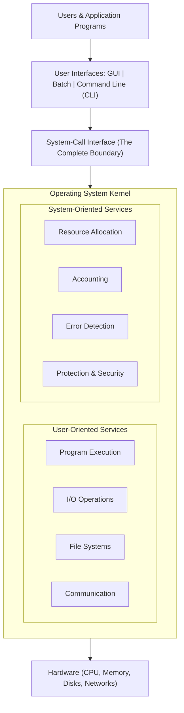
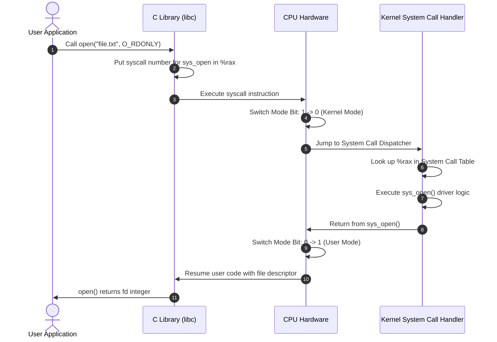
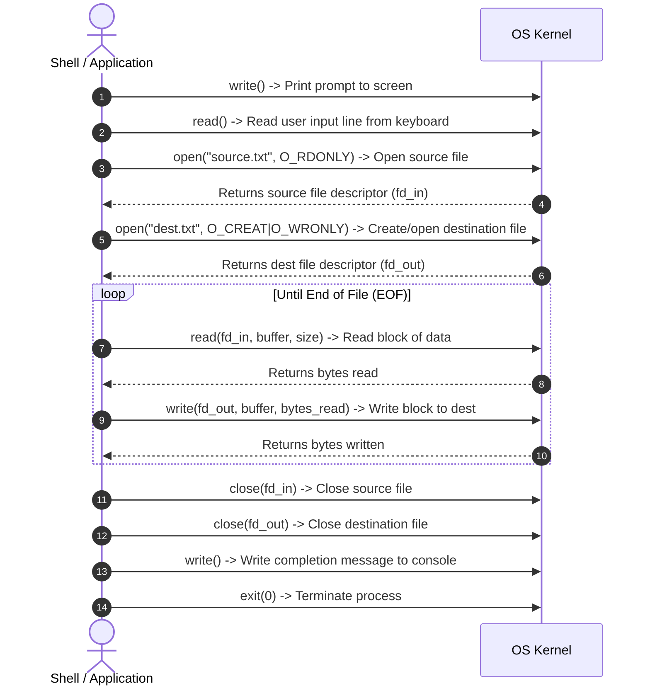
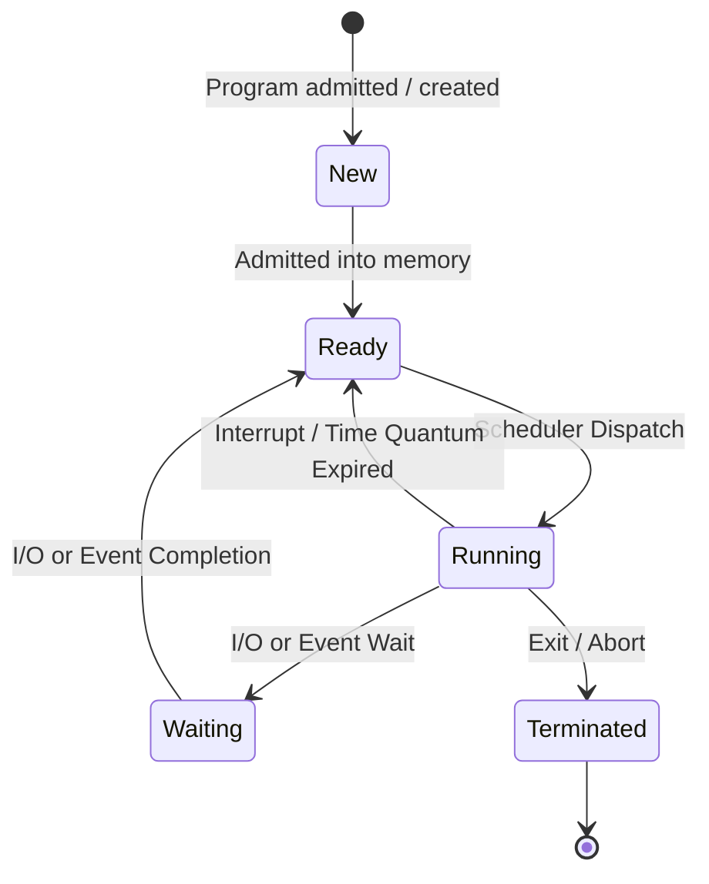
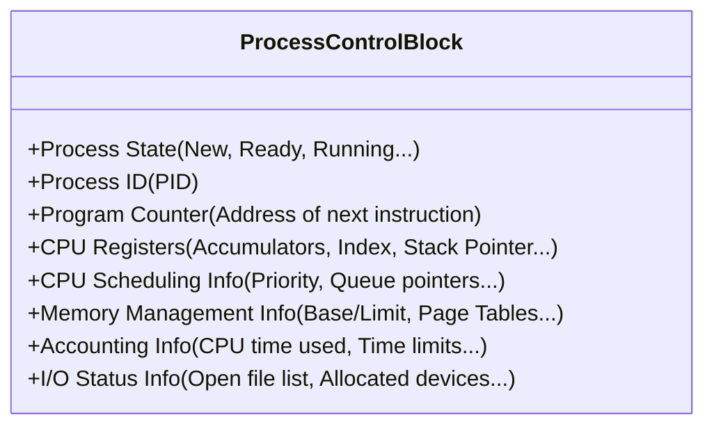
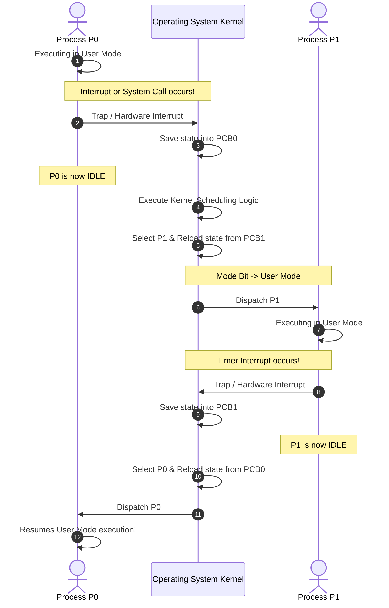
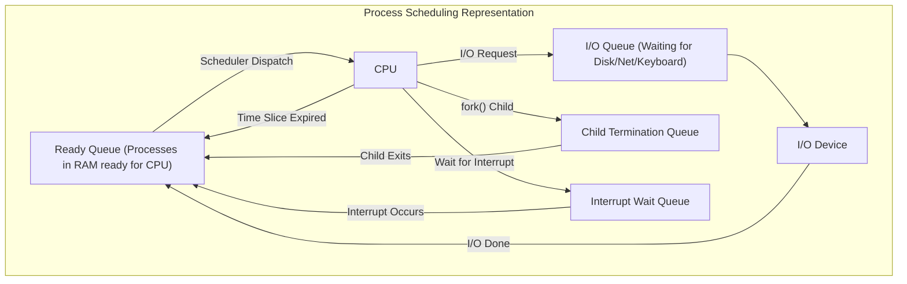
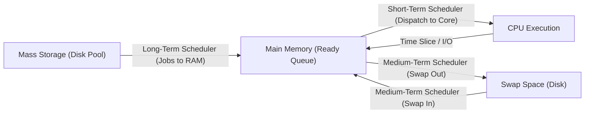
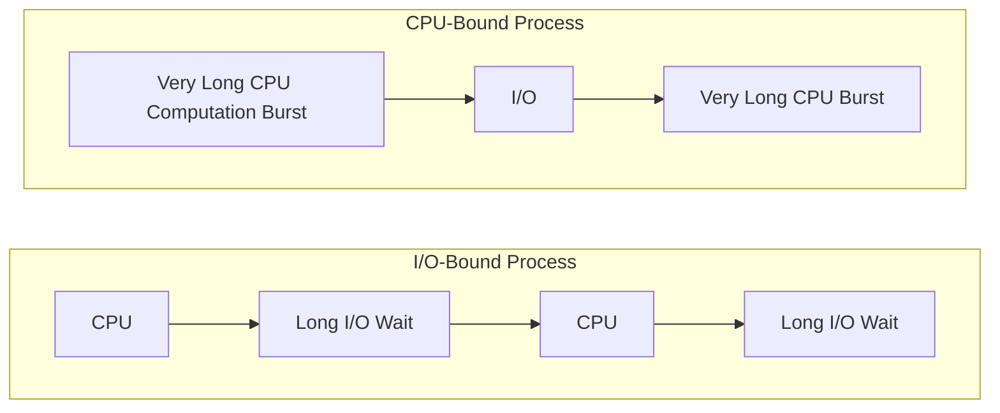

[OS Index](../README.md) / [Unit 1: OS Architecture](Introduction.md)

---

Up to this point, we have explored the machine from the bottom up. We looked at the system bus, interrupts, dual-mode execution, and hardware timers. We know that the hardware enforces boundaries, but we haven't yet looked at what running software actually experiences.

When a program runs, what environment does it live in? What services can it request from the kernel, and how does it ask for them? And more fundamentally: when a program on disk starts running, what does the operating system turn it into?

The answers split cleanly into two halves:
1. **The Operating System View**: What services the OS provides, and the system call interface that acts as the single gateway into those services.
2. **The Process Concept**: What an executing program looks like in memory, the states it passes through, and how the OS tracks and switches between concurrent programs.

---

## A Layered View of Operating System Services

To understand how an operating system is structured, look at the layers sitting between human users and raw physical hardware:



Look closely at where the boundaries lie. This geometry reveals two crucial principles:

1. **The system call interface is an impenetrable horizontal barrier.** There is no backdoor. An application program cannot reach down into memory management, disk drivers, or network stacks without passing through a system call. This is the direct software counterpart of the hardware mode bit we studied earlier: user code runs in user mode, so touching hardware requires trapping across this line into kernel mode.
2. **User interfaces sit entirely above the system call barrier.** The Command Line Interface (CLI), Graphical User Interface (GUI), and batch interpreters are not part of the core kernel. They are simply specialized user programs that take user commands, translate them into system calls, and display results.

---

## The Eight Operating System Services

The services provided by an operating system can be divided into two functional categories: those that make life easier for the programmer, and those that keep the system running smoothly when multiple programs share resources.

### Category 1: Services Helpful to the User

These services provide convenient abstractions so developers do not have to write hardware drivers for every program they build:

1. **User Interface:**
   - **Command-Line Interface (CLI):** Directly accepts typed text commands (e.g., Bash in Linux, PowerShell in Windows). In many systems, the shell is just a normal user-space process that executes system calls.
   - **Graphical User Interface (GUI):** A visual window-and-mouse interface (e.g., macOS, Windows desktop) with icons, menus, and pointers.
   - **Batch Interface:** Commands and input data are submitted in batch scripts or card decks without interactive human intervention.
2. **Program Execution:**
   - The OS must be able to load an executable file from disk into RAM, allocate memory segments, initialize program counters and registers, handle execution, and safely clean up resources when the program terminates (normally or abnormally).
3. **I/O Operations:**
   - Running programs frequently require input and output from files, disks, network interfaces, keyboards, or displays. Because direct hardware manipulation requires privileged instructions, the OS provides standardized functions (like reading a block or writing a packet) that mask device-specific controller quirks.
4. **File-System Manipulation:**
   - Programs need to create, delete, read, write, search, and list files and directories. The file system provides a hierarchical, named abstraction over raw, unformatted disk sectors, while also enforcing ownership and access permission rules.
5. **Communications:**
   - Processes often need to exchange data, either on the same computer or across a network. The OS supports this via two primary models:
     - **Shared Memory:** Two or more processes map the same physical memory frames into their address spaces, reading and writing shared buffers directly without kernel intervention.
     - **Message Passing:** Packets of information are moved between processes through kernel buffers using system calls like `send()` and `receive()`.
6. **Error Detection:**
   - The OS must constantly watch for errors across all levels of the computer:
     - *Hardware errors:* Memory parity failures, power drops, CPU overheating, or bad disk sectors.
     - *I/O device errors:* Printer out of paper, network connection dropped, or disk write timeouts.
     - *User software errors:* Division by zero, illegal memory access (segmentation faults), or attempting to execute a privileged instruction in user mode.
   - For every error, the OS must take consistent corrective action to ensure computing integrity, ranging from logging the issue, to retrying disk operations, to terminating an offending process and generating a core dump without crashing the machine.

### Category 2: Services for Ensuring Efficient System Operation

These services operate behind the scenes to maintain system stability, efficiency, and fairness:

1. **Resource Allocation:**
   - When multiple users or jobs run concurrently, the OS arbitrates the allocation of finite resources: CPU cycles, physical memory pages, disk storage blocks, and I/O channels. Schedulers determine which process gets the CPU and for how long.
2. **Accounting:**
   - The OS keeps detailed records of which users and processes consume how much and what kinds of computer resources (CPU time, memory footprint, disk usage). This data is used for billing in cloud computing environments and for capacity planning and performance tuning.
3. **Protection and Security:**
   - In a multi-user, multi-process environment, processes must not interfere with each other or with the operating system itself.
   - **Protection:** Mechanisms that control access of processes or users to system resources (e.g., ensuring memory spaces and file handles are isolated).
   - **Security:** Defending the system against external threats (e.g., authenticating users via passwords/keys, defending against malicious network packets, and preventing unauthorized hardware access).

---

## System Calls: The Gateway to the Kernel

A **system call** is the programmatic interface by which an application requests a service from the operating system kernel.

Most application programmers rarely write raw assembly-level system call instructions (such as `syscall` on x86-64 or `svc` on ARM). Instead, they program against standard **Application Programming Interfaces (APIs)**:


### Why Use APIs Instead of Direct System Calls?
1. **Portability:** If you program to the standard POSIX API, your code will compile and run on Linux, macOS, FreeBSD, and Solaris without modification, even though their underlying kernel system call tables and calling conventions differ.
2. **Simplicity:** High-level API wrappers handle complex setup. For example, the C library function `printf()` formats strings, manages user-space I/O buffers, and invokes the raw `write()` system call only when necessary, saving thousands of expensive kernel mode transitions.

The three most common system call APIs are:
- **POSIX API:** Standard for Unix-based systems (Linux, macOS, BSD, Solaris).
- **Windows API (Win32 / Win64):** Standard for Microsoft Windows systems.
- **Java API:** Runs inside the Java Virtual Machine (JVM), which translates Java calls into host-specific system calls.

---

## How System Calls Work Mechanistically

When a user program invokes an API function that requires kernel services:

1. The API wrapper places the unique **system call number** into a designated CPU register (e.g., `rax` in x86-64).
2. The program executes a software interrupt or trap instruction (`syscall` or `sysenter`).
3. Hardware switches the CPU **Mode Bit** from User Mode (`1`) to Kernel Mode (`0`), saves the user's instruction pointer and stack pointer, and jumps to a fixed address in the kernel: the **System Call Handler**.
4. The kernel inspects the number, indexes into the **System Call Table** (an array of function pointers stored in kernel memory), and invokes the matching internal kernel function (e.g., `sys_read()`, `sys_fork()`).
5. Once the kernel function finishes, the kernel writes the return value into a register, restores the user's saved context, sets the Mode Bit back to User Mode (`1`), and executes the return-from-trap instruction (`sysret` or `iret`).



### How Parameters are Passed to the Kernel
Operating systems use three general methods to pass parameters from user applications to the kernel:

1. **Pass in Registers:** The simplest and fastest method. Parameters are loaded directly into general-purpose CPU registers (e.g., `rdi`, `rsi`, `rdx`). 
2. **Pass in a Memory Block/Table:** When there are more parameters than available registers, parameters are stored in a contiguous block in user memory, and a pointer to that block is passed in a single register. This approach is used by Linux and Solaris for complex system calls.
3. **Pass on the Stack:** Parameters are pushed onto the program stack by the user program, and popped off by the operating system kernel.

---

## The Six Categories of System Calls

System calls fall into six broad functional categories:

| Category | Purpose | Linux / POSIX Example | Windows Example |
| :--- | :--- | :--- | :--- |
| **Process Control** | End, abort, create, terminate processes; get/set process attributes; wait for time, wait for event, signal event; allocate/free memory. | `fork()`, `exec()`, `exit()`, `wait()`, `brk()` | `CreateProcess()`, `ExitProcess()`, `WaitForSingleObject()` |
| **File Manipulation** | Create file, delete file, open, close, read, write, reposition pointer, get/set file attributes. | `open()`, `read()`, `write()`, `close()`, `lseek()` | `CreateFile()`, `ReadFile()`, `WriteFile()`, `CloseHandle()` |
| **Device Manipulation**| Request device, release device, read, write, reposition, get/set device attributes, logically attach/detach. | `ioctl()`, `read()`, `write()` | `SetConsoleMode()`, `ReadConsole()`, `WriteConsole()` |
| **Information Maintenance** | Get/set time or date, get/set system data, get/set process, file, or device attributes. | `time()`, `date()`, `getpid()`, `alarm()`, `sleep()` | `GetCurrentProcessId()`, `SetTimer()`, `GetSystemTime()` |
| **Communications** | Create/delete communication connection, send/receive messages, transfer status info, attach/detach remote devices. | `pipe()`, `shmget()`, `socket()`, `recv()`, `send()` | `CreatePipe()`, `CreateFileMapping()`, `MapViewOfFile()` |
| **Protection** | Get/set file permissions, control resource access. | `chmod()`, `chown()`, `umask()` | `SetSecurityDescriptorInfo()`, `InitializeSecurityDescriptor()` |

### Tracing a Simple System Call Sequence: Copying a File
To appreciate how many system calls lie beneath an everyday command, trace what happens when you run a utility to copy one file to another (`cp source.txt dest.txt`):



Notice something remarkable: even a trivial operation like copying text involves over a dozen distinct interactions with the kernel.

---

## The Process Concept

Now we arrive at the central abstraction of operating systems: the **Process**.

### Program vs. Process: Passive vs. Active
Students often confuse a program with a process, but they are fundamentally distinct:

- A **Program** is a **passive entity**. It is an inert sequence of compiled machine instructions and static data sitting on a secondary storage disk (e.g., an executable file like `/bin/ls` or `python.exe`). It consumes no CPU cycles, no RAM, and does not change.
- A **Process** is an **active entity**. It is a program in execution. It has an active program counter pointing to the current instruction, CPU registers loaded with live variables, and assigned regions of main memory.

> Think of a program as a recipe in a cookbook sitting on a shelf. A process is the cook actively reading the recipe, mixing ingredients, and using the stove.

Because a program is just passive instructions, **multiple processes can run the exact same program simultaneously**. If four users open their own terminals and run `python`, there is only one `python` binary on disk, but four completely independent processes exist in memory, each with its own program counter, its own stack, and its own private variables.

---

## Structure of a Process in Memory

When the OS loads an executable program into physical memory, it structures the process into distinct functional segments:

```mermaid
flowchart TD
    subgraph ADDR_SPACE["Process Virtual Address Space"]
        direction TB
        HIGH["High Memory Addresses (0xFFFFFFFF / 0x7FFFFFFFFFFF)"]
        STACK["Stack (grows downward)"]
        GAP["Unallocated Free Address Space"]
        HEAP["Heap (grows upward)"]
        BSS["Uninitialized Data Segment (.bss)"]
        DATA["Initialized Data Segment (.data)"]
        TEXT["Text Segment (Compiled Machine Code - Read-Only)"]
        LOW["Low Memory Addresses (0x00000000)"]
    end
    
    HIGH --- STACK
    STACK -->|"pushes grow down"| GAP
    GAP <--|"allocations grow up"| HEAP
    HEAP --- BSS
    BSS --- DATA
    DATA --- TEXT
    TEXT --- LOW
```

Let's dissect each of these segments:

1. **Text Segment:**
   - Contains the compiled executable machine code instructions.
   - Typically marked as **read-only** by the hardware MMU to prevent a process from accidentally modifying its own code.
   - If multiple instances of the same program run at once, they can safely share this identical physical memory segment.
2. **Data Segment (Initialized Data):**
   - Stores global variables and static variables that have been explicitly initialized with non-zero values by the programmer (e.g., `int max_users = 100;`).
3. **BSS Segment (Uninitialized Data):**
   - Historically named *"Block Started by Symbol"*.
   - Holds global and static variables that are uninitialized or initialized to zero (e.g., `static int buffer[1024];`).
   - The executable file on disk does not need to store thousands of zeros; it simply stores the required size. The kernel zeroes this memory when loading the process.
4. **Heap Segment:**
   - Memory dynamically allocated at runtime.
   - In C, this is managed via `malloc()`, `calloc()`, `realloc()`, and `free()`; in C++ and Java, via `new`.
   - The heap begins immediately after the BSS segment and **grows upward** toward higher memory addresses as more dynamic memory is requested. The boundary is expanded using system calls like `brk()` and `sbrk()`.
5. **Stack Segment:**
   - Contains temporary data used during function execution, known as **Stack Frames (Activation Records)**.
   - Each stack frame stores:
     - Function parameters and arguments.
     - Local (automatic) variables.
     - The return address (where the CPU must resume execution after the function finishes).
     - Saved register states of the caller.
   - The stack starts at the top of the virtual address space and **grows downward** toward lower memory addresses. When a function is called, a frame is pushed; when it returns, the frame is popped.

Notice the unallocated gap between the Heap and Stack. By growing toward each other from opposite ends of memory, neither segment needs a rigid predefined size. As long as they don't collide, both can expand dynamically.

---

## Process States

As a process executes, its internal condition changes. A process moves through a series of discrete states during its lifetime:



### The Five States:
1. **New:** The process is currently being created and initialized by the operating system, but has not yet been loaded into the pool of executable processes.
2. **Ready:** The process is residing in main memory and possesses all resources it needs to execute (code, memory, open files), waiting only for CPU time.
3. **Running:** The process's instructions are actively being executed on a CPU core. (On a single-core CPU, only one process can ever be in the Running state at any instant).
4. **Waiting (Blocked):** The process cannot execute until some external event occurs—such as completion of an I/O transfer, arrival of a network packet, or reception of a signal.
5. **Terminated:** The process has finished executing its code (or was killed by an error/signal) and is waiting for the OS to reclaim its resources.

### Can a Process Move Directly from Waiting to Running?
This is a classic exam and interview question: **Can a process go straight from Waiting to Running?**

The answer is an emphatic **NO**.

When a blocked process finishes its I/O operation (e.g., the disk controller signals an interrupt indicating that data has arrived in RAM), the OS moves that process to the **Ready state**, not the Running state. 

Why? Because the CPU is almost certainly busy running another process at that exact microsecond! The newly unblocked process must wait in the Ready Queue until the CPU scheduler selects it and dispatches it onto the CPU.

---

## Process Control Block (PCB)

An operating system needs a way to track, manage, and switch between dozens or hundreds of processes. To do this, the kernel maintains an internal data structure for every active process: the **Process Control Block (PCB)** (also called a **Task Control Block** in Linux).



The PCB is the complete identity of a process. It contains:

- **Process State:** Current state (Ready, Running, Waiting, etc.).
- **Process ID (PID):** A unique integer identifying the process across the system.
- **Program Counter (PC):** The memory address of the next instruction to be executed for this process.
- **CPU Registers:** A snapshot of all architecture-specific hardware registers: accumulator, index registers, stack pointer (`SP`), general-purpose registers, and condition flags. When a process is paused, these registers are copied into the PCB so they can be restored later.
- **CPU Scheduling Information:** Process priority, pointers to scheduling queues, and other scheduling parameters.
- **Memory-Management Information:** Pointers to the process's page tables or segment tables, and the base/limit register values defining its virtual memory boundaries.
- **Accounting Information:** Amount of CPU time used, clock time elapsed, memory limits, and account numbers.
- **I/O Status Information:** The list of I/O devices allocated to this process and a table of open file descriptors.

---

## Context Switching: The Mechanics of Switching CPUs

When the CPU switches from running Process $P_0$ to Process $P_1$, the system must save the state of $P_0$ into its PCB and load the saved state of $P_1$ from its PCB. This operation is called a **Context Switch**.



### The Cost of a Context Switch: Pure Overhead
A context switch is **pure computational overhead**. During the switch, the CPU is executing kernel dispatch routines and copying register values; it is doing zero productive work on user programs.

The overhead of a context switch comes in two forms:

1. **Direct Overhead:**
   - Saving all general-purpose registers, program counter, and stack pointer to memory.
   - Updating PCB status fields and queue pointers.
   - Selecting the next process and loading its registers from memory into hardware.
   - Typically takes several microseconds on modern CPUs.
2. **Indirect Overhead (Cache & Memory Effects):**
   - **Cache Pollution:** While $P_0$ was running, the CPU's high-speed L1, L2, and L3 caches were filled with $P_0$'s data and instructions. When $P_1$ begins running, its data is not in cache, leading to a flood of expensive memory cache misses until the cache is "warmed up".
   - **TLB Invalidation:** The Translation Lookaside Buffer (TLB), which caches virtual-to-physical address mappings, must be flushed or tagged with Address Space Identifiers (ASIDs) so $P_1$ does not access $P_0$'s physical translations.

### Hardware Support for Context Switching
To minimize direct overhead, some CPU architectures provide **multiple hardware register sets** (e.g., Sun UltraSPARC). 

In such processors, multiple processes can maintain their registers in distinct hardware sets simultaneously. A context switch simply involves changing an internal CPU register pointer to point to the new register set, rather than copying dozens of 64-bit registers to and from RAM.

---

## Process Scheduling Queues

As processes enter the system, they are placed into various **scheduling queues** managed by the kernel:



1. **Job Queue:**
   - Consists of all processes entering the system.
2. **Ready Queue:**
   - The set of all processes residing in main physical memory, ready and waiting for the CPU scheduler to dispatch them. Usually implemented as a linked list of PCB pointers.
3. **Device Queues:**
   - When a process issues an I/O request (such as reading a file from disk), it cannot use the CPU. It is removed from the Ready Queue and placed in the **Device Queue** dedicated to that specific device (e.g., Disk Controller Queue, Network Adapter Queue). Each device maintains its own queue.

---

## The Three Schedulers and the Process Mix

Operating systems use different schedulers operating across distinct time scales to move processes between queues:



### 1. Long-Term Scheduler (Job Scheduler)
- **Role:** Selects jobs from a storage pool on disk and loads them into physical memory for execution.
- **Frequency:** Executes **infrequently** (seconds or minutes).
- **Core Responsibility:** Controls the **Degree of Multiprogramming** (the total number of processes currently residing in main memory).
- If the degree of multiprogramming is stable, the long-term scheduler only needs to invoke when an existing process terminates.

### 2. Short-Term Scheduler (CPU Scheduler)
- **Role:** Selects from among the processes residing in memory that are ready to run, and allocates a CPU core to one of them.
- **Frequency:** Executes **very frequently** (every 10 to 100 milliseconds).
- **Speed Constraint:** Must be exceptionally fast! If selecting a process takes 1 millisecond and the process runs for 9 milliseconds, $\frac{1}{10} = 10\%$ of CPU time is wasted on scheduling logic alone.

### 3. Medium-Term Scheduler (Swapper)
- **Role:** Temporarily removes processes from main memory to disk, and brings them back later.
- **Core Responsibility:** Reduces the **degree of multiprogramming** when physical RAM is overcommitted.
- If physical memory runs low and processes start thrashing (competing constantly for memory frames), the medium-term scheduler picks an inactive or waiting process, **swaps it out** to secondary disk swap space, and frees its memory for active processes. Later, when memory pressure subsides, the process is **swapped in** and resumed.

### Summary Comparison of the Three Schedulers

| Feature | Long-Term Scheduler | Short-Term Scheduler | Medium-Term Scheduler |
| :--- | :--- | :--- | :--- |
| **Common Name** | Job Scheduler | CPU Scheduler | Swapper |
| **Speed / Frequency** | Very slow (seconds/minutes) | Extremely fast (milliseconds) | Medium (seconds) |
| **State Transition** | `New` $\rightarrow$ `Ready` | `Ready` $\rightarrow$ `Running` | `Ready/Waiting` $\leftrightarrow$ `Swapped (Suspended)` |
| **Primary Goal** | Controls degree of multiprogramming | Selects which process gets CPU next | Relieves physical memory pressure |
| **Presence** | Minimal/absent in modern time-sharing | Present in all modern systems | Present in systems using swapping/paging |

---

## Balancing the Process Mix: I/O-Bound vs. CPU-Bound

For an operating system to achieve maximum hardware utilization, the Long-Term Scheduler must strive for a good **Process Mix**.

Processes exhibit two distinct execution profiles:



- **I/O-Bound Process:**
  - Spends significantly more time doing I/O operations than doing computations.
  - Characterized by **short CPU bursts** followed by frequent, long I/O waits.
  - Examples: Text editors, database queries, web browsers.
- **CPU-Bound Process:**
  - Spends almost all its time performing computations.
  - Characterized by **infrequent, very long CPU bursts** and rare I/O requests.
  - Examples: Scientific simulations, matrix multiplications, video rendering.

### Why Balance Matters
- If all processes in memory are **I/O-bound**, they will all sit in device queues waiting for disks and network sockets. The Ready Queue becomes empty, and the CPU sits completely idle.
- If all processes in memory are **CPU-bound**, they will constantly monopolize the CPU cores. The device queues will sit completely empty, leaving expensive I/O hardware idle and causing interactive responsiveness to tank.

A well-designed operating system balances both types: keeping the CPU saturated with computational work while ensuring I/O controllers stay fully utilized processing requests.

---

## Key Takeaways

- Operating system services are accessed exclusively through the **System Call Interface**, which acts as a strict boundary between unprivileged user code and privileged kernel mode.
- System calls fall into six categories: **Process Control**, **File Manipulation**, **Device Manipulation**, **Information Maintenance**, **Communications**, and **Protection**.
- A **Program** is a passive collection of bytes on disk; a **Process** is an active entity in execution with its own address space, registers, program counter, and state.
- A process's memory layout consists of:
  - **Text:** Read-only executable code.
  - **Data:** Initialized global and static variables.
  - **BSS:** Zero-initialized global and static variables.
  - **Heap:** Dynamically allocated memory growing upward.
  - **Stack:** Local variables, parameters, and return addresses growing downward.
- The five process states are **New**, **Ready**, **Running**, **Waiting**, and **Terminated**. A process returning from an I/O wait enters the **Ready** queue, never the Running state directly.
- The **PCB (Process Control Block)** represents the entire state of a process in kernel memory.
- A **Context Switch** saves the active process state to its PCB and loads the newly scheduled process state. It is pure overhead, aggravated by CPU cache pollution and TLB invalidation.
- The **Long-Term Scheduler** controls the degree of multiprogramming; the **Short-Term Scheduler** chooses which ready process gets the CPU; the **Medium-Term Scheduler** swaps processes out to disk to relieve memory pressure.

---

Now that we understand what a process looks like in memory, how its state is tracked in a PCB, and how schedulers queue it up, how does an operating system actually create and destroy these processes in real code?

How does a parent process spawn a child, how do system calls like `fork()`, `exec()`, and `wait()` work under the hood, and what happens when a process terminates before its parent is ready?

That brings us to process lifecycles and process control system calls in [**Lecture 4: Process Creation, Termination, and System Calls**](L04%20-%20Process%20Creation,%20Termination,%20and%20System%20Calls.md).
